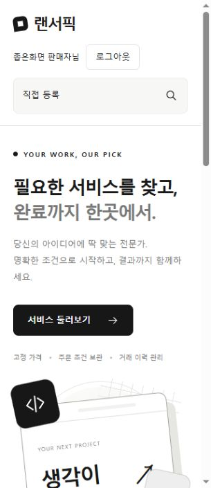
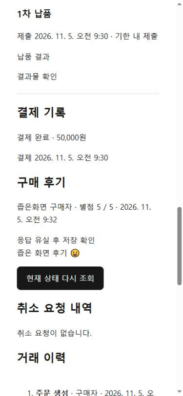

# 변경 이력과 설계 결정

[목차](README.md) · [현재 진행](project-progress.md) · [현재 설계](architecture.md) · [기능 명세](features.md)

## 기록 해석

<a id="v3-representative-trade-check"></a>
### 대표 V3 거래 실서버·브라우저 확인 — 2026-11-11

정은찬, main `2fd0d2f`(#194), Playwright Chromium·MySQL 8.4(개인 개발 DB, Flyway V13 검증 통과). [남은 검증 공지](#verification-notice)의 발표 후보 필수 항목 중 대표 V3 거래 1건과 리팩터링·디자인으로 바뀐 화면 흐름(#175·#177·#186·#187·#194)을 실서버로 확인했다. 기본 설정으로 백엔드(`bootRun`)와 Vite를 실행했고, 계정은 `docs/sql/seed-manual-trade-demo.sql`로 만든 공개 테스트 계정(구매자 demo.b #17, 판매자 demo.a #16)을 서로 분리한 브라우저 세션에서 썼다. 코드·설정 변경과 실패 항목은 없다.

| 항목 | 결과 |
| --- | --- |
| 주문 생성·수락 | 1만원 상품 #6으로 주문 #59 생성(`CONTRACT_V3`, 수락 대기) → 판매자 수락 → 계약 서명 대기 |
| 전자계약(#194) | 특약을 넣은 초안 저장 → PDF 생성 → 서명 대기. PDF를 받기 전에는 동의 체크가 비활성이고 받은 뒤 활성화. 원문이 거래 정보·당사자·금액·서비스·본문/특약 다섯 영역으로 표시. 양측 서명 2/2 후 결제 대기. 내려받은 PDF의 SHA-256이 `order_contracts.file_hash`와 일치, `contract_signatures` 2행 |
| 결제·보관 | 구매자 결제 → 진행 중, 보관금 10,000원·납기 표시. DB `payments` PAID 1행·`order_funds` HELD |
| 주문 채팅(#175·#187·#194) | 실시간 연결 상태에서 CDP 조합 이벤트로 `안녕하세요`를 입력해 중복 없이 유지, Enter 전송. 판매자 답장이 구매자 화면에 새로고침 없이 표시. `order_chat_messages`는 메시지당 1행(순번 1·2). 구매 확정 후 대화는 조회 전용 안내로 바뀜 |
| 납품·구매 확정 | 판매자 1차 납품(기한 내) → 납품 확인 대기·검수 응답 기한 표시 → 구매자 구매 확정. 화면에 수수료 1,000원·판매자 적립금 지급 9,000원 |
| 금액 대조 | 원장 `PAYMENT:38` −10,000(구매자 990,000원)·`SELLER_PAYOUT:38` +9,000(판매자 1,009,000원), `order_funds` RELEASED, 정산 NORMAL(1000 bps, 1,000/9,000) |
| 판매 수익(#159·#186) | 판매자 화면에서 주문번호 59 검색 1건, 결제액·수수료·수익 9,000원과 "적립금 지급 완료" 일치 |
| 320px 거래 상세(#186) | 납품 확인 대기 상태에서 거래 진행·계약·조건·거래 기록 세 탭 모두 가로 넘침 없음 |
| 충전 위젯(#177) | 10,000원 → 결제 수단 단계에서 토스 위젯(결제 수단·약관) 표시, 금액 변경으로 돌아가 30,000원 선택 후 다시 준비해도 위젯 2개만 있고 요약이 30,000원. 결제 승인은 하지 않음 |
| 같은 탭 계정 전환(#175) | 구매자 로그아웃 시 대화창이 닫히고 비로그인 메뉴로 전환. 같은 탭에서 판매자로 로그인하면 대화 상대·나/상대방 표시가 판매자 기준으로 바뀜 |

- 관찰(확인 필요): 1440px에서 메시지 사이드바(#187)가 열려 있으면 오른쪽 약 780px을 덮어 헤더의 로그아웃 버튼을 누를 수 없다. 사이드바를 닫으면 정상이다. 서랍형 패널의 의도인지 황준범 확인 후 결정한다.
- 한계: 한글 입력은 실제 OS 입력기가 아닌 CDP 조합 이벤트다. 채팅 미확정 재전송(네트워크 단절), 로그아웃 시 이전 채팅 소켓 종료의 직접 관찰, 실제 토스 승인, 48시간·7일 타이머 경과는 확인하지 않았다. 후보 SHA 고정과 그 SHA의 원격 CI는 별도다.
- 개인 DB에 테스트 계정 2개·상품 4개·주문 #59 기록이 남아 있다. 문서만 변경(실행 검증 결과 기록).

<a id="verification-notice"></a>
### 남은 검증 전체 검토와 조원 공지 — 2026-11-10, 문서 정리

정은찬, main `80d1f5b` 기준. 개인 MVP 35/35와 고도화 PR(#149~#179)이 모두 main에 반영돼 다른 조원의 미병합 브랜치는 없다. 남은 일은 구현이 아니라 실제 환경 검증이다. [진행·예정·보류 작업](project-progress.md#remaining)·[활성화 기준](project-progress.md#activation-gate)·각 PR 검증 기록을 대조하고 Codex 읽기 전용 반박 검토를 받아 아래처럼 정리했다. 분류와 기한은 **조장 제안**이며 새 팀 합의가 아니다.

- **발표 후보 전 필수(11/11까지, 정은찬 주관)**: 후보 SHA 고정 → 그 SHA의 원격 CI → 대표 V3 거래 1건 실서버·브라우저(황준범 참여, G1 승계) → #175 채팅 발송·재전송·계정 전환, #177 충전 위젯 흐름 확인. 전원: 최신 main을 각자 PC에서 실행·DB V13 적용 확인(발표 환경·팀원 재현).
- **담당별 확인 제안(11/11까지)**
  - 김창재: K6 재처리 화면에서 충전 재확인·Batch 재시작·PDF 재생성 실제 실행과 감사 이력(#168). 재처리 칸은 후보일 때만 보이므로(충전 `PROCESSING`/`UNKNOWN`, 재시작 가능한 복구 실행은 `TOPUP_RECOVERY_ENABLED=true` 필요, 생성 후보 계약 PDF) 개인 DB에 후보 상태를 먼저 준비하고, 준비하지 못한 명령은 확인 범위에서 빼고 적는다([화면 조건](features.md#admin-reprocessing-api)). 아이디 안내(#155)·이메일 인증 전환(#162)은 Mailpit으로 확인. #149 알림 처리 실패 조회·#151 운영 대시보드는 각 PR 검증 기록을 확인해 실서버·브라우저 남은 범위를 정한다.
  - 황준범: 판매 수익 검색·지급 구분(#159) 실서버 브라우저(지금까지 API 대역), 메일 결과 정리(#166) Mailpit 확인, K6 실행 시 토스·Batch·PDF 기반 결과. #157 제재 화면은 U7·U8 확인이 끝났고([기록](#sanction-screen-check)) 보안 잠금 시 기존 소켓 폐기·모바일만 남았다. #163 재시도는 격리 DB·스케줄러·중복 방지 확인이 끝났고 개인 DB·장애 중 종료·다중 서버는 범위 밖이다. G4 320px은 [확인 기록](#gate)이 있어 발표 후보에서 영향 범위만 다시 본다.
  - 박소현: 이번 공지에서 별도 배정 없음. 대표 거래 리허설에서 상품·후기 화면을 함께 본다.
- **이미 확인되어 다시 배정하지 않음**: #156 비밀번호 권고 알림(실서버·브라우저 확인), E5 계정 전환 캐시, #157 U7·U8 화면 적용.
- **이번 검증에서 생략**: 배포(기존 보류), 실제 48시간·7일 경과(DB 시각 조정으로 대체), 실기기·모든 브라우저 조합, 실제 SMTP 운영 발송, Redis·C5(발표 범위 제외), 추가 디자인 개선(웹 디자인 작업으로 11/12까지 별도 진행).
- 결과 공유: 날짜·확인한 main SHA·시나리오·성공/실패·실패 시 traceId를 조장에게 보내면 이 문서에 반영한다. 결함은 `fix/*` PR.
- 실행 검증 없음(문서만 변경).

<a id="showcase-browser-verification"></a>
### 로컬 서버·브라우저 검증 — 2026-11-11

박소현, main `5f089c3`(#182), Edge·MySQL 8.0.46. 개인 PC에서 백엔드와 Vite를 실행하고 Flyway V13의 성공 기록을 확인했다. 팀에서 공유한 화면 확인용 데이터를 로컬 개발 DB에 넣어 로그인·상품 상세·후기 별점 필터와 전체 집계 유지도 확인했다.

| 항목 | 결과 |
| --- | --- |
| 판매 수익 검색·지급 구분(#159) | 기존 거래는 상품명 검색 후 총액 17,000원·수수료 1,700원·수익 15,300원과 ‘기존 거래 · 수익 기록만 보관’ 표시를 확인했다. 신규 V3 테스트 주문 #25는 주문번호 검색 후 총액 60,000원·수수료 6,000원·수익 54,000원과 ‘적립금 지급 완료’ 표시를 확인했다. DB 원장의 판매자 지급도 54,000원 1건이었다. |
| 320px V3 거래 상세 | 주문 #25의 전자계약서·거래 대금·자동 구매 확정 패널에 가로 넘침이 없었다. PDF 다운로드와 타이머 시작 버튼을 브라우저에서 조작했다. 주문 생성부터 납품까지와 구매 확정은 실제 API를 사용했다. 타이머 시작 조건은 해당 테스트 주문의 납품 시각을 49시간 전으로 조정해 재현했다. |
| 메일 결과 정리(#166) | 격리 DB와 Mailpit에서 브라우저로 비밀번호 재설정 메일을 요청했다. 수신 1통과 DB `SENT`·오류 코드 없음이 일치했다. 오래된 `PENDING` 상태를 DB에서 재현한 뒤 스케줄러가 `UNKNOWN`·`MAIL_RESULT_UNCONFIRMED`로 정리했고, 추가 발송은 0건이었다. |
| 보안 잠금·제재 화면 | 격리 DB에서 주문 채팅 연결을 확인한 뒤 관리자 화면에서 보안 잠금을 적용했다. 기존 WebSocket이 종료됐고 기존 세션의 API 요청은 401이었다. 320px에서 관리자 회원 상세와 제재 화면은 적용 전후 모두 가로 넘침이 없었다. |

위 검증 범위의 후속은 K6 관리자 재처리다. 김창재의 실행에 맞춰 토스 충전 재확인·Batch 재시작·PDF 재생성의 처리 결과와 감사 이력을 대조한다. 실제 토스 조회에는 테스트 키와 같은 테스트 상점의 결제 건이 필요하다. 이 후속은 아래 [K6 실서버 검증](#k6-member-mail-browser-verification)에서 확인했다.

<a id="k6-member-mail-browser-verification"></a>
### K6 재처리·회원 메일·관리자 조회 실서버 검증 — 2026-11-11

김창재, main `5f089c3`(#182), Chrome 계열 내장 브라우저·MySQL 8.0(개인 개발 DB). [남은 검증 공지](#verification-notice)의 김창재 배정분과 황준범 이관분(#159·#166·소켓 종료·320px)을 개인 PC 실서버로 확인했다. 백엔드는 실행 인자 대신 환경변수로 `MAIL_ENABLED=true`·`TOPUP_RECOVERY_ENABLED=true`만 켰고 개인 설정 파일은 바꾸지 않았다. 메일은 로컬 Mailpit v1.33.0으로 받았다. 기동 시 개인 DB에 V8~V13이 Flyway로 적용됐다(V7 → V13). 테스트 계정은 화면 회원가입(메일 인증)으로 만든 구매자 #12·판매자 #13과 기존 로컬 관리자 #5를 썼다. 코드·설정 변경과 실패 항목은 없다(traceId 없음).

| 항목 | 결과 |
| --- | --- |
| 아이디 안내(#155) | `/account-guide` 요청 후 Mailpit에 "[랜서픽] 아이디 안내" 수신. 한글 제목·로그인 링크 정상. 기록 없는 메일이라 `account_challenges` 행이 없는 것도 확인 |
| 비밀번호 재설정 | 메일 링크(`/password-reset#token=`)로 새 비밀번호 설정 후 로그인 성공 |
| 기존 회원 이메일 인증 전환(#162) | 내 정보 "인증 메일 받기" → 메일 → 링크 → "이메일 인증하기" → "인증을 마쳤어요", 내 정보 "인증 완료". 같은 링크 재사용은 "이 링크로는 인증할 수 없어요". 주소창의 토큰 조각은 화면 진입 직후 제거됨 |
| 메일 결과 대조(#166) | Mailpit 수신 시각과 `account_challenges`의 `PASSWORD_RESET`·`EXISTING_EMAIL` 2행이 일치(`SENT`, issued/consumed 초 단위 일치). 오래된 `PENDING`→`UNKNOWN` 정리는 이 환경에서 발생하지 않아 [박소현 검증](#showcase-browser-verification)에 맡김 |
| 운영 현황(#151)·알림 처리(#149) | 실서버 조회 정상(6개 건수·FAILED 목록 모두 0건, 빈 상태 안내) |
| K6 PDF 재생성 | V3 주문 #1(상품 #5, 50,000원) 판매자 수락·계약 초안 저장 → DRAFT·최초 생성 후보. 관리자 `/admin/finance/orders/1`에서 실행 → `PDF_GENERATED`, 계약 DRAFT→READY, 감사 이력 #1(관리자 #5·사유·요청/결과 시각). 판매자 화면도 "서명 대기"로 반영됐고 이 PDF로 양측 서명·결제를 진행 |
| K6 충전 재확인 | 황준범 확인("더미 데이터는 따로 묻지 않아도 됨") 후 개인 DB에 토스에 없는 결제 키의 `UNKNOWN` 충전 더미(구매자 #12, 10,000원, 처리 시작 1시간 전)를 SQL로 추가. 관리자 재확인 → 서버가 실제 토스 조회, 응답 실패로 `TOPUP_RESULT_UNCONFIRMED`, 충전에 `PROVIDER_UNAVAILABLE`·다음 복구 시각 기록, 자동 시도 수 0 유지. 감사 이력 #2 일치. 구매자 적립금은 950,000원 그대로(원장 2건) |
| K6 Batch 재시작 | `TOPUP_RECOVERY_SCHEDULING_ENABLED=true`로 복구 Job을 실제 1회 실행(실행 #1 COMPLETED, 더미 충전 5건 읽음·5건 deferred) 후 스케줄러를 끄고, 실행 #1을 SQL로 `FAILED` 표시. 관리자 재시작 → 같은 Job 인스턴스에 실행 #2 COMPLETED, `BATCH_RESTART_ACCEPTED`. 감사 이력 #3 일치 |
| 보안 잠금·소켓 | 판매자가 주문 채팅을 연 상태에서 관리자 보안 잠금 → 기존 WebSocket 즉시 종료(code 4401 `AUTHENTICATION_REQUIRED`), 재연결 없음. 잠긴 계정 로그인은 "보안 잠금 중인 계정입니다". 해제 후 재로그인·납품 정상. 잠금 직후 이미 열린 주문 상세 내용은 새로고침 전까지 화면에 남았고 이후 API는 401 |
| 모바일·320px | 잠금 안내 로그인, 관리자 회원 상세·제재 화면, 거래 상세(진행 중 구매자·판매자, 납품 확인 대기의 "검수 응답 대기" 타이머 칸)에서 가로 넘침 0·버튼 잘림 없음 |
| 판매 수익(#159) | 구매 확정 후 총액 50,000원·수수료 5,000원·수익 45,000원·"적립금 지급 완료". 상품명·주문번호 검색 1건, 없는 검색어 0건·합계 0원. 관리자 금융 화면의 결제(PAID)·보관금(RELEASED)·정산(NORMAL)·종료 분배(COMPLETED)와 일치 |

- 한계: 실제 토스 결제를 다시 조회해 적립금이 반영되는 `TOPUP_CREDITED`는 실결제 데이터가 필요해 확인하지 못했다. 충전 재확인·Batch 재시작의 후보 상태는 정상 화면 흐름으로 생기지 않아 DB로 만들었으며, 업무 판단·처리권·결과 기록은 실서버 코드가 수행했다. 7일 자동 확정 타이머 진행 화면은 48시간 경과가 필요해 보지 못했다.
- 개인 DB에는 테스트 계정 2개·상품 #5·주문 #1·더미 충전 5건·복구 실행 #1(FAILED 표시)·#2가 남아 있다. 검증 이후 병합된 디자인 PR(#183·#186~#189)은 화면 표시만 바뀌었고 이 결과의 기준 커밋은 `5f089c3`이다. #183 병합 후 프런트 검사(테스트 327건)는 통과했다.
- 문서만 변경(실행 검증 결과 기록).

<a id="refactoring-wrapup"></a>
### 전체 리팩터링 마무리 검토 — 2026-11-10, main 반영(#180)

정은찬, main `80d1f5b`(#179) 기준. #170~#179(1~6단계) 병합 뒤 남은 같은 패턴을 grep으로 다시 찾고 Codex 읽기 전용 반박 검토를 받았다. 결론: 계획한 리팩터링은 종료하고 큰 파일 추가 분리·'하지 않음' 3건(수수료 전역 통합·예외 팩토리 일괄화·주문 ID 래퍼)은 다시 열지 않는다.

- 의도적으로 남긴 것: 직접 `UUID.fromString` 3곳(계약 PDF 파일 키 정규화, 아웃박스 이벤트 ID, 저장된 Job 파라미터 검증), 엔티티의 전달받은 시각 `truncatedTo(MICROS)`(현재 시각 생성이 아님), 관리자 실행 lease의 절삭 없는 만료 비교, PDF 바이트 크기·검색어 길이·배치 크기 상한(페이지 범위 판정 아님), 컨트롤러 `@Min/@Max`(HTTP 경계 검증), 위 401 상태 비교.
- 문서 보완: 6단계 표기 main 반영, 401 공통화 범위를 "화면의 단독 판별"로 한정, `AdminRecoveryJobQueries`·`ReviewTimerViews`·`useTopupCheckout` 구현 위치를 [복구 Batch](features.md#finance-batch)·[타이머](features.md#communication-timer)·[충전](features.md#finance-topup)에 추가, [현재 상태](project-progress.md#current-status) 기준 커밋과 발표 전 확인 순서 갱신.
- 실행 검증 없음(문서만 변경). 리팩터링 PR별 테스트 결과는 각 항목에 있다.

<a id="topup-recovery-job-parameters"></a>
### 충전 복구 Job 파라미터 규칙 공유(리팩터링 6단계) — 2026-11-10, main 반영(#179)

정은찬, `refactor/topup-recovery-job-parameters`, main `a32e1c4`(#178) 기준. 전체 리팩터링 검토의 마지막 단계다. 방안은 Codex 읽기 전용 검토를 받아 정했다. Job 검증기(`TopupRecoveryBatchConfiguration`)와 관리자 재시작 판단(`AdminRecoveryJobQueries.requestedAt`)이 같은 파라미터 규칙을 따로 갖고 있었고, 관리자 쪽만 UTC 9999년 상한이 있어 판단이 어긋날 수 있었다(화면은 `INVALID_JOB_PARAMETERS`, 검증기는 통과). `wallet/batch/TopupRecoveryJobParameters`(키 상수, `requestedAt(JobParameters): Optional<Instant>`, `validate`)로 모아 두 곳과 실행 생성(`TopupRecoveryJobService`)·Tasklet이 함께 쓴다. 검증기 메시지는 같다.

**의도한 검증 강화**: 검증기에 9999년 상한(`9999-12-31T23:59:59.999Z`까지)이 추가됐다. 서버는 `clock.millis()`로만 값을 채우므로 정상 시계에서는 해당 값이 생기지 않고, 이런 저장 실행은 이전에도 관리자 재시작 후보에서 빠졌다. 저장된 파라미터로 재시작할 때도 검증기가 다시 적용되는 것을 통합 테스트로 확인했다(실패는 `JobRestartException`으로 감싸져 오며 관리자 재시작은 기존대로 `BATCH_RESTART_REJECTED`). 영향 영역: wallet·admin(황준범·김창재). API·DB 변경 없음.

검증: `TopupRecoveryJobParametersTests` 추가(0, 9999년 마지막 밀리초 허용, 누락·추가 키·타입 불일치·UUID 아님·음수·10000년 첫 밀리초·`Long.MAX_VALUE` 거부, 검증기와 관리자 판단 일치), `TopupRecoveryIntegrationTests`에 정상 파라미터로 저장된 STOPPED 실행 재시작 성공·10000년 파라미터 FAILED 실행 재시작 거부 추가. 관련 `wallet.*`·`admin.AdminFinance*`·`admin.AdminReprocessing*` 통과, 전체 `clean build` **1,149건 통과**(실패·오류·건너뜀 0, 3분 58초, 로컬 테스트 DB, 2026-11-10). 원격 CI는 PR에서 확인한다.

<a id="full-funding-records-split"></a>
### V3 보관금 서비스에서 기록 대사 분리(리팩터링 5-5) — 2026-11-10, main 반영(#178)

정은찬, `refactor/full-funding-checks-split`, main `ff4d517`(#177) 기준. 전체 리팩터링 검토(Codex 읽기 전용 검토 포함)의 5단계 마지막 파일이다. `FullFundingService`(598줄 → 461줄)에서 서명 계약·결제·보관금·원장(결제·환불·판매자 지급)·완료 종료/정산 기록 대사를 order 내부 `FullFundingRecords`로 옮겼다. 코드는 그대로 옮겼고 호출 위치·순서도 같아 원장 행 잠금(`findByEventKeyForUpdate`)이 걸리는 시점이 바뀌지 않는다. 실행 회원 → 주문 → 지갑 잠금 순서, 트랜잭션(READ_COMMITTED, 조회 REPEATABLE_READ), 지급·반환·종료 기록·이력 저장은 서비스에 그대로 있고 새 클래스는 상태를 바꾸지 않는다. 오류 코드·메시지(`DATA_INTEGRITY_ERROR`, `CONTRACT_NOT_SIGNED`)·공개 메서드 변경 없음. 영향 영역: order·payment·wallet·settlement·contract(정은찬·황준범). API·DB 변경 없음.

검증: 관련 `FullFunding*`·`AdminCancellationReviewIntegrationTests`·`ReviewTimerIntegrationTests`·`DefaultCatalogApiTests` 통과, 전체 `clean build` **1,146건 통과**(실패·오류·건너뜀 0, 3분 49초, 로컬 테스트 DB, 2026-11-10). DB 없는 `DefaultCatalogApiTests` 컨텍스트에는 `FullFundingRecords` 대역을 추가했다. 원격 CI는 PR에서 확인한다.

<a id="wallet-topup-page-split"></a>
### 테스트 충전 화면에서 결제 위젯 흐름·요약 분리(리팩터링 5-4) — 2026-11-10, main 반영(#177)

정은찬, `refactor/wallet-topup-page-split`, main `a1575e0`(#176) 기준. 전체 리팩터링 검토(Codex 읽기 전용 검토 포함)의 5단계 네 번째 파일이다. `WalletTopupPage.tsx`(476줄 → 272줄)에서 결제 위젯 준비·정리와 결제 요청 흐름(단계·로딩·약관 동의·오류·제출 ID 상태, 위젯 runtime·언마운트·중복 실행 참조, `prepare`·`changeAmount`·`requestPayment`)을 `features/wallet/useTopupCheckout.ts`로, 오른쪽 충전 요약을 `components/TopupSummary.tsx`로 옮겼다. 코드는 그대로 옮겼고 이전 위젯의 늦은 이벤트 무시, 신청 생성 후 금액 변경 금지·상태 조회 이동, 자동 재시도 없음, 훅 호출 순서는 같다. 화면 문구·버튼 상태 변경 없음. 영향 영역: wallet(황준범). API·서버 변경 없음.

검증: typecheck·lint·build 통과, `test:api` **327건 통과**(`account-navigation.test.mjs`에 미리보기 충전 화면이 금액 단계·요약을 그리고 결제 위젯은 그리지 않는지 확인하는 렌더 테스트 1건 추가, 2026-11-10). 토스 결제 위젯을 띄운 실제 브라우저 확인은 하지 않았고 원격 CI는 PR에서 확인한다.

<a id="review-timer-views-split"></a>
### 자동 구매 확정 타이머 조회·판단 분리(리팩터링 5-3) — 2026-11-10, main 반영(#176)

정은찬, `refactor/review-timer-query-split`, main `c163008`(#175) 기준. 전체 리팩터링 검토(Codex 읽기 전용 검토 포함)의 5단계 세 번째 파일이다. `ReviewTimerService`(420줄 → 348줄)에서 타이머 상태 응답(`view`)·기산점(`basisAt`)·현재 납품·관리자 해제 이후 여부와 응답 변환을 order 내부 `ReviewTimerViews`로 옮겼다. 시작·관리자 해제·만료·사전 안내·보안 잠금 중단 명령과 그 트랜잭션(`@Transactional`, 건별 `TransactionTemplate` READ_COMMITTED)·구매자 → 주문 잠금 순서는 서비스에 그대로 있고, 새 클래스는 잠금·상태 변경 없이 호출자의 트랜잭션 안에서 읽기만 한다. 공개 메서드·응답·오류 코드 변경 없음. 영향 영역: order(정은찬). API·DB 변경 없음.

검증: 전체 `clean build` **1,146건 통과**(실패·오류·건너뜀 0, 3분 40초, 로컬 테스트 DB, 2026-11-10). DB 없는 `DefaultCatalogApiTests` 컨텍스트에는 다른 타이머 빈처럼 `ReviewTimerViews` 대역을 추가했다. 원격 CI는 PR에서 확인한다.

<a id="order-chat-panel-split"></a>
### 주문 대화 화면에서 발송 흐름·목록 분리(리팩터링 5-2) — 2026-11-10, main 반영(#175)

정은찬, `refactor/order-chat-panel-split`, main `b8b74ae`(#174) 기준. 전체 리팩터링 검토(Codex 읽기 전용 검토 포함)의 5단계 두 번째 파일이다. `OrderChatPanel.tsx`(408줄 → 222줄)에서 입력·발송·복구 흐름(초안·미확정 발송 상태, 이력에서 발송 확인, 발송 전후 계정 확인, 새로고침, 소켓/HTTP 발송)을 `features/order-chat/useChatSend.ts`로, 메시지 목록을 `components/ChatMessages.tsx`로 옮겼다. 코드는 그대로 옮겼고 같은 `clientMessageId` 재전송(멱등)·계정 확인·불명확 결과 처리·훅 호출 순서는 같다. 화면 문구·버튼 상태 변경 없음. 영향 영역: order-chat(정은찬). API·서버 변경 없음.

검증: typecheck·lint·build 통과, `test:api` **326건 통과**(`order-chat.test.mjs`는 `ChatMessages`를 새 파일에서 읽도록 수정, 2026-11-10). 실제 브라우저 확인은 하지 않았고 원격 CI는 PR에서 확인한다.

<a id="admin-finance-query-split"></a>
### 관리자 금융 조회에서 복구 Batch 조회 분리(리팩터링 5-1) — 2026-11-10, main 반영(#174)

정은찬, `refactor/admin-finance-query-split`, main `634b283`(#173) 기준. 전체 리팩터링 검토(Codex 읽기 전용 검토 포함)의 5단계 첫 파일이다. `AdminFinanceQueryService`(394줄)에서 충전 복구 Batch 실행 조회·실행 파라미터 해석·재시작 가능 판단을 admin 내부 `AdminRecoveryJobQueries`로 옮겼다(서비스 252줄). 공개 메서드·권한 검사·입력 검사·페이지 응답·트랜잭션(읽기 전용, REPEATABLE_READ)은 기존 서비스에 그대로 있고, 새 클래스는 그 트랜잭션 안에서 호출된다. 판단은 여전히 화면 표시용 스냅샷이며 실제 재시작은 `AdminBatchRestartService`가 실행 시점에 다시 검사한다. 응답·404 조건은 같다. 영향 영역: admin·wallet(김창재·황준범). API·DB 변경 없음.

검증: 관련 `admin.*`·`common.*` 통과, 전체 `clean build` **1,146건 통과**(실패·오류·건너뜀 0, 3분 29초, 로컬 테스트 DB, 2026-11-10). 프런트는 바꾸지 않았고, 원격 CI는 PR에서 확인한다.

<a id="admin-check-paging"></a>
### 관리자 권한 재검사·목록 페이지 범위 정리(리팩터링 4단계) — 2026-11-10, main 반영(#173)

정은찬, `refactor/admin-check-paging`, main `c740953`(#172) 기준. 전체 리팩터링 검토(Codex 읽기 전용 검토 포함)의 4단계로, 응답·잠금 순서를 바꾸지 않는 정리만 했다.

- 관리자 권한: 5곳에 따로 있던 DB 권한 재검사를 `admin/service/AdminAuthorization`으로 모았다. 조회용 `requireAdmin`(잠금 없음, 역할만 읽음)은 회원·금융·문의 조회가 쓰고, `lockAdmin`(회원 공유 잠금, `MANDATORY`)은 감사 요청·감사 조회(`AdminActionAuditService`)와 재처리 실행 확인(`AdminActionExecutionGuard`)이 쓴다. 기존 잠금 여부·401/403 코드·문구는 그대로이고, 문의 조회의 403 문구("관리자만 운영 문의를 처리할 수 있습니다.")도 유지했다. 금융 조회 전용 `AdminFinanceQueries.memberRole`은 쓰는 곳이 없어 지웠다. 주문 잠금 순서에 들어가는 문의 닫기·관리자 계약 PDF는 주문 저장소의 실행 회원 잠금을 그대로 쓴다.
- 목록 범위: `page < 0 || size < 1 || size > 100`을 12개 서비스에서 `PageResponse.isValidRequest`로 바꿨다. 오류 문구와 다른 입력 검사와의 순서는 각 서비스 그대로다.
- 페이지 수: `Math.toIntExact` 올림 계산을 쓰던 7곳(관리자 회원·금융, 주문 목록, 채팅 목록, 알림, 정산, 지갑)만 `PageResponse.totalPages`로 바꿨다. `(int)` 변환을 쓰는 관리자 문의·상품·아웃박스·타이머·감사 이력·문의 목록과 상한 포화 처리를 하는 상품 검색은 극단값 동작이 달라 두었다.

영향 영역: admin(김창재·황준범), product·review(박소현), wallet·settlement(황준범), order·chat·notification(정은찬), demo. API·DB 변경 없음.

검증: 신규 `PageResponseTests` 2건 포함 전체 `clean build` **1,146건 통과**(실패·오류·건너뜀 0, 3분 44초, 로컬 테스트 DB, 2026-11-10). DB 없는 `DefaultCatalogApiTests` 컨텍스트에는 다른 관리자 DB 빈처럼 `AdminAuthorization`을 대역으로 추가했다(첫 실행에서 이 컨텍스트 9건이 빈 누락으로 실패한 뒤 수정). 프런트는 바꾸지 않았고, 원격 CI는 PR에서 확인한다.

<a id="frontend-shared-helpers"></a>
### 프런트 401 판별·로그인 주소·글자 수 정리(리팩터링 3단계) — 2026-11-10, main 반영(#172)

정은찬, `refactor/frontend-shared-helpers`, main `465908b`(#171) 기준. 전체 리팩터링 검토(Codex 읽기 전용 검토 포함)의 3단계로, 화면 동작을 바꾸지 않는 정리만 했다.

- 401 판별: 화면의 단독 판별 24개 파일 34곳의 `instanceof ApiError && status === 401`(부정형 포함)을 `shared/api/client.ts`의 `isUnauthorized`로 바꿨다. 공통 요청 함수의 응답 재처리(`client.ts`), 채팅 소켓 오류(`order-chat/realtime.ts`), 여러 상태를 함께 묻는 판정(`OrderCreatePage`·`ProductEditorPage`)과 관리자 접근 분류(`admin/access.ts`)는 상태 값 비교를 그대로 둔다. 거짓 분기에서 `ApiError` 전체가 타입에서 빠지지 않도록 `ApiError & { status: 401 }`로 좁힌다. 세션 재확인·캐시 정리·안내 처리는 각 화면에 그대로 둔다.
- 로그인 주소: `/login?next=${encodeURIComponent(...)}`를 직접 만들던 14곳을 `features/auth/session.ts`의 `loginPath(next)`로 바꿨다. `next` 없이 `/login`으로 가는 링크(판매자 프로필·지갑 등)는 로그인 후 이동이 바뀌므로 이번에 고치지 않았다.
- 글자 수: `codePointLength(normalizeText(x))` 12곳 → `shared/lib/text.ts`의 `normalizedLength`. 필수·최대 길이·오류 문구는 각 화면 그대로다.
- 관리자: 상품·문의·주문 금융 상세의 `backPath` 3개 → `features/admin/navigation.ts`의 `adminBackPath(from, 목록 경로, 기본값)`(허용 경로·기본값 동일). 회원 제재 입력의 한국 시간 변환 2곳 → `memberValidation.ts`의 `koreaInputValue`(불가능한 날짜 왕복 검사 유지).

영향 영역: auth·admin(김창재), products·seller(박소현), wallet·settlements(황준범), orders·order-chat·notifications·inquiries(정은찬). API·서버 변경 없음.

검증: typecheck·lint·build 통과, `test:api` **326건 통과**(신규 5건: `isUnauthorized`·`normalizedLength`·`loginPath`·`adminBackPath`·`koreaInputValue`, 2026-11-10). 실제 브라우저 확인은 하지 않았고 원격 CI는 PR에서 확인한다.

<a id="backend-shared-helpers"></a>
### 백엔드 공통 시각·UUID 입력 정리(리팩터링 2단계) — 2026-11-10, main 반영(#171)

정은찬, `refactor/backend-shared-helpers`, main `9123f88`(#170) 기준. 전체 리팩터링 검토(Codex 읽기 전용 검토 포함)의 2단계로, 동작을 바꾸지 않는 정리만 했다.

- 저장용 현재 시각: 19개 파일 21곳에 직접 쓰던 UTC 변환·마이크로초 절삭을 기존 `UtcTimes.nowMicros(clock)`로 바꿨다(auth·member·admin·seller·product·review·wallet·notification·contract·chat). 호출 위치·횟수는 그대로다. 절삭 없이 만료를 비교하는 `AdminActionExecutionGuard`의 lease 검사는 의미가 달라 두었다.
- UUID 입력: 같은 정규식+`UUID.fromString`이 5곳에 있어 `common/text/UuidText.parse`로 모았다(관리자 재처리·제재 요청 키, 주문 생성 요청 키, 취소 요청 키, 채팅 `clientMessageId`). 허용 형식·오류 코드·문구는 호출자별로 그대로이고 소문자 문자열 정규화가 필요한 곳(취소 요청·채팅)은 계속 `toString()`을 쓴다. 채팅 소켓에서 `clientMessageId`가 null로 오면 이전에는 서버 오류가 날 수 있었고 이제 같은 400 `VALIDATION_FAILED`가 된다.
- 관리자 제재 요청: `AdminMemberController.apply`의 요청 키·종류·종료 시각 파싱을 `AdminMemberSanctionRequest.parse()`로 옮겼다. 인증 확인 뒤 파싱하는 순서와 400 문구는 같다.

영향 영역: auth·member·admin·common(김창재), seller·product·review(박소현), wallet·contract(황준범), notification·chat·order(정은찬). API·DB 변경 없음.

검증: 신규 `UuidTextTests` 3건 포함 전체 `clean build` **1,144건 통과**(실패·오류·건너뜀 0, 3분 51초, 로컬 테스트 DB, 2026-11-10). 프런트는 바꾸지 않아 검사하지 않았고, 원격 CI는 PR에서 확인한다.

<a id="auth-error-code-unify"></a>
### 관리자 경로 401 오류 코드 통일 — 2026-11-10, main 반영(#170)

정은찬, `fix/auth-error-code-unify`, main `c0ae56e`(#169) 기준. 전체 리팩터링 검토(Codex 읽기 전용 검토 포함)에서 관리자 실행 회원이 없을 때 401 응답의 `code`가 [오류 코드 표](architecture.md#api)의 `AUTHENTICATION_REQUIRED`가 아니라 `UNAUTHORIZED`인 곳 3개를 찾아 맞췄다: `AdminActionAuditService.requireAdmin`, `AdminActionExecutionGuard.require`(#167), `ContractDocumentTransactions.adminOwned`(관리자 PDF 경로). HTTP 상태·문구·잠금은 그대로이고 응답 `code`만 바뀐다. 프런트는 이 경로에서 HTTP 상태로만 분기해 화면 영향이 없다. 일반 계약 문서 경로의 회원 없음→404 은닉은 유지했다. 영향 영역: admin(김창재·황준범), contract(황준범).

검증: 관련 `admin.*`·`contract.*` 180건 통과, 전체 `clean build` **1,141건 통과**(실패·오류·건너뜀 0, 3분 35초, 로컬 테스트 DB, 2026-11-10). `AdminActionAuditIntegrationTests`의 기대 코드를 함께 고쳤다. 프런트는 바꾸지 않아 검사하지 않았고, 원격 CI는 PR에서 확인한다.

<a id="admin-reprocessing-api-history"></a>
### K6 관리자 재처리 실행 API·화면 — 2026-11-10, 로컬 구현

김창재, `feature/admin-reprocessing-api`, main `c76b2eb`(#167) 기준. #141 설계의 API·화면 초안을 황준범의 [내부 입구](features.md#admin-reprocessing)에 연결했다. 현재 규칙은 [API·화면](features.md#admin-reprocessing-api)과 [API 표](architecture.md#b-204-1)를 따른다. 새 DDL·마이그레이션은 없다.

설계 초안과 달라진 점: 초안은 실행 응답에 "기록 + 대상 최신 상태"를 넣으려 했으나 #167 계약대로 receipt만 돌려주고 대상 상태는 기존 GET으로 다시 읽는다. 초안의 `targetType` 필터는 action에서 정해지므로 받지 않고, targetId는 action과 함께만 허용한다. PDF 실행은 주문·버전을 기존 PDF 운영 조회로 계약 ID로 바꾼 뒤 실행하며, 이 조회를 실행 허가로 쓰지 않는다.

검증(프런트): 관련 `admin-reprocess`·`admin-finance` 16건 통과. 전체 typecheck·lint·`test:api` 321건·build 통과(2026-11-10). 백엔드(사용자 실행, 로컬 테스트 DB `lancerpick_test`에 V12·V13 Flyway 적용): 관련 `admin.*`·`common.*` 154건 통과, 전체 `clean build` **1,141건 통과**(실패·오류·건너뜀 0, 4분 25초). 신규 `AdminReprocessingApiIntegrationTests` 7건 포함이며 #167의 1,134건과 합산하지 않는다. 이 7건은 실행 서비스를 대역으로 두고 HTTP 계약(ADMIN·CSRF·입력·202/200·PDF 계약 해석)을, 감사 목록은 실제 MySQL로 검사했다. 실제 토스·Batch·PDF 실행의 브라우저 확인과 원격 CI는 미확인이다.

<a id="admin-reprocessing-services"></a>
### K6 관리자 재처리 서비스 입구 — 2026-11-10, 로컬 후속

황준범, `feature/admin-action-audit`, 감사 기반 `7b53482` 위에서 진행했다. #141 원문을 GitHub에서 다시 확인했고 사용자 지시에 따라 관리자 충전 재확인·복구 Batch 재시작·PDF 생성 명령을 연결했다. [호출 메서드/결과 코드](features.md#admin-reprocessing)를 현재 계약으로 삼는다. 새 DDL은 없으며 기존 V13과 그 이전 마이그레이션을 변경하지 않았다. 관리자 공개 API·화면/감사 목록은 김창재 연결 범위로 유지한다.

`AdminReprocessingService`가 감사 begin → 업무 실행 → 감사 complete를 조율한다. `AdminActionExecutionGuard`는 업무 claim 트랜잭션에서 현재 DB ADMIN·감사 요청 관리자/명령/대상/REQUESTED/기한을 잠금 아래 재검사한다. 새 레코드를 두 번 만들거나 같은 키에서 실행을 반복하지 않는다. 알려진 업무 거절/명확한 PDF 실패/외부 응답·커밋 불명확을 고정 결과 코드로 나누고 예외 원문을 저장하지 않는다. 감사 complete 자체가 실패했을 때 업무를 다시 수행하거나 다른 결과로 다시 기록하지 않는다.

충전은 자동 복구 비활성 상태에서도 동작하는 `AdminTopupRecheckTransactions/Service`를 추가했다. 기존 자동 작업자와 같은 충전 처리권을 사용하며 수동 조회는 자동 시도 횟수를 소모/초기화하지 않는다. 서버 저장 결제 키의 lookup만 하고 새 승인·READY 충전·FAILED 강제 복구는 하지 않는다. 지급은 기존 `TopupApprovalTransactions`의 검증/원장/잔액 트랜잭션을 재사용한다. UNKNOWN/backoff는 금액 반영과 구분한다.

Batch는 감사/후보 재검사 트랜잭션을 끝낸 뒤 기존 Job 서비스의 restart만 호출한다. STARTED 강제 정리·새 Job 파라미터·자동 재시작은 없다. 재시작 수락과 Job 성공을 구분한다. PDF는 기존 생성/저장/완료 코드를 공유하지만 관리자 claim·완료 경로를 명시적으로 구분했다. 구매자/판매자로 가장하지 않으며 주문 잠금 전 불변 주문 ID만 읽고 계약 버전·상태는 잠금 후 가져온다. 렌더링 후에도 권한·주문·현재 계약·생성 키를 확인하고 무효 파일만 폐기한다. 완료 커밋이 불명확하면 파일을 유지한다.

초기 검사에서 새 테스트 fixture의 감사 기한 기준과 주문 취소 시 updated_at 제약을 잘못 잡아 수정했다. 이어서 제공자 활성 설정 확인을 외부 호출로 오인하던 mock 검사를 lookup/confirm 기준으로 바로잡았다. 운영 제약이나 처리 로직을 완화하지 않았다.

최종 전체 백엔드 `clean build` **1,134건 통과**(실패·오류·건너뜀 0, 8분 37초). 신규 관리자 재처리 검사 20건을 포함하며 기반 1,114건과 합산하지 않는다. 실제 감사 선행 커밋·트랜잭션 밖 lookup/render·자동 복구 비활성 시 수동 지급·시도 상한 후 수동 확인·동시 관리자 요청/원장 1건·실패 지급 롤백·타인/만료 요청/강등 관리자 차단·기존 Batch 인스턴스 재시작/실행 중 차단·실제 PDF 및 해시·실패 후 재생성·렌더링 중 취소/무효 파일 폐기를 검사했다. 감사 결과 커밋 실패와 재시작 예외 분기는 대역 검증이다. 전체 회귀에는 V1~V13 Flyway·JPA validate·기존 충전/금융/계약/공개 API 검사가 포함된다.

격리 네이티브 MySQL 8.4 서버는 종료했고 개인 DB는 변경하지 않았다. 토스 응답만 대역으로 사용했으며 실제 토스 호출·실제 프로세스 강제 종료·원격 CI·브라우저 실행 API 검증은 별도다. 프런트/API 변경이 없어 프런트 검사는 재실행하지 않았다. 로컬 커밋만 하고 push/PR은 별도다.

<a id="admin-action-audit-foundation"></a>
### K6 공통 감사 기반 — 2026-11-10, 로컬 구현

황준범, `feature/admin-action-audit`, main `86ecba1`(#166) 기준. 사용자 요청에 따라 단독 진행 가능한 감사 DB·내부 트랜잭션 경계를 먼저 구현했다. 김창재의 관리자 API/화면을 대신 만들거나 기존 상품/문의/회원 제재 이력을 이관하지 않는다. 과거 [제안](#b-19-0)은 당시 기록으로 보존하고 현재 [연결 계약](features.md#admin-action-audit)을 우선한다.

V13 `admin_action_logs`, JPA 엔티티/저장소, 안전한 receipt, 기존 금융/PDF 후보 검사를 재사용하는 `AdminActionEligibility`, `AdminActionAuditService.begin/complete/inspect`를 추가했다. 요청/결과는 별도 READ_COMMITTED 커밋이며 바깥 업무 트랜잭션에서 호출하면 거절한다. ADMIN은 회원 공유 잠금 아래 현재 DB에서 다시 확인한다. PDF 주문 ID는 계약에서 얻고 요청 본문 값을 저장하지 않는다.

기존 초안보다 명령/대상/주문 ID 조합 CHECK와 PDF 주문 FK, 양수 대상 ID, 요청/종료 결과 조합 CHECK를 강화했다. 기존 V1~V12 파일은 수정하지 않는다. 동일 요청 UUID는 재실행하지 않으며 관리자 간 동일 대상 REQUESTED는 생성 열 UNIQUE로 직렬화한다. UNIQUE 충돌의 실패 트랜잭션을 재사용하지 않고 새 트랜잭션에서 다시 판정한다. 첫 조회와 대상 잠금 사이에 들어온 같은 키도 replay로 반환하도록 보완했다.

감사 대기 시간 기본 10분은 작업의 실제 처리권/타임아웃과 구분한다. 기한이 지난 요청은 다음 새 요청에서 UNKNOWN으로 닫되 자동 실행하지 않는다. 완료 결과는 최초 확정만 유지하며 오래된 작업이 UNKNOWN을 뒤늦게 성공으로 덮지 않는다. 실제 재처리 명령·관리자 목록/실행 API/화면은 후속이다. 충전 조회/Batch/PDF는 실제 실행 직전 각 업무의 잠금·처리권을 별도로 다시 검사해야 한다.

첫 격리 실행에서 신규 감사 DB 검사 중 CHECK 예외 번역의 기대 타입이 MySQL JDBC 실제 예외와 달랐고, 기본 공개 API의 DB 없는 테스트 컨텍스트에 새 DB 의존 서비스 대역이 빠져 실패했다. CHECK 이름까지 확인하도록 테스트를 수정하고 기본 컨텍스트에는 감사 서비스/후보 조회만 대체했다. 운영 DB 의존성을 느슨하게 만들거나 CHECK를 없애지 않았다.

최종 전체 백엔드 `clean build` **1,114건 통과**(실패·오류·건너뜀 0, 7분 17초). 신규 감사/후보 검사 16건 포함이며 별도 합산하지 않는다. 실제 MySQL에서 동일 키 동시 재전송·두 관리자 동시 대상 예약·만료 경계·늦은 완료/중복 완료·일반 회원/강등 관리자 차단·후보 실패 롤백·선행 커밋·바깥 트랜잭션 거절·DB CHECK를 검사했다. 후보 서비스의 금융/PDF 호출 매핑은 단위 대역이며 실제 관리자 실행 검증을 뜻하지 않는다. V1~V13 Flyway·JPA validate와 기본 공개 API 회귀 검사도 포함한다. 격리 네이티브 MySQL 8.4 서버는 종료했고 개인 DB는 변경하지 않았다. 프런트 소스/API가 바뀌지 않아 프런트 검사는 재실행하지 않았다. 실제 외부 조회/Batch 재시작/PDF 재생성의 관리자 명령·브라우저·원격 CI는 미검증이다. 로컬 커밋만 하며 push/PR은 별도다.

<a id="mail-delivery-reconciliation"></a>
### 메일 발송 결과 미확인 정리 — 2026-11-10, 로컬 구현

사용자는 자동 재발송 없이 ‘오래된 PENDING 결과 정리·기존 사용자 재요청’ 범위에 동의했다. 황준범, `feature/mail-delivery-reconciliation`, main `a7236ef` 기준. 기본 30분이 지난 PENDING을 UNKNOWN으로 정리하고 늦은 SENT/FAILED를 수용하되 확정 결과는 보존한다. 인증 링크/가입 증명/만료/소비/요청 제한·응답 정책은 바꾸지 않는다. SMTP 호출·토큰 재발급·원문 영속 보관·새 API/화면은 추가하지 않는다.

V12에서 상태 CHECK와 조회 인덱스만 확장한다. 기존 V1~V11과 개인 DB는 수정하지 않았으며 새로운 업무 테이블/컬럼은 없다. 만료·사용된 요청도 발송 결과 메타데이터는 정리할 수 있지만 인증을 복구하지 않는다. 기본 30분은 요청 성공을 보장하는 시간이나 토큰 유효 기간이 아니며, 아이디 안내 untracked 메일은 계정 증명 행이 없어 대상이 아니다.

관련 인증·메일 검사 67건 통과. 경계 시각·배치 제한·기존 확정 결과 제외·인증 필드 보존·늦은 실제 결과와의 경합·중복 정리·자동 발송 없음·기존 제한 안의 사용자 재요청 및 이전 유효 링크 유지·전용 스케줄러 실제 실행·비활성/demo/잘못된 설정을 확인했다.

최종 전체 백엔드 `clean build` **1,098건 통과**(실패·오류·건너뜀 0), V1~V12 Flyway·JPA validate 포함. 앞선 67건과 합산하지 않는다. 메일 발송/기록 파일의 기존 서식은 유지해 변경 범위를 주석과 필요한 로직에 한정했다. 검증 환경은 격리 네이티브 MySQL 8.4, 메일은 대역이며 임시 서버는 종료했다. 프런트/API 변경이 없어 프런트는 재실행하지 않았다. 실제 SMTP·프로세스 강제 종료·개인 DB·원격 CI 검증과 구분한다. 로컬 구현이며 main 반영은 별도다.

<a id="security-lock-confirm-notice"></a>
### 보안 잠금 구매 확정·사전 안내(#164 main 반영)와 판매자 거래 진전 차단 후속 — 2026-11-10

정은찬, `fix/security-lock-confirm-notice`, main `98187eb`에서 분기했다. 구매자 확정 차단·사전 안내 잠금 순서 수정은 #164(`e276405`)로 squash 병합됐다. 아래 판매자 차단은 #164 이후의 별도 후속으로 #165(`a7236ef`)로 병합됐다. `retryPending` 미연결이 결함이 아니라는 설명을 Codex로 반박 검토하다 확인한 두 경합을 고쳤다. 검토 중 황준범의 미전달 자동 재시도(#163)가 main에 들어와 병합했다. 아래 두 경합은 재시도 연결과 무관하게 남아 있던 문제다. 수정안은 Codex 설계 검토를 거쳤다. 모든 주문 명령을 막는 공통 잠금 일괄 차단안은 판매자 환불 승인·계약 PDF 내부 후처리까지 정책을 넓혀 기각했고, 확정 경로만 막는 안을 채택했다.

- 결함 1(수동 확정): `SessionAuthVersionFilter`는 이미 통과한 요청을 되돌리지 않는다. 구매 확정 요청이 필터를 통과한 직후 관리자 보안 잠금이 커밋되면, 확정이 회원 공유 잠금을 얻은 뒤 판매자 지급(V3)·정산(V1)까지 진행됐다. `OrderCommandLocks.requireNotSecurityLocked`를 추가해, V3 `FullFundingService.confirm`과 V1 `OrderConfirmationService.confirm`이 구매자 권한 확인 직후·완료 재요청 반환과 상태 변경 전에 회원 잠금 아래에서 현재 보안 잠금을 다시 본다. 잠겨 있으면 403 `MEMBER_LOCKED`(로그인 거절과 같은 코드·문구)다. 확정이 먼저 회원 잠금을 얻으면 제재 적용이 기다리고 확정은 유지된다(소급 취소 없음). 일반 이용 제한은 검사하지 않는다.
- 결함 2(사전 안내): `ReviewTimerService.notice()`는 주문만 잠그고 보안 잠금 이력을 조회해, 조회 직후 커밋된 잠금을 놓치고 자동 확정 예정 안내를 보낼 수 있었다. 만료·보안 중단과 같은 `lockBuyerThenOrder`(구매자 공유 → 주문 배타)로 바꿨다. 판정 직후 커밋되는 잠금과의 경합만 없애며, 안내가 먼저 직렬화되면 안내 저장 뒤 잠금이 적용될 수 있다.
- 정책 범위: 환불 수령자인 구매자의 보안 잠금은 판매자 승인·관리자 승인 환불을 막지 않는다.
- 판매자 보안 잠금(후속, Codex 정책 검토 "부분 차단" 채택): 처음 제안한 "판매자 명령 전부 허용"은 기각됐다. 잠긴 판매자의 진행 중 타이머 시작 요청이 성공하면 7일 뒤 자동 지급까지 이어지기 때문이다. 거래를 진전시키는 판매자 명령(`ReviewTimerService.start`, `OrderDeliveryService.submit`, `OrderContractService.prepare`·`sign`의 판매자 분기, `OrderCancellationRequestService.resolve`의 거절)에 같은 재검사를 넣었다. 판매자 수락은 기존 U7 검사(403 `MEMBER_RESTRICTED`)로 이미 막혀 바꾸지 않았다. 구매자 지갑으로만 반환하는 승인 환불·V1 직접 취소·결제 전 거절은 허용한다. 이미 시작된 타이머의 판매자 잠금 중단은 하지 않는다. 구매자 `allowedActions`의 `CONFIRM` 노출은 상태 기반으로 유지하고 안전성은 서버 재검사가 맡는다.
- 정정: 전달 실패 영향은 표시 지연만이 아니다. 타이머마다 별도 트랜잭션이라 일부만 중단될 수 있고, 중단 후 같은 기산점 재시작은 409 `TIMER_ADMIN_STOPPED`·해제 후 자동 재개 없음이다. #163 자동 재시도로 미전달 상태는 다음 주기에 정리되며, 자동 확정 오지급은 만료 재검사로 계속 막는다.
- 검증: 판매자 통합 테스트 1건(잠긴 판매자의 납품·타이머 시작·취소 요청 거절 403, 승인 환불 허용, 판매자 지급 없음) 추가, `order.*`·`contract.*`·`member.*` 관련 527건, 이어서 최신 main(`304096a`) 포함 전체 `clean build` **1,090건 통과**(실패·오류·건너뜀 0). Codex 적대 리뷰 approve(지적 없음). 계약 작성·서명의 판매자 차단은 통합 테스트 없이 코드 검토와 기존 계약 테스트 통과로 확인했다. 앞선 구매자 확정: 통합 테스트 2건(V3: 잠금 뒤 서비스 직접 호출 확정 403·지급 없음·해제 후 확정·판매자 잠금은 영향 없음, V1: 같은 조건에서 정산 없음·해제 후 정산 1건)과 단위 1건(보안 잠금 403, 일반 제한·없음 통과)을 추가했다. 로컬 테스트 DB(3307)에서 전체 `clean build` **1,075건 통과**(실패·오류·건너뜀 0). #163 병합 후 `order.*`·`member.*` 관련 **480건 통과**(실패 0). API 경로·DB·Flyway 변경 없음(구매 확정의 403 `MEMBER_LOCKED` 응답 추가). 원격 CI·PR은 별도다.

브랜치 정리(2026-11-10): #164 squash 병합·원격 브랜치 삭제 후 재생성된 `939bc16`에는 이미 main에 반영된 커밋 이력이 남아 있었다. main `e276405` 위에 판매자 차단 커밋 하나만 다시 적용했다. 재적용 직후 전체 파일 트리는 원본 `939bc16`과 동일했고 이후에는 이력·진행 문서의 병합 상태만 정정했다. 코드·테스트·설정은 원본과 동일하므로 위 1,090건은 기존 실행 기록으로 유지하고 빌드·테스트는 재실행하지 않았다. 현재 작업의 확인은 원본 대비 파일 동일성·main 대비 변경 범위·충돌/공백 검사다.

<a id="order-lock-common"></a>
### 계약·채팅 잠금 공통화(R1) — 2026-11-10, main 반영(#161)

정은찬, `refactor/order-lock-common`, main `3d775e5`에서 분기했다. 원래 황준범 구현·정은찬 리뷰로 발표 뒤로 미뤘던 작업인데, 정은찬이 직접 맡아 발표 전에 진행했다. [§14.1 조건](#b-988-0)을 따랐다.

- `OrderContractService`(계약 초안·서명), `ContractDocumentTransactions`(PDF 생성 선점·완료·실패 반영), `OrderChatService.send`가 각자 쓰던 `lockDecisionActor` → `findForDecision` 블록을 `OrderCommandLocks`로 바꿨다. 잠금 순서(회원 공유 → 당사자 주문 배타)·트랜잭션 소유·격리 수준·정책 검사 위치는 그대로다.
- `OrderCommandLocks`에 두 메서드를 추가했다. `lockParticipantOrder(memberId, orderId, notFound)`는 404 문구만 호출자가 정한다(채팅 "주문 대화를 찾을 수 없습니다."). `lockParticipantOrderHidingActor`는 회원이 없을 때도 401 대신 호출자의 404를 던진다. 계약 문서 경로의 기존 응답("계약서를 찾을 수 없습니다.")을 유지하기 위해서다.
- 계약 경로는 V2 계약 주문도 다루므로 V1·V3 필터가 있는 `lockFulfillmentOrder`를 쓰지 않는다. 계약 서비스의 401/404 문구는 공통 잠금과 원래 같았다.
- 잠금 없는 읽기(계약 문서 조회·채팅 목록)는 바꾸지 않았다. 후기 작성(`ReviewService`, 박소현 영역)은 실행 회원 엔티티를 응답에 쓰므로 이번 범위에서 뺐다. 관리자·시스템 경로(`findActorForShare`·`findForSystemUpdate`)도 대상이 아니다.
- 검증: `OrderCommandLocksTests` 단위 5건(잠금 순서, 회원 없음 401, 기본·호출자 404 문구, 회원 없음을 404로 숨기기)을 추가했다. 로컬 테스트 DB(3307)에서 `contract.*`·`chat.*`·`DefaultCatalogApiTests`·`OrderDecisionApiIntegrationTests`와 함께 **113건 통과**(실패·오류·건너뜀 0), 이어서 전체 `clean build` **1,072건 통과**(실패·오류·건너뜀 0). Codex 적대 리뷰 approve(지적 없음). API·DB·응답 형식 변경 없음. main 병합(#161 `98187eb`).

<a id="order-funds-time-refactor"></a>
### 주문 금액 경로 처리 시각 보완·리팩토링 — 2026-11-10, main 반영(#160)

정은찬, `fix/order-funds-time-refactor`, main `db92468`에서 분기했다. 주문 도메인 점검안을 Codex로 적대적 리뷰한 뒤, 리뷰에서 확인된 결함과 축소한 리팩토링 범위만 반영했다.

- 결함: 관리자 취소 승인(`AdminCancellationReviewService` → `FullFundingService.adminRefund`)과 V1 판매자 직접 취소(`OrderCancellationService`)는 구매자 지갑 잠금 **전**에 처리 시각을 정했다. 잠금을 기다리는 동안 같은 구매자의 다른 주문 결제가 지갑을 더 늦은 시각으로 갱신하면 `Wallet.refund`의 시각 역행 검사(`IllegalArgumentException`)로 승인·환불 전체가 롤백됐다. 두 경로 모두 지갑 잠금 뒤 시각을 정하도록 바꿨다. 관리자 승인은 `adminRefund`가 잠금 뒤 시각을 정해 돌려주고, 문의 종료도 같은 시각을 쓴다. 판매자 승인 환불·수동/자동 확정·결제는 원래 잠금 뒤 시각을 써서 바꾸지 않았다.
- 리팩토링: V3 수수료율을 `FullFundingPolicy.FEE_RATE_BPS` 한 곳에서 참조한다. 요율 자체는 10%로 유지하며, V1 `Payment.create`의 1000·약정 상수·V7 DB CHECK는 별도 정책 변경 때 함께 다룬다. `FullFundingService`는 판매자 적립·원장·정산(`payoutToSeller`), 보관금 반환·원장(`refundHeldFunds`), 취소·이력 발행(`cancelAndPublish`)만 공통화했다. 타이머 처리·취소 요청 처리 주체(SELLER/ADMIN)·종료 기록 유형·이력 사유는 흐름마다 그대로 둔다. 상세 응답의 `allowedActions` 조립 10곳은 `OrderAllowedActions.attach`로 모으고, 제재 판매자 ACCEPT 숨김은 상세 조회에만 둔다(다른 경로는 판매자에게 REQUESTED 주문을 돌려주지 않는다). 세 작업 상태 집합 5곳은 `OrderStatus.isWorkOpen()`으로 바꾸고, COMPLETED를 포함하는 3곳은 조건을 명시했다. 낡은 직접 취소 서비스 주석을 고쳤다.
- 검증: 회귀 테스트 2건(관리자 승인·V1 판매자 환불, 지갑 잠금 직전에 같은 구매자의 다른 주문 결제를 별도 트랜잭션으로 커밋)을 추가했다. 수정 전 코드에서는 두 건 모두 실패했고, 수정 후 로컬 테스트 DB(3307)에서 `order.*`·`payment.*` **415건 통과**(실패·오류·건너뜀 0). 이어서 전체 `clean build` **1,063건 통과**(실패·오류·건너뜀 0). API·DB·Flyway·응답 형식 변경 없음. main 병합(#160 `3d775e5`), 원격 CI 결과는 PR 기록을 따른다.

<a id="security-lock-delivery-retry"></a>
### 보안 잠금 미전달 자동 재시도 — 2026-11-10, main 반영(#163)

황준범, `feature/security-lock-delivery-retry`, main `db92468`(#159) 기준. 사용자 요청으로 미연결 상태였던 전달 재시도를 진행했다. 기본 30초·50건, 전용 스레드·서버 내부 호출로 구현하며 관리자 수동 재처리(K6)·Redis·Spring Batch 작업으로 확대하지 않는다.

담당 경계 확인: 회원·전달 재시도는 황준범이 협의 대기 없이 진행한다. 정은찬의 기존 U8 타이머 중단 계약·잠금 순서·반환 의미는 변경하지 않는다. 이 경계를 쓰는 자체 구현/검증은 다른 담당자의 선행 구현을 기다릴 작업이 아니며, 영향은 PR 리뷰에서 공유한다.

고정 선두 페이지만 반복하면 오래 실패하는 기록이 뒤 대기 건을 막을 수 있어 ID 진행 커서와 빈 페이지 뒤 순회를 추가했다. 기존 제한 1~100과 retryPending 반환 계약은 유지한다. 완료 기록은 시각 컬럼만 NULL 조건부 갱신해 첫 시각과 다른 제재 필드를 보존한다. 제재 커밋·인증 버전과 타이머 중단 트랜잭션을 합치지 않으며 기존 U8의 만료/해제 후 역사적 잠금 방어·같은 기산점 재시작 금지를 유지한다. 운영 설정·중복 처리·한계는 [기능 계약](features.md#members-sanctions)에 기록한다. 새 마이그레이션은 없다.

관련 검증 59건 통과 후 DB 트랜잭션 시작 장애의 빠른 배치 중단도 보완하고, 최종 소스의 전체 백엔드 `clean build`를 격리 네이티브 MySQL 8.4에서 재실행해 **1,068건 통과**(실패·오류·건너뜀 0)했다. Flyway V1~V11·JPA validate를 포함한다. 검사 수는 합산하지 않는다.

전용 스케줄러 실제 실행·비활성/demo 제외·배치 크기 검증·중복 진입·커서 실패/순회·만료/해제된 미전달 복구·실제 타이머 중단 후 표식 유실 시 이력/알림/금액 중복 방지를 확인했다. 같은 완료 표식의 재기록은 0행이며 최초 시각과 해제 기록·인증 버전을 보존한다. 기존 관리자 제재·주문/타이머·결제/환불 경합 검증도 전체 검사에 포함된다. 프런트·공개 API 변경은 없어 프런트 검사는 재실행하지 않았다. 임시 MySQL은 종료했고 개인 개발 DB·실제 장애 중 프로세스 강제 종료·원격 CI 검증으로 확대하지 않는다. main 병합(#163 `833f9ee`), 원격 CI 결과는 PR 기록을 따른다.

운영 코드는 그대로 두고, 같은 DB를 사용하는 독립 스케줄러 객체 두 개의 동시 호출 테스트를 추가했다. 최종 관련 **60건 통과**(실패·오류·건너뜀 0). 커밋 후 콜백을 실행하지 못한 상황을 재현해 실제 타이머가 한 번만 ADMIN_STOP되고 이력·알림 1건, 판매자 잔액·보관금·주문 상태·인증 버전이 보존되는 것을 확인했다. 이는 같은 JVM의 별도 스레드 경합이며 실제 다중 서버 배포 검증과 구분한다. 앞선 전체 1,068건과 합산하지 않는다.

<a id="settlement-query-details"></a>
### 판매 수익 검색·지급 구분 — 2026-11-10, main 반영(#159)

황준범, `feature/settlement-query-details`, main `3353e57`(#156·#157 포함)에서 분기했다. 로컬의 ‘화면 개편 범위 마무리’ 문서 수정 2개는 stash로 보존한 뒤 복원했다. 기존 기록을 덮어쓰거나 새 기능 완료 근거로 사용하지 않는다.

상품명/주문번호 검색을 목록·개수·합계에 동일하게 연결하고, 보관 상품명·현재 구매자 이름·실제 지급 원장 기반 상태를 표시했다. 원장/결제는 EXISTS로 검증하고 원본 상품명과 분리하며, 데이터가 부족할 때 지급 완료를 추정하지 않는다. 기존 정산 필드·KST 기간 경계·정렬·페이지·본인 판매자 범위·금액 명령·마이그레이션은 유지한다. 상세 계약은 [기능 명세](features.md#finance-settlement)를 따른다.

검증: 개인 DB와 분리된 네이티브 MySQL 8.4에서 수익 조회·실제 로그인 세션 거래·V3 결제/확정/환불 관련 **40건 통과**(실패·오류·건너뜀 0). 보관 제목과 상품 수정 분리·와일드카드 문자·다른 판매자 차단·목록/합계 조건 일치·과도한 검색어·다른 회원/금액 불일치 원장의 지급 미인정·정상 원장만 CREDITED를 확인했다. 프런트 typecheck·lint·test:api **303건**·build 통과(기존 번들 크기 경고 유지). Edge API 대역 브라우저에서 검색/합계·기간 유지·URL 재접속·미제출 입력 초기화·세 지급 상태·320px 가로 넘침 없음을 확인했다. 실제 개인 DB 브라우저 종단 검증·전체 백엔드 재실행·원격 CI는 이번 확인 범위가 아니다. 임시 검증 MySQL 서버는 종료했다. main 병합(#159 `db92468`).

<a id="admin-design-polish"></a>
### 관리자 화면 디자인 정리 — 2026-11-11, 1차 main 반영(#183)

정은찬, `feature/admin-design-polish`, main `5f089c3`에서 분기했다. 웹 디자인 작업(11/12까지, 정은찬·황준범)의 하나로 관리자 화면 11개를 1280px·375px에서 점검한 뒤 변경안을 만들고 Codex 읽기 전용 반박 검토를 받아 범위를 줄였다. API·queryKey·URL 조건·권한 처리·명령 흐름·문구는 바꾸지 않았다.

- 반영: 본문 폭을 AppLayout `.main`에 맞춤(기존 `.page` 1040px 가운데 정렬 제거, 긴 안내·본문은 72ch 제한), 초기화·새로고침·다시 확인·취소·첫 페이지로·페이지 이동 버튼을 테두리 보조 버튼으로 구분(페이지 이동 5곳은 마크업 변경 없이 `.pager button`), 목록 0건을 점선 빈 상태 상자로 표시, 대시보드 카드 3/2/1열과 건수 0 카드 흐리게·확인할 일 카드 왼쪽 띠, 상태 배지 톤(충전 FAILED·복구 FAILED/STOPPED·알림 처리 중단·보안 잠금=위험, 충전 UNKNOWN/PROCESSING·재시도 대기·일반 제한=주의, COMPLETED=정상). 배지 문구는 유지해 색만으로 구분하지 않는다. 숨김 상품·열린 문의의 검정 배지와 작업 이력 배지는 그대로 둔다.
- 보류(Codex 검토 반영): 목록 행 2열 배치(이력 목록까지 함께 바뀌는 문제), 페이지 이동 컴포넌트 통합(구현 5곳·Outbox 공유), 상세 화면 2단 배치, 원문 상태 코드 한글화.
- 검증: 프런트 typecheck·lint·test:api **327건**·build 통과(기존 번들 크기 경고 유지). 개인 DB 실서버·브라우저(관리자 계정)에서 12개 경로를 1280px·375px로 확인했다. 제목 시작 위치가 헤더 로고와 같고(1280px 48px, 375px 20px) 가로 넘침이 없으며, 보조 버튼 키보드 포커스 외곽선(2px)이 유지된다. 개인 DB에 FAILED·UNKNOWN 충전, 제재 회원, 처리 중단 알림이 없어 **위험·주의 배지 톤의 실제 화면은 확인하지 못했다**. 원격 CI는 PR에서 확인한다.
- 2차(같은 브랜치, 1차 #183 병합 뒤 후속 PR로 반영, 회원 목록 등 화면별 세부 검토 → Codex 반박 검토 반영): 페이지 이동은 **첫 페이지이면서 전체 1페이지 이하일 때만** 숨김(뒤 페이지에서 결과가 줄면 '이전'으로 돌아갈 수 있게 유지, 공용 `AdminPager`·금융/알림 `Pager`·상품·문의 목록), 주문 금융 상세 섹션별 `dl`의 라벨 열을 13em으로 맞춰 값 시작선 정렬, 600px 이하에서 `facts`를 라벨 위·값 아래 한 열로(문의 상세 포함), 작업 이력·상품 운영 이력 빈 상태 상자, 상품 상세에 관리자 메뉴 추가, 필터 입력·선택·조회 버튼 높이 40px 통일, 금융 조회 종류·알림 처리 상태를 상단 메뉴와 구분되는 칩(`subtabs`)으로, 회원 상세 현재 상태를 카드로 묶고 새로고침 버튼을 제목 오른쪽에, 한글 단어 중간 줄바꿈 방지(`word-break: keep-all`, 긴 이메일·ID용 `overflow-wrap: anywhere` 유지), 대시보드 확인 시각·다시 확인 버튼 세로 가운데 정렬. 문구·마크업 검사 대상 문자열은 바꾸지 않았다.
- 2차에서 보류한 항목은 사용자가 11/12 마감과 무관하게 진행하기로 해 3차로 반영했다. 건수 단위(명·개·건)는 대상 구분이라 그대로 둔다.
- 2차 검증: typecheck·lint·test:api **327건**·build 통과. 실서버·브라우저에서 금융 조회 칩·필터 높이, 주문 #58 금융 상세 값 시작선 일치(1280px 네 섹션 모두 같은 x)와 375px 한 열·가로 넘침 없음, 회원 #14 상태 카드, 상품 목록·회원 상세 1페이지에서 페이지 이동 숨김, `?tab=jobs&page=4`에서 페이지 이동과 '이전' 활성 유지, 상품 상세 관리자 메뉴·빈 상태 상자를 확인했다. select·textarea·summary 포커스 표시는 따로 확인하지 않았다(3차에서 확인).
- 3차(같은 브랜치, 계획 v3 → Codex 반박 검토 반영, 커밋 `d430b2f`·`65f503e`·`2fa18a2`·`8aae092`):
  - 필터 초기화: 상품·문의·결제·충전·작업 이력에 `type="button"` 초기화 추가, 회원 목록과 같은 규칙. 해당 화면 필터 키·page(잘못된 값 포함)나 적용 전 입력이 있을 때만 활성, 입력 초안도 비우고 금융 조회 `tab`은 유지(`admin/filterReset.ts`).
  - 포커스: 전역 포커스 외곽선을 select·textarea·summary에도 적용(사용자 화면 포함).
  - 상태 코드: 정책·결제·보관금·정산 유형·종료 사유·계약 PDF·충전·복구 작업 상태를 문맥별 라벨 표(`admin/statusLabels.ts`)로 `라벨 (코드)` 표시, 표에 없는 값은 원문. select value·배지 톤 판정은 코드 기준. 보관금 문구는 주문 화면과 같게 `orders/status.ts`로 옮겨 공유. 복구 작업 `NO_EXECUTION` 포함.
  - 목록: 회원·상품·문의·결제를 전용 행(`.rows`/`.row`, 왼쪽 제목·보조, 오른쪽 상태·금액·날짜, 600px 이하 한 열)으로. 이력 목록은 `.list` 유지. 제목 링크는 옅은 상시 밑줄. 회원은 제한 있을 때만 배지(제한 없음·일반 회원 문구 유지), 관리자 배지. 문의는 제목 앞 주문 번호, 상품 목록 버전 표기는 상세에만.
  - 상호 링크: 결제 목록·주문 금융 상세의 구매자·판매자 → 회원 상세, 문의 상세 주문 번호 → 주문 금융 상세, 당사자 → 회원 상세(문구 전체를 링크로). 돌아가기는 호출 화면별 허용 출처(`adminReturnTo`, 정확한 경로·`경로?` 또는 숫자 ID 상세 경로 전체 일치)만 받고 "← 이전 화면 이름"으로 표시. 문의 상세 취소 사유 라벨.
  - 상세: 주문 금융 상세 금액 4묶음을 카드로 1000px 이상 두 열, 카드 폭 440px 이하에서 facts 한 열(@container). 계약 PDF도 카드. 대시보드 여섯 항목이 모두 0건이면 "집계된 확인 대상이 없어요" 요약. 필터 버튼 padding 덮임 수정, 번호 입력칸 150px(모바일 100%).
- 3차 검증: typecheck·lint·test:api **332건**(초기화 판정·라벨 표·복귀 허용·0건 요약·회원 링크 테스트 추가, 정책 헤더·보관금 라벨 기대값 갱신)·build 통과(기존 번들 크기 경고 유지). 실서버·브라우저: 초기화(초안만 입력·page만·금융 탭 유지·즉시 적용 select·회원)를 실제 클릭으로 확인, 결제→회원→"← 금융 조회" 복귀(검색 조건 유지)·주문 금융→회원→"← 주문 금융"·문의 상세→주문 금융→"← 운영 문의", 목록 4종 1280px·375px 가로 넘침 없음, 주문 #58 카드 1280px 두 열·1000px 카드 안 한 열·375px 한 열, select 키보드 포커스 2px. 위험·주의 배지(충전 FAILED/UNKNOWN, 보안 잠금·일반 제한)와 대시보드 0건 요약은 **응답 가로채기 UI fixture로만** 확인했고 실제 DB·권한 데이터 확인은 아니다.
- 4차(같은 브랜치, 계획 v4 → Codex 반박 검토 반영, v3 계획서에서 빠뜨린 항목): 알림 처리 주문 번호 초기화(상태 탭 유지)와 작업 이력 초기화가 주소의 잘못된 action도 지우도록 수정(3차 누락). 알림 처리·타이머의 주문 번호 → 주문 금융 상세, 상품 상세 판매자·타이머 당사자 → 회원 상세(상품 `seller.id`는 회원 ID, 역할·이름 전체를 한 링크로), 허용 출처에 `/admin/outbox`·`/admin/review-timers`·상품 상세 추가. 알림 이벤트 유형은 수신자 안내 문구(`notifications/messages.ts`)와 별도인 관리자용 짧은 이름 `라벨 (코드)`, 충전 복구 결과 키는 충전 건별 결과 라벨(completed 충전 완료·failed 충전 미완료 확정·deferred 재확인 대기·exhausted 자동 재시도 한도 도달·stale 처리 조건 변경·처리권 없음)과 "제외는 충전 완료가 아닌 결과를 모두 셈" 설명. 회원 상세 가입·이메일 인증·조회 시각을 facts로, 제재 폼 입력칸 640px(회원 명령 전용 CSS, 다른 관리자 폼 영향 없음), 제재 이력 상태 배지(적용 중=주의). 타이머·알림 처리 목록은 행 안 해제 폼·이력 성격이라 `.list` 유지.
- 4차 검증: typecheck·lint·test:api **334건**(허용 출처·잘못된 action 초기화·결과 라벨·이벤트 유형 라벨 검사 추가)·build 통과(기존 번들 크기 경고 유지). 실서버 브라우저: 회원 상세 facts·폼 4칸 모두 640px, 상품 상세 → 판매자 → "← 상품 운영" 복귀, `?tab=logs&action=garbage` 초기화 → `?tab=logs`, 알림 처리 `?status=RETRYING&orderId=58` 초기화 → `?status=RETRYING`·입력 비움. 복구 작업 결과·타이머·알림 처리 목록·제재 이력 배지와 타이머/알림 처리 → 주문 금융 "←" 복귀는 **UI fixture로만** 1280px·375px(긴 이름·미등록 긴 코드 포함, 가로 넘침 없음) 확인.
- 5차(같은 브랜치, 상품 운영·회원 관리·금융 조회 목록 검토, 커밋 `eb9dcd0`): 상품 목록은 숨김·판매 중지만 배지로 두고 공개·판매 중은 보통 글자로 낮춰 가격과 한 줄(`.rowLine`), 결제·환불 목록은 결제·환불 시각을 본문 메타 줄로 옮기고 오른쪽을 상태·금액 한 줄로(환불은 주의 배지), 충전 목록을 `.list`에서 다른 목록과 같은 행 구조로 바꾸고 회원 번호를 회원 상세 링크로, 시각은 기록이 있는 것만 표시. 필터 입력·선택 상자 글자를 보통 굵기로. 회원 목록은 3차 구조 그대로 둔다. 문구·검사 대상 문자열은 유지.
- 5차 검증: typecheck·lint·test:api **334건**·build 통과(기존 번들 크기 경고 유지). 실서버 브라우저 1280px·375px 가로 넘침 없음, 결제 행 높이 1280px 104px(이전 111~160px). 충전 목록은 개인 DB에 미완료 충전이 없어 **UI fixture로만**(UNKNOWN·COMPLETED) 확인.
- 6차(같은 브랜치, "실제 서비스 관리자 목록처럼" 요청 → 관리자 화면 전체 재검토 → Codex 읽기 전용 리뷰 반영, 커밋 `6b39039`와 이 문서 커밋):
  - 목록 표: 회원·상품·문의·결제·충전 목록을 `.rows` 행에서 열 구분 `<table>`(`.tableWrap`·`.table`, 머리글 `scope="col"`)로. 회원(번호·이름·이메일·구분·제한 상태·가입일), 상품(번호·상품명·카테고리·판매자·노출·판매 상태·가격·등록일), 문의(번호·상태·유형·주문·제목·신청자·접수일·처리일), 결제(주문·상태·정책·주문 상태·구매자·판매자·금액·결제일, 환불 금액·시각은 같은 칸 보조 줄), 충전(충전·상태·회원·금액·복구 시도·신청일·진행 시각, 복구 판단·재확인 폼은 항목별 `tbody`의 보조 행). 제목 링크가 행 전체를 덮어 행 어디를 눌러도 상세로 가고, 칸 안 회원 링크·재처리 폼은 그 위에서 따로 동작. 금액 오른쪽 정렬·숫자 폭 고정, 넘치는 표는 표 안 가로 스크롤. 720px 이하는 머리글을 시각적으로만 숨기고 행마다 `data-label` 라벨·값 카드로 펼친다(가로 넘침 없음). `.rows`/`.row*` 스타일은 제거.
  - 이력 표: 제재 이력(번호·종류·상태·사유·적용 관리자·시작·종료, 해제 정보는 보조 행), 관리자 작업 이력(요청·작업·대상·상태·결과·관리자·요청일·결과 시각, 사유는 보조 행), 상품 운영 이력(처리·사유·관리자·처리일). 타이머·알림 처리·충전 복구 작업은 행 안 해제 폼·이력 성격이라 `.list` 테두리 패널 유지.
  - 페이지 이동: 공용 `AdminPager` 하나로 통합(금융 `Pager`·상품·문의·타이머·상품 운영 이력의 복사본 제거). 첫 페이지이면서 전체 1페이지 이하일 때만 숨기고, 범위를 벗어난 뒤 페이지에서는 "첫 페이지로"를 함께 보여 준다.
  - 상세: 상품 상세 번호·가격·작업 기간·버전·등록·수정을 정보 카드로, 노출·판매 상태는 목록 기준(숨김·판매 중지만 배지)과 통일, 폼 사유 입력칸 최대 640px(관리자 폼 공통). 문의 상세는 주문·구매자 취소 요청 카드 두 개(각각 있을 때만), 처리 관리자 번호 → 회원 상세. 주문 금융 상세 상태 배지·금액 숫자 정렬.
  - 문구: 회원 목록·상세·제재 폼·제재 이력의 합니다체를 다른 관리자 화면과 같은 해요체로(뜻은 유지). 1차의 "문구는 바꾸지 않았다"는 이번 차수부터 해당하지 않는다.
  - Codex 리뷰 반영: (1) 카드 전환 직전 폭에서 열이 많은 표가 잘릴 수 있음 → 표 상자 `overflow-x: auto` (2) 구매자·판매자·회원 번호 링크 이름에서 역할이 빠짐 → 화면에는 `#5`, 보조기술에는 숨은 문구로 "구매자 #5" (3) 링크 검사가 열 위치를 확인하지 않음 → 해당 `data-label` 칸 안의 링크 목적지까지 검사. 머리글 범위·오버레이와 폼 겹침·모바일 빈 라벨·다중 `tbody` 구분선은 문제없음 판정.
- 6차 검증: typecheck·lint·test:api **334건**·build 통과(기존 번들 크기 경고 유지). 표 칸 구조에 맞춰 테스트 기대값 갱신(결제 구매자·판매자 칸 링크, 주문 상태 칸, 충전·문의 번호 칸, 상품 상세 버전 facts, 작업 이력 작업·대상 칸). 실서버 브라우저: 결제·상품·문의 표 1280px, 결제 표 760px(표·페이지 가로 넘침 없음), 결제·회원·상품 카드 375px, 상품·문의·주문 금융 상세와 제재 이력 표 1280px. 충전 표 보조 행·관리자 작업 이력 표·타이머 목록은 개인 DB에 데이터가 없어 **응답 가로채기 UI fixture로만** 1280px·375px 확인했고, 이 과정에서 좁은 화면 충전 카드의 보조 줄 간격이 벌어지는 CSS 우선순위 문제를 찾아 고쳤다.

### 화면 개편 범위 마무리 — 2026-11-10 사용자 결정

추가 디자인 개선은 이미 진행한 화면 개편에 포함한다. 중대한 문제가 없으면 현재 범위에서 마무리하고, 별도의 추가 디자인 작업을 남은 기능 개발·연결 건수에 넣지 않는다. 모든 화면의 검증 완료를 새로 선언하거나 실제로 확인하지 않은 결함 부재를 단정하는 결정은 아니다. 중대한 결함은 보완하며 배포 보류·기존 검증 후속은 별도로 유지한다.

<a id="account-switch-cache-check"></a>
### 계정 전환 캐시 정리 브라우저 확인(게이트 권장 E5) — 2026-11-10

정은찬, main `3353e57` 기준(코드 변경 없음). 개인 DB에서 기본 설정으로 서버(`bootRun`)·Vite를 실행하고, Playwright(Chrome, 1280px) **한 탭**에서 새로고침 없이(같은 문서·같은 QueryClient 유지를 스크립트로 확인) 화면의 로그인·로그아웃 버튼으로 구매자 14 → 제3자 12 → 판매자 15 순서로 전환했다. 새 계정으로 전환한 뒤 화면을 옮길 때마다 `/api/**` 응답을 2.5초씩 늦추고, 그동안 0.25초 간격으로 화면을 10번 읽어 이전 계정 값이 한 번이라도 보이는지 확인했다. 데이터 추가·변경은 없다(기존 주문 37: V3 구매 확정, 보관 50,000·지급 45,000).

- 구매자 14: 주문 37 대금 패널(50,000·지급 45,000), 지갑 잔액 100,000, 구매 목록의 주문 37 상품을 캐시에 올렸다.
- 제3자 12로 전환: 지갑 로딩 중·완료 후 모두 100,000 미표시, 이후 1,000,000 표시. 주문 목록에 주문 37 상품 미표시. `/orders/37`은 로딩 중에도 금액·상품명·구매자명이 보이지 않았고, 완료 후 "주문을 찾을 수 없습니다" 표시.
- 판매자 15로 전환: 지갑 로딩 중 제3자 잔액 1,000,000 미표시, 완료 후 1,720,000 표시. 주문 37의 제3자용 "찾을 수 없음"이 남지 않고 판매자 기준 대금(지급 45,000)으로 다시 조회. `pageerror` 없음.
- 첫 실행의 FAIL 2건은 검사 스크립트 오탐이었다. 지갑 안내 문구 "가입 시 적립금 1,000,000원"과 판매자 본인 원장의 "가입 적립금 +1,000,000원"이 금지값과 같은 숫자였다. 안내 문구는 비교에서 빼고 판매자 지갑은 로딩 중 구간만 판정했다. 코드 결함이 아니다.
- 한계: 같은 탭 전환만 확인했다. 다른 탭에서 로그아웃한 뒤 401로 다시 확인하는 경로(`recheckAfterUnauthorized`)와 모바일 화면은 확인하지 않았다. 프런트 코드를 바꾸지 않아 자동 테스트는 다시 돌리지 않았다.

<a id="sanction-screen-check"></a>
### 관리자 제재 화면으로 U7·U8 확인 — 2026-11-10

정은찬, main `3353e57`(#156·#157 병합 후). 개인 DB에서 기본 설정으로 서버·Vite를 실행하고, 회원 12를 잠시 ADMIN으로 바꿔 `/admin/members` 화면에서 제재를 적용했다. 확인용 주문은 API로 준비했고 타이머 시작 조건(납품 후 48시간)은 납품 시각만 DB에서 앞당겼다.

- U7 일반 이용 제한(판매자 15, 화면 적용 → "처리했습니다"·현재 상태 "일반 이용 제한"): 구매자 신규 주문 403 `MEMBER_RESTRICTED`, 판매자 수락 403 `MEMBER_RESTRICTED`, 주문 57 상세 `allowedActions`는 `REJECT`만, 판매자 브라우저 주문 화면에 수락 버튼 없이 "주문 거절"만 표시.
- U8 보안 잠금(구매자 14, 화면 적용): 주문 58의 진행 중 타이머 9가 곧바로 `ADMIN_STOP`(`ended_by`=12)으로 끝나고 제재 `timer_stop_delivered_at` 기록, 타이머 조회 `ADMIN_STOPPED`·`canStart` false, 구매자 로그인 403 `MEMBER_LOCKED`.
- 콘솔 오류는 로그인 전 `/api/me` 401, 계약 전 주문의 `/contract` 404, favicon 404뿐이다.
- 정리: 두 제재는 관리자 API로 해제(204), 회원 12 USER 복구, 확인용 주문 55·57 취소, 56·58 구매 확정.
- 한계: 실제 48시간·7일 경과, 보안 잠금 시 기존 소켓 폐기, 모바일 화면은 확인하지 않았다. 코드 변경이 없어 자동 테스트는 다시 돌리지 않았다.

<a id="admin-member-main-integration"></a>
### 관리자 회원 관리와 최신 main 통합 — 2026-11-10

황준범, `feature/admin-member-management`: 기능 커밋 `60edafd`에 main `fec2f40`(#149~#154)을 병합했다. 상품 서비스 생성자 충돌은 제재 조회와 `NewOrderPolicy` 의존성을 함께 유지해 해결했다. 신규 등록은 기존 회원 배타 잠금 뒤 현재 제재, 판매자 프로필·카테고리와 신규 주문 최소 가격을 검사한다. 기존 상품 수정/중지는 제재로 막지 않고 기존 V3 가격 검증은 유지한다. 최소 금액 통합 테스트의 직접 생성자 호출도 두 의존성을 전달하도록 수정했다.

문서 충돌은 #154의 8개 통합 구성을 유지하고 관리자 API/화면 설명을 features·project-progress에 반영했다. 과거 개별 파일과 main 미반영 기록은 이력으로 보존하며 문서 통합 작업을 새 기능 PR 변경으로 재포함하지 않는다. 기존 관리자 대시보드·알림 실패 메뉴/라우트를 유지한다. 새로운 Flyway 변경·기존 마이그레이션 수정은 없다.

로직 검토: 관리자 권한은 현재 DB 역할로 재검사하며 본인/관리자를 제재할 수 없다. 변경은 회원 ID 순서 잠금 아래 대상 제재·인증 버전을 함께 커밋하고 타이머는 커밋 후 전달한다. 상품 신규 등록도 같은 회원 배타 잠금 뒤 제재를 조회하므로 제재 적용과 직렬화된다. 일반 제한 만료는 서버 시각으로 해제되지만 폐기 세션/중단 타이머는 복원하지 않는다. 금액 차감·주문 일괄 취소는 이 기능에 없다. UI 결과 불명확 시 원래 UUID/본문을 보존하며 계정 경계 이후의 지연 응답은 무시한다.

통합 후 프런트 typecheck·lint·test:api **300건**·build 통과(기존 500kB 번들 경고 유지). Edge API 대역으로 검색/뒤로 이동·영향 확인/연속 클릭·응답 503 후 경로 변경/동일 키 재시도·두 제재 공존/선택 해제·정확한 만료·관리자 대상 보호·403 후 개인정보 숨김·320px를 다시 통과했다.

최초 Docker 전체 검사 중 엔진이 중단되어 MySQL EOF/연결 종료가 발생했다. 그 실행은 통과 근거로 사용하지 않았다. 개인 DB와 별도 데이터 폴더·임시 포트의 네이티브 MySQL 8.4에서 최종 소스 전체 `clean build`를 다시 실행해 **1,043건 통과**(실패·오류·건너뜀 0)했다. V3/LEGACY 최소 가격 및 신규 제재 결합 회귀 1건도 포함한다. 제재 중 신규 등록 차단, 기존 상품 수정 허용, 만료 후에도 9,999원 거절·10,000원 성공과 상품 수를 검증했다. Flyway V1~V11·JPA validate를 포함하며 기존 Flyway 파일 변경은 없다. 소유한 임시 MySQL 서버는 검사 뒤 종료했고 개인 개발 DB는 변경하지 않았다. 과거 테스트 수와 합산하지 않는다. 개인 DB 실제 관리자 제재·소켓 폐기와 원격 CI는 이번 자동/대역 검증과 구분한다.

접기 섹션의 날짜는 절 표제의 명시일 또는 원문의 작성 기준일이다. 같은 절에 추가된 후속 기록의 실제 날짜·커밋은 본문을 우선한다. 날짜가 명시되지 않은 기록은 확인 필요로 구분하며 테스트 실행일이나 구현일을 추측하지 않는다.

이 문서는 수정안·의사결정·트러블슈팅·검증 환경·결과·한계와 폐기/보류한 설계를 보존한다. 과거 미구현·로컬·병합 전은 당시 상태다. 테스트 수를 합산하거나 현 HEAD의 재실행 결과로 바꾸지 않는다. 개인정보가 들어 있는 개인 DB 시연 잔여 상태·원래 커밋/PR 번호도 역사적 재현 근거로만 읽는다. 아래 원문 속 docs 경로/행 번호는 당시 파일 위치이며 현재 이동 경로는 [원본별 이동표](README.md#source-map)를 따른다.

## 주요 결정 흐름

| 시점 | 결정·변경 | 근거 |
| --- | --- | --- |
| 2026-10-29~30 | 역할 확정, 주문 조건 분리·버전/취소 요청/재전송·API 예외 보완 | 문서 검토 반영 기록·MVP·작업표 |
| 2026-11-02~04 | Flyway·MySQL 검증, 지갑·주문·Toss 테스트 충전, JPA/QueryDSL 통일, 실제 세션·대표 거래·환불 확인 | DB·영속화·수동 검증 원문 |
| 2026-11-05 | 2·3·4인 고도화 검토, 업무 스키마 12개로 축소, V3 전액 보관으로 변경 | 선금/잔금 설계는 이력으로 보존. 주문당 결제 1건·전액 반환 제약 유지 |
| 2026-11-05~06 | 계약 PDF·V3 금융·자동 확정·알림·이메일 인증/복구·실시간 채팅·충전 복구 연결 | 기능별 날짜·소스·환경·실행 한계 보존 |
| 2026-11-06 | Redis 보류·최하위, 단일 서버 유지. 기록 없는 안내 메일 선택 | 기존 제안과 후속 사용자/조장 결정 구분 |
| 2026-11-09 | U1~U8·R2·회원 기준일·관리자 조회/문의·제재 후속 | 각 작업의 코드 반영과 전체 기능 완료를 구분 |
| 2026-11-09 | 게이트 후보 변경·보류 후 c0009f2 통과 | 채팅 #142 결함 → #147 수정·#148 포함. 신규 생성 기본값은 계속 false |
| 2026-11-09 이번 정리 | Markdown 100개를 핵심 8개로 통합 | 고유 본문·코드 블록·역할/미완료/검증 이력 보존. 기능·설정·DB·지침 변경 없음 |

<a id="conflicts"></a>
## 충돌·시점 차이와 확인 필요

| 쟁점 | 근거와 정리 |
| --- | --- |
| 로컬·병합 전 표기와 실제 코드 | current-status/work-plan/기능 문서의 날짜별 표현을 보존. 현재 HEAD 60edafd에는 관리자 회원 관리가 존재한다. 원격 반영·CI는 확인 필요 |
| U6/B3 “main 반영 #148”과 본문 “반영 전” | 제목은 후속 상태, 본문은 기능 커밋 c8ed357/통합 전 기록이다. 코드에 V11과 정책이 존재한다. 권고 알림은 후속 |
| 보안 잠금 타이머 미구현 문구 | full-funding-policy의 11/09 합의 당시 예외와 auto-confirm-timer의 U8 #139 후속을 분리. 현재 코드에 시작 차단·중단·만료 방어가 존재. retryPending 스케줄러는 미연결 |
| V3 게이트 통과와 false 설정 | c0009f2는 통과 기록, 설정 기본값 변경은 별도 공동 리뷰 PR. 이후 관리자 회원 관리 변경까지 자동 승계한 전체 검증으로 표현하지 않음 |
| V2 분할·보상과 V3 전액 보관 | 과거 50% 선금·부분 반환/보상 정책은 기존 V2/서명 문서 이력. V3에는 전액 보관·정상 10% 수수료·취소 전액 반환을 적용 |
| admin_action_logs 미생성 결정과 K6 제안 | 고도화 DB 축소 당시 업무별 이력을 재사용했다. 이후 #141 K6 감사 이력은 새 제안이며 DDL 협의 전. 현재 Flyway에 해당 테이블 없음 |
| 알림 담당 충돌 | 과거 작업표 김창재 배정과 4인 설계 정은찬 배정 불일치는 기반 리뷰에 남김. 후속 확정 작업표/4인 배정대로 정은찬 알림·아웃박스, 김창재 회원/관리자 |
| 테이블 수·ERD 범위 | V1 16, V2 17, V6 29, V7 30, V8 31, V10 32 업무 테이블. V9 시스템 9개·V11 컬럼 3개. 그림은 V1 범위이며 최신 전체 ERD가 아님 |
| Toss 기본 비활성 문구 | 11/02 당시 기록. 현재 공유 설정 일반 실행 기본 true, test=false. 개인 런타임 값은 확인 필요 |
| 디자인·배포 보류와 후속 U1/U2 | 초기 디자인 개선/배포 보류는 당시 결정. 이후 요청된 화면 개편 구현을 미완료로 되돌리지 않음. 실제 배포 완료 근거는 별도 확인 필요 |
| 기존 끊어진 앵커 2개 | notifications의 U4 로컬 현황 → main 반영 #131 절, work-plan의 정책 §16 전달 앵커 → 주문·알림·타이머 연결 결정 절로 복구 |
| 외부 README 링크 | 2026-11-10 사용자 요청으로 루트·백엔드·프런트 README의 옛 링크를 현재 주제/이력 섹션으로 변경했다. 소스/SQL 주석의 역사적 경로는 수정하지 않음 |


## 이력 목차

- [기획·담당·범위 결정](#decisions)
- [화면과 공통 정책](#screens)
- [지갑·결제·환불·정산](#finance)
- [주문·계약·납품·취소](#orders)
- [회원·인증·제재](#members)
- [상품·판매자·후기](#products)
- [DB·스키마 전환](#database)
- [채팅·알림·자동 확정](#communication)
- [날짜별 구현·통합 현황](#status)
- [개발 환경·공통 기반](#infrastructure)
- [V3 활성화 판정](#gate)

<a id="decisions"></a>
## 기획·담당·범위 결정

<details>
<summary>날짜 미명시·확인 필요 — 341개 고유 기록 블록</summary>

### 랜서픽 확장 계획서 v1.0

출처: `docs/expansion-plan.md`.

2026-11-05 후속: 고도화 담당·범위는 [4인 설계](change-history.md#b-94-0)와 [고도화 작업표](change-history.md#b-1109-0)가 우선한다. 아래 표의 내부 알림 담당(김창재) 등은 당시 계획이며, 내부 알림은 정은찬이 기존 주문 범위로 구현했다(#79, #80).

목적: MVP 완성 후 기능을 점진적으로 확장하고, 네 명 모두 설계·구현·검증 경험을 포트폴리오로 확보한다.

### 1. 적용 원칙

출처: `docs/expansion-plan.md`.

작동하는 MVP 기준선은 보존한다. 고도화에 필요한 기능·정책·화면·DB 변경은 영향과 기존 데이터 처리 방식을 기록하고 관련 담당자 검토 후 반영한다.

고도화 기능은 MVP 완료 조건에 포함하지 않는다.

3단계는 확장 순서이며, 모든 기능을 발표 전 완료해야 하는 의무가 아니다.

단계 전체를 완료하지 않아도, 선택한 기능의 선행 조건과 검증을 충족하면 착수할 수 있다.

단, 실시간 문의는 저장형 문의의 구현·검증을 마친 뒤 진행한다.

실제 작업량·남은 기간·외부 조건을 확인하고 착수한다.

기존 거래와 데이터를 보호하는 검증을 우선한다.

미래 기능의 테이블·서버·범용 프레임워크를 미리 구현하지 않는다.

새 정책은 기존 합의와 구분하여 기록한다.

12월 5일부터 기능 추가를 중단하고 안정화·발표 준비에 집중한다.

고도화는 React + Spring Boot + MySQL 기반을 유지한다. 기술·기준 버전은 공통 개발 규칙을 참조하고 필요한 라이브러리·테이블·외부 연동만 기능 착수 시 도입한다.

### 2. MVP 기준선

출처: `docs/expansion-plan.md`.

MVP는 다음 흐름을 완성하는 데 집중한다.

상품 등록 → 주문 → 판매자 수락 → 테스트 적립금 결제 → 납품 → 구매 확정 → 판매 수익·후기

수정 1회, 취소·전액 환불, 최소 상품 운영 기능을 포함한다.

### 2. MVP 기준선 / MVP 역할 유지

출처: `docs/expansion-plan.md`.

| 담당 | 주담당 |
| --- | --- |
| 김창재 | 회원·인증·권한·최소 운영 |
| 박소현 | 판매자·상품·검색·후기 |
| 정은찬 | 주문·납품·수정·취소 요청·구매 확정 |
| 황준범 | 적립금·결제·환불·정산 |

확정 배정은 김창재, 박소현, 정은찬, 황준범이다. 첫 통합 후 실제 작업량을 확인하고 지원 범위를 조정한다.

정은찬은 주문·거래 개발과 조장을 겸한다. 조율 시간을 담당 기능의 개발량에 반영한다.

전자서명·실제 출금·분쟁 판정은 현재 3단계 구현 계획에 포함하지 않는다. 장기 검토 항목을 이번 완료 의무로 취급하지 않는다.

### 3. 고도화 착수 조건

출처: `docs/expansion-plan.md`.

다음을 확인한 뒤 첫 고도화를 시작한다.

배포 환경에서 정상 거래·수정·취소·환불이 작동한다.

타인 접근, 중복 결제·환불·정산, 동시 잔액 사용 검증이 통과한다.

미해결 오류의 심각도·담당자·대응 계획이 정리되어 있다.

다른 팀원이 실행·배포 절차를 재현할 수 있다.

기준 버전과 재현 가능한 시연 데이터를 확보했다.

고도화 작업량에 구현·통합·검증·문서 시간이 포함되어 있다.

개인 담당 기능이 끝났다는 이유만으로 팀의 통합보다 고도화를 우선하지 않는다.

### 4. 1단계 — 거래 소통 개선

출처: `docs/expansion-plan.md`.

목표: 사용자가 거래 변화를 확인하고 주문 안에서 문의할 수 있게 한다.

| 기능 | 최소 범위 | 주담당 | 검토자 |
| --- | --- | --- | --- |
| 내부 알림 | 수락·납품·취소·완료 알림, 목록·읽음·주문 이동 | 김창재 | 정은찬 |
| 주문 문의 | 주문 당사자의 텍스트 작성·저장·조회 | 박소현 | 김창재 |

### 4. 1단계 — 거래 소통 개선 / 범위 제한

출처: `docs/expansion-plan.md`.

실시간 수신·첨부파일·외부 알림은 제외한다.

문의 내용은 기존 주문 조건을 자동 변경하지 않는다.

알림이 실패해도 성공한 거래·금액 처리를 되돌리지 않는다.

### 4. 1단계 — 거래 소통 개선 / 착수 전 결정

출처: `docs/expansion-plan.md`.

알림 종류·수신자·중복 식별 기준.

거래 종료 후 문의 작성 허용 여부.

문의 수정·삭제·길이 제한.

### 4. 1단계 — 거래 소통 개선 / 완료 기준

출처: `docs/expansion-plan.md`.

당사자만 문의를 조회·작성할 수 있다.

본인 알림만 조회·읽음 처리할 수 있다.

같은 요청·이벤트를 재처리해도 중복 생성되지 않는다.

문의·알림 실패가 주문·결제 결과에 영향을 주지 않는다.

### 4. 1단계 — 거래 소통 개선 / 정은찬·황준범의 병행 업무

출처: `docs/expansion-plan.md`.

정은찬: 거래 상태 충돌 검증과 주문 권한 기준 제공.

황준범: 동시 결제·환불·정산 검증과 외부 결제 연동 사전 조사.

새 기능을 맡지 않는 기간도 통합·검증 작업량으로 인정한다.

### 5. 2단계 — 외부 연동과 파일 전달

출처: `docs/expansion-plan.md`.

목표: 외부 시스템과 연결하면서 실패·권한·데이터 일관성을 다룬다.

| 우선순위 | 기능 | 최소 범위 | 주담당 | 검토자 |
| --- | --- | --- | --- | --- |
| 1 | 결제사 테스트 충전 | 충전 주문·결과 검증·잔액 반영·재확인 | 황준범 | 정은찬 |
| 2 | 파일 납품 | 제한된 파일 업로드·당사자 다운로드 | 정은찬 | 박소현 |
| 3 | 소셜 로그인 1종 | 최초 가입·반복 로그인·실패 처리 | 김창재 | 박소현 |

우선순위는 착수 판단 순서다. 기본은 한 기능씩 진행하며, 병행은 담당·변경 영역·검증 시간이 분리될 때만 한다.

### 5. 2단계 — 외부 연동과 파일 전달 / 결제사 테스트 충전

출처: `docs/expansion-plan.md`.

<a id="b-438-0"></a>
2026-11-02 사용자 요청으로 [충전 저장 구조](database-design.md#topups), [신청·본인 조회](features.md#finance-topup), [승인·지급·본인 재확인](features.md#finance-topup)을 준비했다. 서버 로직을 외부 제공자 대역·실제 DB로 검증하며, 실제 테스트키 결제창·로그인·프런트 연동·자동 복구는 후속이다. 아래 완료 기준 전체를 달성한 것으로 표현하지 않는다.

### 5. 2단계 — 외부 연동과 파일 전달 / 사전 확인

출처: `docs/expansion-plan.md`.

제공자의 공식 테스트 조건·인증 정보·결과 통지 방식.

초기 지급 적립금과 결제사 충전 내역의 구분.

충전 취소 지원 범위와 결과 불명확 시 처리.

### 5. 2단계 — 외부 연동과 파일 전달 / 완료 기준

출처: `docs/expansion-plan.md`.

서버에서 주문·금액·성공 상태를 확인한다.

중복 응답에도 적립금은 한 번만 반영한다.

외부 성공 후 내부 반영 실패를 재확인·복구한다.

기존 주문의 적립금 결제 기능이 유지된다.

실제 결제·송금은 포함하지 않는다. 기존 테스트 잔액을 결제사 충전금처럼 취급하지 않는다.

### 5. 2단계 — 외부 연동과 파일 전달 / 사전 확인

출처: `docs/expansion-plan.md`.

허용 형식·크기·개수, 저장 위치·비용·보관·삭제 기준.

업로드 실패와 DB 기록 실패 시 정리 방식.

### 5. 2단계 — 외부 연동과 파일 전달 / 완료 기준

출처: `docs/expansion-plan.md`.

권한 세부 기준안: 파일 납품 업로드는 해당 주문 판매자, 다운로드는 해당 주문 당사자에게 허용한다. 이 기준은 고도화 착수 시 확정하며 구매자 첨부 기능은 자동 포함하지 않는다.

저장소 주소를 안다는 이유만으로 타인이 접근할 수 없다.

실패 후 잘못된 납품 기록이나 불필요한 파일이 남는 경우를 처리한다.

기존 링크 납품 이력이 유지된다.

### 5. 2단계 — 외부 연동과 파일 전달 / 사전 확인

출처: `docs/expansion-plan.md`.

제공자의 사용자 식별값·제공 정보·콜백 조건.

동일 이메일의 기존 계정 처리.

신규 가입의 테스트 적립금 지급 기준.

### 5. 2단계 — 외부 연동과 파일 전달 / 완료 기준

출처: `docs/expansion-plan.md`.

같은 소셜 사용자의 반복 로그인으로 계정이 중복 생성되지 않는다.

실패·취소 상황을 처리한다.

기존 일반 로그인과 주문 내역이 유지된다.

계정 연결·통합은 별도 결정 없이 포함하지 않는다.

### 6. 3단계 — 실시간 처리와 측정 기반 개선

출처: `docs/expansion-plan.md`.

목표: 앞 단계의 기능을 재사용하고, 실제 문제를 측정하여 개선한다.

| 작업 | 범위 | 담당 |
| --- | --- | --- |
| 실시간 주문 문의 | 기존 문의에 즉시 수신·재접속·누락 조회 추가 | 박소현 주담당, 김창재 검토 |
| 인증·알림 검증 강화 | 권한 누락·중복·재처리 문제 확인 | 김창재 |
| 거래·납품 검증 강화 | 상태 충돌·파일 실패·이력 일치 확인 | 정은찬 |
| 금액·복구 검증 강화 | 동시성·중복 통지·복구 시나리오 확인 | 황준범 |
| 측정 기반 개선 | 실제 병목이나 반복 실패 한 가지를 선정 | 해당 담당자 |

### 6. 3단계 — 실시간 처리와 측정 기반 개선 / 완료 기준

출처: `docs/expansion-plan.md`.

실시간 연결과 메시지 전송·구독에 권한을 적용한다.

재접속 후 저장된 메시지를 조회하여 누락을 복구한다.

재전송으로 메시지가 중복 저장되지 않는다.

개선 전후를 같은 조건으로 비교한다.

문제가 없다면 기술을 억지로 추가하지 않고 검증 결과를 남긴다.

캐시·메시지 큐·서버 분리는 측정된 필요가 있을 때만 검토한다.

### 6. 3단계 — 실시간 처리와 측정 기반 개선 / 선택 후보

출처: `docs/expansion-plan.md`.

기간별 판매 통계는 여유가 있을 때 검토한다. MVP의 판매 수익 계산·조회는 그대로 유지하며, 통계 그래프 추가와 구분한다.

### 7. 개인별 포트폴리오 목표

출처: `docs/expansion-plan.md`.

| 담당 | MVP에서 확보할 사례 | 고도화로 확장할 사례 |
| --- | --- | --- |
| 김창재 | 인증·객체별 권한·관리자 접근 | 알림 실패 분리·소셜 계정 식별 |
| 박소현 | 상품 변경과 주문 조건 보존·후기 권한 | 저장형 문의에서 실시간 문의로 확장 |
| 정은찬 | 주문 상태·수정 제한·취소 충돌 | 파일 권한·저장 실패·납품 이력 |
| 황준범 | 동시 결제·환불·정산 일관성 | 외부 결제와 내부 잔액의 복구 |

고도화를 완료하지 못해도 MVP에서 개인 대표 사례가 남아야 한다.

### 7. 개인별 포트폴리오 목표 / 기록 형식:

출처: `docs/expansion-plan.md`.

문제 → 설계 선택 → 구현 → 재현 방법 → 실제 결과 → 한계

측정하지 않은 성능 수치나 수행하지 않은 협업은 기록하지 않는다.

### 8. 균형 있는 분배 기준

출처: `docs/expansion-plan.md`.

현재 담당 배치는 출발안이며, 균등한 작업량을 보장하지 않는다. 첫 통합과 단계 전환 때 실제 작업량·난도·검증 부담·조율 시간을 확인하고 조정한다.

작업량은 기능 수가 아니라 다음 항목으로 비교한다.

구현 시간과 화면 수

상태·정책의 복잡도

외부 의존성

실패·동시성 검증 부담

리뷰·통합·조율 시간

### 8. 균형 있는 분배 기준 / 운영 원칙:

출처: `docs/expansion-plan.md`.

조장의 시간을 여유 인력으로 계산하지 않는다.

정은찬·황준범에게 어려운 검증과 신규 기능을 계속 중첩하지 않는다.

실시간 문의를 선택한 경우 박소현을 우선 담당 후보로 검토한다. 구현 의무로 고정하지 않으며 실제 부담과 희망 분야에 따라 조정한다.

먼저 끝낸 사람이 고도화 기회를 독점하지 않는다.

핵심 과제의 주담당은 유지하고 화면·조회·문서부터 지원한다.

본인이 만든 권한·금액 기능은 다른 팀원이 재현·검토한다.

단계 전환 시 남은 작업과 담당 부담을 다시 비교한다.

React 공통 기반은 황준범이 주담당하고 각 기능 담당자가 자기 화면·연결을 구현한다. 고도화 화면은 해당 기능 담당자가 구현하며 초기 구조·검토·지원 시간도 작업량에 포함한다.

황준범은 적립금·결제·환불·정산과 React 공통 기반을 겸한다. 정은찬과 황준범에게 부담이 몰리지 않도록 기능별 반복 화면·조회는 해당 기능 담당자가 수행하고 첫 통합 후 실제 작업량을 조정한다.

### 9. MVP 개발 중 준비할 사항 / 지금 준비한다

출처: `docs/expansion-plan.md`.

기능별 책임과 호출 경계.

내부 회원 ID 기준 참조.

주문 조건·금액·납품·상태 이력 보존.

DB 변경 스크립트와 공통 오류 규칙.

중복 요청 식별과 DB 제약.

핵심 자동 테스트.

시연 데이터와 배포 절차.

### 9. MVP 개발 중 준비할 사항 / 착수 전까지 만들지 않는다

출처: `docs/expansion-plan.md`.

미사용 소셜·채팅·출금 테이블.

범용 알림·이벤트 프레임워크.

다중 결제사 지원 구조.

마이크로서비스·별도 메시지 서버.

근거 없는 캐시·성능 최적화.

### 10. 고도화 작업 카드

출처: `docs/expansion-plan.md`.

각 기능은 착수 전에 아래 항목을 작성한다.

해결할 사용자 문제.

최소 구현 범위와 제외 범위.

기존 기능·화면과 연결되는 위치.

DB 변경과 기존 데이터 처리.

권한·중복·실패·복구 규칙.

완료 기준과 검증 시나리오.

주담당·검토자·작업량.

외부 조건과 지연 시 대응.

기능 추가와 함께 정책이 바뀌면 이전 주문·회원·잔액에 어떤 영향을 주는지 기록한다.

### 11. 배포·변경 관리

출처: `docs/expansion-plan.md`.

고도화 전 작동하는 MVP 기준 버전을 보존한다.

작은 변경 단위로 검토·통합한다.

DB 변경은 기록하고 기존 데이터를 유지하는 방향을 우선한다.

코드 되돌리기와 DB 되돌리기를 같은 것으로 취급하지 않는다.

새 기능을 노출하기 전에 기존 거래 테스트를 실행한다.

배포 후 두 계정으로 대표 흐름을 재검증한다.

외부 장애에 대비한 시연 자료를 준비한다.

공식 프로젝트는 11월 18일까지이며 이후 하루 4시간 이하의 개인 시간을 기준으로 계획한다. 선택적 고도화는 MVP 통합·검증 이후 진행한다. 12월 5일부터 기능 추가를 중단하고 12월 10일까지 안정화·발표 준비를 진행한다. 발표는 12월 11일이다.

고도화 전 추가 회귀 검증: 해결된 취소 요청의 지연 재전송, 동일 키의 다른 입력, 새 키의 의도적 재요청, 환불 완료 후 결제 재요청을 확인한다. 상세 응답은 API 명세서를 따른다.

고도화 회귀 검증에는 최초 납품의 지연 재전송이 수정 납품으로 처리되지 않는지, 확인 대기 시간을 판매자 작업 지연으로 잘못 표시하지 않는지를 포함한다.

### 12. 진행 판단

출처: `docs/expansion-plan.md`.

| 시점·조건 | 판단 |
| --- | --- |
| MVP 통합 전 | 고도화 조사·작업 카드 작성만 수행 |
| MVP 핵심 검증 통과 | 준비된 고도화 기능 착수 가능 |
| 선택한 기능의 선행 조건·기존 기능 검증·외부 조건 확인 | 이전 단계 전체 완료 여부와 관계없이 해당 기능 착수 가능 |
| 저장형 문의 구현·검증 완료 | 실시간 문의 착수 가능 |
| 개선할 문제와 측정 기준 확보 | 측정 기반 개선 진행 |

기능 개수보다 완성도와 검증 근거를 우선한다. 다음 단계로 넘어가지 못해도 현재 단계의 실제 결과와 한계를 정직하게 정리한다.

### 물리 ERD 이미지

출처: `docs/images/README.md`.

<a id="b-585-4"></a>
검증 표기: MySQL 8.4는 설계 기준이고, 2026-11-02 사용자 로컬 8.0.46의 초기 적용만 확인했다. [검증 기록](change-history.md#b-777-0)의 대표 제약·빌드 결과와 미검증 범위를 구분한다. 이미지 생성 자체는 DB 검증이 아니다.

### 랜서픽 MVP 기획 명세서 v1.0

출처: `docs/mvp-spec.md`.

<a id="b-614-0"></a>
구현 현황은 [현재 구현·검증 현황](project-progress.md#current-status)을 따른다. 이 문서의 MVP 정책·역할·일정과 구현 완료 여부는 구분한다. 토스 테스트 충전은 사용자 요청으로 착수한 별도 확장이며 실제 현금 가치·출금 없는 테스트 적립금 정책을 유지한다.

2026-11-02 선택 확장: 사용자 요청으로 토스 테스트 충전의 [저장 구조](database-design.md#topups)와 [승인·지급·본인 재확인 API](features.md#finance-topup)를 추가한다. 아래 기본 MVP의 충전 미제공 범위와 구분하며 외부 호출은 기본 비활성화다. 실제 테스트키 결제창·로그인·프런트 연동·자동 복구는 후속이고 기본 MVP 완료 조건을 자동 확대하지 않는다.

2026-11-04 현황 갱신: 위 11월 2일 기록은 당시 범위다. 이후 충전 화면과 인증 연결이 추가됐으며, 11월 3일 사용자의 5만원 테스트 충전·잔액 105만원 확인이 기록됐다. 상세 근거·한계는 [충전 화면 후속 기록](features.md#finance-topup) 및 [현황표](project-progress.md#current-status)를 따른다. 현재 실행 설정은 [루트 README](../README.md)를 따른다.

프리랜서 서비스를 거래하고, 주문부터 완료·정산까지 관리하는 플랫폼

목적: 학원 취업·포트폴리오용 팀 프로젝트
문서 상태: 기획 범위 마감본
화면 흐름·논리 ERD·공통 개발 규칙은 별도 문서를 참조한다. API 계약·물리 SQL·실제 작업량은 구현 전후 검증하며 구체화한다.

### 1. 프로젝트 조건

출처: `docs/mvp-spec.md`.

팀원 4명, 전원 CRUD·API 사용 가능.

배포 경험 없음.

Spring 사용.

공식 개발 기간: 2026년 10월 28일~11월 18일.

평일 하루 8시간 중심, 주말 자율.

발표: 2026년 12월 11일.

공식 기간 이후에는 하루 4시간 이하의 개인 시간을 기준으로 계획한다. MVP 통합·검증 후 남은 시간에 선택적 고도화를 진행하고 12월 5일부터 기능 추가를 중단한다. 12월 10일까지 안정화·문서·발표 준비를 진행한다.

조장도 핵심 기능을 개발하며 조율·검토 시간을 작업량에 포함한다.

### 2. 서비스 범위

출처: `docs/mvp-spec.md`.

프리랜서가 고정 가격의 서비스 상품을 등록하고, 구매자가 요구사항을 제출하여 거래한다.

작업·레슨에 따른 별도 거래 유형은 만들지 않는다. 카테고리는 검색·탐색용으로만 사용한다.

대표 흐름:

상품 등록 → 주문 → 판매자 수락 → 테스트 결제 → 납품 → 구매 확정 → 판매 수익 계산·후기

납품 후 수정 요청은 거래 전체에서 한 번만 허용한다.

### 3. 필수 구현 기능

출처: `docs/mvp-spec.md`.

| 영역 | 구현 범위 |
| --- | --- |
| 회원 | 일반 가입·로그인·로그아웃, 표시 이름 수정 |
| 판매자 | 소개·전문 분야·포트폴리오 링크 |
| 상품 | 등록·수정·판매 중지, 카테고리·키워드 검색, 페이지 이동 |
| 주문 | 요구사항 입력, 수락·거절·취소, 구매·판매 내역 |
| 거래 조건 | 주문 당시 상품·가격·범위·소요일·요구사항 보관 |
| 결제 | 테스트 적립금 지급·사용·환불·내역 |
| 납품 | 설명·결과물 링크 제출, 제출 이력 |
| 수정 | 구매자 수정 요청 1회, 판매자 재납품 |
| 구매 확정 | 구매자 확인 후 거래 완료 |
| 정산 | 고정 수수료·판매 수익 계산·조회 |
| 후기 | 완료 거래의 별점·글 작성·조회 |
| 운영 | 관리자 상품 조회·숨김·복구 |
| 공통 | 배포·로그·오류 처리·권한·동시 요청 검증 |

현재 고도화 후보는 내부 알림·저장형 주문 문의·결제사 테스트 충전·파일 납품·소셜 로그인 1종·실시간 문의·측정 기반 개선이다. 판매 통계는 여유가 있을 때 검토한다. 전자서명·실제 출금·분쟁 판정은 현재 3단계 구현 계획에 포함하지 않는다. 고도화는 MVP 완료 조건이 아니다.

### 4. 운영 기준 / 회원·상품

출처: `docs/mvp-spec.md`.

한 계정으로 구매·판매를 겸한다.

판매자 프로필 작성 후 상품을 등록할 수 있다.

본인 상품 주문은 금지한다.

상품은 고정 가격이며 주문당 상품 한 개·수량 한 개다.

상품 가격은 1원~100만원, 소요일은 1~30일이다.

거래 이력이 있는 상품은 삭제하지 않고 판매 중지한다.

판매 중지·관리자 숨김은 신규 주문만 차단한다.

기존 주문·조건·납품 기록은 계속 조회·처리할 수 있다.

### 4. 운영 기준 / 주문 조건

출처: `docs/mvp-spec.md`.

주문 제출 시 서버가 상품 가격·조건·판매 상태를 확인한다.

구매자가 확인한 조건이 변경됐다면 다시 확인한 뒤 주문한다.

주문 생성 시 거래 조건을 별도로 보관한다.

저장 구조는 주문의 가격·소요일·진행 정보를 `orders`에, 당시 상품 설명·거래 조건·구매자 요구사항을 `order_snapshots`에 보관한다. 두 기록은 함께 생성하며 확정 가격·소요일과 스냅샷 원문은 변경하지 않는다. 상세 컬럼은 [ERD](database-design.md#schema)를 따른다.

상품 수정이 기존 주문에 영향을 주지 않는다.

판매자는 자료와 요구사항이 충분한지 확인한 뒤 수락한다.

판매자 수락과 구매자의 결제 전 조건 확인 시각을 기록한다.

주문 후 조건 수정은 지원하지 않는다. 필요하면 취소 후 새로 신청한다.

자동 응답·결제 만료는 제공하지 않는다.

### 4. 운영 기준 / 테스트 적립금

출처: `docs/mvp-spec.md`.

가입 시 테스트 적립금 100만원을 한 번 지급한다.

회원·적립금 계정·최초 지급 내역을 일관되게 생성한다.

실제 현금 가치·충전·출금은 없다.

잔액 부족 시 결제를 차단한다.

일반 사용자의 추가 지급 기능은 없다.

시연에 필요한 계정·잔액은 개발·시연 데이터로 준비한다.

### 4. 운영 기준 / 결제

출처: `docs/mvp-spec.md`.

판매자가 수락한 주문만 결제할 수 있다.

주문 가격은 서버에 저장된 금액을 사용한다.

결제 기록·잔액 차감·주문 상태 변경은 함께 성공하거나 실패한다.

같은 주문의 중복 결제와 여러 주문의 동시 잔액 사용을 모두 방지한다.

### 4. 운영 기준 / 납품·수정

출처: `docs/mvp-spec.md`.

결제 완료 시각에 소요일을 더해 납기를 계산한다.

1일은 24시간으로 계산한다.

납품은 설명과 HTTPS 결과물 링크로 제출한다.

링크 형식은 검증하지만 서버가 외부 내용을 자동 실행·수집하지 않는다.

보관 대상은 제출 설명·URL·시각이다. 외부 파일 원본의 보존을 보장하지 않는다.

구매자는 최초 납품 후 수정 요청을 한 번 할 수 있다.

수정 범위는 원래 주문 범위로 제한한다.

수정 요청일부터 원래 소요일을 더해 재납품 기한을 계산한다.

재납품 후 추가 수정 요청은 불가하다.

모든 납품·수정 이력은 보존한다.

작업 중 납기 초과와 이미 제출한 납품의 지각 여부를 구분하여 표시한다. 구매자 확인 대기를 판매자 작업 지연으로 표시하지 않는다. 자동 취소·환불하지 않는다.

### 4. 운영 기준 / 취소·환불

출처: `docs/mvp-spec.md`.

구매자는 수락 전·후 결제 전까지 취소할 수 있다.

판매자는 수락 전에는 거절하고, 수락 후에는 미완료 주문을 취소할 수 있다.

결제 후 구매자는 취소 요청, 판매자는 승인·거절할 수 있다.

구매자는 대기 중인 취소 요청을 철회할 수 있다.

판매자는 구매 확정 전 직접 취소·전액 환불할 수 있다.

취소 요청 대기 중에는 납품·수정·구매 확정을 막는다.

거절·철회하면 기존 거래를 계속한다.

같은 주문에 대기 중인 취소 요청은 한 건만 허용한다.

환불과 주문 취소는 함께 확정한다.

부분 환불·구매 확정 후 환불·자동 취소 승인은 없다.

### 4. 운영 기준 / 구매 확정·정산·후기

출처: `docs/mvp-spec.md`.

검수 대기 상태에서만 구매 확정할 수 있다.

수정 중·취소 요청 대기 중에는 구매 확정할 수 없다.

구매 확정과 정산 기록 생성을 함께 처리한다.

수수료는 결제액의 10%, 원 미만 버림.

판매 수익은 결제액에서 수수료를 뺀 금액이다.

거래당 정산 기록은 한 건만 생성한다.

구매 적립금과 판매 수익은 분리하고 전환하지 않는다.

구매자 무응답 시 검수·정산 대기를 유지한다.

구매 확정 주문의 구매자만 후기 한 개를 작성한다.

별점 1~5점 필수, 글 선택.

후기 수정·삭제·판매자 답글은 MVP에서 제외한다.

판매자 직접 취소 시 대기 취소 요청이 있으면 함께 승인 처리한다. 취소 요청 대기만으로 납기는 연장하지 않는다.

관리자 숨김·복구는 판매 상태와 독립적이다. 관리자·사유·시각을 기록하고 동일 상태 반복 요청은 중복 이력을 만들지 않는다.

판매 중지 상품은 판매자가 판매 재개할 수 있지만 관리자 숨김은 해제할 수 없다.

수수료율은 결제 시 고정한다. 서비스 내 조건 확인 기록을 법적 효력이 보장된 전자서명으로 표현하지 않는다.

### 5. 공통 주문 상태

출처: `docs/mvp-spec.md`.

요청 대기 → 결제 대기 → 진행 중 → 검수 대기 → 완료

↓

수정 중

검수 대기

수정 경로는 거래 전체에서 한 번만 허용한다.

종료 상태는 완료·거절·취소다. 취소 요청·결제·환불·정산은 별도 기록으로 관리한다.

### 6. 역할 배치 기준

출처: `docs/mvp-spec.md`.

| 담당 | 핵심 기능 | 포트폴리오 주제 |
| --- | --- | --- |
| 김창재 | 인증·권한·최소 운영 | 접근 통제·관리자 권한·협업 |
| 박소현 | 판매자·상품·검색·후기 | 상품 변경과 주문 조건 분리·조회 |
| 정은찬 | 주문·납품·수정·취소 요청·구매 확정 | 상태 전환·이력·동시 요청 |
| 황준범 | 적립금·결제·환불·정산 | 금액 일관성·중복 방지·롤백 |

각자 화면·서버·DB·검증·문서를 담당한다.

정은찬·황준범은 취소·환불과 구매 확정·정산을 함께 설계한다. 첫 통합 후 실제 작업량에 따라 화면·조회 작업을 재배분한다.

기능 담당은 김창재, 박소현, 정은찬, 황준범으로 확정한다. 조장은 정은찬이며 통합 조율·검토 시간을 주문 기능 개발량에 포함한다.

React 공통 기반·API 연결 방식은 황준범이 주담당한다. 정은찬과 황준범은 어려운 설계·로직을 지원하며, 김창재·박소현도 자기 기능의 화면·API 연결·DB·검증을 직접 책임진다. 별도 React 공동 개발 담당은 아직 지정하지 않았다.

주담당은 완료 책임을 가지며 공동 구현·지원이 가능하다. 공통 개발·지원·검토·조율 시간을 작업량에 포함하고 첫 통합 때 조정한다.

기본 교차 검토는 김창재와 박소현, 정은찬과 황준범을 연결하는 출발안이다. 거래·금액 변경은 정은찬·황준범이 함께 검토하고 배포 담당은 별도 작업표에 지정한다.

### 7. 기술 구조 / 기술 스택 및 구현 방식

출처: `docs/mvp-spec.md`.

**원래 하위 절: 확정 기술**

**원래 하위 절: 선정 기술**

프런트엔드: React

백엔드: Spring 기반의 Spring Boot

프런트엔드 개발: TypeScript, Vite, React Router

서버 데이터 조회·갱신: TanStack Query

스타일: CSS Modules와 공통 UI 컴포넌트

백엔드 개발: Java 25, Spring MVC, Spring Data JPA

인증·권한: Spring Security 기반 세션 인증

데이터베이스: MySQL 8.4 LTS

DB 변경 관리: Flyway

배포: Docker Compose, Nginx, HTTPS

협업·자동 검증: GitHub, GitHub Actions

### 7. 기술 구조 / 화면과 서버의 역할

출처: `docs/mvp-spec.md`.

React는 화면 구성, 사용자 입력, API 호출과 결과 표시를 담당한다.

Spring Boot는 인증·권한 검사, 입력 검증, 거래 상태 변경, 금액 계산과 데이터 저장을 담당한다.

화면과 서버는 REST API를 통해 JSON 형식으로 데이터를 주고받는다.

거래 가능 여부와 금액은 서버에서 최종 검증한다.

배포 시 화면과 API를 같은 도메인으로 제공하고, 세션 인증과 CSRF 보호를 적용한다.

### 7. 기술 구조 / 적용 범위

출처: `docs/mvp-spec.md`.

기술 변경으로 기존 MVP 기능과 운영 정책을 추가하거나 변경하지 않는다.

고도화 기능은 별도 확장 계획서의 선행 조건과 검증 기준에 따라 선택한다.

기술별 기준 버전과 선택 방식은 공통 개발 규칙의 기술 스택 표를 따른다. 실제 설치·빌드·연결 검증 완료를 의미하지 않으며 정확한 패치는 초기 검증 후 고정한다.

### 8. 일정 기준

출처: `docs/mvp-spec.md`.

10/28~10/30: 설계·공통 환경·기본 배포.

11/2~11/6: 인증·상품·주문·기본 결제 통합.

11/9~11/13: 납품·수정·환불·구매 확정·정산.

11/16~11/18: 후기·최소 운영·전체 검증·공식 결과 정리.

이후: MVP 핵심 검증 통과 후 선택적 고도화. 12월 5일부터 기능 추가 중단, 12월 10일까지 안정화·문서·발표 준비.

일정은 목표이며 상세 작업표와 첫 통합 결과로 조정한다. 검증 시간을 없애서 기능을 추가하지 않는다.

### 9. 필수 검증

출처: `docs/mvp-spec.md`.

타인 주문·납품·잔액 접근 차단.

상품 변경 시 주문 조건 재확인·보존.

같은 주문의 반복 결제 방지.

여러 주문의 동시 결제 시 잔액 초과 사용 방지.

수정 요청 중복·횟수 초과 방지.

취소와 구매 확정의 동시 성공 방지.

반복 환불·정산·후기 생성 방지.

실패 시 상태·금액·기록의 일관된 롤백.

숨김 상품의 신규 주문 차단과 기존 거래 유지.

추가 검증: 취소 요청 거절·철회 후 동일 요청이 늦게 재전송되어도 새 요청이 생성되지 않는다. 환불 완료 후 결제 재요청으로 재차감하거나 결제 성공을 안내하지 않는다.

기능 담당·조장·React 공통 주담당은 확정 배정을 따른다. 검토자·배포 담당과 첫 통합·배포 일정은 팀 작업표에서 별도로 확정한다. 기존 날짜별 일정은 목표안이며 달성 기록이 아니다.

추가 검증: 최초 납품 요청이 수정 진행 중에 늦게 도착해도 수정 납품으로 저장되지 않는다. 요청 회차·상태·기존 납품 이력을 함께 검증한다.

### 10. 프로젝트 한계

출처: `docs/mvp-spec.md`.

실제 자금 이동·분쟁 해결·자동 구매 확정·외부 파일 보존을 제공하지 않는다.

개인정보 보관·삭제, 공개 테스트 범위, 비밀번호 재설정 등은 실제 공개 운영 전 검토가 필요하다. 배포했다고 상용 서비스 운영 준비가 끝난 것으로 표현하지 않는다.

검증된 고객 인터뷰 결과가 아니라 팀이 설정한 서비스 가설과 학습 목표를 기반으로 한다.

### 11. 마감 기준

출처: `docs/mvp-spec.md`.

본 문서로 MVP 기능 범위를 고정한다.

이후 변경은 다음 중 하나에 해당할 때만 반영한다.

구현 불가능하거나 충돌하는 규칙 발견

권한·데이터·금액 오류 방지

일정에 맞춘 범위 축소

팀이 영향과 작업량을 확인한 변경

고도화 아이디어는 별도 목록에 기록하고 MVP 완료 전 자동 추가하지 않는다.

### 과거 검토 기록

출처: `docs/review-changes.md`.

최신 후속 2026-11-02: [토스 승인·멱등 지급·본인 재확인](features.md#finance-topup)을 구현했다. 외부 제공자 대역·격리 MySQL로 전체 148건 및 이후 URI 인코딩을 포함한 클라이언트 5건을 검증했다. 실제 토스 테스트키·결제창·인증·프런트 연동·자동 복구는 후속이다. 담당 진행률은 예상 작업량 기준 약 50%이며 팀 전체 진척률이 아니다. 아래 기록은 각 단계 당시 상태다.

후속 조회 준비 2026-11-02: 잔액·내역 응답 DTO, 회원별 조회·정렬·페이지와 payments 주문 조인, 읽기 전용 내부 서비스를 추가했다. 임시 MySQL 8.4.13에서 전체 54개 테스트를 통과했으며 네이티브 시각 변환의 9시간 이동을 재현·수정했다. [조회 준비 문서](features.md#finance-wallet)와 [작업표 8절](change-history.md#b-1143-0)에 기록했다. 인증 ID·Controller·화면은 연결 전이며 V1·접근 정책·실제 회원/주문/결제 기능은 변경하지 않았다.

후속 구현 2026-11-02: 황준범 담당 지갑·원장 매핑과 최초 지급 내부 서비스를 기존 V1 기준으로 추가했다. 회원가입의 상위 트랜잭션 참여(MANDATORY), 고정 초기 지급 키, 정상 재호출 무변경, 불완전 상태 오류, 초기화 전용 잠금·삽입 순서를 구현했다. 첫 MySQL 병행 검사에서 없는 지갑의 간격 잠금 교착을 재현하고 삽입 우선으로 수정했다. MySQL 8.4.13의 V1·관련 Entity validate와 전체 clean build 44개 테스트를 통과했다. 상세 계약·검증·제한은 [지갑 초기 지급](features.md#finance-wallet), 현재 상태는 [작업표 7절](change-history.md#b-1142-0)을 따른다. 실제 회원가입·인증·잔액 조회·결제·원격 CI는 별도다. V1·개인 설정·회원 Entity·공개 API는 변경하지 않았다.

후속 설계 변경: 아래 기존 검토의 15개 테이블 유지 기록 이후 `order_snapshots` 분리를 합의했다. 현재 논리 설계는 16개이며 변경 내용은 5절을 따른다.

요청: 앞선 검토 내용의 타당성을 다시 확인하고 문서를 수정하며, 실제 프로젝트 구조를 함께 검토한다.

### 1. 수정 범위

출처: `docs/review-changes.md`.

소스·실행 설정을 변경하지 않고 docs만 수정했다. 기존 업무 정책과 15개 논리 테이블을 유지했다. 실명·목표일·문자열 길이·상품 초기 상태 등 미확정 정책을 임의로 확정하지 않았다.

| 파일 | 기존 상태·검토 근거 | 반영 내용 |
| --- | --- | --- |
| README.md(문서 폴더) | 문서 진입점 없음 | 읽는 순서·기준 문서·실행·검토·작업표 링크 추가 |
| api-spec.md | 숨김 변경도 버전 관리한다고 했지만 관리자 입력에 expectedVersion 없음 | 입력 보완, 실제 변경 시 충돌 검사·원자성, 동일 상태 재요청은 기존 무이력 원칙 유지 |
| api-spec.md | fieldErrors는 배열이라고만 정의 | 내부 field·code·message 형식과 예시 추가, 입력 원문 미노출 |
| api-spec.md | 문자열·PATCH 의미·상품 기본값·관리자 목록 필드 미확정 | 구현 전 결정 목록으로 명시, 작업표 연결 |
| erd.md | erDiagram이 일반 코드 블록 여러 개로 분리 | 하나의 mermaid 블록으로 통합, 기존 관계 유지 |
| git-workflow.md | 상단 v1.0과 개정표 v1.1 불일치 | 상단 v1.1로 통일, 기존 운영 정책 유지 |
| setup-guide.md | 실제 경로와 다른 예시, 없는 docs/setup.md 참조, Docker·YAML 초기 구축 안내 | 실제 경로·현재 설정값 기록, 기존 저장소 실행과 초기 생성 예시 구분, 자기 문서 경로로 통일 |
| development-rules.md | 경로 예시와 실제 구조 불일치 | 실제 폴더·패키지·실행 기준 링크 반영 |
| 기존 명세·가이드 | 장·소제목이 동일한 ## 단계 사용 | 소제목 단계를 정리하고 환경 가이드의 중복 진행 순서를 목록으로 변경 |
| 기존 명세·가이드 | 상세 API 규칙이 반복됨 | 공통 규칙·데이터·화면 설명은 유지하며 반복된 상세 API 문단은 기준 명세 링크로 대체 |
| work-plan.md | 실제 작업표 없음 | 미확정 배정표·계약 결정·정은찬·황준범 경계 제안·통합 순서·결과 양식 추가 |
| project-review.md | 실제 파일과 설계의 대조 기록 없음 | 구조·구현 상태·설정 차이·후속 검증 기록 |

이번 API 보완은 기존 버전 관리·동일 상태 반복 요청 무이력 원칙을 구체화한 구현 기준이다. 실제 서버 구현이나 팀 리뷰 완료 기록이 아니다. 상품 PATCH 의미와 초기 상태 등 업무 해석이 필요한 사항은 미확정으로 남겼다.

### 2. 확인 범위와 한계

출처: `docs/review-changes.md`.

승인된 docs, 루트 목록·README, 백엔드/프런트 소스·빌드 설정·공개 설정, 하위 README·제외 규칙, GitHub Actions 파일을 읽었다. 개인 접속 파일·.env·인증서·키·.git 내부·의존성 및 빌드 산출물은 읽지 않았다. 잠금 파일과 Wrapper JAR는 존재만 확인했다.

수정 뒤 문서 12개의 로컬 링크 47개와 제목 앵커, 코드 펜스 닫힘, API 핵심 오류·재전송 계약 보존을 확인했다. ERD는 기존 관계 20개를 유지한 단일 mermaid 블록인지 확인했다. 제목 단계와 실제 경로를 점검했고, 기존 docs/setup.md 참조는 이 변경 기록의 과거 상태 설명에만 남아 있다. Mermaid의 실제 렌더링은 확인하지 않았다.

빌드·테스트·DB·브라우저 시각 검증·배포·원격 CI는 실행하지 않았다. 따라서 이번 변경은 문서와 정적 구조 검토 완료이며 기능 검증 통과 기록이 아니다.

### 3. 소스·설정 후속 항목

출처: `docs/review-changes.md`.

공통 JPA 설정, 로컬 테스트 DB 격리, 최초 마이그레이션, 인증·공통 fetch, 루트 제외 규칙, 실제 CI·배포 검증은 [프로젝트 구조 검토](change-history.md#b-65-0)와 [작업표](project-progress.md#remaining)에 남겼다. 코드 수정이나 실행 검증까지 완료한 것으로 표현하지 않는다.

### 4. 역할 배정 확정 반영

출처: `docs/review-changes.md`.

사용자가 확정한 담당자별 역할과 조장·React 공통 주담당을 작업표에 기록하고 MVP·ERD·API·개발 규칙·확장 계획·환경 안내·세 README에 연결했다. 기능 표에는 담당자 이름을 반영했다. 과거 검토 시점의 기록은 유지하고 현재의 역할 배정 미확정 문구는 갱신했다.

개별 기능의 화면·API·DB·테스트 책임과 핵심 지원 담당의 설계·로직 지원을 구분했다. 32·34·17·17%는 전체 예상 업무량에 대한 초기 추정으로 표시하고 실제 기여도·평가점수로 취급하지 않는다. 검토자·배포·React 공동 개발 담당과 상세 일정은 새로 배정하지 않았다.

문서 16개, 내부 링크 72개, 코드 블록과 담당자 대응을 점검했다. 문서만 수정했으며 이번 변경으로 커밋·Push·채팅 기록 삭제를 수행하지 않았다.

### 5. 주문 조건 원문 분리

출처: `docs/review-changes.md`.

사용자 합의에 따라 주문 당사자·가격·소요일·진행 정보는 `orders`에 유지하고 당시 상품 버전·상품명·설명·제공 범위·준비사항·거래 규칙·요구사항을 `order_snapshots`로 이동했다. `order_id`를 PK·FK로 하는 1:1 구조이며 총 16개 논리 테이블이다. 이는 책임과 불변 원문 보관을 분리하는 수직 분할이며, 모든 정규화 문제가 해소됐다는 의미는 아니다.

주문·스냅샷·최초 이력의 원자적 생성, 스냅샷 불변, 가격·소요일 중복 저장 금지, 재전송 비교·API 응답의 조회 위치를 정리했다. 기존 API 요청·응답과 업무 정책은 유지했다. 기존 데이터가 있다면 주문에 저장된 원문을 기준으로 이전하도록 기록했다.

ERD·API·MVP·문서 안내·작업표와 과거 구조 검토의 후속 상태를 갱신했다. 물리 SQL·엔티티·업무 코드·개인 설정은 변경하지 않았다. 기존에 만든 ERD 이미지는 이번 변경 전 15개 테이블 기준이므로 최신 설계 근거로 사용하지 않는다.

### 5. 주문 조건 원문 분리 / 후속 검토용 SQL 반영

출처: `docs/review-changes.md`.

이후 제공된 `docs/sql/V1__init.sql`과 `docs/sql/inspect-physical-schema.sql`에도 분리를 반영했다. 가격·소요일·상태 관련 제약은 orders에 유지하고 원문 7개 컬럼과 해당 CHECK 제약을 order_snapshots로 이동했다. order_id는 PK·FK이며 연쇄 삭제는 추가하지 않았다. 기존 타입·길이·필수값 제안은 유지하고 새 업무 정책으로 확정하지 않았다. 테이블 수·컬럼 배치·스냅샷 누락·고아 기록 확인 쿼리를 추가했다.

이 SQL은 빈 격리 스키마에서 검토할 최초 생성안이다. 기존 DB가 이미 적용된 경우에는 별도 신규 마이그레이션과 원문 이전 검증이 필요하며, 기존 V1 재실행이나 현재 상품값으로의 복원은 하지 않는다. 애플리케이션 SQL·엔티티·개인 DB는 변경하지 않았다. 실제 DB 실행 결과는 확인한 범위만 별도 기록한다.

### 6. 변경 문서 재검토·제약 보완·ERD 재생성

출처: `docs/review-changes.md`.

16개 테이블로 분리한 최신 SQL과 ERD·API·MVP의 저장 위치를 대조했다. orders에 가격·소요일·진행 정보가 남고 원문 7개 컬럼은 order_snapshots에만 존재한다. 검토 후 사용자 요청에 따라 주문 상태별 수락·결제 시각 조합, 사건 시각 순서와 updated_at, TEXT의 실제 저장 길이 제한을 보완했다. 미수락·수락 후 미결제·결제 후 취소는 모두 유지하며 reviews.content의 NULL도 유지했다.

문서 안내의 잘못된 SQL 상대 경로, 물리 설계서의 15개 기준과 이전 컬럼 사전, 검사·이미지 도구의 고정 개수를 수정했다. 기존 기록은 당시 기준으로 남겼고 현재 물리 설계서·작업표·논리 ERD에는 최신 상태를 연결했다. 신규 입력 길이·기본값은 기존처럼 검토안이며 이번 작업으로 팀 합의된 정책으로 바꾸지 않았다.

정적 검사는 16개 테이블·120개 컬럼·23개 FK·74개 CHECK로 통과했다. 조건식 논리 검사 4개는 정상·오류 상태·시각·TEXT 11개 필드의 경계를 확인했다. 이 검사는 메모리 SQLite에서 비교·길이 식만 평가하며 실제 MySQL 검증을 대체하지 않는다. PNG·SVG와 미리보기를 SQL에서 재생성하고 시각 배치를 확인했다. 자동 Flyway 적용·개인 DB 변경·커밋·Push·스테이징 변경은 수행하지 않았다.

### 기준과 판단

출처: `docs/team-progress.md`.

<a id="b-943-0"></a>
- 저장소 기준: 원격 main을 fetch한 뒤 로컬과 동일한 `1e10d78`임을 확인했다.
- 시트 기준: 사용자가 이번 대화에 첨부한 개인 담당표 2장·공통 담당표 1장이다. 원본 시트의 셀을 직접 수정한 것은 아니다.
- 검토 범위: 추적 중인 Markdown 74개(루트·백엔드·프런트 README와 docs 71개)의 현황·담당·검증·설계 기록 및 문서 연결을 대조했다. 실제 반영 여부는 Flyway V1~V6, 주문 정책 DTO·명령 경계, CI 설정도 정적으로 확인했다.
- 작업 시작 시 미추적으로 확인된 `advanced-foundation-review.md`, `eunchan-advanced-tasks.md`는 이번 변경에 포함하지 않는다. 현재 근거는 추적 중인 문서와 main이다.
- 이번 작업은 문서 갱신이다. 빌드·DB·브라우저·원격 CI를 새로 실행하거나 과거 검사 수를 합산하지 않는다.

개인 기능의 완료 표시는 유지할 수 있다. 기능과 연결 대상이 구현되고 대표 연결 검증 기록도 있다. 다만 모든 예외·기기·운영 환경의 확인까지 끝났다는 의미는 아니다. 공통 업무와 고도화 기능은 개인 MVP 기능 완료와 따로 관리한다.

### 시트 요약

출처: `docs/team-progress.md`.

| 구분 | 완료 | 진행 중 | 시작 전 | 합계 |
| --- | --- | --- | --- | --- |
| 김창재 | 6 | 0 | 0 | 6 |
| 박소현 | 7 | 0 | 0 | 7 |
| 정은찬 | 12 | 0 | 0 | 12 |
| 황준범 | 10 | 0 | 0 | 10 |
| 개인 기능 합계 | **35** | **0** | **0** | **35** |
| 공통 | **0** | **7** | **1** | **8** |

이는 시트 항목 수 집계다. 작업량·검증 범위가 다른 개인 기능 35개와 공통 8개를 더해 프로젝트 완료율로 계산하지 않는다. 시트의 검토·막힘 집계는 모두 0이지만 미검증 범위가 없다는 뜻은 아니다.

### 개인 기능별 대조

출처: `docs/team-progress.md`.

아래 완료는 MVP 구현·연결 기준이다. 링크된 문서의 날짜·검사 환경·제외 범위는 그대로 유효하다.

### 공통 — 완료 0/8 유지

출처: `docs/team-progress.md`.

<a id="b-950-0"></a>
공통 업무에는 이미 구현·검증된 기반과 계속 운영할 일이 함께 있다. 첨부 시트의 상태는 유지한다. 오른쪽 열은 완료 판정을 위한 제안이며 새 팀 합의나 새 담당 배정을 뜻하지 않는다.

| 시트 항목 | 상태 | 현재 근거 | 종료 판단에 필요한 정리(제안) |
| --- | --- | --- | --- |
| 개발환경·테스트 DB 관리 | 진행 중 | [설정](architecture.md#environment), [테스트 DB 격리](architecture.md#environment), 격리 DB 검사 기록 | 팀원별 최신 소스 실행 재현 여부와 환경 차이 기록 |
| API·입력·오류 응답 계약 | 진행 중 | [API 명세](architecture.md#api), 공통 오류·CSRF, 정책 DTO | 현 MVP 계약과 차기 V2 계약을 구분해 변경 관리 |
| 물리 DB·Flyway·엔티티 매핑 검토 | 진행 중 | V1~V6 main 반영, 29개 업무 테이블, [스키마 검사](change-history.md#b-175-0) | 새 엔티티 추가 시 validate·migration 정합성 확인, 결제 회차 전환은 후속 |
| 거래 통합·동시성·롤백 검증 | 진행 중 | [실제 세션](change-history.md#b-12-1), [상품 변경 회귀](change-history.md#b-726-0), [주문 예외](change-history.md#b-720-0), [사용자 거래](change-history.md#b-593-0) | 이미 통과한 범위는 유지하고 새 변경·남은 경합만 선별 확인 |
| CI·코드 리뷰·병합 관리 | 진행 중 | main 대상 PR/push CI 설정·브랜치 이력 | 해당 PR의 실제 검사·리뷰·승인 확인. 이번 문서 검토는 원격 CI 결과를 판정하지 않음 |
| 배포·로그·백업·실행 재현 | 시작 전 | [개발 규칙](architecture.md#conventions), 디자인·배포 보류 결정 | 배포 재개와 담당·환경 결정 후 HTTPS·로그·백업/복구·실행 재현 확인. 현재 착수하지 않음 |
| 문서·API 명세·ERD 관리 | 진행 중 | 이번 현황 갱신, MVP ERD와 고도화 실제 스키마 구분 | 문서 변경·구현 변경을 계속 대조. V1 이미지가 최신 29개 전체 ERD인 것처럼 표시하지 않음 |
| 통합 일정·협업 조율 | 진행 중 | [작업표](project-progress.md#remaining), [4인 고도화 방향](change-history.md#b-94-0) | 기능별 선행 PR·DB 담당·완료 범위를 팀에서 조율 |

### 고도화는 별도 진행

출처: `docs/team-progress.md`.

| 범위 | main `1e10d78` 기준(알림 행은 `1941ad1`) |
| --- | --- |
| V3 금융 컬럼·V4 계약/서명·V5/V6 업무 스키마 | 반영 완료. V1/V2 17개 + V4 2개 + V5 7개 + V6 3개 = 29개 |
| 금액 계산·내부 계약 초안/서명·정책 DTO·기존 명령 차단 | 기반 반영 완료. [정책 경계](change-history.md#b-65-0) |
| 새 계약 주문 생성·정식 상태 전환·공개 API/화면 | 미연결. 현재 생성은 LEGACY_V1 유지 |
| 선금/잔금·부분 반환·보상 정산 | 미연결. 단일 결제 UNIQUE·전액 반환 CHECK 유지 |
| PDF 실물 생성·비공개 저장·당사자 다운로드 | 미연결. 내부 계약 메타데이터 준비와 구분 |
| 알림·아웃박스 | 기존(LEGACY_V1) 주문 알림 연결(#79), 실패 처리 격리 보완(#80). V2 계약 주문 알림·FAILED 재처리 명령은 후속. [주문 알림](features.md#communication-notifications) |
| 채팅·회원 복구·문의·타이머 | 스키마 준비. 기능별 서비스·API·화면 연결은 후속 |
| Redis·Batch·메일 인프라 | 이번 기반에서 설치·활성화하지 않음 |

항목별 담당·선행·상태는 [고도화 작업표](change-history.md#b-1109-0), 담당 근거는 [4인 설계](change-history.md#b-94-0), 선행 순서는 [적용·활성화 기준](change-history.md#b-170-0)을 따른다. 신규 DDL은 황준범이 맡는다. 정은찬의 알림·아웃박스는 이후 #79·#80으로 기존 주문 범위에서 구현됐고, 주문/계약 상태 연결은 고도화 작업표 E3(#82)·E4(#85)로 생성 경로와 계약 성립까지 반영됐고 E5 이후가 남았다.

### 남은 검증 한계

출처: `docs/team-progress.md`.

<a id="b-952-0"></a>
320px 화면 및 상품·후기·주문 예외의 브라우저 확인 기록은 있다. 실기기 모바일·다른 브라우저·터치/가상 키보드·모든 네트워크/경쟁 조합·운영 배포 확인은 별도다. 과거 문서에 남아 있는 광범위한 미확인 문장을 이미 완료한 대표 흐름의 재개발 작업으로 해석하지 않는다.

문서 기록의 651건 전체 통과는 V3/V4 당시다. V5/V6 기록은 전체 651건 중 1건 실패 후 관련 24건 재통과, 정책 경계 기록은 전체 654건 중 1건 실패 후 계약 11건 재통과다. 프런트 129건·lint·build 및 스키마 33건은 각각 당시 실행 결과다. 이들을 최신 main의 전체 일괄 통과로 합산하거나 이번 재실행 결과로 쓰지 않는다.

### 랜서픽 구현 작업표

출처: `docs/work-plan.md`.

<a id="b-1104-0"></a>
회원 관리 후속(2026-11-09, 황준범, 로컬): `feature/admin-member-management`에서 [회원 조회·제재 API/화면](features.md#members-sanctions)을 연결했다. 목록/검색·대표 상태·상세·이력·적용/해제·동일 키 재확인, 상품 등록 제재 검사까지 포함한다. DB 추가 없음. 주문 U7·타이머 U8·기존 인증 경로 재사용이며 상품 변경 영향은 박소현, 타이머/주문 영향은 정은찬, 회원/인증 영향은 김창재와 리뷰한다. 관련 백엔드 119건·프런트 292건 및 네 검사·API 대역 브라우저 통과. 전체 검사 결과·한계는 연결 문서를 따른다. `retryPending` 스케줄러·원격 PR/CI·실서버 브라우저 검증은 별도다.

U6/B3 로컬 후속(2026-11-09, 황준범): [회원 변경 정책·연결 계약](features.md#members-profile)을 구현했다. 닉네임 주기/화면·V11·비밀번호 기준일 저장/조회가 범위이며 커밋 c8ed357의 백엔드 전체 1,015건·프런트 네 가지 검사/276건을 통과했다. 기존 회원 기준일은 사용자 결정으로 V11 도입 시각이다. 정은찬은 권고 알림 발송·반복/중복·스케줄러를 연결하고 김창재는 기존 회원 변경/재설정 경로 영향을 검토한다. 주문 수정 #144·채팅 미확정 전송 수정과 별도다.

채팅 리뷰 후속(2026-11-09, 황준범, main 반영 #147): `fix/chat-pending-message`에서 [미확정 전송 키](features.md#communication-chat)를 계정/주문별 메모리로 분리했다. 방 전환·창 닫기 전에 결과를 받지 못해도 같은 UUID로 재시도하며 계정 변경 시 정리한다. 응답 보류·503 후 재시도/늦은 성공 브라우저 확인 완료. 회원 정책 `feature/member-change-policy`는 별도로 보존했다.

V3 판정 준비 후속(2026-11-09, 황준범, 로컬): `fix/restricted-order-actions`에서 제한 판매자 수락 버튼의 상세 `allowedActions`를 보완했다. 관련 백엔드 102건·대금 패널 5건 통과. [게이트 준비 기록](change-history.md#b-998-0). 이 수정의 main 병합 → 후보 SHA 고정 → 같은 후보의 전체 자동 검사·정은찬 B4/F4·불변식 조회 → 공동 판정 → 설정/문서 한정 활성화 PR 순서다. 지금은 false 유지이며 활성화 완료가 아니다. 이전 채팅 U5는 main #142에 반영됐다.

main 통합 후속(2026-11-09): `feature/order-chat-workspace`에 main `a1f90cf`(#137·#138·#139)를 반영했다. 아래 U5의 ‘R2 별도’와 타이머 ‘연결 전’은 분기 당시 범위 기록이다. R2와 보안 잠금 타이머 연결은 통합됐고, 제재 관리자 HTTP·화면/후속 연결은 해당 기능 기록을 따른다.

U5 후속(2026-11-09, 황준범, 로컬): `feature/order-chat-workspace`(main `b7a91e2` 기준)에서 [헤더 대화 목록·전역 채팅창](features.md#communication-chat)을 구현했다. 당사자 목록 API·검색·페이지·별도 대화창·최소화/경로 유지·계정 정리·종료 거래 조회 전용을 연결했다. DB 변경 없음. 관련 백엔드 37건·프런트 272건·lint/build 및 Edge 응답 대역 화면 검사를 통과했다. push·PR·main 병합과 실제 서버 브라우저 소켓 확인은 별도다. 기존 기반 #134·알림 #135·수익 기간 #136은 분기 기준 main에 반영됐고, 아래 미구현/병합 전 표기는 당시 기록이다. R2 PR #137은 별도다. U7/U8 관리자 HTTP·화면/담당자 연결, B3 비밀번호 기준일과 R1은 이번 완료 범위가 아니다.

R2 후속(2026-11-09, 황준범, 로컬): [결제·보관 상태 enum](features.md#finance-funds)을 별도 브랜치에서 구현했다. 정은찬은 주문 호출·조회 영향, 김창재는 관리자 금융 조회/API 영향을 검토한다. enum 저장 매핑·전이·비교·DTO 문자열을 함께 맞추며 기존 DB와 금융 정책은 유지한다. 전체 검증 결과·main 반영 여부는 해당 문서를 따른다.

판매 수익 §8 후속(2026-11-09, 황준범, 로컬): [기간 조회](features.md#finance-settlement)를 `feature/settlement-date-filters`에서 구현했다. 정산 기록일·정렬·목록/조건 합계·화면 기간 버튼은 제공하며 상품명/주문번호 검색·구매자/상품 표시·실제 지급 구분은 남아 있다. 기존 제재 #134는 main에 반영됐고 헤더 알림 패널 `929bfe7`은 별도 브랜치에 보존한다.
후속 U4 화면(2026-11-09, 황준범): [헤더 알림 패널](features.md#communication-notifications)을 별도 브랜치 `feature/header-notification-panel`에서 로컬 구현했다. #131 API·기존 계정 정리와 연결하며 서버·DB 변경은 없다. 아래 U4 ‘패널 미구현’은 이 후속 이전 기록이다. 대화 목록/채팅창(U5)·판매 수익 조회 조건·회원 관리 API/화면은 별도다.

### 1. 구현 전 결정

출처: `docs/work-plan.md`.

> 아래 결정·호출 경계·착수 순서는 초기 계획과 후속 기록을 보존한다. 현재 구현 여부와 잔여 작업은 맨 위 현재 작업 상태 및 [현황표](project-progress.md#current-status)를 우선한다. 예전의 미확정·미구현 표현을 현재 상태로 해석하지 않는다.

| 작업 | 관련 역할 | 실명·검토자·목표일 | 상태 | 완료 근거 |
| --- | --- | --- | --- | --- |
| 팀원 4명·조장·React 공통 주담당 배정 | 전원 | 위 확정 역할 배정 | 배정 확정 | 사용자 확정, 예상 업무 비중은 첫 통합 후 재검토 |
| PR 검토자·배포·React 공동 개발 담당 지정 | 전원 | 미확정 | 미확정 | 작업별 검토자·지원 범위·배포 책임 기록 |
| 문자열 길이·공백·필수값 및 상품 PATCH 의미 | 김창재·박소현·정은찬·황준범 | 검토자·목표일 미확정 | 2026-10-30 문서 기준 보완, 구현·검증 대기 | API 3·10절: 기존 물리 설계 길이 채택, PATCH 생략·null·빈 값·버전 계약; 비밀번호 원문 정책은 2026-11-02 API 10절 반영 |
| 상품 생성 기본 상태·관리자 목록 응답 | 김창재·박소현 | 검토자·목표일 미확정 | 2026-10-30 문서 기준 보완, 구현·검증 대기 | API 3·9절: ON_SALE·미숨김·version 0, 관리자 목록 필드·필터·예시 JSON |
| 결제·환불·구매 확정 서비스 호출 경계 | 정은찬·황준범 | 작업별 리뷰 | 구현·검증됨 | OrderPaymentService·OrderCancellationService·OrderConfirmationService, 회원→주문→필요 시 구매자 지갑 잠금; 기능 문서·실제 세션 거래 검사 참조 |
| 최초 16개 테이블 물리 설계·V1 | 전원 | 미확정 | V1 이동·도구 갱신, 사용자 로컬 8.0.46 적용·기본 제약·전체 빌드 확인; 8.4.13 초기 적용·빌드 사용자 확인; 새 주문 엔티티 매핑·업무 검증 대기 | orders·order_snapshots 동시 생성, 실제 MySQL에서 Flyway·JPA 검증 |
| 첫 통합·최초 배포 일시와 대상 | 전원 | 미확정 | 미확정 | 실행 담당·환경·날짜·완료 조건 |

### 2. 정은찬·황준범 호출 경계의 최초 제안

출처: `docs/work-plan.md`.

현재 구현은 `OrderPaymentService`, `OrderCancellationService` 및 취소 요청 Service, `OrderConfirmationService`가 업무 진입 트랜잭션을 맡는다. 실행자 회원 공유 잠금 → 주문 배타 잠금 → 잔액 변경 시 구매자 지갑 배타 잠금 순서이며 주문 생성의 참여 회원 ID 오름차순 잠금과 구분한다. 결제/환불/정산·상태·이력·상세 응답은 같은 트랜잭션에서 성공하거나 롤백한다. 아래 표는 구현 전 제안 기록이다. 최신 계약은 [결제](features.md#finance-funds)·[환불](features.md#orders-cancel)·[정산](features.md#finance-settlement)·[취소 요청](features.md#orders-cancel)을 따른다.

현재 확정 원칙은 업무 시작 서비스의 단일 트랜잭션과 주문 → 구매자 지갑 잠금 순서다. 아래는 이를 구체화하는 제안이며 클래스 이름이나 구현 완료를 뜻하지 않는다.

| 업무 | 시작점 제안 | 같은 트랜잭션 안의 책임 |
| --- | --- | --- |
| 최초 결제 | 주문 결제 조정 서비스(정은찬·황준범 공동 검토) | 주문 잠금·자격 검증 → 황준범의 지갑·결제 처리 → 정은찬의 진행 상태·납기·확인 시각·이력 |
| 유료 취소·승인 | 주문 취소 서비스(정은찬) | 주문 잠금·당사자·취소 자격 검증 → 황준범의 환불 → 정은찬의 주문 취소·대기 요청 종료·이력 |
| 구매 확정 | 주문 완료 서비스(정은찬) | 주문 잠금·검수 대기·취소 요청 검사 → 황준범의 정산 생성 → 정은찬의 완료·이력 |

황준범의 내부 금액 처리는 같은 트랜잭션에 참여한다. 정은찬 담당 서비스가 황준범 담당 서비스를 호출한 뒤, 다시 정은찬의 업무 시작 서비스로 되돌아오는 순환 호출을 만들지 않는 방향으로 검토한다. 금액 처리 실패를 숨기지 않고 전체를 롤백한다. 잠금 담당 서비스, 내부 메서드 입력·반환값, 재호출 결과까지 합의한 뒤 구현한다.

### 3. 첫 통합 작업

출처: `docs/work-plan.md`.

| 순서 | 작업 | 관련 역할 | 현재 파일 상태 | 완료 조건 |
| --- | --- | --- | --- | --- |
| 1 | 공통 JPA 설정·테스트 DB 격리 | 김창재·황준범 및 환경 담당 | 공통 JPA·test 프로필·TEST_DB_*·접속 전 검사 구성 반영, 정은찬 로컬 8.4.13 초기 연결·빌드 확인, 격리 MySQL의 구현 엔티티 매핑 검증 완료, 전원 환경 재현은 대기 | 로컬·CI 기준 일치, 전용 DB·계정 연결 확인. [실행 안내](architecture.md#environment) |
| 2 | 회원·지갑 초기 생성·세션·CSRF·공통 오류 | 김창재·황준범 | 가입·지갑·초기 지급 원자적 연결과 세션 로그인·로그아웃·내 정보 API, 로그인·가입 화면 구현. 운영 로그인에서 거래까지의 브라우저 통합은 후속. [호출 계약·검증](features.md#finance-wallet) · [로그인](features.md#members-session) | 가입 원자성·보호 API·로그아웃·오류 JSON 검증 |
| 3 | 공통 fetch·인증 캐시 처리 | 김창재·황준범 | 공통 요청·CSRF 처리와 로그인·로그아웃 시 개인 캐시 정리 구현. 운영 계정 전환 전체 동선의 브라우저 확인은 후속 | 204·401·403·CSRF 갱신·계정 전환 검증 |
| 4 | 상품 조회·등록·주문 생성 | 박소현·정은찬 | DB 상품 검색·공개 상세 및 상세→주문 작성 화면, 주문 생성·조회 API 구현. 상품 등록·수정·판매 상태 관리와 운영 화면에서 주문 생성 검증은 후속 | 버전 충돌·스냅샷·중복 생성 방지 |
| 5 | 수락·테스트 결제 | 정은찬·황준범 | 수락·거절·결제 API와 거래 화면 구현. 격리 환경 브라우저에서 수락→결제를 확인했으며 운영 로그인 동선은 후속 | 화면 연결·잔액 일치·동시 차감 검증 |
| 6 | 납품·수정·취소·환불·완료·정산 | 정은찬·황준범 | API와 거래 화면 구현. 격리 환경에서 납품→수정→재납품→확정 및 별도 취소 요청→승인→환불을 확인했다. 운영 동선·모바일은 후속 | 정상 흐름·충돌·실패 롤백 검증 |
| 7 | 후기·운영·배포·전원 재현 | 김창재·박소현·전원 | 관리자 상품 조회·숨김·복구 백엔드 API 구현, [구현 기록](features.md#products-manage). 관리자 화면·후기·배포는 미구현 | HTTPS·권한·숨김·후기 및 다른 팀원 재현 |

담당자 이름은 위 확정 역할 배정을 따른다. 목표일·PR·테스트 결과는 실제 진행 시 추가한다. 순서는 제안이며 최초 배포는 작은 인증·DB 흐름이 연결되면 기능 개발과 병행한다. 공식 일정은 MVP 명세의 목표를 따르고 실제 진척에 따라 조정한다.

### 4. 완료 기록 양식

출처: `docs/work-plan.md`.

| 작업 | 실명 | 검토자 | 목표일 | 상태 | 커밋·PR·실행 명령·결과 | 남은 제한 |
| --- | --- | --- | --- | --- | --- | --- |
| 배정 후 작성 | 미확정 | 미확정 | 미확정 | 미착수 | 미기록 | 미기록 |

상태는 미착수·진행 중·검증 대기·완료·보류로 기록한다. 문서 작성이나 빈 폴더 생성만으로 기능을 완료 처리하지 않는다.

### 5. 개발 착수 순서와 연결 계약

출처: `docs/work-plan.md`.

<a id="b-1136-0"></a>
2026-11-02 소스 대조를 반영한 착수 제안이다. 담당자의 기존 기능 책임을 바꾸거나 새 목표일·검토자·배포 주담당을 확정하지 않는다. 예시 실행과 실제 DB·인증 통합은 별도로 검증한다.

| 순서 제안 | 작업 | 완료 기준 |
| --- | --- | --- |
| 1 | 전원 공통 예시 실행 | 백엔드 예시 API와 프런트 조회·검색·오류 화면을 각자 재현 |
| 2 | 최초 DB 적용 준비 | 기존 테이블·데이터·Flyway 이력 확인, 격리된 빈 환경 적용·재현, 관련 엔티티 validate |
| 3 | 인증·상품·주문·금액 연결 계약 | 아래 미확정 항목의 결정·검토·관련 PR 기록 |
| 4 | 기능별 병행 개발 | 김창재: 회원·인증, 박소현: 실제 상품, 정은찬: 주문·스냅샷·조회, 황준범: 지갑·초기 지급 |
| 5 | 수락·결제 연결 | 잔액·결제·주문 상태·납기·이력의 원자성·중복·동시성 검증 |
| 6 | 납품·수정·취소·환불·확정·정산·후기 | 정상 거래와 실패·충돌 흐름을 화면까지 연결 |

선행 기능을 기다리는 동안에는 명세에 맞는 DTO·내부 규칙·테스트를 준비할 수 있다. 실제 연결 전에 임시값·테스트 인증을 제거 또는 적절히 격리하며, 보호 API 공개나 실제 사용자 ID 하드코딩으로 우회하지 않는다.

| 결정 항목 | 관련 담당자 | 결정·구현 시 기록할 내용 | 현재 상태 |
| --- | --- | --- | --- |
| 인증 회원 ID 접근 | 김창재·정은찬·황준범, 박소현 등 사용 담당자 검토 | principal에 보관할 ID, 공통 접근 방법, 미인증 응답, 테스트 인증 구성 | AuthenticatedMember·CurrentMemberId 계약 구현. 2026-11-03 실제 로그인 principal `LoginMember(memberId, role)` 연결(PR #31), 지갑 조회 세션 동작 확인. [연결 계약](features.md#finance-wallet) · [로그인](features.md#members-session) |
| 최초 스키마 적용 | 전원 | 실행 담당·검토자·대상 환경·기존 이력·적용 순서·실행 결과·PR | 정은찬 로컬 8.4.13 초기 적용 확인; 다른 팀원·통합 환경 재현과 새 주문 엔티티 매핑은 별도 검증 |
| 상품과 주문 생성 | 박소현·정은찬·김창재 | 상품 상태·판매자·버전 검사, 수정·판매 중지·숨김과 주문 생성의 잠금 범위·순서 | 주문 생성 구현은 참여 회원 ID 오름차순→요청 키→상품, READ_COMMITTED. 실제 상품 쓰기 연동·전원 리뷰 대기. [연결 기준](features.md#orders-create) |
| 결제·환불·정산 | 정은찬·황준범 | 시작 서비스, 주문·지갑 잠금 책임, 입력·반환값, 실패 예외, 재호출 결과, 단일 트랜잭션 범위 | 2절은 제안, 상세 계약 미확정 |
| 비밀번호 원문·인코더 | 김창재, 관련 검토자 별도 지정 | 길이·문자 처리·인코더·실패 응답, 원문 절삭 금지 검증 | 2026-11-02 결정: ASCII 8~64자·영문+숫자 필수·정규화 없음·DelegatingPasswordEncoder(BCrypt). [API 10절](architecture.md#b-207-1), PR #14 병합 |
| 실제 카테고리 | 박소현·전원 | 목록·표시 순서·초기 데이터 반영 방법; demo 목록과 구분 | 미확정 |
| 첫 통합·배포 | 전원, 정은찬 조율 | 첫 PR 범위·선행 기능·목표일·검토자·실행 담당·배포 주담당 | 미확정 |

결정 기록은 `항목 / 결정 내용 / 근거 / 담당자 / 검토자 / 결정일 / 관련 PR / 검증 결과`로 남긴다. 계약은 API 명세, 저장 변경은 ERD·물리 설계에 반영하고 이 표에는 상세 내용을 중복 복사하지 않는다. DB 확인·적용은 [물리 설계 7절](change-history.md#b-773-0)을 따른다.

### 주문 생성 서비스 후속 구현·검증

출처: `docs/work-plan.md`.

아래는 최초 구현 기록이며 회원 잠금 방식과 최신 검증은 다음 교차 구매 데드락 보완 절을 따른다.

2026-11-02 `codex/order-create-service`에서 OrderCreationService·주문 전용 JDBC 조회·서버 거래 규칙 원문을 추가했다. 인증에서 받은 구매자 ID와 현재 상품의 서버 값으로 주문·스냅샷·최초 이력을 함께 저장한다. 동일 구매자·키의 최초 상품 ID/버전·정규화한 요구사항을 먼저 비교하며, 성공 재전송은 현재 상품 상태와 무관하게 기존 ID를 반환한다. HTTP OrderDetail·Controller·로그인은 아직 없다.

이번 구현의 진입 트랜잭션은 READ_COMMITTED이며 구매자 회원→요청 키 조회→상품 순서로 잠근다. 같은 구매자는 직렬화하고 서로 다른 구매자의 신규 키는 불필요한 RR 간격 잠금을 피한다. 호환되는 상위 트랜잭션에는 참여하되 다른 격리 수준에 합류해 잠금 특성이 달라지는 것은 쓰기 전에 거절한다. 기존 지갑의 격리 수준이나 결제 주문→지갑 규칙을 변경하지 않는다. 전원 합의나 다른 담당자의 쓰기 구현 완료로 기록하지 않으며 상세 계약은 [주문 생성 문서](features.md#orders-create)를 따른다.

검증: 개인 DB·비밀번호를 사용하지 않은 임시 MySQL 8.4.13/lancerpick_ci에서 전체 clean build 135개 테스트가 통과했다. 신규 서비스 통합 테스트는 16개다. 실제 원자 생성·멱등 반환·다른 입력 충돌·요청/상품 오류·실패 롤백/재시도·4개 동일 키 동시 요청·다른 구매자 동시 생성·다른 입력 경쟁·상품 변경 잠금·상위 트랜잭션 호환성을 확인했다. 이력 실패는 spy 경계에서 실제 FK 오류를 유도한 것으로 정상 이력 저장 전체를 mock한 것은 아니다.

UTC 원문 보완: 기존 주문/이력 LocalDateTime 매핑에서 서울 JVM 기준 실제 DATETIME이 9시간 이동하는 현상을 SQL 원문 조회로 발견했다. 두 Entity의 DATETIME 필드를 LOCAL_DATE_TIME JDBC 직접 매핑으로 바꾸고 서비스에서 Instant→UTC→마이크로초로 전달한다. 주문 테스트를 서울·로스앤젤레스 JVM에서 실행했으며 SQL 원문과 JPA 값을 함께 확인한다. 과거 119개 성공 기록은 당시 검사 범위이고 UTC DB 원문까지 확인했다는 의미는 아니다. 기존 데이터 보정·지갑 Entity 변경은 수행하지 않았다.

남은 범위: 보호 주문 API·OrderDetail 조립·정확한 JSON 타입/필드 오류, 실제 회원 인증/상품 쓰기 경로와의 통합, 거래 규칙 화면 게시·조건 확인, 결제/취소/확정과의 동시성, 다중 서버 부하·원격 CI·다른 PC 재현. 스키마·V1·V2는 수정하지 않았다.

### 주문 생성 서비스 후속 구현·검증 / 주문 생성 교차 구매 데드락 보완

출처: `docs/work-plan.md`.

2026-11-02 재검토에서 구매자 회원만 잠그는 최초 방식의 교차 구매 오류를 발견했다. A→B 상품 주문과 B→A 상품 주문이 각 구매자를 잠근 뒤 orders.seller_id FK의 상대 회원 공유 잠금을 기다리는 SQL 순서를 격리 MySQL 두 연결에서 재현했고 ERROR 1213을 확인했다. 앞선 135개 통과 기록은 이 사례를 포함하지 않은 당시 범위다.

OrderCreationQueries가 판매자 ID를 사전 조회하고 구매자·판매자 회원을 ID 오름차순으로 개별 잠금하도록 수정했다. 기존 키 비교는 여전히 현재 상품 조건 검사보다 먼저다. 상품 행 잠금 후 판매자가 사전 조회와 달라졌으면 PRODUCT_VERSION_CONFLICT로 거절해 미잠금 회원 FK를 참조하지 않는다. READ_COMMITTED·전체 트랜잭션·기존 결제 주문→지갑 규칙은 유지하며 스키마·마이그레이션은 변경하지 않았다.

회귀: 실제 서비스 두 호출을 사전 판매자 조회 지점에서 동기화한 교차 구매 테스트를 5회 반복하고 두 주문·스냅샷·최초 이력 생성을 확인했다. 판매자 사전 조회 불일치 시 무저장 거절도 추가했다. 임시 MySQL 8.4.13에서 전체 clean build 141개 테스트가 실패·오류 없이 통과했다. 주문 생성 통합 테스트는 반복 실행을 포함해 22개이며, 그중 교차 구매는 5회다. 같은 판매자의 서로 다른 주문도 직렬화되는 비용은 남아 있으며 모든 서비스의 데드락 부재나 부하 성능을 검증한 것은 아니다. [최신 연결 기준](features.md#orders-create)을 따른다.


</details>
<details>
<summary>기록 기준일 2026-11-09 — 11개 고유 기록 블록</summary>

### 회원 제재 B1/B2 후속 — 2026-11-09, 로컬 구현

출처: `docs/README.md`.

[제재 공통 기반·연결 계약](features.md#members-sanctions): V10 `member_sanctions`, 잠금 없는 제재 조회, 관리자 내부 명령, 보안 잠금의 인증 버전 증가·로그인 차단·커밋 후 타이머 전달을 제공한다. main 반영 전이며 신규 관리자 HTTP API/화면은 없다. 주문·상품의 신규 활동 차단, 실제 타이머 중단/만료 보호는 담당자 연결 전이다. 과거의 전체 미구현 표기보다 이 후속 기록을 우선하며, U7/U8 전체 완료를 뜻하지 않는다.

정리일: 2026-11-05. 원격 main과 동일한 `1e10d78` 기준으로 전체 문서의 현황·담당·검증 기록과 첨부 시트를 대조했다. 개인 기능 35/35 완료와 공통 0/8 완료를 [팀 진행도](project-progress.md#team-progress)에 정리했다. 이번 문서 편집은 테스트·원격 CI 재실행을 포함하지 않는다. 후속(같은 날): main `1941ad1`까지의 기존 주문 알림(#79, #80)과 담당별 [고도화 작업표](change-history.md#b-1109-0)를 반영했다. 이어서 main `a7057d6`까지의 V2 생성 경로(#82)·비밀번호 변경(#84)·V2 수락/계약 성립(#85) 반영 상태를 현황·작업표에 맞췄다.

최신 신규 거래 정책은 [결제 금액 보관·자동 구매 확정](features.md#finance-funds)이다. V7은 기존 29개에 보관금 1개를 추가하며 기존 정책/계약은 유지한다. 금융 API와 자동 확정 활성화 완료와 구분한다.

### 회원 제재 B1/B2 후속 — 2026-11-09, 로컬 구현

출처: `docs/work-plan.md`.

U1/U2 첫 단계 로컬 구현(2026-11-09, `feature/ui-discovery-mypage`): 전체 상품 탐색 `/products`·공통 마이페이지 일반/판매자 메뉴·프로필별 메뉴 활성화·지갑 문구·중복 구매/판매 탭 제거와 결제 전 종료 V3 대금 안내를 반영했다. 프런트 233건·lint/build 통과, 실제 브라우저·원격 CI는 별도다. 조회 조건 확장·알림/채팅 패널·회원 제재는 아직 구현하지 않았다. [A/B 담당·연결 계약](change-history.md#b-992-0)에 따라 다음은 황준범의 제재 조회/적용(B-1/B-2) 선행 준비이며 주문·타이머·알림 발송은 정은찬이 연결한다.

U1/U2 첫 단계(2026-11-09, main 반영 #129): 전체 상품 탐색 `/products`·공통 마이페이지 일반/판매자 메뉴·프로필별 메뉴 활성화·지갑 문구·중복 구매/판매 탭 제거와 결제 전 종료 V3 대금 안내를 반영했다. 프런트 233건·lint/build 통과, 실제 브라우저·원격 CI는 별도다. 이후 거래 내역 검색·기간·정렬(U3)은 main 반영(#130), 알림 목록 읽지 않음 조건(U4)은 브랜치 구현 및 이동·계정 경계 보완 완료(PR #131, 병합 전)이며 [현재 동작·검증 한계](features.md#b-647-0)를 따른다. 판매 수익 조회 조건·알림/채팅 패널 화면·회원 제재는 아직 구현하지 않았다. [A/B 담당·연결 계약](change-history.md#b-992-0)에 따라 다음은 황준범의 제재 조회/적용(B-1/B-2) 선행 준비이며 주문·타이머·알림 발송은 정은찬이 연결한다.

### 후속 화면 개편·회원 관리 — 2026-11-09, 구현 전

출처: `docs/work-plan.md`.

추가 리팩토링 제안자는 정은찬이다. [R1 계약·채팅 잠금 공통화 / R2 결제·보관 상태 enum](change-history.md#b-988-0)을 별도 구현 단위로 기록했다. 후속 전달에 따라 둘 다 황준범 구현·정은찬 리뷰이며 R1은 U1~U8 이후 낮은 우선순위다. 기존 401/404와 계약 V2 허용 경계·외부 상태 문자열·금액 결과를 유지하며 현재 코드에는 반영하지 않는다.

[합의 범위·제안·U1~U8 구현 순서](change-history.md#b-971-0)를 따른다. 황준범은 화면 개편과 신규 회원 목록/제재를 진행한다. 김창재의 기존 회원/인증·관리자 K3~K6, 정은찬의 주문·알림·타이머, 박소현의 상품/판매자/후기 담당은 유지하고 변경 지점은 함께 검토한다. DB 변경은 황준범 담당이다. 제재 시 일괄 취소·환불 중간안은 폐기하고 새 활동 차단·기존 거래 허용, 보안 잠금·타이머 관리자 확인 정책을 적용한다. 현재 완료 기능을 미구현으로 되돌리는 표가 아니며, 이 후속 문서 PR main 병합 확인 후 별도 브랜치에서 구현한다. 이번 PR은 문서만 변경한다.

우선순위 변경(2026-11-06, 사용자 확정): **Redis 관련 작업(C4)은 보류하고 전체 고도화 중 최하위 우선순위로 둔다.** 현재 단일 서버 구성을 유지한다. Redis는 다른 기능·신규 계약 거래 활성화의 선행 조건이나 완료 조건에 넣지 않으며, 재개는 필요성을 다시 확인한 뒤 결정한다. 충전 복구·Batch·성능 계측의 기존 조정 가능 범위는 유지한다.

후속 `feature/order-chat-realtime`: 저장형 채팅 `8e92e28`에 J1의 WebSocket/STOMP·재연결/순번 복구와 C2 세션·인증 버전 기반 연결 폐기를 추가했다. 사용자 확정에 따라 종료 주문은 조회만 허용한다. 금융 기능은 main `03b5687`에 반영됐고 최신 검색·자동 구매 확정 타이머도 본 브랜치에 통합했다. [실시간 구현·최신 검증·한계](features.md#communication-chat). 아래 J1·C2의 브랜치 구현 완료는 main 병합·실제 브라우저 확인과 구분한다.

2026-11-06 기준: 아래 `feature/full-funding-payments`는 main `03b5687`로 반영됐다(merge 커밋, PR 번호 없음). 2026-11-05 기록: main `2fec099`(#87)에서 J4와 수동 거래 연결을 진행했다. 결제 금액 보관·수동 확정 지급·승인 환불·주문 상세 대금 표시를 구현하고 main 3fb181d의 V3 납품 기반까지 통합 후 백엔드 786건·프런트 172건/lint/build를 확인했다. 자동 확정·관리자 승인·새 정책 전체 브라우저 확인은 남았다. [구현 범위](features.md#finance-funds). 아래 표의 과거 main 기준 기록과 구분한다.

최신 신규 정책은 [결제 금액 보관 V3](features.md#finance-funds)다. V7·계약 PDF·수락/초안/서명 API·주문 상세 계약 화면은 main `2fec099`에 반영됐다. 아래 V2 구현 기록과 V3 금액 명령(미구현)을 구분하며 신규 금융 작업은 결제 금액 보관·판매자 적립금 지급·자동 구매 확정으로 변경한다.


</details>
<details>
<summary>기록 기준일 2026-11-05 — 338개 고유 기록 블록</summary>

### 랜서픽 문서 안내

출처: `docs/README.md`.

<a id="b-0-0"></a>
2026-11-09 관리자 회원 관리 로컬 후속(황준범): [회원 조회·제재 API/화면](features.md#members-sanctions). `/admin/members`에서 검색·상태·상세·적용/해제·이력을 제공하고 기존 V10/U7/U8을 연결했다. 상품 등록의 제한 검사도 보완했다. DB 추가 없음. 아래 과거 ‘관리자 HTTP/화면 없음’보다 이 기록을 우선하며 push·PR·main 반영은 별도다.

2026-11-09 U6/B3 브랜치 구현: [닉네임 변경 주기·비밀번호 권고 기준일](features.md#members-profile). V11 세 컬럼·닉네임 6개월 제한·내 정보 안내와 비밀번호 시각 조회 계약을 연결했다. 기존 회원은 사용자 결정에 따라 V11 도입 시각부터 6개월 뒤 첫 권고 대상이다. 기능 커밋 c8ed357의 전체 백엔드 1,015건·프런트 네 가지 검사/276건 통과. 알림 발송은 정은찬 후속이며 main 반영 전이다. 최신 main 통합 후 검사는 연결 문서에서 구분한다.

2026-11-09 채팅 수정(main 반영 #147): [방 전환 후 미확정 전송 키 보존](features.md#communication-chat). #142 리뷰 지적을 반영해 방/창을 닫아도 미확정 UUID를 유지하고 같은 키로 재시도한다. 회원 정책·주문 표시 수정과 별도 브랜치이며 서버/DB 변경은 없다.

2026-11-09 로컬 후속: [헤더 대화 목록·전역 주문 채팅창(U5)](features.md#communication-chat). 당사자 목록 API와 페이지 위 별도 대화창·최소화·계정 경계를 연결했다. 분기 기준 main `b7a91e2`에는 #134·#135·#136이 반영돼 있으며, 아래 각 로컬 기록은 당시 상태다. 이번 U5는 push·PR·병합 전이다.

2026-11-09 로컬 후속: [결제·보관금 상태 enum(R2)](features.md#finance-funds). 타입·조회/DTO·기존 데이터 호환을 함께 정리하며 DB와 JSON 상태 문자열은 유지한다.

2026-11-09 로컬 후속: [판매 수익 기간 조회](features.md#finance-settlement). 한국 날짜 기간·목록/합계·화면 조건을 연결하며 기존 금액 명령·DB는 유지한다.
2026-11-09 로컬 후속: [헤더 알림 패널(U4 화면)](features.md#communication-notifications). #131 알림 API를 재사용한 화면 변경이며 회원 제재 PR #134와 별도다.

### 먼저 읽을 문서

출처: `docs/README.md`.

2026-11-09 후속 계획: [화면 개편·회원 관리 정책](change-history.md#b-971-0). 상품 탐색·알림/메시지 패널·마이페이지/조회 조건·닉네임/비밀번호 권고·완화된 회원 제재 정책을 구분한다. 문서 PR main 병합 확인 후 구현하며, 현재 기능 완료 기록과 혼동하지 않는다.

관리자 PDF 운영 조회 로컬 후속: [메타데이터·재처리 후보 내부 계약](features.md#orders-contract). 실제 재처리 실행·관리자 API/화면 연결은 별도다.

주문 대화 후속 로컬: [실시간 채팅·세션 폐기](features.md#communication-chat). [저장형 1:1 채팅](features.md#communication-chat) 위에 WebSocket/STOMP 전송·수신, 커밋 후 전달, 재연결·순번 복구, 인증 버전 기반 소켓 폐기를 연결했다. 원격 병합·실제 브라우저 확인과는 구분한다.

신규 금융 명령의 로컬 후속은 [결제 금액 보관·수동 확정·승인 환불](features.md#finance-funds)을 따른다. 자동 확정·관리자 승인과 생성 기본 비활성은 별도다.

1. [현재 구현·검증 현황](project-progress.md#current-status): 구현된 기능, 남은 개발, 검증 한계.
2. [작업표](project-progress.md#remaining): 확정 담당, [고도화 작업표](change-history.md#b-1109-0)(담당별 항목·선행·상태), 현재 작업, 과거 개발 기록.
3. [루트 README](../README.md): 기존 저장소를 복제한 뒤 실행하는 절차.
4. 아래 분야별 문서: 해당 기능의 정책·API·DB·구현 근거.

시트와 비교할 때는 [팀 진행도](project-progress.md#team-progress)에서 개인 35개·공통 8개와 별도 고도화를 구분한다.

### 문서별 기준

출처: `docs/README.md`.

| 판단할 내용 | 기준 문서 |
| --- | --- |
| 기능 범위·업무 정책 | MVP 명세 |
| 요청·응답·권한·중복 처리 | API 명세 |
| 데이터 관계·컬럼 | Flyway V1~V8 누적 업무 31개, V9는 [Batch 시스템 테이블 9개](features.md#finance-batch). 로컬 후속 V10은 [회원 제재 업무 테이블 1개](features.md#members-sanctions)를 추가해 업무 32개·시스템 포함 41개(Flyway 이력 제외)다. MVP ERD·물리 DB 이미지의 V1 기본 16개와 V2 포함 17개는 과거 범위 |
| 개발 방식·협업 | 공통 개발 규칙·공통 가이드·Git 협업 |
| 구현 현황·미완료 | 현재 현황과 기능별 최신 기록 |
| 담당 | 작업표. 고도화 항목별 담당·선행·상태는 [고도화 작업표](change-history.md#b-1109-0), 배정 근거는 최신 4인 설계, 기반·활성화 조건은 팀원 시작 안내와 적용 순서. 확장 계획과 2·3인 설계는 해당 단계의 이력·선택 범위 |
| 실행·검증 결과 | 날짜·소스·환경이 명시된 기능/통합 기록과 해당 PR/CI |

문서에 적힌 계약·목표·설정 예시는 구현 완료 증거가 아니다. 과거 기록의 ‘미구현’, ‘후속’, ‘병합 전’은 당시 상태다. 과거 테스트 수를 합산하거나 최신 커밋의 실행 결과로 표현하지 않는다. 불일치가 남으면 현재 현황과 해당 기능의 후속 기록을 함께 확인하고, 정책을 임의 변경하지 않는다.

### 전체 문서 색인

출처: `docs/README.md`.

- [박소현 담당 최종 검증과 PR 단위](change-history.md#b-937-0)

- [사용자 수동 거래 검증 현황](change-history.md#b-593-0)
- [주문 흐름 예외·동시 상황 확인](change-history.md#b-720-0)
- [개발용 수동 거래 데이터 SQL](sql/seed-manual-trade-demo.sql)

- [작업표](project-progress.md#remaining)
- [팀 진행도·개인/공통 시트 대조](project-progress.md#team-progress)
- [현재 현황](project-progress.md#current-status)
- [백엔드 README](../LancerPick/README.md)
- [프런트 README](../LancerPickFrontend/README.md)
- [ERD 이미지 안내](database-design.md#erd-assets)

### 전체 문서 색인 / 기준·설계

출처: `docs/README.md`.

- [계약서 PDF 생성·복구·당사자 다운로드](features.md#orders-contract): 황준범 후속 구현. 생성 API·짧은 DB 트랜잭션·시도 키·비공개 보관·해시 검증. V2 생성/서명/화면 활성화와 구분.

- [고도화 공통 기반 팀원 시작 안내](change-history.md#b-181-0): main 제공 범위(현재 V7까지)·담당별 착수 위치·후속 기능 활성화 순서.
- [고도화 전체 업무 스키마 V5/V6](change-history.md#b-175-0): 목표 신규 12개 테이블 준비, 누적 29개·기존 엔티티 호환·후속 분할 결제 전환 경계.
- [설계 리뷰 후 정책 경계 보완](change-history.md#b-65-0): 정책 DTO·허용 행동·기존 명령 차단·시각 검증과 남은 활성화 조건.
- [V5 이후 적용·결제 회차 전환 기준](change-history.md#b-170-0): DDL·회차별 조회·부분 반환의 공동 전환 시점과 담당 연결.
- [운영 문의 취소 검토·관리자 승인 취소(K4)](features.md#orders-cancel): 문의 엔티티, 관리자 승인/거절 서비스 계약·잠금 순서·오류 코드.
- [주문 알림·아웃박스](features.md#communication-notifications): 기존 주문 상태 변경 알림, 트랜잭션 아웃박스·재시도·실패 격리, 목록·읽음 API/화면(#79, #80).

- [4인 고도화 설계안 v0.2 — 현재 검토안](change-history.md#b-94-0): 회원·상품 보완, 채팅·알림·전자계약서와 공통 기반 담당. Redis는 2026-11-06 사용자 결정으로 보류·최하위이며, 충전 복구·Batch·계측 등은 기존 범위를 유지한다. 이전 2인·3인 설계안은 이력으로 보존한다.
- [고도화 DB 설계안 v0.3](database-design.md#extensions): 신규 업무 테이블 12개, 현재 계약·결제 회차·타이머·금액 분배 제약.
- [고도화 상태·제약 명세](change-history.md#b-65-0): 관리자 타이머 해제·만료 우선·서비스 검증 책임·격리 DB 검사 기록.
- [고도화 금융 기반 1차 구현](change-history.md#b-65-0): V3·엔티티 확장·고정 비율 금액 계산, 기존 거래 유지와 후속 연결 범위.
- [전자계약 버전·서명 기반](features.md#orders-contract): V4 계약 테이블·내부 명령·문서 해시·양측 서명의 최초 기록. PDF 후속 구현은 위 문서, 계약 화면·분할 결제 활성화는 별도.
- [고도화 DDL 후보](sql/advanced-db-candidate.sql): V1/V2 후속 검토 SQL. 실행 Flyway 자동 적용 대상이 아니며 서비스 호환 변경 후 단계별 적용.

- [랜서픽 MVP 기획 명세서 v1.0](change-history.md#b-614-0)
- [랜서픽 MVP 화면 흐름 v1.0 — 검토 반영본](features.md#screens-navigation)
- [랜서픽 MVP API 명세서](architecture.md#api)
- [랜서픽 MVP ERD 설계 v1.0](database-design.md#schema)
- [랜서픽 MVP 물리 DB 설계](database-design.md#schema)
- [랜서픽 공통 개발 규칙 v1.0](architecture.md#conventions)
- [랜서픽 Git 협업 및 Pull Request 운영 규칙](team-roles.md#collaboration)
- [랜서픽 확장 계획서 v1.0](change-history.md#b-65-0)
- [2인 고도화 설계안 v0.1](change-history.md#b-139-0): 황준범 채팅·WebSocket 중심, 정은찬 알림 담당 제안, 기술 조합 5개와 추천 순위. 검토안이며 기존 MVP 범위를 변경하지 않는다.
- [3인 고도화 설계안 v0.1](change-history.md#b-115-0): 김창재 회원·인증 고도화 추가, 이메일 인증 가입·비밀번호 재설정/변경·세션 폐기 설계. 2인 설계안은 보존하며 아이디 찾기의 현재 데이터 한계도 구분한다.

### 전체 문서 색인 / 실행·개발

출처: `docs/README.md`.

- [랜서픽 공통 개발 환경 구축 가이드](architecture.md#environment)
- [백엔드 공통 개발 가이드](architecture.md#conventions)
- [프런트엔드 공통 개발 가이드](architecture.md#environment)
- [공통 JPA 설정과 테스트 DB 실행](architecture.md#environment)
- [토스페이먼츠 테스트 키 설정 안내](architecture.md#environment)
- [메일 발송 인프라(C3)](architecture.md#mail): 계정 메일 SMTP 발송기, 기본 꺼짐(`MAIL_ENABLED`), 로컬 Mailpit 확인 방법

### 전체 문서 색인 / 회원·상품·관리자

출처: `docs/README.md`.

- [관리자 금융 조회·재처리 연결 준비(K3/K6)](features.md#finance-batch): 황준범 내부 조회·후보 판단 제공. 관리자 API·화면·사유·감사 이력은 김창재 연결 범위이며 실제 재처리 명령은 별도다.
- [관리자 작업 감사 이력 설계안(K6 재처리 선행)](change-history.md#b-19-0): 김창재 제안. 충전 재확인·Batch 재시작·PDF 재생성의 요청·결과 기록과 중복·동시 요청 방어. DDL은 황준범과 확정 전이며 구현 없음.

- [후기 작성·조회](features.md#products-reviews): 완료 주문 구매자 후기 작성, 공개 상품 후기 목록과 화면·검증 기록.

- [내 상품 조회](features.md#products-manage): 본인 전용 목록 API·관리 화면, 중지/숨김 포함·페이지·수정/상태 관리 연결과 검사 기록.
- [로그인·로그아웃·내 정보 API](features.md#members-session)
- [판매자 프로필 관리](features.md#products-seller)
- [카테고리 공개 조회](features.md#products-catalog)
- [공개 상품 검색 API](features.md#products-catalog)
- [공개 상품 상세 조회](features.md#products-catalog)
- [상품 등록·수정·버전 관리](features.md#products-manage)
- [관리자 상품 조회·숨김·복구 API](features.md#products-manage)
- [상품 판매 상태 관리](features.md#products-manage)

### 전체 문서 색인 / 주문·거래

출처: `docs/README.md`.

- [상품 상세에서 주문 진입](features.md#orders-create)
- [주문 생성 서비스·HTTP 연결](features.md#orders-create)
- [주문 목록·상세 조회 API](features.md#orders-query)
- [주문 수락·거절 API](features.md#orders-create)
- [최초 납품·재납품 API](features.md#orders-delivery)
- [구매자 수정 요청 API](features.md#orders-delivery)
- [구매자 취소 요청·판매자 처리 API](features.md#orders-cancel)
- [주문 적립금 결제](features.md#finance-funds)
- [주문 직접 취소·적립금 환불](features.md#orders-cancel)
- [구매 확정·판매 수익 정산](features.md#finance-settlement)
- [거래 조회·결제·취소·구매 확정 화면 연결](features.md#finance-funds)

### 전체 문서 색인 / 지갑·충전

출처: `docs/README.md`.

- [지갑 생성·최초 테스트 적립금 지급](features.md#finance-wallet)
- [잔액·적립금 내역 조회](features.md#finance-wallet)
- [토스 테스트 충전 저장 구조](database-design.md#topups)
- [토스 테스트 충전 신청·본인 조회 API](features.md#finance-topup)
- [토스 테스트 충전 승인·지급·본인 재확인](features.md#finance-topup)
- [미확정 충전 복구 Batch(J5)](features.md#finance-batch): 기본 비활성, 처리권·재시도·기존 지급 재사용, V9 시스템 메타데이터와 내부 재시작 계약.
- [React 토스 테스트 충전 화면](features.md#finance-topup)

### 전체 문서 색인 / 통합·검증·변경 이력

출처: `docs/README.md`.

- [상품 변경 후 기존 주문 유지 회귀 검사](change-history.md#b-726-0)

- [마이페이지 동선·거래 화면 통합](change-history.md#b-12-0)
- [실제 로그인 세션 기반 거래 API 통합 검증](change-history.md#b-12-1)
- [실제 세션과 지갑 화면 연결](change-history.md#b-12-0)
- [충전 중복·실패·세션 복구 검사](change-history.md#b-12-0)
- [최신 main 반영 후 지갑·충전 회귀 검증](change-history.md#b-12-1)
- [프로젝트 JPA·QueryDSL 통일](architecture.md#persistence)
- [결제·정산의 JPA·QueryDSL 전환](architecture.md#persistence)
- [검증 이력](change-history.md#b-12-1)
- [랜서픽 실제 프로젝트 구조 검토](change-history.md#b-65-0)
- [2026-10-29 문서 검토 반영 기록](change-history.md#b-12-1)

### 문서 관리

출처: `docs/README.md`.

현재 상태는 현황표에 모으고 상세 계약을 여러 문서에 복제하지 않는다. 기능 문서에는 구현 방식·검증 시점·제한을 남긴다. 실행 원본 DDL은 백엔드의 Flyway에서 관리하며 docs에 복사본을 만들지 않는다. 이미 적용한 마이그레이션은 수정하지 않는다.

과거 이력은 삭제하거나 현재 결과로 다시 쓰지 않는다. 새 개발·검증 결과가 생기면 기준 커밋·환경·실행 범위·남은 사항을 함께 기록한다. 추가 확장 작업은 이번 정리에서 착수하지 않는다.

### 랜서픽 4인 고도화 설계안 v0.2

출처: `docs/advanced-design-four-person.md`.

<a id="b-94-0"></a>
후속 사용자 합의(2026-11-09, 구현 전): [화면 개편·회원 관리 정책](change-history.md#b-971-0)을 함께 따른다. 신규 회원 목록/제재는 황준범이 맡으며 김창재의 기존 회원/인증·관리자 운영 K3~K6 담당은 유지한다. 아래 포괄적인 관리자 담당 설명을 이유로 이 신규 분담을 되돌리지 않는다. 일반 제한은 신규 활동 차단·기존 거래 허용, 보안 잠금은 접속 차단·거래 건별 관리자 대응이며 제재만으로 자동 취소/환불하지 않는다. 구매자 보안 잠금 타이머 예외는 후속 문서를 우선한다. 구현은 해당 문서 PR main 병합 확인 이후다.

작성일: 2026-11-05. 상태: 설계 검토안. 기능 구현·설치·일정 확정 기록이 아니다. 이 설계를 항목으로 나눈 담당·선행·구현 상태는 [고도화 작업표](change-history.md#b-1109-0)에서 관리한다.

범위 확정(2026-11-06, 정은찬 결정): **Redis(C4)와 성능 계측(C5, 아래 추천 3번)은 이번 기간 범위에서 제외**한다. 단일 서버 기준이라 Redis가 풀 문제가 없고, 12월 5일 기능 추가 중단 전에 계측·병목 개선까지 검증할 시간이 없다. 금액 일관성은 DB 잠금·UNIQUE, 경합 안전성은 동시 스레드 통합 테스트로 확인한다. 처리 지연·연결 수 같은 성능 수치는 없다. 사유·영향은 [작업표](project-progress.md#remaining) C4·C5 행.

이전 우선순위 변경(2026-11-06, 사용자 확정): **Redis 도입은 보류·최하위 우선순위**다. 현재 단일 서버를 유지하며 세션 공유·교차 서버 메시지 전달을 위해 서버 수를 늘리지 않는다. 다른 기능·복구 작업·거래 활성화를 먼저 진행하고, Redis는 필요성 재검토와 재개 결정 후에만 착수한다. Redis 이외의 기존 담당·범위는 유지한다.

기존 [2인 설계안](change-history.md#b-139-0)과 [3인 설계안](change-history.md#b-115-0)은 그대로 보존한다. 이후 고도화의 담당·범위는 이 문서를 우선하여 검토한다. 과거 문서의 역할 배정과 선택 과제를 현재 확정 사항으로 합산하지 않는다.

### 1. 사용자 지정 방향과 설계 제안

출처: `docs/advanced-design-four-person.md`.

사용자 지정 방향:

- 황준범·정은찬: 기존 결제·주문 기능, 알림·1:1 채팅, Redis·이벤트 처리·Batch 등 프로젝트 공통 기반.
- 황준범: 구매자·판매자 대화와 소켓 프로그래밍 주담당.
- 김창재·박소현: 각자의 기존 담당에서 부족한 사용자 기능을 보완.
- 관리자 고도화는 김창재가 담당한다. 공통 이벤트·Batch 기반과 금융 처리 로직은 황준범·정은찬이 제공한다.
- 전자계약서: 주문 조건·납기 기준으로 생성하고 구매자·판매자가 확인하여 같은 문서를 보관할 수 있도록 고도화에 포함.

아래 구체적인 기능·역할 세분화·처리 정책은 설계 제안이다. 기존 MVP의 정상 동작을 부족한 기능이나 미완료로 다시 분류하지 않는다. 선택 기능은 전부 구현해야 하는 의무가 아니다.

### 2. 역할 배치

출처: `docs/advanced-design-four-person.md`.

DB 축소 반영: 아래 기능별 표의 최초 테이블 분리 예시보다 [DB 설계안 v0.4](database-design.md#extensions)의 12개 구조를 우선한다. 별도 대화방·템플릿·범용 파일·계약 통지·복구 시도 테이블은 만들지 않고 기존 주문·계약 컬럼·업무 이력을 재사용한다. 별도 최종 확인 내역서 파일은 첫 범위에서 제외하고 계약 PDF와 서명 조회 이력을 제공한다.

사용자 추가 확정: **신규 테이블·기존 컬럼/제약·인덱스·Flyway 마이그레이션의 설계와 변경 작업은 황준범이 담당한다.** 각 기능 담당자는 필요한 데이터를 요청하고 합의된 스키마에 맞춰 엔티티·Repository·서비스·화면을 구현한다. 기능 브랜치에서 독자적으로 DDL을 추가하지 않는다. 고도화 DB 기준은 [DB 설계안](database-design.md#extensions)에서 관리한다.

| 담당 | 주담당 | 연결·검토 |
| --- | --- | --- |
| 황준범 | 결제·충전·환불·정산 유지, 주문 채팅·WebSocket·재접속, 금융 복구 Batch, 파일/PDF 공통 처리 기반 | 정은찬의 주문·계약·알림, 김창재의 세션 폐기 |
| 정은찬 | 주문·납품 유지, 거래 이벤트·알림·아웃박스, 전자계약 업무 흐름·양측 확인·납기 이력, 공통 작업 조율 | 황준범의 결제·채팅·Batch |
| 김창재 | 이메일 인증 가입, 비밀번호 재설정·변경, 아이디 안내, 회원 화면·인증 정책 보완, 관리자 운영 기능 고도화 | 가입 지갑 원자성, 공통 세션 무효화 인터페이스, 거래·충전·실패 작업 운영 조회 |
| 박소현 | 상품 탐색·판매자 공개 정보·후기 조회 보완, 선택적으로 관심 상품 | 공개 노출 정책, 주문 스냅샷과 현재 상품의 분리 |

공통 스케줄러·Batch·공통 저장소·계측은 황준범과 정은찬이 설계·구현한다. Redis 구성·공유 세션 저장소·분산 이벤트 전달은 보류하며, 재개 시 두 사람이 공동 담당한다. 김창재는 회원별 인증 버전·권한 판단 등 업무 계약을 제공하고, 박소현은 캐시가 필요해질 경우 상품 변경 조건을 제공한다. 공통 기능을 소비하는 화면·API 연결은 각 담당자가 수행한다.

황준범에게 채팅·Batch·문서 저장소를 동시에 배정하지 않는다. 먼저 채팅을 완성하고 정은찬과 공통 기반 작업을 나누며, Batch는 이후 순서로 둔다.

### 3. 우선순위와 기술 조합 5개

출처: `docs/advanced-design-four-person.md`.

기본 스택은 기존 Java 25·Spring Boot·React·TypeScript·MySQL·JPA/QueryDSL·Flyway·세션/CSRF를 유지한다. 신규 라이브러리 버전은 현재 빌드 설정과 호환성을 확인한 뒤 고정한다.

| 추천 순위 | 추가 조합 | 해결할 문제 |
| --- | --- | --- |
| 1 | WebSocket + STOMP + `@stomp/stompjs`, MySQL 아웃박스 + `@Scheduled`, Spring Mail + Mailpit, PDFBox + 비공개 파일 저장 어댑터 | 채팅·알림·회원 복구·전자계약서의 기본 흐름 완성 |
| 2 | 1번 + Spring Batch 영속 실행 저장소 | 미확정 충전 재확인·실패 후 재시작·대사 |
| 3 | 1번 + Actuator·Micrometer·Prometheus·Grafana·k6 | 처리 지연·연결 수·DB 사용량을 측정하고 한 가지 병목 개선 |
| 4 | 1번 + S3 호환 객체 저장소·SDK·제한 시간 다운로드 | 문서·납품 파일 저장을 서버 파일시스템에서 분리 |
| 5 — 보류·최하위 | 1번 + Redis·Spring Session Data Redis·Redis Pub/Sub | 필요성 재검토·재개 결정 후 세션 공유·교차 서버 메시지 전달 검토 |

1번은 한 번에 도입하지 않고 기능별로 적용한다. 전자계약서는 4번을 선택하지 않아도 비공개 개발용 저장 디렉터리와 권한 검사 다운로드 API로 구현할 수 있다. 저장 구현은 교체 가능하게 분리한다. 개발 서버 디스크를 운영용 영구 보관으로 표현하지 않는다.

Redis 도입 자체를 목표로 하지 않는다. Pub/Sub은 오프라인 메시지를 보관하지 않으므로 DB가 메시지 원본이고 재접속 시 DB로 복구한다. 세션 공유만으로 각 서버의 소켓 브로커가 연결되지는 않는다.

`@Scheduled`는 실행 시점을 담당하고 Spring Batch는 작업 실행 상태·재시작·처리 단위를 담당한다. 알림의 짧은 반복 처리에 Batch를 반드시 사용하지 않는다. Batch 메타데이터의 프레임워크 JDBC 사용은 업무 Repository의 JPA·QueryDSL 규칙과 구분해 합의한다.

### 4. 김창재: 회원·인증 보완

출처: `docs/advanced-design-four-person.md`.

상세 데이터·API 초안은 [3인 설계안 5~9절](change-history.md#b-115-0)을 재사용하되 공통 인프라 담당은 본 문서를 따른다.

우선 구현:

1. 이메일 인증 후 가입: 인증 증명 소비·회원·지갑·최초 지급을 한 트랜잭션으로 처리.
2. 비밀번호 재설정: 이메일로 만료되는 일회용 링크 발송, 토큰 해시 보관·동시 소비 방지.
3. 비밀번호 변경: 로그인 상태에서 현재 비밀번호 재확인, 성공 후 재로그인.
4. 기존 세션 무효화: 인증 버전 변경과 소켓 종료 계약 제공.
5. 요청 제한·메일 재요청·실패 안내, 기존 회원 이메일 인증 전환.

현재 로그인 ID는 이메일이다. 실명·검증 휴대전화·복구 이메일이 없으므로 표시 이름으로 계정을 찾아주지 않는다. 아이디 찾기는 이메일 ID 안내와 복구 동선을 먼저 제공하고, 잊은 이메일 자체를 찾는 기능은 별도 본인확인 수단 도입 후 설계한다.

메일 링크 GET은 화면 표시만 하고 인증 소비·비밀번호 변경은 명시적인 POST로 처리한다. 원문 비밀번호를 보내지 않는다. 비밀번호 재설정·이메일 재인증으로 지갑을 다시 만들거나 최초 적립금을 지급하지 않는다.

김창재는 메일 내용·토큰·회원 API를 담당한다. 황준범·정은찬은 공통 비동기 실행·제한 저장소·세션 저장소 기반을 담당한다. 인증 토큰을 일반 거래 아웃박스에 평문 저장하지 않는다. 초기 메일 전송의 실패 재요청 정책과 영속 재전송 보장은 구분한다.

선택 후속은 소셜 로그인 1종 또는 로그인 시도 제한 보완 중 하나다. 자동 로그인·회원 탈퇴·이메일 변경을 동시에 추가하지 않는다.

### 4. 김창재: 회원·인증 보완 / 4.1 김창재: 관리자 운영 고도화

출처: `docs/advanced-design-four-person.md`.

담당은 사용자 정정에 따라 김창재로 지정한다. 아래 세부 기능은 우선순위 제안이며 회원·인증 작업량과 함께 조정한다. 기존 상품 조회·숨김·복구를 새 미구현 기능으로 분류하지 않는다.

| 우선순위 | 기능 제안 | 최소 범위·연결 담당 |
| --- | --- | --- |
| 1 | 운영 현황 목록 | 주문·계약 상태, 선금/잔금 처리 상태, 검수 응답 기한·자동 종료 결과를 필터·페이지로 조회. 정은찬의 업무 상태 계약 사용 |
| 1 | 충전·금액 처리 조회 | 미확정 충전·환불·정산·보상금 분배 결과 조회. 황준범의 금액·원장 조회 계약 사용 |
| 2 | 실패 작업 조회·재처리 | 알림·계약 PDF·충전 복구의 시도 수·마지막 오류·처리 결과와 허용된 재처리 명령 연결 |
| 2 | 관리자 작업 이력 | 작업자·대상·명령·사유·요청 ID·시각·결과를 기록하고 조회 |
| 1 | 판매자 무응답 취소 처리 | 구매자가 관리자 채팅·문의로 처리를 요청하면 관련 취소 건 검토·승인/거절. 승인 시 선금 전액 반환·계약 종료 |
| 1 | 구매자 운영 문의 | 주문·취소 요청을 참조하는 문의 접수·본인 목록/상세·관리자 답변·처리 결과. 실시간 관리자 채팅은 문의를 대체하거나 확장하는 선택 방식 |

김창재는 관리자 화면·관리자 API·권한·입력 검증·작업 이력을 맡는다. 황준범·정은찬은 실제 재처리 서비스·멱등성·공통 스케줄러·Batch를 맡는다. 관리자 Controller에서 잔액이나 업무 상태를 직접 변경하지 않고 기존 업무 서비스가 최신 상태와 허용 명령을 다시 검증한다.

ADMIN 권한은 서버에서 검사하고 변경 명령에는 CSRF·사유·중복 요청 방어를 적용한다. 재처리는 기존 실패 작업을 다시 수행하는 명령이다. 별도로 사용자 확정에 따라 판매자 무응답 취소 건의 관리자 처리 권한을 추가한다. 취소 요청·응답 이력과 사유를 확인하고 승인/거절·처리 근거를 남긴다. 임의 잔액 수정·강제 구매 확정·자의적인 분배율 변경은 허용하지 않는다. 처리 중·완료 건의 중복 실행을 막고 구매자 철회·판매자 응답·관리자 처리의 동시 성공을 차단한다.

운영 메타데이터 조회 권한이 계약 PDF·특약·채팅 전문의 열람 권한을 자동 포함하지 않는다. 민감한 원문 열람은 별도 정책을 정한 뒤 추가한다. 결제 키·인증 토큰·비밀번호·제공자 응답 원문은 관리자 응답이나 작업 이력에 노출하지 않는다.

완료 기준은 일반 회원 접근 차단, 허용 명령만 실행, 반복 재처리에도 중복 지급/분배 없음, 관리자 동시 실행 충돌 처리, 작업 이력의 비밀정보 제외다.

### 5. 박소현: 상품·판매자·후기 보완

출처: `docs/advanced-design-four-person.md`.

**원래 하위 절: S4 관심 상품 구현 연결**

<a id="b-100-0"></a>
현재 상품 CRUD·검색·판매자 프로필·후기 작성/조회는 구현된 기능이다. 아래는 그 위에 추가할 후보이며 모두 필수로 확정하지 않는다.

| 순서 | 제안 기능 | 최소 범위·완료 기준 |
| --- | --- | --- |
| 1 | 검색 조건·정렬 확장 | 가격 범위·소요일 상한, 최신순·가격순. 잘못된 범위 거부, 동일 값은 ID로 안정 정렬, 조건 변경 시 페이지 초기화 |
| 2 | 판매자 공개 소개 화면 | 공개 소개·전문 분야·포트폴리오 링크와 판매 가능한 상품 조회. 이메일·내부 권한·숨김 상품 비공개 |
| 3 | 후기 요약·탐색 | 평균 별점·건수·별점 필터·최신순 조회. 후기 없는 경우 별도 표시, 목록과 집계의 동일 대상 기준 |
| 선택 | 관심 상품 | 본인 목록·추가·해제, 회원+상품 UNIQUE, 중복 요청 안전 처리 |

1~3 중 실제 화면에서 필요성이 높은 두 가지부터 선택한다. 검색 쿼리·인덱스는 기존 QueryDSL로 구현하고 실행 계획·조회량으로 판단한다. 검색 엔진·Redis 캐시부터 추가하지 않는다.

후기 수정·삭제·판매자 답글은 기존 MVP 제외 정책이므로 별도 변경 합의 없이 포함하지 않는다. 관심 상품에 저장됐더라도 숨김 상품의 설명·가격 등을 계속 노출하지 않는다. 판매 중지·숨김 상품의 노출 방식은 공개 조회 정책과 맞춘다.

- 상품 상세의 등록·해제 버튼과 마이페이지의 내 관심 상품 목록을 연결한다.
- 세션 회원 기준으로 `GET /api/me/favorites`는 공개·판매 중인 상품만 최근 등록순 페이지로 반환한다. `GET /api/me/favorites/{productId}`는 `{ favorited }`를 반환하고, 동일 경로의 `PUT`·`DELETE`는 CSRF 검증 후 등록·해제를 멱등하게 수행한다.
- Flyway V8로 [DB 설계](database-design.md#extensions)의 `product_favorites(member_id, product_id, created_at)`와 복합 PK를 추가한다. 등록은 공개·판매 중 상품만 허용하며 해제는 기존 관심 관계만 대상으로 한다.
- main `bf02aa6` 기준 격리 MySQL에서 관심 상품과 상품 조회·공개 API 관련 테스트 42건, 프런트 자동 테스트 208건·빌드·린트를 통과했다. 실제 브라우저 조작과 원격 CI는 별도다.
- 2026-11-06, #112와 #113이 병합된 main `6d2dac5`에서 격리 MySQL 8.0과 실제 백엔드·Vite를 실행해 Edge로 확인했다. 비로그인 상품 상세 → 로그인 → 상품 상세 복귀 → 관심 등록(204) → 마이페이지 목록 확인 → 상품 상세에서 해제(204) → 목록 복귀·새로고침 후 빈 상태를 확인했다. 회원·상품은 격리 DB에 준비했고, 해제 후 DB의 관심 상품 행이 0건임을 확인했다.

상품 정보가 바뀌어도 기존 주문 조건·계약서에 반영하지 않는다. 계약 생성에 현재 상품 상세 API를 재사용하지 않고 저장된 주문 조건을 참조한다. 공개 판매자 화면과 주문 당사자의 거래 정보 조회 권한을 구분한다.

### 6. 황준범·정은찬: 대화·알림·공통 기반

출처: `docs/advanced-design-four-person.md`.

채팅·아웃박스 상세 초안은 [2인 설계안 5~6절](change-history.md#b-139-0)을 따른다.

- 황준범: 주문별 대화방, 메시지 멱등 키·방 순번·페이지 조회, STOMP 전송·구독 권한, 저장 후 전달, 재접속·순번 공백 복구.
- 작성 정책 확정(2026-11-05): 종료 전 주문의 당사자만 작성하고 완료·거절·취소·종료 후에는 조회만 허용한다. 저장된 요청의 동일 키 재확인은 중복 메시지를 만들지 않는다. [저장형 1차·정확한 상태 목록](features.md#communication-chat), [WebSocket/STOMP·재접속·C2 연결](features.md#communication-chat). Redis·다중 서버는 보류·최하위 우선순위다.
- 정은찬: 거래 변경과 이벤트 저장의 원자성, 수신자별 알림 UNIQUE, 읽음·목록·재처리, 실패 이벤트가 다른 처리를 막지 않도록 분리.
- 공동: 계정 전환·비밀번호 변경 시 연결 폐기, 개인 캐시 정리, 공통 이벤트 ID·버전·오류 계약, 다중 실행 시 선점과 만료 처리.

채팅에서 합의한 메시지로 주문 가격·납기·계약 버전을 자동 수정하지 않는다. 알림 전달 실패는 완료된 거래를 되돌리지 않는다. 아웃박스 저장 자체는 업무 변경과 같은 트랜잭션이므로 저장 실패 시 업무도 롤백한다.

Redis의 캐시·세션·Pub/Sub 역할은 각각 분리한다. 금액 일관성의 기준은 기존 DB 잠금·트랜잭션·유니크 제약이다. Redis 분산 락으로 이를 단순 교체하지 않는다.

Batch 첫 대상은 미확정 충전이다. 저장된 결제 식별자가 있는 PROCESSING/UNKNOWN을 조회하고 외부 조회는 DB 트랜잭션 밖에서 실행한다. 기존 멱등 지급 경로를 사용하고 자동 재승인·원결제 취소·출금은 추가하지 않는다. 재시작과 사용자 수동 재확인이 겹쳐도 원장은 한 번만 생성돼야 한다.

### 7. 전자계약서·결제 금액 보관 — CONTRACT_V3

출처: `docs/advanced-design-four-person.md`.

2026-11-05 사용자 확정: 전액 적립금 결제·주문별 보관·완료 시 판매자 구매용 적립금 지급·검수 무응답 자동 구매 확정. 상세 기준은 [결제 금액 보관 정책](features.md#finance-funds)을 따른다. 이전 선금·잔금 설계는 [보존본](change-history.md#b-559-0)에 남겨 CONTRACT_V2 데이터에만 적용한다.

### 7. 전자계약서·결제 금액 보관 — CONTRACT_V3 / 7.1 목적과 책임

출처: `docs/advanced-design-four-person.md`.

정은찬은 주문·계약·검수·타이머·알림, 황준범은 DB·PDF·보관금·적립금 지급·금융 일관성, 김창재는 인증·관리자 취소/타이머 운영, 박소현은 상품/후기를 담당한다. PDF/서명은 당사자의 동일 버전 확인 기록이며 외부 인증서 전자서명은 아니다.

### 7. 전자계약서·결제 금액 보관 — CONTRACT_V3 / 7.2 고정 계약·특약

출처: `docs/advanced-design-four-person.md`.

표준 본문은 고정하고 특약만 추가한다. 새 정책은 standard-v2-full-funding.txt를 사용한다. 주문 조건·당사자·총액·보관·수수료·검수 조건을 고정하며 기존 PDF·해시·서명은 덮어쓰지 않는다.

### 7. 전자계약서·결제 금액 보관 — CONTRACT_V3 / 7.3 생성·확인·결제 연결

출처: `docs/advanced-design-four-person.md`.

주문 → 수락 → AWAITING_CONTRACT → 초안·특약 → PDF READY → 양측 서명 → AWAITING_PAYMENT → 전액 결제·보관 → IN_PROGRESS → 납품·검수 → 구매자 또는 자동 확정 → COMPLETED·판매자 적립금 지급.

### 7. 전자계약서·결제 금액 보관 — CONTRACT_V3 / 7.4 납기·수정

출처: `docs/advanced-design-four-person.md`.

납기는 전액 결제 완료 시각+소요일×24시간이다. 수정은 원래 범위에서 1회이며 수정 요청 시각+소요일을 재납품 기한으로 한다. 수정 요청은 이전 타이머를 종료하며 재납품 시 새 검수를 시작한다.

### 7. 전자계약서·결제 금액 보관 — CONTRACT_V3 / 7.5 보관·다운로드

출처: `docs/advanced-design-four-person.md`.

양측에 동일 PDF·버전·SHA-256을 제공한다. 문서는 서명 전에 고정하고 확인 시각은 별도 기록이다. 파일 유실/변조 시 임의 재생성해 기존 해시를 바꾸지 않는다.

### 7. 전자계약서·결제 금액 보관 — CONTRACT_V3 / 7.6 데이터·API 연결

출처: `docs/advanced-design-four-person.md`.

계약·서명·조건·이력·아웃박스를 재사용하고 order_funds 하나를 추가한다. 관리자 개인 지갑을 쓰지 않는다. API는 [PDF 기록](features.md#orders-contract), V7은 [DB 설계](database-design.md#extensions)를 따른다. 기본 생성 플래그는 비활성이다.

### 7. 전자계약서·결제 금액 보관 — CONTRACT_V3 / 7.7 파일 생성 실패·무결성

출처: `docs/advanced-design-four-person.md`.

DB claim → 트랜잭션 밖 PDF/비공개 저장 → 잠금 아래 현재 버전·시도 키·주문 재검사 후 READY. FAILED/기한 초과 재시도·늦은 완료 차단·참조 중인 이전 파일 보존은 유지한다.

### 7. 전자계약서·결제 금액 보관 — CONTRACT_V3 / 7.8 결제 금액 보관·정산

출처: `docs/advanced-design-four-person.md`.

총액 10,000~1,000,000원. 정상/자동 확정 수수료 10% 원 미만 버림, 나머지는 판매자 구매용 지갑에 한 번 지급한다. 100,001원은 수수료 10,000원·판매자 90,001원이다. 결제/보관과 정산/지갑 지급은 원장·상태·이력·아웃박스와 원자 처리한다.

### 7. 전자계약서·결제 금액 보관 — CONTRACT_V3 / 7.9 검수·취소·운영

출처: `docs/advanced-design-four-person.md`.

납품 후 48시간 무응답이면 판매자가 7일 타이머를 시작한다. 만료 시 정상 구매 확정·동일 수수료로 정산한다. 잔금 미지급·무응답 위약금/보상 수수료는 V3에서 제외한다. 미납품·납기 초과만으로 확정하지 않는다.

수정/취소 대기는 자동 확정을 차단하고 이전 타이머를 취소한다. 재납품 또는 취소 요청 거절/철회 시각을 새 기산점으로 다시 48시간+판매자 시작 7일을 적용한다. 관리자는 사유로 타이머를 해제하며 문의 접수만으로 해제하지 않는다. 결제 후 합의/관리자 승인 취소는 전액 반환·수익/수수료 0이다. 운영 문의와 실제 취소 처리는 구분한다.

### 8. 실행 순서

출처: `docs/advanced-design-four-person.md`.

| 단계 | 황준범 | 정은찬 | 김창재 | 박소현 |
| --- | --- | --- | --- | --- |
| 0 | 연결·저장 어댑터 계약 | 이벤트·계약 정책 | 인증 버전·가입 계약 | 보완 기능 두 가지 선정 |
| 1 | 저장형 채팅 | 저장형 알림·아웃박스 | 메일 인증·복구 | 검색·판매자 공개 정보 |
| 2 | WebSocket·재접속 | 거래 이벤트 통합 | 세션 폐기·화면 | 후기 요약·조회 보완 |
| 3 | PDF·비공개 다운로드 | 계약 생성·양측 확인·납기 통지 | 인증·확인 연결 검토 | 변경 상품과 계약 분리 검토 |
| 4 | 충전 복구·Batch 구현 목표 | 공통 기반 공동 작업·계측 | 회원·관리자 동선 통합 | 선택 관심 상품·조회 계측 |

사용자 확정 이력: 2026-11-05에는 Redis·충전 복구·Batch·성능 계측을 구현 목표에 포함했다. 2026-11-06 결정으로 Redis는 보류·최하위로 변경했다. 충전 복구·Batch·성능 계측은 기간 내 완료하기 어려우면 제외할 수 있는 조정 가능 범위를 유지하며, 제외 시 사유·영향·남은 상태를 기록한다. 채팅·알림·전자계약·회원 보완·안전한 금액 처리를 먼저 통합하고, 12월 5일 기능 추가 중단·12월 11일 발표 기준에 맞춰 조정한다. Redis는 다른 기능 완료 후에도 자동 추가하지 않는다.

### 9. 완료 기준

출처: `docs/advanced-design-four-person.md`.

- 채팅: 타인 SEND/SUBSCRIBE 차단, 같은 키 중복 저장 차단, 재접속·저장 후 전달 실패 복구.
- 알림: 업무 성공 유지, 재처리에도 한 건 생성, 실패 추적·다른 이벤트 진행.
- 회원: 토큰 목적·만료·동시 소비 검증, 비밀번호 변경 후 세션/소켓 폐기, 지갑 재지급 없음.
- 상품: 공개 노출 규칙 유지, 필터·집계 대상 일치, 상품 변경이 기존 주문·계약을 바꾸지 않음.
- 계약: 당사자만 확인·다운로드, 양측 파일 해시 동일, 확인한 문서 덮어쓰기 없음, PDF 실패 재처리·한글 출력 검증.
- 납기: 결제·수정의 기준 시각으로 계산, 동일 이벤트 중복 통지 방지, 종료된 주문 상태 복원 없음.
- 선택 Batch: 중단·재시작·동시 수동 처리를 실제 재현.
- 보류 Redis: 재개 결정 후에만 서버 간 전달·장애 복구 검증 범위를 정한다. 현재 완료 기준에는 포함하지 않는다.

기존 결제·환불·정산·숨김 상품의 기존 거래 유지 검사를 함께 실행한다. 문서의 제안과 실제 구현·테스트 결과를 구분하고 커밋·환경·미확인 범위를 남긴다.

### 10. 문서·협업 기준

출처: `docs/advanced-design-four-person.md`.

설계의 담당 방향과 7.8~7.9절의 계약·금액·타이머·취소·적용 범위·구매자 요청에 따른 관리자 검토 정책은 사용자 합의를 반영했다. 관리자 검토 근거·파일 보관 기간·SMTP 제공자 등 상세 운영 기준은 착수 카드에서 확정한다. 신규 DDL 번호는 사전 배정하고 적용된 마이그레이션을 수정하지 않는다.

공통 코드는 황준범·정은찬이 책임지고 각 기능 담당자가 자신의 연결 코드를 작성한다. 공통 파일을 동시에 수정하지 않도록 PR 범위와 선행 관계를 표시한다. 기존 2인·3인 문서는 이력으로 보존하고 본 문서 링크를 최신 검토 진입점으로 둔다.

기술 공식 자료는 [2인 설계안 13절](change-history.md#b-139-0)과 [3인 설계안 14절](change-history.md#b-115-0)을 참조한다. 본 문서는 프로젝트 설계 제안이며 전자서명의 법적 효력이나 운영 보관 의무를 판단하는 문서가 아니다.

### 랜서픽 3인 고도화 설계안 v0.1

출처: `docs/advanced-design-three-person.md`.

<a id="b-115-0"></a>
작성일: 2026-11-05. 상태: 검토용 제안. 참여 예정: 황준범·정은찬·김창재.

사용자 요청에 따라 기존 [2인 설계안](change-history.md#b-139-0)을 수정하지 않고 별도 작성했다. 이 문서가 3인 고도화의 검토 기준이며, 기존 문서는 당시 제안과 기술 비교를 보존한다. 담당 수락·세부 정책·일정·기술 버전은 착수 전에 확정한다.

기존 4인 MVP의 담당·완료 기준과 박소현의 상품·후기 영역은 변경하지 않는다. 기능 구현·DB 마이그레이션·설치·커밋·push는 이번 문서 작성 범위가 아니다.

### 1. 목표와 기본 원칙

출처: `docs/advanced-design-three-person.md`.

고도화의 중심은 안전한 회원 가입·계정 복구, 주문 당사자 실시간 대화, 거래 알림이다. 포트폴리오에는 기능 개수보다 권한·동시성·중복·실패·복구를 실제로 재현한 사례를 남긴다.

기존 Spring Boot 4.1.2·Java 25·React·TypeScript·MySQL·JPA·QueryDSL·Flyway를 유지한다. 세션 인증·CSRF와 `AuthenticatedMember` → `CurrentMemberId.require()` 계약도 유지한다. JWT 전환은 포함하지 않는다.

[개발 규칙](architecture.md#conventions), [확장 계획](change-history.md#b-65-0), [현재 현황](project-progress.md#current-status)을 함께 따른다. 기존 확장 계획의 배포 검증 등 착수 조건 충족 여부는 별도 확인한다. 배포는 이번 설계 범위에서 제외하며, 미충족 상태에서 로컬 개발을 먼저 하면 그 예외와 검증 한계를 기록한다.

### 2. 현재 회원 구조에서 가능한 기능

출처: `docs/advanced-design-three-person.md`.

확인 대상은 `SignupRequest`, `Member`, `MemberService`, 회원·인증 문서다. 현재 가입 정보는 email·password·displayName이며, email이 로그인 ID다. 휴대전화·실명·복구 이메일·이메일 인증 시각·인증 버전은 현재 회원 모델에 없다.

| 요청·후보 | 3인 고도화 제안 | 판단 이유 |
| --- | --- | --- |
| 아이디 찾기 | 이메일이 ID라는 안내와 비밀번호 재설정 동선 제공 | 별도 username이 없음 |
| 로그인 이메일 자체를 잊은 경우 | 실제 계정 식별·이메일 일부 공개는 보류 | 현재 데이터만으로 신청자 본인 여부를 확인할 수 없음 |
| 가입 이메일 인증 | 우선 구현 | 이메일 수신 권한 확인 후 회원·지갑 생성 |
| 비밀번호 찾기 | 우선 구현: 기존 비밀번호 조회가 아닌 재설정 | 원문 비밀번호는 복원·전달하지 않음 |
| 로그인 상태 비밀번호 변경 | 우선 구현 | 현재 비밀번호 재확인 후 새 비밀번호 저장 |
| 세션 무효화 | 위 기능과 함께 구현 | 비밀번호를 바꿔도 기존 세션이 계속 사용되지 않게 함 |
| 인증 메일 재요청·요청 제한 | 위 기능과 함께 구현 | 메일 남용·토큰 추측·반복 요청 방지 |
| 소셜 로그인·자동 로그인·회원 탈퇴·이메일 변경 | 선택 후속 | 각각 계정 연결·장기 자격증명·진행 거래·새 주소 검증 정책이 필요 |

표시 이름만으로 이메일을 찾아주거나, 본인확인 없이 마스킹 이메일 목록을 보여주지 않는다. 이메일을 잊었을 때 실제로 복구하려면 가입 시 검증한 별도 복구 수단을 추가해야 한다. 이는 개인정보·외부 제공자·기존 회원 전환까지 포함하는 별도 설계다.

임의의 이메일 후보를 입력받아 해당 주소로 안내를 보내더라도 '잊어버린 이메일을 찾아낸 것'으로 표현하지 않는다. 첫 버전의 아이디 찾기 화면은 이 한계를 안내하고 로그인·재설정으로 연결한다.

### 3. 역할과 작업량

출처: `docs/advanced-design-three-person.md`.

| 담당 | 우선 주담당 제안 | 선택 후속 | 다른 담당자와의 계약 |
| --- | --- | --- | --- |
| 황준범 | 저장형 주문 대화·WebSocket/STOMP·채팅 화면·누락 복구 | 충전 대사 Batch 또는 Redis 교차 서버 전달 | 김창재: Principal·세션 만료/폐기 신호. 정은찬: 주문 권한·연결 위치 |
| 정은찬 | 거래 이벤트·아웃박스·내부 알림·읽음/목록 화면 | 실패 이벤트 운영 조회·재처리, 거래 조건 확인서 | 황준범: 결제 이벤트·실시간 수신 인터페이스. 김창재: 본인 알림 권한 |
| 김창재 | 이메일 인증 가입·메일 전송·비밀번호 재설정/변경·세션 폐기·회원 화면 | 로그인 시도 제한 보완, Redis 세션 공유 또는 소셜 로그인 1종 | 황준범: 가입 지갑 원자성·소켓 종료. 정은찬: 계정 보안 이벤트의 알림 기준 |

김창재는 프런트·서버·DB·검증을 함께 담당한다. 정은찬의 조율 시간과 황준범의 React 공통 지원 시간을 작업량에 포함한다. 각자 우선 기능을 끝내기 전에 선택 과제를 병행 필수로 배정하지 않는다.

공통 Security는 김창재, 소켓 연결 관리는 황준범, 아웃박스 처리기는 정은찬이 변경을 취합한다. 공통 파일은 사전 인터페이스 합의 후 한 사람씩 수정하고 상대방이 검토한다.

### 4. 권장 기술 조합 5개와 순위

출처: `docs/advanced-design-three-person.md`.

3인 구성에서는 인증 메일 도구가 기본 조합에 추가된다. 순위는 두터운 설명 사례와 범위 통제를 기준으로 한 제안이다. 기존 2인 문서의 기술 비교를 삭제하거나 구현 완료로 바꾸지 않는다.

| 순위 | 추가 기술 조합 | 담당 연결·완료 결과 | 추천 |
| --- | --- | --- | --- |
| 1 | Spring WebSocket·STOMP·`@stomp/stompjs` + MySQL 아웃박스·`@Scheduled` + Spring Mail/JavaMailSender·Mailpit | 채팅·알림·인증 메일을 세 사람이 각각 완성 | **가장 강력 추천하는 최소 조합** |
| 2 | 1번 + Spring Batch 영속 실행 저장소 | 황준범의 충전 미확정 복구, 재시작과 멱등 지급 | 결제 담당 경험을 살리는 후속 |
| 3 | 1번 + Actuator·Micrometer·Prometheus·Grafana·k6 | 세 사람의 연결/전송/이벤트 처리 측정과 병목 개선 | 기능 완료 후 추천, 필요한 계측부터 도입 |
| 4 | 1번 + Spring Data Redis·Spring Session Data Redis·Redis Pub/Sub | 김창재의 공유 세션 + 황준범의 서버 간 채팅 전달 | 단일 서버 완료 후 공동 선택 |
| 5 | 1번 + AWS SDK for Java S3·비공개 객체 저장소·Apache PDFBox | 파일 납품·거래 조건 확인서 | 별도 후속, 기존 거래 정책 변경은 따로 합의 |

우선 1번만 확정 후보로 잡고, 이후 선택 과제 한 개를 정한다. 메일 전송만을 위해 Redis·Kafka·RabbitMQ를 필수 도입하지 않는다. 아웃박스는 DB 설계 방식이며 별도 메시지 브로커가 필수는 아니다.

Mailpit은 로컬/CI에서 메일을 포착하는 개발 도구다. 실제 이메일 받은편지함까지 전달되는지 확인하려면 별도 SMTP 제공자가 필요하다. 제공자의 비용·제한·발신자 설정은 선택 시 확인하고, 무료 무제한 전송을 전제하지 않는다. SMTP 계정·비밀번호는 기존 Git 제외 설정/환경변수로 보관한다.

Spring Mail·WebSocket·Batch의 정확한 의존성은 Boot 관리 버전과 JDK 25 호환성을 착수 PR에서 확인한다. 업무 데이터는 JPA·QueryDSL로 유지한다. Batch 메타데이터 저장소의 JDBC는 프레임워크 내부 용도에 한정한 예외 합의 후 도입한다.

### 5. 김창재: 이메일 인증 가입 / 5.1 신규 가입 흐름

출처: `docs/advanced-design-three-person.md`.

```text
이메일 입력 → 인증 메일 요청 → 메일 링크의 인증 화면
  → 사용자가 명시적으로 인증 POST
  → 인증된 가입 증명 확보 → 비밀번호·표시 이름 입력
  → 증명 확인·소비 + 회원 생성 + 지갑 생성 + 최초 지급, 한 DB 트랜잭션
  → 로그인 화면으로 이동
```

첫 요청에는 비밀번호를 저장하지 않는다. 이메일 인증 전에는 회원·지갑·적립금을 생성하지 않는다. 인증 증명은 정규화 이메일·목적·만료에 묶고 최종 가입에서 서버가 다시 확인한다. 화면의 `emailVerified=true` 같은 값은 증명으로 쓰지 않는다.

기존 가입 API에 `emailVerificationProof`를 필수로 추가하는 안이다. API 계약·가입 화면·fixture·시드·테스트 영향이 있으므로 독립 PR로 전환한다. 공개 API에서 구형 요청을 받아 인증을 우회하는 경로는 남기지 않는다. 가입 실패 시 증명 소비도 롤백되어야 하고, 동시 가입은 이메일 UNIQUE와 증명 잠금으로 한 건만 성공해야 한다.

인증만 완료한 증명으로 로그인·비밀번호 재설정은 불가하다. 자동 로그인은 추가하지 않는다. 기존 영문+숫자·ASCII 8~64자 비밀번호 규칙은 이번 설계에서 임의 변경하지 않는다.

### 5. 김창재: 이메일 인증 가입 / 5.2 기존 회원 전환

출처: `docs/advanced-design-three-person.md`.

기존 회원은 이메일을 실제로 검증했다는 증거가 없으므로 `email_verified_at`을 일괄 생성하지 않는다. nullable로 추가하고 기존 로그인·거래는 유지한다. 로그인 후 별도 인증을 마치면 기록하는 안을 제안한다.

기존 이메일로 재설정 링크를 받은 경우 해당 주소의 수신 권한을 확인한 것으로 처리할 수 있지만, 다른 계정과 병합하거나 새 회원·지갑을 생성하지 않는다. 비밀번호 재설정과 이메일 인증 기록의 동시 갱신 여부는 착수 정책으로 확정한다.

기존 가입 API는 중복 이메일에 409를 반환한다. 복구 요청만 일반 응답으로 바꿔도 서비스 전체의 가입 여부 노출이 사라지는 것은 아니다. 초기 인증 메일 요청은 가입 여부와 관계없이 같은 응답을 사용하고, 최종 중복 가입 안내는 해당 이메일을 검증한 뒤 제공하는 방향으로 API/화면을 조정한다.

### 6. 김창재: 비밀번호 재설정·변경 / 6.1 로그아웃 상태 재설정

출처: `docs/advanced-design-three-person.md`.

1. 이메일을 입력하고 재설정 메일을 요청한다. 존재 여부와 무관하게 동일한 202·안내 문구를 반환한다.
2. 존재하는 회원에는 제한 시간의 일회용 링크를 보낸다. 회원 없음·메일 실패·쿼터 초과 때문에 특정 이메일 존재 여부가 드러나는 응답을 만들지 않는다.
3. 링크를 열면 비밀번호 입력 화면만 표시한다. 이메일 보안 검사기의 자동 GET으로 토큰을 소비하거나 비밀번호를 바꾸지 않는다.
4. 명시적인 POST에서 토큰·목적·만료·회원·자격증명 버전을 검증하고 비밀번호를 바꾼다.
5. 비밀번호 해시 변경 + 인증 버전 증가 + 토큰 소비를 같은 DB 트랜잭션에 반영한다. 다른 기존 재설정 토큰도 버전 불일치로 사용 불가하게 한다.
6. 자동 로그인하지 않고 다시 로그인하도록 안내한다. 기존 세션·소켓은 무효화 정책을 적용한다. 변경 완료 안내 메일은 비밀번호를 포함하지 않는다.

재설정 요청만으로 비밀번호나 계정 상태를 바꾸지 않는다. 새 요청이 들어왔다는 이유만으로 기존 유효 링크를 즉시 모두 무효화하지 않는다. 공격자가 재요청을 반복해 사용자의 복구를 방해할 수 있기 때문이다. 유효 링크의 수·발송 빈도를 제한하고 성공 소비 시 모두 무효화한다.

### 6. 김창재: 비밀번호 재설정·변경 / 6.2 로그인 상태 비밀번호 변경

출처: `docs/advanced-design-three-person.md`.

현재 비밀번호와 새 비밀번호를 받는다. 회원 ID는 세션에서 얻으며 현재 비밀번호를 검증하지 않고 변경하지 않는다. 검증과 저장 사이 다른 변경이 발생하면 덮어쓰지 않도록 해시/인증 버전 재검사 또는 회원 잠금을 적용한다.

성공 시 다른 세션뿐 아니라 현재 세션도 재로그인을 요구하는 정책을 제안한다. 재설정과 마찬가지로 토큰을 발급하거나 가입 지갑 초기화를 다시 실행하지 않는다. 기존 주문·잔액·정산·판매자 프로필은 유지한다.

### 7. 토큰·메일·요청 제한 / 7.1 검증 가능한 정책 초안

출처: `docs/advanced-design-three-person.md`.

| 항목 | 초기 제안값·방식 |
| --- | --- |
| 토큰 | SecureRandom 32바이트 이상, URL-safe 인코딩 |
| 저장 | 토큰 원문 대신 SHA-256 해시, 해시 UNIQUE |
| 목적 | SIGNUP_EMAIL / EXISTING_EMAIL / PASSWORD_RESET 엄격 분리 |
| 유효기간 | 가입 인증 15분, 비밀번호 재설정 15분 |
| 재전송 | 이메일+목적별 최소 60초 간격, 시간당 5회 |
| 추가 제한 | IP·전체 발송량 제한, 검증 실패 요청 별도 제한 |
| 동시 소비 | 회원 → 해당 증명/토큰 순서로 잠금, 상태·버전 재검사 |
| 정리 | 만료 토큰·요청 제한 데이터의 보관 기간을 정해 주기 삭제 |

숫자는 운영 검증 전의 제안값이다. 토큰은 엔트로피가 높은 난수이므로 해시 조회를 사용하고 비밀번호는 기존 PasswordEncoder를 유지한다. 가입 인증 증명을 비밀번호 재설정 토큰으로 전용하지 않는다.

링크는 서버 설정의 고정 허용 프런트 주소로 생성하며 요청 Host·임의 returnUrl을 사용하지 않는다. 재설정 화면에는 토큰이 포함된 외부 분석·리소스 전송을 두지 않는다. 토큰을 URL fragment로 전달해 프런트에서 메모리로 읽고 주소에서 제거한 뒤 POST 본문으로 보내는 안을 제안한다. 토큰·메일 전문을 로그·오류·localStorage에 남기지 않고 응답은 no-store로 처리한다.

### 7. 토큰·메일·요청 제한 / 7.2 메일 전송 경계와 첫 버전의 한계

출처: `docs/advanced-design-three-person.md`.

첫 버전은 제한된 비동기 작업 큐에서 발급 트랜잭션을 커밋한 후 JavaMailSender를 호출한다. SMTP 통신을 가입·지급·토큰 저장 트랜잭션 안에서 하지 않는다. 익명 요청에는 '해당 주소로 안내 가능한 경우 메일을 보냅니다'라고 안내하며 202를 전달 성공으로 표현하지 않는다.

존재 여부에 따라 요청 처리의 빠른 종료 경로·응답 문구를 다르게 만들지 않는다. 비동기 요청 수락 경로를 공통화하고 실제 응답 시간 차이를 측정한다. 큐 포화 같은 전역 장애는 계정 존재 여부와 무관한 공통 오류로 처리한다.

토큰 원문은 작업 실행 중 메모리와 발송 메일에만 둔다. 토큰 DB에는 해시만 저장한다. 첫 버전의 메모리 큐는 프로세스 종료 시 메일 작업을 잃을 수 있으므로 사용자가 제한 내 재요청하는 방식으로 복구한다. 실패/실행 중단을 추적하되 원문을 DB에 남기지 않는다. 외부 SMTP 수락과 실제 받은편지함 도착도 구분한다.

정은찬의 거래 아웃박스에 토큰이 들어간 메일 payload를 평문 저장하지 않는다. 영속 재전송이 필요해지면 별도 단계에서 암호화된 발송 payload·키 관리·삭제 기간 또는 발급 재개 프로토콜을 설계한다. 단순 `@Async`를 영속 전달 보장으로 표현하지 않는다.

### 7. 토큰·메일·요청 제한 / 7.3 제한 저장소

출처: `docs/advanced-design-three-person.md`.

첫 단계는 MySQL의 짧은 트랜잭션·유니크 키·원자적 카운트로 제한한다. 가입되지 않은 이메일에도 같은 제한을 적용하고 사용자 존재 여부와 분리한다. 이메일/IP의 제한 키는 서버 비밀키 기반 HMAC 등을 검토하며 키와 보관 기간을 관리한다.

Redis를 선택하면 TTL·원자적 증가의 분산 제한으로 옮길 수 있지만 Redis 설치를 계정 복구의 선행 의무로 만들지 않는다. IP는 신뢰한 프록시 설정에서만 추출하고 임의 X-Forwarded-For를 신뢰하지 않는다. 공개 재설정 요청이 많다는 이유만으로 계정을 잠그지 않는다.

### 8. 회원 DB·API·화면 변경 초안 / 8.1 DB

출처: `docs/advanced-design-three-person.md`.

| 대상 | 추가 제안 |
| --- | --- |
| `members` | nullable email_verified_at, 기본 0의 auth_version |
| `account_challenges` | ID, 목적, nullable member_id, 정규화 이메일, token_hash UNIQUE, credential_version, issued_at, expires_at, verified_at, consumed_at, 발송 상태·안전한 오류 코드 |
| `auth_request_limits` | 제한 키·범위·시간 구간·카운트·만료, 구간 키 UNIQUE |

컬럼명·테이블 수는 ERD 검토 후 확정한다. 가입 전 challenge에는 member_id가 없고, 가입 증명은 이메일에 묶인다. 비밀번호 재설정 challenge에는 member_id와 발급 당시 auth_version이 필수다. 상태·시각의 모순은 서비스 검증과 적절한 DB 제약으로 막는다.

기존 회원 잠금과 토큰 잠금 순서를 문서화하고 회원 → 지갑 등 기존 금액 잠금 순서와 충돌하지 않게 한다. 신규 DDL은 다음 미사용 Flyway 번호로 추가한다. 적용된 V1/V2는 수정하지 않는다.

### 8. 회원 DB·API·화면 변경 초안 / 8.2 API 제안

출처: `docs/advanced-design-three-person.md`.

| 경로 | 입력·권한 | 결과 |
| --- | --- | --- |
| POST `/api/auth/signup-email-requests` | 비로그인+CSRF, email | 공통 202, 가입 인증 메일 요청 |
| POST `/api/auth/signup-email-verifications` | 비로그인+CSRF, token | 유효 증명을 VERIFIED로 전환, 최종 가입용 proof 반환 |
| POST `/api/members` | 비로그인+CSRF, 기존 가입 입력+emailVerificationProof | 이메일 일치·만료 검증 후 증명 소비·회원/지갑 원자 생성 |
| POST `/api/auth/password-reset-requests` | 비로그인+CSRF, email | 존재 여부와 무관한 202 |
| POST `/api/auth/password-resets` | 비로그인+CSRF, token·newPassword | 일회 소비·비밀번호 변경, 204 |
| POST `/api/me/password` | 로그인+CSRF, currentPassword·newPassword | 변경·세션 폐기 후 204, 재로그인 |
| POST `/api/me/email-verification-requests` | 로그인+CSRF, 본문 없음 | 현재 회원의 저장 이메일로 요청 |
| POST `/api/me/email-verifications` | 로그인+CSRF, token | 현재 회원·이메일에 묶인 인증 확인 |

모든 경로는 제안이며 현재 API 계약과 대조 후 확정한다. signup proof는 일회용 고엔트로피 증명이며 원문 저장 없이 가입에 소비한다. 토큰 오류는 외부에 유효하지 않거나 만료된 링크라는 공통 안내를 제공하고 내부 원인은 안전한 코드로 구분한다.

비로그인 API라는 이유로 CSRF를 일괄 해제하지 않는다. 기존 공통 fetch/CSRF 계약을 재사용한다. 메일 요청·가입·재설정 POST를 클라이언트가 무조건 자동 재전송하지 않는다.

화면은 가입 이메일 입력/인증 대기/인증 완료, 아이디 안내, 재설정 메일 요청/새 비밀번호 입력/완료, 마이페이지 비밀번호 변경/기존 회원 이메일 인증이다. 새로운 전역 UI 체계를 만들지 않고 기존 auth feature·공통 오류·입력 컴포넌트를 확장한다.

### 9. 세션 폐기와 채팅·금융 연결

출처: `docs/advanced-design-three-person.md`.

Principal에 memberId·role과 함께 로그인 당시 auth_version을 넣는 안을 제안한다. CurrentMemberId의 외부 사용 계약은 유지한다. Principal에 비밀번호 해시·토큰·잔액은 넣지 않는다.

보호 요청에서 DB의 현재 버전과 비교해 불일치 세션을 거부하고 폐기한다. 초기에는 권한 관련 버전을 캐시하지 않아 폐기 지연을 줄인다. 필터 위치·인증 컨텍스트 정리·CSRF 재발급을 함께 검토한다.

로그인과 비밀번호 변경의 동시 실행도 다룬다. 로그인에서 검증한 비밀번호 해시와 버전이 같은 스냅샷인지 확인하고, 바뀌었다면 새 버전으로 구 비밀번호 세션을 발급하지 않는다. 폐기 전에 이미 인증된 진행 중 HTTP 요청을 되돌린다고 주장하지 않는다. 필요하면 민감 명령 시작 시 추가 버전 확인 범위를 별도 결정한다.

김창재는 `memberId + 새 authVersion`의 폐기 신호·서버 버전 확인 계약을 제공하고, 황준범은 해당 회원의 소켓 종료·SEND 유효성 검사·재연결 중단을 구현한다. 인메모리 종료 신호 유실에 대비한 서버 재검사와 이미 전송 중인 메시지의 한계를 기록한다.

프런트는 인증 상실 시 기존 개인 캐시·CSRF·소켓·재연결 타이머를 정리한다. B로 재로그인한 뒤 A의 대화·알림·지갑을 표시하지 않아야 한다.

회원 복구는 기존 회원의 자격증명만 바꾼다. WalletInitializationService는 신규 회원 생성 트랜잭션에서만 실행하며 인증 재전송·비밀번호 재설정·이메일 재인증에서 호출하지 않는다. 토스 복귀 시 세션이 폐기됐더라도 새 충전을 자동 생성하지 않고 재로그인 후 기존 신청의 결과를 확인한다.

### 10. 황준범·정은찬 설계의 유지 범위

출처: `docs/advanced-design-three-person.md`.

채팅 테이블·멱등 키·방 순번·REST/STOMP 경로·아웃박스 구조는 [2인 설계안 5~6절](change-history.md#b-139-0)을 기본으로 한다. 이 문서에서는 회원 고도화와 연결되는 다음 항목을 추가한다.

- 채팅: 인증 버전 검증, 비밀번호 변경/재설정 후 연결 폐기, 계정 전환 중 늦은 수신 차단.
- 알림: 거래 알림과 인증 메일을 분리한다. 비밀번호 변경 안내가 실패해도 성공한 변경을 되돌리지 않는다.
- 사용자 정보: email_verified_at 노출 범위만 합의하고 토큰·auth_version 같은 내부 복구 자료를 일반 응답에 불필요하게 추가하지 않는다.
- 선택 Batch: 기존 충전 복구 설계를 재사용한다. 계정 비밀번호 변경 때문에 내부 금융 작업이 실패하지 않도록 배치를 브라우저 세션과 분리한다.

읽음 표시·파일·CS 대화를 동시에 필수로 늘리지 않는다. 전자서명 서비스 연동·실제 원결제 환불·출금도 이번 최소 범위가 아니다.

### 11. 구현 순서와 병렬 작업

출처: `docs/advanced-design-three-person.md`.

| 단계 | 황준범 | 정은찬 | 김창재 | 통합 기준 |
| --- | --- | --- | --- | --- |
| 0 | 채팅 API·소켓 수명 계약 | 이벤트·주문 권한 계약 | 메일 도구·토큰·auth_version 계약 | DB 번호·공통 파일·폐기 신호 합의 |
| 1 | 저장형 채팅·화면 | 아웃박스·저장형 알림 | Mailpit·인증 메일·증명·요청 제한 | 각 기능 실제 DB·권한·중복 확인 |
| 2 | WebSocket·누락 복구 | 거래 이벤트 연결·재처리 | 인증 가입·재설정·비밀번호 변경·세션 폐기 | 실제 세션 2계정 통합 |
| 3 | 소켓 폐기·계정 전환 연결 | 알림 실시간 신호·사용자 동선 | 메일 실패·동시 소비·기존 회원 전환 | 복구 후 기존 거래·지갑 유지 |
| 4 | 선택 후속 하나 | 선택 후속 검토·통합 | 선택 후속 검토·인증 연결 | 시연·회귀·개인 설명 자료 |

우선 시간은 각자 핵심 기능과 통합에 사용한다. 일정 추정은 단계 0 기술 검증 후 하고, 공식 기간 이후 하루 4시간 이하의 기존 계획과 12월 5일 기능 추가 중단·12월 11일 발표 기준을 유지한다.

작업 브랜치 예: `feature/order-chat`, `feature/trade-notifications`, `feature/email-verification`, `feature/password-recovery`. 실제 명명·PR 단위는 [Git 협업 규칙](team-roles.md#collaboration)을 따른다. 인증 가입 전환과 세션 버전 추가는 영향이 크므로 별도 작은 PR로 검토한다.

### 12. 필수 검증

출처: `docs/advanced-design-three-person.md`.

| 영역 | 상황 | 기대 결과 |
| --- | --- | --- |
| 가입 인증 | 이메일 변경·미인증·만료·다른 목적 proof | 가입 차단, 회원·지갑·원장 생성 없음 |
| 가입 원자성 | 지갑 실패·같은 proof 동시 가입·이메일 중복 | 증명 소비와 회원/지갑 전체 롤백 또는 한 건 성공 |
| 토큰 | 위조·만료·재사용·같은 토큰 동시 제출 | 비밀번호 변경 한 번, 목적 혼용 차단 |
| 메일 링크 | 스캐너 GET·브라우저 미리보기 | 토큰 소비·비밀번호 변경 없음 |
| 요청 남용 | 존재/비존재 이메일·재전송·IP 위조 | 동일 응답 정책·제한 적용, 계정 잠금 DoS 없음 |
| 전송 실패 | SMTP 타임아웃·작업 큐 포화·발급 후 서버 종료 | 원문 로그 없음, 결과 과장 없음, 재요청 동선 |
| 로그인 경합 | 구 비밀번호 검증 중 재설정 완료 | 새 버전의 구 비밀번호 세션 발급 방지 |
| 세션 폐기 | 다른 탭·다른 브라우저·연결 중 소켓 | 버전 불일치 거부, 소켓 종료·재연결 중단 |
| 자산 유지 | 재설정·재인증 전후 주문·원장·정산 비교 | 회원 ID·잔액·거래 유지, 최초 지급 재실행 없음 |
| 기존 회원 | email_verified_at 없는 회원 로그인·재인증 | 기존 거래 접근 유지, 검증 없이 인증 시각 부여하지 않음 |
| 채팅·알림 | 중복 전송·저장 후 전달 실패·아웃박스 재처리 | DB 복구·정렬, 메시지/알림 중복 생성 방지 |

자동 검증은 실제 MySQL·메일 대역 또는 로컬 Mailpit을 사용하고 외부 SMTP 자격증명을 CI 필수로 만들지 않는다. 실제 받은편지함·브라우저·토스 복귀 확인은 별도 수행 기록으로 남긴다. 기존 검증 결과를 이번 새 기능의 검증 결과로 재사용하지 않는다.

### 13. 착수 전 확정할 항목

출처: `docs/advanced-design-three-person.md`.

1. 세 사람의 담당 수락과 가용 시간.
2. 아이디 찾기는 이메일 안내로 한정하고 실제 이메일 복구는 보류한다는 정책.
3. 기존 회원 인증 전환·중복 이메일 응답 변경과 신규 가입 API 전환 시점.
4. 토큰 만료·발송 제한·개인정보 보관 기간과 SMTP 제공자.
5. 비밀번호 변경 시 모든 세션 재로그인, 진행 중 요청과 소켓 폐기의 실제 보장 범위.
6. 1순위 조합 이후 선택 과제 한 개와 중단 기준.

개인 대표 사례는 황준범은 메시지 중복·누락 복구, 정은찬은 거래 이벤트의 신뢰성 있는 알림 생성, 김창재는 일회용 계정 복구와 세션 폐기로 제안한다. 문제 → 설계 선택 → 재현 → 결과 → 한계를 각자 설명한다.

### 14. 근거 자료

출처: `docs/advanced-design-three-person.md`.

업무 정책·역할·기간·제한값은 프로젝트를 위한 제안이다. 아래 자료는 기술과 보안 검토 근거이며 구현 완료·버전 호환성 증거가 아니다.

- [OWASP Forgot Password Cheat Sheet](https://cheatsheetseries.owasp.org/cheatsheets/Forgot_Password_Cheat_Sheet.html): 일반 응답, 난수·만료·일회용 토큰, 요청 제한과 복구 후 세션 처리.
- [OWASP Authentication Cheat Sheet](https://cheatsheetseries.owasp.org/cheatsheets/Authentication_Cheat_Sheet.html): 자격증명 검증·민감 변경 시 재인증.
- [Spring Email](https://docs.spring.io/spring-framework/reference/integration/email.html): JavaMailSender 기반 메일 전송.
- [Mailpit 사용](https://mailpit.axllent.org/docs/usage/): 개발용 메일 포착·확인.
- 채팅·Redis·Batch·계측·파일 관련 공식 근거는 [보존한 2인 설계안 13절](change-history.md#b-139-0)을 참조한다.

자료 확인일: 2026-11-05. 이번 작업에서는 설계 문서와 색인만 작성했으며 구현·설치·기능 테스트는 수행하지 않았다.

### 랜서픽 2인 고도화 설계안 v0.1

출처: `docs/advanced-design-two-person.md`.

<a id="b-139-0"></a>
작성일: 2026-11-05. 상태: 검토용 제안. 구현 착수·기술 도입·일정 확정을 의미하지 않는다.

참여 예정: 황준범·정은찬. 사용자 요청으로 황준범의 주담당은 소켓 통신을 다루는 구매자·판매자 대화로 제안한다. 정은찬의 알림 담당과 아래 세부 분담은 당사자 간 검토 후 확정한다.

이 문서는 기존 [확장 계획](change-history.md#b-65-0)을 보완하는 2인 실행안이다. 기존 4인 MVP 담당·완료 기준을 변경하지 않는다. 이전 확장 계획의 문의·알림 담당 배치를 이번 2인 고도화에 그대로 적용하지 않는다.

### 1. 목표와 기준선

출처: `docs/advanced-design-two-person.md`.

목표는 주문 당사자가 안전하게 대화하고 거래 변화를 확인하게 만드는 것이다. 포트폴리오에서는 연결 성공보다 권한·중복·유실·재접속·실패 복구를 설명할 수 있게 한다.

현재 소스의 Spring Boot 4.1.2·Java 25, React·TypeScript, 세션 인증·CSRF, MySQL·JPA·QueryDSL·Flyway를 유지한다. 정확한 기준은 [개발 규칙](architecture.md#conventions)과 저장소 빌드 설정을 따른다.

기존 충전에는 승인·멱등 지급·사용자 재확인 경로가 있다. 자동 복구 배치와 실시간 채팅·알림은 이번 고도화의 설계 대상이며 구현 완료로 취급하지 않는다. 현재 상태는 [현황표](project-progress.md#current-status)를 함께 확인한다.

고도화 전 기존 거래·금액 검증과 재현 가능한 기준 커밋을 확보한다. 기존 확장 계획의 배포 검증 착수 조건은 아직 충족 여부를 별도로 확인해야 한다. 배포 작업은 이번 요청 범위에 포함하지 않으며, 로컬 선행 개발을 선택하면 기존 조건에 대한 예외와 검증 한계를 기록한다.

### 2. 최소 범위와 선택 범위

출처: `docs/advanced-design-two-person.md`.

| 구분 | 범위 | 완료 결과 |
| --- | --- | --- |
| 우선 구현 | 주문별 저장형 1:1 대화 | 주문 당사자만 작성·조회, 중복 방지·페이지 조회 |
| 우선 구현 | WebSocket 실시간 대화 | 전송·수신, 재접속·누락 조회, 세션 종료 처리 |
| 우선 구현 | 내부 거래 알림 | 목록·미읽음 수·읽음 처리·주문 이동 |
| 우선 구현 | 이벤트 저장·재처리 | 거래와 이벤트 기록의 원자성, 알림 중복 방지 |
| 선택 A | 충전 결과 자동 대사·복구 | 미확정 충전 조회·안전한 재확인·관리자 확인 대상 분리 |
| 선택 B | 성능·장애 측정 | 실제 병목 한 가지와 개선 전후 비교 |
| 선택 C | Redis 다중 서버 실험 | 서버 2대 세션 공유·다른 서버의 사용자에게 메시지 전달 |
| 장기 후보 | 파일 납품·거래 조건 확인서·상담원 CS | 각각 별도 작업 카드와 정책 검토 후 착수 |

미읽음 메시지 수·상대 읽음·입력 중·접속 상태·첨부파일·주문 전 자유 대화는 첫 채팅 범위에서 제외한다. 거래 알림과 채팅 메시지의 미읽음 상태는 서로 다른 기능이다.

채팅은 기존 주문 조건을 변경하지 않는다. 채팅에서 가격·범위를 합의해도 결제액·납기·스냅샷을 갱신하지 않는다. 자동 구매 확정·출금·충전 원결제 취소·분쟁 판정도 추가하지 않는다.

### 3. 역할과 연결 경계

출처: `docs/advanced-design-two-person.md`.

| 영역 | 주담당 제안 | 상대방이 제공·검토할 부분 |
| --- | --- | --- |
| 채팅 DB·REST·화면 | 황준범 | 정은찬: 주문 당사자·종료 상태 판단 기준 |
| WebSocket·STOMP·재접속·권한 | 황준범 | 정은찬: 거래 화면 연결, 타인 접근 재현 |
| 거래 이벤트·아웃박스·알림 DB/API/화면 | 정은찬 | 황준범: 결제·환불·충전 이벤트 연결 지점 |
| 선택: 충전 대사 배치 | 황준범 | 정은찬: 중복·장애·재시작 교차 검증 |
| 선택: Redis·계측 | 기능별 주담당 | 공동 설계 후 한 사람씩 공통 설정 수정 |

각자 화면·서버·DB·검증까지 맡는다. 황준범에게 채팅과 금융 배치를 동시에 필수로 배정하지 않는다. 인증 공통 코드를 바꾸면 기존 인증 담당자에게 영향과 변경 내용을 공유한다.

먼저 합의할 계약은 회원 식별값, 주문 당사자 조회 방식, 이벤트 ID·버전·수신자, 소켓 연결 관리 책임, 오류 코드다. 알림은 초기 REST 조회로 완성하고, 실시간 알림은 이후 황준범의 연결 모듈에 붙인다. 별도 소켓 연결을 중복 생성하지 않는다.

### 4. 추가 기술 조합 5개와 추천 순위

출처: `docs/advanced-design-two-person.md`.

순위는 2인 개발 부담, 기존 담당과의 연속성, 설명 가능한 실패 사례를 기준으로 한 추천이다. 채용 효과를 보장하는 순위가 아니며, 다섯 조합을 모두 구현하는 계획도 아니다.

각 조합은 기존 React·Spring Boot·MySQL 위에 추가한다. 아웃박스는 라이브러리 이름이 아니라 처리할 이벤트를 업무 변경과 함께 DB에 저장하는 설계 방식이다.

| 순위 | 기술 조합 | 해결할 문제·시연 | 추천 판단 |
| --- | --- | --- | --- |
| 1 | Spring WebSocket + STOMP + `@stomp/stompjs` + MySQL 아웃박스 + `@Scheduled` 처리기 | 채팅 저장·재접속, 거래 알림 실패·재처리 | **강력 추천. 우선 이 조합으로 채팅·알림을 완성** |
| 2 | 1번 + Spring Batch의 영속 실행 저장소 | 미확정 충전 자동 조회·복구, 배치 중단·재시작 | **강력 추천하는 후속. 준범님의 결제 담당 경험과 연결** |
| 3 | 1번 + Actuator·Micrometer + Prometheus·Grafana + k6 | 동시 연결·메시지 처리 지연과 DB 연결 사용량 측정 | 추천. 작은 계측부터 시작하고 병목 한 가지 개선 |
| 4 | 1번 + Spring Data Redis + Spring Session Data Redis + Redis Pub/Sub | 서버 두 개의 세션 공유·교차 서버 채팅 | 조건부 추천. 단일 서버 채팅 완료 후 분산 문제를 직접 재현할 때 |
| 5 | 1번 + AWS SDK for Java S3 + 비공개 객체 저장소 + Apache PDFBox | 파일 납품·거래 조건 확인서 PDF | 기능 확장 후보. 저장소 비용·권한·파일 정리·문서 버전 범위가 큼 |

권장 선택은 **1번 완성 → 2번 또는 3번 중 하나**다. Redis 학습이 우선이면 2번 대신 4번을 선택할 수 있다. 5번은 별도 후속으로 둔다.

기술별 적용 기준:

- Spring WebSocket·Security 관련 의존성은 Boot 관리 버전과 호환성을 확인한다. STOMP는 WebSocket 위의 메시지 전송 규칙이며, 대학에서 사용한 Java TCP Socket 서버를 브라우저에서 직접 사용하는 구조와 다르다.
- 처음에는 Spring의 단일 서버 메모리 브로커로 시작한다. 메시지 원본·복구 근거는 MySQL이다. 메모리 브로커에 영속 전달을 기대하지 않는다.
- `@Scheduled`는 주기 실행에 사용한다. 실행 이력·중단 후 재시작이 필요한 금융 복구에 Spring Batch를 선택한다.
- Batch 영속 실행 저장소의 JDBC 사용은 업무 Repository에 JDBC를 도입하는 것과 구분한다. 현재 규칙과 충돌하지 않도록 프레임워크 메타데이터에 한정한 허용을 합의한 뒤 도입한다. 업무 데이터는 JPA·QueryDSL을 유지한다.
- Redis 세션 공유와 Pub/Sub은 별개다. 세션만 공유해도 각 서버의 메모리 브로커가 자동 연결되지는 않는다. 교차 서버 전달기를 따로 구현한다.
- Redis Pub/Sub의 오프라인 메시지 복구는 DB 조회로 처리한다. Redis 장애가 이미 저장된 메시지·금액 기록을 지우거나 되돌리지 않게 한다.
- 계측 엔드포인트는 접근을 제한한다. 메시지 본문·회원 식별값·결제 키를 메트릭 라벨에 넣지 않는다.
- S3 사전 서명 URL은 만료 전 공유될 수 있는 접근 수단이다. 서버 권한 검사 후 짧은 유효기간으로 발급하며 URL을 영구적인 당사자 인증으로 취급하지 않는다.

정확한 추가 버전은 착수 PR에서 JDK 25·Boot 4.1.2·프런트 잠금 파일 기준으로 빌드 후 고정한다. Redis·Batch를 먼저 설치하거나 사용하지 않는 테이블을 미리 만들지 않는다.

### 5. 채팅 설계 — 황준범 주담당 / 5.1 최소 정책 제안

출처: `docs/advanced-design-two-person.md`.

- 주문 한 건에 대화방 한 개. 주문 전 대화는 후속이다.
- 구매자·판매자만 접근한다. `ADMIN` 권한만으로 대화 내용을 열람하지 않는다.
- 종료 전 주문에서 작성 가능하고 완료·거절·취소 후에는 조회만 허용하는 안을 제안한다. 적용 전 상태 목록을 확정한다.
- 텍스트 1~2,000자, 공백만 입력 금지. HTML로 실행하지 않고 일반 텍스트로 표시한다.
- 첫 버전은 수정·삭제·첨부를 제공하지 않는다. 보관·삭제 정책은 실제 공개 운영 전에 별도 결정한다.

### 5. 채팅 설계 — 황준범 주담당 / 5.2 저장 구조 제안

출처: `docs/advanced-design-two-person.md`.

| 테이블 | 주요 데이터·제약 |
| --- | --- |
| `order_chat_rooms` | ID, order_id UNIQUE, last_sequence, created_at |
| `order_chat_messages` | ID, room_id, sequence, sender_id, client_message_id, 본문, created_at |

`(room_id, sequence)`와 `(room_id, sender_id, client_message_id)`를 각각 UNIQUE로 둔다. 같은 키·같은 내용의 재전송은 기존 메시지 반환, 같은 키·다른 내용은 충돌로 처리한다. 발신자·시각·순번은 서버에서 결정한다.

방 순번은 방 행 잠금으로 증가시키고 메시지와 같은 트랜잭션에 저장한다. 전역 AUTO_INCREMENT ID를 커밋 순서로 가정하지 않는다. 초기 잠금 순서는 주문 → 대화방이며 기존 거래 잠금과 역전되지 않게 검토한다. 이 방식의 같은 주문 내 직렬화 비용은 계측 대상으로 남긴다.

### 5. 채팅 설계 — 황준범 주담당 / 5.3 REST와 소켓 경로 제안

출처: `docs/advanced-design-two-person.md`.

| 구분 | 경로·동작 |
| --- | --- |
| REST | `GET /api/orders/{orderId}/chat/messages?beforeSequence=...&limit=...` 과거 조회 |
| REST | `GET /api/orders/{orderId}/chat/messages?afterSequence=...&limit=...` 누락 복구 |
| REST | `POST /api/orders/{orderId}/chat/messages` 저장형 단계의 전송·중복 처리 |
| WebSocket | `/ws` 연결 엔드포인트 |
| STOMP SEND | `/app/orders/{orderId}/chat/messages` 메시지 명령 |
| STOMP SUBSCRIBE | `/user/queue/chat` 본인에게 전달되는 메시지·저장 확인 |
| STOMP SUBSCRIBE | `/user/queue/chat-errors` 본인 전송 오류 |

경로는 제안이며 API 명세와 충돌 여부를 확인한 뒤 확정한다. REST와 STOMP 전송은 같은 서비스·권한·멱등 처리를 사용한다. 소켓 전송 실패를 이유로 새 ID의 REST 전송을 자동 생성하지 않는다.

조회 두 커서는 동시에 받지 않는다. 과거 조회는 내림차순으로 읽고 화면에서 정렬하며, 복구는 오름차순으로 끝까지 페이지 조회한다. 응답에는 다음 커서·추가 데이터 여부를 제공한다.

### 5. 채팅 설계 — 황준범 주담당 / 5.4 저장·전달·복구 흐름

출처: `docs/advanced-design-two-person.md`.

```text
인증된 메시지 명령
  → 세션 유효성·주문 당사자·주문 상태·본문 검증
  → 주문/대화방 잠금·중복 키 확인
  → 순번 증가 + 메시지 저장, DB 커밋
  → 발신자와 수신자에게 저장된 ID·순번을 실시간 전달
```

저장 성공을 전송 성공의 기준으로 삼는다. STOMP 수신 확인 자체를 DB 저장 완료로 해석하지 않고, 서버가 반환한 저장 결과로 화면 상태를 바꾼다. DB 커밋 후 실시간 전달에 실패해도 메시지를 삭제하지 않는다.

재접속 시 먼저 수신을 구독하고 DB 복구 조회를 병행한다. 순번으로 정렬하고 중복 제거하며, 순번 공백·전송 확인 타임아웃·화면 재진입·주기적 동기화 시 DB를 다시 조회한다. 연결이 유지돼도 마지막 메시지 한 건이 유실될 수 있으므로 재접속에만 복구를 의존하지 않는다.

재시도는 같은 `clientMessageId`를 유지한다. 타임아웃이면 화면에 '결과 확인 중'으로 표시하고 DB 확인 또는 같은 키 재전송으로 판별한다. 동시에 여러 탭이 받아도 한 메시지로 표시한다.

### 5. 채팅 설계 — 황준범 주담당 / 5.5 세션·권한·연결 수명

출처: `docs/advanced-design-two-person.md`.

- 기존 HTTP 세션의 Principal을 사용한다. 요청 본문의 senderId·receiverId를 신뢰하지 않는다.
- 연결 인증, SEND 권한, SUBSCRIBE 권한을 각각 검사한다. `/user` 경로만 사용한다고 자동으로 인증된 것으로 판단하지 않는다.
- 허용 Origin을 제한하고 STOMP CONNECT에 기존 CSRF 토큰을 전달한다. 클라이언트가 브로커 목적지로 직접 SEND하거나 타인의 목적지를 구독하지 못하게 기본 거부 정책을 둔다.
- 기존 Principal의 실제 `getName()`과 회원 ID 매핑을 확인해 개인 목적지 라우팅 키를 일치시킨다.
- 로그아웃·계정 전환 시 연결·재연결 타이머·캐시를 정리한다. 클라이언트 정리만으로 끝내지 않고 서버도 세션 무효화에 연결을 종료하고 메시지 처리 시 유효성을 확인한다.
- 메모리 세션의 만료를 기존 연결이 자동 반영한다고 가정하지 않는다. 세션-연결 매핑, 만료 확인과 종료 처리 방식을 착수 시 정하고 주기 검사 간격만큼의 잔여 전달 가능성도 기록한다. Redis 세션을 도입할 때는 Spring Session WebSocket 통합의 수명 동작도 재검증한다.
- 지수 백오프와 임의 지연으로 재접속한다. 인증 오류면 재접속 반복을 중단하고 로그인으로 안내한다. heartbeat·최대 본문·버퍼·연결당 전송 제한을 설정한다.

### 6. 거래 알림·아웃박스 설계 — 정은찬 주담당 제안 / 6.1 최소 알림과 데이터

출처: `docs/advanced-design-two-person.md`.

수락·결제 완료·납품·수정 요청·취소 요청·취소/환불 완료·구매 확정 중 실제 사용자 행동에 필요한 종류를 먼저 선택한다. 모든 상태 변경에 알림을 만드는 것으로 범위를 늘리지 않는다.

| 테이블 | 주요 데이터·제약 |
| --- | --- |
| `outbox_events` | event_id, type, schema_version, aggregate_id, 최소 payload, 상태, 시도 수, next_attempt_at, 안전한 오류 코드 |
| `notifications` | ID, recipient_id, event_id, type, order_id, created_at, read_at; `(recipient_id, event_id, type)` UNIQUE |

이벤트 식별값은 업무 변경 1회에 고정한다. 같은 요청 재전송으로 새 이벤트를 만들지 않는다. payload에 메시지 전문·결제 키·인증 정보를 넣지 않는다.

### 6. 거래 알림·아웃박스 설계 — 정은찬 주담당 제안 / 6.2 트랜잭션 경계

출처: `docs/advanced-design-two-person.md`.

```text
기존 주문/결제 트랜잭션
  → 업무 상태·금액 변경 + outbox 이벤트 저장, 함께 커밋

별도 처리기의 짧은 DB 트랜잭션
  → 이벤트 선점·알림 멱등 생성 + 이벤트 처리 완료, 함께 커밋
  → 이후 선택적으로 실시간 수신 신호 전달
```

알림 전달 실패는 이미 커밋된 거래를 되돌리지 않는다. 다만 같은 트랜잭션에 넣은 아웃박스 INSERT 자체가 실패하면 업무도 롤백한다. 이것이 이벤트 기록 누락을 막기 위한 원자성 비용임을 명시한다.

처리기 중복 실행은 이벤트 행 잠금·상태 재검사로 막는다. 여러 서버로 확장하면 선점 만료·소유 토큰과 조건부 완료 갱신을 설계한다. '한 번만 전달'을 가정하지 않고 중복 수신에도 결과가 한 번 생성되도록 한다.

실패 시 제한된 재시도·백오프 후 운영 확인 대상으로 남긴다. 재처리 버튼은 ADMIN 전용이며 CSRF·처리 이력을 적용한다. 다른 이벤트가 한 건의 반복 실패에 막히지 않게 한다.

목록 `GET /api/me/notifications`, 미읽음 수 조회, 본인 알림 읽음 `PATCH`를 제안한다. 알림은 처음에는 REST 재조회로 완성한다. 실시간 수신은 동일 개인 연결의 `/user/queue/notifications`에 새 알림 신호만 전달하고 원본은 DB에서 조회한다.

### 7. 선택 과제: 충전 자동 대사·복구

출처: `docs/advanced-design-two-person.md`.

주담당 황준범, 정은찬 교차 검토. 채팅·알림의 최소 완료 후 작업량을 보고 선택한다.

- 일정 시간 이상 갱신되지 않은 `PROCESSING`·`UNKNOWN` 중 저장된 paymentKey가 있는 건만 자동 조회 후보로 삼는다.
- `READY`·키 없는 신청은 자동 승인하지 않는다. 외부 결과 불일치·장기 미확정은 운영 확인 대상으로 남긴다.
- 토스 조회는 DB 트랜잭션 밖에서 실행하고, 검증된 결과는 기존 멱등 지급 경로로 반영한다. 외부 승인 API를 배치에서 무조건 재호출하지 않는다.
- 사용자 재확인·배치·동일 충전의 동시 실행에서도 충전 행 → 지갑 잠금과 원장 UNIQUE를 유지한다. 여러 번 조회될 수 있어도 지급은 한 번만 가능해야 한다.
- 업무별 내부 복구 서비스를 분리하고 기존 본인 API의 소유권 검사는 유지한다. 배치가 브라우저 세션을 흉내 내거나 외부 입력의 memberId로 권한을 우회하지 않는다.
- 실행 메타데이터·시도 이력·재시도 시각을 보존한다. 청크 트랜잭션 안에서 외부 통신을 하지 않도록 조회·외부 조율·내부 반영의 Step/Tasklet 경계를 설계한다.
- 동일 업무 날짜/범위의 재시작과 의도적 새 실행을 구분한다. JobRepository의 실행 중복 방지만으로 사용자 재확인과의 충돌까지 해결된다고 판단하지 않는다.
- 완료 건의 사후 외부 취소, 부분 취소, 충전금 회수는 자동 복구 범위에 넣지 않는다. 일별 전체 대사는 우선 읽기 전용 불일치 보고로 시작한다.

운영 화면은 미확정 목록·마지막 조회 시각·시도 수·안전한 오류 코드·재확인 결과까지 제안한다. 금액 직접 수정 기능은 제공하지 않는다.

### 8. 전자계약서·파일·상담의 위치

출처: `docs/advanced-design-two-person.md`.

거래 조건 확인서는 기존 주문 조건을 읽어 PDF를 생성하고 버전·양측 확인 시각을 남기는 후속으로 제안한다. PDFBox·해시만으로 서명자 신원이나 법적 효력을 증명한다고 표현하지 않는다. 전자서명 서비스 연동은 별도 검토한다.

첫 버전은 기존 거래 조건의 표현·확인에 한정한다. 확인하지 않으면 결제할 수 없게 만들거나 새 조건으로 기존 주문을 갱신하는 것은 별도 업무 정책 변경이다.

파일 납품은 비공개 저장소·당사자 다운로드·크기/형식 제한·업로드와 DB 저장 실패 시 정리까지 한 묶음으로 설계한다. 채팅 첨부는 자동 포함하지 않는다.

상담은 문의 등록 → 담당자 배정 → 답변 → 종료의 저장형부터 검토한다. 주문 채팅을 재사용하더라도 상담원 열람 권한·접근 이력·보관 정책을 별도로 정의한다.

### 9. 구현 순서와 통합 단위

출처: `docs/advanced-design-two-person.md`.

| 단계 | 황준범 | 정은찬 | 다음 단계 진입 기준 |
| --- | --- | --- | --- |
| 0 | 소켓 학습 범위·세션 수명·채팅 API 계약 | 알림 종류·이벤트 계약·주문 권한 계약 | 공통 계약·신규 마이그레이션 번호 합의 |
| 1 | 저장형 채팅 API·화면·중복 키·커서 | 아웃박스·저장형 알림 API·화면 | 당사자 권한·저장·중복·롤백 통과 |
| 2 | WebSocket·실시간 전송·재접속·세션 종료 | 실제 거래 이벤트 연결·실패 재처리 | 두 계정 거래·채팅·알림 통합 확인 |
| 3 | 선택: Batch 또는 Redis | 선택 과제 교차 검토·알림 운영 보완 | 선택한 실패 상황을 반복 재현 |
| 4 | 개인 핵심 사례·설명 자료 | 통합 기준 버전·개인 핵심 사례 | 기존 거래 회귀·문서·시연 정리 |

단계 1의 저장형 대화를 먼저 완성한 뒤 실시간으로 확장한다. 예상 일수는 단계 0의 기술 검증 후 두 사람이 정한다. 새 기술 학습·리뷰·실패 재현 시간을 포함하고 총 작업량의 25% 이상을 통합·검증·설명 준비에 배정하는 안을 제안한다.

기존 확장 계획의 12월 5일 기능 추가 중단·12월 11일 발표 기준을 유지한다. 공식 기간 이후 하루 4시간 이하라는 기존 계획을 반영하며 선택 과제를 완료 의무로 두지 않는다.

### 10. 필수 검증과 완료 판정

출처: `docs/advanced-design-two-person.md`.

| 영역 | 재현할 상황 | 기대 결과 |
| --- | --- | --- |
| 권한 | 타인 주문 조회·SEND·임의 목적지 SUBSCRIBE | 저장·수신·조회 모두 차단 |
| 인증 | 비로그인·CSRF 누락·다른 Origin·세션 만료 | 연결 또는 명령 거부, 종료 정책 확인 |
| 계정 전환 | A 로그아웃 → B 로그인, 이전 연결 잔존 시도 | A의 대화·알림 수신과 캐시 노출 차단 |
| 메시지 중복 | 같은 clientMessageId로 동시/지연 재전송 | 메시지 한 건, 다른 본문은 충돌 |
| 순서·복구 | 동시 전송·재접속·DB 저장 직후 전달 실패 | 순번 정렬·중복 제거·DB 누락 복구 |
| 주문 종료 | 메시지 작성과 취소/완료 동시 실행 | 정한 직렬화 순서에 맞는 작성 허용·차단 |
| 알림 | 거래 커밋 직후 처리기 종료·동일 이벤트 재처리 | 거래 유지, 알림 최종 한 건 |
| 재시도 | 특정 이벤트 반복 실패·처리기 재시작 | 다른 이벤트 처리 유지, 실패 건 추적·재처리 |
| 선택: 배치 | 외부 승인 후 내부 저장 실패·재시작·사용자 동시 재확인 | 기존 지급 검증 재사용, 잔액·원장 한 번 반영 |
| 선택: Redis | 서로 다른 서버 접속·재시작·Redis 중단 | 세션/전달 장애 구분, DB 메시지 보존·복구 |

서버 통합 검사는 실제 MySQL과 제공자 대역을 사용하고, 브라우저 두 계정 검사는 별도로 기록한다. 외부 유료 서비스나 실제 결제를 CI 필수 조건으로 만들지 않는다.

기존 주문·결제·환불·정산·로그아웃 캐시 정리 검사를 유지한다. 실행 결과에는 커밋·환경·범위·남은 한계를 기록하고, 수행하지 않은 성능 개선 수치를 포트폴리오에 쓰지 않는다.

### 11. 구조·협업·변경 관리

출처: `docs/advanced-design-two-person.md`.

- 백엔드: `chat`, `notification` 기능 패키지를 두고 내부 controller/service/repository/entity/dto 책임을 구분한다. 메시지 전송 어댑터는 업무 서비스와 분리한다. 이벤트 저장 코드는 실제 공통 사용이 생기는 범위만 공통화한다.
- 프런트: `features/chat`, `features/notifications` 안에 api/types/queries/components/pages를 기존 컨벤션대로 배치한다. 연결 수명은 로그인 회원 기준 한곳에서 관리한다.
- 신규 DDL은 미사용 다음 Flyway 번호로 추가한다. 두 사람이 같은 번호를 사용하지 않게 먼저 합의하며 기존 V1/V2를 수정하지 않는다.
- 공통 Security·AppLayout·라우터는 동시 수정 범위를 나누고 작은 PR로 통합한다. 채팅 UI 때문에 전체 디자인 개편을 함께 진행하지 않는다.
- 브랜치 예: `feature/order-chat`, `feature/trade-notifications`, 선택 `feature/topup-recovery-batch`. 실제 작업 분리는 [Git 협업 규칙](team-roles.md#collaboration)을 따른다.
- 기준 브랜치와 필요한 선행 PR을 표시한다. PR에는 정책·스키마·권한·장애 시나리오·검증 결과를 기록한다. 본 문서 작성만으로 커밋·push·PR·병합을 수행하지 않는다.

개인 포트폴리오의 대표 사례는 황준범은 '저장 후 전달 실패와 재접속에도 중복·누락을 복구하는 주문 채팅', 정은찬은 '거래 성공을 보존하면서 이벤트를 재처리하는 알림'으로 제안한다. Batch를 선택하면 황준범의 결제 복구 사례를 추가한다.

### 12. 착수 전 확정할 결정

출처: `docs/advanced-design-two-person.md`.

1. 정은찬의 역할 수락과 두 사람의 실제 가용 시간.
2. 주문 종료 후 읽기 전용 정책, 메시지 길이·보관 기준.
3. 세션 만료·로그아웃과 기존 소켓 종료의 구체적인 연결 방식.
4. 알림 종류·수신자·이벤트 식별·재처리 한도.
5. 1순위 조합 이후 선택 과제 한 개와 중단 기준.
6. 기존 고도화 착수 조건 충족 여부, 미충족 상태의 로컬 개발 허용 범위.

### 13. 기술 검토 근거

출처: `docs/advanced-design-two-person.md`.

아래는 기술의 제공 기능을 확인한 공식 자료다. 구체적인 업무 정책·역할·순위·설계는 본 프로젝트를 위한 제안이며, 자료 자체가 프로젝트 호환성 검증이나 구현 완료 증거는 아니다.

- [Spring Security WebSocket](https://docs.spring.io/spring-security/reference/servlet/integrations/websocket.html): HTTP Principal 재사용, 메시지 권한과 CONNECT CSRF.
- [Spring STOMP 개인 목적지](https://docs.spring.io/spring-framework/reference/web/websocket/stomp/user-destination.html): 사용자별 목적지, 다중 세션과 서버 간 전달 고려.
- [Spring Session Redis](https://docs.spring.io/spring-session/reference/guides/boot-redis.html): Redis 기반 HttpSession 저장소.
- [Redis Pub/Sub](https://redis.io/docs/latest/develop/pubsub/): 실시간 전달의 유실 가능성과 저장형 메시징과의 차이.
- [Spring Batch JobRepository](https://docs.spring.io/spring-batch/reference/job/configuring-repository.html), [청크 처리](https://docs.spring.io/spring-batch/reference/step/chunk-oriented-processing.html): 실행 메타데이터 저장과 트랜잭션 단위.
- [Spring Boot 계측](https://docs.spring.io/spring-boot/reference/actuator/observability.html), [Actuator 엔드포인트](https://docs.spring.io/spring-boot/reference/actuator/endpoints.html), [k6 임계값](https://grafana.com/docs/k6/latest/using-k6/thresholds/): 관측과 반복 가능한 부하 기준.
- [S3 사전 서명 URL](https://docs.aws.amazon.com/AmazonS3/latest/userguide/using-presigned-url.html), [Apache PDFBox](https://pdfbox.apache.org/): 제한 시간 파일 접근과 PDF 생성.

기술 자료 확인일: 2026-11-05. 고도화 구현·설치·부하 측정은 이번 문서 작성에서 수행하지 않았다.

### 랜서픽 4인 고도화 설계안 v0.1

출처: `docs/history/advanced-design-four-person-installment.md`.

<a id="b-559-0"></a>
작성일: 2026-11-05. 상태: 설계 검토안. 기능 구현·설치·일정 확정 기록이 아니다. 이 설계를 항목으로 나눈 담당·선행·구현 상태는 [고도화 작업표](change-history.md#b-1109-0)에서 관리한다.

기존 [2인 설계안](change-history.md#b-139-0)과 [3인 설계안](change-history.md#b-115-0)은 그대로 보존한다. 이후 고도화의 담당·범위는 이 문서를 우선하여 검토한다. 과거 문서의 역할 배정과 선택 과제를 현재 확정 사항으로 합산하지 않는다.

### 2. 역할 배치

출처: `docs/history/advanced-design-four-person-installment.md`.

DB 축소 반영: 아래 기능별 표의 최초 테이블 분리 예시보다 [DB 설계안 v0.3](database-design.md#extensions)의 12개 구조를 우선한다. 별도 대화방·템플릿·범용 파일·계약 통지·복구 시도 테이블은 만들지 않고 기존 주문·계약 컬럼·업무 이력을 재사용한다. 별도 최종 확인 내역서 파일은 첫 범위에서 제외하고 계약 PDF와 서명 조회 이력을 제공한다.

사용자 추가 확정: **신규 테이블·기존 컬럼/제약·인덱스·Flyway 마이그레이션의 설계와 변경 작업은 황준범이 담당한다.** 각 기능 담당자는 필요한 데이터를 요청하고 합의된 스키마에 맞춰 엔티티·Repository·서비스·화면을 구현한다. 기능 브랜치에서 독자적으로 DDL을 추가하지 않는다. 고도화 DB 기준은 [DB 설계안](database-design.md#extensions)에서 관리한다.

공통 Redis 구성·세션 저장소·분산 이벤트 전달·스케줄러·Batch·공통 저장소·계측은 황준범과 정은찬이 설계·구현한다. 김창재는 회원별 인증 버전·권한 판단 등 업무 계약을 제공하고, 박소현은 캐시 무효화가 필요한 상품 변경 조건을 제공한다. 공통 기능을 소비하는 화면·API 연결은 각 담당자가 수행한다.

### 3. 우선순위와 기술 조합 5개

출처: `docs/history/advanced-design-four-person-installment.md`.

| 추천 순위 | 추가 조합 | 해결할 문제 |
| --- | --- | --- |
| 1 | WebSocket + STOMP + `@stomp/stompjs`, MySQL 아웃박스 + `@Scheduled`, Spring Mail + Mailpit, PDFBox + 비공개 파일 저장 어댑터 | 채팅·알림·회원 복구·전자계약서의 기본 흐름 완성 |
| 2 | 1번 + Spring Batch 영속 실행 저장소 | 미확정 충전 재확인·실패 후 재시작·대사 |
| 3 | 1번 + Actuator·Micrometer·Prometheus·Grafana·k6 | 처리 지연·연결 수·DB 사용량을 측정하고 한 가지 병목 개선 |
| 4 | 1번 + Redis·Spring Session Data Redis·Redis Pub/Sub | 서버 두 개의 로그인 세션 공유·교차 서버 메시지 전달 |
| 5 | 1번 + S3 호환 객체 저장소·SDK·제한 시간 다운로드 | 문서·납품 파일 저장을 서버 파일시스템에서 분리 |

1번은 한 번에 도입하지 않고 기능별로 적용한다. 전자계약서는 5번을 선택하지 않아도 비공개 개발용 저장 디렉터리와 권한 검사 다운로드 API로 구현할 수 있다. 저장 구현은 교체 가능하게 분리한다. 개발 서버 디스크를 운영용 영구 보관으로 표현하지 않는다.

### 4. 김창재: 회원·인증 보완

출처: `docs/history/advanced-design-four-person-installment.md`.

상세 데이터·API 초안은 [3인 설계안 5~9절](change-history.md#b-115-0)을 재사용하되 공통 인프라 담당은 본 문서를 따른다.

### 6. 황준범·정은찬: 대화·알림·공통 기반

출처: `docs/history/advanced-design-four-person-installment.md`.

채팅·아웃박스 상세 초안은 [2인 설계안 5~6절](change-history.md#b-139-0)을 따른다.

- 황준범: 주문별 대화방, 메시지 멱등 키·방 순번·페이지 조회, STOMP 전송·구독 권한, 저장 후 전달, 재접속·순번 공백 복구.
- 정은찬: 거래 변경과 이벤트 저장의 원자성, 수신자별 알림 UNIQUE, 읽음·목록·재처리, 실패 이벤트가 다른 처리를 막지 않도록 분리.
- 공동: 계정 전환·비밀번호 변경 시 연결 폐기, 개인 캐시 정리, 공통 이벤트 ID·버전·오류 계약, 다중 실행 시 선점과 만료 처리.

### 7. 전자계약서 — 고도화 포함 항목 / 7.1 목적과 책임

출처: `docs/history/advanced-design-four-person-installment.md`.

주문 조건과 납기 기준을 문서로 고정하고 양측이 확인한 동일 문서를 각자 내려받게 한다. 화면 명칭은 전자계약서로 검토하되 첫 구현은 문서 생성·전자적 확인 이력·다운로드다. 외부 전자서명 제공자 연동이나 서명자 신원 보증까지 구현했다고 표현하지 않는다.

정은찬은 계약 내용·주문 상태 연결·확인 API·상세 화면을 맡고, 황준범은 PDF 생성·저장·해시·권한 다운로드 공통 처리를 맡는 안이다. 김창재는 확인 시 인증·필요한 재인증 계약을 제공한다.

### 7. 전자계약서 — 고도화 포함 항목 / 7.2 담을 정보

출처: `docs/history/advanced-design-four-person-installment.md`.

- 계약 ID·문서 버전·템플릿 버전·생성 시각·주문 ID.
- 거래 당사자의 내부 식별 참조와 주문 시점 표시 이름. 실명 확인을 하지 않았다면 실명으로 표기하지 않는다.
- 주문 스냅샷의 상품명·범위·요구사항, orders의 확정 가격·소요일.
- 납기 계산 기준: 결제 완료 시각 + 소요일 × 24시간.
- 수정 1회·재납품 기한 계산, 취소·전액 적립금 환불·구매 확정 정책의 적용 버전.
- 양측 확인 기록과 문서 무결성 확인용 해시의 조회 경로.

정책 본문을 템플릿 버전과 함께 보존한다. 나중에 정책이나 표시 이름이 바뀌어도 이미 확인한 계약을 다시 생성하여 덮어쓰지 않는다. 비밀번호·결제 키·지갑 잔액은 넣지 않는다.

### 7. 전자계약서 — 고도화 포함 항목 / 7.3 생성·확인·결제 연결

출처: `docs/history/advanced-design-four-person-installment.md`.

```text
주문 조건 저장
  → 판매자 수락 → 표준 본문·특약 확정 → 계약 생성 이벤트 저장
  → PDF 생성·비공개 저장 → READY
  → 구매자/판매자 동일 버전 서명 → 계약 성립
  → 선금 결제 → 작업 시작·확정 납기 기록
  → 납품·검수·수정/재납품
  → 잔금 결제·구매 확정 동시 처리 → 완료 후 일괄 정산
```

사용자 확정: 표준 계약서 본문은 고정하고 특약만 추가한다. 특약을 포함한 동일 버전에 양측이 서명한 후 계약이 성립하고 선금을 결제한다. 서명 후 문서를 덮어쓰지 않는다.

적용 시 신규 주문에만 `contract_required` 같은 정책 버전을 고정하고 기존 주문은 소급 차단하지 않는다. 결제 서비스가 최신 계약 READY·양측 확인·주문 수락 여부를 같은 잠금 경계에서 검사한다. 프런트 버튼만 막지 않는다.

PDF 생성 중에는 안내·재시도 상태를 표시한다. 생성 실패를 계약 완료로 표시하거나 외부 저장소 호출 동안 주문 잠금을 유지하지 않는다. 판매자 거절·주문 취소와 생성 완료가 겹쳐도 종료 상태를 되돌리지 않는다.

### 7. 전자계약서 — 고도화 포함 항목 / 7.4 납기·수정과 문서 버전

출처: `docs/history/advanced-design-four-person-installment.md`.

선금 결제 전에는 절대 납기 시각을 알 수 없으므로 계약에는 계산 규칙을 담는다. 선금 결제 완료 후 계산된 납기는 별도 납기 확정 기록/통지로 연결한다. 수정 요청 시 재납품 기한도 별도 이벤트·통지로 남긴다.

기존 소요일과 원래 범위는 유지한다. 수정 요청으로 새 가격·범위를 합의하는 기능은 추가하지 않는다. 최초 계약 PDF를 다시 쓰지 않는다. 나중에 계약 내용 변경 기능을 선택하면 새 버전·이전 버전 연결·양측 재확인과 결제 영향까지 별도 설계한다.

### 7. 전자계약서 — 고도화 포함 항목 / 7.5 동일 문서를 나눠 갖는 방식

출처: `docs/history/advanced-design-four-person-installment.md`.

구매자와 판매자는 주문 상세의 계약서 영역에서 동일하게 저장된 PDF를 다운로드한다. 매 다운로드마다 사용자별로 다른 PDF를 재생성하지 않는다. 파일 ID·버전·SHA-256을 비교해 같은 바이트임을 확인할 수 있게 한다.

계약 내용 PDF는 확인 전에 생성해 고정한다. 양측 확인 시각은 별도 확인 이력으로 관리하며 최종 확인 내역서를 추가 생성할 수 있다. 확인 시각을 넣으려고 이미 동의한 PDF를 덮어쓰지 않는다. 최종 내역서도 양측에 같은 파일을 제공한다.

보관 대상은 계약 PDF·확인 이력·납기 통지이며 현재 외부 납품 링크의 파일 원본 보존과 구분한다. 자동 이메일 첨부는 필수가 아니며 내부 알림과 권한 있는 다운로드 동선을 우선 제공한다.

### 7. 전자계약서 — 고도화 포함 항목 / 7.6 DB·API 초안

출처: `docs/history/advanced-design-four-person-installment.md`.

| 대상 | 주요 데이터·제약 |
| --- | --- |
| `order_contracts` | order_id, version, template_version, 불변 내용·특약·상태·해시·현재 버전 슬롯, 파일 저장 키·크기·해시·생성 요청 키 |
| `contract_signatures` | contract_id, member_id, BUYER/SELLER 역할, 내용/PDF 해시·서명 시각; 계약+역할 UNIQUE |
| `order_histories`의 기한 통지 | details에 계약 버전·납품 회차·기준/납기 시각, source_event_key로 중복 방지 |

별도 confirmations/notices/공통 파일 테이블은 만들지 않는다. 정확한 컬럼은 실행 Flyway와 DB 설계를 따른다.

경로 제안: `GET /api/orders/{id}/contract`, `POST /api/orders/{id}/contract/confirmations`, `GET /api/orders/{id}/contract/file`. 상세 경로·DTO·ERD는 구현 PR에서 확정한다.

당사자만 조회·확인·다운로드한다. 확인 POST는 인증·CSRF·계약 버전·해시를 검증하고 본인 역할은 주문에서 서버가 결정한다. 관리자에게 자동 열람 권한을 주지 않는다. 숨김·판매 중지 후에도 기존 주문의 계약 조회는 유지한다.

### 7. 전자계약서 — 고도화 포함 항목 / 7.7 파일 생성 실패와 무결성

출처: `docs/history/advanced-design-four-person-installment.md`.

생성 요청을 DB에 기록 → 트랜잭션 밖에서 PDF 작성·저장 → 별도 트랜잭션에서 파일 메타데이터·READY 반영 순서로 처리한다. 성공 후 DB 실패로 남은 파일은 작업 ID로 찾아 재사용하거나 유예 후 정리한다. 임시 파일과 완성 파일을 구분한다.

재시도는 동일 생성 요청·버전의 결과를 확인하고 새 계약을 무조건 추가하지 않는다. 완료 메타데이터가 참조하는 파일은 정리 작업에서 제외한다. 한글 글꼴·줄바꿈·페이지 넘김·긴 요구사항을 실제 PDF 렌더링으로 확인한다.

해시는 변경 탐지 근거이며 작성자 신원 보증 자체는 아니다. 파일 교체 권한·DB 변경 권한·접근 이력·보관 정책도 함께 검토한다. 비공개 경로를 정적 공개 디렉터리에 연결하지 않는다.

### 7. 전자계약서 — 고도화 포함 항목 / 7.8 확정된 분할 결제·무응답 종료 정책

출처: `docs/history/advanced-design-four-person-installment.md`.

사용자 합의 반영일: 2026-11-05. 다음 정책은 새 고도화의 확정 방향이며 기존 MVP 계약을 즉시 변경한 구현 기록은 아니다.

| 항목 | 확정 정책 |
| --- | --- |
| 선금 | 계약 총액의 50%, 원 미만 버림 |
| 잔금 | 계약 총액 − 선금. 예: 총액 10,001원 → 선금 5,000원·잔금 5,001원 |
| 정상 종료 | 잔금 차감·결제 기록·구매 확정·정산 생성을 한 트랜잭션으로 처리 |
| 정상 정산 | 완료 후 총 결제액 기준 일괄 정산, 기존 수수료 10%·원 미만 버림 |
| 판매자 종료 | 잔금 결제 전 판매자 단독 종료 불가, 검수 무응답 시 응답 타이머 시작만 허용 |
| 타이머 시작 | 납품 후 구매자 검수 무응답 48시간 경과 시 판매자가 직접 7일 타이머 시작 |
| 기한 기준 | 서버가 시작을 확정한 시각 + 7×24시간. 반복 클릭으로 연장하지 않음 |
| 구매자 응답 | 수정 요청 또는 검수 승인 시 타이머 종료. 단순 페이지 조회·채팅은 검수 응답으로 보지 않는 설계안 |
| 수정 후 | 재납품 후 새 검수 대기 시작. 수정 횟수 제한은 기존 기준 유지 |
| 만료 | 계속 검수 무응답이면 시스템 자동 종료 |
| 판매자 보상금 | 이미 지급된 선금의 30%, 원 미만 버림 |
| 구매자 반환금 | 선금 − 판매자 보상금 |
| 보상 수수료 | 판매자 보상금의 1%, 원 미만 버림 |
| 판매자 종료 수익 | 판매자 보상금 − 보상 수수료 |
| 미지급 잔금 | 무응답 자동 종료 시 청구 종료 |

총액 100,000원은 선금 50,000원, 자동 종료 시 구매자 반환 35,000원·보상금 15,000원·보상 수수료 150원·판매자 수익 14,850원이다. 구매자 반환은 구매 적립금, 판매자 수익은 별도 판매 수익으로 기록한다.

자동 종료·선금 분배·구매자 반환·수수료·종료 정산·이벤트 저장을 한 트랜잭션으로 처리한다. 정상 완료 정산과 무응답 종료 분배를 결과 유형으로 구분하고 같은 주문에서 함께 성공하지 못하게 한다. 반복 스케줄 실행에도 분배는 한 번만 반영한다.

응답 타이머와 구매자 응답은 동일 주문 잠금 아래 상태·기한을 재검사한다. 사용자 합의에 따라 잠금 획득 후 서버 시각이 만료 시각과 같거나 이후이면 종료를 우선하고 해당 구매자 응답·잔금 결제를 허용하지 않는다. 정상 완료·취소·이미 처리된 타이머를 오래된 작업이 다시 종료하지 못하게 한다.

관리자 페이지에서 활성 타이머를 해제할 수 있으며 처리자·시각·사유를 기록한다. 문의 접수만으로 자동 해제하지 않는다. 관리자 해제와 종료가 경합하면 주문 잠금으로 직렬화하고 이미 종료·분배가 커밋된 거래는 되돌리지 않는다. 해제한 같은 회차·유형의 재시작은 막는다. [상태·제약 명세](change-history.md#b-65-0)를 따른다.

선금·잔금 기록은 주문당 하나의 결제 기록으로 표현할 수 없으므로 회차별 결제 식별·UNIQUE·원장 연결을 새로 설계한다. 기존 주문 스키마·전액 환불·정산 제약을 그대로 재사용 가능하다고 가정하지 않는다.

### 7. 전자계약서 — 고도화 포함 항목 / 7.9 추가 확정 정책 — 취소·적용 범위·잔금 미지급

출처: `docs/history/advanced-design-four-person-installment.md`.

사용자 추가 합의 반영일: 2026-11-05.

| 항목 | 정책 |
| --- | --- |
| 선금 후 합의 취소 | 구매자 취소 요청 → 판매자 승인 시 선금 전액 반환·계약 종료. 판매자 보상금·플랫폼 수수료 없음 |
| 판매자 작업 불이행 | 구매자 취소 요청·판매자 승인이 기본. 납기 초과만으로 불이행이나 환불을 자동 확정하지 않음 |
| 판매자 무응답 | 구매자가 관리자 채팅 또는 문의로 처리를 요청하면 관리자 검토. 승인 시 선금 전액 반환·종료, 보상금·수수료 없음 |
| 기존 주문 | 기존 정책 유지. 고도화 적용 이후 생성된 주문부터 새 계약·분할 결제 정책 적용, 생성 시 정책 버전 고정 |
| 최소 계약 금액 | 새 정책의 계약 총액은 10,000원 이상. 기존 주문은 소급 차단하지 않음 |
| 잔금 미지급 | 검수 승인 후 잔금 대기에도 기존 48시간 대기 → 판매자가 7일 타이머 시작 → 계속 미지급 시 시스템 종료 규칙 적용 |
| 잔금 미지급 종료 분배 | 선금의 30%를 보상금으로 계산하고 보상금의 1% 수수료 공제, 선금 나머지는 구매자 반환 |
| 종료 알림 | 잔금 미지급으로 실제 종료가 커밋되면 구매자·판매자에게 종료 사유·보상/반환 내역과 거래 상세 이동 알림 제공 |

잔금 미지급 종료는 이전의 '검수 승인 후에는 잔금 대기 유지' 제안을 대체한다. 검수 승인 시 검수 무응답 타이머를 종료하고, 잔금 미지급은 승인 시각부터 별도 기산한다. 잔금 결제 시 해당 타이머를 종료한다. 검수 무응답과 잔금 미지급을 구분하는 타이머 유형·시작/만료 시각·원인 회차를 보존하고 오래된 작업이 새 상태를 종료하지 못하게 한다.

잔금 결제·자동 종료·합의 취소·관리자 취소는 동일 주문에서 하나의 종료 결과만 성공하도록 잠금과 상태 검사를 적용한다. 선금 반환·분배와 종료 기록·종료 알림 아웃박스를 원자적으로 저장한다. 알림 전달 실패는 확정된 금액 처리를 되돌리지 않고 재처리한다.

최소 계약 금액은 새 주문 생성과 계약 확정에서 서버가 검증한다. 상품 가격 하한까지 동일하게 변경할지는 상품 정책 전환 시 별도로 결정하며, 기존 상품이 새 계약 하한보다 낮으면 새 주문을 차단하고 안내한다.

관리자 검토의 시작 조건은 사용자가 관리자 채팅·문의로 요청하는 것이다. 판매자 무응답의 고정 시간 경과나 자동 이관을 요구하지 않는다. 문의 접수만으로 계약이 종료되거나 환불되지 않으며, 관리자가 주문·취소 요청·응답 이력과 사유를 확인한 뒤 승인/거절한다.

문의 기능은 김창재 담당 관리자 고도화에 포함한다. 첫 구현은 저장형 문의 접수·답변으로 가능하며 관리자 실시간 채팅까지 필수로 구현하지 않는다. 구매자 본인의 주문·취소 요청만 연결할 수 있고 구매자는 본인 문의, 관리자는 운영 문의를 조회한다. 문의 상태와 실제 취소 처리 상태를 구분하고 문의를 닫았다는 이유로 거래를 종료하지 않는다. 관리자 결정 결과를 구매자·판매자에게 알린다. 문의 접수만으로 타이머를 중단하지 않고 관리자가 별도 해제 명령을 실행한다.

### 8. 실행 순서

출처: `docs/history/advanced-design-four-person-installment.md`.

| 단계 | 황준범 | 정은찬 | 김창재 | 박소현 |
| --- | --- | --- | --- | --- |
| 0 | 연결·저장 어댑터 계약 | 이벤트·계약 정책 | 인증 버전·가입 계약 | 보완 기능 두 가지 선정 |
| 1 | 저장형 채팅 | 저장형 알림·아웃박스 | 메일 인증·복구 | 검색·판매자 공개 정보 |
| 2 | WebSocket·재접속 | 거래 이벤트 통합 | 세션 폐기·화면 | 후기 요약·조회 보완 |
| 3 | PDF·비공개 다운로드 | 계약 생성·양측 확인·납기 통지 | 인증·확인 연결 검토 | 변경 상품과 계약 분리 검토 |
| 4 | 충전 복구·Batch·Redis 구현 목표 | 공통 기반 공동 작업·계측 | 회원·관리자 동선 통합 | 선택 관심 상품·조회 계측 |

사용자 확정: Redis·충전 복구·Batch·성능 계측도 구현 목표에 포함한다. 기간 내 완료하기 어려우면 제외할 수 있는 조정 가능 범위이며 제외 시 사유·영향·남은 상태를 기록한다. 채팅·알림·전자계약·회원 보완·안전한 금액 처리를 먼저 통합하고, 12월 5일 기능 추가 중단·12월 11일 발표 기준에 맞춰 조정한다.

### 9. 완료 기준

출처: `docs/history/advanced-design-four-person-installment.md`.

- 채팅: 타인 SEND/SUBSCRIBE 차단, 같은 키 중복 저장 차단, 재접속·저장 후 전달 실패 복구.
- 알림: 업무 성공 유지, 재처리에도 한 건 생성, 실패 추적·다른 이벤트 진행.
- 회원: 토큰 목적·만료·동시 소비 검증, 비밀번호 변경 후 세션/소켓 폐기, 지갑 재지급 없음.
- 상품: 공개 노출 규칙 유지, 필터·집계 대상 일치, 상품 변경이 기존 주문·계약을 바꾸지 않음.
- 계약: 당사자만 확인·다운로드, 양측 파일 해시 동일, 확인한 문서 덮어쓰기 없음, PDF 실패 재처리·한글 출력 검증.
- 납기: 결제·수정의 기준 시각으로 계산, 동일 이벤트 중복 통지 방지, 종료된 주문 상태 복원 없음.
- 선택 Batch/Redis: 중단·재시작·동시 수동 처리 또는 서버 간 전달·장애 복구를 실제 재현.

### 10. 문서·협업 기준

출처: `docs/history/advanced-design-four-person-installment.md`.

기술 공식 자료는 [2인 설계안 13절](change-history.md#b-139-0)과 [3인 설계안 14절](change-history.md#b-115-0)을 참조한다. 본 문서는 프로젝트 설계 제안이며 전자서명의 법적 효력이나 운영 보관 의무를 판단하는 문서가 아니다.

### 고도화 담당 갱신 — 2026-11-05

출처: `docs/work-plan.md`.

3차 후속(main `2fec099` 반영): 사용자 요청으로 E4/E5 중 PDF 연결에 필요한 수락·초안·서명 상태 전환/API/화면까지 같은 브랜치에서 구현했다. J3 파일 처리와 함께 검증한다. 아래 표는 main 기준으로 유지하며 E6~E9·분할 결제 활성화까지 완료된 것으로 표시하지 않는다. [계약 PDF 3차 기록](features.md#orders-contract)을 따른다.

황준범 후속 `feature/contract-pdf-delivery`(main `2fec099` 반영): 계약서 PDF 생성·재시도·비공개 저장·당사자 버전별 조회/다운로드 API 구현. 주문 담당자의 V2 생성·초안/서명 HTTP·상태 전환·화면에 연결할 대상이다. 상세 범위와 실행 결과는 [PDF 작업 기록](features.md#orders-contract)을 따른다. 아래 MVP의 개인 잔여 없음 표는 고도화 착수 전 기록이다.

2차: 주문 상세의 PDF 전용 컴포넌트까지 연결했다(당시 기록). 이후 3차와 함께 main `2fec099`에 반영됐다. 실제 계약 주문 거래의 브라우저 확인은 아직이다.

고도화는 [4인 설계](change-history.md#b-94-0)가 기준이다. 정은찬은 알림·이벤트·주문/계약 흐름, 황준범은 DB 변경 전체·결제·채팅·공통 기반, 김창재는 회원·인증·관리자, 박소현은 상품·판매자·후기 보완을 맡는다. 아래 MVP 완료/잔여 표를 고도화 작업량으로 해석하지 않는다. Redis·Batch 등 공통 인프라는 정은찬·황준범 담당이다. 항목별 담당·선행·상태는 아래 [고도화 작업표](change-history.md#b-1109-0)를 따른다.

김창재 고도화 진행(2026-11-05): main 반영(#84, `feature/password-change`)으로 로그인 상태 비밀번호 변경(POST /api/me/password, K1 일부)과 `auth_version` 기반 기존 세션 폐기(K2)를 구현했다. DB·라이브러리 변경 없음. 세션 폐기 확인 계약(`AuthVersionLookup`, principal의 authVersion)은 [로그인 문서](change-history.md#b-222-0)에 있으며 C2(소켓 연결 폐기) 구현 시 사용한다. 다음은 이메일 인증 가입·비밀번호 재설정(C3 메일 인프라 필요)과 요청 제한이다. 검사 결과는 PR에 기록한다. 후속: 비밀번호 재설정·재설정 요청 제한은 main에 반영됐다(#89). 실제 메일 발송은 C3가 main에 반영돼(#90) `MAIL_ENABLED=true`로 켤 수 있다(아래 K1·C3, 전달 사항은 다음 절).

### 고도화 담당 갱신 — 2026-11-05 / C3 반영 후 김창재 전달 — 2026-11-05

출처: `docs/work-plan.md`.

<a id="b-1108-0"></a>
C3 메일 발송기(#90)가 main에 들어왔다. K1 남은 작업(이메일 인증 가입·아이디 안내)과 재설정 메일 확인에 아래를 사용한다. 상세는 [메일 인프라](architecture.md#mail).

1. **켜는 법**: 기본은 꺼짐(`MAIL_ENABLED=false`)이라 아무것도 안 하면 지금과 같다(`FAILED`·`MAIL_NOT_CONFIGURED`). 로컬에서 Docker로 Mailpit을 띄우고(`docker run -d --name lancerpick-mailpit -p 1025:1025 -p 8025:8025 axllent/mailpit:v1.33.0`) `local-application.properties`에 `MAIL_ENABLED=true`를 넣으면 http://localhost:8025 에서 받는다. 테스트 프로필은 항상 꺼져 있어 개인 설정이 테스트에 영향을 주지 않는다.
2. **새 메일 추가 방법**: 발송기는 고치지 않는다. 기존 재설정과 같이 발급 트랜잭션 커밋 후 `AccountMailDispatcher.dispatch(new AccountMail(challengeId, to, subject, body))`를 부르면 큐 → 발송 → `delivery_status`(`SENT`/`FAILED`) 기록까지 처리된다. 본문은 UTF-8 평문이며, 내용 구성은 `PasswordResetMailContent`처럼 K1 쪽에 둔다.
3. **이메일 인증 가입**: V5 `account_challenges.purpose='SIGNUP_EMAIL'`(member_id·credential_version NULL)로 발급하면 위 경로를 그대로 쓸 수 있다.
4. **아이디 안내는 기록 없는 메일로 보낸다(2026-11-06 정은찬 결정)**: 토큰이 없는 아이디 안내는 `account_challenges` 행을 만들지 않고 `AccountMail.untracked(to, subject, body)`로 보낸다. `challengeId`가 없으면 발송기는 결과를 DB에 기록하지 않고 안전한 로그(오류 코드)만 남긴다. DB 변경은 없다. 대안이던 challenge 행 방식은 `purpose` CHECK 제약 변경(Flyway)과 쓰지 않는 토큰이 필요해 택하지 않았다. 대신 아이디 안내의 발송 성공·실패는 DB로 조회할 수 없다. 응답은 가입 여부와 관계없이 같아야 한다는 기존 규칙은 그대로다.
5. **지키는 것**: 본문(토큰)·수신자를 로그·DB·아웃박스에 남기지 않는다. 자동 재발송은 없으며 요청 제한 안에서 사용자가 다시 요청한다. 메모리 큐라 서버 종료 시 남은 메일은 `PENDING`으로 남는다.
6. **확인 부탁**: 재설정 화면(`/password-reset/request` → 메일 링크 → 새 비밀번호)을 Mailpit 켠 상태로 브라우저에서 한 번 확인해 주면 C3·K1의 남은 브라우저 확인을 채울 수 있다(C3 쪽은 API로만 확인함).

### 고도화 작업표 — 2026-11-05

출처: `docs/work-plan.md`.

<a id="b-1109-0"></a>
기준: main `2fec099`(#86 이후 계약 PDF·V7 병합까지)의 코드와 [결제 금액 보관 V3](features.md#finance-funds), [4인 설계](change-history.md#b-94-0) §2·§4~§9, [활성화 순서](change-history.md#b-170-0), [정책 경계](change-history.md#b-65-0), [DB 설계](database-design.md#extensions). 일정: 12/5 기능 추가 중단, 12/11 발표. 테이블·컬럼·제약·Flyway 변경은 모두 황준범이 제공하고, 마이그레이션 전에 새 엔티티만 main에 올리지 않는다.

상태는 main 코드 기준이다. "완료"는 구현·자동 테스트 기준이며 실제 서버·브라우저 확인 여부는 비고에 따로 적는다. "조정 가능"은 일정상 제외할 수 있는 항목이며, 제외하면 사유·영향을 기록한다. 이 표는 개인 MVP 35개·공통 8개 시트 집계와 합산하지 않는다.

### 고도화 작업표 — 2026-11-05 / 선행 기반 (완료)

출처: `docs/work-plan.md`.

| ID | 작업 | 담당 | 상태 | 근거·비고 |
| --- | --- | --- | --- | --- |
| F1 | V3~V6 스키마(누적 29개 업무 테이블) | 황준범 | 완료 | [전체 스키마](change-history.md#b-175-0). 결제 주문당 1건 UNIQUE·전액 환불 CHECK는 유지 |
| F2 | 분할 금액 계산·계약 엔티티·내부 초안/서명 | 황준범 | 완료 | [계약 기반](features.md#orders-contract). HTTP·PDF·화면은 J3·E5(`2fec099`)로 연결 |
| F3 | 정책 DTO·허용 행동·기존 명령의 V2 차단 | 정은찬 | 완료 | [정책 경계](change-history.md#b-65-0) |

### 고도화 작업표 — 2026-11-05 / 정은찬 — 알림·주문/계약 흐름

출처: `docs/work-plan.md`.

| ID | 작업 | 선행 | 상태 | 비고 |
| --- | --- | --- | --- | --- |
| E1 | 기존(LEGACY_V1) 주문 알림·아웃박스, 목록·읽음 API/화면 | F1 | 완료(#79, #80) | [주문 알림](features.md#communication-notifications). 실서버 스케줄러·브라우저 알림 목록·이동·읽음 확인(2026-11-06, [기록](change-history.md#b-302-0)) |
| E2 | 계약 초안의 당사자 회원 누락을 무결성 오류로 처리(리뷰 9) | F2 | 완료(#81) | |
| E3 | V2 주문 생성·`order_trade_terms` 저장·최소 계약 금액 10,000원 서버 검증 | F3 | 완료(#82) | 생성 경로는 설정 `lancerpick.order.contract-v2-creation-enabled` 기본 false로 닫아 둠(G1 전까지). 계약 확정 시 하한 재검증은 E4 |
| E4 | V2 수락 → `AWAITING_CONTRACT` → 양측 서명 → 선금 대기 상태·이력, 계약 확정 시 하한 재검사, 선금 전 V2 취소 | E3 | 완료(#85) | 선금 대기는 V2의 `AWAITING_PAYMENT`([DB 전환 기준](change-history.md#b-65-0) §1). 병합 전 브랜치에서 백엔드 clean build 693건 통과. 계약 API·화면(E5)·실제 PDF(J3)가 없어 서명은 테스트 고정값으로만 확인, 브라우저 확인 없음 |
| E5 | 계약 조회·확인 API, 주문 상세의 계약 화면 | E4, J3 | 완료(`2fec099`, 황준범 구현) | `/api/orders/{orderId}/contract` 수락·초안·서명·조회·PDF 생성/다운로드와 `ContractPanel`([PDF 연결](features.md#orders-contract)). 수락 경로는 `POST /api/orders/{id}/accept` 하나로 정리(`/contract/accept`·계약 영역 수락 버튼 삭제, #92). 남은 것: 실제 브라우저 계약 거래 확인 |
| E6 | V3 검수·수정/재납품·합의/관리자 취소·구매 확정 연결 | E4, J4 | 대부분 완료(main `03b5687`, #121) | 납품·수정·재납품(#93), 수동 구매 확정 지급·구매자 취소 요청→판매자 승인 전액 반환·V3 `allowedActions`·대금 패널(`03b5687`). 관리자 승인/거절 내부 서비스 `AdminCancellationReviewService`(main 반영 #121). 남음: 관리자 API·화면(K4). [구현 범위](features.md#finance-funds)·[관리자 취소 검토](features.md#orders-cancel) |
| E7 | 검수 무응답 48시간 → 판매자 7일 타이머 → 자동 구매 확정 | E6, J4 | 완료(#99) | 수정/취소 응답 시 이전 타이머 취소, 새 기산점/회차. 관리자 해제는 내부 서비스 `ReviewTimerService.adminStop`까지(K5가 연결). [상세](features.md#communication-timer). 실서버 만료 스케줄러(주문 20)·타이머 시작 가능→진행 중 패널(주문 23) 확인(2026-11-06, 개인 DB 시각 조정) |
| E8 | 전액 결제 완료 기준 납기·재납품 기한·중복 없는 통지 | E4, E6, J4 | 완료(#105) | 납기 `03b5687`, 재납품 기한 #93. 결제·수정 요청 트랜잭션의 `DEADLINE_NOTIFIED` SYSTEM 이력(원천 키 UNIQUE)·양측 알림([V3 알림](features.md#communication-timer)). 실서버·브라우저 확인 완료(2026-11-06) |
| E9 | V3 보관·지급·반환·자동 확정 예정/결과 알림 | E1, E4 | 완료(#105) | V3 금액 알림 유형 3종, 만료 24시간 전 구매자 사전 안내(타이머당 1회). 잔금 미지급 종료 알림은 제외. 금액 알림·사전 안내 스케줄러 실서버·브라우저 확인(2026-11-06, 사전 안내는 개인 DB 시각 조정) |

### 고도화 작업표 — 2026-11-05 / 황준범 — DB·결제·채팅·PDF

출처: `docs/work-plan.md`.

J5 실제 제공자 확인 후속(2026-11-09): [실제 토스 테스트 조회 검증](change-history.md#b-1084-0) 1건 통과. 기존 테스트 결제를 GET으로 조회하고 격리 MySQL의 UNKNOWN 충전에서 실제 Batch 지급·반복 실행 시 중복 방지를 확인했다. 개인 DB 변경·신규 승인·취소는 없고, 관리자 API/화면과 실제 장애·스케줄 확인은 별도다. 아래 J5의 최초 검증 기록과 구분한다.

| ID | 작업 | 선행 | 상태 | 비고 |
| --- | --- | --- | --- | --- |
| J1 | 저장형 채팅 → WebSocket/STOMP·재접속 복구 | F1 | main 반영(#103) | [실시간·멱등·누락 복구](features.md#communication-chat). 실제 HTTP 세션·소켓 자동 검사 기록이 있으며 브라우저 두 계정 확인은 별도. Redis/읽음/첨부 제외 |
| J2 | V7 결제 금액 보관·FULL 결제·판매자 원장·자동 확정 제약 | E4 | 완료(#87) | [최신 정책](features.md#finance-funds). 회차별 결제 전환은 신규 범위에서 제외 |
| J3 | 계약 PDF 생성·비공개 저장·해시·권한 다운로드, `FAILED`·재시도 | F2 | 완료(#87) | [계약/PDF 구현 기록](features.md#orders-contract). 미참조 파일 정리 Batch·다중 서버 저장은 후속 |
| J4 | V3 결제 금액 보관·판매자 구매 적립금 지급·전액 반환·closure | J2 | 완료(수동 경로, main `03b5687`) | [구현 기록](features.md#finance-funds). 자동 확정·관리자 승인 후속, 생성 기본 비활성 |
| J5 | 미확정 충전 복구 Batch | — | main 반영(#114) | [실행·트랜잭션·재시작 계약](features.md#finance-batch). 병합 전 전체 백엔드 875건·프런트 218건·lint/build 통과. 기본 꺼짐, V9 시스템 테이블만 추가. 관리자 운영 연결(K6)·실제 토스 조회는 후속 |

### 고도화 작업표 — 2026-11-05 / 김창재 — 회원·인증·관리자

출처: `docs/work-plan.md`.

**원래 하위 절: K4·K5 연결 안내 (정은찬 → 김창재, 2026-11-06)**

| ID | 작업 | 선행 | 상태 | 비고 |
| --- | --- | --- | --- | --- |
| K1 | 이메일 인증 가입·비밀번호 재설정/변경·아이디 안내·요청 제한 | F1 | 진행 중 | 로그인 상태 비밀번호 변경 완료(#84). 비밀번호 재설정·재설정 요청 제한 완료(#89, 실제 메일 발송은 C3 #90 반영으로 `MAIL_ENABLED=true` 시 가능). 브라우저 + Mailpit 확인 완료(2026-11-06, [기록](change-history.md#b-233-0)). 이메일 인증 가입 main 반영(#113, [기록](features.md#b-234-0)). 기존 회원 이메일 인증 전환·아이디 안내는 남음. V5 토큰 스키마 사용. 메일 인프라는 C3 |
| K2 | 인증 버전 기반 세션 무효화 계약 제공 | K1 | 완료(#84) | HTTP 세션 폐기 필터·`AuthVersionLookup` 계약. 소켓 종료(C2)는 이 계약 사용. 브라우저 2개 동시 확인은 자동 테스트로 대체 |
| K3 | 관리자 운영 현황·충전/금액 처리 조회 | E4, J4 | 내부 금융 조회 main 반영(#117). 조회 API·화면 연결 main 반영(#133, 김창재). 운영 현황 대시보드·재처리 실행은 후속 | 황준범이 [금융 조회 서비스·DTO](features.md#finance-batch) 제공. 김창재가 결제·충전·복구 작업 목록과 주문별 금액 조회 API·화면(`/admin/finance`)을 연결([API 9-3절](architecture.md#b-204-1)). 운영 현황 요약(대시보드)은 남음 |
| K4 | 구매자 운영 문의, 판매자 무응답 취소의 관리자 승인/거절 | E6 | 서비스·문의 엔티티 main 반영(#121, 정은찬). API·화면 연결 main 반영(#132, 김창재). 문의 메시지·담당 지정·일반 문의 접수는 후속 | 문의 엔티티 `SupportInquiry`·저장소와 주문 쪽 승인/거절 서비스를 정은찬이 먼저 구현(2026-11-06 조장 결정). 김창재가 구매자 검토 요청·내 문의·관리자 문의 목록/상세·승인/거절·처리 불가 문의 종료 API·화면을 연결([연결 기록](features.md#b-34-0)). B4 실서버·브라우저 확인 완료(2026-11-09, [게이트 9절](change-history.md#b-1014-0)). 문의 메시지·담당 지정·일반 문의 접수는 남음 |
| K5 | 관리자 타이머 해제 화면·API | E7 | API·화면 연결 main 반영(#132, 김창재) | 서비스 `ReviewTimerService.adminStop(adminId, orderId, reason)` 사용([자동 구매 확정](features.md#communication-timer)). 진행 중 타이머 목록·해제 API([API 9-2절](architecture.md#b-203-1))와 `/admin/review-timers` 화면. 실서버·브라우저 해제 확인 완료(2026-11-09, [게이트 9절](change-history.md#b-1014-0)) |
| K6 | 실패 작업 조회·재처리(알림 `FAILED`·PDF·충전), 관리자 작업 이력 | E1, J3 | 충전/Batch 조회·조건 main 반영(#117), PDF 조회(#125). 조회 화면 연결 main 반영(#133, 김창재). 알림 `FAILED` 조회·재처리 실행·관리자 작업 이력은 후속 | [충전·Batch 후보 판단](features.md#finance-batch)·[PDF 운영 조회](features.md#orders-contract)를 조회 전용 API·화면으로 연결(후보 판단만 표시, 실행 버튼 없음). 실제 관리자 실행·사유·감사 이력(설계 김창재, DDL 황준범)과 알림 `FAILED` 조회·재처리는 미연결 |

K6 PDF 조회 후속(2026-11-09, 황준범, 로컬): [관리자 계약 PDF 운영 조회](features.md#orders-contract)의 `inspect(adminId, orderId, version)`·DTO·생성/재시도 후보 판단을 제공했다. Docker 기동 후 격리 MySQL 8.4의 계약 통합 20건(신규 3건 포함)·단위/기본 공개 메인 20건, 합계 40건 통과. 실제 관리자 재처리·감사 이력·API·화면 연결은 기존 담당 계약을 기다리며 실행 권한을 후보 판단으로 대체하지 않는다.

**K5 타이머 해제** — main #99에 서비스가 있다. 관리자 API는 아래 서비스를 그대로 호출한다.

- `ReviewTimerService.adminStop(long adminId, long orderId, String reason)` → `ReviewTimerResponse`
- 서비스가 처리: ADMIN 역할 확인(아니면 403 `FORBIDDEN`), 사유 공백 정리 후 1~1000자(400 `VALIDATION_FAILED`), V3 주문만(아니면 404), 주문 잠금·트랜잭션·이력 `TIMER_ADMIN_STOPPED`
- 409: `TIMER_NOT_ACTIVE`(활성 타이머 없음), `AUTO_CONFIRM_DUE`(만료 시각이 지나 자동 확정 우선)
- 컨트롤러가 할 일: POST·CSRF·no-store, `@CurrentMemberId`로 관리자 ID 전달
- 해제된 기산점으로는 판매자가 재시작할 수 없다([정책](features.md#finance-funds) §2-5). 상세는 [자동 구매 확정](features.md#communication-timer)

**K4 관리자 승인 취소** — 주문 쪽 서비스는 정은찬이 구현한다. 경계는 [정책](features.md#finance-funds) §1(#102)을 따른다.

- 예정 시그니처: `approve(long adminId, long inquiryId, String reason)`, `reject(long adminId, long inquiryId, String reason)`
- 대상: `type=CANCELLATION_REVIEW`이고 열린 문의, 연결된 취소 요청이 PENDING, V3 결제 후 주문
- 주문 쪽 서비스가 트랜잭션을 소유하고 관리자 공유 잠금 → 주문 → 구매자 지갑 순으로 잠근다. 승인 시 취소 요청 APPROVED(`resolution_source=ADMIN`)·보관금 전액 반환·closure `ADMIN_CANCELLATION`·이력·아웃박스, 거절 시 REJECTED(`ADMIN`)와 타이머 새 기산점
- 문의 종료(`CLOSED`)는 문의 영역이 제공하는 메서드를 이 트랜잭션 안에서 호출한다. 관리자 화면·API는 이 주문 쪽 서비스를 호출한다
- (2026-11-06 변경) 문의 엔티티·저장소·종료 메서드는 정은찬이 `inquiry` 패키지에 먼저 만들었고, 승인/거절 서비스 `AdminCancellationReviewService.approve/reject(adminId, inquiryId, reason)`도 구현했다(오류 코드·잠금 순서·응답은 [관리자 취소 검토](features.md#orders-cancel)). 김창재는 문의 접수 검증(신청자=구매자, 연결 요청 PENDING)·관리자 API·화면을 이 계약으로 연결한다

### 고도화 작업표 — 2026-11-05 / 박소현 — 상품·판매자·후기

출처: `docs/work-plan.md`.

| ID | 작업 | 선행 | 상태 | 비고 |
| --- | --- | --- | --- | --- |
| S1 | 검색 조건(가격 범위·소요일)·정렬 확장 | — | main 반영(#98) | [구현·검증 기록](features.md#b-821-0), 브라우저 확인·원격 CI 결과는 별도 |
| S2 | 판매자 공개 소개·판매 상품 조회 | — | main 반영(#101) | [구현·검증 기록](features.md#b-895-0), 브라우저 확인·원격 CI 결과는 별도 |
| S3 | 후기 요약(평균·건수)·별점 필터 | — | main 반영(#107) | [후기 요약·별점 필터](change-history.md#b-872-0). 이번 상태 정정에서 브라우저·테스트를 재실행하지 않음 |
| S4 | 관심 상품 | — | main 반영(#112) | [관심 상품](change-history.md#b-100-0) |
| S5 | 새 계약 하한(10,000원) 미만 상품의 새 주문 차단·안내 | E3 | main 반영(#110) | [S5 주문 진입](features.md#b-710-0). 상품 가격 자체의 하한 변경은 별도 결정 |

### 고도화 작업표 — 2026-11-05 / 공통 기반 — 정은찬·황준범

출처: `docs/work-plan.md`.

| ID | 작업 | 선행 | 상태 | 비고 |
| --- | --- | --- | --- | --- |
| C1 | 공통 이벤트 ID·버전·오류 계약 | E1 | main 반영(#115) | [공통 이벤트 계약](architecture.md#events). 아웃박스 고정 오류 코드(K6 기준)·이름 기반 이벤트 ID·집계별 스키마 버전, 채팅 소켓 오류에 REST와 같은 fieldErrors·traceId와 status. DB 변경 없음. 채팅 영역(황준범) 수정 포함 |
| C2 | 계정 전환·비밀번호 변경 시 소켓 연결 폐기·개인 캐시 정리 | K2, J1 | main 반영(#103) | [세션 ID·DB 인증 버전 재검사·로그아웃 이벤트·유휴 소켓 정리](features.md#communication-chat). 세션 유휴 만료·버전 변경·권한 실패·클라이언트 정리 자동 검사. 브라우저 계정 전환·비밀번호 변경 시 소켓 폐기 확인(2026-11-06). 끊긴 탭 헤더가 새로고침 전까지 로그인 상태로 남던 점은 조회 401 시 세션 재확인으로 수정(main 반영 #118, 병합 제목은 #116과 같게 잘못 들어감). 다른 세션 비밀번호 변경 후 새로고침 없이 헤더가 로그인 메뉴로 바뀌는 것 브라우저 확인(2026-11-06, [기록](project-progress.md#current-status)) |
| C3 | 메일 발송 인프라(Spring Mail·Mailpit) | — | 완료(#90) | [메일 인프라](architecture.md#mail). 실제 서버+Mailpit API·브라우저 확인(김창재·정은찬, 2026-11-06), DB `SENT` 직접 조회 확인(정은찬). 토큰 없는 안내 메일용 `AccountMail.untracked`(결과 기록 없음) 추가. `SmtpAccountMailSender`(발송 스레드 1개·고정 큐), 기본 꺼짐(`MAIL_ENABLED`). K1 선행. 연결 지점: `auth/mail/AccountMailSender`(비동기 큐에 넣고 바로 반환) 구현 Bean + 발송 후 `AccountMailDeliveryRecorder` 호출([계약](features.md#b-229-0)) |
| C4 | Redis 세션 공유·Pub/Sub | J1 | 제외(2026-11-06 정은찬 결정) | 단일 서버라 세션 공유·교차 서버 전달이 필요 없고, 12/5 기능 추가 중단 전에 다중 서버 장애 복구까지 검증할 시간이 없다. 영향: 세션·채팅 소켓은 서버 1대 기준(서버를 늘리면 세션·브로커 공유가 먼저 필요). 금액 일관성은 기존 DB 잠금·UNIQUE가 맡는다. 발표 후 서버 확장이 필요할 때 다시 검토 |
| C5 | 계측(Actuator·Micrometer·k6) | — | 제외(2026-11-06 정은찬 결정) | 측정·병목 개선을 한 번 마치려면 부하 시나리오·지표 대시보드·개선 검증까지 필요해 12/5 전에 기능 완성(K4·G1)과 함께 하기 어렵다. 영향: 처리 지연·연결 수·DB 사용량 수치는 없음. 경합 안전성은 실제 커밋·동시 스레드 통합 테스트(게이트 3절)로 확인한다 |

### 고도화 작업표 — 2026-11-05 / 활성화 게이트

출처: `docs/work-plan.md`.

| ID | 조건 | 담당 | 상태 |
| --- | --- | --- | --- |
| G1 | V3 API·화면·금액/보관/원장·권한·경합·PDF 실제 검증 후 신규 생성 허용 | 정은찬·황준범 | 추가 테스트 main 반영(#109, [활성화 게이트](project-progress.md#activation-gate)). 화면 버튼 전체 거래·PDF 해시·권한 확인(2026-11-06, 게이트 7절), 타이머 진행 중 패널·320px 화면 확인(게이트 8절). B4·C8 자동 테스트 main 반영(#121). 같은 커밋 검사와 B4·F4·G1 전체 화면 거래·스케줄러 실서버·브라우저 확인 완료(2026-11-09, main `f3c56be`, [게이트 10절](change-history.md#b-1015-0), [게이트 9절](change-history.md#b-1014-0)). `f3c56be` 기준 필수 항목 충족. 이후 #142·#144로 코드가 바뀌어 후보를 main `f28b0d7`로 고정해 다시 확인했고([게이트 12절](change-history.md#b-1017-0)), #145로 코드가 또 바뀌어 최종 후보 main `60b7b7f`에서 같은 커밋 검사·필수 시나리오를 다시 확인했다(2026-11-09, 백엔드 1011건·프런트 274건, [게이트 13절](change-history.md#b-1018-0)). `60b7b7f`는 #142 채팅 결함으로 보류, #147·#148 포함 최종 후보 main `c0009f2`에서 재확인 후 **판정 통과**(2026-11-09, 백엔드 1021건·프런트 282건, [게이트 14절](change-history.md#b-1019-0)). 남은 일: 기본값 변경 PR(황준범 리뷰 승인) |

권장 순서: (완료) E2 → E3·E4 → J3·E5 → J2(V7) → J4·E6 대부분 / E7(#99) / E8 통지·E9(#105) / G1 추가 테스트(#109) / (남음) K4 연결·G1 남은 확인 → G1 판정. 채팅(J1·C2)은 #103, 상품 S1~S3는 #98·#101·#107로 main에 반영됐다. 회원(K1) 등 남은 작업은 V3 흐름과 독립으로 병행한다. K1 선행인 C3(메일)는 완료(#90).

Redis(C4)는 위 진행 순서에 넣지 않는다. 남은 기능·연결·복구 작업을 먼저 진행하고, 이후에도 사용자 재개 결정 전까지 보류한다.

### 현재 작업 상태 — 2026-11-05

출처: `docs/work-plan.md`.

아래 수치는 `1e10d78`(당시 원격 main) 기준의 시트 대조 결과이며, 이후 main 변경(#79~#85)은 이 집계에 반영하지 않았다. 고도화 진행은 위 [고도화 작업표](change-history.md#b-1109-0)를 본다. 첨부 시트의 개인 기능은 **35/35 완료**, 공통은 **0/8 완료(진행 중 7·시작 전 1)**다. 항목별 연결 대상·문서 근거·검증 한계는 [팀 진행도](project-progress.md#team-progress)에서 관리한다. 기능 완료를 전체 운영 검증·배포 완료로 환산하지 않는다.

| 담당 | MVP 기능 상태 | 확인 근거와 남은 범위 | 별도 고도화 담당 |
| --- | --- | --- | --- |
| 김창재 | 6/6 완료 | 회원·세션·내 정보·관리자 API/화면, 숨김·복구·운영 이력·공개 차단 및 320px 배치 확인. 실기기·두 관리자 동시 처리의 409 화면 등은 별도 | 회원 복구·인증·관리자 보완 |
| 박소현 | 7/7 완료 | 판매자·상품·검색·내 상품·후기 API/화면, 실제 세션 거래 완료→후기 회귀와 상품·후기 화면·응답 유실 복구 확인. 실기기·추가 통신/다중 탭 조합은 별도 | 상품 탐색·판매자 공개 정보·후기 보완, 관심 상품은 선택 |
| 정은찬 | 12/12 완료 | 주문 생성·조건 보존·조회·수락/거절·납품/수정·취소/확정 API/화면, 대표 거래 3건·상품 변경 회귀·320px·예외/동시 상황 확인. 실기기·추가 경합은 별도 | 알림·이벤트·아웃박스·주문/계약 흐름·통합 조율 |
| 황준범 | 10/10 완료 | 지갑·충전·결제·환불·정산·React 공통, 정상 거래·기본 충전 실패·계정 전환 사용자 확인. 현재 확정된 개인 MVP 잔여 개발·검증 없음 | DB 변경 전체·분할 결제·채팅·PDF·공통 기반 |

고도화 기반 V3~V6와 정책 DTO·기존 명령 차단은 main 반영 완료다. 누적 29개 업무 테이블이 있으나 신규 계약 주문·분할 결제·PDF·채팅 등의 서비스/API/화면은 별도다. V2 생성 경로(#82, 설정으로 닫힘)와 수락·계약 성립·선금 전 취소 상태 연결(#85)은 내부 서비스 수준으로 반영됐다. 알림은 기존 주문용만 main에 반영됐다(#79, #80). 고도화 항목별 상태는 위 [고도화 작업표](change-history.md#b-1109-0)를 따른다. [팀원 시작 안내](change-history.md#b-181-0)와 [활성화 순서](change-history.md#b-170-0)를 따른다. MVP 완료와 고도화 작업량을 섞지 않는다.

공통 8개는 [항목별 상태](change-history.md#b-950-0)를 따른다. 기존 정상 거래·취소/환불·기본 충전 실패·계정 전환과 후기 대표 흐름을 미완료 개발로 다시 배정하지 않는다. 모바일 실기기와 추가 조합은 별도이며 황준범 개인 잔여 작업으로 임의 배정하지 않는다. 디자인·배포 보류는 유지한다.

이번 문서 검토는 테스트·DB·브라우저·원격 CI를 재실행한 결과가 아니다. 이전 문서 통합 기준 `3178e2e`·`384546a`와 원격 문서 브랜치 `fe1e343`의 날짜별 검증 기록은 아래에 보존한다. 과거 검사 수를 합산하지 않는다.

아래 날짜·브랜치별 설명은 당시 상태다. 과거의 미구현·병합 전·후속 표현을 현재 상태로 해석하거나 테스트 수를 합산하지 않는다.

main de364e3에서 분기한 `codex/order-flow-verification`은 격리 MySQL·실제 API·React 브라우저로 구매/판매 주문 목록·상태 필터·상세 복귀와 수락→결제→1차 납품→수정→재납품→확정 흐름을 확인했다. DB의 완료 주문·7건 이력·수수료 99원·판매 수익 900원을 대조했다. 결제 전 직접 취소의 환불 안내 오류를 수정했다. 최신 main c279827을 합친 뒤 프런트 검사 77건·lint·build와 주문 백엔드 검사도 통과했다. 운영 로그인·상품 상세에서 주문 작성·모바일·배포 검증은 후속이며, [현황표](project-progress.md#current-status)에 범위를 기록했다.

`feature/account-trade-integration`은 c438daf에서 시작한 당시 통합 기록이다. 구현·검증의 최신 범위는 [현황표](project-progress.md#current-status), 당시 거래 검증 방법은 [마이페이지/거래 통합](change-history.md#b-12-0)을 따른다. 아래 날짜별 실행 기록은 당시 결과로 보존한다.

`codex/order-list-status-filter`에서는 main 1c0d42e를 합쳐 목록 상태 필터·한국어 상태·주문 시각/납기를 기존 URL 기반 side·page 선택에 연결했다. status도 URL에 보존하고 구분·상태 변경 시 첫 페이지로 돌아간다. 주문 생성 요청 함수와 입력 검증은 준비했지만 상품 상세의 버전·조건 연결이 없어 실제 주문 작성 화면은 열지 않았다. 합친 브랜치의 프런트 API 검사 44건·lint·build가 통과했으며, 아래 576건/37건은 PR #44 당시 기록이다. 새 목록 화면·주문 작성의 브라우저 종단 간 검증과 원격 CI는 별도다.

2026-11-04 main 8dffe84에 위 목록·요청 함수가 병합되었다. 후속 `codex/order-navigation-polish`는 목록 → 상세 → 목록에서 side·status·page를 유지하고 상세 상태를 한국어로 표시한다. 프런트 검사 46건·lint·build를 통과했다. 실제 로그인 브라우저 이동은 미검증이며 상품 상세 계약이 필요한 주문 작성 화면은 열지 않는다.

같은 브랜치에서 이력 상태 이름과 취소 요청 상태 표기를 통일했다. 프런트 검사 47건·lint·build 통과이며 이전 46건에 더하지 않는다. 서버 API·DB 스키마는 변경하지 않았다.

최신 main에서 새로 분기한 `codex/order-screen-states`는 주문 목록·상세의 빈 결과/인증 만료/오류 안내와 목록 복귀, 좁은 화면 배치를 보완했다. 프런트 검사 50건·lint·build를 통과했다. 이 50건도 현재 브랜치 전체 검사 수이며 앞선 검사와 합산하지 않는다. 실제 로그인·모바일 브라우저 조작과 원격 CI는 별도다.

`codex/order-history-view`에는 PR #44의 변경을 합치고 주문 상세 이력·보관 조건·지각·결제/환불·후기 읽기 표시를 추가했다. 납품 지각은 마이크로초 단위 비교로 보완했다. 합친 브랜치의 프런트 API 검사 40건·lint·build는 통과했으나, 신규 상세 표시의 브라우저 확인과 main 병합은 별도다. 아래 576건/37건은 PR #44 당시 검증 기록으로 보존한다.

- 상품 검색·판매자 프로필 API/화면과 주문 납품·수정·취소 요청 화면이 현재 소스에 반영되었다.
- 황준범의 지갑·토스 테스트 충전·주문 결제·적립금 환불·확정/정산 API와 화면은 구현되었다. 초기 약관·금액 변경은 사용자 확인을 받았고, 실패·세션 복구 서버 검사 8건도 소스에 포함되었다.
- 이번 작업은 구매/판매·판매 수익 메뉴와 URL 선택 상태 연결, 거래 HTTP/화면 응답 통합 검증, 테스트 CI 누락 보완과 문서 정리다. test 프로필의 토스 외부 호출은 비활성화한다.
- 최종 검사: 백엔드 전체 576건·프런트 37건 및 lint·build 통과. 실제 HTTP/React 렌더링 12개 지점과 임시 로그인 도구의 브라우저 거래 완료·수정·환불·메뉴 복원을 확인했다. 운영 인증 화면·모바일·배포·원격 CI는 별도다. [검증 기록](change-history.md#b-12-0)을 따른다.
- 당시에는 로그인·가입 화면/전역 인증 상태·캐시, 상품 등록·상세·주문 작성·후기·관리자 화면과 배포가 후속이었다. 로그인·가입·상품 상세·주문 작성의 현재 반영 여부는 위 통합 기준을 따른다. 기존 역할·일정·MVP 정책은 유지한다.
- 당시 AuthService의 로그인 응답 조립 실패와 세션 저장 순서는 검토 대상이었다. 현재는 응답에 필요한 조회를 세션 저장 앞으로 옮기고 실패 시 비인증을 확인하는 통합 테스트가 main에 반영됐다.

> 아래 날짜별 항목은 당시 구현·검사 기록이다. 현재 구현 현황은 위 표를 따른다.

### 현재 작업 상태 — 2026-11-05 / 2026-11-03 주문 상세 결제·후기 기록

출처: `docs/work-plan.md`.

같은 주문 상세 화면에서 응답의 선택 payment/review 기록을 표시한다. 결제·환불 상태와 시각, 후기 작성자·별점·본문을 null 계약에 맞춰 읽기 전용으로 제공한다. 새 결제·후기 쓰기는 추가하지 않았다. 이력·기한·보관 조건 화면 보완과 함께 검토한다.

### 현재 작업 상태 — 2026-11-05 / 2026-11-03 주문 상세 기한·지각 표시

출처: `docs/work-plan.md`.

같은 `codex/order-history-view`에서 주문 시점의 상품 설명·범위·준비 사항·거래 규칙 표시를 완성하고 현재 작업 지연과 1/2회차 납품 지각을 API 명세대로 분리했다. 진행 상태에서만 현재 경고를 표시하고 확인 대기·종료에서는 숨긴다. 각 납품은 원래/수정 기한을 사용하며 경계 시각은 지각이 아니다. 프런트 lint·build·API 테스트 34개 통과. 실제 브라우저 조작은 별도이며 화면 새로고침 때 재계산한다. 이력 화면과 함께 로컬 commit 후 더 검토하고 PR 시점을 판단한다.

### 현재 작업 상태 — 2026-11-05 / 2026-11-03 주문 상세 이력 화면

출처: `docs/work-plan.md`.

최신 main 5c013ba에서 분기해 정은찬 담당 주문 상세의 histories를 서버 순서대로 표시했다. 행동·구매자/판매자 역할·시각·상태 변경/유지·선택 사유와 빈 이력 안내를 연결했다. 프런트 lint·build·API 테스트 33개 통과. API 응답 매핑 검사이며 실제 로그인 브라우저 확인은 후속이다. 상품 담당 작업과 독립적인 별도 브랜치·PR 범위다.

### 현재 작업 상태 — 2026-11-05 / 2026-11-03 취소 요청 화면 및 push 전 문서 검토

출처: `docs/work-plan.md`.

납품·수정 화면 작업에 이어 구매자 취소 요청 제출/철회와 판매자 승인/거절·요청 내역을 연결했다. 승인 동의·선택 거절 사유·UUID 재시도·공통 실행 잠금과 캐시 재조회를 적용했다. 입력 오류는 사유 수정이 가능하며 결과 불명확 시 같은 화면의 키/사유는 유지한다. 요청 상태 갱신 시 이전 승인 동의는 초기화한다. 키는 메모리에만 보존하므로 화면 이탈 후 복원은 범위 밖이다.

프런트 lint·build·API 테스트 23개 통과. 추가 2개는 취소 요청의 본문·CSRF·큰 문자열 ID·선택 본문 생략·네트워크 실패 무재전송과 명시적 동일 키 재요청을 검사한다. 코드·관련 계약·문서 목차의 구현 표기를 검토했다. 실제 로그인 브라우저 조작·모바일·원격 CI는 미검증이며 서버/스키마 변경이 없어 DB 전체 검사는 생략한다. 사용자 요청에 따라 로컬 commit 후 push 전에서 멈춘다.

### 현재 작업 상태 — 2026-11-05 / 2026-11-03 납품·수정 요청·재납품 화면 연결

출처: `docs/work-plan.md`.

main f920ff0(PR #34)을 pull한 뒤 정은찬 담당 주문 상세에 최초 납품·재납품·구매자 수정 요청 입력을 연결했다. 서버 allowedActions와 현재 상태로 회차/대상 최초 납품을 결정하고 회원 ID·기한·금액은 보내지 않는다. 설명/사유 길이 검증, 수정 사유·요청 시각·수정 기한 표시, 공통 CSRF·변경 중 잠금·오류 후 재조회 흐름을 재사용한다. HTTPS URL의 최종 유효성은 서버에서 검사한다.

납품 결과가 불명확하면 자동 재전송하거나 회차를 올리지 않는다. 입력을 비우고 현재 상태를 재조회하도록 하여 이전 내용을 다음 회차로 그대로 재사용하지 않는다. 백엔드·스키마 변경은 없으며 실제 로그인 브라우저 조작·모바일 검증은 후속이다. 취소 요청 화면과 추가 주문 화면을 묶어 검토하기 위해 로컬 commit만 진행하고 push·PR은 보류한다.

검증: 프런트 lint·build·API 테스트 21개 통과. 신규 2개는 요청 회차의 정수·최초 납품의 큰 문자열 ID·CSRF·본문 계약과 충돌 시 무재전송·잘못된 참조 ID의 네트워크 차단을 확인했다. fetch 대역 검사이며 실제 DB·브라우저 상호작용 검사로 해석하지 않는다. 코드·관련 문서·diff 검토 완료. 서버 변경이 없어 MySQL 전체 테스트는 생략했다.

### 현재 작업 상태 — 2026-11-05 / 2026-11-03 판매자 주문 수락·거절 화면

출처: `docs/work-plan.md`.

main 5f942c2를 pull한 뒤 주문 상세에 서버 allowedActions 기반 수락·거절 버튼과 거절 사유 입력을 연결했다. 공통 세션/CSRF 클라이언트와 실행 중 잠금·오류 후 재조회·개인 캐시 무효화를 재사용하며 POST는 자동 재전송하지 않는다. 거절 사유는 공통 Unicode 정규화 기준 1~1000 코드 포인트를 화면과 서버에서 검사한다.

프런트 lint·build 및 API 테스트 19개가 통과했다. 신규 2개는 CSRF·큰 ID·요청 본문·오류 무재전송·잘못된 ID의 네트워크 차단을 검사한다. 실제 인증 화면을 통한 브라우저 조작은 미검증이다. 백엔드·스키마 변경이 없어 MySQL 전체 테스트는 재실행하지 않는다. 납품·수정·취소 요청 화면은 후속이며 화면을 포함한 주문 기능 전체 완료로 표시하지 않는다. 상세 계약은 [수락·거절](features.md#orders-create)을 따른다.

### 현재 작업 상태 — 2026-11-05 / 2026-11-03 구매자 취소 요청 제출·승인·거절·철회 API

출처: `docs/work-plan.md`.

main 6234019를 pull해 로그인·결제·직접 취소/환불·확정/정산·거래 금융 화면 병합을 반영한 뒤 `codex/order-cancellation-requests`에서 취소 요청 네 API를 추가했다. 요청 생성은 구매자만 유료 미완료 주문에 가능하며 같은 키/정규화 사유는 해결·주문 종료 후에도 기존 요청과 현재 주문을 반환한다. 다른 사유의 키 재사용, 동시 대기 요청, 다른 해결 상태 전환을 차단한다. 동일 해결 동작 재호출은 시각·이력·금액을 변경하지 않는다.

승인은 기존 직접 취소/전액 환불 서비스를 같은 트랜잭션으로 호출한다. 거절·철회는 주문·돈을 바꾸지 않는다. 회원 공유 잠금→주문 배타 잠금→환불 시 지갑 배타 잠금을 유지하고 요청·금액·이력·응답 실패를 전체 롤백한다. 새 승인에는 미입력 responseReason을 null로 유지하며, 직접 취소가 먼저 승인한 요청의 재호출은 저장된 결과를 보존한다. [상세 계약](features.md#orders-cancel)을 따른다.

개인 DB·접속 파일·실제 외부 키를 사용하지 않은 격리 MySQL 8.4.13/서울 JVM에서 전체 clean build 449개가 실패·오류 없이 통과했다. 신규 통합 28개는 실제 지갑 초기화·생성/수락·결제·납품/수정·환불·확정과 요청 HTTP를 연결하고, 로그인만 테스트 principal을 사용한다. 세 유료 상태, 생성/해결 재전송·새 키·권한/CSRF·입력 경계·취소 대기 차단·같은/다른 키 경쟁·승인/철회·승인/직접 취소·승인/확정 경쟁과 실제 DB 오류/응답 실패 롤백을 검증한다. 프런트·스키마·V1/V2 변경이 없어 프런트 재빌드·ERD 재생성은 생략했다. 실제 브라우저·새 취소 요청 UI·원격 CI·다중 서버 부하·모든 명령 조합은 별도다.

README·API·공통 안내·환불 안내·현재 진척의 오래된 구현 표기를 최신화하고 과거 날짜의 실행 기록은 보존했다. 화면을 포함한 전체 기능 완료로 표시하지 않는다.

당시 별도 팀원 검토 항목: feature/login 976eee1에서 세션 저장 이후 판매자 프로필 조회가 실패하면 로그인은 500인데 같은 세션의 지갑 조회가 200인 경로를 재현했다. 당시 주문 PR에서는 인증 코드를 수정하지 않았다. 이후 main의 AuthService.login은 응답에 필요한 조회를 세션 변경 전에 끝내도록 수정됐고, AuthLoginResponseFailureIntegrationTests가 실패 후 `/api/me` 401을 확인한다. 이 해결 근거와 당시 주문 테스트 결과를 구분한다.

### 현재 작업 상태 — 2026-11-05 / 2026-11-03 구매자 수정 요청 백엔드 API

출처: `docs/work-plan.md`.

main을 pull해 납품 병합 c400654를 반영한 뒤 `codex/order-revision-request`에서 POST /orders/{id}/revision-request를 추가했다. 구매자만 같은 주문의 최초 납품에 한 번 요청할 수 있으며 상태는 REVISION_IN_PROGRESS다. 기존 요청이 있으면 재전송/재납품 후 모두 REVISION_ALREADY_USED, 현재 상태가 다르면 ORDER_STATE_CONFLICT, 취소 대기 중이면 CANCELLATION_PENDING이다. 사유·문자열 ID·권한·CSRF를 검증한다.

기존 revision_requests에 Entity/Repository를 매핑하고 요청·주문 상태/updated_at·REVISION_REQUESTED 이력·상세 응답을 같은 트랜잭션으로 저장한다. 수정 기한은 서버 UTC 요청 시각에 주문 당시 소요일을 더하며 최초 납기·금액·결제는 보존한다. 회원 공유 잠금→주문 잠금과 UNIQUE로 중복/동시 요청을 막는다. 계약은 [수정 요청 문서](features.md#orders-delivery)를 따른다.

개인 설정·실제 외부 키를 사용하지 않은 격리 MySQL 8.4.13/서울 JVM에서 전체 clean build 348개가 실패·오류 없이 통과했다. 신규 수정 요청 HTTP 통합 18개는 실제 생성·최초 납품·수정 요청·재납품·상세 GET 연결, 결제일/요청일·현재/주문 당시 소요일을 구분한 기한, UTC SQL 원문, 추가 요청 차단·권한/CSRF·타 주문 납품·입력 경계·취소 대기·동시 요청·실제 FK 실패/응답 조립 실패의 롤백과 재시도를 검증한다. 최종 검토에서 회원/상품/주문 테스트 날짜 순서도 보완하고 신규 검사만 재확인했다.

선행 결제·취소 요청은 SQL fixture이며 실제 로그인·결제 쓰기·확정·브라우저·다중 서버 부하·모든 명령 간 경쟁·원격 CI는 미검증이다. README·API·납품 안내·작업표의 현재 범위를 갱신하고 과거 실행 기록은 보존했다. 스키마·V1/V2·프런트 변경이 없어 프런트 재빌드·ERD 재생성은 생략했다. 이번 작업 범위의 최종 검토 후 로컬 커밋·원격 push를 진행하며 기능 전체(화면 포함) 완료로 표시하지 않는다.

### 현재 작업 상태 — 2026-11-05 / 2026-11-03 최초 납품·재납품 백엔드 API

출처: `docs/work-plan.md`.

main을 pull해 수락·거절 병합 2641f13을 반영한 뒤 `codex/order-deliveries`에서 POST /orders/{id}/deliveries를 추가했다. 판매자만 IN_PROGRESS의 1회차 또는 REVISION_IN_PROGRESS의 2회차를 제출할 수 있다. 이미 제출한 회차는 현재 상태와 무관하게 DELIVERY_ALREADY_SUBMITTED, 미존재/상태 불일치는 DELIVERY_SEQUENCE_CONFLICT, 대기 취소 요청은 CANCELLATION_PENDING으로 거절한다. 재납품의 최초 납품·수정 요청 연결이 없거나 틀리면 DATA_INTEGRITY_ERROR다.

기존 deliveries 테이블에 대응하는 Entity/Repository를 추가하고 설명·HTTPS URL·회차·UTC 제출 시각, 주문 상태/updated_at, DELIVERED 이력을 같은 트랜잭션으로 저장한다. URL에는 접속하지 않는다. 기존 납기·결제·금액은 보존하고 성공 시 현재 상세·허용 행동과 no-store를 반환한다. 상세 계약과 잠금 순서는 [납품 문서](features.md#orders-delivery)를 따른다.

개인 설정·실제 외부 키를 사용하지 않은 격리 MySQL 8.4.13/서울 JVM에서 전체 clean build 330개가 실패·오류 없이 통과했다. 신규 납품 HTTP 통합 24개는 1/2회차·이전 회차 재전송·취소 대기·수정 근거 누락·URL/설명/타입/ID 경계·권한/CSRF·동시 제출과 실제 DB 제약 실패/이력 실패/응답 조립 실패의 전체 롤백·재시도를 포함한다. 선행 결제·수정 요청·취소 요청은 SQL fixture이며 해당 쓰기 서비스나 실제 로그인·화면·원격 CI·다중 서버 부하의 검증 완료를 뜻하지 않는다.

README·API·프로젝트 검토·작업표를 갱신하고 스키마·V1/V2·프런트 코드는 변경하지 않았다. 프런트 재빌드·ERD 이미지 재생성은 생략했다. 화면까지 포함한 납품 기능 전체 완료로 기록하지 않는다.

### 현재 작업 상태 — 2026-11-05 / 2026-11-03 판매자 주문 수락·거절 백엔드 API

출처: `docs/work-plan.md`.

main을 pull해 016df6a 기준 최신 상태를 확인한 뒤 `codex/order-accept-reject`에서 POST /orders/{id}/accept·reject를 추가했다. 판매자 권한과 REQUESTED 상태를 확인해 수락은 AWAITING_PAYMENT·accepted_at 기록, 거절은 REJECTED·정규화 사유를 기록한다. 같은 명령 재전송과 반대 명령은 상태가 바뀌었으면 409다. 구매자는 403, 비참여자·없는 주문은 동일 404이며 인증 principal·CSRF·문자열 사유·양의 주문 ID 검증을 적용한다.

주문 상태·시각·ACCEPTED/REJECTED 이력과 상세 응답 조립은 같은 트랜잭션이다. 이력 FK의 작성자 회원 공유 잠금을 주문 잠금 전에 확보해 생성 재전송의 회원→주문 순서와 맞췄다. 동시 수락/거절은 한 요청만 성공하며 실패하면 전체를 롤백한다. 사유는 정규화 후 최대 1000 코드 포인트, 시각은 UTC 마이크로초다. 자세한 계약은 [수락·거절 문서](features.md#orders-create)를 따른다.

격리 MySQL 8.4.13/서울 JVM에서 전체 clean build 306개 테스트가 실패·오류 없이 통과했다. 신규 수락·거절 HTTP 통합 24개는 정상 전환·UTC SQL 원문·사유 경계·권한/CSRF·중복·세 종류의 명령 경쟁·실제 이력 FK 실패와 응답 조립 실패의 롤백/재시도·생성 재전송과의 잠금 호환을 포함한다. 잠금 호환 검사는 repository spy 경계에서 실제 FOR SHARE SQL을 실행해 생성 재전송과 함께 검증한다. 실제 로그인·주문 React 화면·결제/취소 등 후속 명령·모든 잠금 조합·다중 서버 부하·원격 CI는 미검증이다.

미뤄둔 루트 README·프로젝트 검토 문서·현재 작업표의 오래된 구현/DB 검증 설명도 현재 상태에 맞췄다. 과거 날짜의 실행 기록은 보존했다. 화면까지 포함한 기능 완료로 표시하지 않는다. 스키마·V1/V2·프런트 코드 변경이 없어 프런트 재빌드·ERD 이미지 재생성은 생략했다.

### 현재 작업 상태 — 2026-11-05 / 2026-11-02 구매·판매 주문 목록/상세 GET API

출처: `docs/work-plan.md`.

정은찬 담당 `codex/order-query-api`에서 GET /api/orders와 GET /api/orders/{id}를 추가했다. 인증 principal 회원만 기준으로 BUYER/SELLER 구분·선택 status·페이지·건수·최신 시각/ID 정렬을 적용한다. 상세는 구매자/판매자만 조회하고 비참여자·없는 주문은 동일 404다. 기존 상세 DTO와 실행자별 허용 행동 정책을 재사용하며 no-store를 적용한다. 필수 side 누락은 공통 400 입력 오류로 보완했다.

readOnly·REPEATABLE_READ로 건수/항목과 상세의 여러 테이블을 같은 읽기 스냅샷으로 조회한다. 목록의 상품명·금액은 보존 조건, 상대방은 현재 표시 이름, 시각은 UTC다. 수정 기한 우선·결제 전 기한 null, 큰 offset·빈 페이지를 처리한다. 스냅샷 누락을 목록에서 조용히 제외하지 않고 DATA_INTEGRITY_ERROR로 알린다. 쓰기 서비스·잠금 순서·스키마·V1/V2는 변경하지 않았다. 계약은 [주문 조회](features.md#orders-query)를 따른다.

개인 설정·실제 외부 키를 사용하지 않은 격리 MySQL 8.4.13/서울 JVM에서 전체 clean build 282개 테스트가 실패·오류 없이 통과했다. 신규 조회 HTTP 통합 22개는 구매/판매 범위·상대방·보존 조건·정렬/페이지/필터·참여자 권한·입력 경계·납기 계산·스냅샷 누락을 검증한다. 수정 진행 상태는 SQL fixture이며 실제 결제·수정 요청 업무 실행과 구분한다. 프런트·ERD·스키마 변경이 없어 프런트 재빌드와 이미지 재생성은 생략했다. 실제 로그인·브라우저·원격 CI·대규모 데이터 성능·동시 쓰기 부하는 미검증이다.

### 현재 작업 상태 — 2026-11-05 / 2026-11-02 주문 생성 HTTP API 연결

출처: `docs/work-plan.md`.

정은찬 담당 `codex/order-create-api`에서 POST /api/orders를 기존 생성 서비스에 연결했다. CurrentMemberId의 인증 principal 회원 ID, 기존 Security·CSRF, 입력 Bean Validation과 주문 전용 엄격 JSON 타입 검사를 사용한다. 신규 201·동일 키/입력 재전송 200으로 현재 OrderDetail을 반환하며 no-store를 적용한다. 생성·상세 조립은 같은 READ_COMMITTED 트랜잭션이고 조립 실패 시 신규 주문·스냅샷·최초 이력도 롤백한다. 내부 요청 키·이메일·해시 등은 주문 응답에 노출하지 않는다. 스키마·V1·V2는 변경하지 않았다.

OrderDetailQueries의 DB 조회와 서비스의 OrderAllowedActions 정책을 분리했다. 저장 스냅샷·가격·소요일, 현재 주문 상태·이력·납품·수정·취소 요청·주문 결제·후기를 응답 DTO로 조립하고 ID는 문자열, DATETIME은 UTC OffsetDateTime으로 제공한다. 실제 로그인·주문 GET 목록/상세·후속 업무 명령·주문 React 화면은 미구현이다. 후속 상태 응답 검사는 SQL fixture를 읽는 검사이며 수락·결제·취소 서비스를 구현했다는 의미가 아니다.

개인 설정·실제 외부 키를 사용하지 않은 격리 MySQL 8.4.13에서 최종 서울 JVM clean build 260개가 실패·오류 없이 통과했다. 신규 HTTP 통합 24개와 허용 행동 정책 18개를 포함한다. 정상/재전송·현재 상태와 보존 조건·익명/잘못된 principal/CSRF·엄격 타입·입력/상품 오류·다른 입력의 요청 키 충돌·응답 조립 실패 롤백·동시 HTTP 재전송 단일 생성·비참여자 조회 차단을 확인했다. 로스앤젤레스 JVM에서도 HTTP 통합 24개를 통과했으며 물리 스키마 정적 검사도 통과했다. 실제 로그인·토스 호출·브라우저 종단 간 검증·다중 서버 부하·원격 CI는 포함하지 않는다.

### 현재 작업 상태 — 2026-11-05 / 2026-11-02 회원가입·초기 지급 UTC 저장 재검증

출처: `docs/work-plan.md`.

최신 main `77eab63`의 회원가입·카테고리 병합 내용을 기준으로 재검토했다. 서울 JVM에서 UTC 고정 시각 `2026-11-02T06:00:00.123456`으로 가입했을 때 members.created_at/updated_at, wallets.updated_at, wallet_entries.created_at의 SQL 원문이 모두 `2026-11-01T21:00:00.123456`으로 저장되는 오류를 회귀 테스트로 재현했다. JPA 왕복 값만 비교하는 검사로는 이 오류가 숨겨질 수 있다.

Member·Wallet·WalletEntry의 LocalDateTime에 LOCAL_DATE_TIME JDBC 매핑을 적용하고, 네이티브 초기 지갑 INSERT는 UTC Instant를 전달하도록 보완했다. 가입 시각도 Clock의 zone 대신 instant를 UTC로 변환한다. 스키마·V1·V2·회원가입 응답·지급 금액·트랜잭션 경계는 변경하지 않았다. 기존 데이터는 생성 환경과 실제 사건 시각 확인 없이 일괄 보정하지 않는다.

개인 접속 파일·실제 외부 키를 사용하지 않은 격리 MySQL 8.4.13에서 서울 JVM 전체 clean build 218개 테스트가 통과했다(UTC SQL 원문 회귀 1개 포함). 로스앤젤레스 JVM에서도 UTC 원문·지갑 조회 11개를 재검증해 통과했다. 프런트 lint·build·test:api 15개, 물리 스키마 정적 검사 및 CHECK 표현식 검사 4개도 통과했다. 실제 로그인·토스 제공자 호출·브라우저 종단 간 검증·원격 CI 결과는 포함하지 않는다. 이 기록은 아래 과거 단계별 검증 범위를 대체하지 않는 후속 기록이다.

작성일: 2026-10-29. 아래 역할 배정은 사용자가 확정한 내용이다. 구현 순서와 정은찬·황준범 담당 서비스 간 호출 경계는 검토 제안이며, 상세 일정·검토자·배포 담당은 미확정이다.


</details>
<details>
<summary>기록 기준일 2026-11-04 — 4개 고유 기록 블록</summary>

### 2026-11-04 마이페이지·거래 통합 후속

출처: `docs/review-changes.md`.

구매/판매·판매 수익 메뉴와 URL 거래 구분/페이지 상태를 연결하고 [현재 현황](project-progress.md#current-status)·작업표·기능 가이드·실행/테스트 안내의 과거 미반영 표기를 갱신했다. CI 테스트 파일 전체 실행과 test 프로필 토스 비활성화를 반영했다. [통합 검증 기록](change-history.md#b-12-0)에 백엔드 576건·프런트 37건·HTTP/React 12개 지점 및 실제 브라우저 정상/수정/환불 흐름을 기록했다. 테스트 전용 키 없는 환경의 최초 실패와 수정 후 통과를 구분하며, 운영 로그인 화면·모바일·배포·원격 CI 완료로 표현하지 않는다. 역할·업무 정책·DB 스키마·일정은 변경하지 않았다.

### 2026-11-04 전체 문서 정리

출처: `docs/review-changes.md`.

- 기준: 직전 pull 후 로컬 main 92c4388의 문서와 변경 목록. 업무 소스·개인 설정은 읽거나 수정하지 않았다.
- 문서 안내를 분야별 전체 색인과 판단 기준으로 재구성했다.
- 현황표·작업표·README의 상품 등록/수정·관리자 화면 및 CI test:api의 오래된 안내를 갱신했다.
- 기능·환경·통합 문서의 날짜별 기록에는 과거 상태임을 표시하고 현재 현황·실행·API 기준을 연결했다. 업무 정책·API 계약·과거 실행 결과는 보존했다.
- 파일 납품 등 추가 확장은 착수하지 않는다. 문서 편집으로 구현·실행·원격 CI 성공을 새로 주장하지 않는다.
- 검증: Markdown 54개, 로컬 링크 458개의 대상 파일 존재, 코드 펜스 닫힘, 전체 문서 색인 포함을 확인했다. 누락 대상·닫히지 않은 펜스·색인 누락은 0건이다. git diff --check 통과 및 변경 파일 44개가 모두 Markdown임을 확인했다. 링크의 제목 앵커·외부 URL은 별도 검증하지 않았으며 빌드·DB·브라우저 검사는 실행하지 않았다.

### 2026-11-04 전체 문서 정리 / 재검토 보완 — 2026-11-04

출처: `docs/review-changes.md`.

- MVP의 11월 2일 선택 확장 문구를 원문으로 복원하고, 11월 3일 사용자 테스트 결과는 11월 4일 현황 갱신으로 별도 기록했다.
- 사용자 동의로 공유 설정 3개(application.properties·application-default.properties·application-test.properties)와 CI 워크플로 1개를 읽었다. 일반 실행 충전 기본값 true, test 프로필 false, CI의 test:api 실행 단계를 확인했다. 개인 설정·키 파일은 읽지 않았다.
- 충전 승인·화면·키 설정 안내에 현재 실행 설정을 추가하고 당시 비활성화 기록과 구분했다. 백엔드 README는 서버 환경변수 주입도 명시했다.
- 업무 소스·설정·정책·API 계약은 수정하지 않았다. 원격 CI 성공·리뷰 승인·병합 가능 강제 설정은 별도 확인 대상이다.

### 2026-11-04 전체 문서 정리 / 최신 main 통합 — 2026-11-04

출처: `docs/review-changes.md`.

main 92c4388에서 cd67ff6(PR #58)으로 fast-forward pull 후 문서 변경을 복원했다. docs/README.md의 내용 충돌 1건은 분야별 색인과 새 판매 상태 관리 링크를 함께 보존해 해결했다. 현황표·작업표·API 요약에 판매 중지/재개 반영을 표시하고 내 상품 목록·후기는 잔여 작업으로 유지했다. 기존 백업 stash는 보존한다. 이번 변경은 Markdown만 포함한다.


</details>
<details>
<summary>기록 기준일 2026-11-03 — 1개 고유 기록 블록</summary>

### 2026-11-03 현재 상태 최신화

출처: `docs/review-changes.md`.

- [현재 구현·검증 현황](project-progress.md#current-status)을 추가하고 문서 진입점·작업표·공통 가이드·관련 기능 문서에 연결했다. 로컬 `963451a`, 확인한 main `29afd0c`, 별도 PR #36 `8f10ac4`를 구분했다.
- 회원가입의 지갑 원자 생성·principal 계약·지갑 화면 세션 연결·거래 API 및 일부 화면의 오래된 미구현 안내를 수정했다. JPA·QueryDSL 운영 규칙, V1 16개/V2 누적 17개, 실제 토스 검증 대기 상태를 명시했다.
- 직전 PR #36 검증의 MySQL 8.4 전체 512건·프런트 23건·lint·build 및 원격 CI 성공을 기록했다. 로컬 추가 커밋을 포함한 합본 검사나 브라우저 재검증으로 표시하지 않는다.
- 날짜별 과거 실행 결과·최초 설계/제안·MVP 범위·역할·일정은 보존했다. 이번 변경은 docs만 대상으로 하며 새 업무 테스트·push·PR·병합은 수행하지 않는다. 문서 내부 링크·코드 블록·변경 파일을 점검한다.


</details>
<details>
<summary>기록 기준일 2026-11-02 — 45개 고유 기록 블록</summary>

### 9. 2026-11-02 개발 착수 문서 정비

출처: `docs/review-changes.md`.

최신 소스와 대조해 루트·하위 README의 안내 화면·빈 공통 요청·테스트 없음 설명을 정정했다. 메모리 예시 상품 API·화면과 실제 DB 상품 기능, 공통 Security와 실제 회원 인증을 구분하고 default·demo·DB 없는 테스트·MySQL 통합 테스트·배포의 차이를 안내했다. docs 안내에 공통 개발 가이드를 연결했다.

작업표의 현재 구현 상태와 로컬 선택 검사 결과를 갱신하고 인증 회원 ID·최초 DB 적용·상품/주문 잠금·결제/환불/정산 경계·비밀번호·카테고리·첫 통합의 결정 항목·완료 기준을 추가했다. 미확정 담당·일정·메서드 구조는 임의로 확정하지 않았다. 과거 구조 검토·환경 가이드의 당시 기록은 보존하고 최신 상태 링크를 추가했다. 새 백엔드 가이드에 남은 역할 약칭도 담당자 이름으로 고쳤다.

문서만 변경하며 업무 소스·SQL·CI·ERD 이미지는 변경하지 않는다. 실제 MySQL 적용·전체 통합·배포 완료를 뜻하지 않는다. 기존 CI 미포함 검사(test:api·docs SQL 검사)는 현재 사실로 명시하며 CI 연결 여부를 이번 변경에서 결정하지 않는다.

### 10. 2026-11-02 최초 Flyway 적용 준비

출처: `docs/review-changes.md`.

사용자가 최초 DDL을 docs/sql에서 LancerPick/src/main/resources/db/migration/V1__init.sql로 이동했다. 문서 링크·SQL 정적 검사·제약식 검사·ERD 생성 도구를 새 원본 경로로 맞추고 이미지의 출처 경로도 갱신했다. SQL은 위치·설명 주석만 바꾸고 테이블·제약 본문은 유지한다. 실제 DB 실행·커밋·푸시는 수행하지 않았으며 MySQL 8.0.46 사전 확인과 기준 8.4의 검증을 구분한다. 과거 검토 기록의 docs SQL 경로는 당시 위치로 보존한다.

후속 사용자 실행: MySQL 8.0.46 전용 테스트 DB에서 Flyway V1 성공, 업무 테이블·FK·CHECK 개수, 대표 제약 차단, 독립 롤백 재검증과 clean build 성공을 회신받아 물리 설계·작업표에 근거와 한계를 기록했다. 초기 롤백 실패·검증 행 정리 과정도 누락하지 않았다. 이 시점 이후 적용된 V1은 수정하지 않으며 DB 계정·비밀번호는 문서화하지 않는다.

커밋 전 재검토: DB 실행 기록을 자동 컬럼 사전 밖으로 옮겨 --write-dictionary 재생성 시 보존되도록 했다. 초기 정적 검토와 후속 사용자 실행의 시점을 구분하고, V1 단독 기반 적용 후 엔티티는 후속 기능 PR에서 매핑한다는 현재 범위를 명확히 했다. 적용된 V1 주석은 당시 기록으로 보존한다.

IDE 검사 후속 보완: 백엔드 가이드의 단독 throw 예제를 import·클래스·메서드 안의 설명용 코드로 바꿨다. ERD 생성기는 키 표시가 없는 칸의 빈 text 노드를 생략하도록 하여 SVG의 불필요한 빈 태그 경고를 줄였다. 적용된 V1은 수정하지 않았다. SQL 데이터 소스 미설정 경고는 IDE 연결 설정이며 Flyway 실행 결과와 구분한다.

### 지갑 연결 준비 후속 — 2026-11-02

출처: `docs/review-changes.md`.

- 지갑 잔액·내역 보호 Controller, 인증 principal의 최소 회원 ID 계약과 검증 경계 추가. 공개 조회·고정 회원 ID·테스트 로그인은 추가하지 않음.
- 마이페이지 실제 조회 컴포넌트의 401 시 정보 숨김, 로그아웃 연결용 지갑 쿼리 취소·캐시 제거 함수 추가.
- DB 없는 HTTP 33건(지갑 15·공통 18), 프런트 lint·build·test:api 8건 통과. 실제 인증·가입 호출부·프런트 로그인 상태·DB 결합 검증은 대기.
- 상세 연결 방법·파일·검증 범위는 [지갑 조회 문서](features.md#finance-wallet)를 기준으로 한다. 앞선 기록은 각 작업 당시 상태다.

### 토스 테스트 충전 저장 확장 — 2026-11-02

출처: `docs/review-changes.md`.

- 사용자 요청으로 V2 충전 신청 테이블·원장 참조를 추가하고 JPA 매핑·기존 조회/React TOPUP 호환을 준비했다. V1 기본 ERD·이미지·정적 검사와 V2 확장을 명시적으로 구분했다.
- 격리 MySQL 8.4.13의 V1 기존 데이터 보존과 빈 DB 신규 적용을 확인했다. 전체 clean build 82건·프런트 lint/build/test:api 8건·V1 정적 검사 통과. 충전 Entity 시각은 실제 UTC 값 검사 후 Instant로 보완했다.
- [충전 저장 구조와 검증 기록](database-design.md#topups)에 컬럼·상태·제약·후속 트랜잭션을 정리했다. 최신 main 주문 코드 반영 후 push 전 전체 백엔드 102건과 프런트 검사를 재확인했다. 토스 API 호출·실제 지급 서비스·충전 UI는 미구현이며 PR 생성·병합은 사용자가 진행한다.

### 충전 신청·조회 API 후속 — 2026-11-02

출처: `docs/review-changes.md`.

기존 V2로 READY 신청 저장·본인 조회를 구현했다. 인증·CSRF·금액/ID·소수 절삭 방지·서버 생성 식별자·타인 조회 404·no-store·응답 내부 필드 제외를 적용했다. 신청은 잔액·원장을 바꾸지 않고 외부 통신하지 않는다. 격리 MySQL에서 신규 API 16건을 포함한 전체 clean build 118건 통과. 실제 로그인·토스 승인/지급/복구·충전 UI는 미구현이다. [호출 계약](features.md#finance-topup)과 남은 작업·진행률 추정에 기록했다. 커밋·push는 별도다.

### 6. 2026-11-02 확인한 검증과 남은 범위

출처: `docs/work-plan.md`.

| 확인 범위 | 실행·결과 | 검증하지 않은 내용 |
| --- | --- | --- |
| 프런트 공통 | test:api 7개·lint·build(타입 검사 포함) 통과 | 실제 로그인·계정 전환·주문·결제·브라우저 종단 간 검증 |
| 백엔드 공통 | CommonApiTests·DefaultCatalogApiTests·TextNormalizerTests·TestDatabaseInitializerTests 선택 실행 통과 | 실제 MySQL 연결·전체 clean build·회원 인증·업무 API |
| 물리 SQL | 정적 검사(16개 테이블·120개 컬럼·23개 FK·74개 CHECK)·제약식 테스트 4개 통과 | 실제 MySQL DDL·Flyway·JPA 매핑·잠금·동시성 |

위 결과는 이번 로컬 검토 중 실행한 범위다. 원격 CI·다른 팀원 PC·개인 DB의 성공을 대신 기록하지 않는다. 현재 CI는 프런트 타입·린트·빌드와 백엔드 전체 빌드를 실행하며, 프런트 test:api·docs SQL 검사 스크립트는 포함하지 않는다.

### 6. 2026-11-02 확인한 검증과 남은 범위 / 사용자 DB 적용 후속 기록

출처: `docs/work-plan.md`.

2026-11-02 사용자 실행으로 MySQL 8.0.46의 lancerpick_test에 V1 적용(success=1), 16개 업무 테이블·23개 FK·74개 CHECK, 대표 CHECK·FK·UNIQUE 차단·독립 트랜잭션 롤백 및 clean build 성공을 확인했다. 앞선 6절의 DB 미검증 표는 적용 전 에이전트 로컬 선택 검사 범위이며, 후속 결과는 [물리 설계 검증 기록](change-history.md#b-777-0)으로 구분한다. 이후 MySQL 8.4.13의 테스트 DB V1·16개 업무 테이블·clean build와 개발 DB V1·서버 시작도 사용자 실행으로 확인했다. 이 결과는 주문 엔티티 추가 전이며, 새 엔티티 매핑·업무 동시성·원격 CI·전원 재현은 미완료다.

### 6. 2026-11-02 확인한 검증과 남은 범위 / 주문 생성 기반 구현 진행 상태

출처: `docs/work-plan.md`.

2026-11-02 정은찬 담당 주문 생성 작업은 진행 중이다. `order/entity`에 Order·OrderStatus, `order/dto`에 CreateOrderRequest를 추가했다. 생성 초기 상태·회원/상품 ID·가격·소요일·필수값, 요청 ID/UUID 변환·요구사항 정규화·코드 포인트 길이를 단위 테스트로 확인한다. 패키지 이동 전 두 테스트 클래스의 사용자 실행은 성공했다. 패키지 이동 후 에이전트가 OrderTests·CreateOrderRequestTests를 선택 실행하여 총 20개 테스트(각 10개), 실패·오류 0 및 BUILD SUCCESSFUL을 확인했다. DB 접속 없는 단위 테스트 결과이며 전체 빌드·MySQL 매핑 검증을 의미하지 않는다.

Repository·주문 저장 서비스·스냅샷·최초 이력 동시 저장·중복 요청 처리·상품 상태/버전 검사·인증 연결·주문 API는 아직 구현하지 않았다. 새 주문 엔티티의 MySQL 매핑·저장, UTC 시각 공급·마이크로초 정밀도, 실제 HTTP JSON 타입·필드 오류 응답은 후속 통합 검증 대상이다. DTO의 변환·정규화 메서드는 호출해야 실행되며 어노테이션 검증만으로 대체되지 않는다.

후속으로 OrderSnapshot 엔티티와 생성 검증을 추가했다. 주문 ID 공유 기본 키, 상품 버전, 주문 당시 상품·거래 조건·요구사항을 매핑했다. 사용자 실행으로 생성·정규화, 잘못된 ID·버전, 여섯 문자열의 필수값·코드 포인트 길이 경계 테스트와 주문 관련 테스트 실행 성공을 확인했다. 실제 MySQL 저장·조회와 주문·스냅샷·최초 이력의 원자적 저장은 아직 검증하지 않았다.

### 6. 2026-11-02 확인한 검증과 남은 범위 / 주문 최초 이력 기반 구현

출처: `docs/work-plan.md`.

2026-11-02 `codex/order-history`에서 기존 V1의 order_histories에 대응하는 OrderHistory·OrderHistoryAction을 추가했다. action·from_status·to_status는 VARCHAR로 매핑하고, reason·created_at을 포함한 기존 컬럼을 매핑했다. 최초 생성 팩터리 `OrderHistory.created(orderId, buyerId, createdAt)`는 CREATED / fromStatus=null / toStatus=REQUESTED / reason=null을 고정하고, 양수 ID와 MySQL DATETIME 범위의 시각을 검사한다. 서비스가 UTC 시각과 실제 주문 구매자 ID를 제공해야 하며, 팩터리는 시각을 마이크로초로 절삭한다. 시각 자체에 시간대가 붙는 것은 아니다.

검증: 주문 관련 단위 테스트 31개(OrderTests 10·CreateOrderRequestTests 10·OrderSnapshotTests 5·OrderHistoryTests 6)를 에이전트가 함께 실행하여 실패·오류 0, BUILD SUCCESSFUL을 확인했다. 이력 테스트는 최초 상태 조합·ID 오류·시각 누락/범위·마이크로초 절삭을 검사한다.

수락·결제·취소 등 후속 행동은 enum 값만 정의했으며 해당 이력 생성 메서드·상태 전이 검증은 미구현이다. reason의 후속 사유 입력·정규화도 아직 구현하지 않았다. Repository·실제 MySQL 저장/조회·FK 검증·주문과 스냅샷 및 최초 이력의 단일 트랜잭션·실패 롤백·중복 생성 방지는 후속 작업이다. 이번 실행은 DB 없는 단위 테스트이며 전체 clean build·원격 CI·업무 기능 완료로 해석하지 않는다. API 계약·V1 SQL·ERD는 변경하지 않았다.

### 6. 2026-11-02 확인한 검증과 남은 범위 / 주문 저장 Repository·MySQL 통합 검증

출처: `docs/work-plan.md`.

2026-11-02 주문·스냅샷·이력 Repository를 추가했다. Order는 발급 ID 조회와 VARCHAR 상태 매핑을 제공한다. OrderSnapshot은 공유 PK가 미리 지정된 신규 객체를 Persistable로 식별하여 persist하며, 로드·저장 완료 후에는 기존 객체로 표시한다. 같은 주문에 새 스냅샷을 다시 저장하면 PK 위반으로 거절되는지 검사했다. setter 부재·updatable=false는 일반 JPA 수정 경로를 제한하며 직접 SQL·삭제까지 막는 DB 불변성 보장은 아니다.

기존 사용자 DB나 개인 비밀번호를 사용하지 않고, 설치된 MySQL 8.4.13 실행 파일로 별도 임시 서버(127.0.0.1:13317, lancerpick_ci, REPEATABLE READ)를 생성했다. 기존 V1·V2를 Flyway로 적용하고 엔티티 validate를 포함한 전체 clean build에서 119개 테스트, 실패·오류 0을 확인했다. 그중 주문 저장 통합 테스트는 6개다.

| 통합 테스트 | 확인 범위 |
| --- | --- |
| 저장·별도 트랜잭션 재조회 | 주문 REQUESTED·가격·기간, 스냅샷 원문·버전·요구사항, 최초 이력 CREATED/null/REQUESTED와 마이크로초 시각 |
| 상품 변경 후 조회 | 기존 주문 가격·소요일·스냅샷 상품명 보존 |
| 스냅샷 FK 실패 | 먼저 저장한 주문까지 롤백 |
| 최초 이력 FK 실패 | 먼저 저장한 주문·스냅샷까지 롤백 |
| 요청 키 제약 | 동일 구매자·키 중복 거절, 서로 다른 구매자의 같은 키 허용 |
| 스냅샷 PK 제약 | 두 번째 신규 스냅샷 저장 거절, 최초 원문 유지 |

테스트가 TransactionTemplate로 저장을 묶어 확인한 결과다. 제품 주문 서비스의 구현·원자성 검증 완료를 뜻하지 않는다. 회원·상품은 SQL fixture이며 실제 가입·상품 등록·인증·상품 상태/버전/잠금 연결은 검증하지 않았다. 동일 키의 입력 비교·기존 주문 반환·동시 주문 요청 처리와 보호 API도 남아 있다. 테스트는 생성한 fixture만 정리하며 기존 테이블·사용자 데이터 전체를 삭제하지 않는다. SQL 마이그레이션과 API 계약은 변경하지 않았다. 앞선 단계의 미검증 설명은 당시 기록으로 보존하고 현재 저장 검증 범위는 이 절을 따른다.

### 7. 2026-11-02 지갑 초기 지급 구현·검증

출처: `docs/work-plan.md`.

<a id="b-1142-0"></a>
| 작업 | 담당 | 상태 | 완료 근거 | 남은 연결 |
| --- | --- | --- | --- | --- |
| 지갑·원장 매핑, 최초 100만 원 지급, 재호출·동시 생성·실패 롤백 | 황준범 | 로컬 구현·검증 완료, PR 검토 대기 | feature/wallet-initial-grant에서 임시 MySQL 8.4.13(REPEATABLE READ), 기존 V1 적용, 관련 두 Entity validate, clean build·전체 44개 테스트 통과(지갑 20개 포함) | 실제 회원가입 호출·인증·잔액 조회·결제·원격 CI·팀원 재현 |

이전 검증 표는 당시 범위를 유지한다. 이번 결과는 지갑·원장 초기화 경로에 한정하며 16개 업무 Entity 전체나 결제·환불 동시성의 완료를 뜻하지 않는다. 같은 회원·서로 다른 회원의 동시 초기화는 각각 4요청을 맞춰 실행하는 검사를 5회씩 통과했다. 실제 DB 원장 UNIQUE 실패와 가입 후속 실패에서 새 회원·지갑·원장의 동시 롤백을 확인했다.

회원가입 연결은 [내부 서비스 계약](features.md#b-1031-0)을 따른다. 공개 지급 API는 없으며 상위 가입 트랜잭션을 MANDATORY로 요구한다. 초기화 전용 회원 행 잠금·삽입 우선 처리를 사용하고, 주문 결제의 주문→지갑 잠금 규칙은 변경하지 않는다. Member Entity·가입 서비스를 임의로 중복 구현하지 않았다. PR·검토자·원격 검증 결과는 실제 진행 시 추가한다.

### 8. 2026-11-02 잔액·내역 조회 사전 준비

출처: `docs/work-plan.md`.

<a id="b-1143-0"></a>
황준범 담당 잔액·적립금 내역 DTO와 WalletQueryService를 같은 지갑 작업 브랜치에서 추가했다. 회원별 내역 필터·건수·생성 시각/ID 내림차순·페이지·payments 조인을 구현했다. 내부 이벤트 키·결제 ID·회원 ID는 응답에 포함하지 않고, ID는 문자열·시각은 UTC OffsetDateTime으로 변환한다. V1·회원 인증·공개 접근 정책은 변경하지 않았다.

임시 MySQL 8.4.13에서 전체 clean build 54개 테스트가 통과했다(초기 지급 20개, 조회 10개 포함). 조회에서는 원장/주문 연결, 큰 BIGINT 문자열, 본인 ID 기준 필터·집계 분리, 빈 결과·큰 page·잘못된 입력·없는 지갑의 무변경, JSON 응답 필드와 UTC 변환을 확인했다. 네이티브 Timestamp의 LocalDateTime 변환에 JVM 기본 시간대가 섞이는 문제를 재현한 뒤 Instant 투영으로 수정하고 UTC·서울·로스앤젤레스 시간대에서 검사했다.

이는 내부 조회의 준비·로컬 검증 결과다. 인증된 회원 ID의 공통 접근 방식·Controller·미인증/타인 HTTP 접근 차단·React 화면/인증 캐시 연결은 아직 미구현이다. 조회 메서드의 회원 ID는 향후 인증 정보에서만 전달해야 하며 클라이언트 입력이나 고정 ID로 우회하지 않는다. [조회 연결 계약과 남은 작업](features.md#finance-wallet)을 따른다. 실제 주문·결제 쓰기 기능은 SQL fixture 테스트와 구분한다. PR·원격 CI·팀원 재현은 미완료다.

### 9. 2026-11-02 지갑 HTTP·화면 연결 준비 후속

출처: `docs/work-plan.md`.

8절 이후 지갑 보호 Controller와 AuthenticatedMember/CurrentMemberId 계약을 추가했다. 서버의 인증 principal에서만 회원 ID를 얻으며 익명·계약에 맞지 않는 principal·잘못된 ID는 401로 차단한다. 페이지 입력 검증과 no-store를 적용했다. 실제 로그인·회원가입 구현은 추가하지 않았다.

React 마이페이지는 기존 흑백 공통 레이아웃을 재사용하며 `/mypage/wallet/preview`에서 명시적인 예시 데이터로 확인한다. 실제 조회 컴포넌트·API 함수·조회 훅·401 시 정보 숨김·진행 중 조회 취소 후 지갑 캐시 제거 함수가 준비되어 있다. 기본 마이페이지는 연결 준비 안내이며 인증 상태 연결 전 실제 쿼리를 실행하지 않는다.

검증: DB 없는 Controller 15건+공통 18건=33건 통과, 프런트 lint·build·test:api 8건 통과. 예시 화면의 데스크톱·390/320px·페이지 이동·API 무호출은 앞선 브라우저 검사로 확인했다. 이번 HTTP 검사는 mock 서비스와 테스트 인증이며 실제 로그인/DB 결합 검증이나 기존 MySQL 전체 테스트 재실행을 뜻하지 않는다.

남은 통합: 회원 담당자의 검증된 principal이 최소 인터페이스 구현, 가입 트랜잭션에서 초기 지급 호출, 프런트 인증 보호 라우트/로그아웃 흐름에서 조회 화면·캐시 정리 함수 연결, 실제 인증+DB 종단 간 검증. 결제·환불·정산·원격 CI·PR 검토는 별도다.

Push 전 후속: 새 격리 MySQL 8.4 컨테이너에서 전체 clean build를 재실행해 69건 모두 통과했다. V1·지갑 매핑·초기화/조회와 HTTP 검사를 함께 실행했으며 임시 컨테이너·볼륨을 정리했다. 실제 로그인/프런트 인증 통합 검증을 의미하지 않는다.

### 10. 2026-11-02 토스 테스트 충전 스키마 준비

출처: `docs/work-plan.md`.

사용자 요청으로 최신 origin/main의 지갑 병합을 확인하고 feature/wallet-topup-schema에서 작업했다. 이전 README의 HTTP·Security 설명 복원은 보존했다. 공유 V1은 유지하고 V2에 wallet_topups와 원장 topup_id·TOPUP 유형·1회 지급 UNIQUE·같은 회원/금액 복합 FK를 추가했다. Entity·Repository와 기존 조회·React 유형 호환을 준비했다. 금액 1~100만원·KRW·테스트 전용을 이번 저장 범위로 선택했다.

검증: 격리 MySQL 8.4.13에서 기존 V1 데이터가 있는 업그레이드와 별도 빈 DB의 V1/V2 순차 적용을 확인했다. 기본 validate 설정으로 전체 clean build 82건 통과(신규 충전 13건). 누적 17개 테이블·136개 컬럼·25개 FK·84개 CHECK다. 프런트 lint·build·test:api 8건과 V1 정적 검사 통과. 임시 DB 컨테이너·볼륨 정리 완료. 상세 재현·시각 보완은 [충전 스키마 기록](database-design.md#topups)을 따른다.

미구현: 충전 신청/승인 API, 토스 HTTP 클라이언트, 상태 전이·원장/잔액 반영 서비스, 결과 불명확 복구, 충전 화면·취소 정책. 준비 테이블 생성이 실제 충전 완료나 기존 상품 결제 기능 완료를 뜻하지 않는다. 커밋·push·PR·원격 CI는 별도다.

Push 준비 후속: c7a03e2의 주문 코드를 반영한 뒤 격리 MySQL 8.4에서 V1/V2·기본 validate·clean build 전체 102건을 통과했다(기존 82건+주문 20건). 프런트 lint·build·test:api 8건도 통과했다. 상세 범위는 [검증 기록](change-history.md#b-1103-0)을 따른다. PR 생성·리뷰 요청·병합은 사용자가 진행하며 원격 CI는 PR에서 확인한다.

### 11. 2026-11-02 충전 신청·본인 조회 API

출처: `docs/work-plan.md`.

feature/wallet-topup-api에서 기존 스키마 커밋을 기반으로 충전 신청(201·READY)·본인 조회를 구현했다. 인증 회원 ID 사용, CSRF, 정수 금액 범위·소수 절삭 방지, 서버 주문번호/승인 멱등키 생성, 타인/없는 충전의 동일 404, no-store·내부 필드 제외를 적용했다. 지갑·원장·주문 무변경이며 토스 호출은 없다. 별도 Flyway 변경도 없다.

격리 MySQL 8.4에서 실제 HTTP 필터→DB 검사 16건을 추가하고 전체 clean build 118건 통과. 개인 DB·외부 토스 키를 사용하지 않았으며 임시 컨테이너·볼륨 정리 완료. 실제 로그인은 테스트 principal로 대체하므로 인증 구현 완료와 구분한다. [API 계약](features.md#finance-topup), 남은 작업·약 40% 진행률 산정을 참고한다. 이 진행률은 황준범 담당 범위의 예상 작업량 기준이며 전체 프로젝트 진행률이 아니다. 새 API 변경의 커밋·push·PR·원격 CI는 별도다.

### 12. 2026-11-02 충전 승인·지급·본인 재확인

출처: `docs/work-plan.md`.

같은 API 브랜치에서 POST confirm/reconcile을 추가했다. 조율 서비스 NEVER·별도 DB Bean으로 외부 통신과 DB 트랜잭션을 분리하고, PROCESSING 식별자 저장→외부 승인→충전 행/지갑 잠금·결과 검증·잔액/원장/완료 원자 반영을 구현했다. 불명확 결과는 UNKNOWN으로 남기고 본인 재확인은 저장된 paymentKey 조회로 복구한다. 외부 호출 기본 비활성화·테스트 키만 허용, no-store·CSRF·서버 소유권 검증을 유지한다. Flyway 변경은 없다.

격리 MySQL에서 전체 clean build 148건 통과. 승인 통합 25건·신청 API 17건·당시 클라이언트 4건을 포함한다. 조회 식별자 URL 인코딩 보완 후 클라이언트 5건을 선택 재검증했다. 동시 승인/지급·실제 DB 실패 롤백과 재확인·결과 불일치 차단을 확인했고 임시 DB는 정리했다. 상세 근거는 [승인 문서](features.md#finance-topup)를 따른다.

실제 제공자 호출 대신 대역을 사용했다. 실제 토스 테스트 결제창·회원 인증·React 연동·웹훅/자동 복구·충전 취소는 별도다. 담당 범위 진행률은 가중치 기준 약 50%로 갱신한다. 실제 작업 시간이나 팀 전체 진척률은 아니다. 현재 API 작업은 커밋·push 전이다.

### 12. 2026-11-02 충전 승인·지급·본인 재확인 / 주문 생성 브랜치의 최신 충전 작업 병합 검증

출처: `docs/work-plan.md`.

2026-11-02 `codex/order-create-service`에 origin/main의 795ec1c(토스 테스트 충전 API·화면)을 병합했다. DefaultCatalogApiTests의 주문 생성/조회 mock과 충전 서비스/승인 트랜잭션 mock을 모두 유지하고, 작업표의 주문 생성·교차 구매 기록과 충전 11·12절을 함께 보존했다.

격리 MySQL 8.4.13에서 병합 후 clean build 188개 테스트가 실패·오류 없이 통과했다. 새 package-lock 기준 npm ci 후 프런트 lint·build(타입 검사 포함)·test:api 15개도 통과했다. 주문 생성 회귀와 충전 대역 테스트의 조합이며 실제 회원 인증·토스 제공자 테스트 결제·브라우저 종단 간 검증·원격 CI 실행을 뜻하지 않는다. 개인 DB/설정·실제 키를 사용하지 않았으며 스키마·V1·V2를 변경하지 않았다.


</details>
<details>
<summary>기록 기준일 2026-10-30 — 4개 고유 기록 블록</summary>

### 7. 2026-10-30 구현 전 API 계약 보완

출처: `docs/review-changes.md`.

사용자 요청으로 전체 점검의 3번(API 계약)만 보완했다. 기존 물리 설계의 문자열 길이·필수값·상품 생성 기본값을 이번 구현 기준으로 채택하고 정규화·코드 포인트 수·URL·선택값·비밀번호 예외를 명시했다. 상품 PATCH는 부분 제출·생략 유지·null 거절·최소 한 필드·expectedVersion 필수로 정리했다. 관리자 목록의 반환 필드·필터 생략·잘못된 값·정렬·페이지·검색 문자 처리와 예시 JSON을 추가했다.

API를 기준으로 작업표·물리 설계 설명·ERD 설명·문서 안내·화면 흐름·개발 규칙을 연결했다. 실제 카테고리 목록·비밀번호 원문 정책과 인코더는 미확정으로 유지한다. 팀원 리뷰·구현 완료를 대신 기록하지 않는다. 전체 점검 1번(루트 README)·2번(CI)은 사용자 요청에 따라 보류하고 변경하지 않았다. SQL·DB·ERD 이미지·업무 소스도 변경하지 않았다.

### 8. 2026-10-30 담당자 이름 표기 통일

출처: `docs/review-changes.md`.

사용자 요청으로 README와 docs의 역할 약칭을 김창재·박소현·정은찬·황준범 이름으로 통일했다. 역할 배정·공동 검토·서비스 호출 설명·고도화 후보의 담당 표기를 갱신하고, 변경된 제목의 내부 링크도 맞췄다. 과거 검토 기록의 정책·시점·미확정 상태는 유지한다. ERD 생성 스크립트의 담당 그룹과 색상 키도 이름으로 바꿔 PNG·SVG·미리보기를 재생성했다. 주담당 표기는 공동 구현을 금지하거나 미확정 배포 담당을 새로 배정하는 의미가 아니다. 업무 SQL·소스·실행 설정은 변경하지 않는다.

후속 재검토: 이름 치환 후 남은 조사 오류(박소현을)를 수정하고, 사람 간 호출로 읽힐 수 있던 문장을 담당 서비스 간 호출로 명확히 했다. API 8절은 지갑·정산 담당 황준범과 후기 담당 박소현의 책임을 나누어 표시했다.


</details>

<a id="screens"></a>
## 화면과 공통 정책

<details>
<summary>2026-11-11 웹 디자인 개편(#186~#196) — 10개 기록</summary>

> 각 항목은 PR 작업 당시 로컬 기록이다. 브랜치명·“로컬” 검증 범위는 당시 상태이며, 병합 PR 번호를 제목에 붙였다. 현재 화면 규칙은 [기능 명세](features.md)의 각 도메인 절을 따른다.

> 정리(2026-11-11, 정은찬): #186~#196 동안 기능 명세·변경 이력 맨 위에 쌓인 로컬 후속 절을 도메인 절(`products-catalog`·`products-manage`·`products-reviews`·`orders-query`·`orders-contract`·`communication-chat`·`communication-notifications`)과 이 접기 블록으로 옮겼다. 내용은 바꾸지 않고 제목에 병합 PR을 붙였으며, 병합 뒤 사실과 어긋나는 “push·PR 미진행”·개인 자료 문구만 당시 상태로 고쳤다. 같은 변경에서 `NotificationNavLink`의 덮어써져 쓰이지 않던 `top`·`maxHeight` 상태를 제거했다(동작 변경 없음).

### 판매 수익 화면·거래 목록/상세 디자인 정리 — 2026-11-11

정은찬, `feature/settlement-design-polish`(main `507419e` 기준). 내 디자인 영역(판매 수익·거래 목록·거래 상세)을 실서버(개인 개발 DB, 판매자 demo.a, 주문 #59)와 Playwright로 1440px/375px 점검한 뒤 계획을 Codex로 반박 검토했다. 반영: 테스트가 검사하는 연속 문구("판매 수익 N원", "주문 #N 상세 보기")를 카드에서도 유지, 페이지 이동 숨김은 첫 페이지·1페이지 이하로 한정해 범위 밖 복구 유지, 완료 단계 채움은 기존 `aria-current` 규칙보다 우선하는 선택자로 지정, 펼침 표시는 공용 Icon에 `chevron` 추가. 보류: 모바일 요약/진행 상황 순서 변경(DOM·키보드 순서와 어긋남).

프런트 typecheck·lint·test:api(단일 페이지 숨김·범위 밖 표시 테스트 1건 추가) 통과. 실서버 화면에서 판매 수익·판매 내역 375px, 판매 수익·거래 상세 1440px의 가로 넘침 없음, 완료 단계 채움, 취소·문의 펼침을 확인했다. 정산 2페이지 이상·0건·오류 화면은 렌더 테스트로만 확인했다.

후속(같은 브랜치): 추가 추천 목록을 Codex로 반박 검토해 범위를 줄였다. 반영: 완료 안내 문구를 검증된 판매자 여부로 분기(테스트 1건 추가), 정산 `UNCONFIRMED` 배지를 주의 톤으로 `RECORD_ONLY`와 구분, 좁은 화면 카드 윗줄 줄바꿈. 보류: 공통 Pager(화면별 범위 밖 페이지 정책이 달라 먼저 결정 필요), 정렬 즉시 적용(폼 key 재마운트로 미제출 입력이 초기화될 위험), 모바일 헤더·마이페이지 메뉴(황준범 영역으로 전달). 네 검사(test:api 346건) 통과, 실서버에서 판매자 완료 문구와 320px 카드 줄바꿈·가로 넘침 없음을 확인했다(긴 배지는 화면 문구만 바꿔 확인).

### 거래 상세 탭 전환형 화면 — 2026-11-11, main 반영(#186)

황준범, main `5f089c3`에서 `feature/order-detail-layout` 분기. 사용자 선택 시안 A에 따라 상단 상태/단계 안내, 거래 진행·계약/조건·기록 탭, 오른쪽 요약·판매자 수익 링크, 모바일 한 열 배치와 버튼 계층을 적용했다. 기존 변경 요청·잠금·재조회·상태별 권한과 입력 초기화 키는 유지하고 탭의 hidden 전환으로 입력/취소 UUID를 보존한다. 더미 SQL은 이번 화면 변경에 포함하지 않았다.

프런트 typecheck·lint·전체 검사 333건·build 통과. 기본 500kB 이상 번들 경고는 남는다. 기존 테스트의 주문번호/상태 연속 문자열 기대를 새 상태 배지 구조에 맞게 조정했고 새 테스트의 일반 Error 응답 기대는 기존 오류 은닉 동작에 맞췄다. 데이터 접근 거절 시 캐시된 주문/금액을 숨기는 검증은 유지했다.

별도 포트의 Vite와 headless Edge에서 API 대역으로 PC·320px 탭/방향키·판매자 링크/구매자 비노출·납품 입력/구매 확정 동의 유지·결과 불명확한 취소 요청의 같은 UUID 재확인과 가로 넘침 없음을 확인했다. 실제 DB에는 쓰지 않았다. 브라우저 대역 경로가 개발 소스의 `/api/` 디렉터리까지 가로채던 검증 스크립트는 실제 `/api/` 요청 경로로 한정해 수정했다. 실제 서버 통합 검증·팀원의 최종 회귀 검사와 구분하며 백엔드/API/DB는 변경하지 않았다. 이 시점에는 로컬 작업이었고 이후 PR로 병합됐다.


### 메시지·알림 패널의 헤더 가림 수정 — 2026-11-11, main 반영(#196)

`codex/sidebar-header-access`에서 비모달 메시지/알림 패널이 top:0으로 헤더와 로그아웃을 가리는 결함을 수정했다. 공통 헤더의 실제 표시 하단을 구해 포털 패널 위치와 사용 가능한 높이를 조정한다. ResizeObserver·화면 크기·스크롤에 대응하며 작성 중인 대화 입력은 유지한다.

린트·타입 검사 포함 빌드·test:api 344건 통과. Edge API 대역 1440px/320px에서 메시지/대화창과 알림이 헤더 아래에 표시되고 로그아웃이 클릭 가능한지 확인했다. 로그아웃 2회 처리와 대화창 정리·스크롤 중 작성 내용 보존을 검증했다. 실제 서버/실기기 검증과 구분한다. 더미 SQL·개인 메모는 변경 범위에서 제외했다. 이 시점에는 로컬 작업이었고 이후 PR로 병합됐다.


### 채팅 한글 조합 중복 수정 — 2026-11-11, main 반영(#194)

임시 입력 보관을 위해 textarea를 Query 캐시 값으로 직접 제어한 변경에서 비동기 observer 갱신이 이전 입력을 다시 적용하는 문제를 발견했다. Edge 브라우저 IME 조합 이벤트로 `안` 입력이 `아안`으로 남는 것을 수정 전에 재현했다. `useChatSend`의 입력을 동기 로컬 상태로 갱신하고 Query 캐시는 방 복귀용으로만 보관하도록 수정했다. 미확정 발송 UUID·같은 메시지 재전송 흐름은 변경하지 않았다.

수정 후 동일한 브라우저 IME 재현에서 `안녕하세요`가 중복 없이 유지됐다. 조합 중 Enter 전송 없음·Alt+Enter 줄바꿈·방 복귀 입력 보존·정확한 한글 본문 1회 HTTP 전송과 기존 사이드바 검증을 통과했다. 린트·타입 검사 포함 빌드·test:api 344건 통과. 브라우저 이벤트 기반 API 대역 검증으로 실제 OS 한글 입력기/실서버 검증과 구분한다. 진행 중이던 계약서 화면 변경은 같은 PR에 포함했고 더미 SQL·개인 메모는 제외했다.

### 전자계약서 가독성 개편 — 2026-11-11, main 반영(#194)

`codex/contract-readability`에서 계약 상태·버전·역할별 서명 현황과 버튼을 정리하고, 원문을 다섯 영역으로 구분했다. 금액/수수료/기간은 읽기 쉬운 단위로 표시하며 원문·식별자·해시·서명 payload는 보존한다. PDF 버튼은 본문을 펼쳐도 쉽게 접근하도록 원문 위에 배치했다.

린트·타입 검사 포함 빌드와 API 회귀를 검증했다. 금액 표시/큰 식별자/원문 보존/잘못된 JSON 검증 2건을 추가했다. Edge API 대역 1440px/320px에서 영역별 표시, 금액/수수료, 이전 버전 조회, PDF 해시 검증 후 동의 활성화와 정확한 버전/해시 서명을 확인했다. 실제 DB·실제 계약 PDF 통합 검증과 구분한다. Git 제외 검증 스크립트와 기존 더미 SQL·개인 메모는 변경 범위에서 제외했다. 이 시점에는 로컬 작업이었고 이후 PR로 병합됐다.


### 상품 상세 버튼 위계·구매 후기 개편 — 2026-11-11, main 반영(#193)

`codex/product-reviews-actions`에서 주문 요청을 주 버튼, 관심 상품을 상태 표시가 있는 하트 아이콘으로 정리했다. 구매 후기에는 평균 평점 요약·필터·작성자/별점/본문/날짜 구분·빈 상태를 적용했다. 관심 상품 계정 확인/요청 잠금과 최소 주문 금액 조건, 전체 후기 요약과 필터/페이지 동작은 유지했다.

린트·타입 검사 포함 빌드·test:api 342건 통과. Edge API 대역 1440px/320px에서 주문/하트 크기 균형, 관심 상품 PUT/DELETE와 aria-pressed, 로그인 복귀·최소 금액 조건, 후기 필터 시 페이지 초기화/전체 요약 유지/빈 결과/본문 없는 후기를 확인했다. 실제 DB/서버 검증과 구분한다. 개인 이름은 검증 대역에 사용하지 않았으며 더미 SQL·개인 메모는 변경 범위에서 제외했다. 이 시점에는 로컬 작업이었고 이후 PR로 병합됐다.

### 내 상품 조회 가독성 개편 — 2026-11-11, main 반영(#192)

`codex/my-products-design`에서 내 상품 목록의 정보 위계를 정리하고 가격·작업 기간과 상태를 분리했다. 수정·판매 상태 관리·공개 상세를 카드 하단 버튼으로 정돈하고 상품 등록을 헤더의 기본 버튼으로 표시한다. 기존 서버 조회·페이지·계정 경계·공개 상세 노출 조건은 유지했다. 최신 main `e1117d0`(#191 포함)을 반영했다.

린트·타입 검사 포함 빌드·test:api 342건 통과. Edge API 대역 1440px/320px에서 긴 상품명·큰 상품번호, 판매 중/중지·관리자 숨김, 조건별 공개 링크, 수정 후 목록 페이지 복귀, 초과 페이지 복구·빈 목록·다른 계정 데이터 숨김을 확인했다. 실제 DB/서버 검증과 구분한다. 더미 SQL·개인 메모는 변경 범위에서 제외했다. 이 시점에는 로컬 작업이었고 이후 PR로 병합됐다.

### 거래 내역 연결·상품 화면 통합 검증 — 2026-11-11, main 반영(#191)

사용자 요청으로 다른 세션의 구매/판매 내역 연결 변경을 상품 등록·서비스 필터 개편과 함께 커밋했다. 최신 main `0956f46`을 반영하고 다시 `git pull --no-rebase origin main`을 실행해 최신 상태를 확인했다. 거래 목록 충돌은 다른 세션에서 연결한 현재 화면을 보존하고, 양쪽 문서 기록을 유지해 해결했다. 목록 문구에 맞춰 기존 검증의 기대값을 갱신했다.

실제 작업본에서 린트·타입 검사 포함 빌드·test:api 342건이 통과했다. Edge API 대역 1440px/320px에서 구매/판매 검색·기간·초기화·상태/정렬·상세 링크 조건 보존과 상품 등록/수정 충돌/계정 변경 차단·서비스 필터를 함께 재검증했다. 실제 DB/서버 통합 검증과 구분한다. 더미 SQL·개인 메모는 제외했다.

### 상품 등록·서비스 조회 조건 디자인 — 2026-11-11, main 반영(#191)

`codex/product-registration-catalog`에서 상품 등록/수정 공통 폼을 기본 정보·서비스 안내·가격/기간으로 나누고 예시·정규화 글자 수·작성 요약·저장 영역을 추가했다. 버전 충돌/입력 유지·최신 버전 검토·계정 변경 차단·불명확 결과 잠금은 유지한다. 서비스 목록에는 검색어·가격 범위·최대 작업 기간·정렬을 모은 필터와 적용/초기화 버튼을 제공하며 URL 및 첫 페이지 복귀를 유지한다. 적용 전 입력과 오류도 초기화한다.

동시에 편집 중인 구매/판매 내역 연결 변경은 수정하지 않았다. 해당 변경과 독립된 Git 제외 검증 복사본에서 typecheck·lint·test:api 335건·build를 통과했다. Edge API 대역 1440px/320px에서 상품 등록 payload/글자 수/필수 검증, 수정 충돌 입력 유지와 expectedVersion 재저장, 계정 변경 시 추가 저장 없음, 필터 오류/적용/카테고리 유지/페이지 초기화/URL/미적용 값 초기화/빈 결과를 확인했다. 실제 DB·서버 통합 검증과 구분한다. 자체 5273 서버는 종료하며 사용자 5173 서버는 건드리지 않았고 더미 SQL·개인 메모는 제외했다. 이 시점에는 로컬 작업이었고 이후 PR로 병합됐다.

### 구매·판매 내역 가독성 개선 — 2026-11-11, main 반영(#188)

`codex/order-history-design`에서 기본 입력창·큰 단색 버튼·문장 나열 형태의 구매/판매 내역을 공통 필터 영역과 거래 카드로 개편했다. 주문 상태·상품명·금액·날짜의 정보 위계를 구분하고, 기간 선택·조회·초기화의 버튼 역할을 구분했다. 목록 전용 스타일로 기존 상세/처리 화면은 보존한다.

프런트 typecheck·lint·test:api 335건·build를 통과했다. Edge API 대역 1440px/320px에서 구매·판매 목록, 긴 상품명·큰 주문번호, 조회 후 첫 페이지 복귀, 상세 링크의 조건 보존, 기간 선택·초기화·역전 날짜 오류·빈 목록·상태/정렬을 검증했다. 실제 DB/서버 조회 검증 및 원격 반영과 구분한다. 기존 미추적 더미 SQL은 변경하지 않았다.

### 메시지·알림 사이드바 구현 — 2026-11-11, main 반영(#187)

`codex/message-notification-sidebar`에서 헤더 오른쪽 사이드바·세션 새 메시지 점·새로고침 아이콘·Enter 전송/Alt+Enter 줄바꿈·IME 전송 방지를 구현했다. 방 전환 시 계정별 임시 입력을 보관하며 기존 pending UUID 처리는 유지했다. 서버 채팅 읽음 기능은 없으므로 표시 범위와 최신 20개/30초 조회 제한은 features.md에 명시했다.

프런트 typecheck·lint·test:api 335건·build를 통과했다. Edge API 대역으로 1440px/320px 목록→대화 연결, 입력 복귀, Alt+Enter, 일반 Enter 단일 HTTP 전송, 합성 IME keydown 전송 없음, 새로고침 이름/툴팁, 알림 사이드바 폭을 확인했다. 실제 한글 IME·소켓·실제 DB/서버 통합 검증과 구분한다. 자체 5273 preview 서버는 종료했으며 사용자 5173 서버는 조작하지 않았다. 이 시점에는 로컬 작업이었고 이후 PR로 병합됐다. 미추적 더미 SQL·개인 메모는 변경 범위에서 제외했다.

</details>

<details>
<summary>날짜 미명시·확인 필요 — 126개 고유 기록 블록</summary>

### 마이페이지 동선·거래 화면 통합

출처: `docs/account-trade-integration.md`.

<a id="b-12-0"></a>
> 최신 수동 확인(2026-11-04): 사용자가 실제 화면의 일반 거래 완료·정산, 취소·환불·잔액 반환과 기본 충전 실패 흐름 확인을 완료했다. 아래 날짜별 미확인·후속 표기는 당시 기록이며, 현재 남은 확인과 보류 사항은 [사용자 수동 검증 현황](change-history.md#b-593-0)을 따른다.

<a id="b-12-1"></a>
> 문서 읽기 기준(2026-11-04): 아래 날짜·브랜치별 구현 및 검증 설명은 당시 기록이다. 현재 반영 여부·남은 작업은 [현황표](project-progress.md#current-status), 실행 설정은 [루트 README](../README.md), API 계약은 [API 명세](architecture.md#api)를 따른다. 과거의 미구현·병합 전 표현과 검사 수를 현재 상태로 확대하지 않는다.

작업일: 2026-11-04. 담당: 황준범. 브랜치: `feature/account-trade-integration`. 시작 소스는 `c438daf`다. 로그인·상품 등록·주문 작성 화면을 새로 구현하지 않고 기존 거래·지갑·정산 화면을 연결한다.

### 변경한 동선

출처: `docs/account-trade-integration.md`.

- 마이페이지의 구매 내역은 `/orders?side=BUYER`, 판매 내역은 `/orders?side=SELLER`, 판매 수익은 `/mypage/settlements`로 연결한다. 판매자 프로필 링크도 유지한다.
- 주문 목록은 URL의 `side`·`page`를 읽는다. side 미지정/오류는 BUYER, page 오류는 0으로 처리하며 정수 0~2147483647만 사용한다. 구매/판매 전환 시 첫 페이지로 초기화한다.
- 페이지 이동도 URL에 기록해 직접 진입·새로고침·뒤로가기로 선택을 복원할 수 있도록 한다. 목록에서 마이페이지로 돌아갈 수 있다. 범위 밖 빈 페이지에는 첫 페이지 복귀 버튼을 제공한다.
- 메뉴가 보호 API의 인증·권한 검사를 대신하지 않는다. 메뉴 이동만으로 로그인 상태를 만들거나 개인 잔액을 표시하지 않는다.

### CI·테스트 구성 / 후속 연결: 지갑·정산 내역에서 주문 상세 이동

출처: `docs/account-trade-integration.md`.

브랜치 `feature/finance-order-navigation`에서 지갑의 결제·환불 내역과 판매 수익 내역의 주문 번호를 `/orders/:id`로 연결했다. 주문이 없는 가입 지급·충전 내역에는 주문 링크를 만들지 않으며, 미리보기의 예시 주문 번호도 실제 주문으로 연결하지 않는다.

실제 지갑과 정산 목록은 공통 `usePageSearchParam`으로 URL의 `page`를 읽고 갱신한다. 페이지는 0부터 시작하며 정수 0~2147483647만 허용하고 잘못된 값은 0으로 조회한다. 다른 검색 매개변수는 보존한다. 페이지 이동을 브라우저 히스토리에 기록하므로 주문 상세에서 브라우저 뒤로가기하거나 목록을 새로고침하면 URL에 해당하는 페이지를 다시 조회한다. 범위 밖 빈 페이지에는 첫 페이지 복귀 버튼을 제공한다.

후속 변경 검증: 최초 프런트 테스트 45건·lint·build 통과. 이후 최신 main `1f472a4` 반영과 테스트 파일 충돌 해결 후 전체 프런트 테스트 52건 통과. 추가한 렌더링 검사는 지갑·정산 URL 페이지 복원, 큰 주문 ID 링크 유지, 주문 없는 원장의 링크 제외, 잘못된 페이지 기본값, 빈 페이지 복귀, 미리보기 링크 제외를 확인한다. 이 후속 변경에서 실제 브라우저 클릭 검증은 별도로 재실행하지 않았다.

`npm run test:api`는 `tests/*.test.mjs`를 실행한다. 기존 `wallet-session.test.mjs` 누락을 해결하고 새 테스트 파일도 CI 실행 목록에 포함한다. 현재 GitHub Actions의 기존 API 검사 단계가 이 명령을 사용하므로 워크플로를 중복 추가하지 않는다.

렌더링/라우팅 검사 3건은 실제 React 컴포넌트를 MemoryRouter·QueryClient와 함께 렌더링한다. 실제 메뉴 href, 판매 URL의 탭·페이지·큰 주문 ID 유지, 잘못된 URL의 기본 목록을 확인한다. SSR 기반 검사이며 브라우저 클릭·히스토리 동작을 자동 조작한 결과는 아니다. Vite 테스트 서버의 WebSocket·파일 감시는 끄고 캐시 경로를 분리해 병렬 검사 간 포트 충돌을 제거했다.

전체 백엔드 검사에서 공통 토스 활성화 기본값 true를 상속하면 개인 키 없는 테스트가 외부 Gateway 생성 중 실패하는 것을 발견했다. test 프로필은 `toss.topup-enabled=false`로 고정한다. 실제 제공자 대신 Mockito 또는 로컬 HTTP 응답 대역을 사용한다. 개인 설정을 test로 가져오거나 CI에 개인 결제 키를 등록해 해결하지 않는다. 일반 개발 실행의 활성화 설정은 바꾸지 않았다.

### 거래 화면 검사 방식

출처: `docs/account-trade-integration.md`.

상품 등록 API·운영 인증 화면이 아직 없으므로 별도 로컬 검증 환경을 사용한다. 격리 MySQL에 가입·로그인·판매자 프로필·주문은 실제 API로 생성하고, 카테고리·상품만 SQL fixture로 준비한다. 외부 토스 호출은 끈다. 구매자·판매자 세션으로 실제 프런트 API 함수 → HTTP → Spring → MySQL을 연결하고, 조회 응답을 실제 주문 상세·지갑·정산 React 컴포넌트에 렌더링해 상태별 문구·행동 노출·금액을 검사한다.

확인 대상은 수락 → 999원 결제 → 최초 납품 → 수정 1회 → 재납품 → 구매 확정 → 수수료 99원·판매 수익 900원과, 별도 주문의 결제 → 납품 → 취소 요청 → 승인 → 999원 적립금 반환이다. 반복 확정·승인, 취소 대기 중 구매 확정 차단, 판매 수익과 구매 지갑의 분리도 확인한다. 브라우저 검증과 실제 API/SSR 렌더링 결과를 구분한다.

### 실행 결과

출처: `docs/account-trade-integration.md`.

| 검사 | 결과 | 범위 |
| --- | --- | --- |
| 프런트 lint·build | 통과 | TypeScript 검사 포함, 의존성 추가 없음 |
| 프런트 테스트 | 37건 통과 | 기존 지갑 세션 2건 및 메뉴/라우팅 3건 포함 |
| 백엔드 전체 clean build | 576건 통과, 실패·오류·건너뜀 0 | 격리 MySQL 8.4, V1/V2·Entity validate·상태/금액·동시성 회귀 |
| 실제 HTTP + React 렌더링 | 12개 확인 지점 통과 | 실제 프런트 API 함수·서버 세션·DB와 주문/지갑/정산 컴포넌트 연결 |
| 브라우저 거래 | 정상 완료·수정·환불 흐름 통과 | 별도 18084 백엔드·15174 프런트, 테스트 계정과 임시 로그인 도구 |

최초 전체 검사는 토스 활성화 상속으로 576건 중 404건이 컨텍스트 시작에 실패했다. test 프로필을 보완하고 전체 clean build를 다시 실행해 위 최종 결과를 얻었다. 테스트 통과를 위해 개인 토스 키를 사용하지 않았다.

브라우저에서 확인한 내용:

- 마이페이지 구매·판매·판매 수익 링크가 실제 화면으로 이동한다. 판매 탭은 새로고침 후에도 유지되고 구매 탭 전환 후 뒤로가기로 판매 탭이 복원된다.
- 준비한 주문 3번을 판매자가 수락하고 구매자가 999원 적립금 결제, 판매자가 최초 납품, 구매자가 수정 요청, 판매자가 재납품, 구매자가 확정해 COMPLETED가 되었다. 수정 중 확정·재납품 후 추가 수정 입력은 표시되지 않는다.
- 별도 주문 4번은 실제 API로 결제·납품까지 준비한 뒤, 브라우저에서 구매자 취소 요청·판매자 승인/환불을 실행했다. PENDING에서 구매 확정 입력이 사라지고 승인 후 CANCELLED·APPROVED가 표시된다.
- 자동 HTTP/렌더링 검사로 완료한 주문 1번과 브라우저 주문 3번만 정산된다. 판매자 화면은 완료 2건·총 결제액 1,998원·수수료 198원·수익 1,800원이며, 구매자의 판매 수익 화면은 0원이다.
- 구매자 지갑은 1,000,000 - 999 × 2 = 998,002원이다. 취소한 2·4번의 결제액은 각각 999원 반환되었다. 이용 내역은 가입 1건·결제 4건·환불 2건으로 7건이며 새로고침 후에도 동일하다.
- 격리 DB 원문으로 COMPLETED 2건·CANCELLED 2건, 완료 주문당 정산 1건·취소 주문당 환불 1건, 구매자 잔액 998,002원·판매자 구매 지갑 1,000,000원을 확인했다.

브라우저의 이전 탭이 중간에 닫혀 동일 격리 주문으로 새 탭을 열어 이어서 검사했다. 테스트 로그인 도구는 실제 가입·로그인·CSRF API를 사용하며 운영 소스에 인증 우회 기능을 추가하지 않았다. 상품·카테고리만 SQL fixture이고 주문 상태·납품·결제·환불·정산 성공을 SQL로 조작하지 않았다. 임시 도구·스크린샷·증거 JSON은 Git 제외 testDocument에 보관하며 테스트 계정 인증 정보는 환경 종료 시 삭제한다. 임시 서버·DB는 검증 후 정리한다.

브라우저 검증은 로컬 데스크톱·임시 로그인 도구 기준이다. 운영 로그인/회원가입 화면·모바일·HTTPS 배포·실제 토스 제공자의 실패 화면까지 완료한 것은 아니다. 로컬 검증 이후 기능·CI·문서를 별도 커밋으로 나누어 작업 브랜치로 공유한다. 원격 CI 결과·PR 리뷰·병합 여부는 GitHub에서 별도로 확인한다.

재실행은 [테스트 DB 안내](architecture.md#environment)에 따라 전용 TEST_DB_*를 준비한 뒤 백엔드에서 `./gradlew clean build`, 프런트에서 `npm run lint`, `npm run build`, `npm run test:api`를 실행한다. 실제 브라우저 흐름은 별도 테스트 DB에 상품·주문을 준비하고 구매자·판매자 세션을 전환해 확인한다.

### 남은 연결

출처: `docs/account-trade-integration.md`.

로그인·회원가입 화면과 전역 인증 상태·헤더 메뉴는 김창재 담당자와 연결한다. 로그인·로그아웃·계정 전환 시 CSRF 갱신과 개인 캐시 제거가 필요하다. 상품 등록·상세·주문 작성·후기 및 관리자 화면, 배포·HTTPS 검증은 별도다. 토스 충전 취소·원결제수단 환불은 현재 MVP 구현 범위에 추가하지 않는다.

### V7 결제 금액 보관 정책 적용·활성화 순서

출처: `docs/advanced-rollout-order.md`.

<a id="b-170-0"></a>
2026-11-05 사용자 확정. 신규 기준은 [CONTRACT_V3 결제 금액 보관 정책](features.md#finance-funds)이다. 이전 회차별 결제 전환 계획은 [V2 보존본](change-history.md#b-580-0)으로 남기며 신규 V3 작업에서는 제외한다.

### 1. 현재 제공

출처: `docs/advanced-rollout-order.md`.

main `2fec099`에 기존 MVP·V2 생성/계약 상태·인증 갱신 위로 계약 PDF/API·화면과 V7이 반영됐다. V7은 새 정책·보관금 한 테이블·판매자 원장 유형·새 계약·타이머 회차를 추가한다. 누적 업무 테이블 30개이며 금액 이동 기능 완료와 구분한다.

main beccf52 문서 갱신까지 반영했다. V2 생성(#82)·비밀번호 변경/세션 폐기(#84)·V2 계약 상태(#85)는 main 제공이며 아래 V3 결제 금액 보관 기반과 구분한다.

### 2. 다음 구현 순서

출처: `docs/advanced-rollout-order.md`.

| 순서 | 작업 | 담당 |
| --- | --- | --- |
| 1 | V7·V3 조건·새 계약 양식·V2 해시 보존·생성 플래그 기본 false | 황준범 |
| 2 | 현재 양측 서명 확인 후 주문 결제 금액만 차감·FULL 결제·HELD·납기·원장·이력·아웃박스 원자 처리 | 황준범·정은찬 |
| 3 | 구매 확정/자동 확정의 보관금 해제·정산·판매자 구매 적립금 지급·closure·타이머·이력 원자 처리 | 황준범·정은찬 |
| 4 | 합의/관리자 취소 전액 반환·검수/취소 응답 시 타이머 폐기·새 회차 | 정은찬·황준범·김창재 |
| 5 | 보관/지급/반환 화면·자동 확정 예정 시각·사전/결과 알림·관리자 조회 | 각 담당 |
| 6 | V3 실거래·권한·동시 차감·확정/환불/만료 경합·롤백·합계 검사 후 생성 허용 | 정은찬·황준범 |

### 3. 마이그레이션과 호환

출처: `docs/advanced-rollout-order.md`.

V1~V6는 수정하지 않는다. V7은 기존 정책/데이터를 보존하는 확장이다. payments 주문당 한 건 UNIQUE와 findByOrderId·단건 조회, 전액 환불 제약을 유지한다. 선금/잔금용 UNIQUE 교체·복수 결제 조회·부분 반환 확장은 V3에 필요하지 않다. 개발 DB도 백업 후 코드와 migration을 함께 적용한다.

새 스위치는 lancerpick.order.full-funding-creation-enabled이며 기본 false다. 과거 contract-v2-creation-enabled와 구분하고 기존 policy_version을 변경하지 않는다. 테이블만 생성됐다는 이유로 새 주문을 허용하지 않는다. 옛 DDL 후보를 V7 위에 직접 실행하지 않는다.

### 4. 활성화 근거

출처: `docs/advanced-rollout-order.md`.

기존 MVP/V2 회귀와 새 정책의 실제 DB 금액/원장/보관금/closure 일치, 중복 지급/반환, 동시 잔액 사용, 자동 확정과 수정/취소/관리자 해제 경합, PDF 해시/권한을 확인한다. 동일 소스에서 검사한 범위와 아직 없는 기능을 구분한다. 시나리오·판정 기준·기록은 [활성화 게이트(G1)](project-progress.md#activation-gate)를 따른다.

### 고도화 공통 기반: 팀원 시작 안내

출처: `docs/advanced-team-start.md`.

<a id="b-181-0"></a>
2026-11-06 J5 로컬 후속: [미확정 충전 복구 Batch](features.md#finance-batch) 코드를 받으면 Flyway는 V9까지 적용한다. V9는 시스템 테이블 9개만 추가하며, 복구 Job·스케줄러는 기본 비활성이다. 새 개인 설정이나 Redis 설치 없이 기존 실행 방법을 유지한다. 아래 V7/신규 인프라 미추가 설명은 이전 공유 시점의 기록이다.

갱신일: 2026-11-05. 현재 제공 기준은 main `1e10d78`이다. 최초 공유 브랜치 feature/advanced-common-foundation과 후속 feature/advanced-schema-foundation의 기반 변경은 main에 반영됐다. 이후 main `1941ad1`까지 기존 주문 알림·아웃박스(#79, #80)가 추가됐고, main `a7057d6`까지 V2 생성 경로(#82, 설정으로 닫힘)·비밀번호 변경과 세션 폐기(#84)·V2 수락/계약 성립 상태 연결(#85)이 들어왔다. 담당별 항목 ID·선행·상태는 [고도화 작업표](change-history.md#b-1109-0)를 따른다.

후속 `feature/contract-pdf-delivery`는 main `1e10d78`에서 PDF 생성·재시도·당사자 조회/다운로드를 추가한 단계다. [API·저장·연결 전제](features.md#orders-contract)를 따른다. PDFBox 의존성과 글꼴은 코드와 함께 제공하며 Gradle이 내려받는다. 기본 로컬 저장 경로 외 별도 서버·키·환경변수는 필수가 아니다. 아래 ‘PDF 미완료/추가 라이브러리 없음’은 최초 공통 기반 당시 설명이다.

PR #76의 V4 누적 19개 이후 V5/V6 나머지 10개와 정책별 조회·명령 경계까지 반영돼 현재 29개 업무 테이블을 제공한다. [전체 업무 스키마](change-history.md#b-175-0)와 [정책 경계](change-history.md#b-65-0)를 따른다. 테이블 존재가 신규 기능의 서비스/API/화면 완료를 의미하지 않는다.

### 1. 이번에 공유하는 것

출처: `docs/advanced-team-start.md`.

| 범위 | 상태 |
| --- | --- |
| 담당·정책 | [4인 고도화 설계](change-history.md#b-94-0)가 최신 기준. 2인·3인 문서는 이전 검토 이력 |
| DB 목표 | [DB 설계](database-design.md#extensions)의 신규 업무 12개 테이블을 V4~V6에서 제공 |
| 실행 DB | V1/V2 17개 + V4 2개 + V5 7개 + V6 3개 = 29개. V3는 컬럼 확장 |
| 금융 기반 | 주문 정책·기존 결제 회차/환불액 저장, [고정 비율 계산](change-history.md#b-65-0) |
| 계약 기반 | 엔티티·Repository·DTO·내부 초안/서명 서비스, [현재 구현과 한계](features.md#orders-contract) |
| 기존 기능 | 기존 로그인·상품·주문·전액 결제·취소·정산 흐름 유지 |

계약 내부 서비스는 담당자들이 연결할 공용 기반이다. HTTP API·화면·실제 PDF 생성/저장·신규 주문 전환·선금/잔금 지급 기능이 모두 완성됐다는 뜻은 아니다. 현재 주문 생성은 LEGACY_V1이며 기존 기능이 갑자기 분할 결제로 전환되지 않는다.

### 2. 받아서 실행하기

출처: `docs/advanced-team-start.md`.

1. 본인 변경을 commit 또는 stash로 보존한다. main을 최신화하고 자기 기능 브랜치에 main을 병합한다. 이 문서의 V3~V6 기반은 이미 반영됐으므로 최초 공통 브랜치를 별도로 병합할 필요가 없다. main에 직접 push하지 않는다.
2. 기존 README의 개인 DB·로컬 환경변수 설정을 사용한다. 다른 사람의 키·접속 파일을 복사하거나 저장소에 추가하지 않는다. 신규 환경변수·라이브러리 설치는 이번 기반에서 요구하지 않는다.
3. 최신 main 코드로 백엔드를 시작하면 Flyway가 미적용 migration을 V7까지 적용한다(`2fec099` 이후). 기존 V1~V7을 수정하거나 DB를 삭제·재생성하지 않는다. 코드·migration을 함께 받아 사용하고 ddl-auto=validate를 유지한다. 적용 대상은 기존 README에서 지정한 본인 DB임을 먼저 확인한다.
4. 프런트 실행은 기존 방식이다. 이번 공유에는 새 계약 화면이 없으며 기존 메인·로그인·마이페이지로 정상 동작을 확인한다.

`docs/sql/advanced-db-candidate.sql`은 V1/V2 기준 전체 목표 검토본이다. **현재 DB에 직접 실행하지 않는다.** V3/V4와 컬럼·테이블이 중복된다. 다음 기능의 DDL은 황준범이 현재 적용 이력 기준 새 Flyway로 제공한다.

### 3. 담당자별 시작 위치

출처: `docs/advanced-team-start.md`.

| 담당 | 착수 가능한 작업 | 공통 기반과 맞출 계약 |
| --- | --- | --- |
| 김창재 | 회원 복구·메일·관리자 문의/타이머 화면 및 API 구현(K1~K6) | 기존 Principal·CSRF 유지, V5 제공 토큰/문의 스키마와 V6 타이머 사용 |
| 박소현 | 검색 조건·정렬·판매자 공개 정보·후기 요약 중 우선 보완(S1~S5) | 기존 상품/후기 테이블 우선, 신규 계약 1만원 하한과 기존 상품 정책 구분 |
| 정은찬 | V2 주문 상태·계약 성립 연결·검수/잔금 타이머(E3~E9). 기존 주문 알림·아웃박스(E1)는 반영 완료 | V5/V6 상태·이력·타이머 사용, 금융 회차 제약 전환은 황준범과 함께 진행 |
| 황준범 | 후속 DB 변경·분할 결제·계약 PDF·채팅·공통 기반(J1~J5, C1~C5 공동) | 현재 계약/서명 모델 재사용, 기존 전액 결제와 회차별 지급 분리 |

각자 기능 코드를 작성하되 테이블·컬럼·제약·인덱스·Flyway 변경은 황준범 담당이다. 신규 엔티티를 추가하면 validate가 해당 테이블을 요구하므로 **마이그레이션이 제공되기 전에 엔티티만 공유 main에 올리지 않는다.** 필드 요구·PR 선행 순서를 먼저 공유한다.

### 4. 연결할 때 지킬 기준

출처: `docs/advanced-team-start.md`.

- API 회원 ID는 CurrentMemberId.require()로 얻는다. 내부 서비스 memberId 파라미터를 클라이언트 요청 회원 ID로 채우지 않는다.
- 계약 OrderContractService의 prepare/sign은 현재 내부 명령이다. PDF 파일 키·해시를 사용자가 임의 제출해 READY로 만드는 API를 만들지 않는다.
- 기존 전액 결제 API는 CONTRACT_V2를 차단한다. 신규 정책을 만들기 전에 계약 대기 상태·선금/잔금 서비스·취소/납품/확정 가드를 함께 연결한다.
- 금액은 ContractPaymentPolicy의 계산을 재사용하고 권한·주문 상태·현재 계약·잔액은 서버에서 별도 검증한다. 계산 성공 자체가 지급 승인인 것은 아니다.
- 관리자 타이머 해제는 종료/환불과 다른 명령이다. 서버 잠금·현재 타이머·관리자 사유·이력 기록과 함께 구현한다.
- Redis·Batch·메일 인프라·계측은 이번 PR에 설치하지 않았다. Docker MySQL 외 새 서버를 띄워야 기본 앱이 실행되는 구조를 추가하지 않는다.

### 5. 검토·검증

출처: `docs/advanced-team-start.md`.

V3/V4 공유 전 전체 검사 결과는 [계약 기반 기록](features.md#orders-contract), V5/V6와 정책 경계의 후속 실패·선택 재검증은 [스키마 기록](change-history.md#b-175-0)·[정책 경계 기록](change-history.md#b-65-0)을 따른다. 로컬 격리 MySQL 검사와 GitHub CI는 별도다. 실행하지 않은 PDF·브라우저·고도화 전체 거래를 완료로 표시하지 않는다.

최초 공유 직전 기록: main e44d411(PR #75)을 충돌 없이 통합했다. 당시 백엔드는 격리 MySQL 전체 651건 통과, 통합 프런트는 129건·lint·타입 검사 포함 build 통과다. 현재 main V5/V6까지 전체 651건을 새로 일괄 통과했다는 뜻은 아니다. 원격 CI는 이번 문서 갱신에서 확인하지 않았다.

### 랜서픽 MVP API 명세서

출처: `docs/api-spec.md`.

<a id="b-187-0"></a>
2026-11-09 관리자 회원 관리 로컬 후속: [요청·응답·권한·중복 처리](change-history.md#b-53-0). GET `/api/admin/members`(q/restriction/page/size), GET `/{memberId}`, GET `/{memberId}/sanctions`, POST `/{memberId}/sanctions`, POST `/{memberId}/sanctions/{sanctionId}/revoke`를 추가했다. 하위 경로의 공통 prefix는 `/api/admin/members`다. 적용은 200 `{memberId,sanctionId}`, 해제는 204, no-store·현재 DB ADMIN·CSRF·기존 잠금/멱등을 유지한다. 상품 등록도 제한 시 403 `MEMBER_RESTRICTED`다. 새 DDL 없음. 아래 B1/B2의 내부 서비스 전용 설명은 당시 기록이다.

2026-11-09 로컬 U6: Member 응답에 `displayNameChangeAvailableAt`(첫 변경 null, 이후 UTC 오프셋 시각)을 추가했다. PATCH `/api/me`는 다른 이름으로 바꾸려는 요청이 마지막 변경 후 한국 달력 6개월 전이면 409 `DISPLAY_NAME_CHANGE_NOT_ALLOWED`다. 같은 이름 저장은 기준일을 바꾸지 않는다. 비밀번호 변경/권고 시각은 회원 응답에 노출하지 않는다. [정책·원자성·연결 계약](features.md#members-profile). V11 포함·main 반영 전이다.

2026-11-09 로컬 U5 후속: `GET /api/me/order-chats?q=&page=0&size=20` 본인 주문 대화 목록을 추가했다. principal 기준·no-store·페이지 크기 1~100·검색어 100 코드 포인트 이하. 숫자 검색은 주문번호 정확 일치, 나머지는 보관 상품명/현재 상대방 이름 부분 일치이며 최근 메시지(없으면 주문 생성)순이다. 종료/메시지 없는 주문도 포함한다. [필드·오류·검색·계정 경계](features.md#b-680-0). 기존 메시지 GET/POST·소켓 계약과 DB는 유지한다. 로컬 구현이며 push·PR·병합 전이다.

2026-11-09 로컬 R2: [결제·보관금 내부 enum](features.md#finance-funds)을 적용해도 주문 상세·V3 대금·관리자 금융 JSON의 상태 필드는 기존 문자열을 유지한다. PAID/REFUNDED, HELD/RELEASED/REFUNDED 및 미결제 조회의 NOT_PAID, 관리자 입력 오류 계약을 변경하지 않는다. 신규 API·Flyway는 없다.

2026-11-09 로컬 B1/B2 후속: 보안 잠금 계정은 `POST /api/auth/login`의 올바른 비밀번호 확인 후 403 `MEMBER_LOCKED`를 반환한다. 잘못된 자격 증명의 기존 401은 유지한다. 일반 이용 제한은 로그인 가능하며, 보안 잠금 시 기존 HTTP 세션은 인증 버전 재검사에서 401이 된다. [제재 공통 기반](features.md#members-sanctions)의 변경 명령은 내부 서비스로만 제공한다(409 `SANCTION_REQUEST_CONFLICT` 포함). 신규 관리자 HTTP 경로·요청/응답은 아직 없다.

2026-11-06 main 반영(#99, `eb6b40e`, `feature/v3-auto-confirm-timer`): V3 당사자 `GET /api/orders/{id}/review-timer`(no-store)와 판매자 `POST /api/orders/{id}/review-timer`(본문 없음, 7일 자동 구매 확정 타이머 시작)를 추가했다. 만료 후 구매자 응답은 409 `AUTO_CONFIRM_DUE`, 금액 명령의 `TIMER_INTEGRATION_NOT_READY`는 제거. [상태·오류·처리](features.md#communication-timer). 2026-11-09(U8, `feature/security-lock-timer-stop`): 구매자 보안 잠금 중 시작은 409 `BUYER_SECURITY_LOCKED`, 조회의 `canStart`는 false. 응답 필드·상태 값은 그대로다.

2026-11-05 후속 로컬 `feature/full-funding-payments`: V3는 기존 payment/confirm/취소 요청 승인 API로 결제 금액 보관·수동 확정 지급·전액 반환을 처리한다. 당사자 `GET /api/orders/{id}/funds`를 추가했다. [요청·응답·오류·트랜잭션](features.md#finance-funds). 기존 V1 동작·V2 금융 차단 유지, 자동 확정/관리자 승인 후속, 생성 플래그 기본 false. 아래 과거 정책 경계와 구분한다.

2026-11-05 최신 변경: CONTRACT_V3 결제 금액 보관 정책/V7/새 계약 본문과 계약 PDF·수락/초안/서명 HTTP API·주문 상세 계약 화면이 main `2fec099`에 반영됐다. 기존 V1/V2/서명 문서는 유지한다. 상세 정책·DB·미구현 금액 명령·활성화 조건은 [결제 금액 보관 설계](features.md#finance-funds)를 따른다.

### 2 인증과 회원 김창재

출처: `docs/api-spec.md`.

Member: id,email,displayName,role,hasSellerProfile(email_verified_at은 응답에 넣지 않는다). 이메일은 공백 제거·소문자 정규화 후 중복 확인한다. 가입 후 로그인 화면으로 이동하며 자동 로그인하지 않는다. 로그인·로그아웃 후 CSRF 토큰을 다시 획득한다.

비밀번호 변경(2026-11-05 구현): 두 값 모두 정리하지 않는다. newPassword는 10절 비밀번호 원문 정책, currentPassword는 형식 검사 없음. 현재 비밀번호 불일치 400 CURRENT_PASSWORD_INCORRECT, 새 비밀번호가 현재와 같으면 400 PASSWORD_UNCHANGED, 폐기된 세션·동시 변경의 늦은 요청은 401 AUTHENTICATION_REQUIRED. 로그인 세션은 로그인 당시 auth_version을 갖고, DB 값과 다르면 다음 요청에서 폐기되어 비로그인으로 처리된다. 상세는 [로그인 문서](features.md#b-219-1).

### 4 주문 조회와 생성 정은찬

출처: `docs/api-spec.md`.

2026-11-02 구현 후속: [주문 생성 서비스·HTTP 연결](features.md#orders-create)에 저장·재전송·잠금·응답을, [주문 조회](features.md#orders-query)에 GET 목록/상세의 권한·필터·페이지·읽기 일관성과 검증 범위를 기록한다. POST /orders의 201/200 OrderDetail과 GET 목록/상세를 인증 principal 계약에 연결했다. 실제 로그인·후속 주문 명령·React 연결은 별도다.

### 4 주문 조회와 생성 정은찬 / 주문 상세 내부 응답 계약

출처: `docs/api-spec.md`.

하위 기록이 아직 없으면 단일 객체 payment·revisionRequest·review는 null, 이력·납품·취소 요청은 빈 배열로 표현한다. 최초 주문 생성 응답에는 CREATED 이력 1건이 있으며 allowedActions는 현재 상태·실행자에 따라 계산한다(신규 REQUESTED 주문의 구매자는 CANCEL). 허용 행동이 없으면 빈 배열이다. 미발생 시각 acceptedAt·buyerConfirmedTermsAt·paidAt·originalDueAt·revisionDueAt·currentDueAt·completedAt·cancelledAt 및 refundedAt·resolvedAt·resolvedBy는 null이다. 선택 입력 portfolioUrl·review.content·responseReason은 미입력 시 null이다. 나머지 필수 필드는 생략하지 않는다.

### 5 주문 명령 정은찬과 황준범

출처: `docs/api-spec.md`.

2026-11-03 구현 후속: [판매자 수락·거절](features.md#orders-create), [최초 납품·재납품](features.md#orders-delivery), [구매자 수정 요청](features.md#orders-delivery)에 더해 [주문 결제](features.md#finance-funds)·[직접 취소/환불](features.md#orders-cancel)·[확정/정산](features.md#finance-settlement)이 main에 연결되었다. 세션 로그인·내 정보 API도 구현되었으며 실제 화면 통합·브라우저 검증과 구분한다.

지연 표시는 현재 작업 지연과 제출 결과를 구분한다. 현재 작업 지연은 IN_PROGRESS에서 최초 기한, REVISION_IN_PROGRESS에서 수정 기한을 기준으로 현재 시각이 기한을 넘었을 때만 표시한다. AWAITING_CONFIRMATION은 구매자 확인 대기이며 현재 납품 지연으로 표시하지 않는다. 각 납품의 지각 여부는 submitted_at이 해당 회차 기한을 초과했는지로 계산한다. 완료·취소·거절 후 현재 지연 경고는 표시하지 않되 과거 제출 시각·기한은 보존한다. 경계 시각과 같으면 지각이 아니다. 계산값을 위한 DB 컬럼은 추가하지 않는다.

### 6 취소 요청과 재전송 계약

출처: `docs/api-spec.md`.

2026-11-03 후속: [취소 요청 제출·승인·거절·철회](features.md#orders-cancel)를 추가하고, 승인은 기존 [직접 취소·전액 적립금 환불](features.md#orders-cancel)에 연결했다. [구매 확정·정산](features.md#finance-settlement)과의 경쟁도 검증한다. 기존 [거래 금융 화면](features.md#finance-funds)의 주문 상세에 취소 요청 제출·승인·거절·철회 UI를 연결했다. 실제 로그인 기반 브라우저 통합은 후속이다.

처리 순서: 인증·주문 구매자 확인 → 주문 잠금 → 기존 키 조회·입력 비교 → 신규 키인 경우 유료 미완료 상태 확인 → 대기 요청 없음 확인 → 요청·이력 저장. 같은 키 재전송에는 현재 주문이 완료·취소되었더라도 과거 요청을 반환하고 새 부작용은 발생시키지 않는다.

### 7-1 주문 알림 정은찬

출처: `docs/api-spec.md`.

2026-11-05 고도화 1단계: 기존 MVP 주문 이력이 생길 때 같은 트랜잭션에 아웃박스 이벤트를 저장하고, 처리기가 상대 당사자 알림을 만든다. 처리 기준과 검증 범위는 [주문 알림·아웃박스](features.md#communication-notifications)를 따른다.

### 8 지갑·정산 담당 황준범, 후기 담당 박소현

출처: `docs/api-spec.md`.

2026-11-04 후기 후속: `codex/reviews`에서 후기 작성·공개 조회 API와 주문/상품 상세 화면을 구현했다. 구현·검증·미병합 상태는 [후기 작성·조회](features.md#products-reviews)를 따른다. POST는 회원+CSRF, 구매 확정 주문 구매자만 허용하며 미완료409 ORDER_STATE_CONFLICT·중복409 REVIEW_ALREADY_EXISTS·판매자403·타인404다. 별점은 원본 JSON 정수1~5만 허용하고 content 생략/null을 허용한다. 공개 GET은 공개·판매 중 상품만 조회(그 외404), page0/size20 기본·size1~100·작성 시각/ID 내림차순이며 공개 응답에 orderId를 포함하지 않는다.

2026-11-03 후속: [구매 확정·판매 수익 정산](features.md#finance-settlement)의 POST /orders/{id}/confirm, GET /me/settlements, GET /me/settlements/summary 및 판매 수익 화면을 추가했다. 주문 상세의 구매 확정 버튼과 실제 세션 기반 서버 검사도 연결되었다. 인증 화면을 포함한 브라우저 검증은 별도이며, 아래 후기 API의 구현 완료를 뜻하지 않는다.

2026-11-09 로컬 후속: [판매 수익 기간 조회 계약](features.md#finance-settlement). from/to는 정산 기록일의 한국 날짜(`yyyy-MM-dd`, 1000~9999년, 종료일 당일 포함), sort는 목록의 latest(기본)/oldest다. 조건 생략 시 기존 전체 기간 조회다. 목록·합계 모두 principal 판매자와 같은 기간을 적용한다. 잘못된 날짜·역순 기간·목록 정렬은 400 `VALIDATION_FAILED`, 인증·no-store·응답 필드는 유지한다. 정산 생성/금액 정책은 변경하지 않는다.

WalletEntry: id,type,amountDelta,balanceAfter,orderId,createdAt. 초기 지급과 V2 TOPUP 내역의 orderId는 null이다. [충전 신청·조회 계약](features.md#finance-topup)과 [승인·지급·재확인 계약](features.md#finance-topup)을 따른다. 실제 키 결제창 연동은 검증 전이다. WalletTopupResponse: id,tossOrderId,amount,currency,isTest,status,createdAt. 신청 POST는 호출마다 별도 READY 건을 만들며 멱등 재요청은 아직 제공하지 않는다. 승인 POST는 같은 신청·같은 조건이면 기존 처리 상태를 반환하며 중복 승인/지급하지 않는다. 외부 결과 불명확·진행 중은 202, 불일치는 502 TOPUP_PAYMENT_MISMATCH, 조건/결제 키 충돌은 409다. 제공자 기본 비활성화 시 새 승인은 503이다. 내부 승인 멱등키와 paymentKey는 응답하지 않는다. Settlement: id,orderId,grossAmount,feeRateBps,feeAmount,sellerAmount,createdAt. Review: id,orderId,authorDisplayName,rating,content,createdAt. 공개 리뷰 조회에는 orderId를 제외한다. 별점 1~5 필수, 본문 선택, 주문당 1개.

### 9-1 운영 문의·관리자 취소 검토 김창재

출처: `docs/api-spec.md`.

2026-11-09 `feature/admin-cancellation-inquiries`(K4 API·화면). 승인/거절 처리 자체는 주문 영역 `AdminCancellationReviewService`(#121, [계약](features.md#orders-cancel))가 한다. DB 변경 없음.

- 모든 명령은 CSRF 필수, 응답은 `Cache-Control: no-store`. 관리자 경로는 세션 역할(ROLE_ADMIN)과 현재 DB 역할을 모두 확인한다(강등된 세션 403 `FORBIDDEN`).
- 검토 요청: subject는 앞뒤 공백 정리 후 1~150 코드 포인트(빈 값·초과·문자열 아닌 값 400 `VALIDATION_FAILED`). 주문 당사자가 아니면 404, 판매자는 403 `FORBIDDEN`, 그 주문의 취소 요청이 없으면 404. 요청이 대기(PENDING)가 아니면 409 `REQUEST_ALREADY_RESOLVED`, V3가 아니면 409 `ORDER_POLICY_NOT_READY`, 결제 후 진행 중(IN_PROGRESS·AWAITING_CONFIRMATION·REVISION_IN_PROGRESS)이 아니면 409 `ORDER_STATE_CONFLICT`. 판매자 무응답 시간 조건은 정책에 없어 두지 않았다(관리자가 판단).
- 중복 방지: DB UNIQUE가 없으므로 회원 공유 잠금 → 주문 배타 잠금 아래에서 같은 요청의 열린 문의를 확인하고 저장한다(관리자 승인/거절과 같은 순서). 같은 요청에 열린 문의가 있으면 새로 만들지 않고 200으로 돌려준다.
- 관리자 목록: status는 OPEN·IN_REVIEW·CLOSED, type은 CANCELLATION_REVIEW·GENERAL만 허용(다른 값 400). createdAt 내림차순, 같은 시각은 id 내림차순.
- allowedActions: 열린 취소 검토 문의이고 연결된 요청이 대기 중이면 `APPROVE`·`REJECT`, 열린 문의인데 승인·거절할 대기 요청이 없으면 `CLOSE`, 닫힌 문의는 빈 배열. 화면 표시용이며 서버가 처리할 때 다시 검사한다.
- 종료(close): 관리자 공유 잠금 → 주문 배타 잠금 → 문의 배타 잠금. 연결된 요청이 아직 대기 중이면 409 `REQUEST_STILL_PENDING`(승인·거절로 처리). 이미 닫힌 문의는 현재 상세 200(재전송). 주문·대금·취소 요청은 바꾸지 않는다. 종료 사유 칸은 DB에 없어 받지 않는다(메시지 기능에서 후속).
- 승인/거절 오류는 [K4 계약](features.md#b-30-0) 표를 따른다.

### 9-2 관리자 자동 구매 확정 타이머 해제 김창재

출처: `docs/api-spec.md`.

2026-11-09 같은 브랜치(K5). 해제 처리는 `ReviewTimerService.adminStop`(#99, [자동 구매 확정](features.md#communication-timer))이 한다. DB 변경 없음.

### 9-3 관리자 금융·계약 PDF 운영 조회 김창재

출처: `docs/api-spec.md`.

2026-11-09 `feature/admin-finance-views`(K3·K6 조회). 조회·권한·후보 판단은 황준범의 `AdminFinanceQueryService`(#117, [계약](features.md#finance-batch))·`AdminContractPdfQueryService`(#125, [계약](features.md#orders-contract))가 한다. 모두 GET·`Cache-Control: no-store`·관리자 전용이며 현재 DB 역할을 다시 확인한다(강등 세션 403). DB 변경 없음.

### 10 오류와 입력 기준

출처: `docs/api-spec.md`.

2026-11-09 B4 후속(김창재): 지원하지 않는 메서드·응답 형식(Accept)·요청 본문 형식은 클라이언트 요청 문제이므로 500·ERROR 로그 대신 405·406·415 공통 오류로 응답한다. 예: `GET /api/orders/{id}/contract/file`(PDF)에 `Accept: application/json`만 보내면 406 `NOT_ACCEPTABLE`. JSON도 받지 않는 Accept면 본문 없는 406이다.

### 10 오류와 입력 기준 / 문자열·필수값 공통 기준

출처: `docs/api-spec.md`.

2026-10-30 보완 기준: 기존 물리 설계의 아래 길이·정규화와 상품 기본값을 구현 계약으로 채택한다. 가격 1~1,000,000원, 기간 1~30일, 별점 1~5, requestKey UUID 등 기존 업무 정책은 유지한다. DB 미생성 상태에서도 DTO·화면이 동일한 계약을 사용하도록 하며 SQL 실행 성공을 의미하지 않는다.

### 10 오류와 입력 기준 / 비밀번호 원문 정책

출처: `docs/api-spec.md`.

2026-11-02 김창재 결정(PR #14). 회원가입 입력과 비밀번호 변경·재설정의 새 비밀번호(2026-11-05)에 적용한다. 서버는 `PasswordRules.PATTERN` 한 곳의 상수를 쓴다.

### 11 DB 변경과 완료 검증

출처: `docs/api-spec.md`.

`order_snapshots` 추가로 총 16개 테이블로 구성한다. 가격·소요일은 `orders`에 유지하고 상품 설명·조건·요구사항은 스냅샷으로 분리한다. `cancellation_requests.request_key` 필수 컬럼과 `(order_id, requested_by, request_key)` UNIQUE도 유지한다. DB 미생성 환경은 최초 스키마에 반영한다. 이미 주문 데이터가 있는 환경은 새 마이그레이션에서 당시 주문에 저장된 값으로 스냅샷을 채우고 누락·중복·원문 일치를 확인한 뒤 원래 컬럼의 제거 시점을 정한다. 현재 상품값으로 과거 조건을 복원하지 않는다. 기존 취소 요청에 키가 없다면 고유 키를 채운 후 NOT NULL·UNIQUE를 적용한다. 기존 주문·잔액을 삭제하지 않는다.

| 시나리오 | 기대 결과 |
| --- | --- |
| 주문 생성 중 스냅샷·최초 이력 저장 실패 | 주문·스냅샷·이력 전체 롤백 |
| 상품 변경 후 기존 주문 재조회·동일 키 재전송 | 기존 스냅샷과 orders의 확정 가격·소요일 유지, 기존 주문 반환 |
| 같은 키·사유의 취소 요청 동시 제출 | 요청 1개, 같은 요청 ID |
| 취소 요청 거절·철회 후 같은 키 재전송 | 기존 해결 요청 반환, 새 요청·이력 없음 |
| 같은 키·다른 사유 | 409 IDEMPOTENCY_KEY_REUSED |
| 새 키·대기 요청 있음 | 409 CANCELLATION_PENDING |
| 새 키·기존 요청 해결·주문 유효 | 새 요청 1개 생성 |
| 환불 완료 후 결제 재요청 | 409 PAYMENT_ALREADY_REFUNDED, 잔액·이력 불변 |
| 완료 주문의 기존 결제 재호출 | 현재 COMPLETED 반환, 재차감·시각 변경 없음 |
| 결제와 취소의 동시 요청 | 잠금 순서에 따라 유효 처리만, 금액·상태 일치 |
| 취소 승인과 구매 확정 충돌 | 취소·환불과 완료·정산이 동시에 성립하지 않음 |
| 최초 납품 성공 → 수정 요청 → 최초 납품 재전송 | 409 DELIVERY_ALREADY_SUBMITTED, 2회차 미생성·상태 유지 |
| 진행 중 expectedSequenceNo=2 요청 | 409 DELIVERY_SEQUENCE_CONFLICT, 납품 미생성 |
| 동일 회차 납품 동시 제출 | 한 건만 생성, 나머지 409 |
| 기한 내 납품 후 확인 대기가 기한을 초과 | 현재 작업 지연 아님, 최초 제출 지각 아님 |
| 수정 납품 제출 시각이 수정 기한과 같음 | 지각 아님 |
| 관리자 숨김 변경 시 조회 버전과 현재 버전 불일치 | 409 PRODUCT_VERSION_CONFLICT, 숨김 상태·운영 이력 불변 |
| 이미 숨김 상태인 상품에 같은 숨김 요청 재전송 | 현재 관리자 ProductDetail 반환, 버전·운영 이력 추가 없음 |
| 판매자 상품 수정과 관리자 숨김 동시 실행 | 같은 상품 version·잠금 기준으로 처리, 허용된 변경만 반영 |

위 항목은 실행할 테스트 목록이며 현재 테스트 통과를 의미하지 않는다. 구현 후 실제 MySQL·API·React 연결을 검증한다. 기능 담당·조장·React 공통 주담당은 확정 배정을 따르며, 검토자·배포 담당과 첫 통합·배포일은 팀 작업표에서 별도로 확정하고, 라이브러리 패치는 설치 검증 후 기록한다.

### 백엔드 공통 개발 가이드

출처: `docs/backend-common-guide.md`.

<a id="b-248-0"></a>
2026-11-04. 현재 구현 기준. 업무는 [MVP 명세](change-history.md#b-614-0), 응답 계약은 [API 명세](architecture.md#api), 데이터 구조는 [물리 DB 설계](database-design.md#schema), 검증 환경은 [테스트 DB 안내](architecture.md#environment)를 따른다.

### 실행·검증

출처: `docs/backend-common-guide.md`.

실행은 [설정 안내](architecture.md#environment)를 따른다. 개인 DB·시크릿은 Git에서 제외된 설정으로 관리한다. 테스트는 TEST_DB_*를 사용하고 개발 DB와 분리한다. test 프로필은 토스 외부 호출을 비활성화한다.

전체 검사는 백엔드 디렉터리에서 Gradle Wrapper의 clean build를 실행한다. 상태·금액 기능은 실제 MySQL에서 중복·동시 요청·롤백·타인 접근을 검증한다. 외부 결제 제공자는 대역·로컬 HTTP 서버로 검증하고 실제 토스 테스트 결제와 구분한다. 실행한 검사 수·실패·남은 수동 검증을 PR에 기록한다. CI 보고서는 Actions의 backend-test-reports에서 확인한다.

### 프런트엔드 공통 개발 가이드

출처: `docs/frontend-common-guide.md`.

<a id="b-465-0"></a>
2026-11-04. 현재 구현을 기준으로 관리한다. 기능 완료 여부는 [현재 현황](project-progress.md#current-status), 업무 계약은 [API 명세](architecture.md#api), 협업 절차는 [Git 규칙](team-roles.md#collaboration)을 따른다.

### 검증

출처: `docs/mail-infrastructure.md`.

<a id="b-592-0"></a>
- `SmtpAccountMailSenderTests` 8건(DB·SMTP 없음): 발송 스레드에서 보낸 뒤 SENT 기록·보낸 사람/수신자/제목/본문, `enqueue`가 SMTP를 기다리지 않음, 큐 가득 참 → false, 인증·전송·예상 밖 예외의 안전한 코드와 이후 발송 계속, 기록 실패 후 발송 계속, 종료 후 false, 잘못된 설정 거부.
- `MailInfrastructureConfigurationTests` 4건: 기본 꺼짐, 켜면 발송기 1개, 켰는데 메일 서버 설정 없음 → 시작 실패, demo 프로필에서는 등록 안 함.
- 기존 `AccountMailDispatcherTests` 2건, `PasswordResetIntegrationTests`(가짜 발송기)는 그대로 사용.
- 백엔드 `clean build`(로컬 MySQL 8.4 `lancerpick_test`): 771건 통과(2026-11-05, 병합 전 작업 브랜치. 병합 후 main에서 재실행하지 않음).
- 실제 서버 + Mailpit(2026-11-05, 개발 DB, `MAIL_ENABLED=true`, API 호출로 확인): 가입 → 재설정 요청 202 → Mailpit에 메일 1통 도착(보낸 사람 `LancerPick <no-reply@lancerpick.local>`, 한글 제목·본문, `text/plain; charset=UTF-8`, 링크 `http://localhost:5173/password-reset#token=…` 43자) → 그 토큰으로 재설정 204 → 옛 비밀번호 로그인 401, 새 비밀번호 로그인 200 → 같은 토큰 재사용 400. 서버 로그에 메일 경고·이메일·토큰 없음.
- 확인하지 않은 것: `account_challenges.delivery_status`가 `SENT`인지 DB에서 직접 조회하지 않았다(로컬에 MySQL 클라이언트 없음, 기록 실패 로그가 없는 것으로만 확인). 브라우저 화면으로 재설정 링크를 연 확인은 하지 않았다. 60초 안에 같은 이메일로 다시 요청하면 메일이 오지 않는 것(요청 제한)은 의도된 동작임을 확인했다.
- 후속(2026-11-06, 김창재): 위 확인하지 않은 것 중 브라우저 화면 확인을 채웠다. Mailpit 실행 파일 + 내장 브라우저로 요청 → 수신 → 링크 → 새 비밀번호 → 세션 폐기·재로그인·같은 링크 재사용 거부를 확인했다. DB의 `SENT` 직접 조회는 여전히 하지 않았다. [로그인 문서 기록](change-history.md#b-233-0).
- 후속(2026-11-06, 정은찬, main 반영 #120): 개발 DB·`MAIL_ENABLED=true` 서버 + Mailpit(Docker) + Playwright로 재설정 요청 화면 → Mailpit 수신(제목 「[랜서픽] 비밀번호 재설정 안내」, 보낸 사람 `no-reply@lancerpick.local`) → Mailpit 화면에서 링크 클릭 → 새 비밀번호 설정 화면 표시·주소창 토큰 제거까지 확인했다(비밀번호는 바꾸지 않음). **DB `account_challenges.delivery_status`=`SENT`, `last_error_code` NULL을 직접 조회해 확인**했다. 서버 로그에 수신 이메일·토큰 0건.
- 기록 없는 안내 메일(`AccountMail.untracked`, 2026-11-06): `AccountMailDispatcherTests` 2건 추가(발송기 없음·큐 가득 참에서 기록 호출 없음), `SmtpAccountMailSenderTests` 2건 추가(성공·실패 모두 기록 호출 없음, 뒤의 기록 대상 메일은 정상 기록). 백엔드 `clean build`(로컬 `lancerpick_test`) 908건 통과, 실패·오류·건너뜀 0. 아이디 안내 화면·API가 아직 없어 실제 서버 발송은 확인하지 않았다.

### 주문 흐름 예외·동시 상황 확인

출처: `docs/order-flow-edge-check.md`.

<a id="b-720-0"></a>
2026-11-05. 기준 main `109998c`. 정은찬 담당 주문 영역에서 대표 거래 3건([수동 검증](change-history.md#b-593-0)) 밖에 남아 있던 예외·동시 상황을 실제 브라우저·API·DB로 확인했다. 확인 중 발견한 주문 상세의 결과 불명확 안내 결함을 같은 단위에서 고쳤다. 정책·스키마·백엔드·API 계약은 바꾸지 않는다.

### 실행 환경과 데이터

출처: `docs/order-flow-edge-check.md`.

에이전트가 Playwright 브라우저(1280×800)를 조작했다. 로컬 백엔드 8080, Vite 5173, 개인 개발 DB MySQL 8.4를 사용했다. 회원 두 명(구매자·판매자), 판매자 프로필, 상품 1개는 실제 API로 만들었다. 주문 상태를 SQL로 바꾸지 않았고 기존 회원·주문은 건드리지 않았다. DB는 읽기 전용 SELECT로만 대조했다.

응답 유실과 전송 전 실패는 Vite와 백엔드 사이에 둔 루프백 테스트 프록시(18081)로 재현했다. 지정한 요청 **한 번만** 서버의 성공 응답을 502로 바꾸거나(응답 유실), 서버로 전달하지 않고 502를 돌려준다(전송 전 실패). 나머지 요청은 그대로 전달하고, 프록시가 서버로 넘긴 요청 수를 기록한다. 이 프록시는 제품·저장소·CI에 추가하지 않는다.

### 확인 결과

출처: `docs/order-flow-edge-check.md`.

| 구분 | 수행 | 결과 |
| --- | --- | --- |
| A. 로그인→주문 작성 | 비로그인으로 상품 상세→주문 작성 진입→로그인 안내→`/login?next=`로 로그인→주문 작성 복귀→요구사항 입력→주문 요청 | 주문 상세로 이동. DB 주문의 구매자·판매자·상품·금액·소요일·상품 스냅샷(버전·제목·설명·범위·준비 사항·거래 규칙)·요구사항·최초 이력(CREATED)이 화면과 일치 |
| B. 주문 생성 응답 유실 | 서버 저장(201) 후 응답만 502로 변경 | 입력이 잠기고 "같은 요청으로 재확인" 안내. 재확인은 같은 요청 키로 보내져 서버가 기존 주문을 200으로 반환. DB 주문 1건 |
| C. 연속 클릭 | 주문 요청·주문 수락·적립금 결제 버튼을 같은 순간 세 번씩 클릭 | 각각 서버 POST 1건. 주문·결제·원장 차감 모두 1건 |
| D. 여러 탭(같은 계정) | 판매자 탭 두 개에 같은 주문. 탭 1에서 수락 후, 갱신 전인 탭 2에서 거절 | 서버 409 `ORDER_STATE_CONFLICT`. 탭 2는 결제 대기로 재조회되고 수락·거절 폼이 사라짐. DB에 거절 이력 없음 |
| E. 탭 사이 계정 전환 | 탭 0을 둔 채 탭 1에서 로그아웃 후 다른 계정으로 로그인. 탭 0에서 이전 계정 화면의 취소 실행 | 다른 탭 로그인으로 CSRF 토큰이 바뀌어 서버가 403 `CSRF_INVALID`로 거부. 주문 변화 없음. 실패 후 저장된 토큰을 지우므로 다음 요청은 새 토큰을 받는다 |
| F. 결제 응답 유실 | 결제 처리(200) 후 응답만 502로 변경 | 자동 재전송 없음. 화면은 재조회로 "진행 중" 표시. DB 결제 1건, 지갑 원장 −10,000원 1건, 잔액 일치 |
| G. 전송 전 통신 실패 | 구매자 취소 요청을 서버에 전달하지 않고 502 | 결과 불명확 안내, 입력한 사유 유지. 다시 조회 후 재제출하면 201. DB 취소 요청 1건 |
| H. 상품 변경과 주문 생성 경쟁 | API로 가격 변경과 주문 생성을 동시에 10회, 판매 중지와 주문 생성을 동시에 5회 | 가격 경쟁: 주문 3건 생성, 7건은 409 `PRODUCT_VERSION_CONFLICT`. 생성된 주문의 가격은 모두 스냅샷 버전의 가격과 일치(v1 10,100원, v6 10,600원, v8 10,800원). 판매 중지 경쟁: 주문 5회 모두 409 `PRODUCT_NOT_ORDERABLE`, 중지 이후 생성된 주문 없음 |

### 발견 문제와 수정

출처: `docs/order-flow-edge-check.md`.

**결과 불명확인데 "다시 시도해 주세요" 안내 (수정함).** 주문 상세의 변경 명령(결제·수락·거절·납품·수정 요청·취소·확정·취소 요청 처리)이 502 같은 게이트웨이 오류를 받으면, 공통 요청 함수의 기본 문구 "요청을 처리하지 못했습니다. 다시 시도해 주세요."가 그대로 표시됐다. F에서는 결제가 이미 처리되어 화면 상태도 "진행 중"인데 재시도를 권하는 안내가 나왔다. 통신 오류(status 0)와 5xx는 공통 기준(`features/auth/session.ts`의 `isUnclearResult`)에서 결과 불명확으로 본다.

- `features/orders/failure.ts`의 `orderCommandFailureMessage`가 통신 오류·5xx·예상 밖 오류에는 "처리 결과를 확인하지 못했습니다. 서버에서 이미 처리됐을 수 있으니 다시 요청하기 전에 현재 상태를 확인해 주세요."를 보여준다. 4xx는 지금처럼 서버 메시지와 코드를 보여준다.
- 수정 후 같은 조건(F)에서 새 안내가 표시되고, 결제 1건·원장 1건으로 바뀐 것이 없음을 다시 확인했다. G의 안내도 같은 문구다.
- 버튼 잠금, 자동 재전송 없음, 다시 조회 흐름은 바꾸지 않았다.

**다시 조회가 헤더 계정을 갱신하지 않음 (기록만 함).** E에서 탭 0의 "현재 상태 다시 조회"는 주문만 재조회한다. 그래서 헤더에는 이전 계정 이름이, 주문 화면에는 현재 세션 기준의 행동이 함께 보일 수 있다. 실제 브라우저에서 탭으로 돌아오면(`visibilitychange`) 헤더(`/api/me`)와 주문이 함께 재조회되어 맞춰지는 것을 확인했다. 다른 계정의 이전 화면에서 보낸 변경은 CSRF 토큰 교체로 서버가 거부한다. 표시 불일치만 남는 낮은 등급이라 이번에는 바꾸지 않는다. 계정 확인은 인증 담당 영역이라 김창재와 함께 정한다.

### 검사

출처: `docs/order-flow-edge-check.md`.

- 프런트 전체 129건·typecheck·lint·build 통과(실패·건너뜀 0). 추가 1건은 통신 오류·5xx·예상 밖 오류를 결과 불명확 안내로, 4xx를 서버 메시지로 표시하는지 검사한다.
- 백엔드 소스는 바꾸지 않아 이번에 재실행하지 않았다.

### 남은 범위

출처: `docs/order-flow-edge-check.md`.

실기기 모바일·다른 브라우저·터치, 승인 결과 불명확의 모든 조합, 강제 timeout, 판매 중지보다 주문이 먼저 처리되는 경쟁 순서의 재현, 세 개 이상의 탭·계정 조합, 원격 CI는 별도다. 경쟁 결과는 해당 실행의 표본이며 모든 실행 순서를 증명한 것이 아니다. 동시성의 서버 보장은 기존 자동 검사([주문 생성](features.md#orders-create), [상품 변경 회귀](change-history.md#b-726-0))를 따른다.

### 랜서픽 MVP 화면 흐름 v1.0 — 검토 반영본

출처: `docs/screen-flow.md`.

<a id="b-879-0"></a>
구현 상태 대조 2026-11-04: 아래는 목표 사용자 흐름이다. 실제 라우트·연결된 버튼·미구현 화면은 [현황표의 화면과 동선](change-history.md#b-321-0)을 따른다. 로그인·가입·공개 상품 상세·주문 작성 화면은 구현됐다. 운영 로그인에서 주문 작성·거래 완료까지의 브라우저 검증은 별도다.

### 5. 거래 상세 배치

출처: `docs/screen-flow.md`.

주문 당시 조건·요구사항.

현재 상품 정보와 주문 당시 조건을 혼동하지 않게 표시한다.

### 실제 로그인 세션 기반 거래 API 통합 검증

출처: `docs/session-trade-integration.md`.

2026-11-03. test/session-trade-integration. 선행 지갑 세션 연결 및 JPA·QueryDSL 전환을 포함한다.

### 검사 방식

출처: `docs/session-trade-integration.md`.

SessionTradeIntegrationTests는 MockMvc의 실제 Security 필터·Controller·Service·격리 MySQL 8.4를 연결한다. 회원은 POST /api/members로 생성하고 POST /api/auth/login으로 로그인한다. 테스트 principal·WithMockUser·csrf() 요청 후처리기는 사용하지 않는다. GET /api/auth/csrf에서 받은 토큰을 해당 HttpSession과 함께 변경 요청의 헤더로 전달한다.

이는 실제 인증 로직으로 발급한 테스트 HttpSession을 사용하는 서버 통합 검사다. 실제 TCP 서버·브라우저 쿠키·React 렌더링·외부 토스 제공자까지 검증하는 테스트는 아니다. 상품 등록 API는 담당 범위 밖이므로 상품·카테고리·판매자 프로필만 SQL fixture로 준비한다. 거래 상태·결제·환불·정산을 SQL로 조작해서 성공시킨 것은 아니다.

### 통과한 시나리오

출처: `docs/session-trade-integration.md`.

| 시나리오 | 주요 확인 |
| --- | --- |
| 생성→수락→결제→납품→확정 | 요청 금액 위조 무시, 서버 999원 차감, 반복 결제/확정 1회 반영, 정산 수수료 99원·수익 900원 |
| 정산 분리·소유권 | 판매자 구매 지갑은 최초 100만원 유지, 판매자만 수익 확인, 구매자·제3자의 수익 목록/합계에 노출되지 않음 |
| 취소 요청→승인→환불 | 대기 중 확정/수정 거부, 승인 재호출 시 환불 1회, 잔액 100만원 복구, 환불 후 재결제 409 |
| 거절·철회→수정→재납품→확정 | 해결된 취소 요청의 동일 키 재전송은 기존 결과, 수정은 한 번, 재납품 후 정산 정상 생성 |
| 권한·CSRF·로그아웃 | 제3자 조회/명령 404, 판매자 결제 403, CSRF 누락/다른 세션 토큰 403, 로그아웃 후 주문/지갑 401 |
| 취소와 구매 확정 동시 실행 | 실제 구매자/판매자 세션으로 3회 반복, 매번 200/409 한 쌍, 취소·환불 또는 완료·정산 중 하나만 반영 |

위 항목은 테스트 메서드 4개와 경쟁 반복 3개로 총 **7건**이다. 단일 흐름 안에서 여러 API·금액·원장·이력 검증을 수행하므로 표의 행 수와 실행 건수가 같지 않다.

### 결과와 재실행

출처: `docs/session-trade-integration.md`.

격리 MySQL에서 선택 실행 7건, 실패·오류·스킵 0으로 통과했다. 개인 DB·키를 사용하지 않았고 임시 컨테이너·볼륨을 정리했다. 이번 작업은 테스트·문서만 추가했으며, 서버 업무 로직·프런트·스키마를 바꾸지 않았다. 이전 전체 백엔드 490건 검증과 이번 선택 7건을 합쳐 새 전체 실행 결과로 표현하지 않는다.

테스트 DB를 준비한 뒤 LancerPick에서 실행한다. 개인 개발 DB를 재사용하지 않는다.

```powershell
.\gradlew.bat test --tests com.example.lancerpick.auth.SessionTradeIntegrationTests
```

접속 정보는 [테스트 DB 안내](architecture.md#environment)의 TEST_DB_*를 사용한다. 상품 결과물은 example.com의 HTTPS 링크만 저장하며 외부 링크를 수집·실행하지 않는다.

### 남은 작업

출처: `docs/session-trade-integration.md`.

로그인 화면 완성 후 실제 브라우저의 쿠키/CSRF/캐시 전환과 지갑·주문 화면을 확인해야 한다. 토스 테스트 카드 결제·승인·지급과 모바일 복귀·배포 환경 검증도 별도다. 이번 검사에서는 토스 충전 없이 가입 최초 지급 적립금으로 상품을 결제했다.

### 박소현 담당 최종 검증과 PR 단위

출처: `docs/sohyun-final-verification.md`.

<a id="b-937-0"></a>
2026-11-04. 대조 기준 main `384546a`(PR #68 포함). 문서 색인에 있는 기준·설계·실행·기능·검증 이력을 대조했다. 과거 문서의 미구현·병합 전 문장을 현재 미완료 작업으로 다시 만들지 않는다. 현재 현황·사용자 수동 검증 기록과 실제 코드를 우선한다.

### 담당 범위 판단

출처: `docs/sohyun-final-verification.md`.

판매자 프로필 관리, 카테고리 조회·상품 검색, 상품 상세·주문 진입, 상품 등록·수정·버전 관리, 상품 판매 상태 관리, 내 상품 조회, 후기 작성·조회는 main에 구현돼 있다. 이번 잔여 작업은 기능 재구현이 아니라 검증 근거 보강이다.

| 병합 단위 | 이유 | 변경 범위 |
| --- | --- | --- |
| 실제 세션 거래 완료→후기 통합 검사 | 기존 후기 브라우저 검증은 구매 확정 상태를 SQL fixture로 준비했다. 실제 세션/거래 API와 후기를 연결한 회귀 근거를 추가한다. | SessionTradeIntegrationTests, 이 문서 |
| 상품·후기 화면의 좁은 화면 조작/복구 확인 | 기능별 문서에 모바일·통신 실패 등의 미확인 범위가 남아 있다. 직접 확인한 범위만 후속 기록하고 발견한 문제를 해당 범위에서 수정한다. | 별도 브랜치의 검증 문서 및 필요한 보완 |

두 단위는 main을 기준으로 각각 PR을 만든다. 다른 팀원의 관리자 동시 처리 검증을 임의로 완료하지 않으며, 사용자 수동 확인과 에이전트 자동/브라우저 검사를 구분한다.

### 이번 단위: 실제 세션 후기 회귀

출처: `docs/sohyun-final-verification.md`.

신규 2건은 테스트 principal·WithMockUser·csrf() 후처리기를 쓰지 않는다. 기존 실제 회원가입/로그인/CSRF 토큰 API와 전용 DB를 사용한다. 카테고리·상품 fixture 외 주문 상태를 SQL로 바꾸지 않는다.

- 회원가입·로그인 → 주문 생성·판매자 수락 → 적립금 결제 → 납품 → 구매 확정 → 구매자 후기 작성 → 로그아웃 → 공개 조회.
- 구매 확정 전 409, 판매자 403, 타인 404, CSRF 없는 쓰기 403, 중복 후기 409와 1건 저장 확인.
- 후기 생성 전후 원래 상품/거래 조건·결제·구매자 잔액·판매자 정산 합계·주문 이력 건수 유지 확인.
- 로그아웃 후 새 익명 세션이 유효한 CSRF 토큰을 받더라도 후기 작성은 401이며 저장되지 않음을 확인.

### 정책·범위 근거

출처: `docs/sohyun-final-verification.md`.

- [MVP](change-history.md#b-614-0), [화면 흐름](features.md#screens-navigation), [API](architecture.md#api), [ERD](database-design.md#schema), [물리 DB](database-design.md#schema): 완료 주문 구매자 1후기·공개 정보 제한·거래 조건 보존.
- [개발 규칙](architecture.md#conventions), [Git 규칙](team-roles.md#collaboration), [백엔드](architecture.md#conventions), [프런트](architecture.md#environment): 기능별 책임·전용 DB·실패/권한 검증·작은 PR·main 직접 Push 금지.
- [현재 현황](project-progress.md#current-status), [작업표](project-progress.md#remaining), [수동 확인](change-history.md#b-593-0), 판매자/상품/후기 각 기능 문서: 현재 구현과 이력·남은 검증을 구분.
- 설정·지갑/충전/주문/정산/관리자/검증 이력 문서는 연계 계약과 타 담당 경계 확인에 사용한다. 다른 팀원 기능을 무단 변경하지 않는다.
- [확장 계획](change-history.md#b-65-0): 주문 문의·실시간 문의는 선택적 고도화다. 배포·재현 등 착수 조건과 미결정 정책이 남아 있으므로 이번 MVP 잔여 작업에 포함하지 않는다. 디자인·배포 보류 결정도 유지한다.

### 실행 결과

출처: `docs/sohyun-final-verification.md`.

검사 종료 후 실제 결과를 기록한다. 이전 633건/128건과 새 결과를 합산하지 않는다. MySQL 8.4 원격 CI·PR·병합은 별도다.

2026-11-04 로컬 격리 MySQL8.0.46, 새 임시 lancerpick_ci: 전체 clean build 635 건 통과(실패·오류 0, 건너뜀 0). 신규 실제 세션 후기 검사2건을 포함한다. 최초 clean은 기존 build 내부 테스트 DB의 파일 잠금으로 실패했으며, build 외부 전용 임시 데이터 디렉터리를 새로 준비해 재실행했다. 개인 DB·개인 설정·보관 stash는 변경하지 않았다. 이 PR은 프런트/운영 코드/스키마를 변경하지 않아 프런트 검사는 재실행하지 않았다. 원격 CI와 실제 브라우저/실기기 모바일 확인은 이 검사로 대체하지 않는다.

### 검증 근거

출처: `docs/verification-history.md`.

병합 전 `codex/order-login-return`에서는 주문 작성 진입·거래 목록·상세 조회의 401 로그인 링크에 현재 경로와 필터를 담는다. 기존 로그인 화면의 같은 사이트 `next` 검사로 복귀한다. 프런트 전체 79건·lint·build가 로컬에서 통과했다. 링크와 화면의 서버 렌더링 검사이며 실제 로그인 브라우저·DB 흐름과 원격 CI·병합 확인은 별도다.

기존 JPA 전환 490건, PR #36 512건, PR #38 568건은 각 당시 버전의 전체 검사 기록이다. 지갑 세션 13건·세션 거래 7건·충전 실패/복구 8건은 각 선택 실행이며 전체 검사 수에 더하지 않는다.

사용자는 실제 토스 테스트 충전·잔액/내역과 초기 약관·체크 변경·금액 변경을 확인했다. 충전 중복/실패 서버 8건의 범위와 브라우저 미확인 항목은 [충전 실패 검증](change-history.md#b-12-0)을 따른다.

2026-11-04 최종 검사: 격리 MySQL 8.4 전체 576건, 프런트 37건·lint·build 통과. 실제 HTTP/React 렌더링 12개 확인 지점 및 브라우저 수락→결제→납품→수정→재납품→확정, 별도 주문의 취소 요청→승인→환불을 검증했다. 정산·환불 1회와 지갑 원문도 확인했다. 상세와 운영 인증/모바일 미검증 범위는 [마이페이지/거래 통합](change-history.md#b-12-0)을 따른다. 새 테스트 파일과 wallet-session 검사는 CI의 tests/*.test.mjs에 포함한다. test는 개인 토스 키 없이 외부 호출을 끄고 실행한다. 원격 CI는 이번에 실행하지 않았다.

`codex/order-history-view`에서 PR #44의 변경을 합친 뒤 이력·보관 조건·기한/지각·결제/환불·후기 읽기 표시를 재검사했다. 납품 시각은 마이크로초까지 비교해 같은 시각은 기한 내, 1마이크로초 늦으면 지각으로 판정한다. 프런트 API 검사 40건·lint·build 통과. 이 40건은 합친 브랜치의 결과이며 위 PR #44의 37건에 더하지 않는다. 신규 상세 표시의 실제 브라우저 확인과 원격 CI는 아직 별도다.

`codex/order-list-status-filter`에서 최신 main을 합친 뒤 프런트 API 검사 44건·lint·build를 통과했다. 직접 판매자 URL의 side·status·page 복원, 잘못된 상태의 전체 처리, 필터 요청과 status 생략, 주문 생성 요청의 입력·재전송을 확인했다. 44건은 합친 브랜치의 전체 프런트 검사 수이며 앞선 37·40건에 더하지 않는다. 신규 목록 필터와 주문 생성 요청 함수의 실제 브라우저·DB 종단 간 검증은 아직 별도다.

`codex/order-navigation-polish`에서는 목록 → 상세 → 목록 이동 때 side·status·page URL을 유지하고 상세 상태를 한국어로 표시한다. 프런트 검사 46건·lint·build가 통과했으며, 46건은 현재 브랜치 전체 수이고 앞선 결과에 더하지 않는다. 실제 로그인 브라우저 조작은 아직 수행하지 않았다.

같은 브랜치 후속으로 주문 이력의 상태 이름을 목록·상세와 공유하고 취소 요청 상태도 한국어로 표시했다. 프런트 검사 47건·lint·build를 통과했다. 47건은 후속 전체 수이며 앞선 46건과 합산하지 않는다.

`codex/order-screen-states`에서는 최신 main(PR #45 포함)에서 목록 빈 결과·인증 만료·서버 오류와 상세 오류 화면을 다시 확인했다. 상세 오류에서 목록 필터로 돌아갈 수 있게 하고 API 오류 안내를 표시하며, 좁은 화면의 버튼·입력 배치를 보완했다. 프런트 검사 50건·lint·build를 통과했다. 실제 로그인 브라우저·모바일 기기 검증은 별도다.

`codex/order-flow-verification`에서는 격리 MySQL 8.4.13·백엔드·Vite를 연결하고 임시 테스트 로그인 화면으로 실제 가입·로그인 API를 사용했다. 상품·카테고리만 SQL fixture로 준비하고 주문 293번은 실제 생성 API로 만들었다. 구매/판매 목록과 상태 필터·상세 복귀를 확인한 뒤 화면에서 수락→999원 테스트 적립금 결제→1차 납품→수정 요청→재납품→구매 확정했다. DB에서 COMPLETED·이력 7건·수수료 99원·판매 수익 900원·구매자 잔액 999,001원을 확인했다. 결제 전에도 전액 환불된다고 안내하던 직접 취소 문구는 결제 기록에 따라 분기하고 SSR 회귀 검사에 포함했다. 최신 main을 합친 뒤 주문 패키지 백엔드 검사와 프런트 검사 77건·lint·build가 통과했다. 이번 브라우저 검증은 임시 로그인 화면을 사용했으므로 운영 로그인 화면·상품 상세에서 주문 작성·모바일·배포·원격 CI를 검증한 결과는 아니다.

### 최신 main 반영 후 지갑·충전 회귀 검증

출처: `docs/wallet-regression-20261102.md`.

검증일: 2026-11-02. 브랜치: feature/wallet-topup-api. 검증한 소스 커밋: **36a57ce**. 이 커밋에는 origin/main **eed6671**의 주문 스냅샷·이력·저장 Repository 변경이 포함돼 있다. 이후 다른 원격 커밋·원격 CI의 결과를 대신하지 않는다.

### 실행 결과

출처: `docs/wallet-regression-20261102.md`.

| 검사 | 결과 |
| --- | --- |
| 백엔드 clean build --offline | 성공, 테스트 **166건**, 실패·오류·스킵 0 |
| 프런트 npm run lint | 성공 |
| 프런트 npm run build | TypeScript 검사·Vite 빌드 성공 |
| 프런트 npm run test:api | **15건** 성공, 실패·스킵 0 |

백엔드 집계는 build/test-results/test의 JUnit XML 17개를 합산했다. 검사 후 소스 수정은 하지 않았으며 검증 기록·연결 제안 문서만 추가/갱신했다. 이전 전체 148건 및 URI 인코딩 선택 5건 기록은 당시 결과로 남긴다. 이번에는 최신 주문 검사까지 포함한 전체 166건을 새로 실행했다.

### 백엔드 검사 구성

출처: `docs/wallet-regression-20261102.md`.

| 영역 | 테스트 수 |
| --- | ---: |
| 공통 HTTP·Security·문자열 | 18 |
| 앱 컨텍스트·테스트 DB 보호 | 6 |
| 주문 DTO·Entity·스냅샷·이력·실제 저장 | 37 |
| 지갑 초기화·조회·보호 Controller | 45 |
| 충전 스키마·신청 API·승인 통합·HTTP 클라이언트 | 60 |
| 합계 | 166 |

검사는 저장소에 구현된 테스트의 범위다. 주문 생성/저장 검사 성공을 주문 결제·환불·정산의 구현 완료로 해석하지 않는다.

### 실행 환경과 보호

출처: `docs/wallet-regression-20261102.md`.

- JDK 25.0.5·저장소 Gradle Wrapper·격리 Docker MySQL 8.4 이미지 사용. 의존성은 기존 캐시로 --offline 실행했다.
- 임시 컨테이너 lancerpick-regression-20261102170347에 새 lancerpick_test DB·전용 계정을 만들고 TEST_DB_*를 해당 프로세스에만 전달했다. 포트는 127.0.0.1의 임의 포트로 연결했다.
- 개인 DB 접속 파일·서버 시크릿을 읽거나 변경하지 않았다. 프런트 빌드는 기존 keys.env의 공개 클라이언트 키 항목을 사용하며 값을 출력하지 않았다. 프런트 빌드/단위 검사에서 결제창을 열거나 승인 API를 호출하지 않았다.
- 외부 토스 결제 제공자는 백엔드 테스트 대역이다. 실제 로그인 대신 테스트 principal을 사용하는 보호 API 검사와 실제 인증 통합을 구분한다.
- 빌드 종료 후 임시 컨테이너·전용 볼륨을 제거했고, 컨테이너가 남지 않았음을 확인했다. 사용자 DB·Docker의 다른 자원은 정리하지 않았다.

### 발견 사항과 제한

출처: `docs/wallet-regression-20261102.md`.

이번 전체 실행에서 회귀 실패는 발견되지 않았다. 컴파일 시 deprecated API 안내와 JVM CDS 경고는 있었으며 빌드를 실패시키지 않았다. 경고가 없었다고 기록하지 않는다.

실제 로그인/가입 지갑 초기화 연결, 토스 테스트 카드 결제 후 실제 DB 잔액 반영, 인증·CSRF 만료, 모바일 복귀, 서버 재시작 후 실제 제공자 조회 복구는 미검증이다. 새 주문 결제·환불·정산은 미구현이며 연결 준비 문서의 시나리오는 구현 후 실행할 목록이다.

이번 실행은 로컬 결과다. PR의 원격 CI와 리뷰는 별도로 확인한다. 실행 후 추가한 문서는 아직 커밋·push하지 않았다.


</details>
<details>
<summary>기록 기준일 2026-11-09 — 64개 고유 기록 블록</summary>

### 화면 개편·회원 관리 정책 v1.0

출처: `docs/ui-renewal-member-policy.md`.

<a id="b-971-0"></a>
작성: 2026-11-09, 황준범. 기준 main `5910ccd`(#126). 상태: **화면 방향·정책 합의 문서, 구현 전**.

이번 PR은 문서만 변경한다. main 병합 확인 후 새 기능 브랜치에서 단계별 구현을 시작한다. 문서 병합을 기능 구현 완료로 표시하지 않으며, 이번 작업에서 main 병합·화면/서버/DB 구현을 수행하지 않는다.

### 1. 적용 기준·담당

출처: `docs/ui-renewal-member-policy.md`.

- 흑백 디자인을 유지한다. 홈·탐색·거래 처리·대화를 각각 찾기 쉬운 공간으로 나눈다.
- 이 문서의 **확정**은 사용자가 합의한 방향이다. **제안/후속 설계**는 구현 전 API·데이터·화면 상세를 확정해야 할 부분이다.
- 화면 개편과 신규 회원 관리·제재는 황준범이 진행한다. 기존 로그인/인증·관리자 운영 기능은 김창재, 주문·알림·타이머는 정은찬, 상품·판매자·후기는 박소현 담당을 유지한다. 관련 모듈 변경 시 담당자와 연결 계약을 확인한다.
- 테이블·컬럼·인덱스·Flyway 변경은 황준범이 담당한다. 이번 문서에는 실행 DDL·확정 API 경로를 추가하지 않는다. 기존 공유 마이그레이션은 수정하지 않는다.
- 기존 LEGACY_V1/V2/V3 거래·주문별 채팅·결제 금액 보관 정책을 유지한다. 실제 운영 문의/상담 채팅을 구매자·판매자 대화와 합치지 않는다.
- Redis·성능 계측 제외와 배포 보류는 그대로다. 이 개편으로 라이브 결제·출금·파일 첨부·읽음 영수증·새 거래 유형을 추가하지 않는다.

### 2. 홈과 상품 탐색

출처: `docs/ui-renewal-member-policy.md`.

**확정 방향:** 홈 외에 판매 중인 상품을 더 많이 탐색할 수 있는 별도 진입점을 제공한다.

| 공간 | 역할 |
| --- | --- |
| 홈 | 서비스 소개와 일부 상품 노출 |
| 서비스 둘러보기 | 전체 상품 탐색·검색·필터·정렬·페이지 이동 |
| 상품 상세 | 조건 확인·판매자 정보·주문 신청 |

**제안:** 헤더에 ‘서비스 둘러보기’, 홈 상품 영역에 ‘전체 보기’를 두고 헤더 검색 결과도 탐색 화면으로 연결한다. 현재 `/`의 `ProductListPage`와 기존 상품 조회·가격/소요일 필터·정렬을 재사용할 수 있는지 먼저 확인한다. 새 URL과 홈 노출 수·카테고리 배치는 후속 화면 설계 사항이다. 같은 상품 목록 API를 불필요하게 중복 구현하지 않는다.

### 3. 헤더 알림 패널

출처: `docs/ui-renewal-member-policy.md`.

<a id="b-974-0"></a>
후속 구현(2026-11-09, 황준범, main 반영 전): [헤더 알림 패널](features.md#communication-notifications). #131 API를 그대로 사용하고 아래 열기/닫기·필터·목록·계정 경계를 연결했다. 검증 환경과 실제 서버 확인 한계를 별도로 기록한다.

**확정 방향:** 헤더 종 아이콘 클릭 시 현재 화면 위, 아이콘 아래쪽에 알림 목록 패널을 펼친다. 알림 내용·시각·읽지 않음을 구분하고 선택하면 해당 주문/목적지로 이동한다. 현재의 첫 서명/양측 서명 완료·금액·기한 알림 의미는 유지한다.

**제안:** 전체/읽지 않음 필터·모두 읽음·전체 알림 보기·읽지 않은 건수, 빈 결과/로딩/오류와 재조회 안내를 제공한다. 기존 API 지원 여부를 확인하며 미지원 기능은 별도 개발 단위로 나눈다. 참고 이미지의 설정·중요/기타 분류를 그대로 필수 기능으로 추가하지 않는다.

키보드 열기/닫기·포커스 이동·Escape·바깥 클릭, 패널 겹침과 좁은 화면 배치는 후속 UI 설계에 포함한다. 로그아웃·계정 전환·세션 만료 시 개인 목록과 열린 패널 상태를 정리한다.

### 4. 메시지 목록과 별도 채팅창

출처: `docs/ui-renewal-member-policy.md`.

후속 구현(2026-11-09, 황준범, 로컬): [U5 구현 계약·검증](features.md#communication-chat). 본인 주문 목록·검색·페이지와 한 개의 별도 대화창, 최소화 입력/연결 유지·경로 이동·계정 정리를 구현했다. 주문 상세에는 진입점만 남겼다. 읽음/미확인 건수·온라인 표시는 추가하지 않았고 DB 변경도 없다. 아래 제안 중 구현된 범위는 후속 문서를 우선한다. push·PR·main 병합 전이다.

**확정 방향:** 사용자가 제공한 참고 이미지처럼 페이지 위에 대화 목록과 선택한 채팅방을 나란히 띄운다. 채팅 전용 페이지로만 이동시키는 안은 기본안으로 선택하지 않았다.

- 헤더 메시지 아이콘 → 오른쪽 대화 목록 패널.
- 대화 선택 → 목록 왼쪽에 별도 채팅창. 원래 상품/주문 화면을 유지한다.
- 목록에는 상대방과 관련 주문을 구분할 수 있는 정보를 표시한다. 채팅방 상단에서 상대방·관련 주문·주문 상세 진입점을 제공한다.
- 채팅 본문·하단 입력창을 두고 닫기/최소화를 제공하는 방향으로 구성한다.
- 기존 주문별 채팅을 사용한다. 같은 상대와 여러 주문이 있으면 대화를 상대방 기준으로 임의 합치지 않는다.
- 종료된 주문의 채팅은 조회만 가능하다는 정책을 유지한다.

**제안/후속 설계:** 한 번에 활성 채팅방 하나, 최근 메시지·메시지 시각·미확인 건수, 목록 검색, 모바일의 목록→채팅방 전체 화면 전환. 채팅 읽음 추적/미확인 건수는 기존 API가 제공한다고 가정하지 않는다. 필요한 최소 읽음 기준·목록 API와 데이터 보존 정책을 먼저 확정한다. 상대방의 개별 메시지 읽음 영수증·온라인 상태는 자동 추가하지 않는다.

실시간 연결은 페이지 간 이동에서 유지할 범위를 정하되, 채팅창 중복 구독·동일 메시지 중복 표시·재연결 누락을 방지한다. 기존 세션·CSRF·주문 당사자 검사·순번 복구를 재사용하며 전역 패널을 이유로 타인 주문을 조회할 수 없어야 한다. 열림·최소화 상태와 계정 소유의 서버 캐시를 구분한다.

### 5. 마이페이지 일반/판매자 탭

출처: `docs/ui-renewal-member-policy.md`.

**확정 방향:** 한 계정이 구매·판매를 겸하는 정책을 유지하면서 마이페이지 메뉴를 일반/판매자로 나눈다. 탭 전환은 계정 역할 변경·재로그인이 아니다.

| 일반 탭 | 판매자 탭 |
| --- | --- |
| 내 정보 | 판매자 프로필 |
| 적립금·이용 내역 | 상품 등록 |
| 구매 내역 | 내 상품 조회 |
| 내 관심 상품 | 판매 내역 |
| — | 판매 수익 |

프로필 미등록 상태에서도 판매자 탭에 진입해 등록 안내와 등록 버튼을 볼 수 있다. 프로필 등록 완료 후 판매 관련 기능을 활성화하고 프로필 조회·수정을 제공한다. 상품 등록 등 서버의 프로필 검사를 유지한다. 기존 주문·수익 이력을 탭 비활성화만으로 유실/차단하지 않도록 기존 계정 데이터와 호환성을 검토한다. 프로필 등록 여부와 일반 이용 제한/보안 잠금은 별도로 검사한다.

### 6. 적립금 화면 문구

출처: `docs/ui-renewal-member-policy.md`.

**확정:** 사용자 화면에서 ‘테스트’라는 말을 제거한다.

| 기존 표시 | 변경 |
| --- | --- |
| TEST CREDIT 배지 | 제거 |
| 테스트 적립금 충전 | 적립금 충전 |
| 가입 시 테스트 적립금 | 가입 시 적립금 |
| 테스트 충전금 | 적립금 |

같은 화면의 충전 내역 명칭도 일관되게 검토한다. 실제 현금 가치·출금에 관한 안내는 유지한다. 프런트 표시 문구 변경이며 토스 테스트 키 검증·테스트 모드·가입 최초 지급·금액/원장 정책은 바꾸지 않는다. 개발/검증 문서의 ‘테스트’ 표현까지 일괄 삭제하지 않는다. V3 판매 수익이 구매 적립금으로 지급되는 기존 안내와도 맞춘다.

### 7. 구매/판매 내역과 조회 조건

출처: `docs/ui-renewal-member-policy.md`.

**확정 방향:** 마이페이지의 구매/판매 메뉴와 본문의 구매/판매 탭이 중복되는 구조를 없앤다. 일반 탭→구매 내역은 구매 거래, 판매자 탭→판매 내역은 판매 거래만 표시한다. 내부 목록 컴포넌트와 API는 재사용할 수 있다.

**조회 조건 제안:** 상품명·주문번호·상대방 표시 이름 검색, 주문 상태, 주문일 시작/종료일, 최근 1개월/3개월/전체, 최신순/오래된순, 조회/초기화와 결과 건수. 검색 필드의 일치 방식·페이지 크기·최대 기간·필터 조합은 API 설계에서 확정한다.

목록은 상품·상대방·금액·상태·주문일·납기를 구분하고 상세로 이동한다. 취소 요청 대기·납기 지연은 주문 상태와 별도로 표시한다. 검색 조건과 페이지는 URL로 보존하는 방향이며 목록 복귀 시 스크롤 복원도 검토한다. 현재 `side/status/page` 기능과 신규 조건을 구분하고, 지원하지 않는 조건을 화면에서만 필터링해 전체 건수와 어긋나게 만들지 않는다.

**주문 상세 정리 제안:** 상단에 현재 진행 상태·다음 가능한 행동을 두고, 계약/보관 조건·납품/수정·대금/취소·거래 이력을 구분한다. 채팅 본문은 전역 창으로 옮기되 주문 상세에는 해당 주문의 ‘대화하기’ 진입점을 남긴다. 구체적인 카드/접기 배치는 후속 시안으로 정한다. 버튼은 기존 서버 `allowedActions`를 따르며 화면 이동으로 권한/상태 검사를 우회하지 않는다.

### 8. 판매 수익 구분과 기간별 조회

출처: `docs/ui-renewal-member-policy.md`.

2026-11-09 로컬 구현: [판매 수익 기간 조회](features.md#finance-settlement). 기간·정렬·조회 조건 합계를 먼저 연결했다. 아래 상품/주문번호 검색·구매자/상품 추가 표시·지급 구분은 후속이며 §8 전체 완료가 아니다.

**확정 방향:** 수익의 의미와 지급 구분을 명확히 하며 기간별 조회 조건을 제공한다. 현재 사용 가능한 지갑 잔액과 누적 판매 수익을 같은 금액으로 표시하지 않는다.

| 기존 카드 | 제안 명칭 |
| --- | --- |
| 완료 거래 | 구매 확정 거래 수 |
| 총 결제액 | 판매 총액 |
| 수수료 | 플랫폼 수수료 |
| 판매 수익 | 수수료 제외 누적 수익 |

**조회/표시 제안:** 구매 확정일 시작/종료일, 이번 달/최근 1개월/3개월/전체, 상품명·주문번호, 지급 구분, 구매 확정일 최신순/오래된순, 조회/초기화. 한국 시간 날짜 기준으로 종료일 당일을 포함하고 서버에서는 다음 날 시작 미만의 구간으로 해석하는 방식을 권고한다. 날짜·합계 기준은 API·DTO에서 확정한다.

상단 카드는 ‘조회 기간/조건 합계’로 명시하고 목록과 동일 조건으로 거래 수·총액·수수료·수익을 계산하는 방향을 제안한다. 내역에는 상품·주문번호·구매자·구매 확정일·판매 금액·수수료·수익·지급 구분을 제공한다. V3는 실제 지급 기록을 근거로 ‘적립금 지급 완료’, 기존 거래는 ‘기존 거래·별도 수익 기록’으로 구분한다. 정책 문자열만 보고 실제 지급 성공을 추정하지 않는다. 판매자 본인의 데이터만 조회한다.

### 9. 닉네임 변경 주기

출처: `docs/ui-renewal-member-policy.md`.

2026-11-09 로컬 U6/B3 후속: [확정 세부 정책·구현·연결 계약](features.md#members-profile). 첫 변경 허용·한국 달력 6개월·월말 보정·같은 이름 무변화·회원 잠금·화면을 구현했다. 기존 회원의 비밀번호 첫 권고 기준은 사용자 결정에 따라 V11 도입 시각으로 확정했고 실제 변경일 미상과 구분해 저장한다. 알림 발송/반복 회차는 정은찬 후속이다. 아래 초기 미정 문구보다 이 후속 기록을 우선한다.

**확정:** 닉네임(표시 이름)은 변경 후 6개월마다 한 번 변경할 수 있도록 한다. 서버에서 기간·동시 요청을 검사하며 다음 변경 가능 날짜를 표시한다.

**구현 기준 제안:** 가입 후 첫 변경 허용, 달력 기준 6개월(180일 고정 아님), 같은 이름 저장·실패한 변경은 기준일 미갱신, 제한 중 저장 버튼 비활성화. 달력/월말/한국 시간 경계와 기존 회원의 최초 기준일은 DB 설계에서 확정한다. 다른 정보 수정에도 바뀌는 일반 `updated_at`을 변경 기준일로 그대로 사용하지 않는다.

### 10. 비밀번호 6개월 변경 권고 알림

출처: `docs/ui-renewal-member-policy.md`.

**확정:** 6개월마다 비밀번호 변경을 권고하는 알림을 제공한다. 변경 강제·서비스 차단·변경 후 6개월 대기 제한을 두지 않는다. 기존 비밀번호 형식/길이 검증·현재 비밀번호 확인·요청 제한·변경 성공 시 세션 폐기는 유지한다.

- 가입일 또는 마지막 비밀번호 변경일부터 6개월이 지난 경우가 기준이다. 같은 기준일에 대한 중복 알림을 방지하고 변경 성공 후 다음 기준일을 갱신한다.
- 알림을 누르면 **마이페이지 비밀번호 변경 화면으로 직접 이동**한다. 내 정보에 함께 있으면 변경 영역을 직접 찾을 수 있도록 경로/앵커를 설계한다.
- 알림 읽음 처리, 세션 만료 시 로그인 후 원래 목적지 복귀를 제공한다. 복귀 경로는 허용된 내부 경로로 제한한다.
- 권고 문구: ‘비밀번호를 사용한 지 6개월이 지났습니다. 계정 보안을 위해 변경을 권장합니다.’

달력 6개월·월말 처리, 기존 회원 기준일, 비밀번호 재설정 성공 시 기준일, 미변경 상태에서 다음 6개월의 반복 알림 시점은 구현 전 상세 설계로 정한다. 비밀번호 원문·해시를 알림/URL/Batch 파라미터에 담지 않는다. 인용된 법령의 현행 효력을 판정하는 문서가 아니라 프로젝트의 자율 권고 정책이다.

### 11. 신규 회원 관리·제재 — 황준범 담당 / 11.1 최소 기능

출처: `docs/ui-renewal-member-policy.md`.

회원 목록/상세·검색/페이지 이동, 계정 상태·제재 기간, 제한/잠금·해제와 사유, 처리 관리자·처리 시각·기간·해제 이력을 제공한다. 관리자 권한 부여·강제 회원 삭제·자동 환불은 이 범위에 넣지 않는다. 회원 관리 확장은 황준범이 맡으며 김창재의 K3~K6 관리자 운영 연결 담당까지 바꾸지는 않는다.

### 11. 신규 회원 관리·제재 — 황준범 담당 / 11.2 최종 확정 정책

출처: `docs/ui-renewal-member-policy.md`.

| 구분 | 처리 |
| --- | --- |
| 일반 이용 제한 | 로그인 허용. 신규 주문·상품 등록·신규 주문 판매자 수락 등 새 거래 활동 차단 |
| 일반 이용 제한 중 기존 거래 | 납품·수정·채팅·구매 확정·취소 요청·환불 등 거래 처리 허용 |
| 보안 목적 계정 잠금 | 로그인·기존 세션·채팅 연결 차단 |
| 보안 잠금 회원의 진행 중 거래 | 자동 취소/환불하지 않고 관리자 확인·건별 처리 |
| 제재 기간 만료 | 자동 해제. 보안 잠금으로 폐기한 세션은 복원하지 않고 재로그인 |
| 제재 해제 | 이미 완료된 구매 확정·지급·취소 결과를 되돌리지 않음 |

**폐기한 중간안:** ‘판매자 활동 전체 차단’, ‘활동 정지 시 모든 진행 중 거래 자동 취소·일괄 환불’은 적용하지 않는다. 제재만으로 잔액·보관금·정산을 변경하지 않는다. 신규 거래 차단은 화면 숨김뿐 아니라 주문/상품/수락 서버 경계에서도 검사한다. 제재 유형 중첩·기간 연장·수동 해제·관리자 자신의 제재 방지 등은 상세 설계에서 정한다.

### 11. 신규 회원 관리·제재 — 황준범 담당 / 11.3 구매자 보안 잠금과 자동 구매 확정

출처: `docs/ui-renewal-member-policy.md`.

**확정:** 일반 이용 제한에서는 기존 타이머 규칙을 유지한다. 구매자 보안 잠금 중에는 판매자의 새 타이머 시작을 차단하고 진행 중 타이머를 중단한다. 잠금이 해제되더라도 자동으로 타이머를 재개하지 않고 관리자 확인 후 처리한다. 이미 완료된 자동 구매 확정·지급은 되돌리지 않는다.

잠금 적용·타이머 시작·만료 처리가 경합하면 서버 시각과 주문 잠금 아래 최신 상태를 재검사해 결과를 정한다. 잠금 적용 이후에는 정지 대상 구매자의 응답 불가를 무시하고 자동 확정하지 않아야 한다. 이미 완료 커밋이 선행했을 때는 이를 취소/환불로 뒤집지 않는다. 여러 주문의 타이머 중단은 회원 잠금과 모든 금액 처리를 하나의 긴 트랜잭션으로 묶는 방식을 사용하지 않는다.

중단 사유/원천 식별, 관리자 확인 표시, 잠금 해제 후 관리자 처리 수단, 여러 주문 처리 중 실패 시 재실행, 자동 만료 해제와 실제 접근 검사의 경계는 후속 설계 사항이다. 기존 `ReviewTimerService.adminStop`을 재사용할 때 동일 기산점 재시작 금지 규칙과 충돌하는지 확인한다. 새 상태·테이블이 필요하면 구현 전에 정은찬과 계약을 맞춘다.

### 12. 현재 구현과 새 작업의 구분

출처: `docs/ui-renewal-member-policy.md`.

| 영역 | 현재 기반 | 새 작업 |
| --- | --- | --- |
| 상품 | 홈 ProductListPage·검색/필터 API | 홈/전체 탐색의 진입·레이아웃 분리 |
| 알림 | 목록·읽음·아웃박스·알림 페이지 | 헤더 패널·목적지 유형 확장 |
| 채팅 | 주문별 저장·WebSocket/STOMP·세션 폐기 | 대화 목록·전역 패널·별도 채팅창·필요한 조회/읽음 기준 |
| 마이페이지 | 기능별 페이지·기존 메뉴 | 일반/판매자 탭·프로필별 활성화·중복 구매/판매 탭 제거 |
| 거래/수익 | 구매/판매 목록·상태 필터·수익 집계 | 검색/기간 조건과 동일 조건 합계·지급 구분 |
| 회원 | 표시 이름 수정·비밀번호 변경/재설정·세션 무효화 | 닉네임 주기·비밀번호 권고·회원 관리/제재 |
| 타이머 | 검수 무응답 규칙·관리자 해제 서비스 | 구매자 보안 잠금 검사·중단·관리자 확인 연결 |

현재 없는 대화 목록·미확인 수·조회 조건·닉네임 변경일·비밀번호 알림 원천·제재 데이터가 이미 구현됐다고 가정하지 않는다. 정확한 API 요청/응답·오류 코드·인덱스·DDL·마이그레이션은 후속 기능 설계에서 정의한다. #126의 주문 잠금/ID/서버 시각 공통화와 취소 요청 상태 enum을 기준으로 구현한다.

### 13. 구현 순서·완료 기준

출처: `docs/ui-renewal-member-policy.md`.

아래는 제안 순서이며 세부 작업량은 API/DB 설계 후 조정한다. 모두 **문서 PR main 병합 확인 후 착수**한다.

| 단계 | 작업 | 선행/검증 |
| --- | --- | --- |
| U1 | 공통 메뉴·상품 탐색 진입·마이페이지 탭 | 현재 라우트/권한 점검, 비로그인 탐색·프로필 등록 전후 확인 |
| U2 | 적립금 문구·구매/판매 목록 구분 | 테스트 모드·기존 거래/수익 유지, 메뉴 중복 제거 |
| U3 | 거래·판매 수익 조회 조건 | API/DTO/기간 계약, 목록·건수·합계 일치, 상세 복귀 |
| U4 | 알림 패널 | 목록·읽음 계약, 키보드/모바일·계정 전환 |
| U5 | 대화 목록·별도 채팅창 | 최소 목록/읽음 데이터 설계, 복수 주문 구분·중복 구독/재연결 검사 |
| U6 | 닉네임 주기·비밀번호 권고 알림 | 기준일/중복 원천 설계, 시간 경계·동시 요청·알림 직접 이동 |
| U7 | 회원 관리·제재·만료 해제 | 관리자 권한/이력, 새 활동 차단·기존 거래 허용·잠금 세션 폐기 |
| U8 | 구매자 보안 잠금 타이머 연결 | 정은찬과 중단/후속 처리 계약, 시작·만료·해제 경합 검사 |

각 단계는 담당 기능 변경과 함께 PR로 나누며, 프로덕션 DB 접근은 JPA/QueryDSL을 유지한다. 기능 검증은 변경 범위에 맞게 수행하고 기존 전체 검사 건수를 합산하지 않는다. 새 시간/금액/권한 경계는 실제 MySQL 동시 요청·롤백과 서버 재검사로 확인한다. 반응형·패널 겹침·개인 캐시 유출·로그아웃 후 메시지 전송 불가도 검증한다.

### 14. 정은찬 제안 리팩토링 — 구현 전

출처: `docs/ui-renewal-member-policy.md`.

<a id="b-988-0"></a>
제안자는 **정은찬**이다. 아래 항목은 기능 추가가 아닌 기존 동작 보존을 목표로 하는 별도 리팩토링 후보이며 이번 문서 PR에서는 구현하지 않는다. 문서 병합 후 화면 개편과 별도 PR/검증 단위로 진행한다.

| ID | 작업 | 담당/검토 |
| --- | --- | --- |
| R1 | 계약·채팅의 회원/주문 잠금 공통화 | 황준범 구현, 정은찬 리뷰. U1~U8 이후 우선순위이며 12/5 전 미완료 시 연기 가능 |
| R2 | Payment·OrderFunds 상태 enum 전환 | 결제·보관금 담당 황준범. 정은찬과 주문 호출/조회 영향 검토 |

### 14. 정은찬 제안 리팩토링 — 구현 전 / 14.1 계약·채팅 잠금 공통화 (R1)

출처: `docs/ui-renewal-member-policy.md`.

2026-11-10 정은찬 로컬 구현: [계약·채팅 잠금 공통화 기록](#order-lock-common). 아래는 구현 전 설계 조건이다.

현재 main의 `OrderCommandLocks`는 MANDATORY로 기존 트랜잭션 안에서 실행된다. `lockActor(memberId)`, `lockParticipantOrder(memberId, orderId)`, `lockFulfillmentOrder(memberId, orderId)`를 제공한다. 회원 공유 잠금 → 당사자 주문 배타 잠금 순서를 재사용하되 주문 정책 검사는 각 서비스에 유지한다.

대상 후보는 `OrderContractService`, `ContractDocumentTransactions`, `OrderChatService`의 중복 잠금 블록이다. 다음 조건을 확인한 부분만 교체한다.

- 트랜잭션 소유권·격리 수준·잠금 순서·원자적 상태 전환을 유지한다. 트랜잭션 밖 호출은 허용하지 않는다.
- `lockFulfillmentOrder`는 저장소에서 LEGACY_V1/CONTRACT_V3 정책을 필터링한다. V2도 처리하는 계약 경로에 그대로 적용하지 않는다.
- 현재 `ContractDocumentTransactions`는 회원 잠금 실패도 404로 숨기지만 `lockActor`는 401을 반환한다. **404 문구가 다르다는 이유로 lockActor만 단순 교체해도 응답이 달라질 수 있다.** 이 경로는 기존 코드를 유지하거나 오류 매핑 계약을 먼저 합의한다.
- 각 서비스의 401/403/404 상태·코드·문구, 당사자 여부·정책 버전·결제 여부·취소 대기 검사, 읽기 조회의 잠금 유무를 보존한다.
- 계약 서명/생성·교체·PDF 완료 반영, 채팅 전송과 종료 주문 조회 정책, 타인 접근·동시 요청·롤백 회귀를 확인한다.

### 14. 정은찬 제안 리팩토링 — 구현 전 / 14.2 결제·보관 상태 enum 전환 (R2)

출처: `docs/ui-renewal-member-policy.md`.

<a id="b-990-0"></a>
2026-11-09 로컬 구현: [결제·보관금 enum](features.md#finance-funds). 아래 설계 조건에 따라 엔티티·명령·조회·DTO를 함께 전환했다. 검증·기존 데이터 호환 결과와 main 반영 여부는 해당 문서에서 구분한다.

`Payment.status`와 `OrderFunds.status`의 String 상태를 각각 전용 enum으로 전환하는 방향을 검토한다. 담당은 황준범이다. 상태명·DB 저장 문자열·금융 전이 의미는 바꾸지 않는다. `@Enumerated(EnumType.STRING)`과 `@JdbcTypeCode(SqlTypes.VARCHAR)`를 사용하는 방향이며, 취소 요청 enum 전환에서 검증한 접근을 참고한다.

- 기존 DB의 실제 값·VARCHAR 길이·CHECK 제약·null 허용과 enum의 값이 일치하는지 확인한다. 알 수 없는 값을 임의의 정상 상태로 보정하지 않는다.
- 엔티티 팩터리·변경 메서드, `Payment.status()` 등 접근자, `FullFundingService`의 문자열 비교, JPA/QueryDSL 조건·projection, 관리자 금융 조회·DTO·테스트 fixture까지 영향 범위를 확인한다.
- JSON 상태 문자열·기존 API/조회 응답·원장/수수료/결제액·거래 정책은 유지한다. 내부 타입 변경을 이유로 클라이언트 계약을 바꾸지 않는다.
- **Flyway 변경이 필요 없다는 것은 검증 목표이지 현재 완료 사실이 아니다.** 새 MySQL 8.4의 전체 Flyway 적용과 기존 데이터가 있는 DB의 Hibernate `ddl-auto=validate`·읽기/쓰기 호환성을 해당 결제 enum으로 직접 검증한다. 기존 공유 마이그레이션은 수정하지 않는다. 실제 DDL 변경이 필요하면 새 마이그레이션을 별도 검토한다.
- 반복/동시 결제·취소/확정 충돌·전액 반환·판매자 지급·정산·자동 확정·관리자 취소·실패 롤백의 기존 결과를 유지하는지 검사한다.

### 15. 초기 문서 PR (#127)의 검증 범위

출처: `docs/ui-renewal-member-policy.md`.

대화에서 확정한 방향과 현재 라우트/담당/정책 문서를 대조했다. Markdown 내부 파일 링크·충돌 표시·공백과 문서 전용 diff를 확인한다. 화면·서버·DB·마이그레이션·개인 설정은 수정하지 않으며 빌드·DB·브라우저 검사는 실행하지 않는다. 이 문서의 합의가 새 기능의 검증 완료를 의미하지 않는다.

### 16. 주문·알림·타이머 연결 결정 — 2026-11-09, 조장 결정·구현 전

출처: `docs/ui-renewal-member-policy.md`.

<a id="b-992-0"></a>
정은찬(조장, 주문·알림·타이머 담당)이 위 정책을 바꾸지 않고 연결 방식만 정해 황준범에게 전달했다. 황준범은 U1/U2 화면 정리를 마친 뒤 B-1·B-2를 먼저 준비하기로 했다. 아래는 구현 계약이며 코드·API 문서(`api-spec.md`)는 각 구현 PR에서 바꾼다.

### 16. 주문·알림·타이머 연결 결정 — 2026-11-09, 조장 결정·구현 전 / 16.1 정은찬 구현

출처: `docs/ui-renewal-member-policy.md`.

<a id="b-993-0"></a>
| 단계 | 결정 | 착수 조건 |
| --- | --- | --- |
| U3 | `GET /api/orders`에 `q`(상품명·상대방 표시 이름 부분 일치, 숫자만이면 주문번호 정확 일치), `from`/`to`(한국 날짜, 종료일 포함, 서버는 [from 00:00 KST, to+1 00:00 KST)로 해석), `sort=latest\|oldest`(기본 latest) 추가. 기존 `side/status/page/size`와 size 최대 100 유지, 기간 상한 없음. 최근 1개월/3개월/전체는 화면이 `from`/`to`로 계산한다. 판매 수익 조회(§8)도 같은 날짜 해석을 따른다 | 바로 |
| U4 | 기존 알림 목록·읽지 않은 수·읽음·모두 읽음 API를 그대로 사용하고, 목록에 `unreadOnly=true`만 추가 | 바로 |
| U7 | 주문 생성은 구매자·판매자 중 하나라도 일반 이용 제한이면, 판매자 수락은 판매자가 제한이면 403 `MEMBER_RESTRICTED`. 기존 회원 잠금(생성은 회원 ID 오름차순, 수락은 `lockParticipantOrder`) 뒤에 검사한다. 기존 거래 처리 명령은 막지 않는다 | B-1 |
| U8 | 보안 잠금 중단은 기존 `order_response_timers`의 `CANCELLED`/`end_reason='ADMIN_STOP'`을 쓴다(`ended_by`=잠금을 적용한 관리자, `admin_stop_reason`="보안 잠금: …"). **DB 변경 없음.** 같은 기산점 재시작 금지 규칙이 그대로 적용돼 해제 후 자동 재개되지 않는다. 기존 `adminStop`과 달리 만료 시각이 지났지만 처리 전인 타이머도 중단한다(잠금 이후 자동 확정 금지). 판매자의 타이머 시작은 409, 만료 처리는 자동 확정 대신 중단하며, 둘 다 구매자 회원 공유 잠금 → 주문 잠금 순서로 재검사한다. 여러 주문은 주문마다 별도 트랜잭션이며 실패분은 다음 만료 처리의 재검사로 막힌다. 해제 후 처리는 새 관리자 기능 없이 구매자 응답 또는 기존 문의·관리자 처리로 건별 해결한다 | B-1·B-2 |
| U6 | 알림 유형 `PASSWORD_CHANGE_RECOMMENDED`. 아웃박스 `aggregate_type=MEMBER`, 알림 `order_id` NULL(기존 테이블 그대로). 선택 시 프런트가 비밀번호 변경 화면으로 이동한다 | B-3 |

진행: U3은 main에 반영됐다(#130, 서버 목록 조건·`/orders` 화면, [주문 조회](features.md#b-735-0)). 판매 수익 조회 조건은 포함하지 않았다. U4는 `feature/notification-unread-filter`에서 목록 `unreadOnly=true`와 `/notifications`의 전체/읽지 않음 보기를 구현했다([알림](features.md#b-647-0)). 헤더 알림 패널 화면 자체는 포함하지 않았다. PR #131 후속은 링크 즉시 이동·읽음 후 전체 재조회·클릭 당시 계정 경계 보호를 반영했고, 실제 브라우저 확인은 별도다(상세는 위 알림 문서).

### 16. 주문·알림·타이머 연결 결정 — 2026-11-09, 조장 결정·구현 전 / 16.2 황준범 준비 요청

출처: `docs/ui-renewal-member-policy.md`.

| ID | 요청 |
| --- | --- |
| B-1 | 제재 상태 읽기 전용 조회 서비스(예: `restriction(memberId)` → 일반 제한·보안 잠금·없음). 잠금 없이 현재 값만 읽는다(호출하는 주문 쪽이 회원 잠금을 이미 보유). 보안 잠금이면 적용 관리자 ID를 함께 반환한다 |
| B-2 | 보안 잠금 적용 시 회원 행 배타 잠금(FOR UPDATE)으로 상태를 바꾸고 커밋한 뒤, 정은찬의 타이머 중단 서비스를 호출한다(이름은 구현 시 확정) |
| B-3 | 비밀번호 권고 기준일 데이터(마지막 변경일·기존 회원 시작일). 회원 영역이라 김창재와 함께 정한다. 일정 미정 |
| R1 | 구현 황준범·리뷰 정은찬. U1~U8 이후, 12/5 전에 못 하면 미룬다. §14.1 조건(계약 문서 경로 404 유지, 계약 경로에 `lockFulfillmentOrder` 미사용) |
| R2 | 구현 황준범·주문 쪽 호출·조회 영향 리뷰 정은찬 |

### 16. 주문·알림·타이머 연결 결정 — 2026-11-09, 조장 결정·구현 전 / 16.3 로컬에서 유지한 보완 사항 — 상세 계약 협의

출처: `docs/ui-renewal-member-policy.md`.

- 커밋 후 타이머 중단 호출이 실패하거나 서버가 중단된 동안 잠금 기간이 끝나면, ‘현재 보안 잠금인가’만 검사해서는 과거 ACTIVE 타이머가 다시 자동 확정될 수 있다. 잠금 이력/미처리 중단의 근거를 보존하고 만료 해제 후에도 해당 옛 타이머를 차단·중단할 수 있는 조회/재시도 계약을 정은찬과 맞춘다. 기간 만료를 이유로 이를 소급 구매 확정하지 않는 정책은 그대로다. 이는 main의 결정에 대한 보완 제안이며 아직 구현/합의 완료로 표시하지 않는다.
- 비밀번호 기준일은 닉네임 등 다른 수정에도 변하는 일반 updated_at을 그대로 사용하지 않는다. 기존 회원 초기 기준일은 김창재와 정한다.
- MEMBER 알림은 기존 주문 알림 처리기까지 확장해야 하며 이미 지원된다고 가정하지 않는다.
- B-1/B-2는 U1/U2 이후 우선 준비해 PR/커밋으로 전달한다. 상세 DDL·검증 범위 확정 전 완료 날짜를 임의 약속하지 않는다.
- 각 담당자는 서로 영역을 변경하면 PR에 영향 범위를 기록한다. 이번 U1/U2 브랜치에서 위 주문 API·알림·타이머·제재 DB를 선행 구현하지 않는다.

### 16. 주문·알림·타이머 연결 결정 — 2026-11-09, 조장 결정·구현 전 / 16.4 B1/B2 로컬 제공 계약 — 2026-11-09

출처: `docs/ui-renewal-member-policy.md`.

후속(동일 날짜, `feature/admin-member-management`, 황준범): [관리자 회원 조회·제재 적용/해제 API·화면](features.md#members-sanctions)을 연결하고 상품 등록 차단을 보완했다. 기존 주문 U7·타이머 U8 연결과 제재 명령을 재사용한다. 신규 DDL·자동 취소/환불은 없으며 실제 서버 브라우저 확인·전달 재시도 스케줄러·PR/main 반영은 별도다. 아래 미구현 설명은 기반 제공 당시의 기록이다.

[회원 제재 공통 기반](features.md#members-sanctions)에 조회·변경 메서드, V10, 커밋 후 전달과 타이머 담당 연결 조건을 정리했다. 내부 기반만 구현했고 관리자 API/화면·주문/상품 검사·실제 타이머 구현은 별도다. UI U1/U2는 #129로 main에 반영됐고 이번 브랜치도 main #130까지 통합했다. 위 §16.3의 당시 제안 중 이력 보존·내부 재시도 제공은 이 기반으로 구현했으며 실제 타이머 연결은 정은찬과 검토한다.

전달 장애 뒤 제재가 먼저 만료될 수 있으므로, 타이머는 현재 제한 NONE뿐 아니라 `latestSecurityLock.appliedAt`을 대조해야 한다. 잠금 당시 타이머를 중단하되 해제 후 정상 생성된 타이머는 늦은 전달로 중단하지 않는다. 미처리 기록은 만료·철회 후에도 재시도 대상으로 보존한다.


</details>
<details>
<summary>기록 기준일 2026-11-05 — 56개 고유 기록 블록</summary>

### 고도화 금융 기반 1차 구현

출처: `docs/advanced-finance-foundation.md`.

작성일: 2026-11-05. 정책 기준은 [4인 설계](change-history.md#b-94-0), 목표 스키마는 [DB 설계](database-design.md#extensions)다.

후속 공유 검증: 계약 V4를 포함한 공통 기반 브랜치에서 전체 clean build 651건 통과. [최종 계약 기반 기록](features.md#orders-contract)을 따른다. 아래 642건은 금융 기반 당시 결과로 보존한다.

### 구현 범위

출처: `docs/advanced-finance-foundation.md`.

- ContractPaymentPolicy: CONTRACT_V2 총액 10,000~1,000,000원 검증, 선금 버림·잔금 차감, 정상 정산·무응답 보상·합의 취소 금액 계산.
- orders.policy_version과 JPA 필드: 기존 생성은 LEGACY_V1 유지.
- payments의 order_policy_version·installment_type·refunded_amount와 JPA 필드. 기존 결제는 FULL, 전액 환불 시 반환액도 같은 엔티티 변경으로 저장.
- Flyway V3__prepare_installment_finance.sql: 기존 주문/결제의 기본값과 기존 REFUNDED 행의 반환액 백필, 정책 복합 FK·정책별 회차·전액 반환 금액 CHECK.

V3는 새 테이블을 만들지 않는 확장 단계다. 주문당 결제 하나 UNIQUE와 기존 전액 환불 CHECK는 유지한다. 기존 findByOrderId를 사용하는 서비스가 두 결제를 읽게 만들지 않는다. 계약·회차별 서비스·조회가 준비된 다음 마이그레이션에서 이를 교체한다.

### 아직 연결하지 않은 부분

출처: `docs/advanced-finance-foundation.md`.

계약/서명·고도화 주문 생성·선금/잔금 API·부분 반환·무응답 타이머·종료 분배·보상 정산·채팅/알림·관리자 해제는 후속이다. 금액 계산 클래스는 권한·상태 검증이나 실제 차감 작업을 수행하지 않는다. CONTRACT_V2를 기존 주문 생성 API의 기본값으로 바꾸지 않는다.

현재 V3는 실행 migration 경로에 있으므로 코드를 받아 서버를 시작하면 설정된 DB에 적용될 수 있다. 이번 작업의 직접 실행은 격리 DB로 제한하고 개인 개발 DB에 접속하지 않는다. [전체 DDL 후보](sql/advanced-db-candidate.sql)는 V1/V2 기준 검토 SQL이므로 V3 적용 DB에 그대로 중복 실행하면 안 된다. 이후 SQL은 V3 기준 차분으로 작성한다.

### 검증 기준

출처: `docs/advanced-finance-foundation.md`.

금액 검사는 홀수 금액·최소/최대·무응답 1% 수수료·합의 취소·허용 총액 전체의 금액 보존을 확인한다. 이는 계약 상태·동시 지급 검증을 대체하지 않는다. 기존 환불 fixture도 신규 반환액 CHECK를 만족하도록 갱신한다.

DB 스키마 22건 검사는 이전 전체 DDL 후보의 결과이며 이번 V3/엔티티 전체 검사와 구분한다.

### 2026-11-05 실행 결과

출처: `docs/advanced-finance-foundation.md`.

- 격리 MySQL 8.4에서 V1/V2/V3·JPA validate를 포함한 전체 clean build 성공. 642건, 실패·오류·건너뜀 0. 프런트·원격 CI·실제 브라우저 검사는 이번 변경 범위가 아니다.
- 신규 검사는 금액 정책 6건과 기존 전액 환불 엔티티 호환 1건이다. 허용 계약 총액 10,000~1,000,000원의 분할 합계·분배 보존은 한 테스트 안에서 전 범위를 확인하며 이를 별도 테스트 수로 부풀리지 않는다.
- 별도 V3 데이터 전환 검사에서 V1/V2 회원·지갑·환불 fixture를 먼저 생성한 뒤 V3 적용, 기존 데이터 보존·17개 테이블 유지·LEGACY_V1/FULL 백필·기존 반환액 백필·금액/회차 제약을 확인했다. 실행: `python docs/scripts/test_advanced_schema.py --finance-v3-only`.
- 최초 전체 실행은 641건 중 기존 환불 fixture 5건이 신규 반환액을 채우지 않아 실패했다. fixture 수정과 호환 검사 추가 후 위 642건 전체를 다시 실행해 통과했다. 최초 결과를 통과 건수로 합산하지 않는다.
- 검증용 컨테이너·볼륨은 실행 도구가 정리했다. 개인 DB·개인 설정·기존 V1/V2는 수정하지 않았다.

후속 상태(2026-11-05): 계약 엔티티·현재 버전/서명 내부 서비스는 main에 반영됐다([계약 기반](features.md#orders-contract)). 현재 main `1e10d78`에는 V5/V6와 정책 경계도 있다. 남은 연결은 신규 주문 상태·회차별 결제 조회·원자 명령이며, 이와 함께 주문당 결제 하나 제약을 회차별 제약으로 전환한다. main `1941ad1`에는 기존 주문 알림(#79, #80)도 있으나 V2 알림·채팅은 후속이다. 항목별 상태는 [고도화 작업표](change-history.md#b-1109-0)를 따른다.

### 설계 리뷰 후속: 정책별 조회·명령 경계

출처: `docs/advanced-policy-boundary.md`.

작성일: 2026-11-05. 기준 리뷰: [고도화 기반 리뷰](change-history.md#b-865-0). 리뷰 원문은 main c24f37d의 정적 검토 기록으로 보존한다. 아래 보완은 main `1e10d78`에 반영됐다. 실제 V2 기능 활성화는 남은 조건을 따른다.

### 이번 보완

출처: `docs/advanced-policy-boundary.md`.

| 리뷰 항목 | 처리 |
| --- | --- |
| 1 담당 불일치 | 작업표 고도화 담당을 최신 4인 설계와 연결. 김창재의 이전 내부 알림 배정을 회원/관리자 보완으로 정정 |
| 2·3 문서/마이그레이션 불일치 | API·ERD·현재 현황·DB 문서의 적용 순서를 정정. 최초 보완 때 구분했던 V3/V4와 후속 V5/V6는 현재 모두 main 반영 |
| 4 허용 행동 | OrderAllowedActions가 정책 버전을 필수로 받으며 V2/알 수 없는 정책에 기존 거래 행동을 반환하지 않음 |
| 5 기존 명령의 단일 결제 가정 | 기존 수락/거절·납품·수정·취소·취소 요청/해결·구매 확정이 정책 검사 후 LEGACY_V1만 처리. V2 전용 업무를 구현한 것은 아님 |
| 7 DTO 정책 누락 | 목록·상세·withAllowedActions에 policyVersion을 전달하고 프런트 타입에 반영 |
| 8 정책 문자열 중복 | 공통 TradePolicyVersion enum의 이름을 기존 저장값으로 재사용. JPA String 저장 계약과 기존 API 생성 정책은 유지 |
| 11 테이블 명칭·가격 예시 | signatures와 histories 통합 구조로 정정. 최소 계약금에 맞는 홀수 총액 10,001원 예시 사용 |
| 엔티티 시각 | 계약 상태 변경에서 null·직전 변경보다 이른 시각을 먼저 거부, 메타데이터 변경 전 검사 |

기존 전액 결제 경로는 CONTRACT_PAYMENT_NOT_READY(409)를 유지한다. 다른 기존 명령은 ORDER_POLICY_NOT_READY(409)를 사용한다. 주문 당사자가 아니면 종전처럼 404로 숨기며, 정책 검사를 이유로 타인 주문을 노출하지 않는다.

이 명령 차단은 신규 기능 활성화 전 안전 경계다. 신규 주문 생성·계약 대기 상태·선금/잔금·부분 반환·보상 정산이 연결될 때 V2 전용 경로를 추가하고 적절한 허용 행동을 제공한다. 현재 차단을 해제하는 것만으로 고도화를 활성화하지 않는다.

### 명령 경계 구현

출처: `docs/advanced-policy-boundary.md`.

기존 쓰기 서비스는 OrderRepository.findForLegacyDecision을 사용한다. 기존 findForDecision의 행 잠금·당사자 조건을 유지한 채 공통 정책 검사를 수행한다. 내부 계약 서비스와 조회는 V2가 필요하므로 해당 legacy wrapper를 사용하지 않는다.

E4(#85, main `a7057d6`)부터 수락/거절과 직접 취소는 findForDecision으로 잠근 뒤 정책을 직접 검사한다. 수락/거절은 V2를 허용하고, 직접 취소는 V2의 선금 전(`paidAt` 없음)만 허용한다. 알 수 없는 정책과 선금 후 V2는 계속 ORDER_POLICY_NOT_READY다.

E6 앞부분(#93)부터 납품·재납품·수정 요청은 `findForFulfillment`(LEGACY_V1·CONTRACT_V3 허용)를 사용한다. V3는 주문 잠금 아래에서 결제 금액 보관(`order_funds` HELD, 금액=주문 총액)을 확인하고, 없으면 `DATA_INTEGRITY_ERROR`(500)로 아무것도 바꾸지 않는다. 후속 금융 브랜치에서는 이 검증을 유지하면서 V3 결제·수동 확정·취소 요청/승인 환불을 열었다([금융 구현](features.md#finance-funds)). CONTRACT_V2의 결제 후 명령 차단은 유지한다.

구조 정리(#126) 이후 위 잠금은 `OrderCommandLocks`의 `lockParticipantOrder`(findForDecision)·`lockFulfillmentOrder`(findForFulfillment)로 얻는다. 정책 판단은 바뀌지 않았고, V3 여부는 `Order.isFullFunding()`으로 확인한다.

OrderDetailResponse.withAllowedActions도 policyVersion을 보존한다. 새 필드는 기존 JSON에 추가되는 필드이며 기존 경로·입력은 유지한다. 프런트는 서버 allowedActions를 그대로 사용하고 임의로 V2의 PAY/CONFIRM을 복원하지 않는다.

### 아직 남은 활성화 조건

출처: `docs/advanced-policy-boundary.md`.

- 리뷰 6·8: 실제 V2 주문 생성(E3, 설정으로 닫힘)과 AWAITING_CONTRACT·서명 완료 후 선금 대기 전환(E4)은 구현됨. 신규 생성 허용은 G1 이후.
- 결제: 주문당 한 건 UNIQUE·전액 환불 CHECK를 전용 서비스와 함께 회차별/부분 반환 제약으로 교체.
- 리뷰 10·렌더러: 생성 작업·FAILED·재시도·주문 잠금 아래 완료 반영·파일 실재/해시 검사.
- PDF 실물·취소/완료·렌더러 경합·타이머 경계의 실제 API 통합 검증.

리뷰 9(누락 회원)는 후속 정리에서 반영했다. 계약 초안 작성 중 주문 당사자 회원을 찾지 못하면 `orElseThrow()` 대신 기존 기록 누락 처리와 같은 500 `DATA_INTEGRITY_ERROR`("거래 당사자 기록을 확인해야 합니다.")를 던진다. FK가 보호하는 상황이라 재현 테스트는 추가하지 않았다.

V5/V6 스키마는 준비됐지만 위 기능은 활성화하지 않는다. 검토자의 '활성화 전 필수' 지적을 지금 운영 중인 결함과 혼동하지 않는다.

### 검증

출처: `docs/advanced-policy-boundary.md`.

추가 검사는 V2 목록/상세 정책 표시·기존 행동 없음·기존 수락/취소/확정 차단·상태 불변과 계약 엔티티 시각 검증이다. 기존 행동 단위 검사도 LEGACY_V1 정책을 명시하도록 바꿨다. 당시 실행 결과는 아래와 같으며 이번 문서 갱신에서 재실행하지 않았다.

2026-11-05 격리 MySQL 전체 clean build에서 654건 실행, 653건 통과·계약의 지연 렌더러 거부 예외 순서 검사 1건 실패. 잘못된 상태를 먼저 거부하고 유효한 상태에서 시각을 검증하도록 보완한 뒤 계약 묶음 11건을 재실행해 실패·오류·건너뜀 0으로 통과했다. 수정 후 전체 654건을 한 번에 재실행한 결과와 구분한다. 프런트 129건·lint·타입 검사 포함 build 통과. 원격 CI·브라우저·V2 전체 거래 활성화 검사는 이번 범위가 아니다.

### 고도화 기반 후속 계약 — 2026-11-05

출처: `docs/api-spec.md`.

V3 납품·수정 요청(#93, 본 금융 브랜치에 통합): 경로·입력은 그대로이며 CONTRACT_V3 주문도 POST `/orders/{id}/deliveries`·`/orders/{id}/revision-request`를 쓸 수 있다. 판매자 작업 중·수정 중 `DELIVER`, 구매자 검수 대기(수정 미사용) `REQUEST_REVISION`을 제공하고 보관금이 HELD가 아니면 500 `DATA_INTEGRITY_ERROR`다. 본 브랜치에서는 V3 `PAY`·`CONFIRM`·취소 요청/해결도 추가 연결했다([금융 API](features.md#finance-funds)). V2 금융 명령 차단은 유지한다.

수락 경로 단일화(#92): 계약 전용 POST `/api/orders/{orderId}/contract/accept`를 삭제했다. 계약 주문도 일반 주문과 같은 POST `/api/orders/{id}/accept`(주문 상세 응답, `allowedActions`의 `ACCEPT`)로 수락하며 REQUESTED → AWAITING_CONTRACT가 된다.

후속 3차(main `2fec099` 반영): PDF 흐름용 POST `/api/orders/{orderId}/contract/accept`(위 단일화로 삭제)·`/draft`·`/sign` 추가. V2 전용 수락→계약 대기→초안/PDF→양측 서명→선금 대기이며 기존 전액 결제는 차단 상태다. 요청·권한·반복 처리·트랜잭션은 [PDF 연결 3차](features.md#orders-contract)를 따른다. 생성 플래그 기본 false는 유지한다.

PDF 후속(`feature/contract-pdf-delivery`, main `2fec099` 반영): 당사자 GET `/api/orders/{orderId}/contract`·GET `/api/orders/{orderId}/contract/file`(선택 `version`), 판매자 POST `/api/orders/{orderId}/contract/generate`(`{"version":1}`, CSRF) 추가. 성공/진행 중 200/202, 버전·상태 충돌 409, 생성/파일 검사 실패 503. 요청·응답·오류·권한·비공개 보관의 상세 계약은 [PDF API 문서](features.md#orders-contract)를 따른다. 기존 V2 주문 생성/초안/서명 HTTP 활성화와 구분한다.

기존 MVP API 경로·입력은 유지한다. main `1e10d78`에는 주문 목록 items와 상세/명령 응답의 `policyVersion: LEGACY_V1 | CONTRACT_V2` 및 아래 정책 경계가 반영됐다. 신규 주문 생성 API는 아직 LEGACY_V1만 생성한다(V2 생성 코드는 있으나 설정 `lancerpick.order.contract-v2-creation-enabled` 기본 false로 닫혀 있음, [주문 생성](features.md#orders-create) 8단계). 고도화 기능이 활성화됐다는 뜻이 아니다.

| 응답/검사 | 정책 |
| --- | --- |
| V2 허용 행동 | 선금 전 단계만 연결: `REQUESTED` 구매자 `CANCEL`·판매자 `ACCEPT`·`REJECT`, `AWAITING_CONTRACT`·`AWAITING_PAYMENT`(선금 대기) 양측 `CANCEL`. 그 밖의 상태는 빈 배열이며 PAY·CONFIRM 등 기존 버튼을 노출하지 않음 |
| 기존 전액 결제 API | V2에 409 CONTRACT_PAYMENT_NOT_READY |
| 기존 수락/거절 | V2도 처리. V2 수락은 `AWAITING_CONTRACT`로 전환하고 `ACCEPTED` 이력의 toStatus도 `AWAITING_CONTRACT` |
| 기존 직접 취소 `POST /api/orders/{id}/cancel` | V2는 선금 전(`paidAt` 없음)만 처리: 구매자 `REQUESTED`, 양측 `AWAITING_CONTRACT`·`AWAITING_PAYMENT`. 금액 이동 없이 `CANCELLED`. 선금 후 V2는 409 ORDER_POLICY_NOT_READY |
| 기존 취소 요청/처리·납품·수정·구매 확정 | V2에 409 ORDER_POLICY_NOT_READY. 해당 주문 당사자인지 확인한 뒤 적용 |
| 조회 | 본인 V2 목록/상세는 정책 버전과 함께 조회 가능 |

실제 V2 계약/분할 결제 경로는 별도 API 계약과 상태 전환 검증 후 추가한다. 내부 계약 서비스 prepare/sign을 현재 공개 HTTP API로 표현하지 않는다. [정책 경계 보완](change-history.md#b-65-0)을 따른다.

구현 대조 2026-11-04: 이 문서는 API 계약이다. 가입·세션 인증·주문·거래·지갑·정산·상품 검색/상세·판매자 프로필에 더해 상품 등록·부분 수정·소유자 상세·판매 상태 관리와 관리자 화면이 현재 문서 대조 기준에 포함된다. 내 상품 목록·후기 API의 계약 기재는 구현 완료를 뜻하지 않는다. 구현·검증 범위는 [현황표](project-progress.md#current-status)를 따른다.

2026-10-29 구조 검토 반영: [변경 기록](change-history.md#b-12-1). 실제 구현·실행 검증과 구분한다.

개정 기록 2026-10-29 | 정책·역할·기술 정리, 취소 요청 식별, 환불 후 결제 재요청, 납품 회차·지연 표시 보완 | 구현·설치·페이지 시각 검증 미완료

버전 1.1 | 작성일 2026-10-29 | 계약 보완 2026-10-30

2026-10-30 사용자 요청으로 기존 물리 설계의 입력 기준을 채택하고 상품 부분 수정·관리자 목록 계약을 보완했다. 문서 기준의 결정이며 팀원 리뷰·DTO·화면 구현·실제 DB 검증 완료를 뜻하지 않는다.

MVP의 화면과 서버가 사용할 요청·응답·권한·중복 처리 기준이다. 구현 기준을 정리한 문서이며 실제 API 구현·테스트 완료를 의미하지 않는다. 업무 정책은 MVP 기획 명세서, 데이터 구조는 ERD, 개발 방식과 기술 버전은 공통 개발 규칙을 따른다.

### V5 이후 마이그레이션·결제 회차 전환 기준

출처: `docs/history/advanced-rollout-order-installment.md`.

<a id="b-580-0"></a>
작성일: 2026-11-05. 사용자 지정 DB 담당: 황준범. 주문·이벤트 담당: 정은찬. 변경 일정은 작업량 확인 후 정하며 아래는 기술 선행 순서다.

### 1. 현재 제공

출처: `docs/history/advanced-rollout-order-installment.md`.

- main `1e10d78`: V3 금융 컬럼·V4 계약/서명 내부 기반.
- 같은 main의 V5: 회원 인증·요청 제한·채팅·아웃박스·알림·문의 스키마.
- 같은 main의 V6: 주문 상태/이력 컬럼·거래 정책·타이머·종료 결과·복구 준비 컬럼.
- 이후 main `1941ad1`: 기존(LEGACY_V1) 주문 알림·아웃박스 서비스·API·화면(#79, #80). V2 계약 주문 알림은 아직 없음.
- 이후 main `577f7ed`: 계약 초안의 당사자 회원 누락을 500 `DATA_INTEGRITY_ERROR`로 처리(#81).
- 이후 main `63ac00d`: V2 주문 생성 경로(정책 고정·10,000원 하한·`order_trade_terms` 저장, #82). 설정 `lancerpick.order.contract-v2-creation-enabled` 기본 false라 실제 생성은 LEGACY_V1 유지.
- 누적 업무 테이블 29개. 결제의 주문당 한 건 UNIQUE·전액 환불 CHECK는 유지.

기존 main 코드가 분할 결제 두 행을 만나지 않도록 새 주문 생성은 LEGACY_V1으로 유지한다. 테이블 준비만으로 새 계약 주문을 활성화하지 않는다.

### 2. 다음 구현 순서

출처: `docs/history/advanced-rollout-order-installment.md`.

괄호 안은 [고도화 작업표](change-history.md#b-1109-0)의 항목 ID다.

| 순서 | 작업 | 책임·완료 조건 |
| --- | --- | --- |
| 1 | 정책 DTO·허용 행동·기존 명령 차단·문서 정정 | main `1e10d78` 반영 완료. 후속 작업에서 재구현하지 않음 |
| 2 | V2 주문 생성 설계·AWAITING_CONTRACT·계약 성립 시 상태/이력(E3·E4) | 정은찬 주도, 생성 경로는 활성화 전까지 닫음 |
| 3 | 렌더러 조율·FAILED/재시도·당사자 조회/다운로드(J3·E5) | 황준범·정은찬, 완료 시 주문→계약 잠금·현재 버전·종료 여부 재검사 |
| 4 | 회차별 조회·부분 반환·선금/잔금·완료/보상 정산·후속 DDL(J2·J4) | 황준범, 주문 상태와 원장 경계를 정은찬과 공동 검증 |
| 5 | V2 전용 API/화면과 동시성·원자성 검증 후 신규 생성 허용(E6~E9·G1) | 이전 주문은 유지, 활성화 조건 미충족이면 생성 차단 유지 |

### 3. 회차 전환은 한 변경 단위

출처: `docs/history/advanced-rollout-order-installment.md`.

다음 세 항목과 이를 사용하는 API/조회가 준비됐을 때만 후속 migration을 제공한다. 번호는 최신 공유 이력을 확인해 정한다. V7이라고 미리 확정하거나 V3를 고치지 않는다.

1. payments UNIQUE(order_id)를 UNIQUE(order_id,installment_type)로 교체.
2. PaymentRepository의 단건 조회뿐 아니라 OrderDetailQueries의 fetchOne도 회차별/목록 조회로 변경. 기존 명령은 FULL만 읽고 V2는 선금/잔금·합계·반환액을 구분한다. 목록·DTO·상세 화면도 이에 맞춘다.
3. status 길이/매핑과 V1의 상태·환불 CHECK, V3의 ck_payments_refunded_amount를 함께 교체해 부분 반환을 표현. 상태만 PARTIALLY_REFUNDED로 늘리고 V3의 전액 제약을 남기지 않는다.

계산 금액·서명된 현재 계약·선금 선행·취소 대기·타이머·지갑 소유자 검증, 결제 회차/원장/정산 멱등성을 포함한다. 잔금 결제와 구매 확정·정상 정산, 무응답 종료와 선금 분배·보상 정산은 각각 한 트랜잭션이다.

DDL이 먼저 적용돼도 새 V2 주문 생성 경로는 닫아 둔다. 조회·명령·화면의 호환 코드 배포와 실제 DB 검증을 마친 뒤 생성 허용을 전환한다. 기존 주문의 policy_version을 SQL로 일괄 변경하지 않는다.

### 4. 검토자가 확인할 근거

출처: `docs/history/advanced-rollout-order-installment.md`.

기존 MVP 회귀, 신규 두 회차의 중복 차감 방지, 반환 금액과 원장/종료 결과 일치, 만료와 응답 경합, 관리자 해제와 자동 종료 경합, 렌더러와 취소/계약 교체 경합을 실제 DB로 확인한다. 실제 PDF 내용·저장 파일·해시 일치와 권한 다운로드를 별도 확인한다. 새 테이블 존재나 계산 단위 테스트만으로 활성화하지 않는다.

### 고도화 공통 기반 검토 결과

출처: `docs/review/advanced-foundation-review.md`.

<a id="b-865-0"></a>
> 후속 상태(2026-11-05): 이 리뷰는 main `c24f37d` 당시 기록으로 보존한다. 문서·정책 DTO·허용 행동·기존 명령 차단·계약 시각 검사는 main `1e10d78`에 보완 반영됐다. 항목별 처리와 남은 활성화 조건은 [정책 경계 기록](change-history.md#b-65-0), V5/V6 적용 범위는 [스키마 기록](change-history.md#b-175-0)을 따른다. 아래 발견 사항 전체를 현재 미해결 결함으로 해석하지 않는다.

작성일: 2026-11-05. 검토 대상: main `c24f37d`(PR "feat: 고도화 금융·계약 공통 기반과 팀 개발 기준 추가", 변경 범위 `e44d411..c24f37d`).

### 검토 방법과 범위

출처: `docs/review/advanced-foundation-review.md`.

- 1차: Claude Code가 V3/V4 마이그레이션, `contract` 패키지, `ContractPaymentPolicy`, `Order`·`Payment`·`OrderPaymentService` 변경, 고도화 문서를 정적으로 읽고 보완 사항을 도출했다.
- 2차: Codex가 같은 커밋(작업 트리 변경 없음)에서 항목별로 정적 교차 검증했다(`git diff --check` 포함).
- **실행하지 않은 검증**: 빌드·테스트·DB 실행·브라우저 확인은 하지 않았다. 문서에 기록된 651건 통과는 PR 작성 당시 결과이며 이번 검토에서 재실행하지 않았다.

결론: 현재 `CONTRACT_V2` 주문을 생성하는 경로가 없으므로 **지금 운영 동작을 깨는 문제는 없다.** 다만 문서 정합성 문제와, 계약 주문을 활성화하기 전에 반드시 해결해야 할 항목이 있다.

경로 약어: `J` = `LancerPick/src/main/java/com/example/lancerpick`, `R` = `LancerPick/src/main/resources`.

### 1. 항목별 판정

출처: `docs/review/advanced-foundation-review.md`.

| # | 보완 사항 | Codex 판정 | 심각도 | 근거 |
| --- | --- | --- | --- | --- |
| 1 | 작업표는 "고도화 내부 알림"을 김창재에게, 4인 설계는 알림·아웃박스를 정은찬에게 배정 | CONFIRMED | 문서 | `docs/work-plan.md:15,24`, `docs/advanced-design-four-person.md:28,117` |
| 2 | `erd.md`·`api-spec.md`·`current-status.md`에 V3/V4와 `CONTRACT_PAYMENT_NOT_READY`(409) 미반영 | CONFIRMED | 문서 | `docs/erd.md:3`, `docs/current-status.md:22`, `docs/api-spec.md:281–283` |
| 3 | DB 설계 문서의 "아직 Flyway에 추가하지 않음" 문구가 낡았고 적용 순서가 실제(V3 금융 → V4 계약)와 다름 | CONFIRMED | 문서 | `docs/advanced-db-design.md:3,9,155` |
| 4 | `OrderAllowedActions`가 정책 버전과 무관하게 `AWAITING_PAYMENT`에서 `PAY`를 반환 → V2 주문에서 버튼 노출 후 409 | CONFIRMED | 활성화 전 필수 | `J/order/service/OrderAllowedActions.java:11–22` |
| 5 | 정책 버전 검사가 결제 서비스에만 있음. 취소는 전액 환불, 확정·정산은 단일 전액 결제를 가정 | PARTIAL(계약 서비스 자체는 정책 검사함) | 활성화 전 필수 | `OrderCancellationService.java:108–129`, `OrderConfirmationService.java:72–89`, `OrderDeliveryService.java:61–89` |
| 6 | 계약 서비스가 `AWAITING_PAYMENT`를 계약 대기 상태로 임시 사용(설계는 `AWAITING_CONTRACT`) | CONFIRMED(문서에 임시 연결로 명시) | 활성화 전 필수 | `OrderContractService.java:143–146`, `docs/advanced-db-design.md:151` |
| 7 | 주문 상세·목록 DTO에 `policyVersion` 없음 → 프런트가 계약 주문을 구분 불가 | CONFIRMED | 활성화 전 필수 | `J/order/dto/OrderDetailResponse.java:7–15`, `OrderSummaryResponse.java:5–6` |
| 8 | `Order.policyVersion`이 `LEGACY_V1` 기본값뿐이고 V2 생성 경로가 없음. 정책 문자열이 여러 곳에 리터럴로 흩어짐 | CONFIRMED | 생성 경로: 활성화 전 필수 / 문자열 중복: 경미 | `J/order/entity/Order.java:50`, `Payment.java:19`, `OrderPaymentService.java:72`, `OrderContractService.java:143` |
| 9 | `prepare`의 `members.findById(...).orElseThrow()`가 500으로 이어질 수 있음 | PARTIAL(FK·HTTP 미연결로 실제 발생은 입증 안 됨) | 경미 | `OrderContractService.java:83–84`, `ApiExceptionHandler.java:49–53` |
| 10 | `FAILED` 전이가 없고 `startGeneration` 호출처가 없어 계약이 `DRAFT`에 머묾 | CONFIRMED(렌더러 미연결은 문서에 명시) | 활성화 전 필수 | `OrderContract.java:134–166`, `OrderContractService.java:108–110` |
| 11 | 4인 설계 §7.6의 `contract_confirmations`/`contract_notices`가 실제 `contract_signatures`/`order_histories` 통합과 다름 | PARTIAL(4인 문서가 DB 설계 우선을 명시) | 문서 | `docs/advanced-design-four-person.md:182–183` |

### 2. Codex가 추가로 찾은 사항

출처: `docs/review/advanced-foundation-review.md`.

| 사항 | 판정 | 심각도 | 근거 |
| --- | --- | --- | --- |
| 주문당 결제 1건 UNIQUE가 남아 있어 선금·잔금 두 행 저장 불가 | CONFIRMED(의도적 유보로 문서 명시) | 활성화 전 필수 | `R/db/migration/V1__init.sql:266`, V3 `:26–27`, `docs/advanced-finance-foundation.md:14` |
| `OrderContract` 상태 전이가 null·역행 시각을 검사하지 않지만 V4 CHECK는 거부 → 잘못된 내부 호출 시 저장 단계 오류 | CONFIRMED | 경미 | `OrderContract.java:134–137,148–166,169–173`, V4 `:21,32–33` |
| 4인 설계의 9,999원 분할 예시가 최소 계약 금액 10,000원과 충돌 | CONFIRMED | 문서 | `docs/advanced-design-four-person.md:205,240`, `ContractPaymentPolicy.java:11–12` |
| 렌더러 완료 반영 시 주문 잠금·상태 재검사가 아직 없음(호출자 책임 주석만 존재) | 조건부 | 렌더러 연결 시 필수 | `OrderContract.java:140–159` |
| 계약 해시 무결성 | 결함 미확인. 실제 PDF·메타데이터 일치 검증은 미구현 범위 | 활성화 전 검증 | `OrderContractService.java:96,172–178`, `docs/order-contract-foundation.md:23` |

### 3. 문제없음으로 확인된 항목

출처: `docs/review/advanced-foundation-review.md`.

- `ContractPaymentPolicy` 금액: 총액 100,000원 → 선금 50,000, 구매자 반환 35,000, 보상 15,000, 수수료 150, 판매자 순수익 14,850. 설계 문서와 일치(`ContractPaymentPolicy.java:23–36`, `advanced-design-four-person.md:220`).
- 표준 계약서 `standard-v1.txt`: 분할·보상·취소 정책과 MVP 재납품 기한 규칙(`mvp-spec.md:151,153`)에 부합.
- 잠금 순서: 계약 서비스가 회원 공유 잠금(PESSIMISTIC_READ) → 주문 쓰기 잠금(PESSIMISTIC_WRITE) 순서를 지킨다(`OrderContractService.java:136–142`, `OrderRepository.java:13–20`).

### 4. 처리 순서 제안

출처: `docs/review/advanced-foundation-review.md`.

| 시점 | 대상 | 담당 |
| --- | --- | --- |
| 지금 | 1·2·3·11번, 9,999원 예시 문서 정정 | 정은찬(문서 PR), 영향 담당자 확인 |
| 황준범과 합의 | V5 이후 마이그레이션 순서, 결제 회차 UNIQUE 교체 시점, PDF 렌더러 실패·재시도·완료 반영 잠금 책임(10번·렌더러 항목) | 황준범·정은찬 |
| 계약 주문 생성 API를 열 때 같은 PR에서 | 4·5·6·7·8번, 결제 회차 UNIQUE 교체, 9번 정리, 엔티티 시각 검증 보강 | 정은찬(주문), 황준범(결제·DDL) |
| 활성화 직전 | 실제 PDF·파일 해시 일치, 취소·렌더러 완료 경합을 실제 DB 동시성 테스트로 확인 | 황준범·정은찬 |


</details>
<details>
<summary>기록 기준일 2026-11-04 — 18개 고유 기록 블록</summary>

### 사용자 수동 거래 검증 현황

출처: `docs/manual-trade-verification.md`.

<a id="b-593-0"></a>
정리일 2026-11-04. 최신 문서 대조 기준은 main `3178e2e`다(초기 기록 기준 235ae8f). 아래 결과는 사용자가 직접 확인했다고 전달한 내용이며 이번 문서 편집 중 새로 실행한 테스트와 구분한다. 사용자 실행 환경의 정확한 커밋·DB 연결 대상은 확정하지 않았다. 새로 전달된 주문별 화면 수치는 아래 상품 변경 검증 절에 기록한다.

### 확인 완료

출처: `docs/manual-trade-verification.md`.

| 흐름 | 사용자 확인 결과 |
| --- | --- |
| 상품 등록 → 주문 → 판매자 수락 → 결제 → 납품 → 구매 확정 → 정산 | 실제 화면에서 기능이 정상 동작한다고 확인 |
| 주문 취소·환불·잔액 반환 | 실제 화면에서 정상 동작 확인 |
| 토스 테스트 충전 | 충전 성공·지갑 잔액·내역 표시 확인 |
| 초기 약관 상태·체크 해제/재체크 | 결제 버튼 상태 확인 |
| 충전 금액 변경 | 금액 재선택·결제 금액 일치 확인 |
| 결제창 취소·세션 만료·완료 화면 새로고침·결과 재확인 | 사용자가 앞서 확인한 항목임을 재확인. 기본 충전 실패 흐름의 잔여 작업에서 제외 |
| 관리자 상품 숨김·복구(실제 데이터, 김창재) | 시연 SQL 상품으로 관리자 목록 표시, 숨기기 후 숨김 배지·판매 중 유지·버전 증가·운영 이력·공개 목록 제외, 복구 후 이력 2건·공개 목록 재표시 확인. 숨김 상품 공개 상세 직접 접근 차단, 판매 중지·재개 후에도 관리자 숨김 유지와 판매자 화면 안내, 버전 변경 뒤 관리자 복구 확인. [상세](features.md#b-62-0) |
| 로그아웃 후 다른 계정 로그인 | `test2` 접속 → 로그아웃 → `test3` 접속 후 이전 계정 정보가 남지 않는 것을 사용자 확인 |

한 계정으로 구매·판매를 겸한다. 별도 구매자·판매자 계정 유형은 없으며, 본인 상품 주문이 금지되므로 서로 다른 두 회원이 해당 거래에서 구매자·판매자 역할을 맡는다.

위 수동 확인은 자동 테스트 수에 더하지 않는다. 자동 검사의 동시 요청·원장 1회 생성·실패 롤백 결과와 사용자의 실제 화면 확인을 구분한다. 강제 네트워크 단절·정확한 timeout 경과·모든 UNKNOWN 제공자 응답 조합을 수동으로 재현했다고 확대하지 않는다.

### 상품 변경 후 기존 주문 유지 — 사용자 브라우저 확인 (2026-11-04)

출처: `docs/manual-trade-verification.md`.

정은찬이 대화에서 직접 전달한 화면 결과를 근거로 대표 주문 3건을 기록한다. 에이전트의 브라우저 도구는 로컬 접속/현재 URL 확인에 실패했으므로 에이전트가 직접 조작·재현한 결과가 아니다. 이번 문서 갱신 기준은 main 3178e2e이며, 사용자가 실행한 서버·프런트의 정확한 커밋·브라우저 종류·최종 DB 연결 대상은 별도로 확인하지 않았다. 아래 금액은 화면에서 전달된 값이며 DB 원문을 새로 검사한 결과가 아니다.

변경 전 상품은 999원·1일·설명 "변경 전 설명"이며 주문 1·2·3번을 먼저 생성했다. 상품 수정, 판매 중지, 판매 재개 후 관리자 숨김 순서로 진행했다.

| 주문 | 사용자 수행·확인 | 확인 결과 |
| --- | --- | --- |
| #1 상품 수정 후 완료 | 상품을 50,000원·3일·"변경 후 설명"으로 수정. 기존 주문에서 999원·1일·변경 전 설명과 요구사항 "상품 수정 후 완료 확인" 유지 확인. 수락→999원 결제→1차 납품→구매 확정 | 화면의 완료 거래 1건, 총 결제액 999원, 수수료 99원, 판매 수익 900원 확인 |
| #2 판매 중지 후 직접 취소 | 판매 중지 후 기존 주문 수락·999원 결제. 판매자가 사유 "판매 중지 후 환불 확인"으로 직접 취소 | 취소 이력 17:41(한국 시각), 취소됨·전액 환불됨 999원, 구매자 지갑의 주문 #2 결제 환불 +999원 확인 |
| #3 관리자 숨김 후 승인 환불 | 판매 재개 후 관리자 숨김. 공개 상품 상세 조회 차단과 기존 주문 조회 유지 확인. 기존 주문 수락·999원 결제→구매자 취소 요청→판매자 승인 | 사유 "상품 숨김 후 승인 환불 확인", 승인됨·전액 환불됨 999원, 지갑의 주문 #3 결제 환불 +999원(17:47), 처리 후 잔액 999,001원 확인 |

최종 잔액은 최초 1,000,000원에서 완료 주문 #1의 999원만 차감되고 #2·#3의 결제액은 각각 반환된 결과와 일치한다. 이는 사용자 제공 화면 수치 간 대조이며 원장 단일성·DB 합계를 새로 증명한 것은 아니다. 공개 상세 차단은 사용자의 확인 진술이며 HTTP 404 상태코드를 직접 측정하지 않았다.

이 3건은 상품 변경과 기존 거래의 대표 화면 연결 확인이다. 모든 상품 변경 × 모든 주문 상태 조합, 반복 클릭·새로고침에 따른 중복 지급, 이번 흐름의 수정 요청·재납품, 모바일, 네트워크 단절, 동시 경쟁, 후기 작성까지 수동 검증한 것으로 확대하지 않는다. 기존 자동 검사와 이번 수동 확인은 합산하지 않는다.

### 남은 연결 확인

출처: `docs/manual-trade-verification.md`.

상품 변경·숨김 후 기존 주문의 대표 화면 연결은 위 3건으로 정은찬 사용자 확인 완료다. 남은 별도 확인은 아래와 같으며 황준범의 개인 잔여 작업에서는 제외한다.

- 관리자 상품 상세·숨김/복구 화면의 실제 데이터 기반 동작은 2026-11-04 김창재가 확인했다(위 표). 숨김 상품 공개 상세 차단은 김창재와 정은찬(위 #3)이 확인했고, 이미 숨긴 상품을 판매자가 판매 재개해도 숨김이 유지되는 것은 김창재가 확인했다. 두 관리자 동시 처리의 409 안내 화면 재현은 자동 테스트 범위로 둔다.
- 모바일 브라우저의 화면 조작 확인. 기능별 자동 렌더링 검사와 구분. 인증·관리자 화면의 320px 배치는 2026-11-05 확인([인증](features.md#members-session), [관리자](features.md#products-manage)). 상품·후기는 [상품·후기 확인](change-history.md#b-809-0). 주문 목록·상세·작성 화면의 320px 배치는 2026-11-05 확인([주문 조회](change-history.md#b-742-0)). 실기기 확인은 별도.

- 주문 흐름의 예외·동시 상황(로그인→주문 작성, 응답 유실·전송 전 실패, 연속 클릭, 여러 탭·계정 전환, 상품 변경 경쟁)은 2026-11-05 에이전트 브라우저·API·DB로 확인했다([주문 흐름 예외 확인](change-history.md#b-720-0)). 사용자 수동 확인과 합산하지 않는다.

이미 확인한 일반 거래·취소/환불·기본 충전 실패 흐름은 기본 잔여 작업에 다시 넣지 않는다. 관련 코드 변경이나 결함 발견으로 재검증이 필요해지면 대상과 이유를 명시한다.

### 보류 및 담당 경계

출처: `docs/manual-trade-verification.md`.

내 상품 조회·표시 이름 수정·후기는 각각 PR #64·#63·#67로 main에 반영됐다. 아래의 다른 담당 기능 표기는 새 기능 개발 배정이 아니라 구현·검증 상태 확인의 담당 경계다.

디자인 개선과 배포 작업은 사용자의 결정으로 보류한다. 후기·내 상품 목록·표시 이름 변경 등 다른 담당 기능의 현재 구현·검증 상태는 [현재 현황](project-progress.md#current-status)과 [작업표](project-progress.md#remaining)를 따른다. 토스 충전 취소·원결제수단 환불·출금은 별도 확장 범위다.

개발용 계정·상품이 필요하면 [수동 테스트 데이터 SQL](sql/seed-manual-trade-demo.sql)을 개인 개발 DB에서 실행한다. 같은 테스트 이메일이 있으면 생성을 거절하고 기존 데이터를 보존한다. 기존 계정의 비밀번호가 이 SQL의 공개 테스트 비밀번호라고 보장하지 않으므로 이전 생성 경로를 확인한다.

### 관련 기록

출처: `docs/manual-trade-verification.md`.

- [거래 화면 자동·임시 브라우저 검증](change-history.md#b-12-0)
- [충전 중복·실패·세션 복구 자동 검사](change-history.md#b-12-0)
- [현재 구현·검증 현황](project-progress.md#current-status)

### 서버 자동 검사 후속 — 2026-11-04

출처: `docs/manual-trade-verification.md`.

상품 변경·숨김 후 기존 주문 조건·완료·환불 유지의 서버/API·DB 자동 검사는 [상품 변경 회귀 검사](change-history.md#b-726-0)에서 확인했다. 이 결과는 위 사용자 수동 확인에 합산하지 않으며 대표 브라우저 교차 확인은 위 3건으로 후속 확인됐으며 모바일·나머지 조합은 별도다.


</details>

<a id="finance"></a>
## 지갑·결제·환불·정산

<details>
<summary>날짜 미명시·확인 필요 — 81개 고유 기록 블록</summary>

### 관리자 작업 감사 이력 설계안 — K6 재처리 실행 선행

출처: `docs/admin-action-audit-design.md`.

<a id="b-19-0"></a>
2026-11-09, 김창재. **설계 제안이며 구현·DDL·Flyway는 없다.** 테이블 생성은 황준범 담당이고, 아래 DDL 초안은 협의용이다. 이 문서가 확정되기 전에는 관리자 재처리 실행 버튼·API를 추가하지 않는다.

### 1. 왜 필요한가

출처: `docs/admin-action-audit-design.md`.

[금융 조회 연결 계약](features.md#b-48-1)은 관리자 재처리 실행 전에 **감사 요청 기록을 먼저 커밋**하고, 외부 조회·Batch 시작은 그 트랜잭션 밖에서 실행하며, 결과를 별도로 커밋하도록 정했다. [PDF 운영 조회](features.md#orders-contract)도 재생성 실행을 감사 이력 계약 뒤로 미뤘다.

현재 관리자 기록은 업무별로 나뉘어 있다.

| 기존 관리자 명령 | 이미 남는 기록 | 이번 설계에서 |
| --- | --- | --- |
| 상품 숨김/복구(K2) | `product_moderation_logs` | 그대로 둔다 |
| 문의 승인·거절·닫기(K4) | 취소 요청 처리 이력·주문 이력·문의 처리자 | 그대로 둔다 |
| 타이머 해제(K5) | 타이머 `ADMIN_STOP`·주문 이력 | 그대로 둔다 |
| 회원 제재(B2) | `member_sanctions` | 그대로 둔다 |
| **충전 재확인·Batch 재시작·PDF 재생성(K6)** | **없음** | **새 감사 이력 대상** |

[고도화 DB 설계](database-design.md#extensions)의 "기존 업무별 이력 재사용" 결정은 유지한다. 위 기존 명령은 성공 결과가 이미 업무 기록에 남는다. 그래서 같은 내용을 두 번 쓰지 않는다. K6 재처리는 실행 결과가 외부 응답·Batch 실행에 달려 있어 업무 기록만으로는 "누가, 왜, 언제 요청했고 결과가 무엇이었는지"를 알 수 없다. 이 공백만 새 테이블로 채운다.

### 2. 범위

출처: `docs/admin-action-audit-design.md`.

- 대상 명령 3개: `TOPUP_RECHECK`(미확정 충전 단건 재확인), `TOPUP_RECOVERY_RESTART`(실패/중지된 복구 Batch 재시작), `CONTRACT_PDF_REGENERATE`(계약 PDF 생성 재시도).
- 범위 밖: 잔액 직접 수정, 실패 상태 강제 완료, 시도 수 초기화, 알림 `FAILED` 재발송(별도 설계), 민감 원문 열람.

### 3. 테이블 초안 `admin_action_logs` (DDL은 황준범과 확정)

출처: `docs/admin-action-audit-design.md`.

V10의 `member_sanctions`, V1의 `product_moderation_logs`와 같은 규칙(UTC DATETIME(6), 요청 UUID CHAR(36) ascii_bin, VARCHAR+CHECK, FK RESTRICT)을 따른다.

```sql
-- 협의용 초안. 실행하지 않는다. 실제 마이그레이션 번호·이름은 황준범이 정한다.
CREATE TABLE admin_action_logs (
    id BIGINT NOT NULL AUTO_INCREMENT,
    admin_id BIGINT NOT NULL,                 -- 세션의 관리자. 요청 본문 값을 믿지 않는다
    action VARCHAR(32) NOT NULL,
    target_type VARCHAR(24) NOT NULL,
    target_id BIGINT NOT NULL,                -- 충전 ID / Batch 실행 ID / 계약 ID
    order_id BIGINT NULL,                     -- 주문으로 찾기 위한 보조 값(PDF)
    reason VARCHAR(1000) NOT NULL,
    request_key CHAR(36) CHARACTER SET ascii COLLATE ascii_bin NOT NULL,
    status VARCHAR(16) NOT NULL,              -- REQUESTED / SUCCEEDED / REJECTED / FAILED / UNKNOWN
    result_code VARCHAR(64) NULL,             -- 업무 결과·오류 코드만. 예외 원문·결제 키 금지
    requested_at DATETIME(6) NOT NULL,
    lease_until DATETIME(6) NOT NULL,         -- 이 시각까지 결과가 없으면 "결과 확인 필요"
    completed_at DATETIME(6) NULL,
    in_progress_key VARCHAR(80) GENERATED ALWAYS AS (
      CASE WHEN status = 'REQUESTED' THEN CONCAT(action, ':', target_type, ':', target_id) END) STORED,
    PRIMARY KEY (id),
    UNIQUE KEY uk_admin_action_request (admin_id, request_key),
    UNIQUE KEY uk_admin_action_in_progress (in_progress_key),
    KEY ix_admin_action_target (target_type, target_id, id),
    KEY ix_admin_action_order (order_id, id),
    KEY ix_admin_action_admin (admin_id, id),
    CONSTRAINT fk_admin_action_admin FOREIGN KEY (admin_id) REFERENCES members(id),
    CONSTRAINT ck_admin_action_action CHECK (action IN ('TOPUP_RECHECK','TOPUP_RECOVERY_RESTART','CONTRACT_PDF_REGENERATE')),
    CONSTRAINT ck_admin_action_target CHECK (target_type IN ('WALLET_TOPUP','BATCH_JOB_EXECUTION','CONTRACT')),
    CONSTRAINT ck_admin_action_status CHECK (status IN ('REQUESTED','SUCCEEDED','REJECTED','FAILED','UNKNOWN')),
    CONSTRAINT ck_admin_action_reason CHECK (CHAR_LENGTH(TRIM(reason)) BETWEEN 1 AND 1000),
    CONSTRAINT ck_admin_action_done CHECK (
      (status = 'REQUESTED' AND completed_at IS NULL) OR
      (status <> 'REQUESTED' AND completed_at IS NOT NULL AND completed_at >= requested_at)),
    CONSTRAINT ck_admin_action_lease CHECK (lease_until > requested_at)
) ENGINE=InnoDB;
```

- `target_id`는 대상별 테이블이 달라 FK를 두지 않는다(Batch 실행 ID는 시스템 테이블). 대신 서비스가 대상 존재를 확인한 뒤에만 기록한다.
- `uk_admin_action_in_progress`: 같은 대상·같은 명령의 `REQUESTED`는 DB에서 하나만 허용한다. 끝난 기록은 NULL이 되어 여러 개 남을 수 있다. 서로 다른 관리자의 동시 클릭도 여기서 막힌다.
- `uk_admin_action_request`: 같은 관리자가 같은 요청 키로 다시 보내면(응답 유실 후 재시도) 새 기록을 만들지 않고 기존 기록을 돌려준다.

### 4. 실행 순서 (명령 공통)

출처: `docs/admin-action-audit-design.md`.

1. **요청 기록 트랜잭션**(짧은 READ_COMMITTED): 관리자 회원 공유 잠금 → DB의 ADMIN 역할 재확인 → 사유 정규화(앞뒤 공백만 제거, 1~1,000자) → 대상 존재·후보 판단(기존 `AdminFinanceQueryService`·`AdminContractPdfQueryService`의 판단 재사용) → `REQUESTED` 저장 후 커밋.
   - 같은 `(admin_id, request_key)`가 있으면 인자가 같을 때 기존 기록 반환, 다르면 409 `ADMIN_ACTION_REQUEST_CONFLICT`.
   - 진행 중 기록이 있으면 409 `ADMIN_ACTION_IN_PROGRESS`. 단, 그 기록의 `lease_until`이 지났으면 같은 트랜잭션에서 그 기록을 `UNKNOWN`(result_code `LEASE_EXPIRED`)으로 닫고 새 요청을 받는다.
   - 후보가 아니면 기록 없이 409 `ADMIN_ACTION_NOT_ELIGIBLE`(사유 코드 포함).
2. **실행**(요청 기록 트랜잭션 밖): 각 담당의 기존 업무 서비스를 호출한다. 업무 서비스가 자기 잠금·처리권·상태를 다시 검사한다. 관리자 코드가 잔액·상태를 직접 바꾸지 않는다.
3. **결과 기록 트랜잭션**: `status='REQUESTED' AND id=?` 조건으로만 결과를 쓴다(이미 `UNKNOWN`으로 닫혔으면 덮지 않는다).
   - 성공 `SUCCEEDED`, 업무 규칙 거절 `REJECTED`(예: 그사이 다른 처리 완료), 확실한 실패 `FAILED`, 통신 오류·시간 초과·결과 불명확 `UNKNOWN`.
   - `UNKNOWN`을 성공·실패로 단정하지 않는다. 화면은 "결과 확인 필요"로 보여 주고 대상 조회로 실제 상태를 확인하게 한다.
4. 1과 3 사이에 서버가 멈추면 기록은 `REQUESTED`로 남는다. `lease_until`이 지나면 다음 요청이 1단계에서 정리한다. 자동 재실행은 하지 않는다.

`lease_until` 길이는 명령별로 정한다(예: 충전 재확인은 토스 조회 제한 시간 + 여유, PDF 재생성은 `contracts.generation-timeout`). 실제 값은 각 서비스 담당과 맞춘다.

### 5. API·화면 초안

출처: `docs/admin-action-audit-design.md`.

| 메서드·경로 | 본문 | 응답 |
| --- | --- | --- |
| POST `/api/admin/finance/topups/{id}/recheck` | `reason`, `requestKey`(UUID) | 기록 + 대상 최신 상태 |
| POST `/api/admin/finance/recovery-jobs/{executionId}/restart` | `reason`, `requestKey` | 기록 |
| POST `/api/admin/orders/{orderId}/contract-pdf/regenerate` | `reason`, `requestKey`, `version` | 기록 + PDF 최신 상태 |
| GET `/api/admin/action-logs` | `action`, `targetType`, `targetId`, `orderId`, `page` | 목록(최신순) |

- 공통: `/api/admin/**` ADMIN, CSRF, `Cache-Control: no-store`, 관리자 ID는 `CurrentMemberId.require(authentication)`. 일반 회원 403, 세션 없음 401.
- 응답 상태: 새 기록 202(결과가 `REQUESTED`/`UNKNOWN`일 수 있음), 같은 요청 키 재전송은 200.
- 화면: 기존 `/admin/finance` 후보 칸에 "재처리" 버튼과 사유 입력을 붙인다. 버튼을 누를 때 `requestKey`를 한 번 만들고, 결과가 불명확해 다시 누르면 같은 키를 쓴다. 계정 전환 보호(`captureAccountScope`)·자동 재시도 금지·두 번 클릭 방지는 기존 관리자 명령과 같다. 대상 상세에 "관리자 작업 이력" 칸을 둔다.
- 응답·로그 금지 항목: 결제 키, 토스 응답 원문, 예외 메시지, 파일 경로·해시, 처리권 키, 회원 이메일.

### 6. 정할 것 (담당)

출처: `docs/admin-action-audit-design.md`.

1. 테이블·인덱스·생성 열 방식 확정과 마이그레이션 작성 — 황준범.
2. 명령별 업무 서비스 진입점(관리자 실행용)과 결과 코드 목록 — 충전 재확인·Batch 재시작·PDF 재생성 모두 황준범 영역. 기존 구매자 API에 타인 ID를 넣어 호출하지 않는다.
3. `lease_until` 길이와 PDF 재생성 시 주문 잠금 순서 — 황준범·정은찬.
4. 기존 관리자 명령(K2·K4·K5·B2)도 이 테이블에 함께 남길지 — 이번에는 남기지 않는 것을 제안. 통합 검색이 필요해지면 후속으로 검토.
5. 감사 이력 보관 기간·삭제 정책 — 팀 결정(기본은 삭제하지 않음).

### 7. 검증 계획 (구현 시)

출처: `docs/admin-action-audit-design.md`.

- 일반 회원·강등된 관리자 차단, 사유·요청 키 검증 400.
- 같은 요청 키 재전송 시 기록 1개, 다른 인자 409.
- 두 관리자 동시 요청 시 `REQUESTED` 1개, 나머지 409.
- 실행 중 서버 중단(REQUESTED 잔존) → 기한 후 새 요청이 `UNKNOWN`으로 정리.
- 반복 재처리에도 중복 지급·중복 PDF 생성 없음(업무 서비스의 기존 멱등 검사 재사용).
- 응답·로그에 금지 항목이 없음.

### 관리자 금융 조회·재처리 연결 준비 (K3/K6)

출처: `docs/admin-finance-support.md`.

<a id="b-42-0"></a>
2026-11-06, 황준범. main `a1f7fda`(#114)에서 분기한 `feature/admin-finance-support`의 내부 연결 계약이다. 관리자 API·화면·감사 이력은 김창재 담당이며, 이번 변경은 조회 서비스·DTO·재처리 후보 판단을 제공한다. 새 테이블·Flyway·REST 경로·화면은 추가하지 않는다.

### 응답·개인정보·시간

출처: `docs/admin-finance-support.md`.

DTO는 `admin/dto/AdminFinanceResponses`에 있다. ID는 문자열, 금액은 정수 원, 시각은 UTC ISO 8601이다. 아직 결제하지 않은 주문이나 기존 LEGACY_V1 주문도 조회할 수 있다. 보관금·정산·종료 기록이 없으면 null로 반환한다. 기록 누락을 0원 정산이나 정상 상태로 재해석하지 않는다.

### 후보 판단의 의미

출처: `docs/admin-finance-support.md`.

`Decision(eligible, reason)`은 **조회 순간의 내부 조건**이다. 실행 권한·처리 예약·감사 이력을 대신하지 않는다. 이 값이 true여도 이번 변경에 관리자 실행 API는 없다. 실제 실행 시 권한·대상·상태·처리권을 다시 검사해야 한다.

### 후보 판단의 의미 / 개별 충전

출처: `docs/admin-finance-support.md`.

- 완료/실패는 `TERMINAL_STATE`, READY·결제 키/처리 시작 시각 누락은 `PAYMENT_NOT_IDENTIFIED`다.
- 유효 처리권은 `LEASE_ACTIVE`, 처리 시작 후 최소 대기 전은 `TOO_EARLY`, 다음 시각 전은 `RETRY_DELAY`다. 만료·대기 시각과 정확히 같아지면 해당 대기 사유는 해제된다.
- 토스 설정이 비활성이면 `PROVIDER_DISABLED`다. 설정 확인만 수행하며 조회 서비스에서 외부 API를 호출하지 않는다.
- `automaticRecovery`는 위 조건 외에 복구 설정 활성과 자동 시도 상한도 검사한다(`RECOVERY_DISABLED`·`AUTOMATIC_LIMIT_REACHED`).
- `manualRecheck`는 자동 횟수 상한이나 Batch 등록 여부로 막지 않는다. 다만 관리자 후보 안내에서는 처리권·최소 대기·백오프를 존중한다. 기존 구매자 본인 재확인 API의 허용 규칙은 변경하지 않는다.
- 이 조회는 처리권을 확보/해제하거나 시도 수를 초기화하지 않는다. 실제 관리자 단건 재확인은 아직 미연결이다.

### K6 실제 실행을 연결할 때

출처: `docs/admin-finance-support.md`.

2026-11-09 설계 제안(김창재): [관리자 작업 감사 이력 설계안](change-history.md#b-19-0). 아래 1~4 순서를 공통 테이블·상태·API 초안으로 구체화했다. DDL·구현은 황준범과 확정 후 진행한다.

### 검증

출처: `docs/admin-finance-support.md`.

<a id="b-50-0"></a>
PR #117 충돌 해결 후속(2026-11-06): main `7329be1`(#118 세션 만료 헤더·캐시 정리)을 통합했다. `current-status.md` 상단의 금융 준비 절과 세션 정리 절을 모두 보존했다. 백엔드 소스는 직전 `3869391`과 동일하며 해당 커밋의 원격 CI 성공을 확인했다. 병합 후 프런트 전체 223건·lint·TypeScript 포함 build 통과. 최신 커밋의 원격 CI는 별도다. 화면 안내 수정 `b9ac35c`는 별도 브랜치에 보존하고 이 PR에 포함하지 않는다.

PR #117 생성 직후 main `15358e0`(#116 브라우저 확인·수락 안내 공백 수정)도 반영했다. J5의 main 반영 표기와 브라우저 기록을 보존했다. 백엔드 소스는 #115 통합 후의 `0b9140f`와 동일하므로 백엔드 선택 검사를 반복하지 않았고, 최종 프런트 219건·lint·TypeScript 포함 build는 다시 통과했다. #116에서 발견한 판매 수익 안내·정상 계약 미작성 alert·첫 서명 알림 정책은 이 PR에서 변경하지 않는다.

공유 전 main `f82c49d`(#115 공통 이벤트·오류 계약)을 병합했다. 관리자 금융 소스는 `e8431ef`와 동일하게 유지했고 현황 문서의 두 절을 모두 보존했다. 병합 후 격리 MySQL에서 관리자 금융 선택 검사 **19건**, 프런트 전체 **219건**·lint·TypeScript 포함 build가 통과했다. 백엔드 전체는 이 병합 후 다시 실행하지 않았으며 아래 894건은 병합 전 결과다. 원격 CI는 PR에서 별도로 확인한다. 프런트에는 기존 500kB 이상 청크 경고가 남아 있다.

병합 전 격리 MySQL 8.4에서 백엔드 전체 `clean build` **894건**이 실패·오류·건너뜀 없이 통과했다. 신규 관리자 금융 통합 18건·설정 분리 단위 1건이 포함된 결과다. 권한 차단·DB 역할 변경·필터/페이징·연결 금액과 누락 기록·자격 증명 비노출·처리권 만료/백오프/상한·Batch 실행 집계/이전 실행/실행 없는 인스턴스/잘못된 파라미터를 검사했다. 이전 선행 선택 17건과 합산하지 않는다. 이 실행 당시에는 프런트 검사를 재실행하지 않았다. 실제 관리자 화면·재처리 실행은 별도다.

테스트 회원은 `support/TestMembers`의 인증된 가입 증명과 실제 `MemberService.signup`으로 만든다. 조회 테스트의 결제·보관·정산·종료 상태 조합은 fixture이며 거래 명령 자체의 검증과 구분한다. 개인 DB·실제 토스·SMTP·관리자 화면은 사용하지 않는다.

### 구현 범위와 활성화 경계

출처: `docs/full-funding-payment.md`.

LEGACY_V1의 수익 기록과 구매 지갑 분리 정책은 유지한다. CONTRACT_V2의 기존 금융 명령 차단도 유지한다. 기존 주문 정책을 DB에서 직접 바꾸지 않는다. 이번 변경은 기존 V7 테이블을 사용하므로 새 Flyway나 적용된 마이그레이션 변경은 없다.

### 오류와 후속 연결

출처: `docs/full-funding-payment.md`.

2026-11-06 E7(`feature/v3-auto-confirm-timer`, main 병합 전)에서 타이머를 연결했다. 수동 구매 확정은 활성 타이머를 `ORDER_CLOSED`로 끝내고 진행하며, 결제·승인 환불 시점의 활성 타이머는 앞 단계(취소 요청)에서 끝났어야 하므로 500 `DATA_INTEGRITY_ERROR`다. 이전의 409 `TIMER_INTEGRATION_NOT_READY` 차단은 없앴다. 자동 확정은 `FullFundingService.autoConfirm`이 같은 금액 경로로 처리한다. 상세는 [자동 구매 확정](features.md#communication-timer).

### 검증 기록

출처: `docs/full-funding-payment.md`.

최신 main `1053da6`(#88 문서 갱신·#89 비밀번호 재설정)을 통합하고 문서 충돌을 해결했다. 컨벤션 보완에서는 축약 변수/메서드명을 업무 의미에 맞게 변경하고 명시 import·조건문 블록·어노테이션 표기를 정리했다. 프런트는 기존 타입/API/조회 훅 분리와 함께 공통 `AsyncState`·`Button`을 사용한다. 결제 금액·잠금 순서·트랜잭션 경계는 유지했다. 아래 752/159건은 통합 전 실행 기록이며, 최종 통합 검사는 별도 후속 기록한다.

격리 MySQL 8.4에서 백엔드 `clean build` **752건 통과(실패·오류·건너뜀 0)**. 이 중 새 금융 통합 11건은 실제 커밋·동시 스레드·실제 계약 PDF 생성 후 검사했다. 개인 개발 DB는 사용하지 않았다.

- 주문 결제 금액만 차감/보관, 수동 확정 시 수수료·판매자 실제 잔액·정산/종료 1건.
- 반복/동시 결제, 여러 주문의 같은 지갑 동시 사용 시 잔액 초과 차단.
- 판매자 승인 환불/반복 승인, 대기 요청 없는 직접 취소 차단.
- 동시 구매 확정의 중복 지급 차단, 취소 요청과 확정의 동시 성공 차단.
- 결제·판매자 지급·승인 환불 각 단계의 아웃박스 실패 시 잔액/원장/상태/기록 전체 롤백.
- 서명 누락 시 차감 차단, 역할/타인 접근·익명 401/404 검사.

프런트 `test:api` **159건**, lint·TypeScript 포함 build 통과. 보관/지급/환불 표시, 큰 ID·쿠키·AbortSignal·no-store, 권한 재조회 실패 시 이전 금액 숨김을 검사했다. 빌드의 500kB 초과 청크 경고는 남아 있으며 실패는 아니다. API 인증은 AuthenticatedMember 테스트 principal을 사용하므로 실제 가입/로그인·브라우저 전체 흐름 증거와 구분한다. 자동 확정·관리자 승인·새 V3 전체 브라우저 거래는 이번 검증 대상이 아니다.

1차 main 통합 후(2026-11-05): main `1053da6`·컨벤션 정리를 포함해 격리 MySQL 8.4 **백엔드 clean build 770건 통과, 실패·오류·건너뜀 0**. 새 금융 통합 11건도 포함한다. 프런트 **171건·lint·TypeScript 포함 build 통과**. 마지막 조건문 블록 형식 정리 후 assemble·실행 JAR 생성도 통과했다.

2차 main 통합 후(같은 날): `9e19f77`까지의 SMTP 메일 발송(#90)·문서 갱신(#91)·계약 수락 경로 단일화(#92)를 추가 반영했다. 주문 코드 충돌 2곳은 주석·기존 차단 안내 문구를 최신화하면서 V3 금융 분기를 보존했고, 문서 충돌 2곳도 양측 구현 현황을 유지했다. 격리 MySQL 8.4 **백엔드 clean build 782건, 프런트 172건·lint·TypeScript 포함 build 통과**. 백엔드 실패·오류·건너뜀 0이며 실제 금융 통합 11건도 다시 통과했다.

최종 PR 통합(같은 날): main `3fb181d`(#93 V3 납품·수정·재납품, #94 문서)를 반영했다. 납품 담당의 `findForFulfillment`·`OrderFundingGuard`·`OrderFundsReader`를 유지하면서 V3 금융 행동을 통합했다. 기존 납품 fixture는 지갑/차감 원장이 없으므로 금융 성공 경로로 사용하지 않고, 잘못된 금융 처리가 500 `DATA_INTEGRITY_ERROR`로 차단되는지 확인하도록 기대값을 변경했다. 실제 결제·확정·환불 성공/경합/롤백 검사는 별도 금융 통합 11건을 유지한다. 격리 MySQL 8.4 **백엔드 clean build 786건 통과, 실패·오류·건너뜀 0**. 프런트는 172건·lint·TypeScript 포함 build가 통과한 동일 소스다. 원격 CI와 실제 V3 전체 브라우저 거래 검증은 별도다.

### 거래 조회·결제·취소·구매 확정 화면 연결

출처: `docs/order-finance-ui.md`.

후속 2026-11-04: 수락·거절에 더해 납품·수정·취소 요청 입력 화면도 현재 소스에 반영되었다. 마이페이지 구매/판매·판매 수익 메뉴와 URL 선택 상태를 연결했다. [세션 거래 서버 검사](change-history.md#b-12-1)와 [최신 거래 통합 검증](change-history.md#b-12-0)의 실행 방식·브라우저 범위를 구분한다. 현재 상태는 [현황표](project-progress.md#current-status)를 따른다.

2026-11-03. 황준범. feature/order-finance-ui. 선행 결제·환불·정산 브랜치의 API를 사용한다.

### 범위와 검증

출처: `docs/order-finance-ui.md`.

최초 금융 화면 작업에서는 수락·거절을 제외했으나 후속으로 정은찬 담당 [수락·거절 화면](features.md#orders-create)을 상세에 연결했다. 납품·재납품·수정 요청 입력도 후속 작업에서 연결했다. 취소 요청 제출/승인/거절/철회 화면도 연결했다. 후기 화면은 후속이다. 실제 로그인 기반 브라우저 전체 흐름·모바일 조작 검증은 남아 있다.

최종 lint·build(타입 검사 포함)·test:api 17건 통과. 신규 API 검사 2건은 실제 공통 클라이언트에 fetch 대역을 연결해 경로/큰 ID/쿠키/CSRF/본문과 실패 무재전송을 확인한다. DB나 브라우저 테스트로 표현하지 않는다. 이번 변경은 프런트와 문서만이며 서버는 선행 정산 단계에서 전체 410건을 검증했다. 서버 재검증 결과를 새로 만든 것은 아니다.

### 구매 확정·판매 수익 정산

출처: `docs/order-settlement.md`.

<a id="b-750-0"></a>
2026-11-09 로컬 후속: [판매 수익 기간 조회](features.md#finance-settlement). 목록·합계에 정산 기록일 from/to(한국 날짜·종료일 포함), 목록 sort를 추가하고 동일 조건의 조회 합계를 표시한다. 기존 무조건 조회·JSON 필드는 유지하고 DB/금액 명령은 변경하지 않았다. 아래 기존 전체 기간·최신순 설명은 기본값이다.

2026-11-06 화면 안내 후속(`fix/trade-finance-guidance`, 로컬): 판매 수익 합계는 완료 거래의 누적 집계다. 새 전자계약(CONTRACT_V3) 수익은 수수료 제외 후 구매 적립금으로 지급되고, 기존 LEGACY_V1 수익은 별도 기록으로 유지된다고 안내한다. 전부 구매 적립금과 별도로 관리된다는 기존 화면 문구를 수정했다. 지급/수수료 계산·조회 API·잔액·DB는 변경하지 않는다.

후속 2026-11-04: 마이페이지에서 판매 수익 화면으로 직접 이동할 수 있다. 구매 확정·환불 이후 실제 HTTP/React 렌더링과 전체 회귀 범위는 [거래 통합 검증](change-history.md#b-12-0)을 따른다. 과거 실행 건수와 최신 합본 검증을 구분한다.

2026-11-03. 황준범. feature/order-settlement. 선행 결제·직접 취소/환불 브랜치를 포함한다.

### 검증과 제한

출처: `docs/order-settlement.md`.

OrderConfirmationIntegrationTests는 기존 결제/취소 21건을 재사용하고 구매 확정·수수료 버림·중복 정산·취소와 확정 경쟁·실제 FK 실패 롤백·본인 조회/페이지·권한을 추가 검사한다. 선택 실행 28건 통과. 테스트 principal·상태 fixture를 사용하므로 실제 로그인·브라우저 전체 거래 성공을 의미하지 않는다. 프런트 lint·build·기존 test:api 15건을 검증하며 최종 전체 검사 결과는 아래 기록한다.

격리 Docker MySQL 8.4에서 최종 전체 clean build --offline **410건**이 실패·오류·스킵 없이 통과했다. 개인 DB·시크릿은 사용하지 않았고 임시 컨테이너/볼륨은 정리했다. 프런트는 최종 CSS Modules 적용 후 lint·build를 통과했으며 공통 test:api 15건도 통과했다. 정산 화면의 실제 로그인/브라우저 조작 검증은 아직 하지 않았다. 원격 CI·다른 팀원 PC에서의 성공까지 대신하지 않는다.

### 결제·보관금 상태 enum — R2

출처: `docs/payment-status-enums.md`.

<a id="b-759-0"></a>
2026-11-09, 황준범. main `6cf5667`(#135)에서 분기한 `refactor/payment-funds-status`의 로컬 구현 기록이다. 정은찬의 [리팩토링 제안 §14.2](change-history.md#b-990-0)을 구현하며 주문 호출/조회 영향은 정은찬 검토 대상이다. push·PR·main 반영은 별도다.

### DB·기존 데이터 검증

출처: `docs/payment-status-enums.md`.

기존 Flyway V1~V10은 수정하지 않았고 새 마이그레이션도 추가하지 않는다. 실제 매핑/읽기·쓰기를 MySQL에서 검증한 결과를 아래에 기록한다. DB의 `ddl-auto=validate`를 유지하며 `update`로 컬럼을 바꾸지 않는다.

FullFundingIntegrationTests의 보강은 enum 팩터리로 만든 새 행만 확인하는 것과 구분한다.

1. SQL로 기존 형식의 PAID 결제·HELD 보관금을 넣고 영속성 컨텍스트를 비운 후 JPA enum으로 읽는다.
2. 환불 전이를 JPA로 저장·다시 읽어 두 enum이 REFUNDED인지, 원문 DB도 REFUNDED인지 확인한다.
3. 과거 REFUNDED 결제를 SQL로 넣어 enum으로 읽고 반복 환불이 거절되는지 확인한다.
4. RELEASED 보관금도 저장·재조회하고, information_schema에서 상태 컬럼이 여전히 VARCHAR(10)/VARCHAR(16)인지 확인한다.

이 검사는 격리 DB에 기존 형식의 데이터를 재현한 호환 검사다. 사용자의 개인 DB 전체 내용을 검사·변경했다는 뜻은 아니다.

### 검증 결과

출처: `docs/payment-status-enums.md`.

2026-11-09, main `6cf5667` 기반 변경을 격리 Docker MySQL 8.4에서 `clean build`로 검사했다. **989건 통과, 실패·오류·건너뜀 0**. V1~V10 Flyway 적용·Hibernate `ddl-auto=validate`, 기존 형식의 VARCHAR 행 읽기·환불 저장·컬럼 타입 확인을 포함한다. 기존 금융·관리자 HTTP 검사는 JSON 상태 문자열, 결제·반복 결제, 환불·중복 반환, 취소/확정 경쟁, 수동/자동 확정, 지급/정산·실패 롤백을 확인한다. 실제 브라우저·외부 결제 제공자·원격 CI는 이번 검사 범위가 아니다. 검사 후 임시 컨테이너는 제거했다.

프런트 소스·API JSON 필드가 그대로이므로 프런트 검사는 이번 작업에서 반복하지 않는다. 검증 도구는 Git 제외 `testDocument/`에 두고 개인 설정·키는 커밋하지 않는다.

후속: main `b7a91e2`(#136 판매 수익 기간 조회)까지 통합했다(`139084f`). 소스 충돌은 없고 문서 3곳은 양쪽 기록을 보존해 해결했다. 격리 MySQL에서 기간 조회·기존 구매 확정·V3 지급·VARCHAR 호환·반복 환불 검사를 포함한 53건이 통과했다(실패·오류·건너뜀 0). 앞선 전체 989건과 합산하지 않는다. 통합 후 전체 clean build·프런트 검사는 반복하지 않았으며 원격 CI는 별도로 확인한다.

### 판매 수익 기간 조회 — U3/§8 후속

출처: `docs/settlement-period-query.md`.

<a id="b-901-0"></a>
2026-11-09, 황준범. main `e33982f`(#134)에서 분기한 `feature/settlement-date-filters`의 로컬 구현이다. 앞선 헤더 알림 패널 `929bfe7`은 별도 브랜치에 보존하며 이번 작업에 포함하지 않는다. push·PR·main 병합 전이다.

### 확정한 조회 계약

출처: `docs/settlement-period-query.md`.

DB·Flyway·결제/환불/구매 확정·정산 생성·수수료 계산·적립금 지급은 변경하지 않았다. 기존 `ix_settlements_created`가 있으며 실제 데이터 성능 계측·추가 인덱스는 이번 범위가 아니다.

### 화면·코드

출처: `docs/settlement-period-query.md`.

`/mypage/settlements`에 시작일·종료일·정렬, 이번 달(1일~오늘)·최근 1/3개월·전체, 조회·초기화를 제공한다. 프리셋은 한국 날짜의 달력 월을 사용하고 없는 날짜는 월말로 맞춘다. 새 조건 적용은 첫 페이지로 돌아간다. URL·브라우저 새로고침·페이지 이동에 조건을 보존하고, 미적용 입력/오류도 초기화할 수 있다. 잘못된 직접 URL 값은 해당 조건을 제외해 요청한다.

**남은 §8 범위:** 상품명·주문번호 검색, 구매자·상품 추가 표시, 실제 지급 원장을 근거로 한 지급 구분/필터는 후속이다. 이번 날짜 조회를 §8 전체 완료로 표시하지 않는다. 기존 정책 문자열만으로 개별 지급 성공 배지를 만들지 않았다.

### 검증 기록

출처: `docs/settlement-period-query.md`.

- 격리 MySQL 8.4 신규 테스트 4건 통과: 한국 날짜 시작 포함/다음 날 제외·마이크로초 경계, 목록/합계 동일 조건, 타인 판매자 제외·요청 회원 ID 무시, 안정 정렬·페이지·단방향 조건·기존 무조건 조회, 인증/400/no-store, MySQL 최대 연도에서도 한국 날짜 상한 유지.
- 프런트 `test:api` 268건, lint·TypeScript 포함 build 통과. 기존 번들 크기 경고는 유지한다. 공통 날짜 함수·월말·URL 복원·조건별 합계 캐시·실제 API 요청 조건을 확인했다.
- Edge headless + REST 응답 대역: URL 날짜·정렬·페이지·합계 복원, 역순 기간에서 요청/URL 변화 없음, 적용/미적용 초기화, 이번 달·최근 1/3개월, 정렬/페이지/새로고침 시 기간 유지, 320·390px 가로 넘침 없음 확인. 실제 로그인 서버·DB와 묶은 브라우저 검증은 별도다.
- 신규 4건을 포함해 `SettlementDateQueryIntegrationTests`·`OrderConfirmationIntegrationTests`·`FullFundingTradeIntegrationTests` 총 47건 통과(실패·오류·건너뜀 0). 기존 LEGACY/V3 구매 확정·정산 조회 호환성을 확인했다. 앞선 4건과 합산하지 않으며 전체 백엔드 재실행·원격 CI 결과와 구분한다.

검증 대역·도구·캡처는 Git 제외 `testDocument/`, MySQL은 임시 Docker 컨테이너다. 개인 DB·실제 계정·외부 결제 제공자는 변경하지 않는다.

### 실제 세션과 지갑 화면 연결

출처: `docs/wallet-session-integration.md`.

2026-11-03. feature/wallet-session-integration. 선행 프로젝트 JPA·QueryDSL 전환 브랜치를 기반으로 한다.

### 변경 범위

출처: `docs/wallet-session-integration.md`.

/mypage 및 /mypage/wallet의 WalletPage가 GET /api/me로 현재 세션의 회원을 확인한다. 확인한 id는 React Query 계정별 캐시 구분에만 쓰고, 지갑 API 요청에는 전달하지 않는다. 확인 후 기존 ConnectedWalletPage로 잔액·내역을 조회한다. 서버는 기존 CurrentMemberId.require(authentication)을 그대로 사용한다.

401이면 로그인 안내와 명시적 예시 화면 링크를 표시한다. 일반 조회 오류는 재조회 안내이며 실제 실패를 예시 잔액으로 대체하지 않는다. 세션 확인 중에는 기존 회원 지갑을 숨기고, 회원 ID가 바뀌면 지갑 화면의 페이지 상태도 새로 시작한다. 실제 회원 조회는 wallet 하위 쿼리 키·gcTime=0·자동 재시도 없음으로 동작한다.

### 인증 담당자 연결

출처: `docs/wallet-session-integration.md`.

로그인/회원가입 화면·전역 로그인 상태·헤더 메뉴는 수정하지 않았다. 인증 담당자는 로그인·로그아웃 후 clearCsrfToken으로 공통 CSRF를 갱신하고 clearWalletCache를 호출해 지갑·주문·정산 및 wallet/session 캐시를 취소/제거해야 한다. 계정 전환에도 같은 처리가 필요하다. 서버 로그인 API가 있어도 해당 화면은 별도 구현 대상이다.

지갑 화면은 같은 origin의 로그인 세션 쿠키가 있으면 동작한다. Postman의 쿠키는 브라우저와 자동으로 공유되지 않는다. API 도구에서 로그인했다는 사실만으로 브라우저 화면이 로그인되는 것은 아니다.

### 검증

출처: `docs/wallet-session-integration.md`.

프런트 lint·build(타입 검사 포함)·test:api 21건 통과. 새 2건은 /me→지갑·원장 요청이 쿠키·AbortSignal을 사용하고 회원 ID를 보내지 않는지, 401을 그대로 전파하고 예시 잔액으로 대체하지 않는지 검사한다. fetch 대역 검사이며 브라우저 렌더링 검사는 아니다.

WalletSessionIntegrationTests는 실제 Security 필터·회원가입·로그인·지갑 API·격리 MySQL을 사용한다. 테스트 principal을 주입하지 않고 발급받은 HttpSession으로 서로 다른 회원의 원장 분리, 위조 memberId 무시, 지갑 100만원 조회, CSRF 누락 차단, 로그아웃 후 잔액/내역 401을 검사한다. 기존 인증 11건을 상속 재실행하므로 새 시나리오 2건과 합쳐 13건이다. 최종 서버 실행 결과는 아래에 기록한다.

격리 MySQL 8.4에서 해당 13건이 실패·오류·스킵 없이 통과했다. 개인 DB·키를 사용하지 않았고 임시 컨테이너·볼륨을 정리했다. 전체 서버 테스트를 이번에 새로 재실행했다고 표시하지 않는다.

실제 브라우저 로그인·토스 테스트 카드·전체 거래 흐름·배포 검증은 아직 남아 있다. 기존 서버 업무 로직은 바꾸지 않았고 이번에는 세션 연결 대상 검사만 실행한다.

### 충전 중복·실패·세션 복구 검사

출처: `docs/wallet-topup-failure-verification.md`.

실행일: 2026-11-03. `SessionTopupFailureIntegrationTests` 선택 검사 **8건**, 격리 Docker MySQL 8.4에서 실패·오류·건너뜀 0으로 통과했다. 전체 회귀를 재실행한 것은 아니다.

### 재현 방법과 결과

출처: `docs/wallet-topup-failure-verification.md`.

가입·로그인·CSRF API가 발급한 HttpSession으로 Controller·Service·JPA·DB를 연결한다. 테스트 principal이나 csrf() 후처리기는 사용하지 않는다. 외부 토스 제공자만 Mockito 대역으로 바꾸며 개인 DB·실제 키·테스트 카드 결제를 사용하지 않는다.

| 재현 | 확인 결과 |
| --- | --- |
| 승인 완료 후 결과 GET·원장 GET·동일 승인·재확인을 각각 3회 반복 | 잔액 105만원, 충전 원장 1건. 제공자 승인 1회·조회 0회 |
| 신청 후 승인하지 않고 취소 복귀에 해당하는 GET만 반복 | READY 유지, 잔액 100만원·충전 원장 0건. URL의 성공/취소 주장으로 서버 상태 변경 불가 |
| 제공자 CANCELED·ABORTED·EXPIRED 응답 (3건) | FAILED, 잔액·원장 무변경, 재승인 409, 재확인도 추가 지급 없음 |
| 승인 통신 예외 → 로그아웃 → 재로그인 → 제공자 DONE 조회 | UNKNOWN/202에서 잔액 유지, 익명 재확인 401. 재로그인 후 조회로 1회 지급, 외부 승인 재호출 없음 |
| 승인 및 첫 재확인 통신 예외 → 다음 재확인 DONE | 첫 재확인까지 UNKNOWN·미지급, 다음에만 완료·1회 지급 |
| 서버 세션 무효화 및 타인 계정 접근 | 무효화 후 익명 요청 401, 타인 GET/승인/재확인 404, 제공자 호출·지급 없음 |

세션 만료는 대기 시간을 늘리지 않고 세션을 무효화해 만료 후 상태를 재현했다. 실제 설정된 timeout 경과·브라우저 쿠키 만료 시각 검사는 아니다. 취소 복귀 검사는 승인 API가 호출되지 않았을 때의 서버 동작이며 실제 토스 결제창 닫기 UI를 자동 조작한 것은 아니다.

### 화면 검증 상태

출처: `docs/wallet-topup-failure-verification.md`.

사용자는 별도로 초기 약관·체크 해제/재체크·충전 금액 변경 및 결제 금액 일치를 확인했다고 전달했다. 기존 실제 테스트 충전 5만원·잔액 105만원·내역 2건도 사용자 화면으로 확인했다.

이번 브라우저 자동 확인은 별도 Vite 응답 대역을 준비했지만 in-app 브라우저의 로컬 연결 시간 초과, 이후 Windows 브라우저 현재 URL 확인 실패로 중단되었다. 다른 경로로 브라우저 제약을 우회하지 않았다. 완료 화면 새로고침·결제창 취소·세션 만료 안내·UNKNOWN 재확인 버튼의 실제 브라우저 클릭 성공을 이번 결과로 기록하지 않는다. 이 문장의 미확인은 당시 자동 브라우저 실행 범위다. 이후 사용자가 해당 기본 실패 흐름을 확인했다고 전달했으므로 현재의 기본 잔여 작업에서는 제외한다.

### 재실행

출처: `docs/wallet-topup-failure-verification.md`.

테스트 전용 TEST_DB_*를 설정하고 백엔드 폴더에서 실행한다. 개발 DB를 지정하지 않는다.

```powershell
.\gradlew.bat test --tests "com.example.lancerpick.auth.SessionTopupFailureIntegrationTests"
```

기존 제공자·DB 동시성/롤백 검사는 [충전 승인 문서](features.md#finance-topup), 화면 처리 계약은 [충전 화면 문서](features.md#finance-topup)를 따른다. 임시 MySQL 컨테이너·볼륨은 실행 후 제거했다. commit·push는 하지 않았다.

### 내부 실행·재시작 계약

출처: `docs/wallet-topup-recovery-batch.md`.

현재 호출은 동기식이다. 주기 실행은 `topupRecoveryScheduler` 전용 스레드 하나를 사용한다. 이 Bean은 `defaultCandidate=false`로 등록하고 복구 작업에서 이름으로 지정하므로 기존 알림·타이머의 기본 스케줄러를 가져가지 않는다. 내부 Job 실행에는 회원 세션을 전달하지 않는다. 관리자 HTTP API·권한 검사·사유 입력·운영 감사 이력(K6)은 아직 추가하지 않았으며, 일반 사용자 경로에 이 서비스를 공개하면 안 된다.

Job의 `COMPLETED`는 이번 스캔이 끝났다는 뜻이다. 모든 미확정 충전이 지급됐다는 뜻이 아니므로 상태와 결과별 집계를 함께 확인한다. Step `writeCount`는 지급 완료 수, `filterCount`는 나머지 처리 결과 수다.

### DB·라이브러리

출처: `docs/wallet-topup-recovery-batch.md`.

Boot 4.1.2가 관리하는 `spring-boot-starter-batch-jdbc` / Spring Batch 6.0.6을 사용한다. V9는 해당 버전의 공식 MySQL 스키마를 가져온 **9개 `BATCH_*` 시스템 테이블**이다. main `6d2dac5` 병합 시 관심 상품이 이미 V8을 사용해, 아직 공유하지 않은 복구 스키마만 V8에서 V9로 옮겼다. main에 반영된 V1~V8은 변경하지 않는다. 업무 테이블은 V8까지 31개이며 시스템 테이블을 더하면 40개다(`flyway_schema_history` 제외).

### 검증 / 병합 전 구현 검사

출처: `docs/wallet-topup-recovery-batch.md`.

격리 MySQL 8.4에서 백엔드 전체 `clean build` **839건(신규 복구 통합 16건 포함)**이 실패·오류·건너뜀 없이 통과했다. 이후 스케줄러 구성 보완에 대해 별도 설정 검사 **4건**이 통과했고, 해당 보완을 포함한 복구 통합·설정 선택 검사 **20건**도 새 격리 MySQL에서 실패·오류·건너뜀 없이 통과했다. 스케줄러 보완 이후 전체 검사를 다시 실행하지 않았으며, 전체 검사 수와 선택 검사 수를 합산한 전체 실행 결과로 표현하지 않는다.

테스트는 외부 토스 대역과 테스트 전용 계정을 사용하며 개인 개발 DB·실제 토스 API를 사용하지 않는다. 신규 통합 검사는 중복/동시 실행, 수동 재확인 충돌, 처리권 만료와 오래된 응답, 재시도 상한, 제공자 불일치, DB 제약 실패 롤백, 체크포인트 재시작과 비밀정보 미저장을 다룬다. 설정 검사는 기본 비활성·명시적 활성화·demo 제외·기존 기본 스케줄러 유지 경로를 확인한다. 원격 CI와 실제 토스 연동·운영 스케줄 실행은 이번 자동 검사에 포함하지 않았다.


</details>
<details>
<summary>기록 기준일 2026-11-09 — 5개 고유 기록 블록</summary>

### API·화면 연결 — 2026-11-09 (김창재, `feature/admin-finance-views`)

출처: `docs/admin-finance-support.md`.

- 화면 `/admin/finance`: 결제·환불(기본)·충전·충전 복구 작업 탭, 필터·페이지 URL 보존. `/admin/finance/orders/:id`: 결제·보관금·정산·종료 분배와 계약 PDF 상태. 관리자 탭에 "금융 조회".
- 후보 판단은 "재처리 후보 · 실행은 아직 지원하지 않아요" / "후보 아님: 한국어 설명 (원래 코드)"로 표시한다. **실행 버튼은 두지 않았다**(위 "K6 실제 실행을 연결할 때"의 감사 이력 선행 조건 때문).
- 정산·종료 등 없는 기록은 0원이 아니라 "기록 없음"으로 표시한다. PDF 파일 정보는 "DB에 파일 정보 있음(실제 파일 확인은 아님)"으로 표시한다.
- 연결 중 발견·수정: 없는 실행 ID의 `recoveryJob`이 404가 아니라 500이었다. Spring Batch 6.0.6의 `getJobExecution(long)`은 실행의 인스턴스 ID를 먼저 `queryForObject`로 조회해 없으면 null 대신 `EmptyResultDataAccessException`을 던진다(라이브러리 바이트코드로 확인). 이 예외를 위 계약대로 404 `RESOURCE_NOT_FOUND`로 바꿨다(`AdminFinanceApiIntegrationTests`가 검증, 황준범에게 공유).
- 남은 일: 관리자 작업 감사 이력 설계(김창재, DDL은 황준범과)와 실제 충전 재확인·Batch 재시작·PDF 재생성 명령, 화면의 충전 상세·Job 실행 이력 상세 보기.

### 실제 토스 테스트 조회 후속 검증 — 2026-11-09

출처: `docs/wallet-topup-recovery-batch.md`.

<a id="b-1084-0"></a>
황준범, `feature/admin-contract-pdf-inspection`, 업무 소스 기준 `67b8d73`(복구 코드는 main #114와 동일). 로컬 전용 외부 연동 검사 1건 통과(실패·오류·건너뜀 0). 일반 test 프로필과 CI의 외부 토스 비활성 규칙은 변경하지 않았다.

- 개인 DB의 기존 완료 테스트 충전은 JDBC 읽기 전용 연결로 SELECT만 했다. 완료 기록 3건 중 실제 제공자가 DONE으로 반환한 1건의 주문번호·결제 키·금액을 메모리에서 사용했다. 비밀키는 Git 제외 개인 설정에서 읽고 테스트 키 접두사를 검사했다.
- 토스 실 HTTPS의 결제 조회(GET)로 주문번호·금액·DONE 상태를 확인했다. 운영 `HttpTossPaymentGateway.lookup`를 사용했고, 로컬 검사에서만 gateway 대역의 lookup을 실제 구현으로 위임했다. 승인(confirm) 호출은 실패하도록 막았다. 신규 결제·승인·취소는 하지 않았다.
- 별도 Docker MySQL 8.4에 검증 계정·지갑과 UNKNOWN 충전을 만들었다. 이는 제공자는 이미 승인했지만 로컬 결과 반영이 안 된 상황의 fixture이며, 실제 네트워크 단절을 일으킨 검사는 아니다.
- 실제 `TopupRecoveryJobService.start()`로 Batch를 실행해 실제 토스 조회 → 기존 지급 트랜잭션 → COMPLETED, 검증 지갑 잔액 +충전액, TOPUP 원장 1건을 확인했다.
- 두 번째 Job 실행도 COMPLETED이며 첫 Job의 외부 조회 1회 이후 추가 조회가 없고 잔액·원장은 그대로였다. Job 파라미터·Job/Step 실행 컨텍스트에 결제 키·시크릿 원문이 없는지도 검사했다.
- 개인 DB·개인 잔액·토스 결제 상태는 변경하지 않았고 임시 컨테이너는 종료·삭제했다. 개인용 검사 소스·실행기는 Git 제외 `testDocument/`에만 두며 실제 키나 결제 키를 문서·코드·출력에 기록하지 않았다.

한계: 실제 스케줄 주기 실행, 새 결제창→승인 직후 장애, 실제 토스 장애/네트워크 단절, 관리자 API·화면은 이번에 확인하지 않았다. 기존 대역 기반 실패·동시성·재시작 검사 결과와 이번 실제 조회 성공 경로를 구분한다.

2026-11-06, 황준범. 복구 Batch는 main `a1f7fda`(#114)에 반영됐다. 아래는 해당 구현·검증 기록이며 실제 토스 조회·관리자 재처리 화면 확인과 구분한다. 후속 [관리자 금융 조회·후보 판단](features.md#finance-batch)은 별도 로컬 작업이며 관리자 실행 API를 추가한 상태는 아니다.


</details>
<details>
<summary>기록 기준일 2026-11-06 — 6개 고유 기록 블록</summary>

### 지급 시각·만료 경합 보완 — 2026-11-06

출처: `docs/full-funding-payment.md`.

<a id="b-473-0"></a>
main 반영(#111): 수동·자동 구매 확정은 판매자 지갑 잠금 뒤의 현재 시각으로 지급·원장·정산·종료·주문 이력을 함께 기록한다. 잠금 전 시각을 사용하면 그 사이 같은 판매자의 다른 주문이 지급된 뒤 `Wallet.updatedAt`보다 과거인 지급 시각으로 실패할 수 있다. 수동 확정의 타이머 종료·만료 판단도 지갑 잠금 뒤에 수행해, 지갑 대기 중 만료 시각을 넘은 요청은 `AUTO_CONFIRM_DUE`로 거절한다.

회귀 검사는 다른 주문의 실제 지급 트랜잭션을 `REQUIRES_NEW`로 먼저 커밋하는 순서를 제어한다. 수동·자동 지급 두 경우와 지갑 대기 중 만료 1건은 수정 전 모두 실패하고 수정 후 통과했다. 시각·잠금 진입점은 Clock·리포지토리 스파이와 실제 JPA 행 잠금으로 제어하며 운영 스케줄러·브라우저 재현은 아니다. 지급액·원장·금액 불변식과 기존 잠금 순서는 유지한다. 최종 선택 검사 결과는 [현재 현황](project-progress.md#current-status)을 따른다.

아래 날짜·브랜치별 실행 수치는 당시 기록이다. 금융 수동 경로는 이후 main `03b5687`, 자동 확정은 #99에 반영됐다.

2026-11-05, `feature/full-funding-payments`. main `2fec099`(PR #87)의 V7·계약 API/PDF 기반에 연결한 후속 구현이다. main 병합 전 브랜치 범위이며 업무 정책은 [결제 금액 보관 정책](features.md#finance-funds)을 따른다.

### 검증 / 최신 main 통합 — 2026-11-06

출처: `docs/wallet-topup-recovery-batch.md`.

main `6d2dac5`(#113까지)을 로컬 복구 작업에 병합했다. `current-status.md`의 복구/Redis 기록과 회원·지급 경합 보완 기록을 모두 보존했다. main V8 관심 상품 SQL은 유지하고 미공유 Batch SQL만 내용 변경 없이 V9로 옮겼다. 기존 지갑·복구 Java 코드는 로컬 `5691b21`과 동일하다.

새 격리 MySQL에서 Flyway V1~V9가 모두 성공했고, 업무 31개 + Batch 시스템 9개 = 40개 테이블을 확인했다(`flyway_schema_history` 제외). 병합 후 백엔드 전체 `clean build` **875건**이 실패·오류·건너뜀 없이 통과했다. 프런트 API 테스트 **218건**·lint·TypeScript 포함 build도 통과했다. Vite의 500kB 이상 청크 경고는 남아 있으며 빌드 실패는 아니다. 개인 개발 DB·실제 토스·메일 서버에 접속하지 않았다.


</details>
<details>
<summary>기록 기준일 2026-11-05 — 10개 고유 기록 블록</summary>

### 결제 금액 보관·판매자 적립금 지급·자동 구매 확정 — CONTRACT_V3

출처: `docs/full-funding-policy.md`.

<a id="b-479-0"></a>
회원 제재 후속 예외(2026-11-09, 정책 합의·미구현): [개편 정책](change-history.md#b-971-0) §11을 따른다. 일반 제한은 기존 거래 처리를 허용한다. 보안 잠금은 거래 자동 취소/환불을 유발하지 않고 관리자 건별 대응으로 처리한다. 구매자 보안 잠금 중 새 자동 확정 타이머를 막고 진행 타이머를 중단하며, 해제 후 자동 재개하지 않는다. 이미 완료된 확정/지급을 되돌리지 않는다. 아래 일반 타이머/금액 정책의 나머지는 유지하며 해당 예외는 아직 코드에 반영하지 않았다.

### 3. 정책·계약 호환

출처: `docs/full-funding-policy.md`.

현재 정책을 설정으로 일괄 바꿔 기존 주문의 policy_version을 UPDATE하지 않는다. 과거 계약의 내용·파일·해시는 다시 생성하거나 덮어쓰지 않는다. 새 계약 JSON에는 총액·FULL_HOLD·정상 수수료를 고정하며 deposit/balance는 넣지 않는다.

`lancerpick.order.full-funding-creation-enabled=false`가 기본이다. true일 때만 신규 V3 생성 경로를 선택한다. 이전 `contract-v2-creation-enabled`는 과거 호환용이며 V3 활성화 스위치가 아니다. 두 설정이 모두 false면 기존 MVP 신규 주문을 생성한다. V3 금액 명령·화면·경합 검증 전 기본값을 바꾸지 않는다.

### 6. 적용 범위·현재 남은 작업

출처: `docs/full-funding-policy.md`.

main `2fec099`(PR #87)에는 정책·V7 스키마·V3 생성 선택·계약 본문/PDF·서명 API/화면·보관금 엔티티/금액 계산/판매대금 원장 기반이 반영됐다. 이후 `feature/full-funding-payments`에서 실제 금액 명령을 연결했다.

후속 로컬 구현: **주문 결제 금액 차감·보관·수동 구매 확정 지급·판매자 승인 환불·closure와 주문 상세 대금 표시**. [금융 명령 연결 기록](features.md#finance-funds)을 따른다. 신규 생성 플래그는 false다. 이후 자동 구매 확정 타이머·스케줄러(E7, #99, [기록](features.md#communication-timer))가 main에 반영됐고, 납기·재납품 기한 통지와 보관·지급·반환·사전 안내 알림(E8·E9)도 main에 반영됐다(#105, [기록](features.md#communication-timer)). 화면 버튼 전체 거래 브라우저 확인(#116·#120)과 관리자 승인 취소 주문 쪽 서비스(K4, #121)도 반영됐고, 관리자 API·화면 연결은 남았다. 신규 생성 활성화 조건은 [활성화 게이트(G1)](project-progress.md#activation-gate)를 따른다.

| 담당 | 다음 작업 |
| --- | --- |
| 황준범 | 결제 금액 보관·수동 확정 지급·승인 환불(main `03b5687`), 관리자 금융 조회(#117). 남음: G1 활성화 판정(정은찬과 함께) |
| 정은찬 | G1 활성화 검증(B4 실서버·브라우저 확인 남음). 납품·수정·확정 연결(#93)·자동 확정(E7 #99)·기한 통지/사전·결과 알림(E8·E9 #105)·관리자 승인 취소 서비스(K4 #121)는 완료 |
| 김창재 | 주문별 보관/지급/환불 운영 조회·취소 승인·타이머 해제·실패 재처리 동선 |
| 박소현 | 기존 상품·후기 유지, 새 계약 하한 안내, 자동 확정 후 후기 연결 확인 |

페이지: 계약의 전액 조건, 주문 상세의 보관/지급 상태, 지갑의 판매대금 지급, 판매 수익의 지급 완료 연결, 관리자 보관금 조회, 검수의 자동 확정 예정 시각을 추가/수정한다. 잔금 결제/미지급 종료 UI는 V3에 만들지 않는다. 타이머·지갑 권한은 서버가 최종 판단한다.

### 7. 검증과 기록

출처: `docs/full-funding-policy.md`.

격리 MySQL에서 V1~V7·기존 데이터 호환·새 모드 CHECK/복합 FK/중복 지급·V2 원문 해시 보존·V3 계약 문구를 검증한다. 기존 주문 결제 금액만 차감·환불·정산·인증 회귀도 실행한다. 보관금 지급/환불 경쟁·두 구매의 동시 잔액 사용·수정/취소 응답과 타이머 만료·판매자 지급 실패 전체 롤백은 실제 명령 연결 시 추가 검사한다.

개인 DB·키·기존 주문 정책 값은 직접 변경하지 않는다. 실제 수행한 검사 결과와 아직 없는 API를 구분해 후속 기록한다.

### 7. 검증과 기록 / 2026-11-05 실행 기록

출처: `docs/full-funding-policy.md`.

- 최신 main a7057d6를 현재 브랜치에 병합하고 미커밋 PDF/계약 API/화면을 stash로 보존·복원했다. 계약 서비스 충돌은 main의 E4 구현을 기준으로 중복 상태 전환/필드를 제거하고 로컬 HTTP/파일 처리를 연결했다. 복원용 stash는 안전용으로 유지한다.
- 격리 MySQL 8.4 전체 clean build 최초 735건 중 이력 개수 기대값 1건이 실패했다. main은 최종 양측 계약 성립 이력 1개를 기록하므로 기존 로컬의 2개 기대를 수정했다. 이후 V1~V7·JPA validate 포함 전체 **738건 통과, 실패·오류·건너뜀 0**.
- 그 후 신규 주문 원문에도 V3 정책을 고정하는 보완을 추가했다. 최종 소스의 결제/주문 생성 **42건 통과, 실패·오류·건너뜀 0**. V3 생성·재요청의 정책 불변·기존 V1/V2 원문 보존·V3 계약/보관금/원장 제약을 포함한다. 이를 최종 전체 740건을 실행한 것으로 표현하지 않는다.
- 프런트 **155건·lint·타입 검사 포함 build 통과**. V3 계약 영역·전액 조건·판매대금 원장 이름을 추가하고 기존 화면/인증 회귀를 확인했다. 실제 V3 전체 거래 브라우저 확인은 아직이다.
- 최종 PDF 렌더러 **4건 통과**, 새 결제 금액 보관 PDF를 PNG로 렌더링해 한글·금액·자동 확정/취소 조건·여백을 확인했다. 전액 계약에는 선금/잔금 금액 필드가 없음을 검사했다. 최종 소스로 assemble·실행 JAR 재생성도 통과했다. 출력은 build/reports/contracts의 합성 데이터이며 Git 대상이 아니다.
- 기존 V1~V6 migration은 수정하지 않았다. 실행 대상인 새 V7을 추가했고 기본 생성 플래그는 false다. 돈이 움직이는 V3 명령·자동 확정 스케줄러·관리자 보관금 화면은 위 후속 작업이며 이번 검사로 완료 처리하지 않는다.


</details>
<details>
<summary>기록 기준일 2026-11-03 — 5개 고유 기록 블록</summary>

### 주문 적립금 결제

출처: `docs/order-wallet-payment.md`.

작성일: 2026-11-03. 담당: 황준범. 브랜치: feature/order-wallet-payment.

### 검증

출처: `docs/order-wallet-payment.md`.

OrderPaymentIntegrationTests에서 실제 Security→HTTP→서비스→격리 MySQL로 정상/반복·권한·CSRF·정확한 boolean·잔액 부족·동시 결제·원장/결제 개수·SQL UTC 원문·납기·환불 후 재결제·완료 재호출·모순 기록을 검사한다. 이력 저장 경계에서 실제 FK 위반을 발생시켜 잔액·원장·결제·주문 롤백도 확인한다. 테스트 인증은 실제 로그인 구현과 구분한다. 실행 결과는 검증 완료 후 기록한다.

2026-11-03 격리 Docker MySQL 8.4에서 결제 전용 13건 및 전체 clean build --offline 361건이 실패·오류·스킵 없이 통과했다. 개인 DB·키를 사용하지 않았고 임시 컨테이너·볼륨은 정리했다. 프런트 변경은 없으며 실제 로그인·화면·원격 CI 결과는 이 로컬 검증에 포함하지 않는다. 취소/환불 API가 아직 없으므로 해당 상태의 반복 결제 검사는 DB fixture로 재현했고, 실제 취소 명령과의 동시성은 취소 기능 연결 후 추가해야 한다.

### 2026-11-03 사용자 테스트·초기 약관 상태 보완

출처: `docs/wallet-topup-frontend.md`.

수정 브랜치: `fix/wallet-checkout-agreement`. 프런트 lint·타입 검사 포함 build·기존 API/세션 테스트 21건 통과. 해당 21건은 SDK iframe의 초기 체크 상태를 재현하는 UI 검사가 아니다. 사용자 브라우저에서 초기 체크 시 결제 버튼 활성화, 해제 시 비활성화, 재체크 시 활성화를 추가 확인해야 한다. 백엔드 코드·설정은 이번 수정에서 변경하지 않았다.

같은 사용자 테스트에서 결제 수단 단계 진입 후 금액을 다시 고를 수 없는 문제를 추가 확인했다. 신청 생성 전에는 `충전 금액 변경` 버튼으로 금액 단계에 돌아가 입력/프리셋을 다시 선택할 수 있게 했다. 기존 위젯 제거를 기다린 뒤 단계를 바꾸고, 다음 결제 수단 진입 시 새 금액으로 다시 렌더링한다. 로딩 중에는 복귀·결제를 막고, 이미 만든 신청 또는 저장된 이어가기 신청은 금액을 바꾸지 않으며 상태 확인 링크를 사용한다. 제거 실패 시 새 위젯을 겹쳐 만들지 않고 오류와 재시도를 제공한다. 과거 위젯의 지연 이벤트는 현재 위젯 상태를 변경하지 않는다. 이 단계 복귀 동작은 브라우저 추가 확인 대상이다.


</details>
<details>
<summary>기록 기준일 2026-11-02 — 43개 고유 기록 블록</summary>

### 지갑 생성·최초 테스트 적립금 지급

출처: `docs/wallet-initialization.md`.

현재 연결 2026-11-03: `MemberService.signup()`이 가입 트랜잭션에서 `WalletInitializationService.initializeForNewMember(Long memberId)`를 호출한다. 회원·지갑·최초 지급 내역은 함께 저장/롤백한다. 과거 제안인 `createInitialWallet(memberId, now)`가 현재 호출 계약은 아니다. 실제 가입·로그인 경유 검사는 [지갑 세션 연결](change-history.md#b-12-0)·[세션 거래 검사](change-history.md#b-12-1)를 따른다.

작성일: 2026-11-02. 담당: 황준범. 브랜치: `feature/wallet-initial-grant`.

### 4. 잠금·동시 요청 설계

출처: `docs/wallet-initialization.md`.

초기 지갑은 아직 행이 없으므로 지갑 행 잠금만으로 생성 경쟁을 직렬화할 수 없다. 이 초기화에서는 **회원 행을 먼저 잠가 같은 회원의 생성 시도를 직렬화**한다. 주문 결제·환불의 `주문 → 구매자 지갑` 규칙을 변경하는 것이 아니며, 결제 과정에서 초기화 서비스를 호출하지 않는다.

### 4. 잠금·동시 요청 설계 / 테스트 중 발견한 교착 상태와 수정

출처: `docs/wallet-initialization.md`.

첫 구현은 회원 잠금 후 없는 지갑을 `FOR UPDATE`로 조회했다. 같은 회원의 요청은 통과했지만 **서로 다른 회원을 동시에 초기화하는 실제 MySQL 테스트에서 간격 잠금에 의한 교착 상태**가 발생했다.

### 5. 테스트 실행과 결과

출처: `docs/wallet-initialization.md`.

검증 환경은 기존 개인 DB와 분리한 임시 Docker MySQL 8.4.13, REPEATABLE READ다. 기존 Flyway V1 적용과 지갑·원장 두 Entity의 Hibernate validate를 확인했다. 나머지 14개 테이블의 업무 Entity 매핑 검증으로 확대해 표현하지 않는다.

위 검증은 초기 지급 구현 당시의 범위다. 후속 회원가입·초기 지급 UTC SQL 원문 재검증과 최신 실행 결과는 [작업표](project-progress.md#remaining)를 따른다. 실제 회원 인증·외부 제공자 호출·원격 CI·다른 팀원 환경 검증과는 구분한다.

### 잔액·적립금 내역 조회

출처: `docs/wallet-query.md`.

현재 상태 2026-11-03: 가입 시 최초 지급·세션 로그인·내 정보 API가 구현되었다. 현재 로컬의 `/mypage`·`/mypage/wallet`은 세션 확인 후 실제 잔액·내역을 조회한다. [지갑 세션 연결](change-history.md#b-12-0)과 [현황표](project-progress.md#current-status)를 우선 확인한다. 아래 단계별 검증 기록은 당시 범위다.

V2 저장 확장 후속: [충전 신청 스키마](database-design.md#topups)에서 원장 TOPUP 유형을 추가했다. 기존 조회 응답 필드는 유지하고 해당 유형의 orderId는 null이다. [승인·지급 서비스](features.md#finance-topup)와 화면은 구현되어 있으며 실제 토스 테스트 카드 검증은 별도다. 아래 검증 건수는 각 실행 당시 기록이다.

작성일: 2026-11-02. 담당: 황준범. 현재 작업 브랜치: `feature/wallet-initial-grant`.

### 1. 현재 범위

출처: `docs/wallet-query.md`.

**조회 Controller·인증 회원 ID 계약·마이페이지 세션 연결까지 구현했다.** 아래 경로는 인증이 필요한 실제 Controller다. 같은 origin의 유효한 로그인 세션으로 조회하며, 로그인·가입 폼과 전역 인증 상태 연결은 아직 남아 있다. demo 프로필에서는 지갑 Controller·Service를 등록하지 않는다.

### 4. 인증 담당자와 연결할 부분

출처: `docs/wallet-query.md`.

지갑 쪽에서 사용할 최소 계약을 코드로 준비했다. 인증 담당자는 비밀번호·세션 또는 JWT 검증을 완료한 뒤 `AuthenticatedMember`를 구현한 principal을 `Authentication`에 저장하면 된다. 실제 인증 객체 클래스명·추가 필드는 담당자가 정하며, 인증 서비스 자체를 이번 작업으로 구현한 것은 아니다.

### 6. 검증

출처: `docs/wallet-query.md`.

`WalletQueryIntegrationTests`를 격리된 MySQL의 기존 V1에 대해 실행한다. 개인 DB를 사용하지 않는다. 전용 TEST_DB_* 환경 준비는 [테스트 DB 안내](architecture.md#environment)를 따른다.

```powershell
cd C:\project\LancerPick
.\gradlew.bat test --tests "com.example.lancerpick.wallet.WalletQueryIntegrationTests"
```

검사는 테스트 잔액 JSON 형태, 초기 지급 orderId=NULL, UTC 시각, 내부 필드 제외, 결제·환불의 주문 조인, 문자열 BIGINT ID, 회원별 결과·집계 분리, 정렬·페이지, 매우 큰 page, 빈 결과, 잘못된 입력, 없는 지갑의 무변경을 대상으로 한다.

테스트의 주문·결제는 관계 조회를 위한 SQL fixture다. 주문·결제 쓰기 Service의 구현·검증 결과로 사용하지 않는다. 실행 결과는 [작업표](project-progress.md#remaining)에 따로 기록한다.

### 7. 마이페이지 화면 준비

출처: `docs/wallet-query.md`.

프런트 실행 후 `http://localhost:5173/mypage/wallet/preview`로 확인한다. 별도 백엔드나 DB는 미리보기에 필요하지 않다. 예시 데이터는 API 오류를 숨기는 대체값으로 사용하지 않는다. 미구현 구매·판매·판매 수익·내 정보 메뉴는 이동 링크 없이 준비 중으로 표시한다.

현재 실제 로그인부터 본인 DB 잔액 표시까지의 통합 검증은 미완료다. 충전·외부 결제·판매 수익 화면은 이번 작업에 포함하지 않는다.

2026-11-02 화면 검증: 프런트 build(TypeScript 포함)·lint·기존 공통 API 테스트 7건 통과. 임시 Vite 서버에서 Edge headless로 예시 내역의 이전/다음·마지막 페이지 버튼 비활성화·390/320px 가로 넘침 없음·기본 진입 시 예시 잔액 미노출·준비/미리보기 화면의 API 요청 없음·페이지 오류 없음을 확인했다. 데스크톱·모바일 캡처를 육안 점검했다. 실제 지갑 HTTP API 통합 테스트를 의미하지 않는다.

### 8. Controller 추가 후 검증

출처: `docs/wallet-query.md`.

2026-11-02 `WalletControllerTests` 15건과 기존 공통 테스트 18건, 합계 33건을 DB 없이 선택 실행해 통과했다. 미인증 401·알 수 없는 principal/잘못된 ID 차단·본인 ID 전달·다른 ID 쿼리/헤더 무시·페이지 기본값/형식/범위·큰 문자열 ID/UTC JSON·응답 no-store·지갑 없음 404를 확인했다. 조회 서비스는 mock이며 실제 로그인·DB 결합 테스트가 아니다. 이전 전체 MySQL 54건 실행 이후 이번에는 DB를 다시 실행하지 않았다.

```powershell
cd C:\project\LancerPick
.\gradlew.bat test --tests "com.example.lancerpick.wallet.WalletControllerTests" --tests "com.example.lancerpick.common.*"
```

프런트 lint·build와 test:api 8건을 통과했다. 추가한 wallet-cache 테스트는 진행 중인 조회 취소·모든 계정 지갑 캐시 제거·공개 상품 캐시 유지 검증이다. 실제 로그아웃 흐름 연결 검증과 구분한다.

### 8. Controller 추가 후 검증 / Push 전 전체 빌드 확인

출처: `docs/wallet-query.md`.

2026-11-02 위 선택 검사 이후, 개인 DB와 분리한 새 임시 MySQL 8.4 컨테이너에서 기존 V1 적용과 `clean build --offline`을 다시 실행했다. 전체 69건(공통 18·앱 컨텍스트 1·테스트 DB 보호 5·Controller 15·초기 지급 20·조회 10)이 실패 없이 통과했다. 임시 컨테이너·볼륨은 정리했다. 실제 로그인 구현과 프런트 인증 흐름은 여전히 통합 전이다. 원격 CI 결과는 별도로 확인한다.

### 토스 테스트 충전 신청·본인 조회 API

출처: `docs/wallet-topup-api.md`.

후속 구현: [승인·지급·재확인 API](features.md#finance-topup)와 [React 충전 화면](features.md#finance-topup)을 추가했다. 아래 신청 단계 기록은 유지하며, 실제 테스트 키·로그인 포함 전체 결제 흐름은 아직 검증 전이다.

작성일: 2026-11-02. 담당: 황준범. 브랜치: `feature/wallet-topup-api`.

### 1. 구현 범위

출처: `docs/wallet-topup-api.md`.

기존 V2 충전 스키마를 사용해 신청 저장·본인 조회를 구현한다. Flyway 변경은 없다. 기반 스키마 커밋은 `0bda86a`이며, main 병합 전 해당 작업 브랜치에서 분기했다. 스키마 PR을 먼저 병합한 뒤 이 API 작업을 통합한다. 신청 단계 이후 승인·지급·본인 재확인은 위 후속 문서로 구현했으며 실제 로그인·충전 UI·실제 테스트키 연동은 별도다.

### 2. 호출 계약

출처: `docs/wallet-topup-api.md`.

이 단계의 POST는 요청마다 서로 다른 충전 신청을 생성한다. 같은 금액으로 다시 호출해도 자동 지급·외부 승인은 없으며, 준비 API의 멱등 재요청 기능은 아직 없다. 프런트는 공통 정책대로 변경 요청을 자동 재시도하지 않는다. 네트워크 오류가 나도 생성되지 않았다고 단정하지 않는다. 실제 승인·지급은 향후 선택된 한 신청의 고정 주문번호·멱등키와 DB 제약을 사용한다.

### 5. 검증

출처: `docs/wallet-topup-api.md`.

WalletTopupApiIntegrationTests는 격리 MySQL에서 실제 Security 필터→Controller→Service→Repository를 검사한다. 인증 principal은 테스트에서만 주입하며 실제 로그인 검증은 아니다. 생성/본인 조회·타인 차단·금액·CSRF·서버 생성 식별자·응답 비밀값 제외·잔액/원장 무변경을 확인한다. 일반 테스트와 함께 실행하고 결과는 작업표에 기록한다. 외부 테스트 키와 토스 통신은 사용하지 않는다.

2026-11-02 격리 MySQL 8.4에서 전체 clean build --offline 118건을 통과했다(신규 API 16건). 전용 컨테이너·볼륨 정리 완료. 후속 작업과 진행률 추정은 담당 진행 현황을 따른다. 커밋·push·PR·원격 CI는 별도다.

### 토스 테스트 충전 승인·지급·본인 재확인

출처: `docs/wallet-topup-approval.md`.

후속 화면: [React 충전·결과 화면](features.md#finance-topup)을 추가했다. 아래 서버 단계 기록과 구분하며 실제 키·인증 포함 결제 검증은 여전히 대기 중이다.

### 1. 범위

출처: `docs/wallet-topup-approval.md`.

기존 V2와 신청/조회 API에 서버 승인·적립금 반영·본인 재확인을 추가한다. Flyway 변경은 없다. 실제 토스 테스트 결제창을 통한 연동 실행은 아직 하지 않았다. 검증은 외부 API 대역·실제 Security/DB·커밋/롤백을 사용한다. 로그인 구현·React 결제 UI·웹훅·자동 복구 스케줄러·충전 취소는 포함하지 않는다.

최초 구현 당시 실제 제공자 호출은 기본 비활성화였다. 개인 설정에 아래 값과 기존 테스트 시크릿을 준비하고 서버를 재시작해야 활성화된다. 실제 키를 문서·Git·로그에 기록하지 않는다.

최초 구현 당시 기본값은 false였다. 현재 기본값은 위 현재 실행 설정을 따른다. 비활성화 상태의 새 승인 요청은 503 PAYMENT_PROVIDER_UNAVAILABLE로 차단하고 READY를 유지한다. 활성화 시 test_gsk_ 또는 test_sk_ 키만 허용하고 live 키는 거부한다. demo에서는 관련 Bean을 등록하지 않는다. 테스트에 개인 키나 외부 통신을 요구하지 않는다.

### 4. 외부 호출·결과 검증

출처: `docs/wallet-topup-approval.md`.

RestClient와 JDK HttpClient를 사용한다. 주소는 https://api.tosspayments.com 고정, redirect 금지, connect 5초/read 65초다. Basic 인증은 서버 시크릿+빈 비밀번호로 구성하며 승인 요청에 저장된 approval_request_key를 Idempotency-Key로 전달한다. 애플리케이션에서 자동 승인 재시도하지 않는다.

제공자 응답의 paymentKey·orderId·totalAmount·currency를 저장값과 비교한다. DONE일 때 취소 가능 잔액도 전액과 같고 승인 시각이 유효해야 지급한다. DONE 외 상태에서는 지급하지 않는다. 일치하는 ABORTED/EXPIRED/CANCELED는 FAILED, 진행 중·입금 대기·부분 취소 등은 UNKNOWN으로 남긴다. 비동기 입금 수단을 정상 지원한다는 뜻은 아니다.

gsk 키는 orderId 결제 조회를 지원하지 않으므로 재확인은 paymentKey 조회를 사용한다. 원문 HTTP 오류·인증 헤더·응답 카드 정보는 로그/응답에 전달하지 않는다. 지급 실패 로그에는 내부 충전 ID와 예외 타입만 남긴다.

근거: [토스 코어 API](https://docs.tosspayments.com/reference), [인증·멱등 헤더](https://docs.tosspayments.com/reference/using-api/authorization).

### 5. 불명확 결과·복구

출처: `docs/wallet-topup-approval.md`.

현재 복구는 본인 재확인 API로 실행한다. 서버가 승인 호출 전에 종료됐거나 조회가 계속 불명확한 건을 자동 재승인/실패 처리하는 기능은 없다. 자동 주기 검사·운영자 목록·웹훅·모든 외부 장애의 자동 해결은 후속 범위다. 충전 완료 후 외부에서 따로 취소한 건의 잔액 회수도 이번 범위가 아니다.

### 7. 2026-11-02 실행 결과

출처: `docs/wallet-topup-approval.md`.

- 격리 MySQL 8.4에서 V1/V2·기본 validate로 전체 clean build --offline 148건 통과. 승인 통합 25건, 신청 API 17건, HTTP 클라이언트 4건 및 기존 검사를 포함한다.
- 같은 충전 동시 승인과 서로 다른 회원 4명의 동시 지급은 각각 3회 반복 통과했다. 같은 지갑의 두 충전도 합산 잔액을 확인했다.
- 실제 MySQL CHECK/FK 오류를 지급 원장 INSERT 경계에 주입해 잔액 증가·COMPLETED가 함께 롤백되는 것과 재조회 후 1회 지급 복구를 확인했다. 검증 환경의 SUPER 권한이나 보안 설정 완화 없이 실행한다.
- 결과의 주문번호·키·금액·통화·취소 가능 잔액·승인 시각 불일치, 타인/변경 조건·키 중복, 진행 중·입금 대기·부분 취소·종료 상태, 기본 비활성화 시 READY 유지도 확인했다.
- 전체 빌드 후 조회 URI를 상수 템플릿+식별자 변수로 구성하도록 보완하고 클라이언트 5건을 선택 재실행해 통과했다. '/'·'?'가 경로/쿼리가 아닌 식별자 값으로 인코딩됨을 확인했다. 이 추가 1건을 포함한 전체 149건을 재실행한 기록은 아니다.
- 외부 제공자는 대역이며 실제 토스 테스트 시크릿·인터넷 결제를 사용하지 않았다. 전용 DB 컨테이너·볼륨은 정리했다. 실제 로그인·SDK·키 연동·자동 복구·원격 CI는 후속이다.

### 1. 구현 범위

출처: `docs/wallet-topup-frontend.md`.

실제 테스트 결제는 아직 하지 않았다. 사용자 안내로 개인 `LancerPickFrontend/keys.env`를 확인했고, Vite에서 클라이언트 키 항목을 명시적으로 읽도록 연결했다. 기존 파일을 수정하거나 키 값을 출력하지 않았다. 테스트키로 결제 수단·약관 UI의 실제 로딩까지 확인했으며, 약관 동의·결제 실행·서버 승인은 하지 않았다. 실제 회원 인증·가입 연결도 별도다.

### 4. 화면·SDK 흐름

출처: `docs/wallet-topup-frontend.md`.

1. 금액 1~100만원을 정수로 검증한다. 소수·지수 표기·음수·0·범위 초과를 막는다.
2. 사용자가 결제 수단 선택을 누르면 SDK를 동적 로드하고 금액·결제 UI·약관 UI를 렌더한다. 화면 진입만으로 SDK를 호출하지 않는다.
3. PG 저장형 고객 기능은 사용하지 않고 ANONYMOUS로 초기화한다. 이는 PG의 고객 기능 설정이며 사이트 본인 인증·충전 소유권은 서버가 별도로 검사한다. 이메일·전화번호·회원 ID를 PG 고객 키로 보내지 않는다.
4. 현재는 선택한 결제 경로가 CARD일 때만 진행한다. 카드로 처리되는 간편결제도 여기에 포함된다. 가상계좌·입금 대기·외화·브랜드페이 등의 정상 지원은 별도다. 상점 UI에 다른 수단이 보일 수 있지만 이번 화면에서는 요청을 막는다.
5. 필수 약관 동의 후 결제 버튼을 누르면 서버에 신청을 저장한다. 주문번호·금액은 서버 응답을 사용한다. 기존 세션의 READY 신청이 있으면 조회·조건 확인 후 같은 신청으로 이어간다.
6. 금액과 신청 ID·주문번호·무작위 nonce·작성 시각만 sessionStorage에 기록한다. 복귀 마커 TTL은 30분이며 토스 결제 인증의 유효 시간과는 별개다. 토큰·paymentKey·시크릿은 이 저장소에 쓰지 않는다.
7. successUrl/failUrl은 같은 origin의 고정 경로에 nonce를 붙인다. windowTarget=self로 이동하며 화면에는 테스트 전용임을 명시한다.

필수 약관 상태·로딩·중복 클릭을 관리하고 SDK 객체는 화면 종료 시 정리한다. 결제 요청 이후 오류가 나면 새 신청을 자동 생성하지 않고 기존 신청 상태로 안내한다. 신청 POST 자체의 멱등 요청 키는 기존 계약대로 아직 없다.

### 6. 검증 결과·남은 범위

출처: `docs/wallet-topup-frontend.md`.

- 프런트 lint·build(타입 검사 포함)·test:api 15건 통과. 금액/큰 ID, nonce/조건/중복 파라미터, 테스트 키 종류, 저장 필드 제한, 승인 1회·실패 무재시도·로그아웃 정리를 검사했다.
- 별도 임시 localhost 응답 서버와 Vite로 예시 화면을 확인했다. 실제 회원·DB·토스 호출과 구분한다. 소수 입력 차단·3만원 선택·예시 결제 버튼 비활성화·390/320px 가로 넘침 없음, UNKNOWN→사용자 재확인→COMPLETED, FAILED 표시, 위조 success URL 무승인·쿼리 제거를 확인했다. 응답 대역의 승인 호출 0회·재확인 1회, 브라우저 오류/경고 없음도 확인했다.
- 키를 비운 일반 화면은 결제 수단 버튼을 비활성화하고 SDK 스크립트를 로드하지 않았다. 이후 keys.env 연결로 별도 검사 서버에서 실제 SDK의 결제 수단 iframe·약관 iframe이 각각 1개, 앱 오류/로딩 메시지 없음까지 확인했다. 키·iframe URL을 출력하지 않았고 결제·약관 동의·승인·재확인 요청은 하지 않았다. 인증은 임시 localhost 응답을 사용했으므로 실제 로그인 검증은 아니다.
- HTTP HEAD로 /keys.env와 @fs 절대 경로가 403으로 차단됨을 확인했다. 원문을 가져오는 GET은 사용하지 않았다. 앞서 임의로 만든 미변경 .env.local 자리 표시자 복사본만 예시 파일과 동일한지 비교 후 제거했고, 기존 keys.env는 보존했다.
- SDK 설치 시 전체 의존성 감사는 moderate 12건을 보고했고, `npm audit --omit=dev --json`에서는 배포 의존성 취약점 0건이었다. 개발 도구 항목은 별도 검토하며 강제 버전 변경을 하지 않았다. SDK는 1개 패키지만 추가됐고 기존 라이브러리 버전은 유지했다.
- 실제 카드 테스트·필수 약관 이벤트·모바일 복귀·인증/CSRF 만료·실제 DB 잔액 반영·서버 재시작 복구를 인증 담당자와 함께 검증해야 한다. SDK UI 로딩만 확인한 결과를 결제 성공으로 표현하지 않는다. 이번 단계에서 백엔드 전체 테스트를 새로 실행한 것은 아니며 기존 서버 검증 기록은 [승인 문서](features.md#finance-topup)를 따른다.

SDK 근거: [공식 SDK 초기화](https://docs.tosspayments.com/sdk/v2/js/environment), [주문서형 SDK](https://docs.tosspayments.com/sdk/v2/js/payment-widget).


</details>

<a id="orders"></a>
## 주문·계약·납품·취소

<details>
<summary>날짜 미명시·확인 필요 — 20개 고유 기록 블록</summary>

### 관리자 계약 PDF 운영 조회 — K6 내부 연결 준비

출처: `docs/admin-contract-pdf-inspection.md`.

<a id="b-36-0"></a>
2026-11-09, 황준범. 기준 main `de0b72f`(#124), 브랜치 `feature/admin-contract-pdf-inspection`. 관리자 API·화면·실제 재처리 실행은 연결 담당 작업 이후에 진행한다.

### 검증

출처: `docs/admin-contract-pdf-inspection.md`.

후속 실제 DB 확인(2026-11-09): Docker 기동 후 격리 MySQL 8.4에서 기존 계약 통합 17건·신규 PDF 운영 조회 통합 3건·단위 12건·기본 공개 메인 8건, 합계 40건 통과(실패·오류·건너뜀 0). 실제 JPA 역할 조회, 일반 회원 차단·관리자 승격 후 조회·강등 후 차단, 현재/이전 버전 선택, 없는 버전, JSON 민감정보 비노출을 확인했다. 조회 전후 계약 상태·생성 키·파일 경로·변경 시각·서명·아웃박스 이력이 동일함을 대조했다. DB에 저장된 GENERATING의 기한 직전/정확한 경계에서는 테스트용 고정 시각을 사용해 후보만 달라지고 처리권·상태가 바뀌지 않음을 확인했다. 개인 개발 DB와 실제 PDF 파일에는 접근하지 않았다. 전체 백엔드·실서버·브라우저·원격 CI 검증은 별도다.

초기 Docker 기동 전 기록: 신규 `AdminContractPdfQueryServiceTests` 12건과 DB 미사용 `DefaultCatalogApiTests` 8건, 합계 20건 및 백엔드 소스·테스트 전체 컴파일 통과. 당시 Docker가 꺼져 DB 검사는 미실행이었다. 이 결과는 위 후속 40건과 합산하지 않는다. 프런트 코드는 변경하지 않았다.

### S5 신규 계약 최소 금액 안내

출처: `docs/order-entry.md`.

<a id="b-710-1"></a>
- 계약 최소 금액 미만 상품은 상세에서 주문 진입 링크 대신 안내를 표시한다. 주문 작성 주소로 직접 접속해도 신규 요청을 보낼 수 없다.
- 서버는 주문 생성 시 최신 상품 가격을 다시 검증하고 미달이면 409 `CONTRACT_MINIMUM_AMOUNT_NOT_MET`을 반환한다. 이미 생성된 주문의 같은 요청 키 재확인은 그대로 처리한다.
- 상품 등록·수정 가격 범위와 신규 계약 활성화 설정 기본값은 유지한다.
- main `2272969` 기준 격리 MySQL의 주문 생성·상품 조회·공개 API 테스트 71건과 프런트 자동 테스트 204건·빌드·린트를 통과했다. 실제 브라우저 조작과 원격 CI는 별도다.

### 최신 main과 로그인 복귀 후속

출처: `docs/order-entry.md`.

현재 상태(2026-11-04): 상품 상세→주문 작성→기존 주문 생성 API→주문 상세 연결은 main ff71fda(PR #51)에 병합됐다. 로그인·가입 화면도 main에 반영됐다. 실제 운영 로그인에서 상품 상세·주문 작성·저장·상세 이동을 잇는 브라우저/DB 검증, 모바일·여러 탭·계정 전환 경쟁은 별도다. 아래 커밋·푸시·병합 전 표현과 검사 수는 당시 작업 브랜치의 기록이다.

후속 `codex/order-login-return`: 주문 작성·거래 목록·상세에서 세션 만료(401) 시 로그인 링크의 `next`에 현재 상대 경로와 필터 쿼리를 담는다. 로그인 화면은 기존 `safeNextPath`로 같은 사이트 경로만 허용하고 성공 후 해당 경로로 이동한다. 새 주문을 자동으로 제출하거나 만료 전 입력을 복원하지 않는다. 주문 작성·목록·상세 복귀 링크의 서버 렌더링 회귀 검사를 추가했다. 실제 로그인부터 주문 저장까지의 브라우저·DB 종단 간 검증은 여전히 별도다.

2026-11-04 박소현. 병합된 main 670b99b 기준 `codex/order-entry`. API 명세 3·4·10절, 기존 주문 생성 함수, 프런트 공통 가이드·Git 운영 규칙을 확인했다.

### 검증과 남은 범위

출처: `docs/order-entry.md`.

실행 결과: 프런트 build(타입 검사 포함)·lint·전체 자동 테스트 63건 통과, 실패 0. 백엔드 변경이 없어 이번 단계에서 백엔드 테스트는 다시 실행하지 않았다.

프런트만 변경하며 서버·DB·Flyway 계약은 유지한다. 가상 렌더링으로 요구사항·가격·주문 목록 링크·자기 상품 차단, 저장 함수로 계정/상품 분리·정규화·복원·저장 오류 차단을 검사한다. 기존 동일 키 재전송·CSRF·입력 검사도 유지한다.

당시에는 운영 로그인 화면이 안내 상태였다. 실제 로그인부터 주문 생성·상세 이동의 브라우저/DB 통합, 모바일·계정 전환 경쟁·여러 탭은 이 작업에서 검증하지 않았다. 당시 테스트 통과만으로 업무 최종 완료나 main 병합 완료를 의미하지 않았고, 커밋·Push도 사용자 요청 전까지 보류했다.

### 최종 검토

출처: `docs/order-entry.md`.

2026-11-04 최신 main 42d56d8(CI·테스트 DB 자원 제한)을 fast-forward 반영했다. 충돌·미해결 파일은 없으며 이 시점 작업은 아직 미커밋이다. 최신 main 변경은 주문 진입 파일과 겹치지 않았다.

보완 후 build(타입 검사 포함)·lint 통과, 전체 프런트 자동 테스트 64건 통과. 서버 변경이 없어 백엔드 전체 검사는 재실행하지 않았다. 실제 이벤트 기반 제출·중복 클릭·브라우저 저장과 서버 통합 검증은 당시 미수행이었으므로 그 검사만으로 즉시 최종 병합 가능으로 단정하지 않았다.

자체 검토가 실제 브라우저·원격 CI·GitHub 승인 확인을 대신하지 않는다. 특히 세션 계정 변경과 POST 사이의 경쟁, 상품이 비공개로 바뀐 뒤 불확실한 요청 재확인은 주문 목록을 통한 확인이 필요하다. 이번 검토에서 PR 병합·Commit·Push는 하지 않았다. 사용자는 자체 검토 후 병합하는 방식을 요청했으며 검토 없이 병합하지 않는다. 기존 팀 문서의 작성자 외 1명 승인 정책과 GitHub 보호 설정 변경 여부는 별도 확인한다.

### 목록

출처: `docs/order-query.md`.

- side는 BUYER 또는 SELLER 필수다. 요청의 memberId·buyerId·sellerId로 조회 소유자를 바꿀 수 없다.
- status는 선택이며 지정하면 기존 주문 상태 enum의 정확한 대문자 값이어야 한다. 빈 문자열·잘못된 값은 400이다.
- page 기본 0, size 기본 20/최대 100. 음수 page·범위 밖 size·정수로 변환할 수 없는 값은 400이다.
- 응답은 공통 PageResponse(items,page,size,totalElements,totalPages), 항목은 API 명세의 OrderSummary다.
- 로그인 회원의 해당 side와 status를 건수·항목 조회에 동일하게 적용한다. created_at DESC, id DESC로 정렬한다.
- productTitle은 저장 스냅샷, priceAmount는 주문 당시 금액이다. counterparty는 BUYER 조회 시 판매자, SELLER 조회 시 구매자의 현재 id·displayName만 제공한다.
- currentDueAt은 결제 전 null, 결제 후 수정 요청 기한 우선/없으면 최초 납기다. 미발생 시각은 null이다. 별도의 지연 표시 필드나 DB 컬럼을 추가하지 않는다.
- 큰 page는 long offset으로 계산하며 범위를 벗어나면 빈 items와 정확한 전체 건수를 반환한다. 목록이 없으면 totalPages는 0이다.
- 스냅샷이 누락된 주문을 목록에서 조용히 제외하지 않는다. 해당 항목을 읽으면 500 DATA_INTEGRITY_ERROR다.

### 상세

출처: `docs/order-query.md`.

2026-11-09 로컬 후속(`fix/restricted-order-actions`, main `44c7857` 기준): 역할·상태상 `ACCEPT`가 가능한 상세 요청에서만 실행 회원의 제재를 조회해 신규 활동 제한 중이면 해당 행동을 제외한다. 제재 사유나 종류를 응답에 추가하지 않는다. 거절·구매자 행동·진행 중 거래 처리는 유지하며 제재 만료/해제 후 재조회하면 다시 표시한다. LEGACY_V1/V2/V3에 동일하게 적용한다. 조회에 쓰기 잠금은 추가하지 않으며 실제 수락 명령의 U7 회원 잠금·403 검증은 그대로 최종 판단을 맡는다. 목록에는 주문별 제재 조회를 추가하지 않았다.

기존 OrderDetailQueries·OrderDetailResponse·OrderAllowedActions를 재사용한다. 상품이 수정·숨김·판매 중지되어도 과거 주문 조회를 막거나 당시 조건을 다시 만들지 않는다. 하위 기록의 DTO·null/빈 배열·문자열 ID·UTC 표현은 [API 명세](architecture.md#b-193-1)와 [생성 API의 상세 응답](features.md#b-696-0)을 따른다.

### 읽기 일관성과 검증 경계

출처: `docs/order-query.md`.

OrderQueryService는 readOnly·REPEATABLE_READ 트랜잭션을 사용해 count/목록과 상세의 여러 테이블을 같은 읽기 스냅샷으로 조회한다. FOR UPDATE를 추가하지 않으며 생성의 READ_COMMITTED와 쓰기 잠금 순서는 변경하지 않는다. 시각은 DATETIME 원문을 LocalDateTime으로 읽어 UTC OffsetDateTime으로 변환한다. 조회가 주문·지갑·이력을 생성하거나 상태를 바꾸지 않는다.

필수 side 누락의 Spring 예외도 공통 400 VALIDATION_FAILED로 변환했다. 오류 응답의 fieldErrors·traceId 계약을 유지한다. 읽기 범위·입력 경계·DB 조합에 집중한 OrderQueryApiIntegrationTests를 추가했다. 후속 납기 상태는 SQL fixture로 구성했으며 실제 결제·수정 요청 서비스 실행 검증은 아니다. 최종 실행 결과는 [작업표](project-progress.md#remaining)를 따른다.

### 주문 직접 취소·적립금 환불

출처: `docs/order-refund.md`.

2026-11-03. 황준범. feature/order-refund. 기존 주문 결제 브랜치를 기반으로 한다.

2026-11-03 격리 MySQL 8.4에서 최종 전체 clean build --offline 382건이 실패·오류·스킵 없이 통과했다. 취소 테스트 클래스는 결제 회귀 13건과 취소 관련 8건을 합한 21건이다. 개인 DB·키는 사용하지 않았고 임시 테스트 컨테이너·볼륨을 정리했다. 프런트 변경·실제 로그인·원격 CI는 이번 로컬 검증 범위에 포함하지 않는다.


</details>
<details>
<summary>기록 기준일 2026-11-06 — 7개 고유 기록 블록</summary>

### 운영 문의 취소 검토와 관리자 승인 취소(K4)

출처: `docs/admin-cancellation-review.md`.

<a id="b-27-0"></a>
작성: 2026-11-06, 정은찬, 작업 브랜치 `feature/admin-cancellation-review`(분기 main `92fabc3`, #120). 상태: **main 반영(#121)**, 자동 테스트 통과. 관리자 API·화면 연결 main 반영(#132), 실서버·브라우저 확인 완료(2026-11-09, [활성화 게이트 9절](change-history.md#b-1014-0)). 정책 경계는 [전액 보관 정책](features.md#finance-funds) §1, 금액 처리는 [전액 보관 구현](features.md#finance-funds)을 따른다.

### 결론

출처: `docs/admin-cancellation-review.md`.

- 판매자가 취소 요청에 응답하지 않을 때 구매자는 운영 문의(취소 검토)를 남기고, 관리자가 그 문의를 보고 대기 중인 취소 요청을 **승인하거나 거절**한다.
- 승인: 보관금 전액 반환·종료 기록 `ADMIN_CANCELLATION`(`inquiry_id` 포함)·취소 요청 `APPROVED`(`resolution_source=ADMIN`)·주문 `CANCELLED`·문의 `CLOSED`가 **한 트랜잭션**으로 커밋된다.
- 거절: 취소 요청 `REJECTED`(`ADMIN`)·문의 `CLOSED`. 대금은 계속 보관되고, 거절 시각이 다음 검수 기산점(48시간 → 판매자 7일 타이머)이 된다.
- 이번 변경은 **내부 서비스와 문의 엔티티까지**다. 관리자 API·화면, 구매자 문의 접수 API·화면, 문의 메시지(`support_messages`)는 김창재가 이 계약으로 연결한다.
- DB·Flyway 변경 없음(V5 `support_inquiries`, V6·V7 `order_closures` 제약을 그대로 사용).

### 검증

출처: `docs/admin-cancellation-review.md`.

로컬 `lancerpick_test`(3307) 실제 커밋·잠금. `AdminCancellationReviewIntegrationTests` 9건:

1. 승인: 구매자 잔액 +결제액·판매자 변화 없음, 종료 기록(`ADMIN_CANCELLATION`·관리자·문의·요청·반환액), 요청 `APPROVED`/`ADMIN`/처리 사유, 문의 `CLOSED`·담당 관리자, 보관 `REFUNDED`, 관리자 이력 2건, 양측 `ORDER_FUNDS_REFUNDED`.
2. 같은 결정 재전송은 같은 결과·환불 원장 1건, 다른 결정 `INQUIRY_CLOSED`, 판매자 `/cancel` `ORDER_STATE_CONFLICT`, 구매자 철회 `REQUEST_ALREADY_RESOLVED`.
3. 거절: 보관 `HELD` 유지·종료 기록 없음, 요청 `REJECTED`/`ADMIN`, 양측 `ORDER_CANCELLATION_ADMIN_REJECTED`, 48시간 전 타이머 시작 불가 → 기산점(거절 시각)+48시간 후 시작 가능.
4. 권한·입력: 판매자·구매자 403, 사유 공백/null/1001자·ID 0 → 400, 없는 문의 404, 없는 회원 401, 일반 문의 409. 모두 문의·요청 상태 불변.
5. 판매자가 먼저 거절한 요청: 승인·거절 모두 `REQUEST_ALREADY_RESOLVED`, 문의 `OPEN` 유지.
6. 마지막 이력 저장에서 실패 주입: 잔액·주문·요청·문의·종료 기록 전체 롤백, 이후 재처리 성공.
7. 동시 관리자 승인 vs 판매자 승인: 하나만 성공, 환불·종료 기록 1회(활성화 게이트 C8).
8. 동시 관리자 승인 vs 구매자 철회: 하나만 반영, 결과에 맞는 잔액·문의 상태.
9. 동시 관리자 승인 vs 구매자 구매 확정: 승인만 성공(대기 요청 때문에 확정 409), 판매자 지급·정산 없음(C8).

백엔드 전체 `clean build` 917건 통과(실패·오류·건너뜀 0). 모든 검사 뒤 [V3 금액 불변식](database-design.md#b-1009-1) 0행. 프런트 알림 문구·이력 실행자 단위 테스트 보강.

실행하지 않은 검증: 관리자 API·화면이 없어 실서버·브라우저 확인 없음, 원격 CI.

### 남은 일

출처: `docs/admin-cancellation-review.md`.

- 김창재: 문의 메시지(`support_messages`)·담당 지정(`IN_REVIEW`), 일반 문의(GENERAL) 접수 화면. 문의 상태를 바꾸는 새 경로도 주문 → 문의 잠금 순서를 지킨다.
- G1: B4 실서버·브라우저 확인 완료(2026-11-09, [활성화 게이트 9절](change-history.md#b-1014-0)). 활성화 판정은 정은찬·황준범 공동 검토 대기.


</details>
<details>
<summary>기록 기준일 2026-11-05 — 36개 고유 기록 블록</summary>

### 계약서 PDF 생성·복구·당사자 다운로드

출처: `docs/contract-pdf-delivery.md`.

<a id="b-259-0"></a>
2026-11-06 화면 안내 후속(`fix/trade-finance-guidance`, 로컬): 계약 미작성으로 볼 수 있는 요청 대기·계약 대기·거절·취소 상태에서, 계약 생성/서명 이력·기존 조회 데이터·특정 버전 선택이 없고 현재 조회가 `404 RESOURCE_NOT_FOUND`이면 일반 상태 안내로 표시한다. 실제 권한/인증/통신 오류, 이미 작성된 계약의 조회 실패, 결제 이후의 계약 누락은 alert로 유지한다. 이력은 주문 상세가 `hasContractHistory`로 전달한다. 정상 미작성의 판매자만 초안 작성 안내를 보며, 기존 조회 데이터는 접근 재확인 실패 시 계속 숨긴다. 서버의 비공개 조회 404 정책과 API는 변경하지 않으므로 정상 미작성 조회의 HTTP 404가 개발자 도구에 보일 수 있다. 첫 서명 알림은 변경하지 않는다.

작성일: 2026-11-05. 작업 브랜치: `feature/contract-pdf-delivery`, 시작 기준 main `1e10d78`(PR #77).

### 3차: V2 수락·초안·서명 흐름 연결 — 2026-11-05

출처: `docs/contract-pdf-delivery.md`.

사용자 후속 요청으로 E4/E5 중 PDF에 필요한 수락·초안·서명 연결까지 같은 브랜치에서 구현했다. 아래 1·2차의 ‘서명/상태 전환 후속’은 당시 기록이다. 신규 생성 플래그는 기본 false를 유지하고 Flyway V1~V6는 수정하지 않았다.

기존 내부 prepare/sign의 AWAITING_PAYMENT 기반 검사는 과거 fixture 호환용으로 남긴다. 공개 초안은 AWAITING_CONTRACT에서만, 공개 서명은 그 상태 또는 이미 양측 서명 완료된 미결제 재전송에서만 허용한다. 계약 확정 시 최소 금액을 재검증한다. 기존 전액 결제 API는 V2를 계속 차단하므로 AWAITING_PAYMENT 전환을 결제 활성화로 해석하지 않는다.

계약 작성/서명 이벤트는 기존 주문 아웃박스를 통해 상대에게 전달한다. 수락 알림은 정책과 무관하게 상세에서 다음 절차를 확인하도록 수정했고 계약 알림·이력/상태에 한국어 표시를 추가했다. 타이머·납기·종료·잔금 관련 E6~E9는 이번 범위가 아니다. 관리자 계약 재처리 화면·미참조 파일 정리 Batch도 별도다.

검증: 실제 Security 필터·MySQL·PDF를 사용하는 HTTP 수락→초안→생성→양측 서명, 반복 수락/서명, 타인 접근·동의 누락 차단·이력/아웃박스·미차감, 아웃박스 실패 롤백을 추가했다. 최초 계약 34건 중 2건은 트랜잭션 프록시의 테스트 대역 설정 오류로 실패했고 대역 대상 접근을 수정했다. 그 후 격리 MySQL 8.4에서 **전체 clean build 698건(실패·오류·건너뜀 0)**과 프런트 **146건·lint·타입 검사 포함 build**가 통과했다. API 검사는 테스트 principal을 사용하며 실제 로그인 브라우저 조작과 구분한다.

전체 실행 이후 운영 코드를 바꾸지 않고 두 번째 서명 실패의 상태/서명 롤백 검사와 별도 스레드의 V2 양측/중복 서명을 보강했다. 보강된 **계약 35건 모두 통과(실패·오류·건너뜀 0)**했으며 전체 검사 수에 단순 합산하지 않는다. 신규 생성 기본 비활성, 분할 결제 미연결, 실제 브라우저 V2 흐름 미확인은 그대로다.

### 2차: 주문 상세 PDF 화면 연결 — 2026-11-05

출처: `docs/contract-pdf-delivery.md`.

검증: 최신 main 통합 후 격리 MySQL에서 계약 32건 통과(실패·오류·건너뜀 0). 프런트 최종 145건(실패·건너뜀 0)·lint·타입 검사 포함 build 통과. 신규 8건은 바이너리 요청/오류·CSRF·중복 전송 없음·ID/버전 검증·파일 해시·당사자별 버튼/안전한 원문 표시·접근 오류 후 캐시 내용 숨김을 포함한다. 이전 전체 673건은 main 통합 전 소스의 기록이며 이번에 전체 백엔드를 재실행하지 않았다.

### 구현 범위와 연결 전제

출처: `docs/contract-pdf-delivery.md`.

**신규 V2 주문 생성·초안/서명 HTTP 명령·주문 상태 전환·계약 React 화면·분할 결제 활성화는 이번 범위에 포함하지 않는다.** 기존 주문 생성 API는 LEGACY_V1을 유지한다. 주문 담당자가 V2 생성/초안 경로를 연결한 뒤 실제 화면에서 사용할 수 있다. DB의 기존 주문 정책 값을 수동 변경하는 방법을 팀 실행 절차로 사용하지 않는다.

### API

출처: `docs/contract-pdf-delivery.md`.

서명은 별도 DB 확인 기록이며 PDF 인증서 전자서명·서명 이미지 합성이 아니다. READY 파일의 해시를 양측 서명 기록에서 참조하므로 서명 후 PDF 파일을 다시 써서 해시를 변경하지 않는다. 교체된 SUPERSEDED 버전은 당시 생성 파일이 있는 경우만 다운로드할 수 있다.

### 트랜잭션과 동시성

출처: `docs/contract-pdf-delivery.md`.

현재 PDF 작업은 요청 기반 조율이다. 정은찬 담당의 계약 생성 이벤트/아웃박스·이력·알림에서 호출하는 연결은 후속이며 이번 코드가 이벤트를 자동 발행하지 않는다. 이벤트 재전달로 호출할 때도 같은 계약 버전·현재 생성 상태 확인을 유지한다.

### 검증 기록

출처: `docs/contract-pdf-delivery.md`.

테스트는 별도 MySQL `lancerpick_test`와 임시 저장 경로를 사용하며 개인 개발 DB를 변경하지 않는다. 신규 V2 전체 거래의 실제 브라우저 검사·원격 CI와 구분한다.

| 실행 순서 | 범위·결과 |
| --- | --- |
| 최초 계약 검사 | 28건 중 5건 실패. 테스트 fixture의 마이크로초 정밀도와 Controller 메서드 검증의 500 응답을 수정 |
| 수정 후 계약 검사 | 28건 통과, 실패·오류·건너뜀 0 |
| 전체 clean build | 격리 MySQL 8.4에서 V1~V6/Flyway·JPA validate 포함 **673건 통과, 실패·오류·건너뜀 0**. 실행 JAR 생성 포함 |
| 마지막 파일 보존 보완 후 | 교체된 이전 버전에서 참조 중인 파일의 완료 작업 재전달을 명시적으로 방어한 최종 소스로 계약 **32건 통과, 실패·오류·건너뜀 0**. 해당 변경 후 전체 675건을 한 번에 재실행한 결과로 표현하지 않음 |
| 최종 패키징 | 마지막 보완 후 `assemble` 성공. 최종 코드로 bootJar·plain JAR 재생성 |

검사는 실제 한글 PDF 생성·텍스트 추출·다중 페이지/글꼴 포함·원문 URL 미실행, 파일 해시/크기/경로 검사, 세션 principal/CSRF/타인 접근, FAILED·기한 초과 재시도, 동시 생성의 단일 작업, 주문 취소·버전 교체·늦은 완료, DB 결과 불명확 시 파일 보존을 포함한다. MockMvc의 인증은 테스트 principal이며 가입/로그인 자체와 실제 브라우저 계약 화면을 검증한 것은 아니다.

합성 데이터 PDF와 2페이지 PNG를 `LancerPick/build/reports/contracts`에 만들어 한글·줄바꿈·여백·페이지 번호를 시각 확인했다. 원문·파일 해시와 실제 다운로드 바이트도 대조한다. 이 출력과 테스트 저장 파일은 Git 대상이 아니다. 프런트 소스는 바꾸지 않아 이번 작업에서 프런트 검사를 재실행하지 않았다.

참고: [PDFBox 공식 다운로드](https://pdfbox.apache.org/download.cgi), [PDFBox 3 사용 안내](https://pdfbox.apache.org/3.0/getting-started.html), [동봉 글꼴 출처·라이선스](../LancerPick/src/main/resources/fonts/README.md).

### 전자계약 버전·서명 기반 1차 구현

출처: `docs/order-contract-foundation.md`.

<a id="b-684-0"></a>
2026-11-06 사용자 확정 후속: [첫 서명 알림](features.md#b-648-0)을 추가했다(`feature/first-contract-signature-notification`, 로컬). 첫 서명은 READY/AWAITING_CONTRACT를 유지하며 미서명 상대방에게만 알리고, 양측 완료의 상태 전환·이력·기존 완료 알림은 유지한다. 아래 초기 구현 기록의 "두 번째 서명 이벤트"를 첫 서명 알림 금지 정책으로 해석하지 않는다.

작성일: 2026-11-05. 공유 브랜치: feature/advanced-common-foundation. 초기 작업 브랜치 feature/contract-finance-foundation에서 공통 기반을 분리했다. 정책은 [4인 설계](change-history.md#b-94-0)를 따른다.

후속 구현: `feature/contract-pdf-delivery`에서 [실제 PDF 생성·실패 재시도·계약 HTTP API·화면](features.md#orders-contract)을 추가했다. main #82/#85의 V2 생성·수락/계약 성립 상태 전환을 재사용하고 신규 V3 결제 금액 보관 기반을 확장했다. 아래 ‘미연결’·검증 수·19개 테이블은 최초 V4 기반 당시 기록이다. main은 V6까지 29개, 이 브랜치 V7은 30개이며 실제 V3 금액 명령·자동 확정은 후속이다.

현재 반영 상태(2026-11-05): 아래 V3/V4 기반은 PR #76으로 main에 반영됐고, main `1e10d78`에는 V5/V6 누적 29개와 [정책 경계 보완](change-history.md#b-65-0)도 포함된다. 기존 명령의 V2 차단·허용 행동·정책 DTO는 반영 완료다. 이후 V2 생성 경로(E3, #82, 설정으로 닫힘)와 수락·계약 성립·선금 전 취소 상태 연결(E4, #85, main `a7057d6`)도 반영됐다. 계약 HTTP API·화면·PDF는 main `2fec099`에서 연결됐다([PDF 연결](features.md#orders-contract)). 분할 결제는 [결제 금액 보관 V3](features.md#finance-funds)로 대체됐고 V3 금액 명령은 미구현이다. 아래 19개 스키마와 결제 외 명령 재검토 필요 문장은 최초 공유 당시 기록이다. 후속: 초안 작성 중 주문 당사자 회원이 없으면 500 `DATA_INTEGRITY_ERROR`로 처리한다(리뷰 9, [정책 경계](change-history.md#b-65-0)). 남은 연결은 [고도화 작업표](change-history.md#b-1109-0)의 E3~E5·J3을 따른다.

공유 전 최종 검증: 2026-11-05, 격리 MySQL 8.4에서 V1~V4·JPA validate 포함 clean build 전체 **651건 통과, 실패·오류·건너뜀 0**. 아래 최초 실패와 부분 재검증 기록 이후, 수정된 전체 소스를 한 번에 재실행한 결과다. 프런트·브라우저·원격 CI 결과와 구분한다.

### 단계별 연결 한계

출처: `docs/order-contract-foundation.md`.

기존 주문 생성 API는 설정(`lancerpick.order.contract-v2-creation-enabled` 기본 false)으로 아직 LEGACY_V1만 생성한다. 계약 서비스는 내부 명령이며 HTTP Controller·React 계약 화면은 추가하지 않았다(E5, 당시 기록). 이후 main `2fec099`에서 `/api/orders/{orderId}/contract` 수락·초안·서명·조회·PDF API와 주문 상세 계약 화면이 추가됐다.

상태 연결(E4, main 반영 #85):
- V2 판매자 수락은 `AWAITING_CONTRACT`로 전환한다. 초안 작성은 이 상태에서만 가능하다.
- 초안의 새 버전마다 `CONTRACT_CREATED` 이력(상태 유지, details에 계약 버전)과 아웃박스 이벤트를 같은 트랜잭션에 저장한다. 같은 초안 재요청은 이력을 추가하지 않는다.
- 두 번째 서명으로 계약이 SIGNED가 되면 같은 트랜잭션에서 주문을 `AWAITING_PAYMENT`(선금 대기)로 전환하고 `CONTRACT_SIGNED` 이력(행위자는 마지막 서명자)과 이벤트를 저장한다. 계약 성립 후에도 같은 당사자의 서명 재요청은 기존 결과를 돌려준다.
- 초안·확정 시 최소 계약 금액 10,000원을 `CONTRACT_MINIMUM_AMOUNT_NOT_MET`(409)으로 다시 검사한다. 저장 단계에서는 V3 `ck_orders_v2_price`가 이미 막으므로 이 검사는 방어선이다.
- 선금 전 V2 주문은 기존 직접 취소로 금액 이동 없이 취소한다. 취소 후 현재 계약은 상태를 바꾸지 않고 남지만 서명·초안 변경은 주문 상태 검사에서 거부된다. 렌더러(J3)는 완료 반영 시 주문이 종료됐는지 다시 확인해야 한다.

PDF 렌더러·비공개 저장·당사자 다운로드는 아직 연결하지 않았다. completeGeneration은 내부 렌더러 결과 반영용 엔티티 메서드이며 클라이언트가 파일 키·해시를 제출하는 API를 만들지 않았다. 실제 파일과 메타데이터의 검증·지연 완료 반영·생성 실패 재시도는 렌더러 조율 서비스에서 구현해야 한다.

서명은 인증된 주문 당사자의 문서 확인 이력을 기록하는 모델이다. 외부 서명 서비스·실명 인증·서명 이미지 업로드가 구현된 것은 아니다. 서비스 입력의 memberId는 이후 Controller에서 CurrentMemberId.require()로만 공급한다.

### 검증 범위

출처: `docs/order-contract-foundation.md`.

기본 통합 검사 7건은 격리 MySQL에서 통과했다. 특약 버전 교체·예전 서명 보존/사용 차단·타인/구매자 초안 권한·중복 서명·양측 완료·파일 해시 불일치·늦은 렌더러 결과 차단·기존 결제 우회를 포함한다. 렌더러 결과는 테스트 fixture이며 실제 PDF 파일을 생성한 검사는 아니다.

최종 검사에는 별도 스레드·실제 커밋으로 같은 초안 동시 생성과 양측/중복 동시 서명을 추가했다. 전체 651건 실행에서 계약 9건을 포함한 643건은 통과했고 DB 없는 DefaultCatalogApiTests 8건은 새 서비스의 대체 객체 누락으로 실패했다. 해당 클래스에만 MockitoBean을 추가한 뒤 이 8건을 재실행해 실패·오류·건너뜀 0으로 통과했다. 수정 후 전체 651건을 한 번에 다시 실행한 결과와는 구분한다. 운영 소스는 재검증 때 변경하지 않았다. 이전 금융 기반 642건과 단순 합산해 최신 실행 수로 표현하지 않는다.

최초 계약 검사에서는 JUnit Order와 엔티티 Order의 와일드카드 import 충돌을 수정했다. 현재 테스트는 명시적 JUnit import를 사용하며 컴파일 실패를 테스트 통과로 계산하지 않는다.

신규 주문 API 활성화 전에는 기존 취소·납품·확정 API도 정책별 허용 행동을 재검토해야 한다(위 최초 공유 당시 기록). 이후 E4(#85)에서 수락/거절과 선금 전 직접 취소는 V2를 처리하도록 연결했고, 선금 후 V2 명령은 계속 ORDER_POLICY_NOT_READY로 막는다(E6 대상). 현재 결제 API 차단만으로 전체 CONTRACT_V2 업무 흐름의 검증이 끝났다고 판단하지 않는다.

### 마이그레이션

출처: `docs/order-contract-foundation.md`.

실행 스키마는 V1/V2 17개 + V3 컬럼 확장 + V4 계약 2개로 업무 테이블 19개다. 목표 신규 12개 중 2개가 추가됐다. 각자의 DB에 다음 서버 시작 시 V3/V4가 적용될 수 있으므로 기능 브랜치의 코드와 migration을 함께 사용한다. 이번 직접 검증은 격리 DB만 사용한다.

### 좁은 화면 확인 — 2026-11-05

출처: `docs/order-query.md`.

<a id="b-742-0"></a>
에이전트가 Playwright 브라우저를 조작해 320×740 viewport로 주문 화면을 확인했다(2026-11-05, main `ca412bf`, 로컬 개발 서버와 개인 개발 DB MySQL 8.4). 판정 기준은 문서 `clientWidth`와 `scrollWidth`(둘 다 305, 세로 스크롤바 제외), 화면 밖으로 나간 요소 수(0), 내부에서 잘린 요소 수(0)다. 실기기 모바일·다른 브라우저·터치·가상 키보드 검증으로 확대하지 않는다.

데이터는 실제 API로 만들었다. 새 확인용 회원 두 명(구매자 표시 이름은 공백 없는 긴 문자열), 판매자 프로필, 긴 제목·설명의 상품 1개를 등록했다. 주문 6건 중 5건은 각각 수락 대기·결제 대기·진행 중·납품 확인 대기·취소 요청 대기 상태로 두었다. 나머지 1건은 납품→수정 요청→재납품→구매 확정까지 진행했다. 요구사항에는 줄바꿈, 공백 없는 긴 문자열, 긴 URL을 넣었다. 납품 URL과 취소·수정 사유도 길게 입력했다. 주문 상태는 SQL로 바꾸지 않았고 기존 회원·주문은 건드리지 않았다.

| 화면 | 확인 내용 |
| --- | --- |
| `/orders?side=BUYER`, `/orders?side=SELLER` | 구매/판매 탭, 상태 필터, 긴 상품 제목·상대 이름, 페이지 버튼이 넘치지 않는다 |
| `/orders/:id` 구매자 | 보관된 거래 조건, 긴 요구사항·URL, 납품 내역, 결제 기록, 취소 요청 내역, 거래 이력과 수정 요청·구매 확정·취소 요청 입력 폼이 넘치지 않는다 |
| `/orders/:id` 판매자 | 수락·거절, 최초 납품(설명·URL 입력), 직접 취소, 대기 중인 취소 요청 승인·거절 입력 폼이 넘치지 않는다 |
| `/products/:id`, `/products/:id/order` | 상품 상세에서 주문 작성으로 이동해 요구사항을 입력하고 주문 요청을 보내면 새 주문 상세로 이동한다 |

320px에서 구매자가 납품 확인 대기 주문의 구매 확정 체크·버튼을 직접 눌러 "구매 확정" 상태와 안내 문구를 확인했다. 처리 뒤에도 가로 넘침이 없다. 브라우저 콘솔 오류는 로그아웃 상태의 `/api/me` 401과 `favicon.ico` 404뿐이다.

발견된 배치 결함이 없어 코드는 바꾸지 않았다. 2026-11-04 헤더 줄바꿈 수정(PR #72) 이후의 상태다.

후속 검토 거리: 주문 상세 맨 아래의 "판매 수익 확인 →" 링크가 구매자에게도, 완료 전 주문에도 항상 표시된다. 배치 문제는 아니라 이번 범위에서 바꾸지 않았다. 판매자에게만 보일지는 정산 담당과 함께 정한다.


</details>
<details>
<summary>기록 기준일 2026-11-04 — 6개 고유 기록 블록</summary>

### 결과물 링크 스킴 표시 보완 — 2026-11-04

출처: `docs/order-delivery.md`.

실제 OrderDetailPage의 React 서버 렌더링 회귀 검사로 소문자/대문자/혼합 HTTPS 링크 및 쿼리 escaping·새 창 속성을 확인한다. HTTP·javascript·data·스킴 생략·httpsx는 링크로 표시하지 않는다. 수정 전 대문자 링크 검사 실패를 재현했고 수정 후 프런트 전체 108건·lint·build(타입 검사 포함)를 통과했다. 실제 브라우저 클릭·외부 URL 접속·백엔드/DB 재검사는 실행하지 않았다.

### 2026-11-04 병합 후 실제 화면 확인 당시 기록

출처: `docs/order-entry.md`.

main ff71fda(PR #51)에서 개인 DB와 분리한 새 임시 MySQL 8.0.46/lancerpick_ci, 백엔드 18080, Vite 15173으로 검사했다. 인증 프런트 브랜치는 아직 main에 없으므로 Git 제외 경로의 임시 도구로 실제 회원가입·로그인 API를 호출했다. 테스트 구매자/판매자만 생성했으며 인증·Security 운영 코드는 수정하거나 우회하지 않았다. 상품 등록 API가 아직 없어 이 임시 DB에 상품 fixture 1개를 SQL로 준비했다.

이번 정상 진입 흐름은 통과했다. 운영 로그인/헤더 연결은 인증 프런트 병합 후 별도이며 모바일·다중 탭·계정 전환 경쟁·통신 단절 후 복원·중복 클릭의 실제 브라우저 검증은 이번 결과에 포함하지 않는다. 기존 자동 검사와 구분한다. 소스 수정·Commit·Push는 하지 않았고 이 검증 기록만 갱신했다.

### 주문 목록 화면 후속 (2026-11-04)

출처: `docs/order-query.md`.

후속 `codex/order-navigation-polish`에서는 목록에서 상세로 이동할 때 현재 side·status·page 쿼리를 전달하고 상세의 거래 내역 링크에서 복원한다. 목록·상세의 상태 이름은 같은 변환 함수를 사용한다. URL과 상세 렌더링 검사는 통과했으며 실제 로그인 브라우저 이동은 별도다.

후속 `codex/order-screen-states`에서는 목록의 빈 결과·인증 만료·서버 오류를 구분하고 필터를 유지한다. 상세 조회 오류에는 API 오류 안내·재조회·필터를 유지한 목록 복귀를 제공한다. 좁은 화면에서 탭 버튼·입력·필드셋이 가로로 넘치지 않도록 CSS를 보완했다. 렌더링 검사와 빌드 결과이며 실제 모바일 브라우저 검증은 별도다.

### 직접 취소 입력 검사 보완 — 2026-11-04

출처: `docs/order-refund.md`.

추가 회귀 2건은 정규화 후 빈 값·1001자 한글/이모지의 무요청, 공백·줄바꿈 정규화, 이모지 1000자 허용 및 기존 CSRF 전달을 검사한다. 수정 전 두 검사 실패를 재현했고 수정 후 프런트 전체 106건·lint·build(타입 검사 포함)를 통과했다. 실제 브라우저 입력 이벤트·DB·백엔드 검사는 이번에 재실행하지 않았다.


</details>
<details>
<summary>기록 기준일 2026-11-03 — 15개 고유 기록 블록</summary>

### 구매자 취소 요청·판매자 처리 API

출처: `docs/order-cancellation-requests.md`.

작성일: 2026-11-03. 담당: 정은찬. 기존 황준범 담당 직접 취소·전액 적립금 환불 서비스를 재사용한다.

### 승인·거절·철회

출처: `docs/order-cancellation-requests.md`.

거절/철회는 요청 상태를 REJECTED/WITHDRAWN으로 바꾸고 대응 이력을 저장한다. 주문 상태·금액·결제는 유지한다. 요청 이력의 fromStatus/toStatus는 당시 주문 상태로 동일하다. 승인만 환불하며, 거절·철회에는 환불이 없다.

### 검증 범위

출처: `docs/order-cancellation-requests.md`.

OrderCancellationRequestIntegrationTests는 실제 지갑 초기화·주문 생성/수락·적립금 결제·납품·수정·취소/환불·확정 서비스와 HTTP API를 연결한다. 로그인만 테스트 principal을 사용한다. 생성/해결 재전송·새 키·권한/CSRF·입력 경계·세 유료 상태·취소 대기 차단·같은/다른 키 경쟁·승인/철회·승인/직접 취소·승인/확정 경쟁과 실제 DB 실패/응답 실패의 롤백을 검사한다.

최초 API 작업에서는 스키마·V1/V2·프런트를 변경하지 않았다. 후속 작업에서 취소 요청 UI를 연결했다. 프런트 lint·build·API 테스트 23개가 통과했으며 fetch 대역 검사와 실제 브라우저 검증은 구분한다. 원격 CI·브라우저·모든 명령 조합·다중 서버 부하는 별도다. 최신 실행 결과와 기존 로그인 예외 경로의 별도 검토 항목은 [작업표](project-progress.md#remaining)를 따른다.

### 주문 수락·거절 API

출처: `docs/order-decision.md`.

작성일: 2026-11-03. 담당: 정은찬. 수락·거절 API와 주문 상세의 실행 화면을 구현했다. 로그인·결제 백엔드는 별도 담당 구현을 사용하며 실제 로그인 화면을 통한 브라우저 통합은 후속이다.

### 트랜잭션·잠금

출처: `docs/order-decision.md`.

수락/수락·거절/거절·수락/거절 경쟁은 주문 잠금으로 직렬화해 한 요청만 성공한다. Clock이 DB 시각보다 과거이거나 MySQL 범위를 벗어나면 변경하지 않고 실패한다. 최초 수락·거절 검사에서 제외했던 결제·취소 명령과의 경쟁, 다중 서버 부하·모든 조합의 데드락 부재를 검증했다는 의미는 아니다.

### 검증 범위

출처: `docs/order-decision.md`.

OrderDecisionApiIntegrationTests에서 실제 필터·HTTP·서비스·MySQL을 연결하고 로그인만 테스트 principal로 제공한다. 정상 전환·UTC SQL 원문·거절 사유 경계·권한/CSRF·중복·동시 경쟁·실제 이력 FK 오류 시 롤백과 재시도·생성 재전송과의 잠금 호환을 검사한다. 최초 API 작업에서는 프런트·스키마·V1/V2를 변경하지 않았다. 후속 화면 작업은 프런트만 추가하며 스키마는 유지한다. 최종 테스트 개수와 실행 결과는 [작업표](project-progress.md#remaining)를 따른다.

### 최초 납품·재납품 API

출처: `docs/order-delivery.md`.

작성일: 2026-11-03. 담당: 정은찬. 백엔드 API와 React 납품·재납품 입력을 구현했다. 구매자 수정 요청은 [수정 요청 API](features.md#orders-delivery)에 연결했다. 실제 로그인 기반 브라우저 검증은 후속이다.

### 검증 범위

출처: `docs/order-delivery.md`.

OrderDeliveryApiIntegrationTests는 실제 HTTP 필터·Controller·Service·MySQL을 사용한다. 로그인은 테스트 principal, 결제·수정 요청·취소 요청의 선행 상태는 SQL fixture다. 정상 1/2회차·이전 회차 재전송·현재 상태/취소 요청 충돌·URL/문자열/회차/ID 경계·권한/CSRF·동시 제출·실제 DB 제약 실패 및 응답 조립 실패의 롤백을 확인한다. 전체 실행 결과는 [작업표](project-progress.md#remaining)를 따른다.

스키마·V1/V2·프런트 코드는 변경하지 않았다. 후속 수정 요청 통합 테스트에서 실제 최초 납품→수정 요청→재납품 연결도 확인했다. 실제 결제 API 연결·브라우저·원격 CI·다중 서버 부하·모든 상태 변경 간 경쟁은 별도 검증 대상이다.

### 주문 이력 화면 후속 (2026-11-03)

출처: `docs/order-query.md`.

<a id="b-739-0"></a>
`/orders/{id}`는 서버의 histories 배열을 받은 순서대로 표시한다. 서버 조회는 created_at·id 오름차순이다. 행동·구매자/판매자 역할·시각·이전/이후 상태를 보여주고, 상태가 그대로인 취소 요청·해결 이벤트는 상태 유지로 구분한다. reason이 null이면 사유를 표시하지 않으며 빈 배열은 안내 문구를 표시한다. 이력은 조회용이고 클라이언트에서 새 이력이나 상태를 만들지 않는다. 프런트 lint·build·API 테스트 33개 통과. 실제 브라우저 조작은 별도다.

### 구매자 수정 요청 API

출처: `docs/order-revision.md`.

작성일: 2026-11-03. 담당: 정은찬. 백엔드 API와 React 수정 요청 입력을 구현했다. 결제·구매 확정은 기존 구현을 사용하며 실제 로그인 기반 브라우저 통합은 후속이다.

### 계약

출처: `docs/order-revision.md`.

- 인증 principal의 구매자만 실행하며 CSRF가 필요하다. 판매자는 403, 비참여자·없는 주문은 동일 404다.
- 주문 ID와 deliveryId는 양의 BIGINT 범위 10진 문자열이다. 숫자 JSON deliveryId를 문자열로 자동 변환하지 않는다.
- reason은 문자열 필수이며 Unicode 공백 제거·줄바꿈 통일 후 1~1000 코드 포인트다.
- AWAITING_CONFIRMATION 상태의 같은 주문에 속한 최초 1회차 납품만 대상으로 한다. 없는/타 주문 납품은 404다.
- 주문당 한 번만 요청할 수 있다. 이미 사용한 경우 재전송과 재납품 후 요청 모두 409 REVISION_ALREADY_USED다. 요청 키 기반 멱등 200이 아니다.
- 사용 전 상태가 잘못되었으면 409 ORDER_STATE_CONFLICT, 대기 취소 요청이 있으면 409 CANCELLATION_PENDING이다.
- 성공은 200 OrderDetail·no-store이며 상태는 REVISION_IN_PROGRESS다. 실제 API 동작과 별개로 수정 범위의 적절성은 주문 당시 범위에 따라 구매자·판매자가 확인한다.

### 검증 범위

출처: `docs/order-revision.md`.

OrderRevisionApiIntegrationTests는 실제 생성 서비스·최초 납품 서비스·수정 요청 HTTP API·재납품 서비스·상세 GET을 연결한다. 선행 결제와 취소 요청은 SQL fixture, 로그인은 테스트 principal이다. 요청 시각과 결제일, 현재 상품 소요일과 주문 당시 소요일을 다르게 설정해 기한의 기준을 확인한다.

정상 상태/UTC/기한·권한/CSRF·납품 소속·사유/ID/타입 경계·취소 대기·반복/동시 요청·실제 FK 실패 및 응답 조립 실패의 롤백/재시도를 검사한다. 스키마·V1/V2·프런트 코드는 변경하지 않았다. 전체 실행 결과는 [작업표](project-progress.md#remaining)를 따른다. 실제 로그인·결제 쓰기·화면·확정·원격 CI·다중 서버 부하·모든 명령 간 경쟁은 별도 검증 대상이다.


</details>
<details>
<summary>기록 기준일 2026-11-02 — 10개 고유 기록 블록</summary>

### 주문 생성 서비스·HTTP 연결

출처: `docs/order-creation.md`.

작성일: 2026-11-02. 담당: 정은찬. 브랜치: `codex/order-create-service`.

### 구현 범위

출처: `docs/order-creation.md`.

API 명세 4·10·11절과 기존 SQL을 바탕으로 `OrderCreationService.create(buyerId, request)`를 구현했다. 주문·스냅샷·최초 이력을 실제 서비스 트랜잭션으로 저장한다. 내부 반환값은 `Result(orderId, created)`이며 HTTP `OrderDetail` 응답이 아니다. 후속 `OrderCreationApiService`와 Controller가 인증 principal의 회원 ID를 제공하고 상세 DTO로 조립해 신규 생성은 201, 동일 입력 재전송은 200으로 반환한다. GET 목록/상세는 [주문 조회 문서](features.md#orders-query)를 따르며 실제 로그인·React 연결은 아직 없다.

### 트랜잭션과 잠금 연결 기준

출처: `docs/order-creation.md`.

이번 구현은 주문 생성 진입점에만 READ_COMMITTED를 사용한다. REPEATABLE READ에서 없는 요청 키를 FOR UPDATE로 조회하면 다른 구매자의 신규 INSERT와 간격 잠금이 충돌할 수 있어 이를 피한다. 기본 DB 격리 수준·지갑 초기화의 기존 REPEATABLE READ 검증은 변경하지 않았다.

이 순서는 이번 구현의 연결 기준이며 전원 합의나 회원·상품 담당자의 구현 완료를 뜻하지 않는다. 상품 수정·판매 상태·관리자 숨김 쓰기는 같은 products 행의 version을 일관되게 변경해야 한다. 다른 경로에서 회원 ID 역순 잠금이나 상품 잠금 후 참여 회원 잠금을 추가하기 전 담당자 간 검토가 필요하다. 결제·취소의 기존 **주문 → 구매자 지갑** 잠금 순서는 변경하지 않는다.

### 거래 규칙 원문

출처: `docs/order-creation.md`.

`OrderTerms.currentText()`는 [MVP 정책](change-history.md#b-614-0)에서 주문 조건 보존·수락/결제·납기·수정 1회·취소/환불·구매 확정·수수료 규칙을 구성한 서버 원문 v1이다. 클라이언트가 termsSnapshot을 제출할 수 없다. 원문은 주문 생성 시 스냅샷에 복사하며 이후 서버 규칙이 바뀌어도 과거 원문을 다시 만들지 않는다.

주문 생성 백엔드 API와 프런트 요청 함수·입력 검증을 구현했다. 구매자 화면에 규칙을 게시하거나 동의 UI·조건 확인 API를 연결한 상태는 아니다. 공개 API 연결 전에 원문과 화면 표시를 함께 리뷰해야 한다. 법적 효력을 보장하는 전자서명으로 표현하지 않는다.

### UTC 저장 보완

출처: `docs/order-creation.md`.

검증은 JPA 재조회뿐 아니라 SQL DATE_FORMAT으로 orders·order_histories의 실제 저장 원문을 검사한다. 앞선 저장 테스트의 성공을 UTC 원문 검증 완료로 확대하지 않는다. 기존 업무 데이터에 대한 시간 보정 SQL은 실행하지 않았으며, 해당 데이터가 있다면 수정 전 원문·시각 출처를 별도로 점검해야 한다.

### 검증과 남은 작업

출처: `docs/order-creation.md`.

테스트: `OrderCreationIntegrationTests`. 격리 MySQL 8.4.13의 lancerpick_ci, 기존 V1·V2를 사용한다. 실행 결과와 테스트 개수는 [작업표](project-progress.md#remaining)의 주문 생성 서비스 후속 기록을 따른다.

- 신규 생성·서버 가격/조건 복사·최초 상태·공유 UTC 마이크로초 시각
- 상품/주문 상태 변경 후 동일 키 재전송, 저장한 규칙 원문 유지
- 같은 키의 상품 ID·버전·요구사항 불일치 및 새 키 생성
- 구매자·요청·상품 상태·버전·자기 상품 오류
- 스냅샷 검증 실패와 이력 저장 경계의 실제 FK 실패 시 전체 롤백 및 같은 키 재시도
- 같은 키 4개 동시 요청의 단일 생성, 다른 구매자의 동시 생성, 같은 키·다른 입력 경쟁
- 서로의 상품을 구매하는 두 회원의 동시 생성 5회, 사전 조회 후 판매자 변경 시 무저장 거절
- 상품 변경 트랜잭션과의 직렬화, 호환/비호환 상위 트랜잭션

이력 실패 검사는 Repository spy에서 실제 FK 위반 SQL을 실행해 서비스의 실패 전파·롤백을 확인한다. 정상 이력 저장은 실제 Repository를 사용한다. 아래 HTTP 후속 검증과 구분한다. 실제 로그인·화면·실제 상품 쓰기 연동·결제/취소 동시 실행·다중 서버 부하·원격 CI는 별도다. 스키마와 기존 V1·V2는 변경하지 않았다.


</details>

<a id="members"></a>
## 회원·인증·제재

<details>
<summary>기록 기준일 2026-11-10 — 2개 고유 기록 블록</summary>

<a id="existing-email-20261110"></a>
### 기존 회원 이메일 인증 전환 — 2026-11-10 (`feature/existing-email-verification`, 김창재), main 반영(#162)

- 결정 근거: 3인 설계 §5.2 "기존 회원은 검증 증거가 없으므로 일괄 인증하지 않고, 로그인 후 별도 인증을 마치면 기록"과 §7.1(목적 분리·15분·60초/시간당 5회). V5 `account_challenges`의 `EXISTING_EMAIL` 목적과 `members.email_verified_at`을 그대로 쓴다. 새 DDL·Flyway 없음.
- 구현: `ExistingEmailVerificationService`·`ExistingEmailVerificationController`(`/api/me/email-verification-requests`, `/api/me/email-verifications`), `AccountChallenge.existingEmail`·`existingEmailRejection`, `Member.verifyEmail`, 메일 `ExistingEmailMailContent`, `MemberResponse.emailVerified` 추가. 화면은 내 정보 "이메일 인증" 칸(`EmailVerificationCard`)과 링크 화면 `/mypage/email-verification`.
- 정책 판단: 다른 계정으로 로그인해 연 링크는 그 계정을 인증하지 않고 400으로 거절하며 토큰을 소비하지 않는다(본인이 다시 사용 가능). 발급 후 비밀번호 변경·세션 폐기(auth_version 변경)도 거절한다. 인증은 세션·비밀번호·인증 버전을 바꾸지 않는다. 재설정 성공 시 인증 시각 동시 기록은 이번에도 하지 않았다(§5.2의 착수 정책 미확정).
- 검증: PR 본문에 기록한다.

<a id="account-guide-20261110"></a>
### 아이디 안내 API·화면 — 2026-11-10 (`feature/account-id-guide`, 김창재), main 반영(#155)

- 결정 근거: 3인 설계 1절 "아이디 찾기는 이메일이 아이디라는 안내로 한정, 잊어버린 이메일 복구는 보류"와 2026-11-06 정은찬의 C3 결정(토큰 없는 안내 메일은 `AccountMail.untracked`, DB 기록 없음)을 그대로 구현했다. 새 테이블·Flyway 없음.
- 구현: `POST /api/auth/account-guide-requests`(`AccountGuideController`·`AccountGuideService`), 메일 내용 `AccountGuideMailContent`, 토큰 없는 화면 링크용 `FrontendLinks.pageLink` 추가, `SecurityConfig`에 비로그인 POST 경로 1줄 허용(CSRF 유지). 화면 `/account-guide`(`AccountGuidePage`, 공통 `EmailLinkRequestForm` 재사용)와 로그인 화면 링크.
- 처리 순서는 재설정 요청과 같다: 이메일 정규화 → 요청 제한 행 준비(별도 커밋) → 짧은 트랜잭션에서 제한 확인·회원 조회 → 커밋 뒤 발송기에 넘김. 제한은 이메일별 60초·1시간 5회이며 재설정 제한과 별도 scope(`ACCOUNT_GUIDE_EMAIL_INTERVAL`·`ACCOUNT_GUIDE_EMAIL_HOUR`, HMAC 목적 `ACCOUNT_GUIDE`).
- 검증(로컬 `lancerpick_test`, 분기 main `a7e889b`): 백엔드 관련(`auth.*`·`member.*`·`common.*`) 182건, 전체 `clean build` 1037건 통과(실패·오류·건너뜀 0). 신규 `AccountGuideIntegrationTests` 4건 — 가입 이메일 1통·토큰/비밀번호/표시 이름 미포함·`account_challenges` 행 없음, 미가입 이메일 같은 202·메일 없음, 60초 내 반복 1통·재설정 제한과 별도, 발송 실패 비노출·형식 오류 400·CSRF 누락 403. 프런트 관련 16건, 전체 `test:api` 294건·lint·build 통과.
- 한계: 실제 SMTP 발송·Mailpit 확인은 하지 않았다(가짜 발송기). 기존 회원 이메일 인증 전환(`EXISTING_EMAIL`)은 별도 후속이다. #154 문서 통합 이후 병합하면서 기록 위치를 이 문서·features·architecture·project-progress로 옮겼다.

</details>

<details>
<summary>날짜 미명시·확인 필요 — 34개 고유 기록 블록</summary>

### 관리자 회원 조회·제재 관리

출처: `docs/admin-member-management.md`.

<a id="b-51-0"></a>
2026-11-09 황준범, `feature/admin-member-management`, 분기 main `c0009f2`(#148). 기존 V10 제재 기반과 U7 주문 차단·U8 타이머 연결을 관리자 HTTP/화면에 연결했다. 로컬 구현 기록이며 push·PR·main 병합과 구분한다. 새 마이그레이션은 없다.

### 트랜잭션과 다른 담당 영역

출처: `docs/admin-member-management.md`.

- `AdminMemberQueries`는 JPA/QueryDSL 스칼라 조회다. `AdminMemberService`의 읽기 전용 REPEATABLE_READ 안에서 요청별 서버 시각과 DB 스냅샷을 고정한다. 조회에 회원 쓰기 잠금을 추가하지 않는다.
- Controller는 기존 `MemberSanctionCommandService`에 위임한다. 이 서비스의 `NEVER` 경계를 유지해 외부 트랜잭션으로 감싸지 않는다. 기존 회원 ID 순서 잠금·대상 배타 잠금 아래 제재 기록/인증 버전을 함께 커밋하고, 커밋 뒤 타이머 중단을 전달한다.
- 보안 잠금 전달 미완료는 상세 경고로 표시한다. 기존 U8 시작/만료 재검사를 유지하며 `SecurityLockDelivery.retryPending`의 자동 스케줄러 연결은 아직 별도 후속이다. 이번 화면에 재시도 API를 임의 추가하지 않았다.
- **박소현 영역 영향:** `ProductManagementService.create`의 기존 회원 배타 잠금 뒤 `MemberSanctionQuery`를 검사해 제한 중 상품 등록을 403으로 차단했다. 상품 수정·판매 중지와 기존 거래는 바꾸지 않았다. 주문 생성/수락 차단은 기존 정은찬 구현을 재사용한다.
- 김창재의 인증 필터·로그인과 정은찬의 타이머 연결을 재사용하며 기존 Flyway·테이블·Security 경로 설정은 변경하지 않는다.

### 검증과 한계

출처: `docs/admin-member-management.md`.

- 격리 Docker MySQL 8.4 관련 백엔드 119건 통과. 새 관리자 HTTP 통합 9건에서 실제 로그인/기존 세션 차단, 일반 제한 후 상품 등록 차단, 만료·교체·중복/동시 요청, 권한·CSRF·입력·응답 비밀정보 제외를 확인했다.
- 프런트 typecheck·lint·test:api **292건**·build 통과. 기존 번들 500kB 경고는 남는다.
- Edge 응답 대역 브라우저: 검색/뒤로 이동, 확인 체크·연속 클릭, 저장 후 응답 503·경로 이동·동일 키 재시도, 두 제재 공존·선택 해제, 정확한 만료 경계, 입력 초기화, 관리자 대상 보호, 403 후 캐시 숨김, 320px 가로 넘침 없음을 확인했다.
- 브라우저 검사는 API 대역이며 실제 서버·브라우저·소켓 통합 확인이나 원격 CI 통과를 뜻하지 않는다. 사용자 개인 DB에 제재를 생성하지 않았다.

격리 Docker MySQL 8.4 전체 백엔드 `clean build`는 **1,030건 통과**(실패·오류·건너뜀 0)했다. 이 실행 뒤 해제 DTO를 기존 문의 DTO에서 회원 제재 전용 `AdminMemberSanctionRequest.Revoke`로 분리하고 오래된 주석을 정정했다. 최종 소스의 관리자·회원 제재·상품·주문·타이머·로그인·공개 메인 관련 **119건 재검사도 통과**(실패·오류·건너뜀 0)했다. 검사 수를 합산하지 않는다. 검사에 사용한 임시 MySQL 컨테이너는 종료 후 제거했다.

기동 시 새 Controller를 읽도록 백엔드를 재시작한다. 관리자 계정으로 로그인한 뒤 `http://localhost:5173/admin/members`에서 확인할 수 있다.

### 로그인·로그아웃·내 정보 API

출처: `docs/auth-login.md`.

<a id="b-211-0"></a>
2026-11-09 로컬 B1/B2 후속: [제재 공통 기반](features.md#members-sanctions)을 추가했다. 일반 이용 제한은 로그인·기존 세션을 허용한다. 보안 잠금은 올바른 비밀번호 확인 후 403 `MEMBER_LOCKED`, 적용 시 `auth_version` 증가로 기존 HTTP/소켓 인증 검사에서도 차단한다. 만료·철회해도 이전 인증 버전으로 되돌리지 않아 새 로그인이 필요하다. 관리자 제재 API/화면과 타이머 중단 구현은 후속이며 아래 과거 ‘구현 전’은 당시 범위다.

후속 정책(2026-11-09, 구현 전): [화면 개편·회원 관리](change-history.md#b-971-0) §9~11에 닉네임 변경 후 6개월 제한, 강제 변경 없는 비밀번호 6개월 권고 알림과 마이페이지 변경 화면 이동, 일반 제한/보안 잠금·만료 해제를 정리했다. 이번 문서화는 현재 수정/로그인 API를 변경하지 않으며 구현·DDL·오류 계약은 후속이다. 기존 인증/회원 담당과 황준범의 신규 제재 담당이 연결 지점을 확인한다.

### 계약

출처: `docs/auth-login.md`.

Member: id(문자열), email, displayName, role, hasSellerProfile. 모든 성공 응답은 `Cache-Control: no-store`다. SecurityConfig는 변경하지 않았다. 로그인·가입 경로는 기존 설정에서 이미 공개되어 있고, 나머지 경로는 인증이 필요하다.

### 로그인 처리 순서

출처: `docs/auth-login.md`.

1. 이메일은 가입과 같은 방식으로 정리한다. TextNormalizer로 공백을 정리하고 Locale.ROOT 기준 소문자로 바꾼 뒤 회원을 조회한다. 비밀번호는 정리하지 않고 입력 그대로 비교한다.
2. 회원이 없으면 더미 해시와 한 번 비교한다. 응답 시간 차이로 가입 여부가 드러나는 것을 줄이기 위해서다. 이메일이 없을 때와 비밀번호가 틀렸을 때 모두 같은 `401 INVALID_CREDENTIALS`와 같은 메시지를 반환한다. 로그인에서는 비밀번호 형식을 검사하지 않는다(API 10절).
3. 응답에 넣을 `hasSellerProfile`을 먼저 조회한다. 세션을 바꾼 뒤 조회가 실패하면 화면은 실패인데 서버는 로그인된 상태로 남기 때문이다.
4. 기존 세션이 있으면 `changeSessionId()`로 세션 ID를 바꾸고, 없으면 새로 만든다. 세션 고정 공격을 막기 위해서다.
5. principal은 `LoginMember(memberId, role)`이다. `AuthenticatedMember`를 구현하므로 각 기능은 `CurrentMemberId.require()`로 회원 ID를 얻는다. 권한은 `ROLE_USER` 또는 `ROLE_ADMIN`이고, credentials는 저장하지 않는다.
6. SecurityContext를 `HttpSessionSecurityContextRepository`로 세션에 저장한다.
7. CSRF 토큰을 교체한다. 프런트는 로그인·로그아웃 후 `GET /api/auth/csrf`를 다시 호출해야 한다.

### 검증 범위

출처: `docs/auth-login.md`.

AuthLoginIntegrationTests 11건과 AuthLoginResponseFailureIntegrationTests 1건은 실제 Security 필터, HTTP, Service, MySQL을 연결해 검사한다. 대상은 로그인 성공 후 세션으로 /me 조회, principal의 memberId와 ROLE_ADMIN, 기존 세션 ID 변경, 이메일 정리, 두 실패 응답의 동일성, 비밀번호 공백을 정리하지 않음, 빈 요청 400, CSRF 403, PATCH 성공과 실패, 로그아웃 후 401, 익명 401, 응답 조회가 실패하면 세션에 로그인 정보가 남지 않음(2026-11-04 추가)이다. 실패 검사는 `@MockitoSpyBean`이 별도 테스트 컨텍스트를 만들기 때문에 `@DirtiesContext`로 분리해, 끝나면 컨텍스트와 DB 연결을 닫는다(CI의 Too many connections 방지). 브라우저에서도 로그인 200 → /me 200 → PATCH 200 → 로그아웃 204 → /me 401 흐름을 수동으로 확인했다. 준범님이 로그인 세션으로 지갑 조회 API가 동작하는 것도 확인했다.

로그인 시도 횟수 제한, 기억하기(remember-me), 배포 환경의 쿠키 Secure·SameSite 설정은 이번 범위가 아니다.

### 닉네임 변경 주기·비밀번호 권고 기준일(U6/B3)

출처: `docs/member-change-policy.md`.

<a id="b-600-0"></a>
2026-11-09, 황준범. `feature/member-change-policy`, main `44c7857` 기준 로컬 구현. 주문 표시 보완 PR #144와 별도다. 알림 발송·배치·반복 회차·직접 이동 연결은 정은찬 후속이며, 이번 작업으로 U6 전체가 완료된 것은 아니다.

### 확정 정책

출처: `docs/member-change-policy.md`.

- 닉네임 첫 변경은 즉시 가능하다. 변경 후 한국 시간의 달력 6개월이 지나면 다시 변경할 수 있다. 월말은 도착 월의 마지막 날로 맞춘다. 180일 고정 계산이 아니다.
- 공백 정리 후 같은 이름이면 성공하되 변경일·일반 updated_at을 갱신하지 않는다. 유효성 오류·기간 제한·트랜잭션 실패도 변경일을 갱신하지 않는다.
- 비밀번호는 변경 강제가 아닌 권고다. 언제든 기존 형식·현재 비밀번호 검사에 따라 변경할 수 있으며 기존 세션 폐기 정책을 유지한다.
- **사용자 확정(2026-11-09): 기존 회원의 첫 권고 기준은 기능 도입 시각이다.** 가입일/일반 updated_at으로 과거 비밀번호 변경일을 추정하지 않는다. 개인 DB마다 V11 적용 시각이 해당 DB의 도입 시각이다.
- 신규 가입·성공한 변경·성공한 재설정은 실제 시각과 권고 기준일을 함께 기록한다. 같은 비밀번호 변경 거절·실패·재설정 토큰 재사용은 기준을 갱신하지 않는다. 닉네임 변경·세션 무효화도 비밀번호 기준을 바꾸지 않는다.

### V11 데이터와 호환

출처: `docs/member-change-policy.md`.

모두 UTC DATETIME(6)이며 `LOCAL_DATE_TIME` 매핑을 사용한다. 권고 기준 컬럼은 NOT NULL, 기존 개발/테스트 SQL이 컬럼을 생략해도 호환되도록 `DEFAULT (UTC_TIMESTAMP(6))`를 둔다. 신규 JPA 가입은 같은 가입 시각을 명시적으로 저장한다. 도입 시각은 과거 실제 변경일과 구분하며, 권고 알림을 이미 보냈다는 뜻이 아니다.

### 회원 API와 화면

출처: `docs/member-change-policy.md`.

기존 Member 응답(가입·로그인·GET/PATCH `/api/me`)에 `displayNameChangeAvailableAt`만 추가한다. 첫 변경은 null, 이후는 한국 달력 6개월을 계산한 UTC 오프셋 문자열이다. 과거 시각이라면 다시 변경 가능하다. 비밀번호 변경 시각·권고 기준·원문/해시는 이 응답에 추가하지 않는다.

PATCH `/api/me`는 기존 회원 배타 잠금 아래 현재 시각과 기간을 검사한다. 아직 변경할 수 없으면 409 `DISPLAY_NAME_CHANGE_NOT_ALLOWED`이며 다시 GET하면 다음 날짜를 확인할 수 있다. 다른 이름의 동시 요청은 한 건만 성공한다. 표시 이름이 같은 재요청은 기간을 소비하지 않는다.

### 로컬 검증

출처: `docs/member-change-policy.md`.

V10까지 적용한 격리 MySQL 8.4에 과거 회원을 넣은 뒤 V11로 업그레이드해 실제 변경일 NULL·도입 기준일·기존 생성/갱신 시각·비밀번호 해시 보존을 확인했다. DB 세션을 +09:00으로 바꿔도 생략 INSERT 기본값이 UTC인 것을 확인했고 Flyway 11개 validate를 통과했다.

보존된 기능 커밋 `c8ed357`의 별도 작업 폴더·격리 MySQL 8.4에서 백엔드 `clean build` **1,015건 통과**(실패·오류·건너뜀 0). 최초 변경·같은 값/오류 무변화·정확한 6개월 경계·다른 이름 동시 변경 1건·한국 달력/윤년·비밀번호 변경/재설정·실패/재사용 무변화·내부 시각 조회와 HTTP 다음 가능일/409를 포함한다. 이전 관련 51건과 합산하지 않는다.

같은 커밋을 별도 작업 폴더에서 잠금파일로 설치해 프런트 typecheck·lint·276건·build를 확인했다. Edge/API 응답 대역에서는 첫 변경·저장 1회·다음 날짜와 닉네임 비활성·비밀번호 폼 유지·기한 도달 후 새로고침 없이 활성화·390px 조작을 확인했다. 이 브라우저 확인은 실제 서버 세션 검사가 아니다. 기존 번들 크기/deprecated API 경고는 유지한다. 이 검증의 DB 명령은 격리 DB를 대상으로 했으며 main 반영·실제 권고 발송은 별도다.

### 로컬 검증 / 최신 main 통합 후 검증

출처: `docs/member-change-policy.md`.

같은 날 main `c5aa2b4`(#147까지)를 통합했다. 운영 코드 충돌은 없었고 문서 세 곳의 추가 기록은 양쪽 보존해 해결했다. 격리 MySQL에서 V10→V11 데이터 보존/UTC 기본값/Flyway 11개 validate를 다시 확인하고 회원 정책·비밀번호 변경/재설정·회원 프로필 경합·UTC 저장·주문 생성/조회/수락·공통 오류 컨텍스트 관련 **156건 통과**(실패·오류·건너뜀 0). 프런트 typecheck·lint·**282건**·build 통과. 통합 후 전체 백엔드 clean build·실서버/브라우저는 다시 실행하지 않았으며 이전 1,015건과 합산하지 않는다.

팀원이 반영할 때는 백엔드를 재시작하면 개인 DB에 V11이 적용된다. 기존 V1~V10 파일/체크섬은 수정하지 않는다. 비밀번호 알림 발송·스케줄링·V3 활성화 설정은 이번 PR에서 추가하지 않는다.

### 회원 제재 공통 기반 — B1/B2

출처: `docs/member-sanction-foundation.md`.

<a id="b-607-0"></a>
2026-11-09, 황준범. `feature/member-sanction-foundation`의 로컬 구현 기록이다. main 반영·관리자 화면 완료와 구분한다. 정책은 [화면 개편 §11·§16](change-history.md#b-971-0)을 따른다.

### 제공 범위

출처: `docs/member-sanction-foundation.md`.

**관리자 HTTP 경로·화면, 상품/주문의 신규 활동 차단, 실제 타이머 중단·만료 보호는 이 브랜치에 없다.** 연결 전 제재 기능 전체 완료로 표시하거나 일반 운영에 열지 않는다. 비밀번호 기준일(B3), 잠금 공통화(R1), 결제 enum(R2)도 별도다. 자동 취소·환불은 추가하지 않았다.

### B1: 조회 계약

출처: `docs/member-sanction-foundation.md`.

`latestSecurityLock`은 만료·철회 후에도 `sanctionId/adminId/reason/appliedAt/endsAt`을 반환한다. **현재 제한 NONE만 보고 잠금 이전 타이머를 자동 확정하면 안 된다.** 커밋 후 전달 장애·서버 종료 뒤 잠금이 먼저 만료될 수 있다. 타이머 담당은 과거 잠금의 appliedAt과 해당 타이머를 대조해 중단 여부를 재검사한다.

### 정은찬 연결: 커밋 후 타이머 중단

출처: `docs/member-sanction-foundation.md`.

`member/service/SecurityLockTimerStopper`의 Bean 구현체 하나를 제공한다.

```java
void stop(SecurityLockApplied lock);
// lock.sanctionId(), adminId(), memberId(), reason(), appliedAt()
```

1. 회원 제재가 실제 커밋된 뒤, 제재 트랜잭션 밖에서 호출된다. 타이머 쪽은 주문마다 별도 트랜잭션을 사용한다. 회원 공유 잠금 → 주문 배타 잠금을 유지한다.
2. `appliedAt` 당시 영향을 받은 타이머만 중단한다. 해제 후 정상적으로 시작한 새 타이머를 늦은 전달로 중단하면 안 된다. 같은 기산점 재시작 금지·만료 후 미처리도 ADMIN_STOP 처리하는 규칙은 유지한다.
3. 모든 대상이 처리됐을 때만 정상 반환한다. 일부 실패는 예외로 알린다. 전달은 중복될 수 있으므로 중단 명령은 멱등이어야 한다.
4. 성공 후 `timer_stop_delivered_at`을 별도 트랜잭션으로 기록한다. 실패·구현체 부재·프로세스 중단은 미처리 상태로 보존한다. 제재 커밋 성공을 되돌리거나 성공 전달로 가장하지 않는다.
5. `SecurityLockDelivery.retryPending(int limit)`는 1~100건 내부 재시도 진입점이다. 자동 스케줄러·관리자 API는 아직 연결하지 않았다. 재시도와 별개로 타이머 시작/만료 처리 자체의 제재·과거 잠금 재검사가 필수다.

연결(2026-11-09, 정은찬, `feature/security-lock-timer-stop`): 구현체 `order/service/SecurityLockTimerStops`와 타이머 시작 차단·만료 재검사를 추가했다. 처리 규칙은 [자동 구매 확정 U8 절](features.md#b-242-0). 실제 구현체가 생겨 `MemberSanctionIntegrationTests`의 대역 Bean에 `@Primary`를 붙였다(전달 대상이 하나로 정해지도록). `retryPending` 스케줄러는 아직 연결하지 않았다.

전달 로그에는 제재 ID·예외 종류만 남긴다. 비밀번호·세션·제재 사유를 로그에 쓰지 않는다.

### 검증

출처: `docs/member-sanction-foundation.md`.

2026-11-09 후속(황준범, 로컬): 일반 관리자 [회원 조회·제재 적용/해제 API와 화면](features.md#members-sanctions)을 연결했다. 과거 내부 기반 범위와 구분하며 신규 DDL은 없다. 미처리 전달 재시도 스케줄러·관리자 재시도 API는 여전히 별도다.

2026-11-09 로컬, main `4064d08` 기반: 격리 Docker MySQL 8.4에서 백엔드 `clean build` 962건 통과(실패·오류·건너뜀 0). V10 Flyway 적용·`ddl-auto=validate` 기동을 포함한다. 패키지 분리 후 전체 재실행 결과이며, 이후 기존 파일의 조건문 줄바꿈·블록 표기만 정리했다.

후속: main `4430cd0`(#129 화면 개편·#130 주문 목록 조회 조건)까지 작업 브랜치에 통합했다. 소스 충돌은 없고 현황·작업표·개편 설계 문서의 추가 기록 충돌 3곳은 양쪽 기록을 보존해 정리했다. 통합 커밋 `94d2947`에서 격리 MySQL 기반 제재·로그인·공개 메인·주문 조회·계약 통합 테스트 85건과 프런트 `test:api` 236건이 통과했다(실패·오류·건너뜀 0). 85건을 전체 재실행으로 표시하거나 앞선 962건과 합산하지 않는다. main 통합 후 프런트 lint/build·실제 브라우저·원격 CI는 이번에 재실행하지 않았다.

신규 제재 통합 9건·전달 단위 2건은 일반 제한/보안 잠금 우선순위·정확한 만료 경계·철회 후 이력 보존, 중복/동시 요청, 관리자 권한·입력·외부 트랜잭션 거절, 인증 버전 실패 시 전체 롤백, 기존 세션 폐기·잠금 로그인 차단·만료 후 새 로그인, 추가 회원 잠금 없는 조회, 커밋 후 호출·실패/구현체 부재 시 미처리 보존·재시도를 확인한다.

관리자 API/화면과 실제 타이머 구현은 미연결이므로 대역으로 커밋 후 호출·실패 보존을 검사했다. 실제 브라우저·소켓 잠금 확인과 U7/U8 전체 완료를 뜻하지 않는다. 개인 DB 변경·외부 결제 호출은 없고 격리 컨테이너는 검사 후 제거했다.


</details>
<details>
<summary>기록 기준일 2026-11-06 — 8개 고유 기록 블록</summary>

### 프로필 저장·자격 증명 경합 보완 — 2026-11-06

출처: `docs/auth-login.md`.

main 반영(#111): 표시 이름 수정도 비밀번호 변경·재설정과 같은 회원 행 배타 잠금을 사용한다. 과거 회원 상태를 읽은 프로필 저장이 나중에 커밋되며 비밀번호 해시·`auth_version`을 되돌리던 경합을 막는다. API·응답·DB 구조는 유지한다.

현재 통합 상태 2026-11-03: `LoginMember` → `AuthenticatedMember` → `CurrentMemberId.require()` 계약으로 지갑·거래 API를 연결했다. 실제 가입/로그인 세션의 [지갑 검사](change-history.md#b-12-0)와 [거래 검사](change-history.md#b-12-1)를 통과했다. 2026-11-04: 로그인·가입 폼과 전역 인증 상태(아래 '프런트 연결')를 구현했다. 세션 저장 뒤 판매자 프로필 조회가 실패하면 응답과 세션이 어긋나던 검토 항목은 조회를 세션 변경 앞으로 옮겨 해결했다.

작성일: 2026-11-03. 담당: 김창재. PR #31(병합). 프런트 로그인·회원가입 화면과 인증 캐시 연결은 별도다.

### 이메일 인증 가입 — 2026-11-06 (`feature/email-verification`) / 테스트 회원 만들기 (팀 공통 영향)

출처: `docs/auth-login.md`.

<a id="b-238-0"></a>
`POST /api/members`를 부르는 기존 테스트는 증명이 필요하다. 테스트마다 메일 → 인증을 거치지 않도록 공통 도우미 `support/TestMembers`가 인증된 증명 행을 테스트 DB에 넣고 원문을 돌려준다(`signupJson`·`signupBody`·`signupRequest`). 이번 작업에서 기존 테스트 10개 파일의 가입 호출을 이 도우미로 바꿨다(각 1~2줄, main #111의 `ProfileCredentialRaceIntegrationTests` 포함. 이 파일은 `ResetTokens` → `OneTimeTokens` 이름 변경도 반영). 가짜 메일 발송기는 `support/FakeAccountMailSender`로 옮겨 재설정·가입 테스트가 같은 Spring 컨텍스트를 쓴다.

### 이메일 인증 가입 — 2026-11-06 (`feature/email-verification`) / 검증

출처: `docs/auth-login.md`.

백엔드 `SignupEmailIntegrationTests`(실제 Security 필터·MySQL, 가짜 발송기): 전체 흐름(인증 전 회원 없음·링크 1회·증명 1회·email_verified_at·지갑 100만원·로그인), DB에는 해시만·15분·증명 30분, 이미 가입된 이메일의 같은 202·인증 후 alreadyRegistered·409, 만료된 링크·증명, 인증 전 토큰·다른 이메일·목적 혼용(재설정 ↔ 가입) 거부, 잘못된 토큰·증명 같은 오류·구형 요청 400, 60초 재요청 미발급·정규화 이메일 같은 제한, 같은 링크 동시 인증 1건, 같은 증명 동시 가입 1건, 같은 이메일 다른 증명 동시 가입 1건(진 쪽 증명 롤백), CSRF 403. `MemberServiceTests`(DB 없음) 증명 형식·다른 이메일 거부, `MemberSignupRollbackIntegrationTests` 지갑 실패 시 회원·증명 사용 롤백. 프런트 `tests/signup-email.test.mjs`. 실행 결과는 PR에 기록한다.

브라우저 + Mailpit 확인(2026-11-06, 작업 브랜치 `88a2d6c`, 로컬 개발 DB, 백엔드 `bootRun`에 이번 실행만 `MAIL_ENABLED=true`, 프런트 `npm run dev`, Mailpit v1.33.0 Windows 실행 파일, 에이전트가 Claude 데스크톱 앱 내장 브라우저로 조작, 새 확인 계정 `signup-1106a@example.com`):

- `/signup`에서 이메일만 입력 → 같은 안내와 60초 재요청 대기 표시 → Mailpit에 메일 1통(보낸 사람 `LancerPick <no-reply@lancerpick.local>`, 한글 제목 `[랜서픽] 회원가입 이메일 인증 안내`, 링크 `http://localhost:5173/signup/verify#token=…` 43자).
- 링크를 열면 주소창의 `#token=`이 바로 지워짐 → "인증하기" → 가입 정보 화면(이메일 칸은 인증한 주소, 읽기 전용) → 가입 201 → `/login`에 완료 안내 → 로그인 200, `/api/me` 표시 이름 일치, `/api/me/wallet` 잔액 1,000,000(테스트).
- 로그인 상태로 인증 링크를 열면 "먼저 로그아웃" 안내. 로그아웃 뒤 같은 링크 재사용 → "링크를 쓸 수 없어요"와 "인증 메일 다시 받기".
- 이미 가입된 같은 이메일로 다시 요청 → 화면 안내는 처음과 같고 메일도 1통 더 도착 → 그 링크로 인증한 뒤에만 "이미 가입된 이메일이에요"(로그인·비밀번호 재설정 안내).
- 서버 로그: 일부러 만든 실패 2건(잘못 입력한 로그인, 재사용 링크)의 경고만 있고 이메일·토큰 없음.

확인하지 않은 것: `account_challenges`의 `delivery_status`·`verified_at`·`consumed_at`은 DB를 직접 조회하지 않았다(자동 테스트 결과를 따른다). 15분·30분 만료, 동시 요청, 1시간 5회 제한은 자동 테스트로만 확인했다. 실기기 모바일·다른 브라우저·외부 SMTP는 범위 밖이다.


</details>
<details>
<summary>기록 기준일 2026-11-05 — 15개 고유 기록 블록</summary>

### 좁은 화면 확인 — 2026-11-05

출처: `docs/auth-login.md`.

에이전트가 Claude 데스크톱 앱의 브라우저 창을 조작해 320×740 viewport로 확인했다(2026-11-05, main `74328c1`, 로컬 개발 DB·개발 서버). 판정은 문서 `clientWidth`와 `scrollWidth`(둘 다 320)와 화면 밖으로 나간 요소 수(0)로 했다. 실기기 모바일·다른 브라우저·터치·가상 키보드 검증으로 확대하지 않는다. 로그인은 공개 시연 계정(`demo.b@example.com`)을 사용했다.

- `/login`, `/signup`: 입력칸·안내·버튼이 넘치지 않는다.
- `/login?next=%2Fmypage%2Fprofile`로 로그인 후 `/mypage/profile`로 돌아온다. 이메일·현재 표시 이름·입력칸·글자 수·저장 버튼이 넘치지 않는다.
- 표시 이름을 공백 없는 영문 30자로 저장해도 헤더가 넘치지 않는다(이름 한 줄, 로그아웃 버튼은 다음 줄). 확인 후 원래 이름(`테스트 회원 B`)으로 되돌렸다.
- `/mypage` 메뉴의 "내 정보" 링크가 좁은 화면에서도 표시된다.
- 발견된 결함이 없어 코드 변경은 없다. 2026-11-04 상품 담당의 헤더 줄바꿈 수정(`product-review-browser-check.md`) 이후 상태다.

### 비밀번호 변경·세션 폐기 — 2026-11-05 (`feature/password-change`)

출처: `docs/auth-login.md`.

반영 상태: main `b08e031`(#84)에 병합됐다. 아래 검증 결과는 병합 전 작업 브랜치 기록이다.

### 비밀번호 변경·세션 폐기 — 2026-11-05 (`feature/password-change`) / 서버 처리 순서

출처: `docs/auth-login.md`.

<a id="b-221-0"></a>
1. `MeController`가 세션 principal에서 회원 ID와 로그인 당시 `authVersion`을 꺼낸다.
2. `MemberService.changePassword`가 회원 행을 `SELECT … FOR UPDATE`로 잠근다(`MemberRepository.findByIdForUpdate`).
3. 세션 버전과 DB 버전이 다르면 401. 같은 회원의 변경 두 건이 동시에 오면 잠금에서 한 줄로 서고, 늦은 쪽은 앞 요청이 올린 버전을 보고 거절된다(덮어쓰지 않음).
4. 현재 비밀번호 확인 → 같은 비밀번호 거절 → 새 해시 저장 + `auth_version + 1` + `updated_at` 갱신(`Member.changePassword`). 한 트랜잭션이다.
5. 커밋 뒤 `AuthService.logout`(로그아웃과 같은 `SecurityContextLogoutHandler`)으로 지금 세션을 무효화한다.

### 비밀번호 변경·세션 폐기 — 2026-11-05 (`feature/password-change`) / 세션 폐기 계약 (채팅 소켓 담당 참고)

출처: `docs/auth-login.md`.

<a id="b-222-0"></a>
- 로그인 principal은 `LoginMember(memberId, role, authVersion)`이다. `authVersion`은 비밀번호 해시와 같은 행 조회에서 읽은 값이다. `CurrentMemberId.require()` 사용법은 그대로다.
- `SessionAuthVersionFilter`(Security 체인, `CsrfFilter` 다음)가 매 요청 `AuthVersionLookup.currentAuthVersion(memberId)`로 DB 값을 읽어 비교한다. 다르거나 회원이 없으면 세션을 무효화하고 인증 정보를 지운 뒤 비로그인으로 계속 진행한다. 보호 API는 401, 공개 조회는 비로그인 결과다. 캐시하지 않으므로 요청마다 기본키 조회 1회가 추가된다.
- 로그인과 비밀번호 변경이 겹쳐 변경이 먼저 커밋되면, 그 로그인 세션은 옛 버전을 갖고 있어 다음 요청에서 폐기된다. 옛 비밀번호로 새 버전 세션이 발급되지 않는다.
- 소켓 연결·SEND 검사에서도 같은 `AuthVersionLookup`으로 `memberId + authVersion`을 다시 확인하면 된다. 서버가 소켓에 보내는 폐기 신호(이벤트)는 이번 범위가 아니다(소켓 구현 시 함께 정한다).
- `authVersion`이 null인 principal(DB 없이 만드는 테스트용 2인자 생성자)은 확인하지 않는다. 실제 로그인은 항상 값을 넣는다. demo 프로필과 `@WebMvcTest`에는 조회 Bean이 없어 필터를 넣지 않는다.

한계: 이미 필터를 통과해 처리 중인 요청은 되돌리지 않는다. 비밀번호 변경 요청 횟수 제한(현재 비밀번호 대입 방지)은 아직 없다(요청 제한 작업에서 함께 처리). 변경 완료 안내 메일은 메일 기반 작업 후 추가한다. 세션이 메모리에 있으므로 서버 재시작 때 모두 로그아웃되는 기존 동작은 같다.

### 비밀번호 변경·세션 폐기 — 2026-11-05 (`feature/password-change`) / 검증

출처: `docs/auth-login.md`.

백엔드 `PasswordChangeIntegrationTests`(실제 Security 필터·MySQL): 로그인 principal의 버전 0, 변경 성공 시 두 세션 모두 폐기·옛 비밀번호 401·새 비밀번호 로그인·`auth_version`=1·해시 변경·지갑 잔액·원장 불변, 현재 비밀번호 틀림(공백 포함·72바이트 초과 포함) 400·세션 유지, 같은 비밀번호 400, 새 비밀번호 규칙 위반 6종 400, 누락 400, 익명 401·CSRF 403, DB 버전이 바뀐 세션 폐기(보호 401·공개 200·변경 401), 삭제된 회원 세션 폐기, 동시 변경 2건 중 1건만 성공. 프런트 `tests/password-change.test.mjs`. 실행 결과(2026-11-05 로컬): 관련 백엔드 테스트·`clean build` 통과, 프런트 test:api 138건 통과·typecheck·lint·build 통과.

브라우저 확인(2026-11-05, 에이전트가 Claude 데스크톱 앱 브라우저로 로컬 개발 서버 확인, 새 테스트 계정 `pwcheck-1105a@example.com` 사용): 빈 값 제출 시 세 칸 안내, 틀린 현재 비밀번호 → POST 1회 400·현재 비밀번호 칸 비움·안내, 정상 변경 → `/login` 이동과 완료 안내·헤더 비로그인 표시·`/api/me` 401, 옛 비밀번호 로그인 401 INVALID_CREDENTIALS·새 비밀번호 로그인 200. 320×740에서 `/mypage/profile`의 문서 너비 320·넘친 요소 0. 두 기기 세션 폐기는 같은 브라우저로 재현하지 않았고 백엔드 통합 테스트로 검증했다. 실기기 모바일은 확인하지 않았다.

### 비밀번호 재설정·요청 제한 — 2026-11-05 (`feature/password-recovery`) / 서버 처리 순서

출처: `docs/auth-login.md`.

요청(`PasswordResetService.requestReset`):
1. 이메일 정규화(가입과 같은 `member/dto/EmailRules`. 가입 코드도 이 클래스로 옮겼다).
2. 제한 키 = HMAC-SHA256(서버 키, `PASSWORD_RESET` + 이메일). 제한 행이 없으면 별도 짧은 트랜잭션에서 만들고 커밋한다(HQL `on conflict do nothing`, 지갑 최초 생성과 같은 방식). 같은 새 이메일의 첫 요청이 동시에 오면 MySQL이 같은 키 insert끼리 교착 상태(deadlock)로 한쪽을 롤백할 수 있어, 이 행 만들기만 교착 시 최대 3번 시도한다(결과가 같은 작업이고, 다시 시도할 때는 행이 이미 있다).
3. 업무 트랜잭션: 제한 행 잠금(간격 행 → 1시간 행) → 허용되면 회원 조회 → 회원이 있으면 SecureRandom 32바이트 토큰의 SHA-256 해시, 발급 당시 auth_version, 15분 만료, `delivery_status=PENDING` 저장.
4. 커밋 뒤 트랜잭션 밖에서 `AccountMailDispatcher`가 메일을 발송기에 넘긴다. 실패해도 예외를 던지지 않고 `delivery_status`·안전한 로그(challengeId·코드)만 남긴다.

실행(`resetPassword`, 한 트랜잭션): 토큰 해시로 회원 ID 조회(잠금 없음) → **회원 `FOR UPDATE` → 토큰 `FOR UPDATE`** → 잠근 뒤 목적·사용 여부·만료(경계 시각은 만료)·발급 당시 auth_version 재확인 → `Member.changePassword` 재사용(해시 변경 + auth_version + 1) → `consumed_at` 기록. 같은 토큰 동시 제출은 회원 잠금에서 한 줄로 서고 늦은 쪽은 400이다. auth_version이 오르므로 기존 세션은 `SessionAuthVersionFilter`가 폐기하고 다른 재설정 링크도 버전 불일치로 쓸 수 없다. 지갑·적립금은 건드리지 않는다.

### 비밀번호 재설정·요청 제한 — 2026-11-05 (`feature/password-recovery`) / 한계

출처: `docs/auth-login.md`.

<a id="b-231-0"></a>
- 실제 메일 발송은 C3 발송기(`MAIL_ENABLED=true` + Mailpit)로 가능해졌다. 확인 범위는 [메일 인프라](change-history.md#b-592-0)를 따른다. 재설정 흐름 자체는 자동 테스트의 가짜 발송기로 끝까지 검증했고, 2026-11-06 브라우저 + Mailpit으로도 확인했다(아래 [브라우저 확인](change-history.md#b-233-0)).
- 1시간 제한은 고정 구간이라 두 구간에 걸치면 짧은 시간에 최대 10회까지 허용될 수 있다(60초 간격은 항상 보장).
- IP·전체 발송량 제한, 재설정 POST 실패 횟수 제한(토큰이 256비트라 추측은 현실적이지 않음), 로그인 상태 비밀번호 변경의 시도 제한은 없다.
- 만료된 `account_challenges`·`auth_request_limits` 정리 작업은 없다(공통 스케줄러·Batch 담당과 함께 정한다). `account_challenges.email`에는 스키마상 정규화 이메일이 저장된다.
- 비밀번호 변경·재설정 완료 안내 메일은 아직 없다(C3 발송기를 사용해 K1에서 추가).
- 가입 여부에 따른 응답 시간 차이는 회원 조회·토큰 저장 1건 정도이며 실제 측정은 하지 않았다.

### 비밀번호 재설정·요청 제한 — 2026-11-05 (`feature/password-recovery`) / 검증

출처: `docs/auth-login.md`.

백엔드 `PasswordResetIntegrationTests`(실제 Security 필터·MySQL, 가짜 발송기): 전체 흐름(기존 세션 폐기·옛 비밀번호 401·새 비밀번호 로그인·auth_version 1·지갑 잔액·원장 불변), 링크 주소·DB에는 해시만·15분·발송 결과 기록(SENT 뒤 늦은 실패가 덮어쓰지 않음), 가입 안 된 이메일의 같은 응답·미발급·같은 제한, 이메일 정규화·형식 400, 60초 내 재요청 미발급과 이후 재발급, 1시간 5회, 같은 이메일 동시 4건 중 1건만 발급, 일회용, 만료, 다른 링크 사용 후 무효, 비밀번호 변경 후 링크 무효, 잘못된 토큰 5종 같은 400, 새 비밀번호 규칙 위반 시 토큰 유지, 같은 토큰 동시 2건 중 1건만 성공, 큐 가득 참·예외 시 같은 202와 FAILED 기록, CSRF 403. `AccountMailDispatcherTests`(DB 없음): 발송기 없음 → MAIL_NOT_CONFIGURED, 기록 실패도 예외 없음. 프런트 `tests/password-reset.test.mjs` 12건. 실행 결과는 PR에 기록한다(#89: 병합 전 브랜치에서 백엔드 관련 71건·`clean build` 759건, 프런트 167건 통과, CI 성공).

### 비밀번호 재설정·요청 제한 — 2026-11-05 (`feature/password-recovery`) / 브라우저 + Mailpit 확인 — 2026-11-06

출처: `docs/auth-login.md`.

<a id="b-233-0"></a>
C3 전달 사항 6번 요청에 따라 실제 화면에서 처음부터 끝까지 확인했다. 환경: main `0f67606`, 로컬 개발 DB, 백엔드 `bootRun`(이번 실행만 환경변수 `MAIL_ENABLED=true`, 요청 제한 키는 미설정이라 임의 키), 프런트 `npm run dev`, Mailpit v1.33.0. 이 PC에는 Docker가 없어 Docker 대신 Mailpit 공식 Windows 실행 파일(GitHub 릴리스, SHA-256 일치 확인)을 `--smtp 127.0.0.1:1025 --listen 127.0.0.1:8025`로 실행했다. 에이전트가 Claude 데스크톱 앱 내장 브라우저로 조작했고, 새 확인 계정 `pwreset-1106a@example.com`을 화면에서 가입해 사용했다.

| 단계 | 결과 |
| --- | --- |
| 로그인 화면 | "비밀번호를 잊으셨나요?" 링크 → `/password-reset/request` |
| 재설정 요청(로그인 세션을 둔 상태) | POST 1회 202, 같은 안내 문구, 버튼 "59초 후 다시 요청할 수 있어요"로 잠김 |
| Mailpit 수신 | 1통. 보낸 사람 `LancerPick <no-reply@lancerpick.local>`, 제목 `[랜서픽] 비밀번호 재설정 안내`, `text/plain; charset=UTF-8`, 15분 안내, 링크 `http://localhost:5173/password-reset#token=`+43자, 본문에 비밀번호 없음 |
| 메일 링크 열기 | "새 비밀번호 설정" 화면. 주소창이 `/password-reset`로 바뀌어 토큰이 사라지고, 화면 HTML·localStorage·sessionStorage에 토큰 없음. 여는 것만으로는 POST 없음 |
| 확인 칸 불일치 제출 | "새 비밀번호가 서로 달라요." 안내, POST 0회 |
| 정상 제출 | POST `/api/auth/password-resets` 1회 204 → `/login`으로 이동, "비밀번호를 다시 설정했어요…" 안내, 헤더 비로그인 표시, 기존 로그인 세션 `/api/me` 401(폐기) |
| 로그인 | 옛 비밀번호 401 `INVALID_CREDENTIALS`, 새 비밀번호 200 |
| 같은 링크 재사용 | 새 비밀번호 입력 후 제출 → "링크를 쓸 수 없어요" 화면(재설정 메일 다시 받기·로그인 링크). 비밀번호는 바뀌지 않음(재사용 시 입력한 값 로그인 401, 앞의 새 비밀번호 200) |
| 서버 로그 | `account mail` 경고·ERROR 0건. 재사용 거부는 `password reset rejected reason=ALREADY_CONSUMED challengeId=1`만 남고 토큰·이메일 없음 |
| 320×740 | 요청·새 비밀번호·링크 사용 불가·로그인 화면 모두 문서 너비 320, 넘친 요소 0 |

확인하지 않은 것: `account_challenges.delivery_status`의 `SENT`는 DB를 직접 조회하지 않았다(발송 실패·기록 실패 로그가 없는 것으로만 확인). 외부 SMTP·실제 받은편지함·실기기 모바일·다른 브라우저는 범위 밖이다. 60초·1시간 제한과 만료는 자동 테스트 결과를 따른다.


</details>
<details>
<summary>기록 기준일 2026-11-04 — 1개 고유 기록 블록</summary>

### 내 정보 화면 (2026-11-04, `feature/profile-display-name`)

출처: `docs/auth-login.md`.

검증: `tests/my-profile.test.mjs` 9건(PATCH 본문·CSRF·재시도 없음, 표시 이름 규칙과 가입 규칙 일치, 저장 후 헤더 캐시 갱신과 늦은 /me 무시, 다른 계정·세션 만료 시 PATCH 미전송과 캐시 정리, 다른 회원 응답 처리, 400·403·500 1회 전파, 비로그인 안내·next, 이메일·이름 표시와 이스케이프, 세션 확인 실패 시 재시도, 마이페이지 메뉴 링크). 실행 결과와 브라우저 확인 여부는 PR에 기록한다.


</details>

<a id="products"></a>
## 상품·판매자·후기

<details>
<summary>날짜 미명시·확인 필요 — 63개 고유 기록 블록</summary>

### 최신 main 문서 정리 반영

출처: `docs/my-products.md`.

<a id="b-637-0"></a>
사용자 커밋 f504ac7 이후 main 235ae8f를 pull하면서 docs/README.md·docs/current-status.md가 충돌했다. 팀원의 새 문서 색인·현황 정리를 유지하면서 내 상품 문서 링크·본인 목록 구현/검증/미병합 상태를 함께 보존했다. 공통 컨벤션의 과거 검증 문단은 현황표의 검증 근거 절에 그대로 있어 중복 삽입하지 않았다. 새 main의 변경은 README·문서45개이며 운영 코드·설정·테스트 소스 변경은 없다. 따라서 앞선 백엔드621·프런트109 검사 후 자동 테스트를 반복하지 않았고 문서 충돌 표시·링크·diff 공백 검사를 수행했다. 이번 충돌 해결에서 커밋·Push하지 않았다.

2026-11-04 박소현. main cd67ff6(PR #58) 기준 codex/my-products. API 명세·최신 프런트/백엔드 공통 가이드·Git 규칙 확인. 보관 stash는 변경하지 않는다.

### 검증

출처: `docs/my-products.md`.

테스트: 실제 MySQL에서 본인/타인 분리·중지/숨김 포함·정렬·페이지·UTC·개인정보 제외·미인증·프로필 없는 회원 빈 목록·잘못된 페이지·큰 offset 확인. 프런트는 쿠키·취소·문자열 BIGINT·잘못된 페이지·HTTP 오류·직접 URL 복원·관리 링크·계정 불일치 숨김·범위 밖 복구를 확인한다.

최초 검사 당시 커밋·Push·PR·병합 전이었으며, 최신 통합 검증 결과는 아래 기록을 따른다. 모바일·통신 실패의 실제 화면 검증 등 추가 미확인 범위는 PR에 구분한다.

### 실행 결과

출처: `docs/my-products.md`.

- 격리 MySQL8.0.46/lancerpick_ci에서 전체 백엔드 build·테스트621건 통과, 실패·오류·건너뜀0. 본인 목록 신규9건 포함. 기본 Hibernate validate·V1/V2 유지.
- 프런트 build(타입 검사 포함)·lint·전체 자동 테스트109건 통과. 가상 API·React 렌더링 검사 포함.
- 실제 브라우저: 비로그인 목록 안내→실제 로그인→내 목록 복귀. 실제 API로 등록한 본인 상품21개로 다음 페이지 이동, 관리자 숨김 상품 표시 확인. 목록에서 숨김 상품 수정→가격60000 저장→동일한 page=1 목록 복귀와 새 가격 표시 확인.
- 같은 상품의 판매 상태 관리→중지 적용→동일 page=1 목록 복귀. 판매 중지·관리자 숨김 동시 표시와 새로고침 후 페이지 유지 확인. 최종 DB price60000·STOPPED·is_hidden=1·version2와 일치.
- 테스트 회원·프로필·상품은 실제 API로 준비했고, 카테고리·숨김 표시용 상태는 격리 DB fixture로 준비했다. 타인 제외·빈 목록·잘못된 페이지·범위 밖은 실제 MySQL/HTTP 자동 검사와 구분한다.
- 임시 브라우저·백엔드18080·Vite15173·MySQL 종료. 개인 DB·기존 개발 서버 설정·자격 정보 파일 변경 없음.

미확인: 모바일·통신 단절·계정 전환 경쟁의 실제 브라우저 검증, MySQL8.4 원격CI는 별도다. 운영 배포 완료로 해석하지 않는다. 기존 order-entry verification notes stash는 4번 때 이미 복원·반영한 기록의 백업으로 보존하며 다시 적용하지 않았다. 최초 검증은 기능 커밋 전에 수행했다.

### PR 생성 전 최종 통합

출처: `docs/my-products.md`.

표시 이름 브랜치의 최신6461369(팀원 브라우저 확인 기록 포함)를 반영하여 main73f841f와 납품 링크 수정도 모두 포함했다. 최신 회원 행·상품 행·다음 담당 기록을 대조해 보존했다. 이 최종 조합에서 프런트 build·lint·전체122건 통과(실패·건너뜀0). 백엔드는 소스 변경 없어 앞선621건 기록을 유지한다. 이전 절의 미커밋·main 미반영 문장은 당시 단계 기록이며 현재는 통합 커밋·Push 후 PR 생성 단계다.

### PR #63 병합 후 main 반영

출처: `docs/my-products.md`.

main16bb8c5(PR #63 squash 병합)를 반영했다. 같은 표시 이름 소스가 앞서 통합되어 있어 LancerPick·LancerPickFrontend는 이전122건 통과 소스와 diff가 없다. 따라서 자동 검사를 중복 실행하지 않고 코드 동일성·문서 충돌 표시·diff 공백을 확인했다. current-status의 상품 행은 본인 목록 현황을 유지하고 회원/다음 담당 행의 PR #63 상태를 병합 완료로 갱신했다. 최신 PR diff는 내 상품 조회 변경으로 정리됐으며 원격 CI는 새 Push 기준으로 별도 확인한다.

### 상품 변경 후 기존 주문 유지 회귀 검사

출처: `docs/order-product-change-regression.md`.

<a id="b-726-0"></a>
2026-11-04. 시작 기준 main 73f841f. 상품 수정·판매 중지·관리자 숨김이 기존 주문의 조건과 처리를 바꾸지 않는지 서버 통합 검사로 확인한다. 실제 브라우저 수동 확인 및 모바일 검증과 구분한다.

### 검사 범위

출처: `docs/order-product-change-regression.md`.

기존 SessionTradeIntegrationTests에 변경 3종 × 거래 경로 2종의 매개변수 검사 6건을 추가한다. 회원·지갑은 실제 가입 API, 인증·CSRF는 실제 로그인과 토큰 API를 사용한다. 상품·카테고리·판매자 프로필은 테스트 fixture이며, 관리자 역할만 테스트 회원에 준비한 뒤 실제 로그인 API로 관리자 세션을 발급한다. 일반 실행에 인증 우회는 추가하지 않는다.

상품 수정·판매 중지·숨김은 각각 실제 PATCH API를 사용한다. 기존 주문·스냅샷·결제·납품·환불·정산의 상태를 SQL로 조작하지 않는다.

| 경로 | 확인 내용 |
| --- | --- |
| 변경 전 생성 → 상품 변경 → 동일 주문 생성 요청 재전송 | 같은 주문 ID, 상품/거래 조건·금액·기간·요구사항 보존, 주문 추가 생성 없음 |
| 변경 후 새로운 주문 요청 | 수정 전 버전은 충돌, 판매 중지는 신규 주문 차단, 숨김은 비공개 404 |
| 기존 주문 수락 → 결제 → 납품 → 수정 → 재납품 → 확정 | 원래 999원·1일 유지, 구매자 잔액 999001원, 수수료 99원·수익 900원·정산 1건 |
| 결제된 기존 주문 2건 → 상품 변경 → 납품 → 직접 취소 및 취소 요청 승인 | 각 원결제 999원 환불, 반복 처리에도 주문당 환불 원장 1건, 잔액 100만원 복구, 정산 없음 |

### 환경·한계

출처: `docs/order-product-change-regression.md`.

설치된 MySQL 8.4.13을 --no-defaults로 별도 임시 데이터 디렉터리·루프백 포트에서 실행한다. 개발용 개인 설정·기존 DB를 사용하지 않는다. TEST_DB_* 전용 계정과 lancerpick_ci에 V1/V2를 적용하며 외부 토스 호출은 test 프로필로 비활성화한다.

이는 MockMvc·실제 Security/Service/JPA/QueryDSL·MySQL 검사다. React 브라우저 동선·모바일·실제 네트워크 단절·상품 변경과 주문 명령의 동시 경쟁을 새로 검증한 결과는 아니다. 업무 로직·스키마·프런트는 변경하지 않는다.

### 실행 결과

출처: `docs/order-product-change-regression.md`.

격리 MySQL 8.4.13에서 Gradle Wrapper의 `--offline clean build --no-daemon` 성공. 전체 618건, 실패·오류·건너뜀 0건이다. SessionTradeIntegrationTests는 기존 7건과 신규 6건을 합한 13건이며, 선택 검사를 전체 검사 수에 다시 더하지 않는다. V1/V2·기본 Entity validate와 기존 주문·상품·관리자·금융 검사를 포함한다. 이후 main 16bb8c5(PR #63)를 충돌 없이 반영했다. 이 main 변경에는 백엔드 변경이 없으므로 618건 결과는 동일한 백엔드 소스 기준이다. 조합 확인으로 프런트 전체 117건·lint·build(타입 검사 포함)를 통과했다. 프런트 업무 코드를 이번 PR에서 수정한 것은 아니다. 원격 CI는 PR에서 별도 확인한다.

### 실행 결과 / 최신 main 충돌 해결 후 재검사

출처: `docs/order-product-change-regression.md`.

main fdaaf17(PR #64, 내 상품 조회)을 반영하면서 docs/current-status.md의 충돌 1건을 해결했다. main의 표시 이름·본인 상품 목록 반영과 이 PR의 주문 연결 검사 결과를 모두 보존했다. 합친 소스에서 격리 MySQL 8.4.13 전체 clean build 627건(실패·오류·건너뜀 0), 프런트 122건·lint·build를 통과했다. 기존 618/117건은 이전 소스의 기록이며 새 결과에 합산하지 않는다. 임시 DB는 종료·정리했다. 실제 브라우저·모바일·원격 CI는 별도다.

### 공개 상품 상세 조회

출처: `docs/product-detail.md`.

현재 상태(2026-11-04): 공개 상품 상세 API·화면은 main 670b99b에, 상품 상세에서 주문 작성으로 이어지는 화면은 main ff71fda(PR #51)에 반영됐다. 실제 브라우저·모바일 동선과 운영 로그인부터 주문 생성까지의 통합 검증은 별도다. 아래 테스트 수와 커밋·푸시·병합 전 표현은 이 기능을 개발하던 당시 기록이다.

2026-11-04 박소현 담당. `main` 8dffe84에서 `codex/product-detail`을 생성했다. 판매자 프로필 병합과 최신 main 반영을 확인하고 작업했다.

### 검증

출처: `docs/product-detail.md`.

- 상품·공통 백엔드 선택 테스트 52건 통과, 실패·오류 0. 전체 백엔드 테스트 실행 결과는 아니다.
- 개인 DB와 분리한 임시 MySQL 8.0.46/lancerpick_ci에서 기존 V1/V2와 매핑을 적용했다. 상세 실제 조인, 응답 계약·UTC·민감 필드 미노출 및 숨김·중지·미존재 차단을 확인했다. 테스트 fixture는 롤백하고 임시 MySQL은 종료했다.
- 프런트 build(타입 검사 포함), lint, 전체 tests/*.test.mjs 47건 통과. 문자열 BIGINT·취소·쿠키 전달, 잘못된 ID의 요청 차단, HTTP 오류 전파를 확인했다.
- React 서버 렌더링 검사로 직접 상세 URL, 상세 내용·가격, HTML escaping, UTC→KST, 목록 복귀 검색 조건을 확인했다. 실제 브라우저 클릭·새로고침·모바일 시각 검증과 구분한다.

### 남은 범위

출처: `docs/product-detail.md`.

이 작업 당시 실제 브라우저·모바일 검증, MySQL 8.4 원격 CI, 팀원 검토·병합은 별도였다. 상품 등록·수정·판매 상태 관리·후기 및 주문 작성 화면 연결은 당시 상품 상세 PR 범위에 포함하지 않았다. 주문 작성 연결은 이후 별도 PR #51로 병합됐다.

### Commit·Push 전 최종 검증

출처: `docs/product-detail.md`.

사용자 요청으로 main의 de364e3(PR #45·#46)을 충돌 없이 fast-forward 반영했다. 기존 상품 상세 변경을 보존했다. 개인 DB와 분리한 임시 MySQL 8.0.46에서 `gradlew.bat build --no-daemon` 전체 **584건**, 실패·오류·건너뜀 0을 확인했다. V1/V2와 기본 validate를 유지하고 검사 후 임시 MySQL을 종료했다.

당시 main 기준 프런트 build(타입 검사 포함)·lint·전체 테스트 **54건** 통과. 가상 데이터로 상세 URL·원문 escaping·KST·목록 조건 복귀, 404·500 안내·재시도 버튼과 외부 목록 복귀 주소 차단을 렌더링 검사했다. API 검사는 잘못된 ID 요청 차단·큰 문자열 ID·쿠키·취소·HTTP 오류를 확인한다. 이 검사에서 브라우저 직접 클릭과 모바일 검사는 수행하지 않았다. 커밋·Push는 사용자가 승인했으며 당시 원격 CI·리뷰·병합은 별도였다.

### 상품 등록·수정·버전 관리

출처: `docs/product-management.md`.

<a id="b-804-0"></a>
2026-11-09 회원 관리 연결 로컬 후속(황준범): `ProductManagementService.create`의 기존 회원 배타 잠금 다음에 `MemberSanctionQuery`로 현재 제한을 검사한다. 일반 이용 제한/보안 잠금은 신규 등록 403 `MEMBER_RESTRICTED`, 만료/해제 후 허용한다. 기존 수정·판매 중지·거래 처리와 테이블은 유지한다. 박소현 영역 영향이며 [관리자 제재 계약·검증](features.md#members-sanctions)을 함께 리뷰한다.

2026-11-04 박소현. main cd86802 기준 codex/product-management에서 작업. API 명세 3·10절, JPA·QueryDSL 규칙, 프런트 공통 가이드·Git 규칙을 확인했다. 주문 진입 검증 기록 stash `order-entry verification notes`는 삭제·복원하지 않고 보존 중이다. 추후 이 기능 반영 시 메시지를 확인해 함께 복원한다.

### 검증

출처: `docs/product-management.md`.

임시 MySQL 8.0.46/lancerpick_ci에서 상품·공통 선택 63건 통과. 신규 11건은 실제 HTTP 등록·정규화·기본값, 부분 수정·no-op·stale 버전, 입력 오류 무변경, 로그인·CSRF·소유권·판매자 프로필, 숨김·중지 수정 검증이다. fixture는 롤백한다. 개인 DB는 사용하지 않는다.

프런트 전체 자동 테스트 80건 통과. 상품 입력 정규화·코드 포인트·범위, 계약 외 필드 제외, CSRF·부분 PATCH·큰 문자열 ID와 충돌 자동 재시도 없음 확인. build(타입 검사 포함)·lint 통과. 브라우저 클릭·HTTP/DB 통합과 구분한다.

### 남은 범위

출처: `docs/product-management.md`.

전체 백엔드 build 회귀 596건 통과, 실패·오류·건너뜀 0. 기존 주문·관리자·금융 검사 포함. 임시 MySQL 종료 완료. 마지막 프런트 build·타입 검사·lint·전체 테스트 80건도 통과했다.

실제 브라우저 등록→재조회→수정·충돌 비교·계정 변경, 모바일·실제 동시 수정 경쟁은 별도다. 운영 인증 프런트 통합도 최신 main 반영 후 확인한다. 상품 판매 상태 관리와 내 상품 목록은 다음 업무이며 이번 변경으로 완료 처리하지 않는다. 커밋·Push는 사용자 요청 전까지 하지 않는다.

### 커밋·Push 전 검토와 브랜치 조합 검사

출처: `docs/product-management.md`.

후속 실제 pull: 사용자 커밋 e00a161 후 main bfc1f00 반영 과정에서 복원한 docs/order-entry.md의 검증 기록과 팀원의 최신 현황 문구가 충돌했다. 두 기록을 당시/최신 절로 구분해 모두 보존하고 해결로 표시했다. 합친 실제 작업 폴더에서 build·타입 검사·lint·프런트 전체 84건 통과. 백엔드 변경은 없어 이전 596건 결과를 유지한다. 병합 커밋과 Push는 아직 하지 않았다.

2026-11-04 origin/codex/order-login-return db106fb와 미커밋 상품 관리 변경 전체를 임시 인덱스·가상 병합 트리로 비교했다. 처음에는 docs/README.md의 인접 문서 목록에서만 충돌 1건, 운영 코드 충돌 0건이었다. 주문 진입의 공통 설명을 일치시키고 새 상품 관리 링크를 다른 문단으로 옮겨 두 문서 링크를 보존했다. 재검사에서 충돌이 없어졌다. 실제 작업 브랜치에는 상대 브랜치를 병합하지 않았고 커밋도 만들지 않았다.

보완: 상품 관리의 로그인 링크에도 next를 넣어 현재 등록/수정 경로로 복귀한다. 제출 중 401·계정 불일치면 이전 폼을 숨긴다. 충돌 비교는 카테고리명·가격·기간도 사용자용 이름으로 표시한다. 로그인 복귀·소유자 폼의 비공개 상태·escaping 회귀 테스트를 추가했다.

본 작업 소스 프런트 build·타입 검사·lint·전체 테스트 82건, 상대 브랜치를 합친 임시 소스에서 build·lint·전체 테스트 84건 통과. 82와 84는 별도 전체 검사이며 합산하지 않는다. 백엔드 소스는 앞선 전체 596건 검사 이후 바꾸지 않아 재실행하지 않았다. 개인 키 없이 Vite를 구동하고 외부 토스 호출은 비활성화했다.

실제 브라우저/DB 확인은 이 두 브랜치 조합의 임시 복사본에서 수행했다. 임시 MySQL 8.0.46/lancerpick_ci, 백엔드18080·Vite15173. 테스트 회원만 실제 가입 API로 준비하고 운영 로그인 화면에서 로그인→원래 상품 등록 경로 복귀 확인. 프로필 미보유 등록 403→실제 프로필 등록→상품 등록 201→수정 경로 이동→가격 수정 version0→1을 확인했다. 두 편집 탭으로 한쪽에서 먼저 version2로 저장한 뒤 다른 쪽의 이전 버전 저장이 거절되고 입력70000이 유지되는 것을 확인했다. 최신 내용 선택 후 가격75000으로 명시 저장, version3 성공과 DB 원문을 확인했다. 운영 Security 우회·개인 DB 사용은 없었다. 모든 임시 서버·탭은 종료했다.

기능 코드에 즉시 수정해야 할 추가 문제는 이 검토 범위에서 발견하지 못했다. 미확인 범위는 모바일·네트워크 단절 후 등록 복구·동시에 도착하는 쓰기 경쟁·MySQL8.4 원격 CI다. 원격 브랜치가 바뀌면 다시 비교해야 한다. 아직 커밋·Push·PR·병합하지 않았다. stash의 주문 진입 문서는 삭제하지 않았으며 실제 반영 시 메시지 확인 후 함께 복원할 예정이다.

### 상품·후기 좁은 화면과 응답 유실 복구 확인

출처: `docs/product-review-browser-check.md`.

<a id="b-809-0"></a>
2026-11-05. 기준 main `a681219`. `codex/product-review-browser-check`는 실제 세션 후기 서버 검사 [PR #71](https://github.com/ecjung-dev/lancerpick/pull/71)과 독립적으로 병합할 수 있는 화면 보완·검증 단위다. 정책·스키마·백엔드·API 계약은 바꾸지 않는다.

### 발견 문제와 수정

출처: `docs/product-review-browser-check.md`.

320px 브라우저에서 세로 스크롤바를 제외한 가용 폭은 305px인데 body의 min-width:320px 때문에 문서 scrollWidth가 320px가 되어 가로 스크롤이 발생했다. 로그인 이름/로그아웃 메뉴와 로고도 같은 줄에서 겹쳤다.

- body의 강제 최소 폭을 해제했다.
- 480px 이하에서는 로고·회원 메뉴·검색을 각 줄에 놓고 회원 링크의 줄바꿈을 허용했다. 로그아웃 버튼과 검색 입력을 유지하며 이름을 잘라 숨기지 않는다.
- 수정 후 같은 320px 조건에서 clientWidth=305, scrollWidth=305를 확인했다. 검색 결과와 공개 상품 상세, 판매 상태 관리에서 가로 넘침이 없다. 더 넓은 화면의 기존 미디어 쿼리는 유지했다.



### 실행 환경과 데이터

출처: `docs/product-review-browser-check.md`.

에이전트가 실제 IAB 브라우저를 조작했다. 390×844 및 320×740 viewport를 사용한 데스크톱 브라우저 검사이며 실기기 모바일/Safari/가상 키보드/터치 검증으로 확대하지 않는다.

루프백 MySQL8.0.46의 임시 lancerpick_ci, 백엔드18080, Vite15173을 사용했다. 회원 두 명·판매자 프로필·상품21개·주문은 실제 API로 생성했다. 카테고리만 전용 DB fixture다. 구매 확정은 주문 생성→수락→결제→납품→확정 API를 호출했고 주문 상태 SQL 변경은 없다. 개인 DB·개인 접속 파일·기존 stash는 변경하지 않았다.

### 담당 기능별 화면 확인

출처: `docs/product-review-browser-check.md`.

| 담당표 기능명 | 실제 수행·확인 |
| --- | --- |
| 판매자 프로필 관리 | 판매자 로그인 후 소개 변경·프로필 수정 저장 성공 |
| 카테고리 조회·상품 검색 | 직접 등록한 상품명 검색·카테고리 체크, URL keyword/categoryId와 같은 상품 결과 확인 |
| 상품 상세·주문 진입 | 구매자 로그인→상품 상세→요구사항 입력→주문 요청 생성→수락 대기 주문 상세 도착 |
| 상품 등록·수정·버전 관리 | 등록 폼의 카테고리·본문·금액·소요일 입력→신규 상품 수정 화면 도착/버전0. 기존 상품 가격50000→60000 저장/버전1 확인 |
| 상품 판매 상태 관리 | 판매 중지 확인→적용 성공→판매 중지 표시, 이후 재개 확인→적용 성공→판매 중 표시 |
| 내 상품 조회 | 상품21개에서 page=1 직접 복원→수정 이동→가격 저장→복귀 링크로 같은 page=1에서60000원 확인 |
| 후기 작성·조회 | 실제 완료 주문에 줄바꿈/emoji 후기 작성→아래 응답 유실 재현→저장된 후기 표시·폼 제거. 로그아웃 후 공개 상품 상세에서 동일 후기 조회 |

회원 전환은 구매자 로그아웃→판매자 로그인으로 수행했으며 헤더와 본인 상품이 판매자 기준으로 바뀌었다. 이는 동시 계정 전환 경쟁이나 모든 캐시 조합의 검증을 뜻하지 않는다.

### 저장 성공 후 응답 유실

출처: `docs/product-review-browser-check.md`.

Vite와 백엔드 사이에 루프백 테스트 프록시18081을 임시로 두었다. 실제 POST /orders/{id}/review를 서버에 전달하고 서버의201 응답을 받은 **그 한 번만** 테스트502로 바꿨다. GET 재조회와 다음 요청은 그대로 전달했다. 이 테스트 프록시는 제품·저장소·CI에 추가하지 않는다.

- 화면에서 후기 등록은 한 번만 클릭했다.
- 프록시의 후기 POST 전달 횟수는1이며 자동 재전송이 없었다.
- 화면은 실제 주문 GET 재조회로 저장된 후기를 보여주고 작성 폼을 제거했다.
- DB의 해당 주문 후기 건수도1이다. 중복으로 작성할 필요가 없는 결과를 확인했다.



Vite 재시작 중 일시적으로 연결이 안 된 화면도 새로고침 후 정상 조회로 돌아왔다. 이를 강제 timeout·완전한 오프라인·승인 결과 불명확의 모든 조합을 검증했다고 표시하지 않는다.

### 재현과 검사

출처: `docs/product-review-browser-check.md`.

1. 개발 DB와 분리한 전용 테스트 DB에서 두 회원/판매자 프로필/상품을 준비한다.
2. 구매자 주문→판매자 수락→구매자 결제→판매자 납품→구매자 확정 API를 수행한다.
3. 390px에서 구매자로 로그인하여 주문 상세 후기 입력과 등록, 조회를 확인한다. 응답 유실은201 저장 완료 응답만 한 번502로 바꾸고 POST 횟수·GET 결과·DB 건수를 함께 확인한다.
4. 판매자로 전환해 프로필·상품 등록/수정·본인 목록 복귀·중지/재개를 확인한다. 320px에서는 헤더·검색·공개 상세·판매 상태 관리의 배치와 scrollWidth/clientWidth를 대조한다.
5. 로그아웃 후 공개 후기 유지, 브라우저 viewport 복원과 임시 서버 종료를 확인한다.

수정 후 프런트 전체128건·build(타입 검사 포함)·lint 통과(실패·건너뜀0). 백엔드 소스는 main과 동일하여 이 PR에서 재실행하지 않는다. PR #71의635건 결과를 이 브랜치의 실행 결과로 합산하지 않는다.

### 남은 범위

출처: `docs/product-review-browser-check.md`.

실기기 모바일, 다른 브라우저, 키보드/터치, 모든 다중 탭·동시 계정 전환, 저장 직전 서버 중단과 timeout 등 추가 네트워크 조합, 원격 CI는 별도다. 문서의 사용자 수동 완료 기록을 임의로 확대하거나 전체 MVP·배포 완료로 바꾸지 않는다. 디자인 개선·배포 보류와 선택적 고도화 착수 조건도 유지한다.

### 상품 판매 상태 관리

출처: `docs/product-sale-status.md`.

<a id="b-816-0"></a>
> 현재 반영 상태(2026-11-04): PR #58이 main `cd67ff6`에 반영됐다. 아래 구현·검증 및 커밋 전 설명은 당시 작업 기록이며, 이번 문서 정리에서 업무 검사를 재실행한 것은 아니다.

2026-11-04 박소현. 최신 main 92c4388에서 codex/product-sale-status 생성. API 명세 3·9·10절, 화면 흐름, 최신 프런트/백엔드 공통 가이드를 확인했다. 기존 stash `order-entry verification notes`와 `backup-category`는 변경하지 않는다.

### 검증

출처: `docs/product-sale-status.md`.

개인 DB와 분리한 임시 MySQL8.0.46/lancerpick_ci에서 실제 등록→중지→재개, 동일 상태/이전 버전, 관리자 숨김 보존·공개 조회 차단, JSON 오류 무변경·인증/CSRF/소유권을 검사한다. 기존 주문 스냅샷과 같은 요청 키 재확인 보존·새 주문 차단도 기존 주문 서비스를 연결해 확인한다.

프런트 테스트는 전용 PATCH·문자열 BIGINT·CSRF·계약 필드·잘못된 입력 요청 차단·오류 재전송 없음과 실제 컴포넌트 렌더링의 중지/재개·숨김 안내·로그인 복귀를 포함한다. 최종 실행 결과와 브라우저 범위는 검사 후 아래 기록한다. 커밋·Push·PR·병합은 별도다.

### 실행 결과

출처: `docs/product-sale-status.md`.

- 전체 백엔드 build·테스트 612건 통과, 실패·오류·건너뜀0. 판매 상태 신규16건 포함. 기존 주문·관리자·금융 회귀 포함.
- 프런트 build(타입 검사 포함)·lint·전체 자동 테스트104건 통과.
- 임시 DB·백엔드18080·Vite15173에서 실제 로그인 화면으로 테스트 판매자 로그인. 로그인 후 판매 상태 관리 경로 복귀, 중지 확인 취소→미변경, 중지 적용→공개 상세404, 재개 적용→공개 상세 표시를 확인했다.
- 두 편집 화면에서 한쪽이 먼저 중지한 뒤 이전 버전의 동일 중지 요청은409로 차단됐다. 화면은 자동 재시도하지 않고 현재 상태 재조회→다시 선택을 요구했다. 재조회 후 명시적 재개 성공. 최종 DB는 ON_SALE·is_hidden=0·version4다.
- 준비 회원·프로필·상품은 실제 API, 카테고리는 테스트 SQL fixture 사용. 개인 DB·운영 인증 우회 없음. 임시 브라우저·백엔드·Vite·MySQL 종료 완료.

남은 범위: 모바일·통신 단절 후 실제 브라우저 복구·서버에 동시에 도착하는 쓰기 경쟁·MySQL8.4 원격CI는 별도. 기존 주문 보존·관리자 숨김 분리는 실제 MySQL 자동 검사로 확인했으며 이번 브라우저 정상 흐름과 구분한다. 작업 브랜치의 구현·검증 결과이며 PR 병합 완료는 아니다. 커밋·Push하지 않았다.

### 후기 요약·별점 필터 (S3)

출처: `docs/reviews.md`.

<a id="b-872-0"></a>
- 공개 후기 조회에 선택 쿼리 `rating=1`~`rating=5`를 추가한다. 생략 시 전체를 조회하고 범위 밖 또는 잘못된 값은 400 `VALIDATION_FAILED`로 응답한다.
- 응답의 `summary.averageRating`과 `summary.reviewCount`는 필터와 무관한 전체 상품 후기 기준이다. 후기 0건이면 평균은 `null`이다. `totalElements`와 `totalPages`는 선택한 필터 기준이다.
- 집계와 목록은 동일한 공개 상품과 후기 범위를 읽는다. 기존 최신순·공개 응답 필드·작성 정책을 유지한다. 상품 상세는 평균을 소수 첫째 자리까지 표시하고 필터를 바꾸면 첫 페이지로 이동한다.
- #105를 반영한 `main`(`9f9aa8f`) 기준 격리 MySQL 8.0의 후기 통합·공개 API 테스트와 프런트 자동 테스트 201건·빌드·린트를 통과했다. 실제 브라우저 조작과 원격 CI는 별도다.

2026-11-05 후속: 실제 거래 API로 완료한 주문의 후기 응답 유실 복구·좁은 화면 조작은 [브라우저 확인](change-history.md#b-809-0)에 별도 기록한다. 기존 검사 수·구매 확정 fixture 검증과 구분하며 실기기 모바일 완료를 뜻하지 않는다.

2026-11-04, 박소현. `codex/reviews`에서 구현·검증. MVP·API·DB 설계·공통 백엔드/프런트 가이드에 따라 기존 reviews 테이블을 사용한다. 최초 기능 검증은 커밋 전 수행했고, 최신 main 통합 및 커밋·Push 검토 기록은 아래 후속 절을 따른다.

### 검증

출처: `docs/reviews.md`.

- 격리 MySQL 8.0.46/lancerpick_ci에서 백엔드 전체 build 627건 통과, 실패·오류·건너뜀0. 신규6건: 정상 작성/중복/후기 포함 주문 상세, 권한/CSRF/상태, 엄격 JSON/Unicode2000자 경계, 공개 페이지/노출 제한, 숨김·판매 중지, 3개 동시 요청에서 1개 생성·2개 중복 응답.
- 최초 DB 기동 실패로 통합 검사가 연결 오류를 냈고, 전용 인스턴스의 기동 확인 후 재실행했다. 입력 테스트에서 소수 별점이 정수로 강제 변환되는 문제를 찾아 DTO 원본 JSON 타입 검증으로 수정한 뒤 전체 검사를 통과했다.
- 프런트 전체128건·build(타입 검사 포함)·lint 통과. 신규6건은 쿠키/CSRF/문자열 BIGINT/취소 signal, 입력 경계/정규화, 실패 POST 무재전송, 목록 렌더링·HTML 이스케이프·빈 목록/페이지 복구와 폼 안내를 검증한다.
- 실제 브라우저: 격리 회원 로그인 → 구매 확정 주문 상세 → 줄바꿈·emoji 포함 5점 후기 등록 → 폼 제거·저장된 후기 표시 → 상품 상세에서 동일 후기 → 로그아웃 → 상품 목록을 통해 상세 재진입 후 비로그인 후기 조회 확인.
- 브라우저용 회원·판매자 프로필·상품·주문은 실제 API로 준비했으며 구매 확정 상태는 테스트 SQL fixture다. 수락·결제·납품·확정 전체를 이번 브라우저 실행에서 다시 수행한 것으로 확대하지 않는다. 개인 DB·개인 접속 파일·기존 stash는 변경하지 않았다.

### 남은 단계

출처: `docs/reviews.md`.

모바일·네트워크 단절/결과 불명확·계정 전환 경쟁의 실제 브라우저 확인, MySQL 8.4 원격 CI는 별도다. 통합 검사는 승인/병합의 대체 기록이 아니다. 최신 main 충돌 검토·사용자 승인 후 커밋/Push·PR·CI·병합을 구분한다.

### 커밋·Push 전 최신 main 통합 검증

출처: `docs/reviews.md`.

기능 커밋214e725 이후 main a148642(PR #65, 상품 변경 후 기존 주문 완료·환불 연결 검사)를 반영했다. 코드 충돌은 없었고 docs/current-status.md 충돌은 팀원의 교차 기능 검사 기록·내 상품 목록 병합 사실과 이 브랜치의 후기 진행 상태를 함께 보존하여 해결했다. 새 main은 백엔드 검사6건·문서만 추가하고 실행 코드·프런트 소스는 변경하지 않았다.

통합 소스에서 격리 MySQL8.0.46 전체 build 633 건 통과(실패·오류 0, 건너뜀 0). 앞선627건을 다시 합산하지 않는다. 프런트128건·build·lint 결과는 동일 프런트 소스의 검사로 유지하며 이번 main 반영 때 중복 실행하지 않았다. 원격 CI·PR·병합은 별도다. 기존 stash 두 개는 보존했다.

### 관리자 검증 문서 병합 후 PR 갱신

출처: `docs/reviews.md`.

main edd1762(PR #66)를 git pull origin main으로 반영했다. current-status·work-plan의 문서 충돌은 관리자의 실제 데이터 브라우저 검증 완료/남은 항목과 후기 구현·검증 기록을 함께 보존하여 해결했다. DB·백엔드·프런트·테스트 소스는 직전633건/128건 통과 소스와 diff가 없으므로 자동 검사는 중복 실행하지 않았다. 문서 충돌 표시·공백·main과의 가상 병합을 확인하며 병합 커밋을 같은 브랜치에 Push하여 기존 PR을 갱신한다. 새 Push의 원격 CI는 별도 확인한다.


</details>
<details>
<summary>기록 기준일 2026-11-05 — 2개 고유 기록 블록</summary>

### 좁은 화면 확인 — 2026-11-05

출처: `docs/admin-product-moderation.md`.

에이전트가 Claude 데스크톱 앱의 브라우저 창을 조작해 320×740 viewport로 확인했다(2026-11-05, main `74328c1`, 로컬 개발 DB·개발 서버). 판정은 문서 `clientWidth`와 `scrollWidth`(둘 다 320)와 화면 밖으로 나간 요소 수(0)로 했다. 실기기 모바일·다른 브라우저·터치·가상 키보드 검증으로 확대하지 않는다. 관리자 비밀번호는 사용자가 직접 입력했다.

- 관리자 목록: 헤더(관리자 링크·이름·로그아웃)가 겹치지 않고, 필터 세로 배치·상품 4개 카드·배지·이전/다음 버튼이 화면 안에 표시된다.
- 관리자 상세(`/admin/products/3`): 제목 줄바꿈, 숨김/공개·판매 상태 배지, 본문, 숨기기 사유 입력·버튼, 운영 이력 8건 목록이 넘치지 않는다.
- 일반 회원의 `/admin/products` 직접 접근: 필터와 "접근 권한이 없어요" 안내가 넘치지 않는다.
- 이번 확인은 화면 배치 점검이며 숨김·복구를 새로 실행하지 않았다. 발견된 결함이 없어 코드 변경은 없다.


</details>
<details>
<summary>기록 기준일 2026-11-04 — 6개 고유 기록 블록</summary>

### 공개 상세 차단·기존 주문 유지 사용자 확인 — 2026-11-04

출처: `docs/admin-product-moderation.md`.

정은찬은 판매 재개 후 관리자 숨김을 적용한 상품의 공개 상세가 조회 차단되는 것을 확인했다(HTTP 상태코드 직접 측정 아님). 기존 주문 #3은 조회·수락·999원 결제·취소 요청·판매자 승인·환불이 가능했고 지갑 +999원과 최종 잔액 999,001원을 전달했다. [수동 검증 기록](change-history.md#b-593-0)을 따른다. 이는 이미 숨긴 상품을 판매자가 재개했을 때 숨김이 유지되는지의 역순 시나리오나 동시 처리 검증을 뜻하지 않는다. 앞선 남은 확인 중 공개 상세 차단은 이 결과로 후속 확인됐다.

### Push 전 최신 main 통합 검토 (2026-11-04)

출처: `docs/my-products.md`.

기능 커밋 f504ac7에 최신 main 74cf6ec를 반영했다. docs/manual-verification-status는 이미 main에 병합되어 별도로 중복 병합하지 않았다. 가상 병합 검사와 실제 pull에서 코드 충돌은 없고 docs/current-status.md만 충돌했다. 팀원의 사용자 수동 검증 완료·담당 경계 기록과 내 상품 조회의 구현·미병합 상태를 함께 보존했다.

main 53bc38b의 직접 취소 사유 정규화·1~1000 코드 포인트 검증 변경을 검토하고, 최신 통합 소스에서 프런트 build(타입 검사 포함)·lint·자동 테스트111건 모두 통과했다. 백엔드 소스는 최초621건 통과 이후 유입 변경이 없어 재실행하지 않았다. 실제 브라우저21개 상품 검증도 위 실행 결과를 보존하며 이번 문서 통합 때 재실행한 것으로 표시하지 않는다. 원격 CI·PR·병합은 별도 단계다. 보관 stash는 다시 적용하거나 삭제하지 않았다.

### 표시 이름 브랜치 충돌 해결 검증 (2026-11-04)

출처: `docs/my-products.md`.

feature/profile-display-name 9301649를 로컬에서 커밋 없이 병합하여 docs/current-status.md 충돌을 해결했다. 최신 사용자 수동 검증·담당 경계·배포 보류 기록과 내 상품 조회 현황을 유지하고, 표시 이름 화면 구현 사실과 실제 브라우저 미확인 범위를 함께 반영했다. router와 마이페이지 메뉴의 자동 병합에서 두 기능의 경로·링크가 모두 남는 것을 확인했다. 통합 프런트 build·lint·자동 테스트120건 통과(실패·건너뜀0). 커밋·Push는 수행하지 않았다.

codex/order-delivery-link-scheme 35566cb는 main 73f841f(PR #62)에 이미 반영됐다. 앞선 가상 병합에서 코드 충돌이 없음을 확인했으며, 이번에는 표시 이름 브랜치 병합을 미커밋 상태로 유지하므로 최신 main의 추가 반영은 아직 수행하지 않았다. 120건 결과에 납품 링크 수정이 포함됐다고 해석하지 않는다.

### 사용자 브라우저 후속 확인 — 2026-11-04

출처: `docs/order-product-change-regression.md`.

서버 자동 검사 이후 정은찬이 상품 수정→기존 주문 완료·정산, 판매 중지→기존 주문 직접 취소·환불, 관리자 숨김→공개 상세 차단 및 기존 주문 취소 요청 승인·환불을 화면에서 확인했다. 주문 #1~#3과 금액·잔액, 사용자 실행 버전 미확정 및 대표 3건의 한계는 [수동 검증 기록](change-history.md#b-593-0)을 따른다. 앞선 자동 검사 실행 당시의 브라우저 미검증 설명은 당시 범위로 보존하며 모바일·모든 조합 검증 완료로 확대하지 않는다.


</details>
<details>
<summary>기록 기준일 2026-11-03 — 36개 고유 기록 블록</summary>

### 관리자 상품 조회·숨김·복구 API

출처: `docs/admin-product-moderation.md`.

2026-11-04 갱신: [프로젝트 JPA·QueryDSL 통일](architecture.md#persistence)(황준범)으로 저장소 구현이 JdbcTemplate에서 QueryDSL·JPA 엔티티로 바뀌었다. Service의 처리 순서와 API 계약은 그대로이며, 아래 설명은 현재 구조 기준으로 고쳤다. 전환 후 같은 테스트 39건을 다시 실행해 통과를 확인했다.

작성일: 2026-11-03. 담당: 김창재. PR #32. 계약은 [API 명세 9절](architecture.md#b-200-0)을 따른다. 관리자 화면은 아래 '관리자 화면' 절을 따른다.

### 숨김·복구 처리 순서

출처: `docs/admin-product-moderation.md`.

1. 입력 검증
2. 실행자의 현재 DB role 확인. 세션의 ROLE_ADMIN과 별개로 다시 확인하며, ADMIN이 아니면 403이고 회원이 없으면 401이다.
3. `products` 행 `FOR UPDATE` 잠금
4. 이미 요청한 hidden 상태이면 버전과 관계없이 현재 상세를 반환한다. 버전과 이력은 바꾸지 않는다.
5. expectedVersion이 다르면 409 PRODUCT_VERSION_CONFLICT. 상태와 이력은 바꾸지 않는다.
6. `Product.moderate(hidden, expectedVersion, at)`가 버전을 다시 확인한 뒤 `hidden`, `version + 1`, `updatedAt`을 바꾸고, `ProductModerationLog`(HIDE/RESTORE, 정리한 reason, admin_id)를 `persist`한다. 둘 다 같은 트랜잭션에서 flush된다. 처리 시각이 기존 updated_at보다 과거면 변경하지 않고 실패한다.

### 검증 범위

출처: `docs/admin-product-moderation.md`.

AdminProductApiIntegrationTests 39건(파라미터 포함)은 실제 Security 필터, HTTP, Service, MySQL을 연결해 검사한다. 로그인만 테스트 principal로 대체한다. 검사 대상은 다음과 같다.

- 권한: 익명 401, 일반 회원 403, DB 권한이 해제된 관리자 403, CSRF 없음 403
- 목록: 응답 필드와 정렬, 목록에 상세 설명이 없음, 필터 AND 결합, `%`·`_` 이스케이프, 범위 밖 page
- 입력 오류: 잘못된 쿼리·ID·본문 400, 없는 상품 404
- 숨김·복구: 숨김 성공(판매 상태 유지, 정리한 사유, admin_id), 같은 상태 재전송(오래된 버전도 200, 이력 추가 없음), 버전 충돌 409, 복구 후 이력이 최신순, reason 1000/1001자 경계

origin/main(PR #31 포함)을 병합한 뒤 전체 `gradlew test`가 통과했다.

판매자 상품 수정과 관리자 숨김의 실제 동시 실행 테스트는 상품 쓰기 API가 병합된 뒤 추가한다. keyword 비교는 `products` 컬럼 콜레이션(utf8mb4_0900_ai_ci)을 따르므로 대소문자와 악센트를 구분하지 않는다.

### S1 상품 검색 조건·정렬 확장

출처: `docs/product-search.md`.

<a id="b-821-3"></a>
2026-11-06 로컬 검증(`codex/product-search-filters`, 기준 `0f67606`). 격리 MySQL 8.0.46에서 백엔드 `gradlew.bat build` 전체 788건(상품 검색 32건 포함), 프런트 `test:api` 172건·타입 검사 포함 빌드·린트 통과. HTTP의 잘못된 조건 차단, 경곗값 포함, 공개 조건 유지, 가격 정렬과 페이지 간 동률 순서, 프런트 요청 인코딩을 확인했다. 브라우저 직접 조작과 원격 CI는 검증 범위 밖이다.

작성일: 2026-11-03. 담당: 박소현. 브랜치: `codex/product-search`.

### 검증과 재현

출처: `docs/product-search.md`.

- ProductSearchControllerTests 15건: 기본 페이지·공개 접근·빈 결과·잘못된 페이지/크기/카테고리·Unicode 공백·이모지 길이 경계·큰 오프셋·필터 집계.
- ProductSearchIntegrationTests 7건: 실제 MySQL 제목/설명 검색·카테고리 결합·숨김/중지 제외·HTTP 응답·생성 시각/ID 정렬·페이지 경계·특수문자 일반 검색.
- `@IntegrationTest`와 TEST_DB_* 전용 DB를 사용한다. 임의 고유 이름의 SQL fixture는 테스트 트랜잭션으로 롤백하며 기존 데이터를 일괄 삭제하지 않는다.
- 로컬 임시 MySQL은 8.0.46이다. 개인 개발 DB와 다른 포트·새 lancerpick_ci·임시 계정을 사용한다. 팀 기준 MySQL 8.4 및 원격 CI 결과와 구분한다.
- 2026-11-03 실행: 기존 V1/V2·Hibernate validate를 포함한 `gradlew.bat build --no-daemon` 성공. 백엔드 전체 510건(상품 검색 22건 포함), 실패·오류·건너뜀 0. 임시 DB를 build 경로에 두어 clean은 사용하지 않았다. 종료 후 임시 서버와 자격 정보 파일을 정리했다. 프런트 검사·실제 브라우저 검색·원격 CI 결과는 아니다.

테스트 DB 설정은 [공통 안내](architecture.md#environment)를 따른다. 백엔드 폴더에서:

### 남은 작업

출처: `docs/product-search.md`.

React 메인은 `/api/products`와 `/api/categories`를 사용한다. 조회 키는 `['products', search]`, `['categories']`로 예시 캐시와 분리했다. 검색 조건은 URL에 유지하고 카테고리 변경 시 첫 페이지로 돌아간다. 범위 밖 페이지는 서버의 실제 전체 페이지 수와 첫 페이지 복귀 버튼을 표시한다. 오류를 예시 데이터로 대체하지 않는다. 상품 카드는 상세 API 대신 목록 응답의 요약을 표시한다.

2026-11-03 프런트 검증: 타입 검사 포함 build·lint·test:api 23건 통과(추가 4건 포함). 실제 기능 API 모듈을 Vite로 읽어 공개 경로·검색어 인코딩·문자열 ID·페이지/취소 신호·빈 응답·서버 오류 전파를 확인했다. 이는 네트워크 대역 검사이며 아래 실제 브라우저 검증과 구분한다. 의존성 추가·잠금 파일 변경은 없다.

### 실제 브라우저 검증 후속

출처: `docs/product-search.md`.

2026-11-03 개인 DB와 분리한 새 임시 MySQL 8.0.46의 lancerpick_ci에 V1/V2를 적용했다. 별도 백엔드(18080)·Vite(15173)와 in-app 브라우저를 연결하고 테스트 전용 카테고리 2개·공개 상품 7개·숨김 1개·판매 중지 1개를 사용했다. 개발 DB·실제 카테고리 초기 데이터는 변경하지 않았다.

- 공개 상품 7개가 첫 페이지 4개·둘째 페이지 3개로 조회되고 이전/다음 버튼이 경계에서 비활성화된다.
- 제목 '로고' 검색은 공개 5개만 반환하고 숨김·중지 상품은 제외한다. 설명에만 있는 '브랜드' 검색은 2개를 반환한다.
- 검색어와 디자인 카테고리를 함께 선택하면 1개이며, 브라우저 뒤로가기로 카테고리 선택 전 결과 2개가 복원된다.
- 둘째 페이지에서 개발 카테고리를 선택하면 page가 초기화되고 해당 카테고리 2개만 표시된다.
- `%_!` 검색은 해당 문자를 가진 상품 1개만 표시하고 새로고침해도 URL·검색어·결과가 유지된다.
- 상품 요약에서 가격·기간·판매자가 표시되며 실제 상세/주문 미구현 범위를 안내한다.
- 존재하지 않는 검색어는 빈 결과, page=999는 페이지 범위 밖 안내·실제 총 페이지 수·첫 페이지 복귀 버튼을 표시한다. 두 빈 상태의 안내 문구를 구분하도록 보완했다.
- 임시 백엔드 종료 시 상품·카테고리 오류와 재조회 버튼이 표시된다. 서버 복구 후 각 버튼으로 정상 재조회한다. 오류를 빈 성공·예시 상품으로 대체하지 않는다.
- 문구 수정 후 타입 검사 포함 build·lint·test:api 23건을 다시 통과했다. 임시 백엔드·Vite·MySQL을 종료하고 임시 자격 정보 파일을 제거했다.

main 화면에는 DB를 사용하는 기본 백엔드가 필요하며 demo 프로필의 예시 API로 자동 전환하지 않는다. 팀 기준 MySQL 8.4·최신 CI·리뷰 승인 확인은 남아 있다. 초기 브라우저 검증 단계에서는 커밋·Push·PR 병합을 수행하지 않았으며, 아래 후속 검증과 구분한다.

### 최신 main 반영 후 Push 전 검증

출처: `docs/product-search.md`.

2026-11-03 커밋 준비 중 main의 `29afd0c`까지 JPA·QueryDSL 통일 변경이 추가되어 반영했다. 공통 HTTP 테스트 충돌은 검색 Service/Queries와 팀원의 정산 Repository 모의 빈을 모두 보존해 해결했다. ProductSearchQueries도 공유 QProduct·QCategory·QMember를 사용하는 QueryDSL 스칼라 조회로 전환했다. 운영 코드에 직접 JDBC/네이티브 SQL을 다시 추가하지 않는다. 테스트 fixture SQL은 기존 규칙대로 유지한다.

집계보다 큰 offset은 Service에서 바로 빈 목록을 반환한다. 기본 빈 결과·큰 페이지의 HTTP 검사도 DB 목록 호출을 건너뛰는 계약으로 보완했다. 검색어 정규화·특수문자 처리·공개 상품 조건·응답 모양은 유지한다.

개인 DB와 분리한 새 임시 MySQL **8.0.46**에서 V1/V2·Hibernate validate를 포함한 `gradlew.bat build --no-daemon`을 재실행했다. 전체 **512건**(상품 검색 22건·운영 영속성 경계 검사 포함), 실패·오류·건너뜀 0이다. 임시 DB는 종료하고 자격 정보 파일을 제거했다. 프런트는 이 후속 변경에서 수정하지 않았으며 앞선 build·lint·23건 결과를 따른다. 앞선 브라우저 확인은 JDBC 구현 당시 결과이며, QueryDSL 전환 후 실제 MySQL HTTP·검색 통합 검사는 이번 전체 빌드에서 재실행했다. 실제 브라우저 클릭을 다시 실행한 것으로 기록하지 않는다.

원격 MySQL 8.4 CI와 작성자 외 1명 이상 승인은 Push 후 최신 PR에서 확인한다. main에 직접 Push하거나 PR을 병합하지 않는다.

### 판매자 프로필 관리

출처: `docs/seller-profile.md`.

작성일: 2026-11-03. 담당: 박소현. 브랜치: `codex/seller-profile`.

### 검증

출처: `docs/seller-profile.md`.

- SellerProfileInputTests 18건: 필수/선택값·Unicode 정규화·이모지 길이 경계·URL 형식/길이·userinfo 차단.
- SellerProfileControllerTests 6건: 공개 응답·미인증 차단·CSRF·인증 회원 ID 사용·201/200. Service는 mock이다.
- SellerProfileIntegrationTests 12건: 실제 MySQL 저장·별도 트랜잭션 재조회·HTTP 생성/수정·누락 입력 무변경·링크 삭제·초기 시각 보존·UTC 원문·실패 롤백·4개 동시 최초 등록·ID 오류·없는 회원 차단.

통합 검사는 TEST_DB_* 전용 lancerpick_ci와 임시 MySQL 8.0.46을 사용한다. fixture로 만든 회원·프로필만 정리하며 개발 DB를 사용하지 않는다. HTTP 통합 테스트의 인증 principal은 테스트 대역이므로 실제 브라우저 로그인부터의 종단 간 검증과 구분한다. 팀 기준 MySQL 8.4·원격 CI 성공을 대신하지 않는다.

2026-11-03 에이전트 실행 결과: 프로필 전용 36건과 기존 기능을 포함한 백엔드 전체 **548건**, 실패·오류·건너뜀 0. V1/V2·기본 Hibernate validate를 포함한 `gradlew.bat build --no-daemon` 성공. build 경로의 임시 DB를 사용해 clean은 생략했다. 검사 후 임시 MySQL을 종료하고 자격 정보 파일을 제거했다. 운영 Java에는 JPA만 사용하며 직접 JDBC/네이티브 쿼리 금지 검사도 통과했다.

백엔드 폴더에서 [테스트 DB 설정](architecture.md#environment) 후 실행한다.

```powershell
.\gradlew.bat test --tests "com.example.lancerpick.seller.*"
.\gradlew.bat build
```

아래 초기 백엔드 검사 당시 프런트 관리 화면은 미구현이었으며, 이후 프런트 후속 구현 절의 결과와 구분한다. 초기 검사 단계에서는 커밋·Push·PR 병합을 하지 않았다.

### main 병합 후 Push 전 확인

출처: `docs/seller-profile.md`.

2026-11-03 main의 `7efafbd`까지 작업 브랜치에 반영했다. docs/README 충돌은 프로필 문서 링크와 팀원의 세션 거래·지갑 연결 문서를 모두 보존해 해결했다. 프로필 변경 기준 커밋은 `34b8c66`, 병합 기록은 `03e9617`이다.

개인 DB와 분리한 새 임시 MySQL 8.0.46에서 V1/V2·기본 validate를 포함해 전체 build를 다시 실행했다. **568건**, 실패·오류·건너뜀 0이다. 프런트 build(타입 검사 포함)·lint·test:api 23건 및 별도 wallet-session 2건, 합계 25건도 통과했다. 이 백엔드 검사 단계에서는 프런트 소스를 변경하지 않았으며 팀원의 main 변경을 반영한 회귀 검사다. 임시 MySQL을 종료하고 자격 정보 파일을 제거했다.

MySQL 8.4 원격 CI·팀원 리뷰 승인은 Push 후 최신 PR에서 확인한다. 실제 프로필 화면과 브라우저 로그인부터의 연동 완료를 의미하지 않으며 PR 병합은 별도로 진행한다.

### 프런트 후속 구현

출처: `docs/seller-profile.md`.

2026-11-03 같은 작업 브랜치에서 `/mypage/seller-profile` 화면을 추가했다. 마이페이지 메뉴에 진입 링크를 두고 공통 레이아웃·Input·Button·AsyncState와 TanStack Query를 재사용한다. 백엔드와 함께 기존 PR에서 검토할 프런트 후속 변경이다. PR 병합은 별도로 진행한다.

프런트 build(타입 검사 포함)·lint·test:api **28건** 통과. 추가 API/검증 검사 5건은 실제 경로·문자열 ID·CSRF PUT·404/오류 구분·전체 교체·문자 수/URL 경계를 확인한다. 의존성 추가와 잠금 파일 변경은 없다.

브라우저는 개인 DB와 분리한 새 임시 MySQL **8.0.46**, 백엔드 18080·Vite 15173을 사용했다. 운영 로그인 화면은 아직 준비 중이므로 Git 제외 경로의 임시 테스트 도구에서 테스트 계정 A/B를 실제 회원가입·로그인 API로 인증했다. 일반 앱의 인증·Security 코드를 우회하거나 수정하지 않았다.

검증 후 임시 백엔드·Vite·MySQL을 종료하고 임시 자격 정보·테스트 로그인 도구를 제거했다. 평소 사용하는 개발 DB·8080 서버·5173 프런트 설정은 변경하지 않았다.

### S2 판매자 공개 소개·판매 상품 조회

출처: `docs/seller-profile.md`.

2026-11-06 로컬 검증(`codex/public-seller-profile`, 기준 `df96f8b`). 격리 MySQL 8.0.46에서 백엔드 전체 789건, 프런트 174건·타입 검사 포함 빌드·린트 통과. 비로그인 판매자별 상품 조회, 숨김·판매 중지·타 판매자 제외, 범위 밖 페이지, 잘못된 판매자 ID 거절, 문자열 ID 전달, 화면 렌더링과 안전하지 않은 포트폴리오 링크 차단을 확인했다. 실제 브라우저 조작과 원격 CI는 별도다.

2026-11-06 Push 전 검증. 자동 구매 확정 타이머 변경(#99, `eb6b40e`)을 충돌 없이 반영한 뒤 격리 MySQL 8.0.46에서 백엔드 전체 799건(실패·오류·건너뜀 0), 프런트 179건·타입 검사 포함 빌드·린트 통과. 후속 main `80840bf`(#100)는 문서만 변경해 가상 병합과 diff를 확인했다. 이전 검사 건수와 합산하지 않는다.


</details>
<details>
<summary>기록 기준일 2026-11-02 — 12개 고유 기록 블록</summary>

### 카테고리 공개 조회

출처: `docs/category-query.md`.

연결 상태 2026-11-04: 실제 상품·카테고리 공개 API가 현재 메인 화면에 연결되었다. demo API를 호출한다는 과거 설명과 구분한다. 현재 상태와 검증은 [현황표](project-progress.md#current-status)·[거래 통합](change-history.md#b-12-0)을 따른다.

작성일: 2026-11-02. 담당: 박소현. 작업 브랜치: `codex/product-list`.

### 검증

출처: `docs/category-query.md`.

`CategoryControllerTests` 3건은 공개 접근·응답 필드·큰 ID의 문자열 보존·Unicode 이름·빈 목록·내부 오류 비노출을 검사한다. Service는 mock이며 실제 DB 검사를 대신하지 않는다.

`CategoryIntegrationTests` 1건은 공통 `@IntegrationTest`와 TEST_DB_* 전용 MySQL을 사용한다. SQL로 넣은 테스트 분류 세 개의 JPA 매핑·표시 순서/ID 정렬·DTO 변환·비로그인 HTTP 응답을 확인한다. 테스트 fixture는 트랜잭션 롤백하며 기존 카테고리 삭제나 실제 초기 데이터 확정은 하지 않는다.

2026-11-02 에이전트 실행 결과:

- 개인 MySQL과 분리한 임시 MySQL **8.0.46**, 루프백 별도 포트, 새 `lancerpick_ci`와 임시 전용 계정 사용.
- 기존 Flyway V1/V2 적용 및 Hibernate 기본 validate를 포함한 `gradlew.bat build --no-daemon` 성공.
- 전체 **192건**, 실패·오류·건너뜀 0. 카테고리 검사 4건 포함.
- 빌드 경로에 임시 DB를 두어 `clean`은 사용하지 않았다. 개인 접속 파일·개발 DB는 사용하지 않았다.
- 프런트 `npm ci` 후 `npm run build`(타입 검사 포함)·`npm run lint`·`npm run test:api` 15건 통과. 프런트 소스·의존성 정의·잠금 파일은 수정하지 않았다.
- 검증 후 임시 MySQL을 종료하고 임시 자격 정보 파일을 제거했다. build 안의 데이터 디렉터리는 Git 제외 대상이다.

팀 기준 MySQL **8.4**의 최신 PR CI 결과는 Push 후 별도로 확인해야 한다. 위 로컬 결과를 원격 CI 성공이나 실제 상품 검색·회원 인증 검증으로 표현하지 않는다.

### 제외·남은 범위

출처: `docs/category-query.md`.

상품 검색·상품 목록 API·판매자 프로필·상품 등록/수정·후기는 이번 변경에 포함하지 않는다. React 메인은 아직 demo API를 사용한다. 실제 상품 API와 일관되게 전환할 때 카테고리 API·조회 키·화면을 함께 검토해야 하며, 이 PR만으로 상품 화면 연결 완료를 표시하지 않는다.

실제 카테고리 목록·초기 데이터 방식은 팀 결정 후 별도로 반영한다. 현재 변경은 카테고리 조회 API 단위이며 작업표의 '카테고리 조회·상품 검색' 전체 완료가 아니다. Push·최신 CI·작성자 외 1명 이상 승인 확인 후 Squash merge한다.

### 재실행

출처: `docs/category-query.md`.

테스트 전용 DB 설정은 [테스트 DB 안내](architecture.md#environment)를 따른다. 백엔드 폴더에서:

```powershell
.\gradlew.bat test --tests "com.example.lancerpick.product.*"
.\gradlew.bat build
```

첫 명령에도 MySQL 통합 검사가 포함된다. 일반 개발 DB의 DB_*로 대체하지 않는다.


</details>

<a id="database"></a>
## DB·스키마 전환

<details>
<summary>날짜 미명시·확인 필요 — 41개 고유 기록 블록</summary>

### 랜서픽 MVP ERD 설계 v1.0

출처: `docs/erd.md`.

<a id="b-365-0"></a>
2026-11-09 로컬 B1/B2 후속: V10은 `member_sanctions` 업무 테이블 1개를 추가한다(업무 32개 + Batch 시스템 9개 = 41개, Flyway 이력 제외). 대상 회원·적용/해제 관리자 FK, 대상별 요청 UUID UNIQUE, 기간·종류·해제 필드·전달 시각 CHECK를 둔다. 상세 컬럼·정책·연결 전 범위는 [제재 공통 기반](features.md#members-sanctions)을 따른다. 기존 V1~V9와 아래 과거 ERD를 수정해 재적용하지 않는다.

2026-11-06 J5 로컬 후속: V9는 [충전 복구 Batch](features.md#finance-batch)의 공식 `BATCH_*` 시스템 테이블 9개다. main V8 관심 상품까지 업무 테이블은 31개이며, 시스템 테이블을 포함하면 40개(`flyway_schema_history` 제외)다. 아래 MVP 업무 ERD는 이력으로 유지하며 기본 자동 복구 실행은 꺼져 있다.

2026-11-05 후속: 아래 그림·본문은 V1 MVP 기준으로 보존한다. main `1e10d78`에는 V3~V6가 반영돼 목표 신규 12개 전체·누적 29개 업무 테이블이 있다. [DB 설계](database-design.md#extensions)·[전체 업무 스키마](change-history.md#b-175-0)와 실행 Flyway V1~V6가 고도화 관계/제약의 기준이다. 이 문서의 기존 16/17개 설명을 현재 고도화 총수로 해석하지 않는다. 스키마 준비와 신규 기능 활성화도 구분한다.

구현 대조 2026-11-03: V1 기본 16개와 V2 충전 확장을 적용하면 누적 17개 테이블이다. 현재 Entity·운영 JPA/QueryDSL과 V1/V2의 validate·회귀 검증은 [현황표](project-progress.md#current-status)·[저장소 전환](architecture.md#persistence)을 따른다. 아래 기본 ERD·이미지는 V1이며, 추가 마이그레이션이나 이미지 재생성은 이번 문서 최신화에서 수행하지 않는다.

2026-11-02 확장 착수: 사용자 요청으로 토스 테스트 충전의 [V2 저장 구조](database-design.md#topups)를 별도 추가한다. 아래 기본 논리 ERD·이미지는 V1 MVP 16개 테이블 기준이다. V2 적용 시 wallet_topups 1개와 원장 topup_id 참조가 추가되며, 실제 승인·지급 기능 완료를 뜻하지 않는다.

설계 변경 2026-10-29: 주문 당시 설명·조건·요구사항을 `order_snapshots`로 분리한다. 주문 확정 가격·소요일과 진행 정보는 `orders`에 유지하며 총 16개 논리 테이블로 구성한다. 물리 SQL·엔티티 구현 완료를 의미하지 않는다.

### 1. 설계 범위 / 원칙

출처: `docs/erd.md`.

현재 상품 정보와 주문 당시 거래 조건을 분리한다.

### 7. 주문·거래 조건 / 7.2 order_snapshots

출처: `docs/erd.md`.

분리 당시에는 필드별 필수 여부·문자열 길이·공백 정책을 새로 확정하지 않았다. 이후 2026-10-30 사용자 요청으로 기존 물리 설계의 입력 기준을 API 계약으로 채택했다. 최신 기준은 [API 명세 10절](change-history.md#b-205-0)을 따르고 DTO·화면·물리 SQL의 일치는 구현 시 검증한다.

스냅샷은 최초 신청 내용을 보존하는 불변 기록이다. 수정·삭제 API를 제공하지 않으며, 조건 변경이 필요하면 기존 정책에 따라 취소 후 새 주문과 스냅샷을 생성한다. 현재 상품을 다시 조회하여 과거 스냅샷을 갱신하지 않는다.

### 8. 납품·수정 / 검증

출처: `docs/erd.md`.

요청자가 주문 구매자인가?

검수 대기이며 취소 요청 대기가 없는가?

대상 납품이 해당 주문의 최초 납품인가?

이전 수정 요청이 없는가?

주문당 UNIQUE로 수정 요청 한 번을 제한한다. 재납품해도 이 기록을 삭제하거나 횟수를 초기화하지 않는다.

최초 납기는 orders.due_at, 수정 납기는 revision_requests.due_at에 별도로 보존한다. API는 두 값을 구분하고 현재 적용 기한은 조회 시 결정한다. 이를 위한 새 컬럼은 추가하지 않는다. 완료·취소·거절 주문에는 진행 중 지연 표시를 하지 않는다.

expectedSequenceNo는 API 요청값이며 별도 컬럼이 아니다. 기존 deliveries.sequence_no와 (order_id, sequence_no) UNIQUE를 사용한다.

### 13. DB 제약과 서버 검증 구분 / 추가 관계·상태 검증 기준

출처: `docs/erd.md`.

주문의 seller_id는 상품에서 가져오며, 사용자가 전달한 값을 그대로 저장하지 않는다. 거래 이력이 있는 상품의 판매자는 변경하지 않는다.

취소 요청 승인·거절·철회 시 해당 주문의 요청인지, 대기 상태인지, 실행자가 허용된 당사자인지 확인한다.

결제·환불 내역의 지갑 소유자는 주문 구매자와 일치해야 한다. 초기 지급은 양수, 결제는 음수, 전액 환불은 원결제액과 같은 양수로 기록한다.

paid_at, completed_at, cancelled_at은 해당 사건이 발생했을 때 기록하며, 상태 변경과 함께 처리한다. 이후 취소되더라도 기존 결제 시각은 보존한다.

| DB로 보장할 것 | 서버에서 확인할 것 |
| --- | --- |
| 이메일·요청 키 중복 제한 | 로그인 사용자·소유권·관리자 권한 |
| 주문당 결제·정산·후기 한 개 | 허용된 주문 상태 전환 |
| 주문당 수정 요청 한 개 | 수정 대상이 해당 주문의 최초 납품인지 |
| 납품 순번 중복 제한 | 납품·재납품 자격 |
| 적립금 이벤트 키 중복 제한 | 원결제 금액과 환불액 일치 |
| FK·금액·별점 범위 | 상품 판매 가능 상태 |
| 구매자·판매자 구분 | 대기 취소 요청 중 행동 제한 |

여러 데이터에 걸친 정책을 단일 DB 제약만으로 해결하려 하지 않는다.

### 15. 데이터 일치 검증

출처: `docs/erd.md`.

지갑 잔액 = 해당 지갑의 증감 내역 합계.

결제액 = 주문에 보관한 가격.

전액 환불액 = 원결제액.

판매 수익 + 수수료 = 결제액.

완료 주문에는 정산 한 건.

취소 주문에는 정산 없음.

결제된 주문의 취소에는 환불 기록 존재.

초기 지급은 회원당 한 번.

모든 주문에는 스냅샷 한 건이 존재한다. 주문 확정 가격·소요일과 스냅샷의 설명·조건·요구사항은 생성 후 불변이다.

재납품 뒤에도 수정 요청은 한 건.

이 조건은 설계 목표다. 실제 통합 테스트로 확인해야 한다.

### 18. 변경·검증 관리

출처: `docs/erd.md`.

DB 변경은 Flyway 스크립트로 관리한다. 적용된 공유 스크립트는 수정하지 않고 새 변경을 추가한다.

고도화 전 MVP 기준 버전과 테스트 데이터를 보존한다.

기존 회원·주문·잔액이 있는 상태에서 변경을 검증한다.

사용하지 않는 컬럼·테이블을 미리 만들지 않는다.

스키마 변경마다 담당자·이유·기존 데이터 영향·검증 결과를 기록한다.

React 사용 자체로 데이터 관계를 변경하지 않는다. 주문 정보와 조건 원문을 분리하는 이번 설계 변경으로 `order_snapshots`를 추가해 총 16개 테이블로 구성한다. 기술 버전은 공통 개발 규칙, 업무 정책은 MVP 명세서를 참조한다.

자료형·문자열 길이·인덱스·실제 SQL은 물리 설계 작업이다. 논리 설계 정리 완료와 실제 DB 실행·동시성 검증 완료를 구분한다.

기능 담당은 김창재, 박소현, 정은찬, 황준범이다. 정은찬은 조장·통합 조율, 황준범은 React 공통 기반을 겸한다. 별도 배포 담당·검토자·세부 일정은 작업표에서 확정한다.


</details>
<details>
<summary>기록 기준일 2026-11-05 — 94개 고유 기록 블록</summary>

### 랜서픽 고도화 DB 설계 v0.4

출처: `docs/advanced-db-design.md`.

<a id="b-65-0"></a>
2026-11-05 신규 정책: CONTRACT_V3는 [결제 금액 보관·판매자 적립금 지급·자동 구매 확정](features.md#finance-funds)을 따른다. V7은 main `2fec099`에 반영돼 업무 테이블 30개와 새 모드를 제공한다. 아래 선금/잔금·보상·V1~V6/29개 설명은 해당 버전의 이력이다. 신규 V3 금액 명령·스케줄러의 완료를 뜻하지 않는다.

### 이하 CONTRACT_V2 설계 이력 — 신규 V3에 적용하지 않음 / V2 설계 원문 — 이전 제약·상태

출처: `docs/advanced-db-design.md`.

후속 합의: 현재 계약 한 개·정책별 결제 회차·관리자 타이머 해제·만료 우선 규칙을 적용한다. 실제 컬럼 타입·NULL·FK·CHECK는 백엔드의 실행 Flyway V1~V6가 기준이다. [DDL 후보](sql/advanced-db-candidate.sql)는 최초 전체 목표 검토본이고, 명령별 처리 기준은 [상태·제약 명세](change-history.md#b-65-0)를 따른다. 실제 단계별 V3~V6 적용 범위는 아래 후속 기록을 따른다.

작성일: 2026-11-05. DB 설계·컬럼·제약·인덱스·Flyway 담당: 황준범. 기능 담당자는 합의된 스키마에 맞춰 JPA·서비스·화면을 구현한다.

현재 반영 상태: main `1e10d78`에 V5/V6 나머지 업무 10개까지 반영돼 목표 신규 12개·누적 29개 업무 테이블을 제공한다. [전체 스키마 기반](change-history.md#b-175-0)을 따른다. 기존 결제의 회차별 UNIQUE·부분 반환 전환은 서비스 연결과 함께 적용할 후속 변경으로 남긴다. 후속: §7의 outbox_events·notifications는 기존 주문 알림(#79, #80)에서 사용하며, 처리는 이벤트별 트랜잭션의 행 잠금이라 lease_owner·lease_until은 현재 비워 둔다([주문 알림](features.md#communication-notifications)).

기준은 [4인 설계안](change-history.md#b-94-0)과 실행 Flyway V1/V2의 기존 17개 테이블이다. 최초 신규 20개 제안을 **12개**로 축소했다. 초기 축소안 당시에는 DB를 변경하지 않았으며, 이후 실제 V3~V6 migration을 별도 추가했다. 개인 DB에는 직접 적용하지 않았다. 본 문서가 이전 DB 초안의 테이블 분리를 대체하며 기존 2인·3인 설계 문서는 보존한다.

### 1. 축소 결과

출처: `docs/advanced-db-design.md`.

| 기존 제안 | 변경 | 이유·한계 |
| --- | --- | --- |
| order_payment_installments | 생성하지 않음 | 고정 50%이므로 주문 총액에서 계산, 실제 지급만 payments에 보관 |
| contract_templates | 생성하지 않음 | 표준 양식은 저장소 버전 파일, 사용한 본문·버전은 계약에 고정 |
| stored_files | 계약 컬럼에 통합 | 계약당 PDF 한 개. 범용 첨부파일은 후속 |
| contract_notices | order_histories에 통합 | 기한 변경 당시 값은 이력, 알림은 outbox/notifications로 전달 |
| order_chat_rooms | 생성하지 않음 | 주문 한 건이 대화방 한 개이므로 order_id 사용 |
| admin_action_logs | 기존 업무별 이력 재사용 | 상품 로그·취소 기록·주문 이력·문의 기록으로 성공 처리 추적. 범용 통합 감사 검색은 후속 |
| topup_recovery_tasks | wallet_topups 컬럼에 통합 | 충전당 복구 작업 한 개 |
| topup_recovery_attempts | 생성하지 않음 | 마지막 결과·시도 수는 충전, 실행 이력은 Batch/구조화 로그. 모든 시도의 업무 DB 검색은 후속 |

신규 테이블은 계약 2 + 거래 조건/종료 2 + 타이머 1 + 채팅/이벤트/알림 3 + 회원 복구 2 + 운영 문의 2 = **12개**다. 기존 17개와 합쳐 업무 테이블은 29개 예상이며 선택 관심 상품과 Spring Batch 시스템 테이블은 별도다. 실제 착수 기능부터 단계적으로 생성한다.

### 2. 공통 기준

출처: `docs/advanced-db-design.md`.

ID·금액은 signed BIGINT, 시각은 UTC DATETIME(6), 비율은 INT bps(50%=5000, 30%=3000, 10%=1000, 1%=100). 해시는 BINARY(32), 요청 UUID는 CHAR(36) ascii_bin, 상태는 VARCHAR+CHECK를 사용한다. 아래 독립 테이블은 별도 표시가 없으면 id BIGINT PK와 필요한 생성/변경 시각을 가진다. FK는 기본 RESTRICT다.

가격·소요일은 orders, 최초 신청 조건은 order_snapshots에 유지한다. 기존 주문은 LEGACY_V1, 신규는 CONTRACT_V2를 생성 시 고정한다. 신규 계약 총액은 10,000~1,000,000원이며 기존 주문에 소급 적용하지 않는다. 현재 상품 가격 하한을 일괄 변경하지 않고 신규 주문 서버 검증으로 막는다.

JSON은 계약 출력 스냅샷·이벤트 payload·이력 부가 정보에 한정한다. 금액·상태·기한처럼 검증과 검색이 필요한 핵심 데이터는 컬럼으로 둔다. FK가 행 간 합계·당사자 권한을 모두 보장하지 않으므로 서비스 검증도 수행한다.

### 3. 기존 테이블 변경

출처: `docs/advanced-db-design.md`.

| 테이블 | 변경안 |
| --- | --- |
| members | email_verified_at NULL, auth_version BIGINT NOT NULL DEFAULT 0 |
| orders | policy_version VARCHAR(32) DEFAULT LEGACY_V1, inspection_approved_at NULL, terminated_at NULL, chat_sequence BIGINT DEFAULT 0, 새 상태 CHECK |
| order_histories | actor_type MEMBER/SYSTEM, actor_id nullable, source_event_key nullable UNIQUE, details JSON NULL, 새 action/from/to CHECK |
| cancellation_requests | resolution_source SELLER/BUYER/ADMIN nullable, 기존 resolved_by로 실제 처리자 기록 |
| payments | installment_type FULL/DEPOSIT/BALANCE, refunded_amount, PARTIALLY_REFUNDED 상태. 기존 주문 UNIQUE를 UNIQUE(order_id,installment_type)로 교체 |
| settlements | settlement_type NORMAL/NO_RESPONSE_COMPENSATION. 주문당 UNIQUE는 유지 |
| wallet_topups | recovery_attempt_count, next_recovery_at, recovery_lease_token NULL, recovery_lease_until NULL |
| wallet_entries | 기존 payment/type UNIQUE와 TOPUP 복합 FK 유지. 선금 부분 반환에 대한 연결·금액 검증 보완 |

seller_profiles·categories·products·order_snapshots·deliveries·revision_requests·wallets·reviews·product_moderation_logs는 우선 구조를 유지한다. 검색 인덱스는 쿼리 실행 계획을 보고 추가한다.

orders.paid_at은 기존 주문에서는 원결제, 신규 주문에서는 선금 지급 시각이다. 잔금 시각은 BALANCE payments에서 조회한다. buyer_confirmed_terms_at은 선금 전 확인이며 양측 계약 서명을 대체하지 않는다. paid_at·due_at·accepted_at·completed_at·terminated_at과 상태를 검사하는 기존 CHECK를 함께 검토한다.

payments는 반환액 0이면 PAID, 원결제액 미만이면 PARTIALLY_REFUNDED, 전액이면 REFUNDED다. 0<=refunded_amount<=amount와 반환 시각 조합을 검사한다. 한 결제를 여러 번 나눠 환불하는 기능은 추가하지 않는다. 기존 findByOrderId 단일 조회는 신규 정책 생성 전에 회차별 조회로 바꿔야 한다.

actor_type=SYSTEM이면 actor_id NULL, MEMBER이면 NOT NULL을 강제한다. 자동 종료에 가짜 관리자 회원을 만들지 않는다. 관리자 행동은 MEMBER와 실제 ADMIN 회원 ID·사유로 기록한다.

### 4. 거래 조건·종료: 신규 2개 / order_trade_terms

출처: `docs/advanced-db-design.md`.

order_id PK/FK orders, deposit_rate_bps, compensation_rate_bps, normal_fee_rate_bps, compensation_fee_rate_bps, review_wait_hours, response_window_hours.

CONTRACT_V2에만 생성하고 값은 5000/3000/1000/100/48/168로 고정한다. 금액·소요일을 중복 저장하지 않는다. 선금=총액 DIV 2, 잔금=총액-선금으로 계산하고 실제 결제 시 주문 잠금 아래 회차·금액을 재검증한다. 여러 회차 자유 금액 결제를 도입할 때만 지급 계획 테이블을 검토한다.

### 4. 거래 조건·종료: 신규 2개 / order_closures

출처: `docs/advanced-db-design.md`.

order_id FK UNIQUE, reason, source_timer_id NULL FK, source_cancellation_request_id NULL FK, inquiry_id NULL FK, actor_type, actor_id NULL FK members, paid_amount, buyer_refund_amount, seller_gross_amount, fee_amount, seller_net_amount, created_at.

reason: COMPLETED/MUTUAL_CANCELLATION/ADMIN_CANCELLATION/REVIEW_NO_RESPONSE/BALANCE_UNPAID. 금전 처리 종료 결과를 주문당 한 번 고정한다. 계약 전 거절은 기존 주문 이력으로 처리한다.

CHECK: paid_amount=buyer_refund_amount+seller_gross_amount, seller_gross_amount=fee_amount+seller_net_amount, 모두 0 이상. 정상 gross는 선금+잔금, 수수료 10%. 무응답 gross는 선금의 30%, 수수료는 gross의 1%, 구매자 반환은 선금-gross다. 각각 원 미만 버림. 합의/관리자 취소는 선금 전액 반환·판매 수익/수수료 0이다.

settlements.order_id UNIQUE를 유지해 정상 정산과 보상 정산이 동시에 생기지 않게 한다. 합의/관리자 전액 반환에는 판매 수익 정산을 만들지 않는다. closure의 금액은 종료 당시 감사 근거이며 원장·정산과 같은 트랜잭션에서 일치시킨다.

### 5. 계약·서명: 신규 2개 / order_contracts

출처: `docs/advanced-db-design.md`.

order_id FK, version INT, template_version VARCHAR(50), status VARCHAR(20), special_terms TEXT, canonical_content JSON, content_hash BINARY(32), file_storage_key NULL VARCHAR(255), file_backend NULL VARCHAR(20), file_size NULL BIGINT, file_hash NULL BINARY(32), generation_key CHAR(36), created_by FK members, signed_at NULL.

UNIQUE(order_id,version), generation_key·file_storage_key 각각 UNIQUE. 표준 본문·신청 조건·당사자 표시 이름·거래 규칙·특약을 canonical_content에 불변 출력 스냅샷으로 고정한다. 계산 기준은 orders/order_trade_terms다. 양식은 저장소의 버전별 템플릿 파일로 관리하고 기존 버전을 덮어쓰지 않는다.

READY 이후 내용·파일을 변경하지 않는다. 서명 도중 특약 변경은 새 버전 생성·기존 버전 SUPERSEDED로 처리하며 계약 성립 뒤 변경 합의는 후속이다. active_slot은 현재 버전에 1, SUPERSEDED에 NULL을 두고 UNIQUE(order_id,active_slot)로 현재 버전 한 개를 보장한다. 이전 서명 이력은 보존하지만 새 계약에 재사용하지 않는다. SIGNED는 교체하지 않는다.

READY/SIGNED에는 파일 키·크기·해시가 필수다. 구매자·판매자는 같은 저장 파일을 내려받는다. 계약당 PDF 한 개만 제공하므로 파일 컬럼을 계약에 둔다. 서명 시각은 화면 이력으로 제공하고 별도 확인 내역서 파일은 첫 범위에서 제외한다. 실제 납품 파일·복수 첨부 도입 시 파일 테이블을 재검토한다.

### 5. 계약·서명: 신규 2개 / contract_signatures

출처: `docs/advanced-db-design.md`.

contract_id FK, member_id FK, party_role BUYER/SELLER, signed_content_hash BINARY(32), signed_file_hash BINARY(32), signed_at.

UNIQUE(contract_id,party_role), UNIQUE(contract_id,member_id). 서명자는 주문 당사자로 서버가 검증한다. 서명 대상의 내용·PDF 해시를 대조하고 양측 완료 시 계약을 성립시킨다. 서명 이력을 계약 상태 한 값으로 합치지 않는다.

PDF 생성은 생성 요청 DB 커밋 → 트랜잭션 밖 파일 생성 → 별도 DB 트랜잭션에서 READY 반영 순서다. generation_key로 재시도 중복을 막고 실패 후 미참조 파일을 유예 정리한다. 공개 디렉터리에 저장하지 않으며 권한 API로 다운로드한다.

결제·수정의 납기 통지는 order_histories.details에 당시 basis_at·due_at·납품 회차·계약 버전을 보존한다. outbox/notifications로 전달하고 같은 source_event_key 중복을 막는다. 최초 계약 PDF를 갱신하지 않는다.

### 6. 응답 타이머: 신규 1개 / order_response_timers

출처: `docs/advanced-db-design.md`.

order_id FK, delivery_id FK, timer_type REVIEW_RESPONSE/BALANCE_PAYMENT, basis_at, eligible_at, started_by FK members, started_at, expires_at, status ACTIVE/CANCELLED/EXPIRED, active_slot INT NULL, ended_at NULL, ended_by NULL FK members, end_reason NULL, admin_stop_reason NULL.

판매자 클릭 시 생성한다. basis_at은 납품 시각 또는 검수 승인 시각, eligible_at=basis+48시간, expires_at=started+168시간이다. UNIQUE(order_id,timer_type,delivery_id)로 반복 시작을 막는다. UNIQUE(order_id,active_slot)와 ACTIVE일 때 1/종료 때 NULL이라는 CHECK로 주문당 활성 타이머 하나를 제한한다.

인덱스(status,expires_at,id)로 후보 조회 후 주문 잠금 아래 현재 상태·회차·유효 타이머를 재검사한다. 응답·결제 시 이전 타이머를 닫는다. EXPIRED·금액 반환·분배·종료 이력은 한 트랜잭션이다. 합의한 경계는 잠금 획득 후 서버 시각이 expires_at 이상이면 종료 우선이다. 배치가 늦어져도 구매자의 늦은 응답/결제를 허용하지 않는다.

관리자는 활성 타이머를 해제할 수 있고 처리자·시각·사유를 필수 기록한다. 해제는 거래 종료·환불과 다른 명령이다. 이미 종료·분배가 커밋됐다면 되돌리지 않는다. 해제한 같은 회차/유형 타이머의 재시작은 UNIQUE로 차단하며, 재납품이나 검수 승인으로 새 회차/유형이 생기면 별도 판단한다. 문의 접수 자체는 자동 해제하지 않는다.

### 7. 채팅·이벤트·알림: 신규 3개

출처: `docs/advanced-db-design.md`.

| 테이블 | 핵심 컬럼 | 키·인덱스 |
| --- | --- | --- |
| order_chat_messages | order_id FK, sequence BIGINT, sender_id FK, client_message_id CHAR(36), content TEXT, created_at | UNIQUE(order_id,sequence), UNIQUE(order_id,sender_id,client_message_id) |
| outbox_events | event_id CHAR(36), type VARCHAR(60), schema_version INT, aggregate_type VARCHAR(30), aggregate_id BIGINT, payload JSON, status VARCHAR(16), attempt_count INT, next_attempt_at, lease_owner NULL, lease_until NULL, last_error_code NULL, processed_at NULL | event_id UNIQUE, (status,next_attempt_at,id) |
| notifications | recipient_id FK, event_id FK outbox_events.event_id, type VARCHAR(60), order_id NULL FK, read_at NULL, created_at | UNIQUE(recipient_id,event_id,type), 수신자+생성시각, 수신자+읽음 |

주문 자체가 방 식별자다. 메시지 본문은 1~2,000자 일반 텍스트. 주문 잠금 후 orders.chat_sequence를 증가시키고 같은 트랜잭션에서 메시지를 저장한다. 일반 MAX 조회가 기존 트랜잭션 스냅샷을 읽을 가능성을 없애기 위해 카운터 컬럼을 사용한다. 같은 주문 전송을 직렬화하며 잠금 중 소켓 통신을 하지 않는다. 실제 경합이 생기면 방/순번 테이블 분리를 검토한다.

아웃박스는 처리해야 할 이벤트, 알림은 사용자별 읽음 상태이므로 합치지 않는다. 메시지는 DB 저장 후 전달하며 Redis 장애 시에도 조회 복구가 가능해야 한다. payload에는 인증 토큰·결제 키·대화 전문을 넣지 않는다. 임대 소유권을 조건부 검증해 오래된 작업의 완료 덮어쓰기를 막는다. 알림 FK가 있는 이벤트를 무조건 삭제하지 않는다.

### 8. 회원 복구: 신규 2개

출처: `docs/advanced-db-design.md`.

| 테이블 | 핵심 컬럼 | 제약 |
| --- | --- | --- |
| account_challenges | purpose VARCHAR(24), member_id NULL FK, email VARCHAR(254), token_hash BINARY(32), credential_version NULL BIGINT, issued_at, expires_at, verified_at NULL, consumed_at NULL, delivery_status VARCHAR(16), last_error_code NULL | token_hash UNIQUE, 목적+이메일+발급시각, 만료시각 |
| auth_request_limits | scope VARCHAR(30), subject_hmac BINARY(32), window_start, request_count INT, expires_at | UNIQUE(scope,subject_hmac,window_start), 만료시각 |

목적은 SIGNUP_EMAIL/EXISTING_EMAIL/PASSWORD_RESET이다. 가입 전 member_id는 없고 재설정에는 member_id·발급 당시 인증 버전이 필수다. 고엔트로피 원문 토큰은 저장하지 않고 해시만 저장한다. 인증 증명 소비·회원·지갑·최초 지급을 원자 처리한다.

인증 요청 제한은 비회원에게도 필요하므로 members에 넣지 않는다. Redis로 제한을 전환하면 이 테이블을 생략할 수 있으나 초기 회원 복구가 Redis 장애/미도입에 의존하지 않도록 우선 유지한다. 메일 전송은 DB 트랜잭션 밖에서 실행한다.

### 9. 운영 문의: 신규 2개

출처: `docs/advanced-db-design.md`.

| 테이블 | 핵심 컬럼 | 제약 |
| --- | --- | --- |
| support_inquiries | requester_id FK, order_id NULL FK, cancellation_request_id NULL FK, type VARCHAR(30), status VARCHAR(20), subject VARCHAR(150), assigned_admin_id NULL FK, resolved_at NULL | 신청자+생성시각, 상태+생성시각 |
| support_messages | inquiry_id FK, sender_id FK, client_message_id CHAR(36), content TEXT, created_at | UNIQUE(inquiry_id,sender_id,client_message_id), 문의+ID |

취소 운영 문의는 주문·취소 요청이 필수이고 본인 주문인지 검증한다. 일반 문의는 NULL 가능하다. 문의 종료와 주문 종료를 구분한다. 관리자 승인 시 cancellation_requests.resolved_by·resolution_source=ADMIN과 order_histories의 사유·actor를 기록한다.

관리자 작업 성공 이력은 상품 운영 로그·취소 처리·종료 결과·주문 이력·문의 기록으로 추적한다. 기록은 업무 변경과 같은 트랜잭션에 저장한다. 실패 시도·조회·복구 실행 오류는 안전한 구조화 로그로 남긴다. 범용 관리자 감사 테이블과 전체 시도의 DB 검색은 후속이다. 문의 접수만으로 타이머를 자동 중단하지 않고 관리자가 별도 해제 명령을 실행한다.

### 10. 복구·상품 기능은 기존 테이블 우선

출처: `docs/advanced-db-design.md`.

충전 복구는 wallet_topups의 시도 수·다음 시각·임대 토큰·만료·마지막 오류를 사용한다. 조회 인덱스(status,next_recovery_at,id)를 검토한다. 외부 조회는 트랜잭션 밖, 최종 지급은 기존 충전 잠금·원장 UNIQUE로 검증한다. 별도 시도 원문 DB 이력은 만들지 않는다.

Spring Batch 실행 메타데이터는 선택 버전의 공식 BATCH_* 스키마를 별도로 적용한다. 이를 임의로 없애거나 업무 테이블에 합치지 않는다. 신규 업무 12개 수에는 포함하지 않으며 정확한 시스템 테이블 수는 도입 시 확인한다.

2026-11-06 J5 로컬 후속: main `6d2dac5`의 V8 관심 상품을 보존하고, 아직 공유하지 않은 Batch 스키마만 V9로 옮겼다. V9는 Spring Batch 6.0.6 공식 MySQL 시스템 테이블 9개다. 업무 테이블은 V8 누적 31개이며 합계 40개(`flyway_schema_history` 제외)다. `wallet_topups` 복구 컬럼은 V5를 재사용하고 V1~V8은 수정하지 않는다. 활성화·재시작·검증은 [충전 복구 문서](features.md#finance-batch)를 따른다.

상품 필터·판매자 공개 소개·후기 요약은 기존 테이블 조회로 구현한다. 관심 상품을 실제 선택하면 product_favorites(member_id,product_id,created_at), 복합 PK를 추가한다. 캐시와 통계 집계 테이블을 미리 만들지 않는다.

### 11. 상태·일관성·마이그레이션

출처: `docs/advanced-db-design.md`.

기존 상태를 유지하고 CONTRACT_V2에 AWAITING_CONTRACT·AWAITING_BALANCE·TERMINATED를 추가하는 안이다. 서명 후 선금 대기 → 선금 후 진행 → 납품 후 검수 → 검수 승인 후 잔금 대기 → 잔금 결제와 COMPLETED를 원자 처리한다. 무응답 분배는 TERMINATED, 합의/관리자 취소는 CANCELLED다. 정상 완료만 후기를 허용한다.

잔금 결제·구매 확정·정산·closure·원장·이력·outbox를 한 트랜잭션으로, 자동 종료도 타이머·선금 반환·보상 정산·closure·원장·이력·outbox를 한 트랜잭션으로 처리한다. 서로 다른 종료가 함께 성공하면 안 된다. 기존 회원→주문→지갑 잠금 순서에 하위 계약·타이머·취소 요청 획득 순서를 맞추고 호출 그래프로 재검토한다.

새 Flyway는 적용 시 최신 번호부터 기능별로 추가한다. 기존 V1/V2는 수정하지 않는다. 실제 순서는 V3 금융 컬럼 → V4 계약/서명 → V5 소통·회원·문의 → V6 거래 조건·타이머·종료다. 선택 관심 상품·Batch 시스템 스키마는 실제 착수 시 추가한다.

기존 주문은 LEGACY_V1, 결제는 FULL, 환불액은 기존 상태에 따라 0/전액, 정산은 NORMAL, 이력 actor_type은 MEMBER로 백필한다. 기존 회원 인증 시각은 NULL이다. DDL의 실패를 업무 트랜잭션처럼 전체 롤백 가능하다고 가정하지 않는다. 확장·백필·제약 교체·호환 코드·신규 정책 활성화를 격리 MySQL 8.4에서 검증한다.

초기 설계 이후 실제 V3~V6 DDL과 기존 엔티티 호환 변경을 추가했다. 다음 단계는 정책별 상태·서비스·조회 연결 및 회차별 결제 제약의 공동 전환이다. 실행 결과는 전체 스키마·정책 경계 기록에서 확인하며, 개인 DB에 직접 적용한 것으로 표현하지 않는다.

### 고도화 DB 상태·제약 구현 기준

출처: `docs/advanced-db-transitions.md`.

작성일: 2026-11-05. 기준: [DB 설계 v0.3](database-design.md#extensions), [DDL 후보](sql/advanced-db-candidate.sql). 기존 주문은 LEGACY_V1으로 유지한다. 이 문서의 CONTRACT_V2 상태 전환은 신규 정책 코드에 적용할 명세다.

### 1. 현재 계약과 서명

출처: `docs/advanced-db-transitions.md`.

order_contracts.active_slot=1인 행이 현재 계약이다. UNIQUE(order_id,active_slot)로 주문당 한 개만 허용하고 이전 버전은 SUPERSEDED·NULL로 남긴다. 모든 서명·계약 수정 명령은 주문 → 계약 순서로 잠그고 요청 버전·내용 해시·파일 해시·현재 상태를 검사한다.

| 명령 | 전제 | 원자 처리 |
| --- | --- | --- |
| 초안 생성 | 판매자 수락, 현재 계약 없음 | DRAFT·active_slot=1·새 generation_key |
| PDF 생성 완료 | 해당 generation_key의 현재 계약 GENERATING | 파일 메타데이터와 READY 반영 |
| 특약 변경 | 성립 전, 본문 고정 | 이전 계약 SUPERSEDED → 새 버전 DRAFT 생성. 이전 서명은 보존하지만 새 버전 효력 없음 |
| 본인 서명 | 현재 READY, 주문 당사자, 해시 일치 | 본인 역할 서명 한 건. 두 서명 충족 시 SIGNED·signed_at·주문 AWAITING_PAYMENT |
| 선금 결제 | 현재 SIGNED, 양측 서명·조건 일치 | DEPOSIT 결제·원장·진행 상태·납기·이력 |

SIGNED 계약의 특약 수정은 첫 구현에서 차단한다. PDF 생성이 늦게 끝나도 SUPERSEDED/종료된 주문을 READY/진행 상태로 복구하지 않는다. DB UNIQUE는 현재 계약과 중복 서명을 막지만 당사자·해시·버전 변경 권한은 서비스가 검사한다.

### 2. 결제 회차와 정상 완료

출처: `docs/advanced-db-transitions.md`.

payments.order_policy_version은 주문 정책의 복합 FK로 묶는다. LEGACY_V1은 FULL만, CONTRACT_V2는 DEPOSIT/BALANCE만 허용한다. UNIQUE(order_id,installment_type)로 같은 회차 재결제를 막는다. 정책값을 클라이언트에서 받아 신뢰하지 않는다.

| 명령 | 상태·조건 | 금액·결과 |
| --- | --- | --- |
| 선금 | AWAITING_PAYMENT·현재 계약 SIGNED, 취소 대기 없음 | 총액 DIV 2, IN_PROGRESS, paid_at·due_at 설정 |
| 검수 승인 | AWAITING_CONFIRMATION, 현재 납품 회차, 미만료 또는 해제된 타이머, 취소 대기 없음 | inspection_approved_at 고정, AWAITING_BALANCE, 검수 타이머 해제 |
| 잔금 | AWAITING_BALANCE, 선금 존재·미반환, 현재 계약 유지, 타이머 미만료, 취소 대기 없음 | 총액-선금, COMPLETED·정산·종료 결과 동시 생성 |

검수 승인과 구매 확정은 별도다. 잔금 부족이면 AWAITING_BALANCE에 남고 완료를 먼저 기록하지 않는다. 동일 요청 재전송은 기존 결과를 확인해 반환하고 두 번째 차감하지 않는다.

DB는 다른 행의 합계·선금 존재·반환 여부를 CHECK로 판단하지 않는다. 서비스가 주문 잠금 아래 기존 payments·지갑을 확인한다. 현재 단일 findByOrderId 조회와 전체 결제액을 가정하는 환불·조회 DTO·화면은 같이 변경한다.

### 3. 타이머와 기한 경계

출처: `docs/advanced-db-transitions.md`.

REVIEW_RESPONSE는 납품 시각, BALANCE_PAYMENT는 검수 승인 시각이 basis_at이다. basis+48시간부터 판매자가 시작할 수 있고, 시작 시각+168시간이 expires_at이다. DDL은 시간 수식을 검증하지만 실제 판매자와 현재 납품은 서비스에서 확인한다.

기준 시각은 주문 잠금 획득 후 서버 Clock으로 얻은 UTC 시각이며 동일 명령의 상태·원장·이력에 같은 값을 사용한다. `now < expires_at`이면 허용된 구매자 응답을 처리하고, `now >= expires_at`이면 해당 응답·잔금 결제를 거부하고 종료가 우선한다. 브라우저 전송 시각이나 배치의 예정 실행 시각으로 판단하지 않는다.

배치가 늦더라도 만료된 잔금 결제를 허용하지 않는다. 만료를 발견한 명령은 공통 종료 서비스로 처리하거나 종료 대기 응답으로 끝낼 수 있지만, 종료와 예외 처리를 섞어 성공한 분배를 롤백하지 않도록 트랜잭션 결과를 반환한 뒤 HTTP 응답으로 변환한다.

### 3. 타이머와 기한 경계 / 관리자 해제

출처: `docs/advanced-db-transitions.md`.

- 관리자 페이지에 타이머 해제 명령을 제공한다. ADMIN·CSRF·사유 필수.
- 주문 → 타이머를 잠그고 현재 ACTIVE·거래 미종료임을 확인한다. CANCELLED, active_slot=NULL, ended_at/ended_by, end_reason=ADMIN_STOP, admin_stop_reason을 저장한다.
- 같은 트랜잭션에 TIMER_ADMIN_STOPPED 이력과 알림 이벤트를 남긴다. 해제는 계약 종료나 환불 명령이 아니다.
- 자동 종료가 먼저 커밋됐다면 해제는 충돌 응답이며 분배를 되돌리지 않는다. 관리자 해제가 먼저 커밋됐다면 해당 타이머의 자동 종료는 무효다. 이는 운영자 개입 명령이며 일반 구매자의 만료 후 응답 허용과 구분한다.
- 해제한 같은 회차·유형은 다시 시작하지 않는다. 새 납품 회차 또는 검수 승인 후의 다른 유형은 별도 타이머다. 문의 접수 자체는 타이머를 해제하지 않는다.

### 4. 취소·자동 종료와 금액 보존

출처: `docs/advanced-db-transitions.md`.

| 종료 유형 | 구매자 반환 | 판매자 gross | 플랫폼 수수료 | 정산 생성 |
| --- | --- | --- | --- | --- |
| 정상 완료 | 0 | 선금+잔금 | gross의 10% 버림 | NORMAL |
| 합의 취소 | 지급한 선금 전액 | 0 | 0 | 없음 |
| 관리자 승인 취소 | 지급한 선금 전액 | 0 | 0 | 없음 |
| 검수 무응답·잔금 미지급 | 선금-gross | 선금의 30% 버림 | gross의 1% 버림 | NO_RESPONSE_COMPENSATION |

판매자 수익은 gross-fee다. order_closures UNIQUE(order_id), settlements UNIQUE(order_id), 원장 이벤트·payment/type UNIQUE가 중복 결과를 막는다. closure의 타이머·취소 요청·문의는 주문 ID까지 포함한 복합 FK로 다른 거래 참조를 막는다.

실행 흐름: 주문 잠금 → 상태/타이머/결제 확인 → 필요한 하위 기록 잠금 → 구매자 지갑 잠금 → 반환·결제 상태·정산·closure·주문 상태·이력·outbox를 함께 커밋. 외부 토스·SMTP·파일 통신은 이 경계 밖이다.

취소 요청 대기 중 기존 구매 확정 차단을 유지한다. 관리자 문의 접수와 취소 요청의 생성은 다른 행동이다. 관리자 취소 처리 시 현재 PENDING 취소 건·문의 신청자·주문 당사자를 재검증하고 철회·판매자 처리·자동 종료와 경쟁한다. 이미 종료된 주문을 문의 승인으로 다시 환불하지 않는다.

### 5. 채팅 순번과 짧은 잠금

출처: `docs/advanced-db-transitions.md`.

별도 방 테이블 대신 주문의 chat_sequence를 사용한다. 주문 잠금 → 당사자·상태 검사 → 같은 client_message_id 존재 확인 → 새 메시지일 때만 카운터 증가·메시지 저장 순서다. 동시 전송의 최신 값은 잠근 주문에서 읽고, 메시지 저장 실패 시 카운터도 롤백한다.

잠금 안에서 브로드캐스트·네트워크·대량 목록 조회를 하지 않는다. 커밋 후 ID·순번을 전달하고 DB 기반 재조회로 누락을 복구한다. 금융 명령과의 잠금 경합은 부하 측정 대상이며 문제가 측정되면 방/순번 테이블 분리를 검토한다.

### 6. DB 보장과 서비스 책임

출처: `docs/advanced-db-transitions.md`.

| DB가 차단 | 서비스에서 추가 검증 |
| --- | --- |
| 계약 현재 슬롯·버전 중복 | SIGNED 교체 금지, PDF 내용 불변, 현재 버전에만 서명 |
| 서명 역할·회원 중복 | 실제 주문 당사자와 역할 일치, 서명 해시 일치 |
| 정책과 결제 회차 혼용 | 회차별 정확한 금액, 선금 선행, 계약 성립, 지갑 소유자 |
| 타이머 회차 중복·활성 중복·기간 수식 | 판매자 권한, 현재 회차·주문 상태, 만료 경계 |
| 종료 금액 합계·보상률·연결 주문 | 기존 원장/정산과 일치, 승인 근거, 한 트랜잭션 종료 |
| 토큰 해시 중복·목적별 필수값 | 난수 품질·만료 현재 시각·원자 소비·회원 인증 버전 |

### 7. 적용·검증 범위

출처: `docs/advanced-db-transitions.md`.

DDL 후보는 V1/V2 적용 DB의 후속 변경 스크립트다. 실행 소스의 migration 폴더에 넣지 않았으므로 일반 앱 실행으로 자동 적용되지 않는다. 실제 Flyway 번호는 최신 main 확인 후 기능 단위로 나누어 부여한다. NOT NULL 기본값·CHECK 변경·백필과 JPA 매핑·조회 변경을 같이 검토한다.

[검증 스크립트](scripts/test_advanced_schema.py)는 임의 고유 이름의 MySQL 8.4 컨테이너만 생성하고 종료 시 해당 컨테이너와 볼륨을 정리한다. 개인 DB 접속 정보·키를 읽지 않는다. 기존 fixture는 스키마 제약 검사용이며 전체 정상 업무 흐름의 재현을 의미하지 않는다.

2026-11-05 MySQL 8.4.13에서 22개 스키마 검사 통과: 기존 회원/지갑 보존, 29개 테이블, 기존 정책/환불 백필, 신규 금액 하한, FULL 혼용·정책 FK·회차 중복, 홀수 합계, 현재 계약·PDF 필수값·서명 중복, 타이머 관계·활성 중복·관리자 사유·재시작·조기 만료, 종료 중복·보상률·롤백, 채팅 중복·SYSTEM 행위자.

한계: 서비스/JPA/브라우저·실제 동시 요청·인증 권한은 이번 검사 범위가 아니다. 코드 구현 후 잠금 경합·같은 시각의 응답/종료·관리자 해제/배치·계정 전환까지 별도 통합 검증해야 한다. 이 결과를 전체 고도화 구현 완료로 표현하지 않는다.

### 고도화 전체 업무 스키마 기반 — V5/V6

출처: `docs/advanced-schema-foundation.md`.

<a id="b-175-0"></a>
2026-11-06 로컬 후속: [J5 복구 Batch/V9](features.md#finance-batch)을 추가했다. 아래 V5/V6 업무 스키마는 이력으로 유지한다. main의 V8 관심 상품까지 업무 테이블은 31개, 로컬 V9 시스템 메타데이터는 9개로 구분한다. 공유된 기존 migration은 수정하지 않는다.

작성일: 2026-11-05. 브랜치: feature/advanced-schema-foundation. 선행 기준: main c24f37d(PR #76). DB 변경 담당 황준범.

현재 반영 상태(2026-11-05): main `1e10d78`에 V5/V6와 기존 엔티티 호환 변경이 반영됐다. 아래 브랜치·검증 설명은 구현 당시 기록이다. 이번 문서 갱신은 DB 적용이나 재검증을 포함하지 않는다. 후속: `outbox_events`·`notifications`는 main `1941ad1`의 기존 주문 알림(#79, #80)에서 사용한다([주문 알림](features.md#communication-notifications)). 나머지 테이블의 서비스 연결 상태는 [고도화 작업표](change-history.md#b-1109-0)를 따른다.

### 실제 추가 범위

출처: `docs/advanced-schema-foundation.md`.

V1/V2의 17개 + V4 계약 2개 + V5 7개 + V6 3개 = **29개 업무 테이블**이다. 목표 신규 12개가 모두 존재한다. 선택 관심 상품·Spring Batch의 BATCH_* 시스템 테이블은 포함하지 않는다.

| 테이블 | 제공 기능의 데이터 | 기능 담당 |
| --- | --- | --- |
| order_contracts·contract_signatures | 현재 계약·문서·특약·양측 서명 | 정은찬·황준범 |
| order_chat_messages | 주문별 대화·순번·요청 중복 방지 | 황준범 |
| outbox_events·notifications | 이벤트 처리 상태·사용자 알림·읽음 | 정은찬(기존 주문 알림 반영 #79, #80) |
| account_challenges·auth_request_limits | 목적별 인증 증명·메일/인증 요청 제한 | 김창재 |
| support_inquiries·support_messages | 구매자 운영 문의·관리자 답변 | 김창재(문의 엔티티·K4 승인/거절 서비스는 정은찬이 먼저 구현, [관리자 취소 검토](features.md#orders-cancel)) |
| order_trade_terms | 신규 주문의 고정 비율·응답 기한 | 황준범·정은찬 |
| order_response_timers | 검수/잔금 기한·관리자 해제 근거 | 정은찬·황준범, 관리자 화면 김창재 |
| order_closures | 한 번의 종료 결과·선금 분배 | 황준범·정은찬 |

테이블 생성이 해당 기능 구현 완료를 의미하지 않는다. V5/V6에서는 새 REST API·프런트 화면·Redis·메일·Batch 작업을 켜지 않는다. 신규 10개 테이블의 기능별 엔티티/Repository는 각 담당자가 실제 기능과 함께 추가한다. 이미 존재하는 12개 중 계약 2개의 엔티티는 선행 PR에서 제공했다.

### 기존 테이블의 준비 컬럼

출처: `docs/advanced-schema-foundation.md`.

- members: email_verified_at·auth_version. 기존 회원 인증 시각은 NULL이며 인증 버전은 0. 실제 토큰/세션 버전 비교는 회원 기능에서 연결한다.
- orders: inspection_approved_at·terminated_at·chat_sequence와 새 고도화 상태. 기존 생성은 LEGACY_V1 유지.
- order_histories: nullable actor_id·actor_type·source_event_key·details JSON, 신규 행동/상태 CHECK. 기존 팩터리는 MEMBER와 회원 ID를 계속 저장한다.
- cancellation_requests: resolution_source와 주문 일치용 복합 키. 기존 승인/거절은 SELLER, 철회는 BUYER로 백필하고 엔티티도 같은 값을 저장하도록 보완했다. 관리자 처리 경로는 후속이다.
- settlements: settlement_type NORMAL 기본값. 보상 정산에는 NO_RESPONSE_COMPENSATION과 100bps를 요구한다. 기존 NORMAL 수수료 데이터는 재계산하지 않는다.
- wallet_topups: 복구 시도 수·다음 실행 시각·임대 토큰/만료. 실제 복구 실행기는 후속이다.
- deliveries: 타이머가 다른 주문의 납품을 참조하지 못하도록 복합 키 추가.

회원·주문·이력·취소·정산·충전의 추가 컬럼은 기존 엔티티에도 매핑했다. 주문/이력 enum은 새 값을 표현할 수 있지만 기존 주문 API가 이를 생성하도록 바꾸지는 않았다.

### 의도적으로 유지한 결제 제약

출처: `docs/advanced-schema-foundation.md`.

payments.uk_payments_order와 전액 환불 CHECK는 아직 유지한다. 단일 결제 조회를 사용하는 기존 API가 회차 두 건이나 부분 반환을 만나지 않도록 한 단계적 전환이다.

**테이블은 모두 준비됐지만 분할 결제를 실행할 준비가 끝난 것은 아니다.** 회차별 조회·계약 상태·원장·정산·HTTP 명령이 연결되면 후속 migration으로 주문당 단일 결제를 회차별 UNIQUE로, 전액 환불을 부분 반환 상태 CHECK로 전환한다. 전체 검토 SQL을 직접 실행해 먼저 풀지 않는다.

기존 도메인 서비스의 취소/검수/구매 확정 가드, 새 상태의 허용 행동·화면 표시·SYSTEM 이력 표시도 기능 활성화 전에 구현한다. 새 테이블이 있다고 raw SQL로 운영 주문을 새 상태로 전환하지 않는다.

### 적용 절차

출처: `docs/advanced-schema-foundation.md`.

최신 main의 코드·V5/V6를 함께 받아 기존 설정으로 서버를 실행한다. Flyway가 V1~V4 적용 이력을 보존하고 V5/V6만 추가 적용한다. 적용된 migration 파일을 수정하거나 전체 DB를 재생성하지 않는다.

docs/sql/advanced-db-candidate.sql은 최초 V1/V2 기준 전체 목표 검토본이다. V3~V6 적용 DB에 직접 실행하지 않는다. 다음 DDL도 황준범이 최신 migration 기준 차분으로 제공한다. 관심 상품·파일 납품·Batch 시스템 스키마는 선택 기능 착수 시 별도 추가한다.

### 검증

출처: `docs/advanced-schema-foundation.md`.

실행 명령: `python docs/scripts/test_advanced_schema.py --runtime`. 이 모드는 V1/V2에 기존 회원·지갑·주문·환불·해결된 취소 fixture를 넣고 V3~V6를 적용한다. MySQL 8.4.13에서 **33개 스키마 검사 통과**. 29개 테이블·기존 데이터 보존·정책/환불/취소/이력 백필·회원/채팅 기본값·현재 계약·타이머·종료 분배·토큰·요청 제한·아웃박스·알림·문의 제약을 검사했다.

검사는 자체 생성한 임시 컨테이너와 볼륨만 사용·정리한다. fixture는 DB 제약 검사용이며 전체 업무 시나리오나 HTTP 권한 검증을 의미하지 않는다. 개인 개발 DB에 직접 적용한 기록이 아니다.

전체 clean build에서 V1~V6·JPA validate를 포함해 651건을 실행했고 650건 통과, 기존 취소 fixture의 resolution_source 누락 1건이 실패했다. fixture에 SELLER를 추가한 뒤 해당 OrderCreationApiIntegrationTests 전체 24건을 재실행해 실패·오류·건너뜀 0으로 통과했다. 수정 후 운영 코드는 바꾸지 않았으며 전체 651건을 한 번에 다시 실행한 결과와 구분한다. 기존 철회 fixture도 BUYER를 명시하도록 보완했다.

위 구현 당시 검증에서는 개인 DB 적용·커밋·push를 수행하지 않았다. 이후 main 반영 상태는 문서 상단을 따른다. 테이블 수에 Batch 시스템 테이블을 포함했다고 표현하지 않는다.

### 랜서픽 고도화 DB 설계안 v0.3 — 제약·상태 구체화

출처: `docs/history/advanced-db-design-installment.md`.

<a id="b-542-0"></a>
후속 합의: 현재 계약 한 개·정책별 결제 회차·관리자 타이머 해제·만료 우선 규칙을 적용한다. 실제 컬럼 타입·NULL·FK·CHECK는 백엔드의 실행 Flyway V1~V6가 기준이다. [DDL 후보](sql/advanced-db-candidate.sql)는 최초 전체 목표 검토본이고, 명령별 처리 기준은 [상태·제약 명세](change-history.md#b-65-0)를 따른다. 실제 단계별 V3~V6 적용 범위는 아래 후속 기록을 따른다.

현재 반영 상태: main `1e10d78`에 V5/V6 나머지 업무 10개까지 반영돼 목표 신규 12개·누적 29개 업무 테이블을 제공한다. [전체 스키마 기반](change-history.md#b-175-0)을 따른다. 기존 결제의 회차별 UNIQUE·부분 반환 전환은 서비스 연결과 함께 적용할 후속 변경으로 남긴다. 후속: §7의 outbox_events·notifications는 기존 주문 알림(#79, #80)에서 사용하며, 처리는 이벤트별 트랜잭션의 행 잠금이라 lease_owner·lease_until은 현재 비워 둔다([주문 알림](features.md#communication-notifications)).

기준은 [4인 설계안](change-history.md#b-94-0)과 실행 Flyway V1/V2의 기존 17개 테이블이다. 최초 신규 20개 제안을 **12개**로 축소했다. 초기 축소안 당시에는 DB를 변경하지 않았으며, 이후 실제 V3~V6 migration을 별도 추가했다. 개인 DB에는 직접 적용하지 않았다. 본 문서가 이전 DB 초안의 테이블 분리를 대체하며 기존 2인·3인 설계 문서는 보존한다.


</details>
<details>
<summary>기록 기준일 2026-11-02 — 25개 고유 기록 블록</summary>

### 7. 적용과 검증 / 2026-11-02 최초 적용 준비 기록

출처: `docs/physical-db.md`.

실행용 경로 이동은 완료했으며 SQL 본문의 테이블·제약은 변경하지 않았다. 사용자 Workbench 확인 기준 로컬 서버는 MySQL 8.0.46으로 문서·CI 기준 8.4와 다르다. lancerpick_test에는 업무 테이블이 없고 flyway_schema_history의 적용 이력은 비어 있었다. Workbench 세션 시간대를 +00:00으로 설정하고 대상 DB를 lancerpick_test로 선택했다. 이는 사용자 화면·응답으로 확인한 사전 점검이며 실제 Flyway 적용 성공은 아니다. Workbench의 USE·세션 설정은 Spring JDBC 연결에 자동 전달되지 않으므로 TEST_DB_URL·전용 계정과 UTC 옵션을 별도로 확인한다. 8.0.46 실행 결과와 8.4 검증 결과는 구분해서 기록한다.

### 7. 적용과 검증 / 2026-11-02 사용자 실행 검증 결과

출처: `docs/physical-db.md`.

<a id="b-777-0"></a>
검증 실행자는 사용자(정은찬)이며, 아래 결과는 이 대화의 Workbench 화면·오류 출력·빌드 성공 회신을 근거로 한다. 에이전트가 해당 MySQL에 직접 접속한 결과가 아니다. 서버는 MySQL 8.0.46, 대상은 전용 lancerpick_test이며 문서·CI 기준 MySQL 8.4와 구분한다.

| 항목 | 실행·확인 | 결과 |
| --- | --- | --- |
| 최초 적용 | LancerPickApplicationTests 선택 실행으로 Flyway 적용 후 이력 조회 | version=1, description=init, success=1 |
| 생성 개수 | information_schema 조회 | 업무 테이블 16, FK 23, CHECK 74 |
| CHECK 대표 사례 | categories의 display_order=-1 삽입 | 오류 3819, ck_categories_order 위반 |
| FK 대표 사례 | members.id=-1 없음 확인 후 해당 member_id로 wallets 삽입 | 오류 1452, fk_wallets_member 위반 |
| UNIQUE 대표 사례 | 같은 categories.name 두 번 삽입 | 두 번째 요청 오류 1062, uk_categories_name 위반 |
| 초기 롤백 시도 | 중복 검사 후 ROLLBACK·조회 | 검증용 행이 남아 실패 원인은 확정하지 않음; 해당 ID·이름 조건으로 검증용 행 삭제 후 정리 확인 |
| 독립 롤백 재검증 | 같은 연결에서 START TRANSACTION → 정상 INSERT → ROLLBACK → 조회를 한 단계씩 실행 | 명령 성공과 사용자 회신상 검증용 행 없음 확인 |
| 전체 빌드 | TEST_DB_* 설정한 터미널에서 gradlew.bat clean build | 사용자 BUILD SUCCESSFUL 회신 |
| 자격 정보 정리 | TEST_DB_PASSWORD 제거·자격 정보 변수 초기화 | 사용자 완료 회신; 비밀번호는 기록하지 않음 |

CHECK·FK·UNIQUE는 위 대표 사례만 동작 검증했으며 모든 제약·인덱스 정의를 전수 검증한 것은 아니다. ROLLBACK의 0 rows affected 자체가 성공 증거는 아니며 마지막 SELECT의 행 부재 확인을 근거로 한다. AUTO_INCREMENT 번호는 실패·롤백 뒤 연속적이지 않을 수 있으므로 데이터 정리를 위해 ID를 초기화하지 않는다.

위 빌드는 업무 엔티티 추가 전 실행이므로 16개 테이블의 Hibernate 매핑 검증으로 보지 않는다. 이후 8.4.13 초기 적용 결과는 다음 절에 기록하며, 원격 CI·다른 팀원 재현·전체 제약 경계·주문/결제/환불 동시성·업무 롤백은 남아 있다. V1 상단의 execution validation pending 주석은 적용 준비 시점에 작성된 기록이며 현재 검증 상태는 이 절을 따른다. 이미 로컬에 적용한 V1 파일은 체크섬 보존을 위해 이후 주석까지 포함해 수정하지 않고, 필요한 변경은 후속 마이그레이션으로 처리한다.

### 7. 적용과 검증 / 2026-11-02 MySQL 8.4 전환 후 사용자 실행 결과

출처: `docs/physical-db.md`.

기존 8.0 서버와 별도로 설치한 MySQL 8.4.13, 포트 3307에서 사용자가 실행한 결과다. 비밀번호·개인 접속 파일은 기록하거나 읽지 않았다.

| 대상 | 사용자 확인 결과 |
| --- | --- |
| 서버 | SELECT VERSION(), @@port 결과 8.4.13 / 3307 |
| 테스트 DB lancerpick_test | LancerPickApplicationTests 성공, Flyway version=1 / init / success=1, 업무 테이블 16개 |
| 전체 빌드 | TEST_DB_*로 새 서버를 지정한 상태에서 clean build 성공 |
| 개발 DB lancerpick | DB_*로 새 서버를 지정한 bootRun에서 Started LancerPickApplication·8080 시작, Flyway version=1 / init / success=1 |

이 실행은 새 Order 엔티티 작성 전 결과다. 이후 추가한 엔티티의 매핑·저장 성공으로 해석하지 않는다. 8.0에서 확인한 FK 23·CHECK 74 및 대표 제약 검사를 8.4에서 다시 수행했다고 기록하지 않는다. 개발 DB의 테이블 개수는 별도로 회신받지 않았으며, 다른 팀원 PC·원격 CI도 이번 결과 범위에 포함하지 않는다. V1 SQL은 변경하지 않았다.

### 7. 적용과 검증 / 2026-11-02 주문 엔티티 저장 후속 검증

출처: `docs/physical-db.md`.

에이전트가 개인 설정·기존 개발/테스트 서버와 분리한 임시 MySQL 8.4.13(127.0.0.1:13317, lancerpick_ci)에서 기존 V1·V2를 적용했다. Order·OrderSnapshot·OrderHistory를 포함한 현재 엔티티의 시작 시 스키마 검증과 전체 clean build 119개 테스트가 통과했다. 업무 테이블 전체의 엔티티 구현을 뜻하지 않는다.

주문 저장 통합 테스트 6개로 저장 후 별도 트랜잭션 재조회, 상품 변경 후 주문 조건 보존, 스냅샷/이력 FK 실패 시 선행 저장 롤백, 구매자별 요청 키 UNIQUE, 스냅샷 공유 PK 중복 거절을 확인했다. 상세 범위와 제한은 [작업표](project-progress.md#remaining)의 주문 저장 Repository·MySQL 통합 검증 절을 따른다. 저장은 테스트에서 트랜잭션으로 조합했으며 실제 주문 서비스·보호 API·멱등 응답·동시성·전원 재현·원격 CI는 검증하지 않았다. V1·V2 SQL과 ERD는 수정하지 않았다.

### 7. 적용과 검증 / 2026-11-02 주문 생성 서비스·UTC 원문 후속 검증

출처: `docs/physical-db.md`.

[주문 생성 내부 서비스](features.md#orders-create)가 주문·스냅샷·최초 이력의 단일 트랜잭션 저장과 키 비교·동시 생성을 구현했다. 격리 MySQL 8.4.13의 기존 V1/V2에서 신규 통합 테스트 16개와 전체 clean build 135개가 통과했다. 실패 롤백은 실제 서비스에서 검증하며 이력 실패는 저장 경계에서 실제 FK 위반 SQL을 유도했다. 보호 API·실제 회원/상품 쓰기·결제 연동·원격 CI는 별도다.

기존 LocalDateTime 매핑의 저장/재조회 왕복만으로는 발견되지 않던 9시간 DATETIME 이동을 서울 JVM에서 재현했다. Order·OrderHistory 시각을 JDBC LOCAL_DATE_TIME 직접 매핑으로 보완하고 UTC Clock의 Instant를 변환한다. 서울·로스앤젤레스 주문 검사와 SQL DATE_FORMAT 원문 조회로 보존을 확인한다. 과거 생성 데이터의 시각 보정은 자동 실행하지 않는다. 기존 119개 결과는 당시 저장 경로 검사이며 UTC 원문 검증으로 확대하지 않는다. SQL·컬럼·ERD는 변경하지 않았다.

### 토스 테스트 충전 저장 구조

출처: `docs/wallet-topup-schema.md`.

작성일: 2026-11-02. 담당: 황준범. 작업 브랜치: `feature/wallet-topup-schema`.

### 1. 이번 구현 범위

출처: `docs/wallet-topup-schema.md`.

현재는 Entity·Repository와 제약·조회 호환 검증까지이며, 충전 신청/승인 API·토스 통신·실제 잔액 증가 서비스·복구 작업·충전 UI는 미구현이다. 앱 실행만으로 충전 신청이 생기거나 적립금이 추가되지는 않는다. 개인 DB에 자동으로 검증하지 않으며, 일반 실행 전 Flyway 적용 대상을 확인한다.

이번 저장 범위의 선택: 테스트 전용, KRW, 1회 충전 1~1,000,000원. 이는 이번 스키마의 충전 한도이며 토스 자체 한도나 기존 상품 가격 정책의 자동 확장을 뜻하지 않는다. 누적 잔액 상한·충전 취소·비동기 입금 수단은 후속 서비스 설계에서 결정한다. 외부 식별자는 토스 공식 API 기준 주문번호 6~64자, paymentKey 최대 200자로 저장한다.

### 4. 상태와 검증 경계

출처: `docs/wallet-topup-schema.md`.

| 상태 | 의미 |
| --- | --- |
| READY | 충전 신청 저장, 외부 승인 전 |
| PROCESSING | 검증 후 승인 시도 시작. paymentKey·시작 시각 필요 |
| UNKNOWN | 통신 실패 등 결과 불명확. 결과 조회 전 실패로 확정하지 않음 |
| COMPLETED | 외부 승인 검증과 내부 지급 반영 완료 |
| FAILED | 미승인·실패를 확정한 종료 상태. UNKNOWN을 단순 시간 경과로 전환하지 않음 |

DB는 허용 상태·필요 필드·시각 순서를 제한한다. 과거 상태에서 다음 상태로 이동 가능한지, 토스 결과가 실제 성공인지, 완료 행에 원장이 반드시 존재하는지는 서비스 트랜잭션·테스트로 보장해야 한다. READY 요청 저장은 외부 승인·지갑 증가를 실행하지 않는다.

### 5. 원장 확장과 중복 방지

출처: `docs/wallet-topup-schema.md`.

- `wallet_entries.topup_id`는 nullable이고 UNIQUE다. 충전 신청 한 건에 TOPUP 원장은 최대 한 건이다.
- TOPUP은 payment_id=NULL, topup_id 필수, 증감액 양수다. 다른 유형은 topup_id=NULL이어야 한다.
- `(topup_id, member_id, amount_delta)` → `wallet_topups(id, member_id, amount)` 복합 FK로 다른 회원·다른 금액의 지급 근거를 차단한다. 부모의 복합 UNIQUE는 이 FK를 위한 참조 키다.
- 기존 초기 지급·결제·환불의 범위와 FK·고유 제약을 유지한다. 전역 event_key UNIQUE도 유지한다.
- 추후 서비스는 고정 이벤트 키 `TOPUP:{topupId}`를 생성한다. 아직 TOPUP 원장 factory와 지급 서비스는 추가하지 않았다.

### 7. 검증 방법과 제한

출처: `docs/wallet-topup-schema.md`.

`WalletTopupSchemaIntegrationTests`는 테스트 DB의 실제 V2·JPA validate·Repository·DB 제약을 검사한다. 신청 저장 시 잔액 무변경, 소유자 조회, 토스 주문/승인 키/결제 키 고유성, 금액·통화·테스트 전용·상태·시각, 원장의 같은 회원/금액/1회 제한, TOPUP 조회 호환을 확인한다. SQL fixture로 완료 상태를 구성하는 검사는 실제 토스 승인·지급 서비스 검증과 구분한다.

```powershell
cd C:\project\LancerPick
.\gradlew.bat test --tests "com.example.lancerpick.wallet.WalletTopupSchemaIntegrationTests"
```

전용 TEST_DB_* 설정은 [테스트 DB 안내](architecture.md#environment)를 따른다. 일반 앱 실행 시 V2가 적용될 수 있으므로 DB 대상과 기존 Flyway 이력을 먼저 확인한다. MySQL DDL은 앱 데이터 트랜잭션처럼 전체 롤백되지 않으므로 공유 환경 적용 후에는 V2를 수정하지 않고 새 버전으로 보완한다. 병렬 브랜치의 V2 번호 충돌은 공유 적용 전에 조율한다.

기존 물리 ERD 이미지·정적 검사/컬럼 사전 생성기는 V1 기본 16개 테이블 기준으로 유지한다. V2 확장은 이 문서·마이그레이션·실제 DB 검사로 확인하며, V1 검사 성공을 V2 검증으로 표현하지 않는다.

외부 식별자 규격 근거: [토스 코어 API](https://docs.tosspayments.com/reference). 실제 실행 결과는 검증 후 아래에 기록한다.

### 8. 2026-11-02 실행 결과

출처: `docs/wallet-topup-schema.md`.

- 임시 MySQL 8.4.13에 Flyway target=1로 V1만 적용한 뒤 기존 회원·100만원 잔액·최초 지급 내역을 넣고 V2로 업그레이드했다. 기존 값과 원장 1건이 유지되고 topup_id=NULL임을 확인했다. V1만 준비하는 단계는 새 Entity의 테이블이 없으므로 해당 컨텍스트 검사에서만 ddl-auto=none을 사용했고, 이후 검사는 기본 validate로 실행했다.
- 같은 격리 컨테이너의 별도 빈 lancerpick_ci DB에서는 기본 설정으로 V1→V2를 연속 적용하고 clean build --offline을 통과했다. 전체 82건 중 충전 스키마 검사는 13건이다. 3개 지갑 Entity의 매핑도 validate를 통과했다.
- 누적 업무 구조: 17개 테이블·136개 컬럼·25개 FK·84개 CHECK. Flyway 이력은 V1/V2 모두 success=1이다. V1 SQL은 변경하지 않았고 기존 V1 정적 검사도 통과했다.
- 최초 검사에서 MySQL CHECK 오류 3819가 JDBC에서 UncategorizedSQLException으로 전달되는 점을 확인했다. 테스트는 예외 클래스만 추정하지 않고 실제 DB 제약 오류 코드(1062/1452/3819)를 확인하도록 보완했다. 충전 Entity의 UTC 저장 문제도 위 Instant 매핑과 DB 물리 값 검사로 수정했다.
- 프런트 TOPUP 타입·표시 문구 추가 후 lint·build·test:api 8건을 통과했다. 토스 API·인증·지급·충전 화면의 통합 검증은 아니다.
- 전용 컨테이너·볼륨은 소유 라벨 확인 후 정리했다. 원격 CI·팀원 환경 재현은 별도다.

### 8. 2026-11-02 실행 결과 / 최신 main 반영 후 push 전 확인

출처: `docs/wallet-topup-schema.md`.

<a id="b-1103-0"></a>
main의 `c7a03e2`(주문 Entity·생성 요청 검증)를 작업 브랜치에 반영하고, 새 임시 MySQL 8.4에서 V1/V2 및 기본 validate로 전체 clean build를 다시 실행했다. 주문 단위 테스트 20건을 포함한 총 102건이 통과했다. 실제 주문 INSERT·토스 승인·실제 충전 지급의 통합 검증은 아니다. 프런트 lint·build·test:api 8건도 재확인했으며 전용 컨테이너·볼륨은 정리했다. `.db`는 루트 .gitignore로 제외하고 README의 공통 HTTP·Security 설명과 main의 주문 설명을 함께 유지했다. PR 생성·병합은 사용자가 진행한다.


</details>
<details>
<summary>기록 기준일 2026-10-29 — 17개 고유 기록 블록</summary>

### 랜서픽 MVP 물리 DB 설계

출처: `docs/physical-db.md`.

구현 대조 2026-11-05: main `1e10d78`의 실행 원본은 Flyway V1~V6이며 누적 29개 업무 테이블이다. 본문의 컬럼 사전·이미지·정적 검사 기준은 V1 기본 16개를 설명하고, V2 포함 17개 이후 고도화 관계·제약은 [DB 설계](database-design.md#extensions)·[전체 업무 스키마](change-history.md#b-175-0)를 따른다. 단계별 MySQL·Entity validate 결과는 [현황표](project-progress.md#current-status)에서 구분한다. 과거 작성일의 매핑 미검증 설명을 현재 상태로 해석하지 않으며, 적용된 migration은 수정하지 않는다.

2026-11-02 V2 확장: 사용자 요청으로 [토스 충전 신청 저장 구조](database-design.md#topups)와 새 Flyway V2·JPA 매핑을 추가한다. 아래 컬럼 사전·ERD 이미지·정적 검사 결과는 V1 MVP 기본 구조이며 V2 누적 구조와 구분한다. 기존 V1은 변경하지 않는다.

작성일: 2026-10-29. 기존 docs의 Markdown 문서 13개를 검토해 작성한 MySQL 8.4 기준 설계안이다. 기존 업무 정책과 이번에 선택한 물리 설계 기준을 구분한다. 팀 리뷰·실제 MySQL 적용·JPA 매핑 검증 완료를 뜻하지 않는다.

2026-10-30 계약 보완: 사용자 요청으로 아래 입력 길이·정규화·상품 생성 기본값을 [API 명세](architecture.md#api)의 구현 기준으로 채택했다. 이전 분리 시점에 미확정이었던 제안과 구분하며, 실제 테이블 생성·팀원 리뷰·매핑 검증 완료를 뜻하지 않는다. 자료형·인덱스·그 밖의 설계 선택은 기존 검토 상태를 유지한다.

후속 검토 반영: 조건 원문 7개 컬럼을 order_snapshots로 분리하여 총 16개 테이블·120개 컬럼·23개 FK로 갱신했다. 가격·소요일·진행 상태는 orders에 유지한다. 문자열 길이·초기값 등의 기존 제안은 이번 분리로 새롭게 업무 정책으로 확정하지 않는다.

### 1. 결과물과 적용 범위

출처: `docs/physical-db.md`.

2026-11-02 최초 적용 준비: DDL을 `LancerPick/src/main/resources/db/migration/V1__init.sql`로 이동했다. docs에는 중복 SQL을 두지 않고 검사·ERD 생성 도구도 이 파일을 읽는다. 이후 MySQL 8.0.46 테스트 DB의 V1 적용·전체 빌드 성공을 사용자 실행 결과로 확인했다. [검증 상세](change-history.md#b-777-0)를 참고하고 후속 8.4.13 초기 적용 결과와 엔티티 매핑·업무 검증은 구분한다. 일반 실행·DB 통합 테스트에서 마이그레이션을 시도하므로 연결 대상과 기존 이력을 먼저 확인한다. 엔티티·서비스·업무 API는 이번 이동에 포함하지 않는다.

### 3. 이번 설계 선택 / 기본값

출처: `docs/physical-db.md`.

가입 role은 USER, 상품 sale_status는 ON_SALE·is_hidden은 false·version은 0, 주문은 REQUESTED, 취소 요청은 PENDING이다. 상품 즉시 판매 시작은 이번 설계 선택이며 초안/심사 상태를 추가하지 않는다. 가입 원자 트랜잭션은 지갑을 0으로 생성한 뒤 100만원 지급과 INITIAL_GRANT 내역을 함께 반영한다. 지갑 기본값 0은 초기 지급을 생략해도 된다는 뜻이 아니다.

결제 시 서버가 1000bps를 고정한다. DB는 장래 과거 비율 보존을 위해 0~10000bps 범위만 보장하고 임의의 수수료율을 클라이언트에서 받지 않는다. 정산은 payments의 고정 비율을 복사한다.

### 4. 핵심 제약과 서비스의 책임

출처: `docs/physical-db.md`.

PENDING 최대 한 건을 위해 `UNIQUE(order_id,status)`를 만들지 않는다. 이 제약은 과거 REJECTED·WITHDRAWN 이력의 반복도 막기 때문이다. 원래 설계대로 주문 잠금 아래 검사한다. 이를 위한 생성 컬럼·추가 테이블은 도입하지 않는다.

### 5. 상태와 이력 코드

출처: `docs/physical-db.md`.

주문·결제·취소 요청 상태는 기존 API 명세의 문자열을 그대로 사용한다. 주문 이력 action의 실제 영문 코드는 이번 물리 설계에서 선택했다.

### 7. 적용과 검증

출처: `docs/physical-db.md`.

<a id="b-773-0"></a>
1. 팀원이 보완된 API 계약과 이력 코드·JPA 매핑을 리뷰한다. 상품 PATCH 상세는 API 3절을 따르고, 실제 카테고리 목록·비밀번호 원문 정책은 별도로 결정한다.
2. 실제 MySQL에서 VERSION(), sql_mode, @@session.time_zone을 확인한다. Workbench 연결명 MySQL80만으로 실제 서버 버전을 단정하지 않는다. 기준은 MySQL 8.4이며 8.0을 쓰면 최소 8.0.16 이상의 CHECK 집행과 차이를 따로 검증한다.
3. 기존 업무 테이블이 없는 별도 테스트 스키마에 먼저 적용한다. DDL을 수동 실행하는 것과 Flyway 이력 등록은 다르다. 같은 DB에 수동 생성 후 V1을 다시 적용하거나 baseline/repair로 우회하지 않는다.
4. V1은 실행용 경로에 있고 로컬 8.0.46 테스트 DB의 적용 결과는 아래 기록으로 확인했다. 다른 환경에서는 빈 격리 테스트 DB와 환경변수를 확인한 뒤 Flyway로 최초 적용하고 실제 결과를 검증한다. 같은 DB에 수동 생성 후 다시 V1을 실행하지 않는다. docs에 복사본을 유지하지 않으며, 기존 업무 데이터나 적용 이력이 있으면 별도 마이그레이션 계획을 세운다.
5. 실제 Flyway 적용 후 16개 테이블과 flyway_schema_history를 확인한다. 현재 V1은 스키마 기반으로 먼저 적용했으며 업무 엔티티는 후속 기능 PR에서 매핑하고 Hibernate validate로 확인한다. 이후 스키마 변경이 필요한 기능은 해당 마이그레이션과 엔티티를 함께 검토한다. 엔티티가 없을 때 시작 테스트만 성공한 것은 16개 매핑 검증이 아니다.
6. 아래 실패·동시성 시나리오를 검증하고 PR에 실제 결과를 기록한다. 공유 적용된 V1은 이후 수정하지 않고 V2 이상을 추가한다.

| 시나리오 | 기대 결과 |
| --- | --- |
| 중복 이메일·동일 주문 키·동일 취소 키 | UNIQUE 거부, 서비스는 계약에 맞는 재조회·충돌 처리 |
| 0원·100만원 초과·기간 0/31·별점 0/6 | CHECK 거부 |
| 없는 FK·다른 주문 납품에 대한 수정 요청 | FK 또는 서비스 관계 검증 거부 |
| 같은 회차 납품·두 번째 수정·두 번째 후기·정산 | UNIQUE 또는 상태 검사 거부 |
| 잘못된 상태·음수 잔액·유형별 잘못된 원장 부호 | CHECK 거부 |
| 완료/취소 상태와 종료 시각 불일치 | CHECK 거부 |
| 해결된 취소 요청에 해결자·시각 누락 | CHECK 거부 |
| 정산 합계·버림 계산 불일치 | CHECK 거부 |
| 취소 요청 해결 후 같은 키 재전송·환불 후 재결제 | 기존 해결 결과 또는 정해진 409, 재반영 없음 |
| 최초 납품 지연 재전송·수정 후 1회차 재요청 | 2회차 미생성, 기존 데이터 불변 |
| 동시 지갑 사용·취소와 확정·취소 요청과 납품 | 주문→지갑 잠금 아래 유효한 전환만 반영 |
| 이모지·한글의 길이 경계·NULL·빈 문자열 | DTO·화면·DB 문자 수와 정규화 일치 |
| 결제·환불·정산 처리 중 실패 | 상태·금액·이력 전체 롤백 |

### 7. 적용과 검증 / 검증 상태

출처: `docs/physical-db.md`.

후속 재검토: 16개 테이블·120개 컬럼·23개 FK·74개 CHECK의 정적 검사를 통과했고, 컬럼 사전과 PNG·SVG를 SQL에서 다시 생성했다. SQL에 있는 orders·TEXT CHECK 식을 추출해 [조건식 논리 검사](scripts/test_schema_checks.py) 4개를 실행했다. 정상 상태·취소 3경로, 모순된 상태, 역전된 시각, TEXT 11개 컬럼의 한글·이모지·길이 경계·뒤 공백 우회를 확인했다.

이 논리 검사는 메모리 SQLite의 SQL 3값 논리로 문자열 비교와 길이 식만 평가한다. MySQL 테이블 생성·자료형·collation·FK·CHECK 집행·Flyway·동시성 검증이 아니며 이를 대체하지 않는다. `python docs/scripts/check_physical_schema.py`와 `python docs/scripts/test_schema_checks.py`로 실행한다.

아래는 최초 정적 검토 당시 기록이며, 2026-11-02 후속 DB 결과는 다음 절에 별도로 기록한다. 설계·정적 구조 검사와 실제 DB 실행 검증은 구분한다. 당시 작업에서는 개인 접속 파일·비밀번호를 읽지 않았고 실제 DB에 DDL을 실행하지 않았다. 로컬 MySQL 클라이언트와 Docker 명령은 사용할 수 없었으며, 파서 검사는 MySQL 실행 성공으로 표현하지 않는다. 앞서 사용자가 보고한 기존 clean build 성공은 이번 신규 스키마 적용 성공과 다르다.

### 7. 적용과 검증 / 공식 근거

출처: `docs/physical-db.md`.

CHECK의 허용 표현·NULL·다른 테이블 참조 제한은 [MySQL CHECK 문서](https://dev.mysql.com/doc/refman/8.4/en/create-table-check-constraints.html), FK의 키·제한 동작은 [MySQL FK 문서](https://dev.mysql.com/doc/refman/8.4/en/create-table-foreign-keys.html), DATETIME 정밀도·시간대 특성은 [MySQL 시각 문서](https://dev.mysql.com/doc/refman/8.4/en/datetime.html)를 확인했다. TEXT·VARCHAR 행 크기 선택은 [InnoDB 제한](https://dev.mysql.com/doc/refman/8.4/en/innodb-limits.html)을 참고했다.

### 7. 적용과 검증 / 주문 생성 교차 구매 잠금 후속

출처: `docs/physical-db.md`.

구매자만 잠근 채 주문을 삽입하면 교차 구매에서 seller_id FK의 상대 회원 공유 잠금과 충돌할 수 있다. 격리 MySQL 두 연결의 SQL 재현에서 ERROR 1213을 확인했다. 참여 회원 ID를 작은 순서로 개별 잠금하고 상품 잠금 후 사전 판매자와 일치하는지 재검사하도록 보완했다. 실제 서비스 교차 구매 5회와 판매자 조회 변경 거절을 회귀 검사하며 상세 실행 결과는 [작업표](project-progress.md#remaining)를 따른다. 이 수정은 잠금 코드 변경으로 V1·V2 및 DB 정의는 그대로다.


</details>

<a id="communication"></a>
## 채팅·알림·자동 확정

<details>
<summary>날짜 미명시·확인 필요 — 53개 고유 기록 블록</summary>

### 검증

출처: `docs/auto-confirm-timer.md`.

- 백엔드 `ReviewTimerIntegrationTests` 10건(로컬 MySQL 8.4 `lancerpick_test`, 실제 커밋·잠금): 48시간 전 시작 거부·판매자 전용, 재전송 시 타이머 1개, 만료 후 응답 거부(만료 우선)와 1회 시스템 확정·금액·종료 기록·SYSTEM 이력·알림 유형, 자동 확정 후 확정/결제 재전송 무지급, 수정 요청 취소→재납품 새 기산점, 취소 요청 취소→거절 시각 새 기산점·회차 2, 수동 확정 시 타이머 종료, 관리자 해제 권한·사유·재시작 차단, 만료된 타이머 해제 거부, 동시 만료 실행 1회 지급, 아웃박스 실패 시 전체 롤백 후 재시도, 배치 크기 1에서도 계속 실패하는 앞 타이머 뒤의 정상 타이머 처리, HTTP 권한·CSRF·no-store. 48시간·7일 경과는 DB 시각을 같은 폭으로 과거로 옮겨 재현했다.
- 프런트 `tests/review-timer.test.mjs` 5건: 요청 경로·no-store·본문 없는 POST, 상태별 문구, `canStart`만으로 버튼 표시, SYSTEM 이력·새 알림 문구, 상태별 재조회 간격. 프런트 typecheck·lint·test:api 177건·build 통과.
- 백엔드 전체 `clean build`(로컬 `lancerpick_test`) 796건 통과, 실패·오류·건너뜀 0. DB 없이 뜨는 `DefaultCatalogApiTests` 컨텍스트에는 `ReviewTimerService`·`ReviewTimers` mock과 만료 스케줄러 끄기 설정을 추가했다.
- 실제 서버 스케줄러 동작과 브라우저 화면 확인은 하지 않았다.

실서버 확인(2026-11-06, main `9f9aa8f`): 개인 개발 DB에서 테스트 주문 한 건의 납품·타이머 시각을 과거로 옮겨 실제 만료 스케줄러의 자동 구매 확정(SYSTEM 완료·`EXPIRED`/`TIMEOUT`·closure `AUTO_CONFIRMED`·양측 알림)과 브라우저 알림·후기 폼을 확인했다. 시각을 직접 옮긴 확인이며 실제 시간 경과 검증은 아니다. 상세는 [V3 알림](change-history.md#b-1026-0).

화면 확인(2026-11-06, main `7329be1`): 주문 23의 납품 시각만 49시간 앞당겨 판매자 패널 "시작 가능" → 시작 버튼 → "진행 중"(만료 예정 시각 표시)과 구매자 패널의 같은 안내(버튼 없음), 320px 배치를 확인했다. 상세는 [활성화 게이트 8절](change-history.md#b-1013-0).

### 헤더 알림 패널 — U4 화면

출처: `docs/header-notification-panel.md`.

<a id="b-537-0"></a>
2026-11-09, 황준범. main `ed98643`(#131 알림 API·#133 관리자 조회)에서 분기한 `feature/header-notification-panel`의 로컬 구현 기록이다. 회원 제재 PR #134와 독립된 프런트 작업이며, push·PR·main 병합 전이다. [화면 개편 §3](change-history.md#b-974-0)의 확정 방향을 구현했다.

### 검증

출처: `docs/header-notification-panel.md`.

- 프런트 `test:api` 266건 통과(실패·건너뜀 0). 기존 헤더 링크 검사를 버튼/접근성 상태로 바꾸고 패널의 페이지·링크·빈 결과/실패 구분 검사를 추가했다.
- `npm run lint`, `npm run build`(TypeScript 포함) 통과. 기존 500kB 번들 경고는 유지한다.
- Edge headless 브라우저 + REST 응답 대역으로 키보드 열기/닫기·포커스 복귀, 바깥 클릭·닫기·Tab 이탈, 필터·서버 페이지·모두 읽음, 개별 알림 이동 직후 읽음 처리, 전체 목록 이동, 오류 재조회, 로그아웃→다른 계정 로그인 후 이전 알림 없음, 목록 401→헤더/패널 정리를 확인했다.
- 320·390·768px 너비와 568×320 가로 화면에서 패널 경계를 확인했다. 패널 내부 목록 스크롤 중 닫히지 않는 것도 확인했다. 실제 서버 세션·DB·알림 발송 연동을 이번 브라우저 검증으로 대체하지 않는다.

검증 도구·REST 대역·화면 캡처는 Git 제외 `testDocument/`에 보관한다. 새 개발 의존성을 프로젝트에 추가하지 않았고 개인 DB·실제 계정·기존 실행 서버를 변경하지 않았다. 검사용 Vite는 별도 포트로 실행한 뒤 종료한다.

### 범위

출처: `docs/notifications.md`.

기존 MVP(LEGACY_V1) 주문의 상태 변경을 상대 당사자에게 알린다. V2 계약 주문·채팅·이메일·실시간 전송(WebSocket)·Redis는 이번 범위가 아니다. 새 테이블·마이그레이션은 추가하지 않았다(V5 스키마 사용).

### 처리 흐름

출처: `docs/notifications.md`.

2026-11-06 C1: `last_error_code`에는 예외 클래스 이름 대신 고정 코드(`UNSUPPORTED_EVENT`·`INVALID_PAYLOAD`·`INVALID_RECIPIENT`·`AGGREGATE_NOT_FOUND`·`LOCK_UNAVAILABLE`·`PROCESSING_FAILED`)를 저장한다. 앞의 네 개가 즉시 `FAILED` 대상이다. 이벤트 ID·스키마 버전 규칙과 함께 [공통 이벤트 계약](architecture.md#events)에 정리했다.

### API·화면

출처: `docs/notifications.md`.

- 헤더 회원 메뉴의 "알림" 링크와 읽지 않은 개수(99 초과 시 99+). 30초마다 다시 조회한다. 실시간 전송은 아니다.
- `/notifications`: 최신순 목록·읽지 않음 구분·URL 페이지(`?page=`). 개별/모두 읽음과 이동·오류·계정 경계의 현재 정책은 위 U4 절을 따른다. 과거 “읽음 성공 후 이동”은 U4 후속에서 즉시 링크 이동으로 변경했다.
- 로그인 필요(401)·서버 오류·빈 목록을 구분해 표시한다. 계정 전환 시 `accountCache.ts`가 auth 외 조회를 모두 지우므로 이전 계정의 알림이 남지 않는다.

### 검증

출처: `docs/notifications.md`.

2026-11-05 로컬 실행(커밋 전 작업 트리):

- 백엔드 `clean build`: 로컬 테스트 DB(MySQL, `lancerpick_test`)에서 V1~V6·JPA validate 포함 **664건 통과, 실패·오류·건너뜀 0**. 신규 `NotificationIntegrationTests` 10건 포함(Codex 리뷰 반영 후 재실행).
  - 생성 이벤트 저장·상대방 1회 알림, 수락 알림과 목록 응답(스냅샷 상품명·UTC 시각), 본인 알림만 읽음·멱등, 모두 읽음의 본인 한정, 먼저 기록한 읽음 시각 유지, 주문 당사자가 아닌 수신자 페이로드 실패 처리, 이벤트 저장 실패 시 주문 롤백, 전달 실패 재시도·백오프·5회 후 FAILED, 동시 처리 1회 완료, 인증·CSRF·페이지 크기 검증.
- 프런트: `typecheck`·`lint`·`test:api` 135건(신규 6건)·`build` 통과.

2026-11-05 보완(`fix/notification-outbox-hardening`, Codex 리뷰 P2 2건·P3 1건 반영) 로컬 실행:

- 백엔드 `clean build`: 로컬 테스트 DB에서 **667건 통과, 실패·오류·건너뜀 0**. `NotificationIntegrationTests` 13건(신규 3건, 수신자 오류 기대값을 즉시 `FAILED`로 변경 1건).
  - 신규: 형식이 잘못된 수신자 ID 즉시 `FAILED`, 처리·실패 기록 모두 잠금 대기 초과여도 예외가 `dispatch` 밖으로 나가지 않고 다음 실행에서 정상 처리, 다른 처리기가 이미 미룬 이벤트의 실패를 다시 세지 않음.
  - 회귀 확인: 보완 전 `OutboxDispatcher`로 같은 테스트를 돌리면 위 4건이 실패함을 확인했다.
- 프런트: `typecheck`·`lint`·`test:api` 137건(신규 2건: 같은 탭 이동 판정, 읽음 실패 안내 렌더링)·`build` 통과.
- 실행하지 않은 검증: 개별 읽음 실패 시 이동 보류·안내의 브라우저 클릭 확인(SSR 렌더링과 판정 함수만 검사), 실제 다중 처리기 경합 재현(스파이로 잠금 실패를 흉내 냄).

실행하지 않은 검증: 동시 읽음 요청 경합의 직접 재현(조건부 UPDATE `read_at IS NULL`로 보장, 순차 검사만 실행), 실제 서버 기동 후 스케줄러 자동 처리와 브라우저 화면 확인, 320px 배치, 원격 CI. 스케줄러는 테스트에서 끄고 처리기를 직접 호출해 검증했다.

### 방 전환 후 미확정 채팅 전송 키 보존

출처: `docs/order-chat-pending-send.md`.

<a id="b-661-0"></a>
2026-11-09, 황준범. `fix/chat-pending-message`, main `44c7857`(#142) 기준. 회원 정책 `feature/member-change-policy`·주문 표시 PR #144와 별도다.

### 검증

출처: `docs/order-chat-pending-send.md`.

프런트 typecheck·lint·전체 `test:api` **280건**·build 통과. 신규 회귀 6건은 방 관찰 해제/GC와 UUID 보존, 다른 주문 분리, 재시도 본문 고정, 늦은 실패/성공, 이력 확인, 최초 거절과 재시도 거절의 차이, 캐시 무효화 무전송, 로그아웃/같은 계정 재로그인 후 늦은 응답 차단을 포함한다. 기존 번들 500kB 초과 경고는 남아 있다.

Edge 격리 브라우저/API 응답 대역에서 POST 응답을 보류한 상태로 (1) 다른 방 이동 후 복귀, (2) 전체 창 닫기 후 재열기를 수행했다. 서버 저장 후 503을 돌려준 뒤 재시도해 두 경우 모두 같은 UUID/본문으로 POST 2회·저장 1건을 확인했다. (3) 기존 컴포넌트 해제 후 늦은 성공 응답도 다시 연 방에 반영되고 추가 POST 없이 저장 1건이었다. 합계 POST 5회·새 저장 메시지 3건이다. 실제 토큰/회원/개인 DB는 사용하지 않았다.

기존 브라우저 회귀도 목록·최소화·REST 전송·종료 거래 조회 전용·검색·경로 유지·알림 패널·320/390/768px·로그아웃/계정 전환·401 정리를 통과했다. 실제 서버 STOMP 방 전환과 원격 CI는 이 변경에서 확인하지 않았다. 서버·DB 변경이 없어 백엔드를 이 브랜치에서 재실행하지 않았으며 회원 정책 브랜치 검사 결과와 합산하지 않는다.

후속 main 통합(같은 날): `60b7b7f`(#143 판정 기록·#144 수락 버튼·#145 B4 발견 보완)를 반영했다. 코드 충돌은 없었고 현황·작업표 두 문서의 기록을 양쪽 보존했다. 통합 후 백엔드 `compileTestJava`, 프런트 280건·build 통과. 전체 백엔드 테스트·실서버·브라우저를 이 통합 직후 다시 실행한 결과는 아니다. 별도 회원 정책 브랜치의 보존된 커밋에는 영향을 주지 않았다.

### 주문별 실시간 채팅·세션 폐기

출처: `docs/order-chat-realtime.md`.

<a id="b-665-0"></a>
2026-11-09 U5 로컬 후속: [헤더 대화 목록·전역 주문 채팅창](features.md#communication-chat). 기존 전송·복구를 별도 대화창에서 재사용하고 주문 상세는 진입점으로 변경했다. 최소화·경로 이동 시 선택 대화를 유지하고 계정 변경 시 정리한다. 본인 목록 API를 추가했으나 읽음/미확인 건수·온라인 표시·Redis는 추가하지 않았다. 아래 전역 창 미구현 표기는 이 후속 이전 기록이다.

후속 화면/회원 정책(2026-11-09, 미구현): [개편 문서](change-history.md#b-971-0) §4·§11에 헤더 대화 목록과 그 왼쪽 별도 채팅창을 정리했다. 현재 주문별 메시지·세션·복구 경계를 재사용하며 대화 목록/읽음 API 지원은 후속 확인 사항이다. 일반 제한의 기존 거래 채팅은 허용하고 보안 잠금은 연결/전송을 차단한다. 운영 문의 채팅과 합치지 않는다. 이번 문서화로 소켓/API를 변경하지 않는다.

2026-11-05 구현, 2026-11-06 통합 정리. 작업 브랜치 `feature/order-chat-realtime`에서 저장형 채팅 커밋 `8e92e28` 위에 WebSocket/STOMP를 연결한다. 금융 기능이 반영된 main `03b5687`에서 시작해 검색·자동 구매 확정 타이머·판매자 공개 소개와 문서 변경(main `5a36ef4`, #96~#101)을 통합했다. 채팅의 main 병합·원격 CI 통과 완료를 뜻하지 않는다. [저장형 API·정책](features.md#communication-chat)을 그대로 재사용한다. 새 테이블·Flyway 변경은 없다.

### 로컬 확인

출처: `docs/order-chat-realtime.md`.

기존 백엔드를 재시작하고 `npm run dev`로 프런트를 실행한다. Vite `/api`와 `/ws`는 같은 `API_PROXY_TARGET`을 사용하며 `/ws`는 Host/Origin을 보존한다. 별도 개인 키나 소켓 서버 실행은 필요 없다. 배포 프록시 설정은 이번 범위가 아니다.

### 자동 검증 기록

출처: `docs/order-chat-realtime.md`.

<a id="b-671-0"></a>
전체 통합 검증(2026-11-06, main `80840bf` 통합 코드): 격리 MySQL 8.4에서 백엔드 전체 `clean build` **822건 통과(실패·오류·건너뜀 0)**, 프런트 전체 **195건·lint·TypeScript 포함 build 통과**. 검색·자동 구매 확정 타이머와 채팅을 함께 검사했다. 개인 키·개발 DB를 사용하지 않았고 검사 컨테이너는 정리했다. 아래 11/5 기록은 단계별 이력이며 최신 결과와 합산하지 않는다.

추가 main 통합 검증(같은 날, `5a36ef4`, #101): 판매자 공개 소개·판매 상품 조회를 보존하고 작업표 충돌을 해결했다. 프런트 전체 **197건·lint·TypeScript 포함 build 통과**, 변경된 `ProductSearchControllerTests`·`ProductSearchIntegrationTests`는 격리 MySQL에서 **33건 통과(실패·오류·건너뜀 0)**했다. #101 이후 백엔드 전체를 다시 실행한 것은 아니며, 이전 822건과 선택 검사 33건을 합산하지 않는다.

이어서 문서 전용 main `ceec3d8`(#102, 타이머 관리자 해제·관리자 승인 취소 경계)을 통합했다. #101 검증 이후 실행 코드 변경은 없으며, main 반영 완료로 표시된 기능과 문서상 후속 정책은 구분한다.

2026-11-05, 격리 MySQL 8.4의 백엔드 전체 `clean build` **809건 통과(실패·오류·건너뜀 0)**. 개발 DB·개인 키는 사용하지 않았고 검사 컨테이너는 정리했다. 이어 Controller/Service/DTO/config 패키지 분리 후 채팅 **23건을 다시 통과**했다. 전체 809건 재실행과 최종 구조의 표적 재검사를 구분하며 건수를 합산하지 않는다.

마지막으로 응답 직전 세션 폐기 경쟁의 전달 중단을 보완하고, 해당 단위 검사 1건과 최종 `bootJar`를 통과했다. 이 새 1건은 앞선 전체 809건 실행에 포함되지 않는다. 최종 구조는 `chat/controller`·`service`·`dto`·`config`·`event`, 연결 보안은 `chat/realtime`으로 분리한다.

프런트 전체 **188건 통과**, lint·TypeScript 포함 build 통과. 이후 STOMP 클라이언트를 연결할 때만 동적 로딩하도록 분리하고 채팅 16건·lint/build를 다시 통과했다. 기존 500kB 초과 메인 청크 경고는 남아 있다. 새 채팅 클라이언트는 별도 청크로 생성된다.

브라우저 후속 수정: 타이머를 의존성 객체의 메서드로 호출하면서 `this`가 바뀌어 `Illegal invocation`이 발생했다. 기본 `setTimeout`·`clearTimeout`을 `globalThis`에 바인딩했다. 브라우저와 같은 수신 객체 검사를 적용한 회귀 검사는 수정 전 실패·수정 후 통과했고, 프런트 전체 189건·lint/build를 다시 검사했다. 이 검사는 실제 브라우저 수동 확인과 구분한다.

2026-11-06 컨벤션 점검: 공용 연결 상태·오류 응답 타입은 `types.ts`, CONNECT용 새 CSRF HTTP 조회는 `api.ts`, 전송·복구는 `realtime.ts`, Query 캐시 연결은 `useChatRealtime.ts`로 분리했다. 불필요한 non-null 단언을 제거하고, 연결마다 새 CSRF를 조회하는 회귀 검사를 추가했다. main의 주문 상세 타이머와 채팅 패널을 모두 보존했다. 통합 프런트 전체 195건·lint·TypeScript 포함 build 통과. 이전 단계 검사 수와 합산하지 않는다.

- 실제 HTTP 로그인 쿠키·CSRF·네이티브 소켓 7건: REST/소켓 양측 수신·동일 키 재확인, 롤백 미전달·연결 중단 중 저장 후 커서 조회, 익명/다른 출처/잘못된 CSRF/회원 불일치, 임의 구독/브로커 직접 SEND/타인 관리자 거부, 종료 주문 신규 작성 차단·기존 키 응답, 로그아웃 종료, 다른 로그인 세션의 비밀번호 변경 후 종료·다른 회원 연결 유지.
- 세션/프레임 보안 단위 9건: HTTP 유휴 만료·세션 ID 회전·인증 버전 변경·DB 조회 불가 차단, 목적지 기본 거부·구독 한도·SEND 빈도·원시 프레임 빈도·회원 연결 한도·CONNECT 순서. 세션 유휴 만료는 제어 가능한 시계·세션 대역으로 검사한 결과다.
- 기존 저장형 통합 7건도 유지한다. 프런트 실시간 신규 8건은 새 CSRF/회원 헤더·구독, 순번 격차/페이지 복구, 저장 응답 확인, 결과 불명확 시 쓰기 미재시도, 마지막 이벤트 누락의 주기 복구, 계정/세션/CSRF 거부 중단, 해제 후 늦은 응답 차단, 업무 오류/잘못된 프레임을 검사한다.

실제 브라우저 두 계정·Vite 프록시 경유 수동 조작과 원격 CI는 아직이다. 자동 테스트의 실제 소켓 검사와 브라우저 사용자 검증을 혼동하지 않는다.

참조: [Spring Security WebSocket 보안](https://docs.spring.io/spring-security/reference/servlet/integrations/websocket.html), [Spring Framework 사용자 목적지](https://docs.spring.io/spring-framework/reference/web/websocket/stomp/user-destination.html), [STOMP.js 클라이언트](https://stomp-js.github.io/guide/stompjs/using-stompjs-v5.html). 실제 API 사용은 프로젝트에서 해석한 Spring WebSocket 7.0.10/Security 7.1.2 소스와 빌드로 확인한다.

### 주문별 1:1 저장형 채팅

출처: `docs/order-chat-storage.md`.

<a id="b-672-0"></a>
후속 로컬: 저장형 커밋 `8e92e28` 이후 [WebSocket/STOMP·재접속 복구·소켓 세션 폐기](features.md#communication-chat)를 연결했다. 아래는 저장형 1차 단계의 범위와 검증 이력이며 ‘소켓 미포함/후속’은 당시 기준이다.

2026-11-05, `feature/order-chat-storage`. 금융 기능이 반영된 main `03b5687`에서 시작한 후속 구현이다. [4인 설계](change-history.md#b-94-0)의 J1 중 저장·조회·화면 단계이며 **WebSocket/STOMP·실시간 전달·Redis·읽음 표시·첨부·메시지 수정/삭제는 포함하지 않는다**. 기존 HTTP 세션·CSRF·JPA/QueryDSL을 사용한다.

### 확정 정책

출처: `docs/order-chat-storage.md`.

- 주문 한 건이 대화방 한 개다. 기존 주문도 사용할 수 있고 별도 방 생성은 없다.
- 구매자·판매자만 조회/작성한다. 관리자 권한만으로 타인의 대화 원문을 열람하거나 전송하지 못한다. 타인/없는 주문은 404다.
- 사용자 확인(2026-11-05): **종료 후에는 조회만 허용**한다. 작성 가능 상태는 REQUESTED·AWAITING_CONTRACT·AWAITING_PAYMENT·IN_PROGRESS·AWAITING_CONFIRMATION·REVISION_IN_PROGRESS·과거 V2의 AWAITING_BALANCE다. COMPLETED·REJECTED·CANCELLED·TERMINATED 및 알 수 없는 상태는 새 메시지를 차단한다.
- 본문은 공통 문자열 정리(양끝 Unicode 공백 제거·CRLF/CR→LF) 후 1~2,000 코드 포인트다. HTML을 실행하거나 링크의 외부 내용을 수집하지 않는다.
- 채팅으로 주문 가격·조건·상태·납기·계약 버전·거래 updatedAt을 변경하지 않는다. 별점/거래 이력이나 상대방 알림을 메시지마다 생성하지 않는다.
- 종료 직전 저장됐으나 응답만 유실된 메시지는 **같은 발신자·같은 키·같은 내용**으로 종료 후 재요청해도 기존 메시지를 반환한다. 종료 후 새 메시지를 허용하는 것은 아니다.

### DB·트랜잭션

출처: `docs/order-chat-storage.md`.

조회는 REPEATABLE_READ에서 당사자 여부·마지막 순번·페이지를 같은 스냅샷으로 읽는다. 과거는 DESC로 limit+1개를 읽고 선택된 페이지를 뒤집으며, 복구는 ASC로 읽는다. 순번 인덱스로 조회하고 전체 개수/offset 조회는 하지 않는다.

### 프런트 연결과 확인 방법

출처: `docs/order-chat-storage.md`.

기능 파일은 `features/order-chat/types.ts`·`api.ts`·`queries.ts`·`validation.ts`·`messages.ts`·`components`로 나눴다. 공통 HTTP/CSRF·Button·AsyncState를 사용하고 본문은 React 일반 텍스트로 표시한다. 과거 페이지를 순번으로 병합/중복 제거하며 BIGINT를 Number로 바꾸지 않는다.

### 검증·다음 단계

출처: `docs/order-chat-storage.md`.

격리 MySQL에서 채팅 통합 7건 통과: 본인/상대 조회·발신자 변조 무시, CSRF/익명/타인·관리자 차단, 동시 중복 전송·양측 순번, 카운터/메시지 롤백, 종료 상태·종료 후 기존 요청 재확인, 양방향 커서, Unicode 한도. 프런트 신규 8건은 큰 ID/커서·CSRF·재전송 키·HTML 이스케이프·종료 화면·권한 실패 숨김·계정 변경 시 조회 중단/캐시 제거를 검사했다.

최종 전체 결과(2026-11-05, main `03b5687` 기반 로컬 소스): 격리 MySQL 8.4에서 **백엔드 clean build 793건 통과(실패·오류·건너뜀 0)**, **프런트 180건·lint·TypeScript 포함 build 통과**. 기본 프로필의 DB 없는 HTTP 검사도 포함한다. 기존 500kB 초과 프런트 청크 경고는 남아 있다. 실제 브라우저 두 계정 대화 확인과 원격 CI는 아직이다. 개발 DB·키를 사용하지 않았고 임시 검사 컨테이너는 정리했다.

J1의 다음 단계는 같은 서비스를 재사용하는 WebSocket/STOMP 전송·구독 권한, 커밋 후 전달, 순번 기반 누락 복구다. C2의 세션 만료/비밀번호 변경/계정 전환 시 서버 소켓 종료도 함께 연결한다. J1 전체 완료·실시간 채팅 완료로 표시하지 않는다.

### 헤더 대화 목록과 전역 주문 채팅창(U5)

출처: `docs/order-chat-workspace.md`.

<a id="b-678-0"></a>
2026-11-09 리뷰 후속(로컬): [미확정 전송 키 보존](features.md#communication-chat). 아래 방 전환/닫기의 입력 정리는 일반 미전송 입력에 적용한다. 전송을 시도했지만 결과가 미확정인 본문·UUID는 방 컴포넌트 밖 계정/주문별 캐시에 보존하고, 성공·이력 확인·계정 정리 경계에서 처리한다. 브라우저 새로고침 이후의 복구는 범위 밖이다.

2026-11-09, 황준범. `feature/order-chat-workspace`, 분기 기준 main `b7a91e2`(#136). **로컬 구현·검증 완료, push·PR·main 병합 전**이다. 기존 [저장형 채팅](features.md#communication-chat)과 [실시간 채팅](features.md#communication-chat)을 재사용한다.

### 화면과 동작

출처: `docs/order-chat-workspace.md`.

헤더 ‘메시지’를 누르면 현재 페이지 위 오른쪽에 주문별 대화 목록이 열린다. 선택한 대화는 목록 왼쪽의 별도 창 하나에 표시한다. 상대방이 같아도 주문이 다르면 별도 항목이다. 아직 메시지가 없는 본인 주문과 종료 주문도 목록에 포함한다. 종료 주문은 조회 전용이다.

대화창 상단에는 상대방·주문번호·주문 당시 상품명과 상세 링크가 있다. 주문 상세의 기존 채팅 본문은 ‘이 주문 대화하기’ 진입점으로 교체했다. 상품·주문 등 페이지를 이동해도 열린 대화를 유지한다. 860px 이하에서는 목록과 대화창 중 하나를 표시하고 ‘목록’으로 돌아간다.

### 검증과 한계

출처: `docs/order-chat-workspace.md`.

이번 로컬 변경 기준 결과이며 과거 전체 검사 건수와 합산하지 않는다.

| 범위 | 결과 |
| --- | --- |
| 격리 MySQL 8.4 백엔드 | 채팅 전체와 `DefaultCatalogApiTests` 관련 37건 통과, 실패·오류·건너뜀 0. 실제 HTTP 세션·WebSocket 보안 검사 포함 |
| 프런트 자동 검사 | `test:api` 272건 통과. 회원 ID를 보내지 않는 목록 계약과 CSRF 대기 중 계정 전환 시 이전 전송 차단 포함 |
| 정적·빌드 | lint·프로덕션 build 통과. 기존 번들 500kB 초과 경고는 남음 |
| Edge 브라우저, API 응답 대역 | 별도 창·한 방 선택·최소화 입력 유지·REST 대체 전송·종료 거래 조회 전용·검색·상세 진입·경로 이동 유지·알림 조합·320/390/768px·로그아웃/계정 전환 정리·오류 재조회·401 정리 확인 |

브라우저 검사는 격리한 API 응답 대역으로 수행했고 소켓을 닫아 REST 경로를 확인했다. 실제 서버 두 계정 간 브라우저 소켓 송수신·실기기 조작·원격 CI는 별도다. 이번 기능에서 전체 백엔드 clean build나 금융 전체 검사를 재실행하지 않았다. U7/U8 관리자 제재 화면·주문/타이머 연결, 비밀번호 기준일(B3), R1 잠금 공통화와는 별도 작업이다.

### 최신 main 통합 후속

출처: `docs/order-chat-workspace.md`.

같은 날 main `a1f90cf`(#137 결제·보관 상태 enum, #138 관리자 명령 계정 경계, #139 구매자 보안 잠금 타이머)를 이 브랜치에 통합했다. 코드 충돌은 없었고 문서 네 개의 같은 위치에 추가한 진행 기록을 양쪽 보존해 정리했다. R2와 타이머 연결은 이제 포함되며 위 분기 당시 범위와 구분한다. 통합 후 백엔드 `compileTestJava`·프런트 273건·build 통과. 전체 백엔드 테스트·실제 브라우저는 이 통합 직후 다시 실행하지 않았다. 기존 번들 크기·deprecated API 경고는 남아 있다.

### V3 기한 통지(E8)·보관/지급/반환·자동 확정 사전 안내(E9)

출처: `docs/v3-notices.md`.

<a id="b-1020-0"></a>
2026-11-06, `feature/v3-deadline-autoconfirm-notices`(정은찬), main 반영(#105). 작업 기준은 main `2188f8d`. CONTRACT_V3 주문에만 적용하며 LEGACY_V1 알림은 바꾸지 않는다. DB 변경(Flyway) 없음: V6의 `DEADLINE_NOTIFIED` 행동·`source_event_key` UNIQUE·`details` JSON과 V5 `outbox_events.event_id` UNIQUE를 그대로 쓴다. 정책은 [결제 금액 보관 정책](features.md#finance-funds) §1·§2-6, 전달 구조는 [주문 알림·아웃박스](features.md#communication-notifications)를 따른다.

### 검증

출처: `docs/v3-notices.md`.

2026-11-06 로컬 실행(커밋 전 작업 트리, 로컬 MySQL 8.4 `lancerpick_test`):

- 백엔드 전체 `clean build` **828건 통과, 실패·오류·건너뜀 0**.
- `ReviewTimerIntegrationTests` 신규 5건(실제 커밋·잠금): 결제 기한 통지의 SYSTEM 이력·details(기준·납기·회차·계약 버전)와 `orders.due_at` 일치, 결제 재전송 시 통지 1건 유지, 같은 원천 키 재기록 시 UNIQUE 위반, 양측 알림과 V3 `ORDER_FUNDS_HELD`; 수정 요청의 재납품 기한 통지와 `revision_requests.due_at` 일치; 수동 확정 `ORDER_FUNDS_RELEASED`·승인 환불 `ORDER_FUNDS_REFUNDED`; 만료 24시간 전 사전 안내의 구매자 1회 전달(동시 실행 2개 포함)·고정 이벤트 ID·상태 불변; 수정 요청으로 끝난 타이머와 이미 만료된 타이머에는 안내하지 않음.
- 기존 테스트 보정: `ContractV3FulfillmentApiIntegrationTests` fixture에 서명 계약 행 추가·이력 기대값에 `DEADLINE_NOTIFIED` 추가, DB 없는 `DefaultCatalogApiTests`에 `DeadlineNotices` mock 추가.
- 프런트 `typecheck`·`lint`·`test:api` 199건(신규 2건)·`build` 통과(로컬 `node_modules`가 #103 이전 상태라 `npm ci` 후 실행).
- 당시 실행하지 않은 검증: 실제 서버 스케줄러의 사전 안내 자동 실행, 브라우저 알림·이력 화면 확인, 원격 CI.


</details>
<details>
<summary>기록 기준일 2026-11-10 — 1개 고유 기록 블록</summary>

### 비밀번호 변경 권고 알림(U6) — 2026-11-10, `feature/password-change-recommendation`(정은찬)

<a id="b-u6-recommendation"></a>
- **결정**: 스케줄러·전체 회원 스캔·새 인덱스·마이그레이션 없이 로그인한 회원에게만 권고한다(2026-11-09 조장 결정, Codex 반박 리뷰 반영). 로그인 트랜잭션은 `readOnly`·회원 잠금 없이 세션까지 저장하므로 쓰기로 바꾸면 커밋 실패·세션 성공이 어긋날 수 있어, 로그인 성공 뒤 별도 트랜잭션으로 분리했다. 중복은 알림 테이블이 아니라 아웃박스 `event_id`로 판정한다(디스패처는 별도 트랜잭션이라 디스패치 전 재로그인을 알림 테이블로는 막을 수 없다). 현재 규칙은 [권고 발송](features.md#password-recommendation)·[회원 알림](features.md#communication-notifications).
- **구현 중 보완**: 비밀번호를 바꾸지 않은 회원은 첫 권고 이후 계속 대상이라 매 로그인마다 회원 배타 잠금을 잡게 되어, 잠금 전에 이번 회차 이벤트 존재를 확인해 있으면 끝내도록 했다(잠금 아래에서 다시 확인).
- **자동 테스트**: 커밋 `712c84c`, 격리 MySQL 8.4 `lancerpick_test`. `PasswordChangeRecommendationIntegrationTests` 8건(경계 직전/정확한 경계·회차 1건, 기준에서 센 회차·장기 미로그인, 비밀번호 변경 뒤 옛 기준 무효, 로그인 API 발행·디스패치·목록 orderId null, 저장 실패에도 로그인 200, 동시 4건 → 1건, 다른 수신자·미지원 유형·없는 회원 FAILED), `MemberChangePolicyTests` 회차 7건 추가. 백엔드 `clean build` 1,048건 통과(실패 0). 프런트 typecheck·lint·`test:api` 291건·build 통과.
- **실서버·브라우저**: 개인 DB `bootRun`+Vite+Playwright Chromium. 회원 14의 `password_recommendation_base_at`을 2026-04-01로 바꾼 뒤 로그인 → 아웃박스 MEMBER 1건(회차 1) COMPLETED·알림 1건(`order_id` NULL) → 헤더 알림 패널에 권고 문구·`/mypage/profile` 링크 → 클릭 시 내 정보 이동·읽음. 로그아웃 후 재로그인해도 이벤트·알림 각 1건. 콘솔은 로그인 전 `/api/me` 401·favicon 404 외 오류 없음. 확인 후 기준일 원복.
- **리뷰**: Codex 적대 리뷰 approve(지적 없음, 정적 검토).
- **한계**: main #154 문서 통합 이전 커밋에서 실행한 결과다. 병합 후 문서만 새 위치로 옮겼고 코드는 같다. 원격 CI는 PR에서 확인한다.

</details>
<details>
<summary>기록 기준일 2026-11-09 — 4개 고유 기록 블록</summary>

### 구매자 보안 잠금 연결(U8) — 2026-11-09, `feature/security-lock-timer-stop`(정은찬)

출처: `docs/auto-confirm-timer.md`.

<a id="b-242-1"></a>
- **중단**: `order/service/SecurityLockTimerStops`가 제재 커밋 후 호출된다. 그 구매자의 주문 중 **잠금 적용 시각까지 시작된** `ACTIVE` 타이머만 대상으로, 타이머마다 별도 READ_COMMITTED 트랜잭션(`ReviewTimerService.stopForSecurityLock`)에서 구매자 회원 공유 잠금 → 주문 배타 잠금 후 다시 확인해 `CANCELLED`/`ADMIN_STOP`으로 끝낸다. `ended_by`는 잠금을 적용한 관리자, 사유는 고정 문구 "보안 잠금: 구매자 계정 보호 조치로 자동 구매 확정 타이머를 중단했습니다."다(이력이 판매자에게도 보이므로 제재 사유 원문은 싣지 않는다). 이력 `TIMER_ADMIN_STOPPED`·양측 알림은 관리자 해제와 같다. 만료 시각이 지났지만 아직 처리 전인 타이머도 중단한다(관리자 해제와 다른 점). 이미 끝난 타이머·잠금 이후 시작된 타이머는 건너뛰어 중복 전달에 멱등이다. 하나라도 실패하면 예외로 알려 제재의 전달 기록이 미처리로 남는다.
- **시작 차단**: 판매자 시작은 실행 회원 → 구매자 회원 공유 잠금 → 주문 잠금 순서로 얻고, 구매자가 현재 보안 잠금이면 409 `BUYER_SECURITY_LOCKED`. 잠금 적용(구매자 회원 배타 잠금)과 직렬화돼 "잠금 직전 시작된 타이머는 중단, 잠금 뒤 시작은 거절" 둘 중 하나가 된다. 조회의 `canStart`도 false이고 화면은 "시작 보류"로 안내한다.
- **만료 재검사**: 만료 처리도 구매자 회원 공유 잠금 → 주문 잠금 후, 타이머 시작 이후(같은 시각 포함)에 적용된 구매자의 가장 최근 보안 잠금이 있으면 **현재 해제·만료됐더라도** 자동 확정 대신 위와 같이 중단한다. 커밋 후 전달이 실패하거나 서버가 멈춘 사이 잠금이 끝나도 옛 타이머가 자동 확정되지 않는다. 만료 24시간 전 사전 안내도 같은 조건이면 보내지 않는다.
- **해제 후**: 같은 기산점 재시작 금지(`TIMER_ADMIN_STOPPED`)가 그대로 적용돼 자동 재개되지 않는다. 구매자 응답 또는 기존 문의·관리자 처리로 건별 해결한다. 잠금 중 타이머가 없었던 주문은 해제 후 정상 시작할 수 있다. 이미 끝난 자동 확정·지급은 되돌리지 않는다.
- **남은 것**: 미처리 전달 재시도(`SecurityLockDelivery.retryPending`)의 스케줄러 연결은 하지 않았다. 실패분도 만료 재검사로 자동 확정은 막히지만 타이머는 만료 시각까지 `ACTIVE`로 보인다. 관리자 제재 API·화면(황준범)이 없어 실제 브라우저 확인은 아직이다.

2026-11-06, `feature/v3-auto-confirm-timer`(정은찬). main `0f67606` 기준 작업 브랜치에서 구현해 #99(`eb6b40e`)로 main에 반영됐다. 업무 정책은 [결제 금액 보관 정책](features.md#finance-funds) §2, 금액 처리는 [금액 보관 구현](features.md#finance-funds)을 따른다. CONTRACT_V3 주문에만 적용하며 DB 변경(Flyway)은 없다. V6·V7의 `order_response_timers`·`order_closures`·`order_histories`를 그대로 사용한다.

### 헤더 알림 패널(U4 화면) — 2026-11-09, 로컬 구현

출처: `docs/notifications.md`.

<a id="b-646-0"></a>
황준범의 [헤더 패널](features.md#communication-notifications)이 #131 API를 재사용한다. 종 버튼·현재 화면 위 목록, 전체/읽지 않음·모두 읽음·페이지·전체 보기, 키보드/바깥 클릭 닫기·계정/화면 이동 시 정리, 전체 목록과 공통 알림 행을 구현했다. 백엔드·DB 변경은 없고 main 반영 전이다. 아래 ‘헤더 패널 미포함’은 #131 당시 범위다.

### 읽지 않은 알림만 보기 (U4) — 2026-11-09

출처: `docs/notifications.md`.

검증은 [현재 현황](change-history.md#b-287-0)에 적는다.


</details>
<details>
<summary>기록 기준일 2026-11-06 — 4개 고유 기록 블록</summary>

### 첫 계약 서명 알림 — 2026-11-06 로컬 후속

출처: `docs/notifications.md`.

검증(2026-11-06): 격리 MySQL 8.4에서 백엔드 `clean build`·907건(실패·오류·건너뜀 0), 프런트 전체 224건·lint·TypeScript 포함 build 통과. 구매자/판매자 각각의 첫 서명 수신자, 실제 아웃박스 처리 후 수신자별 알림 저장, 반복·동시 서명, 계약 버전 교체, 이벤트 저장 실패 시 서명 롤백·재시도를 검사했다. 실제 브라우저·운영 스케줄 배달은 아직 확인하지 않았다.

작성일: 2026-11-05. 담당: 정은찬. 최초 브랜치: `feature/order-notifications`(main 반영 #79), 보완: `fix/notification-outbox-hardening`. 기준: [4인 고도화 설계](change-history.md#b-94-0) §6, [DB 설계](database-design.md#extensions) §7, V5 `outbox_events`·`notifications`.

### 검증 / 실서버·브라우저 확인 — 2026-11-06 (main `9f9aa8f`)

출처: `docs/v3-notices.md`.

<a id="b-1026-0"></a>
로컬 실서버(`bootRun`, 개인 개발 DB, 실행 인자로만 `lancerpick.order.full-funding-creation-enabled=true`, 설정 파일은 바꾸지 않음) + Vite 개발 서버에서 새로 가입한 두 계정으로 V3 주문 2건을 HTTP API로 진행했다. 주문·수락·계약 초안·실제 PDF 생성·양측 서명·결제·납품·수정 요청·재납품·확정/취소 요청·승인은 화면 버튼 대신 같은 API로 실행했다.

- 주문 A(결제 → 납품 → 수정 요청 → 재납품 → 구매 확정): `DEADLINE_NOTIFIED` 2건(SYSTEM, `DEADLINE:PAYMENT:<결제 ID>`/`DEADLINE:REVISION:<요청 ID>`, `deliverySequence` 1→2, `dueAt`=기준+3일이 `orders.due_at`·`revision_requests.due_at`과 일치). 대금 `RELEASED`, 수수료 5,000원·판매자 지급 45,000원.
- 주문 B(결제 → 구매자 취소 요청 → 판매자 승인): 대금 `REFUNDED`, 반환 50,000원.
- 아웃박스가 모두 `COMPLETED`로 처리됐고 알림 수신자가 표와 같다: `ORDER_FUNDS_HELD`·`ORDER_FUNDS_RELEASED`는 판매자, 기한 통지 2종은 양측, `ORDER_FUNDS_REFUNDED`는 구매자.
- 브라우저(두 계정 실제 로그인): 알림 목록에 새 문구 4종(납기·재납품 기한·보관·지급·반환)이 표시되고, 주문 상세 거래 이력에 "납기 통지 · 시스템 / 상태 유지: 진행 중", "재납품 기한 통지 · 시스템 / 상태 유지: 수정 진행 중"이 표시된다. 대금 패널은 지급 완료·수수료·지급액을 표시한다.
- [G1 금액 불변식 조회](database-design.md#b-1009-1)가 두 주문에 대해 위반 0행이다.
- 발견(이 기능 범위 밖, 계약 영역): 결제·완료 뒤에도 계약 패널이 "주문 상세에서 전액 적립금 결제를 진행해 주세요."를 표시한다(`ContractPanel.tsx`가 계약 `SIGNED`만 보고 주문 상태를 보지 않음). → `test/v3-activation-gate`에서 보완: 결제 안내는 주문이 `AWAITING_PAYMENT`일 때만 표시(V2 안내 포함), 회귀 테스트 `contract-pdf.test.mjs` 추가.
- 사전 안내·자동 확정 스케줄러(주문 C): 기준 시간(48시간·7일·24시간)이 코드 상수라, 사용자 승인을 받아 **개인 DB의 이 테스트 주문 한 건만** 시각을 과거로 옮겼다. 납품 시각 -49시간 → 판매자가 HTTP로 타이머 시작 → 타이머(기준·시작 가능·시작·만료 시각 함께, CHECK 유지)와 납품 시각을 -145시간 이동해 만료 23시간 전으로 맞춤 → 실제 만료 스케줄러(30초)가 구매자에게만 `ORDER_AUTO_CONFIRM_SOON` 1건을 보냄(이름 기반 UUID 이벤트 ID, 추가 주기 뒤에도 1건 유지, 주문 상태 불변) → 다시 -24시간 이동해 만료 → 스케줄러가 SYSTEM `COMPLETED` 이력·타이머 `EXPIRED`/`TIMEOUT`·closure `AUTO_CONFIRMED`(수수료 5,000원·지급 45,000원·`source_timer_id`)·양측 `ORDER_AUTO_CONFIRMED`를 남김. 브라우저에서 구매자 알림 3종(타이머 시작·24시간 전 안내·자동 확정 결과) 문구와 자동 확정 후 후기 작성 폼을 확인했다. 세 주문 모두 G1 불변식 위반 0행.
- 시각을 직접 옮긴 확인이므로 "실제 시간 경과"를 검증한 것은 아니다. 타이머 시작 이력·알림 시각은 옮기지 않아 타이머 시각보다 늦게 남아 있다.


</details>

<a id="status"></a>
## 날짜별 구현·통합 현황

<details>
<summary>날짜 미명시·확인 필요 — 16개 고유 기록 블록</summary>

### 화면 개편·회원 관리 후속 — 문서화, 구현 전

출처: `docs/current-status.md`.

정은찬 제안의 계약/채팅 잠금 공통화(R1)와 결제/보관 상태 enum 전환(R2)을 [개편 문서 §14](change-history.md#b-988-0)에 추가했다. 후속 전달로 둘 다 황준범 구현·정은찬 리뷰로 정했다. 특히 계약 문서의 회원 없음 404와 공통 잠금의 401 차이를 보존 조건으로 기록했다. 리팩토링 구현·DB validate는 수행하지 않았다.

2026-11-09 사용자 합의와 main `5910ccd`(#126)를 기준으로 [개편 문서](change-history.md#b-971-0)를 추가했다. 상품 전체 탐색, 헤더 알림/대화 목록과 별도 채팅창, 일반/판매자 탭, 적립금 문구, 구매/판매·수익 조회 조건, 닉네임 6개월 제한·비밀번호 6개월 권고, 황준범 담당 회원 관리/제재를 정리했다. 일반 이용 제한은 신규 활동 차단·기존 거래 허용이며 보안 잠금도 자동 취소/환불하지 않는다. 구매자 보안 잠금은 자동 확정 타이머 시작 차단·중단·관리자 확인 대상이며 자동 재개하지 않는다. 확정 방향과 제안/후속 설계를 구분했다. 이번 변경은 문서만이며 API·DB·화면은 미구현, 문서 PR main 병합 확인 전까지 구현하지 않는다.

### 관리자 계약 PDF 운영 조회 — 로컬 후속

출처: `docs/current-status.md`.

main `de0b72f`(#124)에서 황준범이 K6의 조회 전용 `AdminContractPdfQueryService`·DTO를 추가했다. 현재 DB 관리자 역할 확인, 현재/지정 버전 PDF 메타데이터와 생성/재시도 후보를 제공한다. 파일 원문·경로·해시·처리권 키는 반환하지 않는다. 실제 생성/재처리·파일 검사·감사 이력·관리자 API/화면은 연결하지 않았다. 후속 Docker 기동 후 격리 MySQL 8.4에서 기존 계약 통합 17건·신규 PDF 운영 조회 통합 3건·단위 12건·기본 공개 메인 8건 총 40건 통과. 실제 JPA 역할 조회·권한 강등·계약 버전·기한 경계·조회 전후 무변경을 확인했다. 전체 백엔드·실서버·브라우저·원격 CI 검증은 별도다. [계약·검증 범위](features.md#orders-contract).

### 현재 구현

출처: `docs/current-status.md`.

상품 후속(2026-11-04): main fdaaf17(PR #64)에는 내 상품 조회 API·화면까지 반영됐다. main 3178e2e(PR #67)에 후기 작성·공개 조회 API와 주문/상품 상세 화면이 반영됐다. 당시 검증 범위와 남은 수동 확인은 기능 문서에서 구분한다. 상세 범위는 [후기 작성·조회](features.md#products-reviews)를 따른다.

| 영역 | 구현된 범위 | 남은 범위 |
| --- | --- | --- |
| 회원·인증 | 가입·세션 로그인/로그아웃·내 정보·표시 이름 변경, 가입 시 회원/지갑/100만원 원자 생성. 로그인·가입 폼, 헤더 회원 메뉴, 로그인·로그아웃 시 CSRF·개인 캐시 정리, 로그인 응답 조회를 세션 변경 앞으로 이동. `feature/profile-display-name`: `/mypage/profile` 내 정보·표시 이름 수정 화면, 마이페이지 "내 정보" 메뉴 연결. 로그인 상태 비밀번호 변경과 `auth_version` 기반 기존 세션 폐기(#84) | 표시 이름 수정 화면은 로컬 브라우저 확인(저장 후 헤더 이름 변경·비로그인 직접 접근 시 로그인 안내), PR #63으로 main에 병합 완료. 계정 전환의 이전 정보 제거는 사용자 확인 완료 |
| 상품·판매자 | 상품/카테고리 검색·공개 상세, 판매자 프로필 API/관리 화면·상품 등록·부분 수정·소유자 상세·판매 중지/재개 API와 관리 화면. 내 상품 목록은 PR #64, 후기는 PR #67로 main 반영. 실제 세션 거래 완료→후기 회귀, 상품·후기 좁은 화면·응답 유실 복구 확인([기록](change-history.md#b-809-0)) | 실기기 모바일·다른 브라우저·추가 네트워크/다중 탭 조합 등 기능 문서의 미확인 범위 |
| 주문·거래 | 생성/조건 보존 API, 구매/판매 조회, 수락·거절·납품·수정 1회·재납품·취소 요청/해결 API와 거래 상세 화면. 거래 이력·보관된 조건·기한/지각·결제/환불·후기 기록, 목록 상태 필터·한국어 상태·주문 시각/납기 표시 및 상품 상세에서 주문 작성·생성 연결이 main에 포함 | 일반 거래 흐름은 사용자 확인 완료. 상품 수정·판매 중지·숨김 후 기존 주문 유지의 서버/API·DB 자동 검사 완료. 대표 브라우저 교차 확인 3건 사용자 완료([기록](change-history.md#b-593-0)). 주문 화면 320px 배치 확인 완료(2026-11-05). 로그인→주문 작성, 응답 유실·전송 전 실패, 연속 클릭, 여러 탭·계정 전환, 상품 변경 경쟁 확인과 결과 불명확 안내 수정(2026-11-05, [기록](change-history.md#b-720-0)). 실기기 모바일은 별도 |
| 지갑·결제·환불 | 최초 지급·잔액·원장, 주문 결제·전액 적립금 반환, 중복·동시 잔액 사용 차단 | 계정 전환의 이전 정보 제거 사용자 확인 완료. 모바일 조작 확인 |
| 확정·정산 | 구매 확정/정산 원자 생성, 수수료 10% 원 미만 버림, 판매 수익 목록·집계·화면. 브라우저와 DB에서 수수료·수익·환불 주문 제외 확인 | 사용자 거래 완료·정산 확인 완료. 계정 전환 사용자 확인 완료. 모바일 확인, 배포는 보류 |
| 토스 테스트 충전 | 신청·승인·멱등 지급·재확인, SDK/복귀/결과 화면. 사용자 5만원 충전·105만원 잔액 확인 | 기본 실패 흐름 사용자 확인 완료. 모바일 확인. 충전 취소·원결제수단 환불·자동 복구는 범위 밖 |
| 관리자 | 상품 조회·숨김·복구·운영 이력 API와 `/admin/products` 목록·필터, `/admin/products/:id` 상세·숨김/복구·운영 이력 화면, 관리자에게만 보이는 헤더 링크 | 실제 데이터 숨김·복구·운영 이력·공개 목록 반영, 숨김 상품 공개 상세 차단, 판매 중지·재개 후 숨김 유지는 사용자 확인 완료(2026-11-04, 공개 상세 차단은 정은찬도 확인). 두 관리자 동시 처리의 409 화면 재현은 자동 테스트 범위 |
| 공통·배포 | JPA·QueryDSL, Flyway V1~V7 누적 30개 업무 테이블, 세션/CSRF·오류·CI 설정. 공통 시트 8개는 [팀 진행도](project-progress.md#team-progress)에서 별도 관리 | 공통 종료 판단·실행 재현 확인, Docker/Compose/Nginx·HTTPS·운영 로그·백업 검증은 보류 |

### 화면과 동선

출처: `docs/current-status.md`.

<a id="b-321-0"></a>
- `/`: 실제 `/api/products`·`/api/categories`를 사용한다. DB를 사용하는 기본 실행이 필요하며 demo 예시로 자동 전환하지 않는다.
- `/login`, `/signup`: main에 반영된 로그인·가입 폼. 가입 후 자동 로그인 없이 로그인 화면으로 이동하고, 로그인 후 `?next=` 경로(같은 사이트만)로 돌아간다. 헤더는 `GET /api/me` 결과로 회원 메뉴를 바꾼다. [상세](features.md#b-216-0)
- `/products/:id`, `/products/:id/order`: 공개 상품 상세와 요구사항 입력·주문 생성 화면. [상품 상세](features.md#products-catalog)·[주문 진입](features.md#orders-create)의 구현과 남은 검증 범위를 구분한다.
- `/mypage`, `/mypage/wallet`: 현재 세션을 확인한 뒤 본인 잔액·원장을 조회한다. 구매/판매·정산·판매자 프로필 메뉴를 제공한다.
- `/orders?side=BUYER`, `/orders?side=SELLER`: 마이페이지 메뉴의 목적지다. side·status·page를 URL에 유지하고 잘못된 값은 기본값을 사용한다. 전체 선택에서 status를 생략하고, 구분·상태 변경 시 페이지를 처음으로 되돌린다.
- `/orders/:id`: 결제·직접 취소·확정에 더해 수락·거절·납품·수정·취소 요청과 해결 화면이 연결되었다. 이력·보관 조건·현재 작업 지연과 회차별 제출 지각·결제/환불·후기 기록도 표시한다.
- `/mypage/products/:id/sale-status`: 판매 중지·재개 화면. [판매 상태 관리](features.md#products-manage)를 따른다.
- `/mypage/products/new`, `/mypage/products/:id/edit`: 상품 등록·수정 화면. [상품 관리](features.md#products-manage)를 따른다.
- `/mypage/seller-profile`, `/mypage/settlements`: 본인 판매자 프로필과 판매 수익 화면이다.
- `/mypage/profile`: `feature/profile-display-name`의 내 정보 화면. 이메일을 보여주고 표시 이름을 `PATCH /api/me`로 바꾼다. 비밀번호 변경 폼(`POST /api/me/password`, #84)도 이 화면에 있다. 저장 직전 계정을 다시 확인하며 비로그인은 로그인 후 이 화면으로 돌아온다. [상세](features.md#b-217-0)
- `/admin/products`, `/admin/products/:id`: 현재 소스에 포함된 관리자 상품 운영 화면. 권한은 서버가 판단하며 401은 로그인 안내, 403은 접근 권한 없음으로 표시한다. [상세](features.md#b-62-0)
- `/mypage/wallet/topup` 및 하위 결과 경로: 테스트 충전 화면. preview 경로는 명시적인 예시이며 지급 근거가 아니다.

### 검증 근거

출처: `docs/current-status.md`.

문서 대조 기준 이력: 11월 4일 `3178e2e`(PR #67 포함), 문서 통합 `384546a`, 11월 5일 V3/V4 `c24f37d`를 거쳐 이번 기준은 `1e10d78`이다. V3/V4 당시 전체 백엔드 651건 통과와 V5/V6·정책 경계의 최초 실패 후 선택 재검증은 별도 기록이다. 최신 main 전체를 이번에 일괄 검증했다고 표현하지 않는다([검사 한계](change-history.md#b-952-0)).

문서 브랜치에 main `53bc38b`를 반영하고 프런트 전체 106건·lint·build가 통과했다. 직접 취소 사유 검증 보완과 문서 변경의 조합을 확인한 결과다. 사용자 브라우저 수동 확인·백엔드 전체 검사·원격 CI를 이번 실행으로 대체하지 않는다.

사용자는 실제 화면에서 상품 등록→주문→수락→결제→납품→구매 확정→정산, 취소·환불·잔액 반환을 확인했다. 결제창 취소·세션 만료·완료 화면 새로고침·결과 재확인도 이미 확인한 항목이다. [사용자 수동 검증 현황](change-history.md#b-593-0)에 완료·남은 항목과 증거 범위를 정리한다.

아래는 문서에 보존된 이전 실행 결과다. 이번 문서 정리에서 재실행하지 않았다.

`refactor/project-conventions` 로컬 작업에서는 프런트 조회 훅·회원 확인 API·계정 캐시 제거 정책을 분리하고, 정산 백엔드의 service·dto 패키지를 정리했다. 프런트·백엔드 공통 가이드는 실제 구현 기준으로 교체했다. 격리 MySQL 8.4 전체 clean build 585건(실패·오류·건너뜀 0), 프런트 79건·lint·build가 통과했다. 실제 브라우저 수동 검증·원격 CI·PR·병합은 이번 로컬 검증과 별도다.

컨벤션 정리 브랜치에 main `37ee5a5`(관리자 화면 포함)를 반영한 뒤 프런트 테스트 93건·lint·build가 통과했다. 정산·회원 확인·계정 캐시 구조 정리와 관리자 화면의 조합을 로컬 자동 검사로 확인한 결과다. 기존 백엔드 585건 기록은 구조 정리 당시 실행 범위이며 이번 프런트 재검사와 구분한다.

과거 커밋별 검사 수와 실행 범위는 [검증 이력](change-history.md#b-12-1)에 보존한다. 최신 작업의 테스트 결과는 해당 PR과 CI에서 확인하며 과거 검사 수를 합산하지 않는다.

### 다음 연결

출처: `docs/current-status.md`.

1. test2→로그아웃→test3 로그인 후 이전 계정 정보가 남지 않는 것을 사용자 확인 완료로 관리한다.
2. 상품 수정·판매 중지·관리자 숨김 후 기존 주문 조건·거래 유지의 서버/API·DB 자동 검사는 [교차 기능 회귀 검사](change-history.md#b-726-0)로 확인했다. 대표 브라우저 교차 확인 3건도 정은찬 사용자 확인 완료로 반영한다. 모든 조합을 확인한 것은 아니며 황준범 개인 잔여 작업에서는 제외한다. 대표 3건 밖의 예외·동시 상황(응답 유실, 연속 클릭, 여러 탭·계정 전환, 상품 변경과 주문 생성 경쟁)은 [주문 흐름 예외 확인](change-history.md#b-720-0)에 기록했다.
3. 다른 담당자가 모바일 조작 확인을 진행한다. 관리자 상세·숨김/복구의 실제 데이터 기반 확인은 완료했다([사용자 수동 검증](change-history.md#b-593-0)). 숨김 상품 공개 상세 차단(김창재·정은찬)과 이미 숨긴 상품의 판매 재개 후 숨김 유지(김창재)도 확인했다. 두 관리자 동시 처리의 409 화면 재현은 자동 테스트 범위로 둔다. 인증·관리자 화면(로그인·가입·내 정보·헤더·관리자 목록/상세)의 320px 좁은 화면 배치는 김창재 담당으로 확인했다(2026-11-05, 데스크톱 브라우저 viewport, 결함 없음). 주문 목록·상세(구매자/판매자, 상태별 입력 폼)·주문 작성 화면의 320px 배치도 정은찬 담당으로 확인했다(2026-11-05, 데스크톱 브라우저 viewport, 결함 없음, [기록](change-history.md#b-742-0)).
4. 내 상품·후기·표시 이름 변경은 main 반영 완료다. 실제 세션으로 거래 완료 후 후기를 작성하는 회귀와 상품·후기 화면의 정상 조작·응답 유실 복구도 후속 확인했다([서버 기록](change-history.md#b-937-0), [브라우저 기록](change-history.md#b-809-0)). 해당 대표 흐름을 미확인 작업으로 다시 배정하지 않으며 실기기·추가 조합은 별도다.
5. 디자인 개선과 배포 작업은 보류한다. 일반 거래·취소/환불·기본 충전 실패 흐름은 완료 항목으로 관리한다.

기능 구현·사용자 수동 확인·자동 검사·병합 상태를 구분하며 전체 작업률을 임의 산정하지 않는다.

### 확장 작업

출처: `docs/current-status.md`.

내부 알림·주문 문의·파일 납품 등 추가 확장은 이번 작업에서 착수하지 않는다. 담당·선행 조건은 [확장 계획](change-history.md#b-65-0)을 따르며 MVP의 필수 잔여 작업과 구분한다.


</details>
<details>
<summary>기록 기준일 2026-11-09 — 59개 고유 기록 블록</summary>

### 관리자 회원 조회·제재 관리 — 2026-11-09, 로컬 구현

출처: `docs/current-status.md`.

<a id="b-268-0"></a>
황준범, `feature/admin-member-management`, main `c0009f2` 기준. [관리자 회원 관리](features.md#members-sanctions)에 API·필드·잠금·검증·한계를 정리했다. 회원 검색/대표 제재 상태/페이지·상세·전체 제재 이력, 관리자 적용/해제 API와 `/admin/members` 화면을 연결했다. 기존 제재 명령·보안 잠금 커밋 후 타이머 전달을 재사용하고 상품 등록에도 회원 잠금 후 제한 검사를 추가했다. 자동 취소·환불과 DB 변경은 없다. 본인/관리자 보호·현재 DB 관리자 권한·CSRF·같은 키 재시도를 포함한다.

관련 백엔드 119건, 프런트 typecheck·lint·test:api 292건·build 및 Edge API 대역 화면 시나리오 통과. 전체 백엔드 결과는 연결 문서에 별도 기록한다. 실제 서버 브라우저 제재/소켓 차단·원격 CI는 이번 확인 범위가 아니다. `retryPending` 자동 스케줄러와 역할 부여·회원 삭제는 별도다. 아래 U7/U8·B1/B2의 ‘관리자 API/화면 미구현’은 당시 기록이며 이번 로컬 상태를 우선한다. push·PR·main 반영 전이다.

### V3 활성화 최종 후보 `c0009f2` 판정 통과 — 2026-11-09

출처: `docs/current-status.md`.

정은찬, 브랜치 `test/v3-gate-final-check`. `60b7b7f` 판정은 #142 채팅 중복 저장 결함으로 보류됐고(황준범 검토), 수정 #147과 #148을 포함한 main `c0009f2`를 최종 후보로 고정했다. 후보 간 운영 코드 diff가 채팅·회원 영역뿐이라 [게이트 1절](change-history.md#b-999-0)에 추가한 증거 승계 규칙으로 변경 영역과 V3 정상 거래만 다시 확인했다. 운영 코드·설정은 바꾸지 않았고 스위치는 그대로 false다.

- 자동: 백엔드 `clean build` 1021건(로컬 `lancerpick_test`, 실패·오류·건너뜀 0), 프런트 `npm ci`·typecheck·lint·`test:api` 282건·build 통과.
- 실서버·브라우저(개인 DB, V11 적용, V3 생성은 실행 인자로만 켬, 화면 버튼): V3 정상 거래·수정·재납품·확정(54), PDF 해시 2/2, 채팅 STOMP 방 전환·REST 창 닫기·같은 UUID 재전송·같은 계정 재로그인 늦은 응답(5건 모두 저장 1건), #148 닉네임 변경. 나머지 필수 항목은 13절 결과 승계.
- 불변식 0행(결제된 V3 주문 23건), 아웃박스 290건 모두 `COMPLETED`. 상세는 [게이트 14절](change-history.md#b-1019-0).
- 판정: **통과**(열린 결함 없음, `retryPending` 미연결은 결함 아님). 기본값 변경은 별도 PR이며 황준범 공동 검토는 그 PR 리뷰 승인으로 한다. 권장 E5·원격 CI는 확인하지 않았다.

### 회원 변경 정책 U6/B3 — 2026-11-09, main 반영(#148)

출처: `docs/current-status.md`.

`feature/member-change-policy`(황준범, 분기 main `44c7857` 기준): V11 시각 컬럼 세 개, 닉네임 첫 변경 허용/변경 후 한국 달력 6개월 제한·동시성 검사·화면 안내, 비밀번호 가입/변경/재설정 성공 기준일과 내부 조회 계약을 추가했다. 기존 회원 첫 권고는 사용자 결정에 따라 도입 시각+6개월이다. [연결 계약·검증](features.md#members-profile). 알림 발송·반복 회차·스케줄링은 정은찬 후속이고 U6 전체 완료가 아니다. 격리 DB 검증 완료·main 반영 전이다.

기능 커밋 `c8ed357`: 격리 MySQL 백엔드 clean build 1,015건, 같은 커밋의 프런트 typecheck·lint·276건·build 통과. V10 회원 업그레이드 보존과 UTC 기본값, 응답 대역 Edge 닉네임 화면도 확인했다. 실제 권고 알림·팀원 연결·원격 CI는 별도다.

최신 main `c5aa2b4`(#147) 통합 후: 문서 세 곳의 추가 기록을 모두 보존했다. V10→V11 보존/UTC 기본값을 재확인하고 관련 백엔드 156건·프런트 네 가지 검사/282건 통과. 전체 백엔드 재실행 결과로 표시하거나 앞선 건수와 합산하지 않는다.

### 채팅 방 전환 미확정 명령 보존 — 2026-11-09, main 반영(#147)

출처: `docs/current-status.md`.

황준범의 `fix/chat-pending-message`(main `44c7857` 기준): #142 리뷰 지적에 따라 방/창 닫기 후에도 미확정 본문·UUID를 계정/주문별 메모리에 보존한다. 같은 키 재시도·해제 후 응답·회차별 늦은 실패·계정 정리를 연결했다. [재현·수정·한계](features.md#communication-chat). 응답 보류→방 전환/닫기→저장 후 503→같은 UUID 재시도 브라우저 검사에서 저장 1건을 확인했다. DB·서버 변경 없음. push·PR·main 병합은 별도다.

### V3 활성화 최종 후보 SHA `60b7b7f` 같은 커밋 재확인 — 2026-11-09

출처: `docs/current-status.md`.

정은찬, 브랜치 `test/v3-gate-candidate-check`. 먼저 main `f28b0d7`(#143)을 후보로 같은 커밋 검사를 마쳤으나([게이트 12절](change-history.md#b-1017-0)), 이후 #145가 운영 코드(공통 오류 처리·관리자 화면)를 바꿔 후보를 main `60b7b7f`(#145)로 다시 고정하고 [게이트 1절](change-history.md#b-999-0) "같은 소스" 규칙대로 전체를 다시 확인했다. 실행 트리는 `60b7b7f`와 코드가 같은 병합 커밋(문서만 다름)이다. 운영 코드·설정은 바꾸지 않았고 스위치는 그대로 false다.

- 자동: 백엔드 `clean build` 1011건(로컬 `lancerpick_test`, 실패·오류·건너뜀 0), 프런트 typecheck·lint·`test:api` 274건·build 통과.
- 실서버·브라우저(개인 DB, V3 생성은 실행 인자로만 켬, 화면 버튼): 정상 거래·수정·재납품·확정(47), 결제 후 합의 취소(48), 스케줄러 사전 안내·자동 확정·후기(49, DB 시각 조정), 관리자 승인(50)·거절과 타이머 해제(51), 스위치 off 재시작 후 V3 확정(51)·신규 LEGACY_V1(52), 제3자 404, PDF 해시 10/10·쪽별 렌더링, #129 대금 안내, #144 제한 판매자 수락 버튼(53, DB 제재 행으로 대신), #145 관리자 상태 라벨·PDF 406, 320px.
- 불변식 0행(결제된 V3 주문 22건), 아웃박스 278건 모두 `COMPLETED`. 상세는 [게이트 13절](change-history.md#b-1018-0).
- 판정: 정은찬 확인 범위의 필수(●) 항목은 같은 커밋 근거를 충족했다. 황준범 검토에서 #142 채팅 중복 저장 결함이 열려 있어 **보류**됐고, 최종 판정은 위 `c0009f2` 절이다. 권장 E5(계정 전환 캐시 브라우저)는 확인하지 않았다.

### B4 확인 발견 2건 보완 — 2026-11-09

출처: `docs/current-status.md`.

김창재, `fix/b4-admin-findings`(main `0b11016`에서 분기, main `f28b0d7`(#143) 병합). 정은찬의 B4 실서버·브라우저 확인에서 전달받은 2건을 고쳤다. (1) 관리자 문의 상세의 주문 상태를 코드 대신 주문 화면의 `orderStatusLabel`로 표시하고, 같은 문제의 관리자 금융 결제 목록·주문 금액 화면의 주문 상태도 맞췄다(결제·충전·Batch 상태 코드는 운영 조건 값이라 그대로). (2) `ApiExceptionHandler`가 406(응답 형식 불일치)·405(메서드)·415(본문 형식)를 500·ERROR 로그 대신 공통 오류로 응답한다([API 10절](change-history.md#b-205-0)). DB·Flyway 변경 없음. [활성화 게이트 9절](change-history.md#b-1014-0) 발견 2건의 후속이다.

### V3 활성화 게이트 같은 커밋 실서버·브라우저 확인(B4·F4·G1 전체) — 2026-11-09

출처: `docs/current-status.md`.

정은찬, 브랜치 `test/v3-gate-b4-check`(main `f3c56be`(#140) 기준). 같은 커밋에서 백엔드 `clean build` 1002건(로컬 `lancerpick_test`, 실패·오류·건너뜀 0), 프런트 typecheck·lint·`test:api` 272건·build 통과. 개인 DB 실서버(V3 생성은 실행 인자로만 켬) + Vite + Playwright 세 계정(구매자·판매자·관리자)으로 **화면 버튼**으로 확인했다(주문 준비 단계만 API).

- B4: 구매자 관리자 검토 요청 → `/admin/inquiries` 승인(주문 34, 전액 반환·`ADMIN_CANCELLATION`)·거절(주문 35, 보관 유지·거절 시각 기산점), `/admin/review-timers` 해제(주문 35). 각 명령 3회 클릭에 POST 1건, 빈 사유는 요청 없음, 양측 상세·이력("관리자")·알림 확인.
- F4: 스위치 없이 재시작 후 V3 주문 35 구매 확정(수수료 5,000원·지급 45,000원), 새 주문은 LEGACY_V1.
- G1 전체(코드 리뷰 지적으로 같은 커밋 재확인, API 없이 화면 버튼만): 정상 거래·수정 1회·재납품·확정(주문 37), 결제 후 합의 취소(38), 실서버 스케줄러 사전 안내·자동 확정·후기 등록(39, DB 시각 조정), PDF 해시 6/6·쪽별 렌더링 표시(한글·금액·특약, 글꼴 내장), 지갑·판매 수익 화면, 제3자 404. 상세는 [활성화 게이트 10절](change-history.md#b-1015-0).
- 불변식 조회 0행(결제된 V3 주문 12건), 아웃박스 전부 `COMPLETED`, 콘솔 오류 없음, 320px 가로 넘침 없음. 결제 없이 취소된 V3 대금 패널은 #129 수정대로 "결제 없이 종료된 거래입니다."
- 후보 커밋 변경: 이 결과는 `f3c56be` 기준 기록이다. 이후 main에 #141·#142(주문 채팅 화면)·#144(제한 판매자 `allowedActions`의 `ACCEPT` 제외)가 들어와, [게이트 준비 절](change-history.md#b-998-0)대로 최종 판정은 #144 이후 고정할 후보 SHA에서 같은 검사·필수 시나리오를 다시 한다. 이 브랜치에 main `9d14489`(#144)를 병합한 뒤 백엔드 `clean build` 1009건(실패·오류·건너뜀 0), 프런트 typecheck·lint·`test:api` 274건·build 통과(병합 충돌 확인용이며 실서버·브라우저 재확인은 아님).
- `f3c56be` 기준 판정: 같은 커밋에서 필수(●) 항목 전체 근거 대조([게이트 11절](change-history.md#b-1016-0)) 충족·열린 결함 없음(권장 E5 계정 전환 캐시 브라우저는 미확인). 활성화(설정 기본값 변경)는 황준범과 공동 검토 후 별도 PR(게이트 5절). 스위치는 그대로 false.
- 발견 2건(판정 필수 아님): 관리자 문의 상세 주문 상태 코드 그대로 표시, 계약 PDF에 JSON만 허용하는 `Accept`면 500. 상세는 [활성화 게이트 9절](change-history.md#b-1014-0).

### V3 재판정 전 수락 버튼 보완 — 2026-11-09, main 반영(#144)

출처: `docs/current-status.md`.

`fix/restricted-order-actions`(황준범, main `44c7857` 기준): 상세 `allowedActions`에서 신규 활동 제한 중인 판매자의 `ACCEPT`만 제외한다. 거절·기존 거래·구매자 행동은 유지하며 만료/해제 후 재조회 시 복구한다. DB·응답 필드·명령 잠금은 변경하지 않았다. 관련 백엔드 102건·대금 패널 회귀 5건 통과. [게이트 준비 기록](change-history.md#b-998-0). main `9d14489`(#144)에 반영됐으며 활성화 기본값은 false다. 최종 판정은 후속으로 고정할 후보 커밋의 검사 결과로 한다.

### 헤더 대화 목록·전역 주문 채팅창(U5) — 2026-11-09, main 반영(#142)

출처: `docs/current-status.md`.

황준범의 `feature/order-chat-workspace`(main `b7a91e2`, #136 기준): 본인 주문 대화 목록 API와 검색·페이지, 헤더 메시지 목록·별도 대화창, 최소화·경로 이동 유지, 상세 진입점, 종료 거래 조회 전용, 계정 변경 정리를 연결했다. JPA/QueryDSL 조회이며 DB 변경은 없다. 관련 백엔드 37건·프런트 272건·lint/build 통과, Edge 응답 대역으로 화면·REST 전송·계정 경계·320/390/768px를 확인했다. 실제 서버 브라우저 소켓 송수신·원격 CI·push·PR·병합은 별도다. [구현 계약·검증 한계](features.md#communication-chat). 아래 과거 채팅창 미구현 표기보다 이 기록을 우선하며 U7/U8 완료를 뜻하지 않는다.

이번 작업의 분기 기준 main에는 회원 제재 기반 #134(`e33982f`)·헤더 알림 #135(`6cf5667`)·판매 수익 기간 조회 #136(`b7a91e2`)가 반영돼 있다. 이후 main `a1f90cf`의 결제/보관 enum #137·관리자 명령 계정 경계 #138·보안 잠금 타이머 #139도 이 브랜치에 통합했다. 아래 각 절의 로컬·병합 전 표기는 해당 기록 당시 상태다. U5 원격 반영 여부와 통합 후 검사 결과는 별도로 구분한다.

### 관리자 작업 감사 이력 설계안(K6 선행) — 2026-11-09, 제안·main 반영(#141)

출처: `docs/current-status.md`.

김창재, `docs/admin-action-audit-design`(main `a1f90cf`에서 분기). [설계안](change-history.md#b-19-0): K6 재처리 3종(충전 재확인·복구 Batch 재시작·계약 PDF 재생성)의 요청→실행→결과 기록 순서, `admin_action_logs` 협의용 DDL 초안, 같은 요청 키 재전송·동시 요청·처리 중 서버 중단 처리, API·화면 초안과 담당별 확정 항목을 정리했다. 문서만 추가했으며 코드·Flyway·DB 변경과 검사 실행은 없다.

### 일반 이용 제한의 새 거래 차단(U7) — 2026-11-09, main 반영(#140)

출처: `docs/current-status.md`.

정은찬, 브랜치 `feature/member-restriction-trade-block`(main `381d4cd`(#137)에서 분기). [개편 결정 §16](change-history.md#b-971-0) U7대로 [제재 조회](features.md#members-sanctions)를 주문 영역에 연결했다. 새 주문 생성은 구매자·판매자 중 하나라도, 판매자 수락은 판매자가 일반 이용 제한 또는 보안 잠금이면 403 `MEMBER_RESTRICTED`로 거절한다. 기존 회원 잠금(생성은 회원 ID 오름차순, 수락은 `lockParticipantOrder`) 뒤에 검사해 제재 적용과 직렬화한다. 같은 요청 키 재전송(기존 주문 반환)과 거절, 이미 성립한 거래의 처리 명령은 막지 않는다. 주문 신청 화면은 이 403을 확정 거절로 보고 저장된 요청 정리 버튼을 보여 준다. 공통 검사는 `order/service/NewTradeRestrictions`. DB·Flyway·응답 필드 변경 없음. [생성 처리 순서 4-1](change-history.md#b-691-0).

- 영향 범위: 주문 생성·수락 서비스 생성자에 의존성 하나 추가. 상품 목록·상세에서 제한 판매자 상품을 숨기거나 상품 등록을 막는 일은 상품 영역(박소현)이다.
- 남은 것: 관리자 제재 API·화면(황준범) 연결 후 실제 브라우저 확인. 주문 상세 `allowedActions`는 제재를 반영하지 않아 제한 판매자에게도 수락 버튼이 보이고 서버가 403으로 막는다.

검증(로컬, `lancerpick_test` 3307): 주문 생성·결제·계약·공통 관련 107건 통과(`OrderCreationIntegrationTests` 신규 2건: 제한 구매자의 새 주문 403·같은 키 재전송은 기존 주문·기간 끝난 제재는 허용, 판매자 보안 잠금 시 새 주문·수락 403·거절 허용·철회 후 수락). 프런트 `tests/order-attempt.test.mjs` 3건(신규 1건), typecheck·lint·`test:api` 271건·build 통과(기존 번들 크기 경고 유지). 백엔드 전체 `clean build` 995건 통과(실패·오류·건너뜀 0). main `cb305d8`(#139 U8) 병합 후 백엔드 `clean build` 1002건 통과(실패·오류·건너뜀 0), 프런트 typecheck·lint·`test:api` 271건·build 통과. main `a1f90cf`(#138, 프런트·문서만 변경) 병합 후 프런트 typecheck·lint·`test:api` 272건·build 통과, 백엔드 소스는 직전 병합과 같아 재실행하지 않았다. 실제 서버·브라우저 확인은 하지 않았다.

### 관리자·검토 요청 명령의 계정 경계 — 2026-11-09, main 반영(#138)

출처: `docs/current-status.md`.

`feature/admin-account-guard`(김창재, main `b7a91e2`에서 분기): #131의 `captureAccountScope`를 관리자 상품 숨김/복구, 문의 승인·거절·닫기, 타이머 해제와 구매자 관리자 검토 요청에 적용했다. 클릭 때 계정을 잡아 두고, CSRF 대기 후 전송 직전에 계정이 바뀌었으면 보내지 않으며, 늦게 도착한 성공·실패는 같은 계정일 때만 화면·캐시에 반영한다. 이미 전송된 명령의 서버 처리를 취소하지 않고 다른 탭·기기의 계정 전환을 즉시 감지하지 않는 한계는 [알림 U4](features.md#communication-notifications)와 같다. API·DB 변경 없음. 작업표의 K3~K6 상태를 main 반영(#132·#133)으로 맞췄다.

### 구매자 보안 잠금 → 자동 구매 확정 타이머 연결(U8) — 2026-11-09, main 반영(#139)

출처: `docs/current-status.md`.

정은찬, 브랜치 `feature/security-lock-timer-stop`(main `e33982f`(#134)에서 분기). [제재 기반](features.md#members-sanctions)의 `SecurityLockTimerStopper` 구현체 `order/service/SecurityLockTimerStops`를 추가해, 구매자 보안 잠금이 커밋되면 잠금 시각까지 시작된 진행 중 타이머를 주문마다 `CANCELLED`/`ADMIN_STOP`(실행자 = 잠금 관리자, 고정 사유)으로 중단한다. 판매자 타이머 시작은 구매자 회원 공유 잠금 뒤 재검사해 409 `BUYER_SECURITY_LOCKED`, 만료 처리는 타이머 시작 이후의 보안 잠금 기록이 있으면(현재 해제·만료됐어도) 자동 확정 대신 중단한다. 해제 후 자동 재개하지 않는다. 판매자 화면은 시작 불가일 때 "시작 보류"로 안내한다. DB·Flyway·응답 필드 변경 없음. [처리 규칙](features.md#b-242-0).

- 영향 범위: `ReviewTimerService`의 시작·만료 잠금 순서에 구매자 회원 공유 잠금이 추가됐다. `MemberSanctionIntegrationTests`(황준범 영역)의 대역 Bean에 `@Primary`만 추가했다(실제 구현체와 둘 다 등록돼 전달 대상이 모호해지지 않도록). DB 없이 뜨는 `common/DefaultCatalogApiTests` 컨텍스트에 `SecurityLockTimerStops` mock을 추가했다.
- 남은 것: 미처리 전달 재시도(`retryPending`) 스케줄러, 관리자 제재 API·화면(황준범) 연결 후 실제 브라우저 확인.

검증(로컬, `lancerpick_test` 3307): 타이머·회원·문의·관리자 테스트 142건 통과(`ReviewTimerIntegrationTests` 신규 7건: 잠금 시 1회 중단·중복 전달 무변화·해제 후 재개 없음과 무지급, 잠금 중 시작 409·`canStart` false·해제 후 시작, 만료 지났지만 미처리 타이머 중단, 전달 없이 잠금이 끝난 뒤 만료 재검사로 중단, 사전 안내 생략, 해제 후 시작된 타이머는 늦은 전달로 중단 안 됨·판매자 잠금 무영향, 시작·잠금 동시 실행 후 활성 타이머 없음). 프런트 `tests/review-timer.test.mjs` 7건, typecheck·lint·`test:api` 264건·build 통과(기존 번들 크기 경고 유지). main `381d4cd`(#135~#137) 병합 후 백엔드 `clean build` 1000건 통과(실패·오류·건너뜀 0), 프런트 typecheck·lint·`test:api` 270건·build 통과. 실제 서버·브라우저 확인은 하지 않았다.

### 결제·보관금 상태 enum(R2) — 2026-11-09, main 반영(#137)

출처: `docs/current-status.md`.

`refactor/payment-funds-status`(황준범, main `6cf5667` 기준)에서 PaymentStatus·OrderFundsStatus를 적용했다. 기존/V3 명령·보관금 조회·관리자 금융 조건과 String DTO 조립을 함께 맞추며 DB VARCHAR·기존 문자열·금액/잠금 정책은 유지한다. [이전 데이터 호환·검증 기록](features.md#finance-funds). main 반영(#137)이며 R1 계약/채팅 잠금 공통화는 별도다.

검증: 격리 MySQL 8.4 `clean build` 989건 통과(실패·오류·건너뜀 0). 기존 VARCHAR 값의 JPA 읽기·환불 쓰기, 컬럼 타입·validate 기동, 금융/관리자 JSON 계약 회귀를 포함한다. 프런트 변경·검사, 실제 브라우저·외부 결제·원격 CI 실행은 없다.

### 판매 수익 기간 조회 — 2026-11-09, main 반영(#136)

출처: `docs/current-status.md`.

황준범의 `feature/settlement-date-filters`(main `e33982f` 기준): 목록·합계의 한국 날짜 기간 조건, 안정 정렬·화면 프리셋·조건 합계·URL/캐시 보존을 구현했다. DB·금액 생성/변경 로직은 유지한다. [검증·남은 §8 범위](features.md#finance-settlement). 이전 알림 패널은 별도 브랜치에 보존했고 main 반영(#136).

### 헤더 알림 패널(U4 화면) — 2026-11-09, main 반영(#135)

출처: `docs/current-status.md`.

`feature/header-notification-panel`(황준범, main `ed98643`에서 분기)에서 종 버튼의 패널, 전체/읽지 않음·모두 읽음·페이지·전체 보기와 알림 행 공통화를 진행했다. API·DB 변경 없음. [구현·검증·남은 연결](features.md#communication-notifications). 회원 제재 PR #134와 별도이며 main 반영(#135).

### 회원 제재 B1/B2 후속 — 2026-11-09, main 반영(#134)

출처: `docs/current-status.md`.

[제재 공통 기반·연결 계약](features.md#members-sanctions): V10 `member_sanctions`, 잠금 없는 제재 조회, 관리자 내부 명령, 보안 잠금의 인증 버전 증가·로그인 차단·커밋 후 타이머 전달을 제공한다. main 반영(#134)이며 신규 관리자 HTTP API/화면은 없다. 주문·상품의 신규 활동 차단은 담당자 연결 전이고, 실제 타이머 중단/만료 보호는 위 U8 절에서 연결했다. 과거의 전체 미구현 표기보다 이 후속 기록을 우선하며, U7/U8 전체 완료를 뜻하지 않는다.

검증: main `4064d08` 기반 전체 백엔드 962건 통과. 이어 main `4430cd0`(#129·#130) 통합 후 관련 백엔드 85건·프런트 236건 통과(모두 실패·오류·건너뜀 0). 범위별 결과이며 합산하지 않는다. 실제 관리자 제재 화면·타이머 연결·브라우저 검증은 별도다.

### 관리자 금융·계약 PDF 운영 조회 연결(K3·K6 조회) — 2026-11-09, main 반영(#133)

출처: `docs/current-status.md`.

`feature/admin-finance-views`(김창재, main 반영 #133·`ed98643`, 분기 기준 `6f59f7b`(#132)): 황준범의 금융 조회(#117)·PDF 운영 조회(#125) 서비스에 조회 전용 관리자 API 7개와 화면(`/admin/finance` 결제·충전·복구 작업 탭, `/admin/finance/orders/:id` 주문 금액·계약 PDF)을 연결했다. 후보 판단은 "재처리 후보 / 후보 아님(사유)"으로만 표시하며 실행 버튼은 없다(관리자 감사 이력 설계가 선행). 없는 정산·종료 기록은 "기록 없음"으로 표시한다. DB·Flyway 변경 없음. [API 9-3절](architecture.md#b-204-1) · [연결 기록](features.md#b-49-0). 검증 결과는 PR에 기록한다.

### 운영 문의·관리자 취소 검토(K4)·타이머 해제(K5) 연결 — 2026-11-09

출처: `docs/current-status.md`.

K5: 같은 브랜치에서 `ReviewTimerService.adminStop`에 관리자 API(`GET /api/admin/review-timers` 진행 중 타이머 목록, `POST /api/admin/orders/{orderId}/review-timer/stop`)와 `/admin/review-timers` 화면을 연결했다. 관리자 경로는 현재 DB 역할을 다시 확인한다. [API 9-2절](architecture.md#b-203-1). 이로써 B4(V3 활성화 전 실서버·브라우저 확인)에 필요한 관리자 API가 모두 연결됐다(B4 확인은 정은찬과 함께, 아직).

`feature/admin-cancellation-inquiries`(김창재, main 반영 #132·`6f59f7b`, 분기 기준 `2162b2a`): 정은찬의 문의 엔티티·승인/거절 서비스(#121)에 API·화면을 연결했다. 구매자는 V3 결제 후 주문의 대기 중 취소 요청에 대해 주문 상세에서 관리자 검토를 요청하고(제목 1~150자, 같은 요청 재접수는 기존 문의 반환), 관리자는 `/admin/inquiries`에서 목록·상세(주문 요약·취소 요청)를 보고 승인(전액 반환)·거절하거나, 판매자가 먼저 처리해 승인·거절할 수 없게 된 문의를 닫는다. 중복 접수와 종료는 주문 → 문의 잠금 순서로 직렬화한다. DB·Flyway 변경 없음. [연결 기록](features.md#b-34-0) · [API 9-1절](architecture.md#b-202-1). 문의 메시지·담당 지정·일반 문의 접수, 실서버·브라우저(B4) 확인은 남음. 검증 결과는 PR에 기록한다.

### 알림 목록 읽지 않음 조건(U4) — 2026-11-09, main 반영(#131)

출처: `docs/current-status.md`.

<a id="b-287-0"></a>
정은찬, 작업 브랜치 `feature/notification-unread-filter`(main `4430cd0`(#130)에서 분기, 병합 후 원격 삭제). [개편 결정 §16.1](change-history.md#b-993-0)의 U4 계약대로 기존 알림 API는 그대로 두고 `GET /api/notifications`에 `unreadOnly`(기본 false)만 추가했다. true면 읽지 않은 본인 알림만 최신순으로 보여 주고 건수·페이지 수도 같은 조건으로 센다. `/notifications`에 전체/읽지 않음 보기(URL `?filter=unread`, 바꾸면 첫 페이지)를 붙였다. DB·Flyway 변경 없음(기존 `ix_notification_unread` 사용). 헤더 알림 패널 화면은 포함하지 않았다. [계약·화면 동작](features.md#b-647-0).

- 영향 범위: 프런트 알림 목록 queryKey가 `['notifications', 'list', 'all'|'unread', page]`로 바뀌었다. 계정 전환 정리는 `accountCache.ts`가 auth 외 조회를 모두 지우므로 그대로다.

검증(로컬): 백엔드 `test --tests "com.example.lancerpick.notification.*"`(`lancerpick_test` 3307) 22건 통과(`NotificationIntegrationTests` 17건 중 신규 1건: 본인 읽지 않음만·최신순·건수/페이지, 생략·false는 전체, 타인 미포함, 불리언 아닌 값 400, 모두 읽음 후 0건). 프런트 `tests/notifications.test.mjs` 11건 통과(신규 2건: URL 필터·별도 캐시·빈 목록 문구·알 수 없는 값은 전체, 요청 주소). push 전 백엔드 `clean build`(`lancerpick_test` 3307) 964건 통과(실패·오류·건너뜀 0), 프런트 typecheck·lint·`test:api` 238건·build 통과(기존 번들 크기 경고 유지).

실제 브라우저 확인(2026-11-09, 개인 개발 DB `bootRun` + Vite + Playwright Chromium, V3 구매자 테스트 계정, 알림 52건 모두 읽지 않음): API로 `unreadOnly=true` 52건·읽지 않은 수 52·항목 순서가 전체 목록의 읽지 않음과 같음, `unreadOnly=maybe` 400 `VALIDATION_FAILED`. 화면에서 전체 2페이지(`?page=1`) → "읽지 않음" → URL `?filter=unread`(첫 페이지로), 버튼 `aria-pressed` 전환, 요청에 `unreadOnly=true`. 읽지 않음 첫 항목(알림 108) 클릭 → 읽음 POST 성공 후 `/orders/30` 이동, 뒤로 가면 읽지 않음 51건·첫 항목이 다음 알림으로 바뀜, "전체"로 돌아가면 URL에서 필터가 빠지고 108이 읽음으로 표시. 320px에서 `?filter=unread&page=2` 3페이지 11건·다음 비활성, 가로 넘침 없음(`scrollWidth`=`clientWidth`=305, 화면 밖 요소 0). 콘솔 오류는 로그인 전 `/api/me` 401·favicon 404·의도한 400뿐이다. 읽지 않음 보기의 빈 결과 문구와 모두 읽음은 자동 테스트로만 확인했다(개인 DB 알림을 모두 읽음 처리하지 않음). 개인 DB 잔여: 알림 108 읽음.

과거 보완 기록(`b35dae9`, 아래 즉시 이동 정책으로 대체): 읽지 않음 보기에서 알림을 누르면 읽음 직후 목록 재조회로 그 행이 사라져, 행이 화면에 있을 때만 실행되는 이동 콜백(`mutate()` 호출별 `onSuccess`, TanStack Query 5.105가 `onSettled` 대기 후 `hasListeners()`일 때만 호출)이 생략될 수 있었다. 처음에는 이동을 mutation 옵션 `onSuccess`로 옮겼으나(`605e149`), 이후 검토에서 응답 전 페이지 이탈 시 강제 이동·연속 클릭 경쟁이 새로 생기는 것이 지적돼 되돌렸다. 당시에는 목록 재조회를 피하는 방식으로 보완했다: 개별 읽음 성공 시 목록을 다시 조회하지 않고 화면 캐시의 그 항목만 읽음으로 바꾸고 읽지 않은 수만 다시 조회한다(`notifications/queries.ts`의 `notificationReadOptions`, 실패 시 기존처럼 전체 재조회). 이동은 main의 원래 방식 그대로다. 회귀 테스트 1건(성공 시 목록 재조회 없이 행 유지·읽음 표시·이동 콜백 실행, 실패 시 이동 없음·목록 재조회). 프런트 typecheck·lint·`test:api` 239건·build 통과. 백엔드 변경 없음(`clean build` 964건 결과 유지).

실제 브라우저 재확인(같은 환경, Playwright로 읽음 POST만 지연): ① 읽지 않음 보기에서 알림 106 클릭(1.5초 지연) → 응답 전 목록에 머묾, 성공 후 `/orders/32` 이동, 요청은 읽음 POST와 읽지 않은 수 GET뿐(목록 재조회 없음), 읽지 않음 51→50. ② 알림 105 클릭(2.5초 지연) 직후 "← 마이페이지" → 응답 후에도 `/mypage`에 머묾(강제 이동 없음), 읽음은 반영(49). ③ 알림 104를 Ctrl+클릭(새 탭) → 목록에 남아 읽음 표시로 바뀜·목록 재조회 없음, 전체 → 읽지 않음으로 다시 고르면 빠짐(48). 콘솔 오류는 favicon 404·로그인 전 `/api/me` 401뿐이다. 개인 DB 잔여: 알림 104~106 읽음.

### 알림 목록 읽지 않음 조건(U4) — 2026-11-09, main 반영(#131) / U4 후속: 즉시 이동·읽음 재조회·계정 경계 — 2026-11-09 (PR #131 보완)

출처: `docs/current-status.md`.

주문 링크의 기본 이동과 읽음 요청을 분리하고 개별/모두 읽음 완료 후 알림 전체 무효화를 복원했다. 클릭 당시 계정 세대·회원 ID를 오프라인 보류 이후와 CSRF 대기 후 실제 전송 직전, 완료 후 무효화 전에 검사한다. 이전 응답의 401·CSRF 오류가 새 토큰 캐시를 초기화하지 않도록 공통 API 요청 세대를 확인한다. 가운데 버튼 읽음 요청을 추가했다. 이번 후속의 서버/API/DB 변경 없음(U4 전체 PR에는 기존 `unreadOnly` 서버 변경 포함).

읽음 요청 실패가 미반영을 뜻하지는 않는다. 이동을 유지하고 후속 조회로 확인한다. offset 경계는 본인의 읽음·신규 유입에도 움직이며 다른 탭의 계정 변경·이미 전송된 요청의 취소·새로고침/탭 닫기 완료는 보장하지 않는다. 위 브라우저 기록은 **이전 정책의 검사**로 보존하며 이 수정의 브라우저 성공 근거가 아니다.

검증: main `6f59f7b`(#132)를 병합한 `f74b787` + 이번 수정 기준, 알림·인증·공통 API·관리자 문의/타이머 관련 4개 테스트 파일 **53건 통과**(실패·오류·건너뜀 0). 프런트 typecheck 및 알림·인증·공통 API·문의·관리자·라우터·주문 상세 관련 파일 ESLint 통과. 앞선 40건과 합산하지 않는다. 이번 후속에서는 전체 빌드·전체 테스트를 실행하지 않았다. 앞선 백엔드 964건·프런트 238/239건·빌드 기록은 해당 과거 버전의 결과다. 실제 브라우저 시도는 MCP의 임시 서버 접속 시간 초과, 로컬 Edge 실행 종료로 완료하지 못했다. 개인 DB·실제 거래 서버·백엔드 테스트는 사용하지 않았다.

### 거래 내역 검색·기간·정렬 조건(U3) — 2026-11-09, main 반영(#130)

출처: `docs/current-status.md`.

정은찬, 작업 브랜치 `feature/order-list-search`(main `4064d08`(#128)에서 분기, 병합 후 삭제). [개편 결정 §16.1](change-history.md#b-993-0)의 U3 계약대로 `GET /api/orders`에 `q`(숫자만이면 주문번호 정확 일치, 그 밖에는 저장 상품명·상대방 표시 이름 부분 일치, 최대 100자)·`from`/`to`(한국 날짜, 종료일 포함)·`sort=latest|oldest`를 추가하고 `/orders` 화면에 검색어·기간(최근 1/3개월·전체)·정렬·결과 건수·주문번호를 붙였다. DB·Flyway 변경 없음. 판매 수익(§8) 조회 조건은 이 변경에 포함하지 않았다. [계약·화면 동작](features.md#b-735-0).

- 영향 범위: `OrderQueryService.list` 시그니처가 바뀌어 `contract/OrderContractIntegrationTests`(황준범 영역)의 호출 한 줄을 새 인자(null)로 맞췄다(동작 동일). 프런트 목록 queryKey에 조건 4개가 추가됐다.

검증(로컬): 백엔드 `clean build`(`lancerpick_test` 3307) 963건 통과(실패·오류·건너뜀 0). 그중 `OrderQueryApiIntegrationTests` 34건에 신규 검색어·KST 날짜 경계·정렬 2건과 400 입력 10건이 들어 있다. 프런트 typecheck·lint·`test:api` 230건·build 통과(기존 번들 크기 경고 유지).

실제 브라우저 확인(2026-11-09, 개인 개발 DB `bootRun` + Vite + Playwright Chromium, 구매자 테스트 계정, 주문 15건): 검색어 `26` → 주문 26 1건. `판매자` + 2026-11-06~2026-11-06 → 11/6 KST 주문 6건(18~23), 오래된순 → 18부터. 시작일을 종료일보다 늦게 넣고 조회 → "시작일이 종료일보다 늦습니다." 표시, URL·요청 변화 없음. 최근 1개월 → `from=2026-10-09&to=2026-11-09`, 15건. 상세 이동 후 "← 거래 내역"으로 돌아오면 URL과 입력값(검색어·날짜·정렬)이 복원되고, 초기화 → `?side=BUYER`, 15건. 잘못된 주소(`from=2026-02-30&sort=price`)는 그 조건만 빼고 요청했다. 320px에서 가로 넘침 없음(`scrollWidth`=`clientWidth`=305, 화면 밖 요소 0). 콘솔 오류는 로그인 전 `/api/me` 401·favicon 404·확인 중 의도한 로그인 403뿐이다. 판매 내역의 실제 브라우저 조회는 자동 테스트로만 확인했다.

main `db4c1b5`(#129 화면 개편 U1/U2) 통합: 거래 내역 화면 충돌은 #129의 본문 구매/판매 탭 제거·구분별 제목(`구매 내역`/`판매 내역`)을 따르고 이 변경의 검색 폼·정렬·건수를 유지했다. 구분 전환은 공통 메뉴 링크가 맡는다. Codex 반박 검토 지적에 따라, 적용된 검색어·날짜가 없을 때 초기화를 눌러도 입력 중인 검색어·날짜와 오류 안내가 남던 문제를 고쳤다(초기화가 입력 상태를 직접 비움). 통합·수정 후 프런트 typecheck·lint·`test:api` 236건·build 통과. #129에 백엔드 변경이 없고 이 수정도 화면만이라 백엔드 `clean build`는 위 963건 결과를 유지했다. 실제 브라우저(같은 환경)에서 미적용 검색어 `26`·시작일>종료일 오류 상태로 초기화 → 입력 세 칸·오류 안내가 비워지고 `?side=BUYER` 15건, 이어서 조회해도 조건 없이 15건, 제목은 "구매 내역"이었다.

### 화면 개편 U1/U2 첫 단계 — 2026-11-09, main 반영(#129)

출처: `docs/current-status.md`.

후속 main `4064d08`(#128 문서)를 통합했다. 개편 문서 §16의 동일 연결 계약 충돌은 main의 결정 표로 합치고 로컬 고유 보완 제안은 §16.3에 보존했다. 소스/테스트/빌드 설정은 직전 검증 커밋 `473750a`와 동일하므로 프런트 233건·lint/build 결과를 유지하고 자동 검사를 반복하지 않았다.

main `2162b2a`(#127)에서 `feature/ui-discovery-mypage`를 시작했다. `/products` 전체 상품 탐색(12개/페이지), 헤더/홈 진입, 검색·상세 복귀 URL을 연결했다. 홈은 기존 4개 목록을 유지한다. 마이페이지 경로와 구매/판매 목록에 공통 일반/판매자 메뉴를 적용하고 프로필 미등록 시 판매 기능의 메뉴 진입을 비활성화했다. 프로필 저장 후 공통 회원 정보를 재조회한다. 구매/판매 본문 중복 탭과 지갑 내부 중복 메뉴를 제거하고 지갑의 테스트 표시 문구를 정리했다. 기존 서버의 프로필·거래 권한 검사는 유지한다.

정은찬 제보의 결제 전 종료 V3 대금 안내도 수정했다. `NOT_PAID`이면서 CANCELLED/REJECTED일 때 ‘결제 없이 종료된 거래’로 표시하며 보관금 0원·실제 REFUNDED 표시는 유지한다. 개인 DB 주문 31·32를 변경하거나 직접 조회하지 않았고 렌더링 회귀 검사로 확인했다. 프런트 233건·lint·TypeScript 포함 build 통과. 실제 브라우저·모바일 조작과 원격 CI는 미실행이다. 백엔드/DB 변경은 없어 해당 검사를 반복하지 않았다. 기존 큰 번들 경고는 유지된다.

정은찬 전달 A/B 연결 계약은 [개편 문서 §16](change-history.md#b-992-0)에 반영했다. R1/R2는 황준범 구현·정은찬 리뷰, R1은 낮은 우선순위다. 다음 선행 작업은 B-1/B-2 제재 조회·적용과 비밀번호 기준일 데이터 계약이며, 주문 API·알림 발송·타이머 연결은 정은찬 담당이다. 이번 브랜치에서 해당 백엔드 기능을 구현하지 않았다.

### 주문 서비스 구조 정리(동작 변경 없음) — 2026-11-09

출처: `docs/current-status.md`.

main 반영(#126, 정은찬, 작업 브랜치 `refactor/order-service-cleanup`, main `de0b72f`(#124)에서 분기). 리팩토링 제안을 Codex로 반박 검토한 뒤 그 조건대로 반영했다. API·DB·Flyway·응답 형식 변경은 없다.

- **주문 잠금 공통화**: `order/service/OrderCommandLocks`(`Propagation.MANDATORY`)가 실행 회원 공유 잠금 → 당사자 주문 배타 잠금과 401/404를 맡는다. 정책 검사는 호출자에 그대로 둔다(납품·수정은 `findForFulfillment` 경로, 취소 요청은 기존 404 문구 때문에 회원 잠금만 공유). `FullFundingService.lockOrder`는 public 진입점 방어용으로 V3·금액 검증과 함께 유지한다. 계약·채팅의 같은 블록은 담당 영역이라 손대지 않았다.
- **정책 판단**: `Order.isFullFunding()`을 추가해 주문 패키지의 `CONTRACT_V3.name().equals(...)` 비교를 바꿨다. 알 수 없는 정책 값 차단은 기존 `TradePolicyVersion.require*`가 계속 맡는다.
- **취소 요청 상태 enum**: `CancellationRequestStatus`(PENDING·APPROVED·REJECTED·WITHDRAWN)와 `@Enumerated(STRING)`+`@JdbcTypeCode(VARCHAR)`(Order.status와 같은 매핑). 저장소 매개변수·Querydsl 조건·JPQL 리터럴·조회 Row·서비스 비교를 함께 바꿨고, 응답 DTO는 문자열 그대로다. 엔티티의 한 줄 압축 코드도 펼쳤다. 계약 서비스 두 곳(`ContractDocumentTransactions`, `OrderContractService`)은 컴파일을 위해 `"PENDING"` 인자만 enum으로 바꿨다(황준범 영역, 동작 동일).
- **UTC 시각**: `common/time/UtcTimes.nowMicros(clock)`. 주문 패키지만 적용했고 시각을 읽는 위치(지갑 잠금 뒤, 자동 확정 재검사)는 그대로다.
- **주문 ID 파싱**: `order/service/OrderIds.positive`(ASCII 숫자·long 범위·1 이상). 호출자별 400 문구와 잠금 전 검사 순서를 유지한다.
- **주문 상세 화면**: 납품·수정 요청·수락·거절·결제·직접 취소·구매 확정 폼을 `OrderCommandForms.tsx`로 분리했다. 잠금 ref·busy·실패·재조회는 페이지의 `run`이 계속 소유하고(`CancellationActions`와 같은 방식), 입력 초기화는 기존 시점(성공 시 전체, 실패 시 납품 입력, 재조회 성공 시 동의 체크)에 key를 바꿔 다시 마운트한다. 명령 요청 경로는 기존과 같이 화면 주소의 주문 ID를 쓴다. 다시 마운트하는 방식이라 입력란이 새로 그려지며 포커스가 풀린다(예: 납품 제출 실패 후 비워진 입력란). 입력값·요청에는 차이가 없다. 컴포넌트가 작아지며 React 순수성 lint가 렌더 중 `Date.now()`를 잡아, `orderDeadlineView`의 `now` 기본값으로 옮겼다(계산 시점 동일).

검증(로컬): 백엔드 `clean build`(`lancerpick_test` 3307) 936건 통과(실패·오류·건너뜀 0, 신규 `OrderIdsTests` 포함, enum 매핑의 `ddl-auto=validate` 기동 포함). 프런트 typecheck·lint·`test:api` 227건·build 통과(기존 번들 크기 경고 유지). 실행하지 않은 검증(병합 전): 실제 브라우저 확인(아래 병합 후 확인으로 대신함). 원격 CI는 #126 PR에서 통과했다.

**병합 후 실제 브라우저 확인(2026-11-09, main `5910ccd`)**: 개인 개발 DB `bootRun` + Vite 개발 서버 + Playwright(Chromium), 판매자·구매자 테스트 계정을 로그아웃·로그인으로 전환했다. V3는 실행 인자로만 `--lancerpick.order.full-funding-creation-enabled=true`를 켰다(커밋하지 않음). V3 계약 초안·PDF·양측 서명과 상대 당사자의 선행 명령은 API로 처리했다(폼 대상이 아님).

- **연속 제출 차단**: 각 버튼을 다시 그려지기 전에 DOM click 3회 → POST 1건. LEGACY_V1 주문 24(수락·결제·1차 납품·구매 확정), CONTRACT_V3 주문 26(수락·결제·1차 납품·수정 요청·2차 재납품·구매 확정). 수정 요청은 사유가 비면, 결제·구매 확정은 동의 체크 전 비활성. V3 수락 폼은 "계약 작성·양측 서명 후 전액 결제" 문구.
- **실패 후 재조회 전 차단**: 주문 24 납품에 `http://` 링크 → 400 `INVALID_URL` 알림, 납품 입력 두 칸이 비워지고 모든 명령 폼(`fieldset`)이 비활성. 재조회 전 입력·강제 클릭에도 추가 POST 없음. "현재 상태 다시 조회" 후 알림이 사라지고 다시 활성. 실패 후 포커스는 BODY로 풀렸다(위에 적은 다시 마운트 동작).
- **상대 선행 명령 후 409**: 주문 25(V1)는 판매자 화면을 연 뒤 구매자가 먼저 취소 → 수락 409 `ORDER_STATE_CONFLICT`. 주문 26(V3)은 판매자 납품 폼을 연 뒤 구매자가 취소 요청 → 납품 409 `CANCELLATION_PENDING`. 두 경우 모두 주문 조회가 먼저 갱신돼 원래 폼은 사라졌고, 주문 26에서 새로 보인 "대기 중인 취소 요청 처리" 폼이 재조회 전 비활성·추가 POST 없음, 재조회 후 활성이었다.
- **V3 패널 갱신**: 명령 직후 새로고침 없이 대금 패널이 보관금 0원 → 50,000원 보관 중 → 판매자 지급 완료(수수료 5,000원·지급 45,000원)로, 타이머 패널이 납품 후 검수 응답 대기 → 수정 요청 후 중단 안내로 바뀌었다.
- **주문 거절·직접 취소 폼**(V1 주문 27·28·29, V3 주문 30·31·32): 거절은 V1·V3 모두 3회 클릭 → POST 1건, 처리 사유가 상세에 표시됐다. 거절 사유는 비면·공백뿐이면(`0 / 1,000자`) 비활성, 이모지 1,000자는 `1000 / 1,000자` 활성, 1,001자는 비활성(코드 포인트 기준). 직접 취소는 V1 결제 전(구매자), V1 결제 후(판매자), V3 계약 대기·결제 대기(구매자) 모두 POST 1건. 안내 문구는 결제 전 "적립금 차감·환불 없이", 결제 후 "전액 적립금 환불"로 나뉘었고, V1 결제 후 취소에서 구매자 잔액이 650,000원 → 700,000원(`REFUND` +50,000원 1건)으로 복원됐다.
- **재조회 시 입력 초기화**: 결제 동의 체크 후 "현재 상태 다시 조회"를 누르면 체크가 풀리고 결제 버튼이 비활성으로 돌아갔다(V1 주문 29, V3 주문 32). 직접 취소 사유 입력은 유지됐다(성공 시에만 초기화하는 기존 시점).
- **주문 간 이동**: 판매자가 주문 27 거절 사유를 입력한 상태에서 전체 새로고침 없이 주문 28로 이동하면 입력이 비워지고, 거절 요청은 `/orders/28/reject`로 갔다.
- **좁은 화면**: 320px에서 거절 폼(주문 28)·직접 취소 폼(주문 29) 문서 가로 넘침 없음(`scrollWidth`=`clientWidth`, 화면 밖 폼 요소 0).
- **발견(동작 변경 아님, 황준범 영역)**: 결제 없이 끝난 V3 주문(31·32 취소)의 대금 패널이 계속 "전액 결제 대기"를 표시한다. `OrderFundsPanel`이 `/funds`의 `NOT_PAID`만 보고 주문 상태를 보지 않기 때문이다. 보관금 0원은 맞다.
- 콘솔에는 의도한 409·400과 로그아웃 직후 401 외 스크립트 오류가 없었다.

실행하지 않은 검증: 빌드 결과물(`npm run build` 산출물) 화면, V3 결제 후 취소 요청·승인 흐름(`CancellationActions`, 이번 분리 대상 아님). 개인 DB 잔여: 주문 24·26 구매 확정, 25·27·29·31·32 취소, 28·30 거절.

main `f5e1618`(#125 관리자 계약 PDF 운영 조회) 통합: 이 문서 최상단 기록 충돌은 양측을 보존했다. 새 `AdminContractPdfQueryService`(김창재 영역)와 그 단위 테스트의 `findByOrderIdAndStatus(..., "PENDING")`를 `CancellationRequestStatus.PENDING`으로 바꿨다(컴파일 대응, 동작 동일). `DefaultCatalogApiTests`의 mock 추가는 양쪽이 자동 병합됐다. 병합 후 백엔드 `clean build`(로컬 `lancerpick_test`) 951건 통과(실패·오류·건너뜀 0). 프런트는 main 변경이 없어 기존 결과를 유지한다.

### 충전 복구 실제 토스 조회 확인 — 2026-11-09

출처: `docs/current-status.md`.

기존 완료 테스트 결제를 개인 DB에서 읽기만 하고, 실제 토스 HTTPS 조회 결과로 격리 MySQL의 UNKNOWN 충전을 Batch 복구했다. 검증 지갑 지급·원장 1회와 두 번째 Job의 추가 조회/지급 없음, Batch 메타데이터 비밀정보 미저장을 확인했다(로컬 외부 연동 1건 통과). 신규 승인·취소·개인 DB 변경은 없으며 실제 스케줄/장애 주입·관리자 연결은 미검증이다. [환경·재현 범위·한계](change-history.md#b-1084-0).


</details>
<details>
<summary>기록 기준일 2026-11-06 — 39개 고유 기록 블록</summary>

### 거래 화면 안내 보완 — 2026-11-06 로컬 후속

출처: `docs/current-status.md`.

`fix/trade-finance-guidance`는 main `15358e0`(#116)에서 별도로 분기했다. 판매 수익 화면이 새 전자계약의 구매 적립금 지급과 기존 거래의 별도 기록을 구분하도록 문구를 수정했다. 계약 미작성의 정상 404는 상태 안내로 표시하되, 계약 생성 이력·기존 데이터가 있거나 결제 이후 상태라면 404도 오류로 남긴다. 인증·권한·통신 오류도 유지한다. 초기 구현 때 첫 서명 알림은 변경하지 않았고, 이후 별도 PR #123으로 main에 반영됐다. 초기 프런트 전체 222건(신규 회귀 3건 포함)·lint·TypeScript 포함 build 통과. SSR 자동 검사이며 실제 브라우저 재확인은 하지 않았다. 서버·API·DB 변경이 없어 백엔드 검사는 재실행하지 않았다. 기존 번들 크기 경고는 남아 있다.

후속 PR 준비: main `8aa42b6`(#123)까지 통합했다. 문서 2곳의 충돌은 이 화면 수정과 첫 서명 알림·관리자 연결의 최신 기록을 함께 보존해 해결했다. 통합 후 프런트 전체 227건(실패·건너뜀 0)·lint·TypeScript 포함 build 통과. 백엔드·CI 설정은 main과 동일해 백엔드 검사를 반복하지 않았다. 실제 브라우저 확인은 아직이며 정상 미작성 조회의 HTTP 404는 기존 API 정책에 따라 개발자 도구에 남을 수 있다.

### 첫 계약 서명 알림 — 2026-11-06 로컬 후속

출처: `docs/current-status.md`.

main `64b3bcf`(#117)에서 `feature/first-contract-signature-notification`을 시작했다. 사용자 확정에 따라 첫 서명이 저장되면 미서명 상대방에게 `ORDER_CONTRACT_SIGNATURE_REQUESTED`를 보내고, 기존 `ORDER_CONTRACT_SIGNED`는 양측 완료 안내로 구분했다. 첫 서명에서는 주문/계약 상태를 유지하며 반복 요청·동시 요청·버전 교체의 중복 발송을 방지한다. 서명과 이벤트 저장은 같은 트랜잭션이고 기존 아웃박스·알림 UNIQUE를 재사용한다. 새 DB·API는 없다. 격리 MySQL 8.4 백엔드 `clean build`·907건(실패·오류·건너뜀 0), 프런트 224건·lint/build 통과. 실제 브라우저·운영 스케줄 배달은 미확인이다. [정책·검증](features.md#b-648-0). 별도 화면 수정 `b9ac35c`는 이 브랜치에 포함하지 않았다.

후속 main `92fabc3`(#119·#120)을 이 작업 브랜치에 통합했다. 충돌은 이 문서의 최상단 기록 위치 한 곳이며 양측 기록을 보존했다. 첫 서명 코드·테스트·프런트는 `8a2a8b3`와 동일하고 최신 메일 구현은 main과 동일하다. 병합 후 격리 MySQL 8.4에서 계약 서명·계약 HTTP/PDF·알림·V3 거래·메일 발송 관련 6개 클래스 70건 통과(실패·오류·건너뜀 0). 전체 백엔드 907건은 병합 전 기록이며 이번 선택 검사와 합산하지 않는다. 프런트 변경이 없어 기존 224건·lint/build 결과를 유지하고 다시 실행하지 않았다.

추가 main `a71d636`(#121, 관리자 취소 검토)을 통합했다. 이 문서의 최상단 기록 충돌은 양측 내용을 보존해 해결했다. 계약·첫 서명 코드는 그대로 유지했고 공통 이벤트 발행기와 프런트 알림 문구에는 첫 서명·관리자 거절 유형이 함께 남아 있다. 병합 후 격리 MySQL 8.4에서 계약·알림·관리자 승인/거절·보관 결제/환불·취소 요청·구매 확정·타이머·관리자 금융 조회 등 관련 백엔드 216건 통과(실패·오류·건너뜀 0), 프런트 전체 224건·lint·TypeScript 포함 build 통과. 백엔드 전체 재실행·실서버·브라우저 검증은 하지 않았다. 별도 화면 수정 `b9ac35c`는 기존 브랜치에 보존하며 여기에는 포함하지 않았다.

PR 준비 시 main `f1b0e15`(#122 문서 상태 정리)도 통합했다. 관리자 취소 검토 문서의 상태 표현 충돌은 API·화면 연결이 남아 있음을 명시한 main 문구로 정리했다. 소스·테스트·빌드 설정은 직전 검증 커밋 `56165c8`와 동일하므로 자동 검사를 반복하지 않고 위 216건·프런트 224건 결과를 유지한다.

### 운영 문의 엔티티·관리자 승인 취소 서비스(K4) — 2026-11-06

출처: `docs/current-status.md`.

main 반영(#121, 정은찬, 작업 브랜치 `feature/admin-cancellation-review`, 분기 main `92fabc3`). [관리자 취소 검토](features.md#orders-cancel).

- **문의 엔티티**: 김창재 선행 작업이던 `support_inquiries` 엔티티 `inquiry/entity/SupportInquiry`·저장소를 K4 진행을 위해 정은찬이 먼저 만들었다(조장 결정). 취소 검토·일반 문의 생성, 제목 1~150자, 종료(`close`)만 제공한다. 문의 접수·목록·답변 API는 김창재 담당으로 남는다.
- **관리자 승인/거절**: `AdminCancellationReviewService.approve/reject(adminId, inquiryId, reason)`. 관리자 공유 → 주문 → 문의 → (승인 시) 구매자 지갑 잠금. 승인은 보관금 전액 반환·종료 기록 `ADMIN_CANCELLATION`(문의 ID)·요청 `APPROVED`(`ADMIN`)·문의 종료, 거절은 요청 `REJECTED`(`ADMIN`)·문의 종료·새 검수 기산점. 같은 결정 재전송은 같은 결과, 판매자·구매자가 먼저 처리했으면 409.
- **알림·화면**: 관리자 거절 알림 유형 `ORDER_CANCELLATION_ADMIN_REJECTED`(양측) 추가, 관리자 승인 반환은 기존 `ORDER_FUNDS_REFUNDED`(양측). 주문 이력의 비당사자 실행자를 "관리자"로 표시. 관리자 승인으로 취소된 주문에 판매자 `/cancel` 재전송은 409 `ORDER_STATE_CONFLICT`.
- DB·Flyway·HTTP API 변경 없음. 관리자 API·화면은 김창재가 이 서비스로 연결한다.
- 문서 정리 포함: #120 상태 표기(이 문서 아래 두 절, 메일 인프라 후속, 활성화 게이트 판정 기록)를 main 반영으로 정정.

검증(병합 전 작업 브랜치, 로컬 `lancerpick_test` 3307): 신규 `AdminCancellationReviewIntegrationTests` 9건(승인·거절·재전송·권한/입력·선처리 충돌·실패 롤백·동시 판매자 승인/구매자 철회/구매 확정, 매 검사 V3 금액 불변식 0행) 포함 백엔드 `clean build` 917건 통과(실패·오류·건너뜀 0). 처음 전체 빌드에서 DB 없는 `DefaultCatalogApiTests` 8건이 새 서비스 Bean 때문에 실패해 mock을 추가한 뒤 재실행했다. 프런트 typecheck·lint·`test:api` 223건·build 통과(알림 문구·이력 실행자 검사 보강). 실행하지 않은 검증: 관리자 API·화면이 없어 실서버·브라우저 확인 없음. 원격 CI는 #121 PR 기록을 따른다.

### 기록 없는 안내 메일 계약·C3 DB 확인·C4/C5 제외 결정 — 2026-11-06

출처: `docs/current-status.md`.

main 반영(#120, 정은찬, 작업 브랜치 `test/v3-gate-remaining-check`, 아래 V3 게이트 확인과 같은 PR).

- **아이디 안내 메일 계약(작업표 C3 전달 4번)**: 토큰이 없는 안내 메일은 `account_challenges` 행 없이 `AccountMail.untracked(to, subject, body)`로 보낸다. `challengeId`가 null이면 `AccountMailDispatcher`·`SmtpAccountMailSender`가 `AccountMailDeliveryRecorder`를 부르지 않고 안전한 로그만 남긴다. 기존 재설정·가입 인증 메일은 그대로 기록한다. DB·API 변경 없음. 아이디 안내 화면·API는 김창재가 이 계약으로 구현한다(남음).
- **C3 메일 확인**: 실제 서버(`MAIL_ENABLED=true`)+Mailpit+브라우저로 재설정 요청 → 수신 → 링크 → 새 비밀번호 화면까지 확인하고, 그동안 남아 있던 DB `delivery_status`=`SENT` 직접 조회를 채웠다([메일 인프라 검증](change-history.md#b-592-0)).
- **C4 Redis·C5 계측 제외**: 단일 서버이고 12/5 기능 추가 중단 전 검증 시간이 없어 이번 범위에서 뺐다. 사유·영향은 [작업표](project-progress.md#remaining) C4·C5 행과 [4인 설계](change-history.md#b-94-0) 맨 위.
- **#117 상태 표기**: 관리자 금융 조회 절·작업표 K3·K6 행의 "로컬 후속·로컬 준비"를 "main 반영(#117)"으로 정정(황준범 영역).

검증: 메일 단위 테스트 4건 추가, 백엔드 `clean build`(로컬 `lancerpick_test`) 908건 통과(실패·오류·건너뜀 0). 프런트 변경 없음. 실행하지 않은 검증: 아이디 안내 실제 발송(화면·API 없음), 원격 CI.

### V3 게이트 남은 화면 확인(G2 타이머 진행 중·G4 좁은 화면)·C2 후속 브라우저 확인 — 2026-11-06

출처: `docs/current-status.md`.

main 반영(#120, 정은찬, 작업 브랜치 `test/v3-gate-remaining-check`, 확인 기준 main `7329be1`): 운영 코드 변경 없이 실서버·브라우저 확인과 문서만 정리했다. 환경은 백엔드 `bootRun`(개인 개발 DB, 실행 인자로만 `--lancerpick.order.full-funding-creation-enabled=true`) + Vite 개발 서버 + Playwright(Chromium) 격리 컨텍스트(구매자 14·판매자 15).

- **G2 타이머 진행 중 패널**: 주문 23(V3, 특약 없음)을 API 호출로 납품(검수 대기)까지 진행했다(이 구간은 화면 버튼이 아님. 화면 버튼 전체 거래는 게이트 7절 주문 21·22). 개인 DB에서 이 주문의 `deliveries.submitted_at` 한 행만 49시간 앞당겼다(조장 승인). 판매자 화면 패널이 "자동 구매 확정 타이머 시작 가능"과 시작 버튼을 보였고, 버튼을 누르자 "자동 구매 확정 타이머 진행 중 · 2026. 11. 13. 오후 4:55까지 구매자 응답이 없으면 자동으로 구매가 확정됩니다"로 바뀌었다. 구매자 화면에도 같은 진행 중 안내가 나오고 버튼은 없다. DB `order_response_timers` ACTIVE 1행(시작+7일 만료), `order_funds` HELD 50,000원, 게이트 4절 불변식 조회 0행.
- **G4 좁은 화면(320px)**: 구매자로 주문 23(타이머 진행 중)·21(구매 확정·지급)·22(취소 반환)·17(계약 대기)을 열어 문서 가로 넘침이 없음을 확인했다(`scrollWidth`=`clientWidth`, 화면 밖으로 나간 요소 0). 대금·타이머 패널 문구 줄바꿈과 겹침 없음은 스크린샷으로 확인했다.
- **C2 후속(#118) 브라우저 확인**: 구매자를 두 격리 세션으로 준비하고, 다른 세션(Node 요청)에서 비밀번호를 바꿨다가 바로 원래대로 되돌렸다. 브라우저 탭은 새로고침 없이 헤더가 "로그인·회원가입"으로 바뀌었고, 거래 내역으로 이동하면 "로그인 후 거래 내역을 확인할 수 있습니다"가 보였다. 다만 확인 시점에 이미 바뀌어 있어, 채팅 소켓 종료와 타이머 패널 1분 재조회의 401 → 세션 재확인 중 무엇이 먼저 반영했는지는 구분하지 않았다. 같은 브라우저 두 탭에서 로그아웃하면 다른 탭도 즉시 로그인 메뉴로 바뀐다(기존 동작).
- 개인 DB 잔여: V3 주문 23(타이머 진행 중, 서버가 2026-11-13 이후 실행되면 자동 확정). 테스트 계정 비밀번호는 원래 값으로 되돌렸다.

검증: 운영 코드 변경이 없어 백엔드·프런트 자동 테스트는 다시 돌리지 않았다. 실행하지 않은 검증: 실제 48시간·7일 시간 경과, K4 연결 후 B4·C8.

### 관리자 금융 조회·재처리 연결 준비 — 2026-11-06

출처: `docs/current-status.md`.

main 반영(#117). main `a1f7fda`(#114)에서 `feature/admin-finance-support`를 시작했다. 황준범이 관리자 전용 충전·결제/환불 목록, 주문별 보관/정산/종료 분배, 충전 복구 Batch 실행 조회와 재처리 후보 조건을 제공한다. 각 진입은 현재 DB 관리자 역할을 확인하며 결제 키·토큰·원문 예외는 반환하지 않는다. 읽기만 제공하고 금융/처리권/감사 이력은 변경하지 않는다. 새 DDL·API·화면은 없고, 김창재의 관리자 연결과 실제 실행·감사 기록은 남았다. 격리 MySQL에서 전체 백엔드 `clean build` 894건 통과(신규 19건 포함, 실패·오류·건너뜀 0). 프런트 변경/재검사·원격 CI·관리자 화면 확인은 없다. [내부 계약·검증 기록](features.md#finance-batch).

관리자 금융 작업 브랜치에서도 main `f82c49d`(#115)을 통합했고, 현황의 금융 준비 절과 이 C1 절을 모두 보존했다. 병합 후 관리자 금융 선택 19건·프런트 전체 219건·lint/build 통과. 금융 구현의 백엔드 전체 894건은 병합 전 기록이며 합산하지 않는다. [금융 연결 검증 기록](change-history.md#b-50-0).

### 끊긴 세션 탭의 헤더 정리(C2 후속) — 2026-11-06

출처: `docs/current-status.md`.

`fix/session-expired-header`(정은찬, main 반영 #118. squash 병합 제목이 #116과 같은 「V3 화면 전체 거래 브라우저 확인 기록과 수락 안내 공백 보완」으로 잘못 들어갔고 실제 내용은 이 절이다, 분기 main `15358e0`): 다른 곳에서 로그아웃·비밀번호 변경으로 세션이 끝난 탭이 새로고침 전까지 헤더에 이전 로그인 이름·알림 수를 보이던 문제를 고쳤다. 공통 QueryClient의 조회 오류 처리(`QueryCache` `onError`)에서 401을 받으면, 헤더가 로그인 회원을 보이는 동안에만 `recheckSession`으로 서버에 로그인 상태를 다시 묻는다(`features/auth/session.ts`의 `recheckAfterUnauthorized`). 로그인 안 함이면 헤더가 로그인 메뉴로 바뀌고 개인 캐시를 지운다. 동시에 받은 401은 재확인 한 번으로 묶고, 재확인이 실패하면 같은 로그인 상태로는 다시 묻지 않는다(재조회 반복 방지). 재확인 응답을 기다리는 동안 로그인·로그아웃이 끝나면(계정 전환 세대 변경) 늦은 응답으로 새 상태를 덮지 않는다(`superseded`, Codex 리뷰 반영). 변경 요청(mutation)의 401은 기존처럼 각 화면이 처리한다. API·DB·백엔드 변경 없음.

검증: 신규 자동 테스트 4건(`tests/auth.test.mjs`) 포함 프런트 typecheck·lint·`test:api` 223건·build 통과. 실행하지 않은 검증: 원격 CI는 #118 PR 기록을 따른다. 브라우저 두 세션 확인은 위 절(2026-11-06).

### V3 화면 전체 거래·알림·계정 전환 브라우저 확인 — 2026-11-06

출처: `docs/current-status.md`.

<a id="b-302-0"></a>
main 반영(#116, 정은찬, 작업 브랜치 `test/v3-gate-browser-check`, 확인 기준 main `f82c49d`): 개인 DB 실서버(V3 생성은 실행 인자로만 켬) + Vite + Playwright 두 계정으로 **화면 버튼만으로** V3 정상 거래(주문 21: 계약·특약·PDF·양측 서명·결제·납품·수정 요청·재납품·구매 확정·판매자 45,000원 지급)와 결제 후 취소 요청·판매자 승인 전액 반환(주문 22)을 마쳤다. 다운로드 PDF 해시 = DB `file_hash` = 서명 시점 해시, PDF 본문(한글·금액·특약·정책) 확인, 제3자 주문·계약·PDF·대금 404, 불변식 조회 0행. 상세·발견 3건은 [활성화 게이트 7절](change-history.md#b-1012-0).

- E1 알림(브라우저): 양측 알림 목록이 아웃박스 이벤트·수신자와 일치하고, 알림을 누르면 주문 상세로 이동하며 읽음 처리된다.
- C2 계정 전환: 같은 탭 로그아웃 → 다른 계정 로그인 시 헤더·알림 수·판매 내역이 새 계정 기준으로 바뀌고 이전 계정 데이터가 남지 않음. 비밀번호 변경 시 다른 세션의 채팅 소켓이 끊기고 "로그인이 필요합니다"가 표시되며 이후 조회는 401로 막힌다. **발견**: 끊긴 세션 탭의 헤더는 새로고침 전까지 로그인 이름·알림 수를 그대로 보인다(401 응답이 세션 재확인으로 이어지지 않음). → 위 C2 후속에서 수정. 테스트 계정 비밀번호는 확인 후 원래대로 되돌렸다.
- 고친 것: 판매자 수락 안내 문구 공백 누락(`OrderDetailPage.tsx`). 프런트 typecheck·lint·`test:api` 219건·build 통과. 백엔드 변경 없음(재실행 안 함). 수정 후 화면 재확인은 안 함.
- 실행하지 않은 검증: E7 타이머 "진행 중" 패널(48시간 대기 또는 DB 시각 조정 필요), 좁은 화면(G4), 원격 CI.

### 공통 이벤트 ID·버전·오류 계약(C1) — 2026-11-06

출처: `docs/current-status.md`.

main 반영(#115, 정은찬, 작업 브랜치 `feature/common-event-contract`): [공통 이벤트 계약](architecture.md#events). 아웃박스 `last_error_code`에 예외 클래스 이름 대신 고정 코드 6개(즉시 실패 4·재시도 2)를 저장하고, 이름 기반 이벤트 ID를 `OutboxEvent.nameBasedId`로 모았으며(#105 사전 안내 ID 값 유지), 스키마 버전을 집계별 상수로 넘긴다. 채팅 소켓 업무 오류에 REST와 같은 `fieldErrors`·`traceId`와 HTTP 상태 의미의 `status`를 더했고 STOMP `ERROR` 본문에도 `traceId`를 넣었다. 프런트는 서버 `status`·`traceId`를 `ApiError`로 넘긴다(상태 없는 이전 프레임은 기존 판단). DB·REST API·알림 응답 변경 없음. **영향 범위**: 채팅(황준범) `ChatSendError`·`ChatSocketController`·`ChatSocketErrorHandler`·`order-chat/realtime.ts`.

검증(커밋 전 작업 트리, 로컬 `lancerpick_test` 3307): 백엔드 `clean build` 865건 통과(실패·오류·건너뜀 0). 신규 `OutboxEventContractTests` 5건(DB 없음), `ChatSocketErrorHandlerTests` 2건, `NotificationIntegrationTests` 신규 3건(스키마 버전·없는 주문·잠금 실패 코드)과 기존 3건 기대 코드 변경, WebSocket 통합 오류 프레임 필드 검사 보강. 프런트 typecheck·lint·`test:api` 219건·build 통과. 실행하지 않은 검증: 실제 브라우저 채팅 오류 표시, 원격 CI.

최신 main `a1f7fda`(#114 충전 복구 Batch·V9)를 작업 브랜치에 병합했다. 충돌은 이 문서 맨 위 절 1곳뿐이었고 두 절을 모두 남겼다. 병합 후 로컬 `lancerpick_test`에 V9 적용, 백엔드 `clean build` 885건 통과(실패·오류·건너뜀 0), 프런트 typecheck·lint·`test:api` 219건·build 통과. 병합 전 865건은 별도 실행이며 합산하지 않는다.

### 미확정 충전 복구 J5 — 2026-11-06

출처: `docs/current-status.md`.

main 반영(#114, 황준범, 작업 브랜치 `feature/wallet-topup-recovery-batch`). Spring Batch 기반 미확정 충전 조회·복구, 처리권 만료·동시 실행 방어, 백오프/횟수 제한, 기존 지급 롤백·중복 방지, 체크포인트 재시작을 구현했다. 외부 승인 재호출 없이 저장된 키로 조회하며 기본 비활성이다. main `6d2dac5` 통합 시 V8 관심 상품과 겹치던 미공유 복구 스키마를 V9로 옮겼다. V9는 Batch 6.0.6 공식 시스템 테이블 9개만 추가하고 업무 테이블은 V8까지 31개다. V1~V8은 유지한다. 병합 후 격리 MySQL에서 V1~V9 적용과 백엔드 전체 `clean build` 875건, 프런트 218건·lint·TypeScript 포함 build가 통과했다. 병합 전 839건/선택 20건은 과거 실행이며 합산하지 않는다. [복구 작업 기록](features.md#finance-batch)을 따른다. 실제 토스 조회·관리자 운영 화면(K6)은 아직이다.

우선순위 변경(2026-11-06, 사용자 확정): Redis(C4)는 **보류·최하위**다. 단일 서버 구성을 유지하고 남은 기능·연결·충전 복구 작업을 먼저 진행한다. Redis 세션 공유·Pub/Sub 등은 다른 기능이나 V3 신규 거래 활성화의 선행·완료 조건이 아니다. [작업표](project-progress.md#remaining)와 [4인 설계](change-history.md#b-94-0)에 반영했다.

### 회원·지급 경합 보완 — 2026-11-06

출처: `docs/current-status.md`.

main 반영(#111). 아래는 병합 전 `codex/fix-profile-payout-races` 작업 기록이다. 표시 이름 저장을 비밀번호 변경·재설정과 같은 회원 행 잠금으로 직렬화했다. 수동·자동 구매 확정은 판매자 지갑 잠금 뒤의 시각으로 지급·종료 기록을 남기고, 수동 확정의 타이머 만료도 그 시각으로 다시 판단한다. API·DB·금액 정책·V3 생성 기본 false는 유지한다.

수정 전 신규 회귀 검사 5건에서 인증 버전 복원 2건, 수동·자동 지급 시각 역전 2건, 지갑 대기 중 만료 누락 1건을 재현했다. 수정 후 동일 5건 통과. 실행 환경은 개인 DB와 분리한 임시 MySQL 8.4.13의 `lancerpick_ci`다. main `2272969` 기준 수정 후 `gradlew.bat test --offline --no-daemon` 선택 검사는 7개 클래스 70건 통과, 실패·오류·건너뜀 0이다. 신규 5건을 포함한 결과이며 앞선 실행 수와 합산하지 않는다. 전체 빌드·프런트·브라우저·원격 CI는 이번 검증 범위가 아니다.

선택한 클래스: `ProfileCredentialRaceIntegrationTests`(2), `PasswordChangeIntegrationTests`(15), `PasswordResetIntegrationTests`(16), `MemberUtcIntegrationTests`(1), `FullFundingTradeIntegrationTests`(14), `ReviewTimerIntegrationTests`(15), `V3ActivationGateIntegrationTests`(7). 필터는 각 클래스의 전체 패키지명을 `--tests`로 지정했다. 프로필 HTTP 응답·비밀번호 정책·세션 폐기와 기존 지급/환불·만료/응답·G1 경합을 확인한 결과이며 전체 프로젝트 검사와 구분한다.

최신 main `dff368b`(#110 최소 금액 안내)을 작업 브랜치에 실제 병합했고 충돌·미해결 파일은 없었다. 병합 후에는 신규 회귀 5건·`V3ActivationGateIntegrationTests` 7건·`OrderCreationIntegrationTests` 30건만 재실행해 총 42건 통과, 실패·오류·건너뜀 0을 확인했다. 같은 임시 MySQL 8.4.13 환경을 사용했으며 앞선 70건과 별도 실행 기록이다. #110 프런트 변경은 main의 수신 변경이며 이번 경합 수정에서 추가 수정하지 않아 프런트 검사는 재실행하지 않았다.

문서 상태 정정: 채팅 J1·세션 연결 C2는 #103, 후기 요약 S3는 #107, G1 추가 검사는 #109로 이미 main에 반영됐다. 아래 브랜치별 기록·검사 수는 보존하며, G1은 K4 및 남은 실서버/브라우저 확인 때문에 계속 보류한다.

2026-11-06 후속 `feature/order-chat-realtime`: 금융 기능(main `03b5687`) → 저장형 채팅 `8e92e28` 위에 WebSocket/STOMP·커밋 후 전달·재연결/순번 복구·세션·인증 버전 기반 연결 폐기(C2)를 연결하고 최신 main의 검색·자동 구매 확정 타이머를 통합했다. 당사자만 조회/작성하고 종료 후 조회만 허용한다. 실제 HTTP 로그인 쿠키로 양측 수신·중복·롤백·타인/관리자 차단·로그아웃/비밀번호 변경 시 소켓 종료를 검사했다. 브라우저 타이머 호출 오류와 타입/API 컨벤션을 보완했다. [실시간 구현·최신 검증 결과](features.md#communication-chat). 저장형 단계의 793건/180건 기록은 [이전 단계](features.md#communication-chat)이며 최신 실행 결과와 합산하지 않는다. 채팅의 main 병합·실제 브라우저 전체 확인은 아직이다.

통합 검증(2026-11-06, main `80840bf` 통합 코드): 격리 MySQL 8.4에서 백엔드 전체 `clean build` 822건, 프런트 전체 195건·lint·TypeScript 포함 build 통과. 원격 CI와 실제 브라우저 전체 확인은 별도다. [검사 범위](change-history.md#b-671-0).

추가 main `5a36ef4`(#101)도 통합했다. 프런트 전체 197건·lint/build와 변경된 상품 검색 HTTP·MySQL 검사 33건 통과. 백엔드 전체 822건은 #101 이전 통합 실행 결과이며 선택 검사 수와 합산하지 않는다.

### 이메일 인증 가입(K1 일부) — 2026-11-06

출처: `docs/current-status.md`.

main 반영(#113, 김창재, 작업 브랜치 `feature/email-verification`): 가입이 이메일 인증 후에만 가능해졌다. `/signup`에서 인증 메일을 요청(가입 여부와 무관한 같은 202) → 메일 링크 `/signup/verify`에서 "인증하기"로 가입 증명을 받고 → 비밀번호·표시 이름 입력 → `POST /api/members`(`emailVerificationProof` 필수)가 증명 소비·회원(`email_verified_at`)·지갑·100만원을 한 트랜잭션으로 만든다. DB·라이브러리 변경 없음(V5 `account_challenges` `SIGNUP_EMAIL`). **팀 영향**: 증명 없는 가입 경로가 없어 메일이 꺼진 기본 상태에서는 화면에서 새 계정을 만들 수 없다(새 계정이 필요하면 Mailpit). 테스트에서 회원을 만들 때는 `support/TestMembers`를 쓴다(기존 테스트 10개 파일 전환). 기존 회원 인증 전환·아이디 안내는 남음. [상세](features.md#b-234-0)

### V3 활성화 게이트(G1) 시나리오 — 2026-11-06

출처: `docs/current-status.md`.

문서만(`docs/v3-activation-gate.md`, 정은찬): 신규 V3 생성 스위치를 켜기 전 확인할 정상·취소·경합·롤백·권한·호환·실서버/브라우저 시나리오와 기존 테스트 근거, 추가할 테스트(처음부터 끝까지 거래, V3 결제 전 취소, 만료 vs 수정 요청·관리자 해제 동시 실행, 금액 불변식 공통 검사), 불변식 확인 조회, 활성화·되돌리기 절차를 정리했다. 후속 `test/v3-activation-gate`: 3절 추가 테스트 7건(`V3ActivationGateIntegrationTests`, 실제 생성 설정 on)과 공통 불변식 검사 `support/V3FundsInvariant`를 추가해 기존 V3 금융·타이머 통합 테스트 정리 단계에서도 판정한다. 운영 코드 변경 없음. 로컬 `lancerpick_test`에서 백엔드 전체 `clean build` 835건 통과(실패·오류·건너뜀 0). 원격 CI는 PR 기록을 따른다. 판정은 보류(K4 미연결). 함께 계약 패널의 결제 안내 문구가 결제 대기(`AWAITING_PAYMENT`) 주문에만 보이도록 고쳤다(계약 영역, 프런트 typecheck·lint·test:api 200건·build 통과, 브라우저 재확인은 안 함).

### V3 기한 통지(E8)·V3 알림(E9) — 2026-11-06

출처: `docs/current-status.md`.

main 반영(#105, `feature/v3-deadline-autoconfirm-notices`, 정은찬): V3 결제·수정 요청 트랜잭션에 `DEADLINE_NOTIFIED` SYSTEM 이력(원천 키 UNIQUE로 중복 차단, 기준·기한·회차·계약 버전 보존)과 양측 기한 알림을 추가했다. V3 결제·구매 확정·결제 후 취소 알림을 보관·지급·반환 유형으로 분리하고, 만료 24시간 전 구매자에게 자동 구매 확정 사전 안내를 타이머당 한 번 보낸다. DB 변경 없음. 자동 테스트: 병합 전 작업 브랜치에서 로컬 `lancerpick_test` 대상 백엔드 전체 `clean build` 828건, 프런트 typecheck·lint·test:api 199건·build 통과. 병합 후 main에서 재실행하지 않았으며 원격 CI는 PR 기록을 따른다. 실제 서버 스케줄러·브라우저 확인은 아직이다. [상세](features.md#communication-timer)

### V3 검수 무응답 자동 구매 확정(E7) — 2026-11-06

출처: `docs/current-status.md`.

main 반영(#99, `feature/v3-auto-confirm-timer`, 정은찬): 판매자가 납품(또는 거절·철회된 취소 요청 처리) 후 48시간이 지나면 7일 타이머를 시작하고, 만료되면 스케줄러가 정상 확정과 같은 수수료로 시스템 구매 확정(`AUTO_CONFIRMED`·SYSTEM 이력·`ORDER_AUTO_CONFIRMED` 알림)을 한다. 수정 요청·취소 요청·구매 확정은 활성 타이머를 끝내고, 만료 시각 이후의 응답은 409 `AUTO_CONFIRM_DUE`(만료 우선). 관리자 해제는 내부 서비스만 있다(K5 화면·API 김창재). 주문 상세에 타이머 패널을 추가했다. DB 변경 없음. 자동 테스트: 병합 전 작업 브랜치에서 로컬 `lancerpick_test` 대상 새 통합 테스트 10건, 프런트 typecheck·lint·test:api 177건·build 통과. 백엔드 전체 `clean build` 796건 통과(실패·오류·건너뜀 0). 병합 후 main에서 재실행하지 않았으며 원격 CI는 PR 기록을 따른다. 실제 서버 스케줄러·브라우저 확인은 하지 않았다. [상세](features.md#communication-timer)

2026-11-05 후속 로컬 `feature/full-funding-payments`: main `2fec099`(#87)의 계약/PDF·V7 기반에 **주문 결제 금액만 차감·보관, 수동 구매 확정 시 판매자 구매 적립금 지급, 판매자 승인 전액 환불**과 주문 상세 대금 표시를 연결했다. main 3fb181d의 V3 납품 기반까지 통합 후 백엔드 clean build 786건·프런트 172건/lint/build 통과. 자동 확정 타이머·관리자 승인·신규 생성 활성화·실제 V3 전체 브라우저 확인은 남았다. [범위·검증](features.md#finance-funds). 아래 미연결 문구·검사 수는 해당 시점의 기록이다.


</details>
<details>
<summary>기록 기준일 2026-11-05 — 16개 고유 기록 블록</summary>

### V3 납품·수정 요청·재납품(E6 앞부분) — 2026-11-05

출처: `docs/current-status.md`.

아래는 main #93 시점의 기록이다. 본 브랜치는 해당 보관금 검증·납품/수정 규칙을 보존하면서 V3 결제·수동 확정·취소 요청/승인 환불까지 연결했다([금융 구현](features.md#finance-funds)).

main 반영(#93, `feature/v3-delivery-revision`, 정은찬): CONTRACT_V3 결제 후 금액이 움직이지 않는 명령을 열었다. 판매자 납품·재납품(작업 중·수정 중), 구매자 수정 요청(검수 대기, 주문당 1회)이 기존 규칙·이력·알림 그대로 동작하며 재납품 기한은 수정 요청 시각+원래 소요일이다. V3 상태별 `allowedActions`에 `DELIVER`·`REQUEST_REVISION`을 추가했고 화면은 이 값으로 기존 납품·수정 폼을 보여 준다. V3 명령은 주문 잠금 아래 결제 금액 보관(`order_funds` HELD)을 확인하며 없으면 무결성 오류다(읽기 경계 `payment/service/OrderFundsReader` 추가, 황준범 영역). 구매 확정·결제 후 취소·취소 요청과 V2 결제 후 명령은 계속 `ORDER_POLICY_NOT_READY`다. V3 전액 결제(J4)가 없어 결제 후 상태는 테스트 fixture로 만들었고, 생성 스위치는 false라 실제 화면에는 V3 주문이 생기지 않는다. 검수 타이머 취소는 E7에서 연결한다. DB 변경 없음. 병합 전 브랜치에서 백엔드 `clean build` 775건 통과. 브라우저 확인은 하지 않았다.

### 계약 주문 수락 경로 단일화 — 2026-11-05

출처: `docs/current-status.md`.

main 반영(#92, `fix/contract-accept-single-path`, 정은찬): 같은 수락을 하던 두 경로 중 계약 전용 `POST /api/orders/{orderId}/contract/accept`와 계약 영역의 "계약 주문 수락" 버튼을 삭제했다. 판매자가 계약 주문(REQUESTED)을 볼 때 수락 버튼이 두 개 나오던 문제가 사라지고, 수락은 주문 상세의 공통 버튼(`allowedActions`의 `ACCEPT`, `POST /api/orders/{id}/accept`) 하나로 한다. 상태 전환·이력·아웃박스는 같은 `OrderDecisionService.accept`라 바뀌지 않는다. 함께 V3 기준으로 주석(`NewOrderPolicy`, `OrderAllowedActions`)과 계약 주문 결제 차단 메시지(`CONTRACT_PAYMENT_NOT_READY`, 코드 유지·문구에서 "분할 결제" 제거)를 고쳤다. DB 변경 없음. 병합 전 브랜치에서 백엔드 `clean build` 771건·프런트 검사 통과. 브라우저 확인은 하지 않았다.

### 메일 발송 인프라(C3) — 2026-11-05

출처: `docs/current-status.md`.

main 반영(#90, `feature/mail-infrastructure`, 정은찬): `AccountMailSender`의 SMTP 구현 `SmtpAccountMailSender`(발송 스레드 1개 + 고정 크기 큐, 결과를 `AccountMailDeliveryRecorder`에 SENT/FAILED 안전 코드로 기록)와 `spring-boot-starter-mail`을 추가했다. `lancerpick.mail.enabled`(환경변수 `MAIL_ENABLED`) 기본 false라 메일 서버 없이 지금처럼 켜지고, 켜면 로컬 Mailpit(localhost:1025)으로 보낸다. DB 변경 없음. 자동 테스트: 병합 전 작업 브랜치에서 백엔드 `clean build` 771건 통과(로컬 `lancerpick_test`). 병합 후 main에서 재실행하지 않았으며 원격 CI는 PR 기록을 따른다. 실제 서버 + Mailpit에서 재설정 메일 수신 → 링크 토큰으로 재설정 → 새 비밀번호 로그인까지 API로 확인했다. DB의 SENT 직접 조회와 브라우저 화면 확인은 하지 않았다. 상세·한계·검증은 [메일 인프라](architecture.md#mail).

### 비밀번호 재설정·요청 제한(K1 일부) — 2026-11-05

출처: `docs/current-status.md`.

main 반영(#89, 김창재): 로그아웃 상태 비밀번호 재설정 API(`POST /api/auth/password-reset-requests` 202, `POST /api/auth/password-resets` 204)와 화면(`/password-reset/request`, `/password-reset#token=…`, 로그인 화면 링크)을 추가했다. V5 `account_challenges`(토큰 SHA-256 해시만 저장, 15분, 일회용)·`auth_request_limits`(이메일 HMAC, 최소 60초 간격·1시간 5회)를 사용하며 DB·라이브러리 변경은 없다. **#89 시점에는 실제 메일 발송이 없었다**: 발송 경계 `AccountMailSender`만 두었고 구현(Spring Mail·비동기 큐)은 C3 담당(정은찬·황준범, 위 항목에서 추가)이다. C3 발송기를 켜기 전에는 발급 기록이 `FAILED`(`MAIL_NOT_CONFIGURED`)로 남는다. 상세·한계·검증은 [로그인 문서](features.md#b-225-0).

### V2 수락·계약 성립·선금 전 취소(E4) — 2026-11-05

출처: `docs/current-status.md`.

main 반영(#85, `a7057d6`): V2 수락 → `AWAITING_CONTRACT` → 양측 서명 → `AWAITING_PAYMENT`(선금 대기) 전환과 `ACCEPTED`·`CONTRACT_CREATED`·`CONTRACT_SIGNED` 이력·아웃박스, 초안·확정 시 10,000원 하한 재검사, 선금 전 V2 직접 취소(금액 이동 없음), V2 선금 전 허용 행동을 구현했다. 생성 설정은 계속 false다. 자동 테스트: 병합 전 작업 브랜치(`f5e1513`, #84 반영 전)에서 로컬 MySQL 8.4 `lancerpick_test` 대상 백엔드 `clean build` 693건 통과(2026-11-05). 병합 후 main에서 재실행하지 않았으며 원격 CI는 PR 기록을 따른다. 프런트 코드는 바꾸지 않았다. 실제 PDF(J3)·계약 HTTP API/화면(E5)이 없어 서명은 테스트용 READY 고정값으로만 확인했고, 브라우저 확인은 하지 않았다. 상세는 [계약 기반](features.md#orders-contract) 단계별 연결 한계.

### V2 주문 생성 경로(E3) — 2026-11-05

출처: `docs/current-status.md`.

main 반영(#82, `63ac00d`): 주문 생성 서비스가 정책 버전을 생성 시 고정하고, `CONTRACT_V2`이면 최소 계약 금액 10,000원 검증과 `order_trade_terms` 저장을 같은 트랜잭션에서 한다. 설정 `lancerpick.order.contract-v2-creation-enabled` 기본 false라 실제 API는 계속 LEGACY_V1만 만든다(G1 전까지 유지). 자동 테스트: main `63ac00d`에서 로컬 MySQL 8.4 `lancerpick_test` 대상 백엔드 `clean build` 675건, 프런트 typecheck·lint·test:api 137건·build 통과(2026-11-05). V2 수락·계약 성립(E4)·브라우저 확인은 아직이다. 상세는 [주문 생성](features.md#orders-create) 8단계.

### 비밀번호 변경·세션 폐기(K1 일부·K2) — 2026-11-05

출처: `docs/current-status.md`.

main 반영(#84, `b08e031`, 김창재): 로그인 상태 비밀번호 변경 API·화면(`/mypage/profile`)과 `members.auth_version` 기반 기존 세션 폐기 필터를 추가했다. DB·라이브러리 변경 없음. 이메일 인증 가입·비밀번호 재설정·요청 제한은 아직 없다. 세션 폐기 계약은 채팅 소켓 종료(C2)에서 사용한다. 상세·한계·검증은 [로그인 문서](features.md#b-219-1).

### 계약 PDF 후속 구현 — 2026-11-05

출처: `docs/current-status.md`.

3차 로컬: 사용자 요청으로 V2 수락·초안·서명 API와 화면을 연결했다. 서명 완료·주문 선금 대기·이력·아웃박스는 함께 저장하고, 실제 PDF 무결성 확인 후 서명한다. 아래 2차의 E4/E5 후속 설명은 당시 상태다. 생성 플래그·기존 결제 차단은 유지하며 실제 브라우저 V2 거래 확인은 아직이다. [3차 범위·검증](features.md#orders-contract)을 따른다.

2차 로컬 작업: V2 주문 상세에 PDF 전용 영역(상태·버전·원문/특약·판매자 생성/재시도·양측 다운로드)을 연결했다. 공통 바이너리 요청·파일 해시 대조·계정 변경/화면 종료 시 다운로드 중단을 추가했다. 서명/초안 명령과 주문 상태 전환은 E4/E5 후속이다. V2 생성 플래그는 기본 false를 유지한다. [2차 범위](features.md#orders-contract)를 따른다.

PDF 후속 `feature/contract-pdf-delivery`(main `1e10d78`에서 분기): 한글 PDF 생성·FAILED/기한 초과 재시도·당사자 버전별 조회/다운로드·파일 해시 검증 API를 추가했다. [범위·검증 기록](features.md#orders-contract)을 따른다. 신규 V2 주문 생성·계약 화면·분할 결제·전체 거래는 아직 별도 연결 대상이다. (당시 미커밋 로컬 작업 기록. 이후 main `2fec099`에 반영됐다.)

### 주문 알림·아웃박스 — 2026-11-05

출처: `docs/current-status.md`.

main 반영(#79, `feature/order-notifications`): 기존 주문 이력 발생 시 같은 트랜잭션에 아웃박스 이벤트 저장, 스케줄러가 상대 당사자 알림 생성, 알림 목록·읽음 API와 `/notifications` 화면·헤더 개수 표시. 아래 팀 진행도의 "채팅/알림 미연결" 중 기존 주문 알림만 연결했으며, V2 계약 주문 알림·채팅은 여전히 미연결이다. 로컬 백엔드 `clean build` 664건·프런트 검사 통과. 실제 서버 스케줄러·브라우저 확인은 아직이다. 상세는 [주문 알림·아웃박스](features.md#communication-notifications).

### 최신 팀 진행도 — 2026-11-05

출처: `docs/current-status.md`.

아래 수치는 `1e10d78`(당시 원격 main) 기준의 시트 대조 결과이며, 이후 main 변경(#79~#85)은 이 집계에 반영하지 않았다. 첨부 시트와 전체 문서의 현황·검증 기록을 대조한 [팀 진행도](project-progress.md#team-progress)에 개인 35개·공통 8개 항목별 근거를 정리했다. 개인 MVP 기능은 김창재 6/6·박소현 7/7·정은찬 12/12·황준범 10/10 완료를 유지한다. 공통은 완료 0/8(진행 중 7·시작 전 1)이며 전체 프로젝트 완료율을 뜻하지 않는다.

V3 금융 컬럼·V4 계약/서명·V5/V6 업무 스키마와 정책별 DTO/허용 행동/기존 명령 차단은 모두 main에 반영됐다. 실행 Flyway는 V1~V6이며 업무 테이블은 누적 29개다(이 절 기준 당시). 이후 main `2fec099`에서 V7로 30개가 됐다. V2 생성 경로(#82, 설정으로 닫힘)와 수락·계약 성립·선금 전 취소 상태 연결(#85)은 반영됐지만, 계약 API·화면·선금/잔금·PDF·채팅·타이머 기능과 V2 계약 주문 알림은 미연결이다. 기존 주문 알림은 위 절과 같이 반영됐다. 기존 생성은 LEGACY_V1이고 단일 결제 제약도 유지한다. [스키마 기반](change-history.md#b-175-0)과 [정책 경계](change-history.md#b-65-0)를 따르고, 담당별 남은 항목은 [고도화 작업표](change-history.md#b-1109-0)에서 관리한다.

이번 갱신은 문서 편집이며 빌드·DB·브라우저·원격 CI를 새로 실행하지 않았다. 아래 사용자 검증은 사용자가 실행한 소스의 정확한 커밋을 확정한 기록이 아니다. 디자인 개선·배포 보류와 실기기 모바일 등 검증 한계는 유지한다.

업무 정책은 [MVP 명세](change-history.md#b-614-0), API 계약은 [API 명세](architecture.md#api), 담당 배정은 [작업표](project-progress.md#remaining)를 따른다. 날짜·브랜치가 붙은 검사 결과는 해당 버전의 기록이며 현재 전체 검증 결과로 합산하지 않는다.


</details>
<details>
<summary>기록 기준일 2026-11-04 — 2개 고유 기록 블록</summary>

### 상품 변경 연결 자동 검사 후속 — 2026-11-04

출처: `docs/current-status.md`.

기준 main 73f841f에서 상품 수정·판매 중지·관리자 숨김과 기존 주문 생성 재전송·완료·환불을 연결한 새 6건을 추가했다. 실행 환경·전체 검사 수·제한은 [상품 변경 회귀 검사](change-history.md#b-726-0)를 따른다. 사용자 브라우저 완료 기록을 새로 추가하거나 모바일 검증 완료로 처리하지 않는다.

### 상품 변경 연결 사용자 확인 후속 — 2026-11-04

출처: `docs/current-status.md`.

정은찬이 상품 수정 후 주문 #1의 999원·1일·원래 설명 유지와 완료/정산(수수료 99원·수익 900원), 판매 중지 후 주문 #2의 직접 취소/환불 +999원, 관리자 숨김 후 공개 상세 차단과 주문 #3의 취소 요청 승인/환불 +999원을 확인했다. 최종 표시 잔액은 999,001원이다. 사용자 제공 사실·수치·검증 제외 범위는 [수동 검증 기록](change-history.md#b-593-0)을 따른다. 기존 자동 검사 수와 합산하지 않는다.


</details>

<a id="infrastructure"></a>
## 개발 환경·공통 기반

<details>
<summary>날짜 미명시·확인 필요 — 110개 고유 기록 블록</summary>

### 랜서픽 공통 개발 규칙 v1.0

출처: `docs/development-rules.md`.

개정 기록 2026-10-29 | Java 25 기준 반영, 정책·역할·기술 정리, 취소 요청 식별, 환불 후 결제 재요청, 납품 회차·지연 표시 보완 | 구현·설치·페이지 시각 검증 미완료

### 3. 프로젝트 구조와 버전 / 백엔드

출처: `docs/development-rules.md`.

2026-11-03 사용자 확정: 프로덕션 데이터 접근은 JPA·QueryDSL로 통일한다. JdbcTemplate·직접 JDBC·JPA 네이티브 SQL을 새로 사용하지 않는다. Entity 저장·상태 변경은 JPA, 조인·검색·집계는 QueryDSL을 기본으로 한다. 지갑의 원자적 최초 생성에는 Hibernate HQL 충돌 처리를 사용하며 MySQL의 실제 변경 건수 설정을 함께 유지한다. Flyway SQL과 테스트 fixture·DB 원문 검사용 SQL은 이 운영 코드 규칙에서 구분한다.

2026-11-06 J5 구현: Spring Batch의 JDBC 기반 `BATCH_*` 실행 메타데이터는 프레임워크 내부 저장소로 구분한다. 업무 데이터는 기존 JPA/QueryDSL 규칙을 유지한다. V9는 선택 버전의 공식 시스템 스키마를 Flyway로 관리하며, 업무 Repository에 직접 JDBC를 추가하는 근거로 사용하지 않는다. [충전 복구 구현 기준](features.md#finance-batch)을 따른다.

### 8. 금액과 시간

출처: `docs/development-rules.md`.

결제 당시 수수료율과 주문 당시 거래 조건을 보존한다.

### 9. 동시 요청과 중복 처리 / 중복 처리

출처: `docs/development-rules.md`.

취소 요청은 요청 키를 유지하여 과거 요청과 새 요청을 구분한다. 동일 키 입력 비교·재호출 응답·처리 순서는 [API 명세 6절](architecture.md#b-196-1)을 따른다.

같은 종류의 동작을 여러 회차에 수행하는 경우 현재 상태만으로 과거 요청의 의도를 바꾸지 않는다. 요청이 대상으로 삼은 회차를 검증한다.

### 10. DB 변경 관리

출처: `docs/development-rules.md`.

변경 파일 번호 충돌은 병합 전에 해결한다.

### 11. Git 협업과 코드 검토 / 11.6 CI 및 병합 조건

출처: `docs/development-rules.md`.

main 대상 PR은 필수 CI 검사를 통과해야 한다.

### 11. Git 협업과 코드 검토 / 11.7 충돌 및 공통 변경 관리

출처: `docs/development-rules.md`.

Flyway 마이그레이션 번호 충돌은 병합 전에 해결한다. 이미 공유 환경에 적용된 변경 파일은 수정하지 않으며, 아직 적용되지 않은 파일의 번호 조정과 신규 마이그레이션 작성 여부를 구분한다.

### 12. 테스트와 완료 기준 / 검증 수준

출처: `docs/development-rules.md`.

| 기능 성격 | 필요한 검증 |
| --- | --- |
| 조회·일반 정보 수정 | 정상 처리, 입력 오류, 권한, 없는 데이터 |
| 거래 상태 변경 | 허용·금지 전환, 참여자 권한, 충돌, 실패 시 복구 |
| 금액 변경 | 중복·동시 요청, 잔액·기록 일치, 원자성·복구 |
| 화면·API 연결 | 로딩·빈 결과·오류·인증 만료·성공 후 갱신 |

DB 제약·잠금·동시성은 실제 MySQL로 검증한다.

모든 화면에 같은 수준의 자동 테스트를 요구하지 않는다.

중요한 거래 규칙과 회귀 위험이 높은 부분에 자동 테스트를 집중한다.

첫 통합 후 주문·결제·완료 등 핵심 사용자 흐름을 연결해 검증한다.

### 12. 테스트와 완료 기준 / 기능 완료 조건

출처: `docs/development-rules.md`.

해당 기능에 필요한 정상·오류 검증을 통과한다.

코드 검토와 CI 검사를 통과한다.

### 12. 테스트와 완료 기준 / CI 자동 검사 운영 기준

출처: `docs/development-rules.md`.

실패한 테스트를 삭제하거나 비활성화하여 CI를 통과시키지 않는다.

### 결제·정산의 JPA·QueryDSL 전환

출처: `docs/finance-persistence.md`.

2026-11-03 저장소 후속 변경: [프로젝트 JPA·QueryDSL 통일](architecture.md#persistence)에 따라 현재 운영 구현에서 JdbcTemplate·네이티브 SQL을 제거했다. 아래 이전 SQL 구현 설명·실행 결과는 당시 기록으로 보존하며 현재 구조와 최종 검증 범위는 후속 문서를 따른다.

2026-11-03. refactor/finance-jpa-querydsl. 기존 V1/V2·API·금액/상태 정책은 변경하지 않는다.

### 변경 이유

출처: `docs/finance-persistence.md`.

초기 결제·정산은 기존 주문 조회의 JdbcTemplate 패턴을 따라 구현했다. 기능 테스트는 통과했지만 JPA·QueryDSL을 선택한 팀의 저장소 구조와 일관성이 부족했고 서비스에 SQL이 섞였다. JDBC가 필요해서 선택한 구조가 아니므로, 쓰기는 JPA와 Entity 상태 변경으로, 수익 조회는 QueryDSL로 정리한다.

### 검증

출처: `docs/finance-persistence.md`.

기존 실제 MySQL 결제·환불·정산·취소 요청 통합 테스트를 전체 재실행한다. QueryDSL의 복수 정산 합계, 동일 시각 ID 내림차순 페이지, 타인 데이터 제외, 없는 회원의 0원 합계를 보강했다. 기존 동시 잔액 사용·취소/확정 충돌·중복 지급/정산·실제 FK 실패 롤백·UTC SQL 원문 검사도 유지한다. 최종 실행 결과는 아래 기록한다.

최종 격리 MySQL 8.4 clean build --offline **489건**, 실패·오류·스킵 0으로 통과했다. 최초 전환 검사에서는 승인 이력 팩터리가 CANCELLATION_APPROVED를 허용하지 않아 실패했고, 기존 SQL과 동일한 승인 이력을 JPA로 생성하도록 보완한 뒤 전체를 재실행했다. QueryDSL 보강 검사는 최종 실행에 포함됐다. 임시 컨테이너·볼륨은 정리했고 개인 DB·키는 사용하지 않았다. 프런트·API 형식·DB 스키마 변경이 없어 프런트 재빌드는 하지 않았다. 실제 브라우저/원격 CI 검증을 뜻하지 않는다.

### 1. 기본 협업 원칙

출처: `docs/git-workflow.md`.

PR은 작성자 외 최소 1명의 승인과 필수 CI 검사 통과 후 병합한다.

### 5. Push 및 Pull 규칙 / 5.2 Pull

출처: `docs/git-workflow.md`.

로컬 브랜치와 원격 브랜치의 이력이 분기되었다면 명령이 실패할 수 있다. 이때 원인을 확인하지 않고 강제 초기화하지 않는다.

### 6. Pull Request 규칙 / 6.2 PR 작성 항목

출처: `docs/git-workflow.md`.

검증 결과

### 8. CI 및 병합 조건 / 8.2 PR 병합 조건

출처: `docs/git-workflow.md`.

필수 CI 검사가 실패했거나 실행되지 않았거나 아직 완료되지 않은 상태에서는 병합하지 않는다.

실패한 테스트를 삭제하거나 임의로 비활성화하여 CI를 통과시키지 않는다.

### 8. CI 및 병합 조건 / 8.4 GitHub 보호 설정

출처: `docs/git-workflow.md`.

필수 CI 검사 통과

### 9. Merge Conflict 해결 / 9.3 Flyway 변경 관리

출처: `docs/git-workflow.md`.

아직 공유 환경에 적용되지 않은 파일은 번호를 조정할 수 있다.

main에 들어온 마이그레이션은 공유 환경에 적용된 것으로 본다. PR CI의 `Migration immutability` job이 main 기준으로 기존 파일의 수정·삭제·이름 변경을 실패 처리한다. 같은 PR에서 새로 추가한 파일은 병합 전까지 고칠 수 있다.

### 12. Git 사용 시 금지 사항 / 12.1 비밀정보 노출 대응

출처: `docs/git-workflow.md`.

파일을 삭제하거나 새로운 Commit에서 비밀정보를 제거하는 것만으로 과거 Git 이력의 노출이 사라지는 것은 아니다.

### 13. 팀원별 기본 작업 흐름

출처: `docs/git-workflow.md`.

PR 생성 → CI 검사 → 코드 리뷰 → 필요한 수정 → 승인 및 CI 통과 → Squash merge

### 프로젝트 JPA·QueryDSL 통일

출처: `docs/project-persistence.md`.

2026-11-03. refactor/project-jpa-querydsl. 선행 금액 처리 리팩터링을 포함한다.

### 검증

출처: `docs/project-persistence.md`.

지갑 초기 지급 20건을 우선 통과했다. 동시 동일/다른 회원, 기존 낮은 잔액 보존, 불완전 원장 거절, 오래된 REPEATABLE_READ 스냅샷을 포함한다. 전체 회귀 검사는 관리자 검색/권한/버전/롤백, 주문 생성/조회/취소/납품/수정, 금액 처리·UTC 원문·동시성을 재실행한다.

ProductionPersistenceBoundaryTests는 운영 소스의 직접 Spring JDBC import·nativeQuery=true·createNativeQuery·DriverManager 연결 재도입을 차단한다. 테스트 SQL과 마이그레이션은 검사 대상에서 제외한다. 최종 실행 결과는 아래에 기록한다.

최종 격리 Docker MySQL 8.4 clean build --offline **490건**, 실패·오류·스킵 0으로 통과했다. 최초 전환 검사에서 무조건 flush하던 직접 상세 조회와 지갑 중복 삽입 반환 건수 차이를 발견했고, 트랜잭션 참여 시 flush 및 실제 변경 건수 설정으로 보완 후 전체를 재실행했다. 초기 지급 20건도 별도로 통과했다. 임시 컨테이너·볼륨은 정리했으며 개인 DB·키는 사용하지 않았다. API·프런트 소스 변경이 없어 프런트 재빌드는 생략했다. 원격 CI·실제 브라우저 성공을 대신하지 않는다.

### 랜서픽 실제 프로젝트 구조 검토

출처: `docs/project-review.md`.

현재 대조 2026-11-04: 소스 `edd1762` 기준으로 내 상품 목록·표시 이름 수정·관리자 화면이 구현됐다. 상품 변경 후 기존 거래 유지 자동 검사와 관리자 실제 데이터 숨김·복구 확인도 완료됐으며, 후기 작성·조회도 PR #67로 main에 반영됐다. 최신 담당·검증·보류 상태는 [현황표](project-progress.md#current-status)와 [작업표](project-progress.md#remaining)를 따른다. 아래 초기 구조 표는 당시 기록이다.

후속 상태 2026-11-03: 회원가입·세션 로그인·내 정보, 공통 기반·메모리 예시 상품·카테고리 DB 조회·지갑, 주문 생성/조회/수락/납품/수정과 결제·직접 취소/환불·확정/정산 및 구매자 취소 요청 API가 구현되었다. 거래 금융 화면 기반과 실제 로그인 기반 브라우저 통합·신규 화면의 완료는 구분한다. 아래 2026-10-29 표는 당시 기록이며 최신 진척은 [작업표](project-progress.md#remaining)와 각 기능 문서를 따른다.

설계 후속 변경 2026-10-29: `orders`의 조건 원문을 `order_snapshots`로 분리하여 현재 논리 설계는 총 16개 테이블이다. 아래 본문의 15개 표기는 당시 검토 기준이며 스키마 구현 완료를 뜻하지 않는다.

후속 변경 2026-10-29: 아래 본문은 문서 검토 당시의 상태다. 이후 공통 JPA 설정·test 프로필·전용 TEST_DB_*·접속 전 DB 검사·루트 .gitignore를 반영했다. 실제 DB·원격 CI 연결 검증은 별도로 필요하다. 현재 실행 방법은 [공통 환경 안내](architecture.md#environment)를 따른다.

검토일: 2026-10-29. 승인된 소스·설정·문서를 읽은 정적 검토다. 소스와 실행 설정은 변경하지 않았다. 빌드·서버·DB·브라우저·GitHub Actions 실행 및 저장소 보호 설정은 확인하지 않았다. 개인 접속 파일·.env·인증서·키·.git 내부·의존성 및 빌드 산출물은 읽지 않았다.

### 1. 확인한 구조

출처: `docs/project-review.md`.

```text
lancerpick/
  README.md
  docs/
  .github/workflows/ci.yml
  LancerPick/
    build.gradle
    settings.gradle
    gradle/wrapper/gradle-wrapper.properties
    src/main/java/com/example/lancerpick/
      LancerPickApplication.java
      auth/ member/ seller/ product/ order/
      wallet/ payment/ settlement/ review/ admin/
      common/config/ common/security/ common/exception/
    src/main/resources/application.properties
    src/test/java/com/example/lancerpick/LancerPickApplicationTests.java
  LancerPickFrontend/
    package.json
    package-lock.json
    vite.config.ts
    src/
      app/router.tsx
      app/providers.tsx
      features/auth/ features/products/ features/orders/
      shared/api/client.ts
      shared/components/
      main.tsx
      index.css
```

package-lock.json과 Gradle Wrapper JAR는 존재 여부만 확인했다. 하위 프로젝트에서 AGENTS.md는 발견되지 않았다. 기능 패키지의 대부분은 `.gitkeep`으로 보존한 빈 디렉터리다.

### 2. 구조 판단

출처: `docs/project-review.md`.

| 영역 | 실제 상태 | 판단 |
| --- | --- | --- |
| 저장소 | 백엔드·프런트 단일 저장소 | 문서의 단일 저장소 원칙과 일치 |
| 백엔드 | 기능별 패키지, 기능 안의 계층 디렉터리 | 현 단계에서 구조 재편 필요 없음. 빈 계층마다 클래스를 의무적으로 만들 필요 없음 |
| 엔티티 책임 | README에 Member·Category·주문 하위 엔티티 소속 정의 | 중복 엔티티를 만들지 않도록 구현 시 유지 |
| 프런트 | app·features·shared, CSS Modules | 기능별 화면과 공통 처리를 나누는 방향과 일치 |
| 라우팅 | 상품·거래·로그인 안내 화면과 없는 경로 안내 | 경로 골격만 구현. 로그인·접근 통제·업무 화면은 미구현 |
| 서버 데이터 | QueryClientProvider, mutations.retry=false | 변경 자동 재시도 금지 기준을 반영. 실제 조회·갱신·캐시 정리는 미구현 |
| 연결 | Vite의 /api → localhost:8080 프록시 | 개발 연결 설정 있음. 공통 fetch와 서버 API가 없어 실제 연결 완료는 아님 |
| CI | 프런트 타입·린트·빌드, JDK 25·임시 MySQL·Gradle build | 워크플로 파일 존재. 원격 실행 성공·필수 병합 검사 강제 여부는 미확인 |

### 3. 구현 전에 처리할 항목 / 우선: 로컬과 CI의 JPA 설정 기준 맞추기

출처: `docs/project-review.md`.

근거: [로컬 공통 설정](../LancerPick/src/main/resources/application.properties), [CI 설정](../.github/workflows/ci.yml).

로컬 공통 파일에는 DB 접속값 참조만 있고 `spring.jpa.open-in-view=false`, `spring.jpa.hibernate.ddl-auto=validate`, `spring.jpa.properties.hibernate.jdbc.time_zone=UTC`가 명시되어 있지 않다. CI는 같은 항목을 환경변수로 지정한다. 문서의 공통 기준이 로컬에서도 적용되도록 정리해야 한다. 개인 파일의 추가 설정은 열어보지 않았으므로 현재 로컬의 최종 유효 설정까지 단정하지 않는다.

후속 검증: 개인 설정에 의존하지 않는 공통 기준, 엔티티·V1 적용 후 스키마 일치, API 서비스에서 필요한 조회를 완료하는 방식 확인.

### 3. 구현 전에 처리할 항목 / 우선: 테스트 DB 격리

출처: `docs/project-review.md`.

근거: [현재 테스트](../LancerPick/src/test/java/com/example/lancerpick/LancerPickApplicationTests.java), [루트 README](../README.md).

현재 테스트는 별도 프로필 없이 `@SpringBootTest`로 전체 컨텍스트를 로드한다. 로컬 기본 경로로 실행하면 개발용 DB 접속 설정을 사용한다. CI의 임시 DB는 분리되어 있지만 로컬 테스트 격리 구성은 없다. 금액·초기 지급·상태 변경 테스트를 추가하기 전에 테스트 전용 DB와 실행 설정을 준비해야 한다.

현재 테스트 본문은 비어 있으며 업무 엔티티와 마이그레이션도 없다. 이 테스트가 통과하더라도 15개 테이블·결제·환불·동시성 검증을 통과한 것으로 해석할 수 없다.

### 3. 구현 전에 처리할 항목 / 우선: 최초 스키마·인증·공통 요청의 연결

출처: `docs/project-review.md`.

근거: [리소스 설정](../LancerPick/src/main/resources/application.properties), [공통 요청 골격](../LancerPickFrontend/src/shared/api/client.ts), [로그인 안내 화면](../LancerPickFrontend/src/features/auth/pages/LoginPage.tsx).

Flyway 의존성은 있지만 `src/main/resources/db/migration`과 업무 SQL이 없다. Security 설정·컨트롤러·업무 서비스도 아직 없다. 프런트의 client.ts·기능별 api.ts·types.ts는 주석과 `export {}`만 있다. 이는 고장난 완성 기능이 아니라 구현 전 상태다. 최초 구현에서는 회원·지갑 생성, 로그인·CSRF·보호 API, 공통 오류·인증 캐시 처리를 작은 흐름으로 연결한다.

### 3. 구현 전에 처리할 항목 / 다음: 저장소 전체의 제외 규칙

출처: `docs/project-review.md`.

근거: 루트 파일 목록과 [백엔드 제외 규칙](../LancerPick/.gitignore), [프런트 제외 규칙](../LancerPickFrontend/.gitignore).

루트 `.gitignore`가 없고, 루트 `.idea/` 디렉터리는 존재한다. 백엔드 제외 규칙은 개인 properties를 다루지만 `.env` 계열은 명시하지 않는다. 하위 제외 규칙만으로 루트의 개인 IDE 파일이나 환경변수 파일까지 관리한다고 가정하지 말고 루트 정책을 마련해야 한다. 실제 추적·커밋 여부나 비밀정보 유출은 확인하지 않았으며 유출로 판단하지 않는다.

### 3. 구현 전에 처리할 항목 / 다음: 테스트와 재현성을 기능 진척에 맞춰 강화

출처: `docs/project-review.md`.

CI의 MySQL 이미지는 `mysql:8.4` 계열 태그이고 JDK는 `25` 계열이다. 재현 기준으로 삼을 패치·이미지 식별자는 초기 검증 후 기록한다. 현재 CI에서 빈 스키마와 시작 테스트만 성공하는 것과 실제 Flyway 변경 검증을 구분한다. 기능이 생기면 중복·동시성·롤백 테스트를 같은 PR에 추가한다.

QueryDSL·Lombok·DevTools도 build.gradle에 포함되어 있다. 의존성 존재만으로 사용 필요성이나 호환성 검증이 끝난 것은 아니다. 기존 의존성을 이번 검토에서 제거하지 않았으며 첫 빌드·실제 조회 구현 시 사용 범위와 검증 결과를 기록한다.

### 4. 문서에 반영한 차이

출처: `docs/project-review.md`.

- 예시 `backend/`, `frontend/` 경로를 실제 `LancerPick/`, `LancerPickFrontend/`로 정리했다.
- 초기 생성 참고 절차와 현재 저장소 복제 후 실행 절차를 구분했다.
- 현재 MySQL·개인 properties 방식과 선택적인 Docker·YAML 예시를 구분했다.
- 구성된 CI 파일과 미확인 원격 실행 결과를 구분했다.
- API 세부 계약의 미확정 사항과 정은찬·황준범 호출 경계 제안을 작업표로 연결했다.

기본 패키지 `com.example.lancerpick`은 애플리케이션과 테스트에서 일치한다. 이전 가이드의 `com.lancerpick` 제안과 다르다는 이유만으로 패키지 이동을 요구하지 않는다. 배포 Dockerfile·Compose·Nginx 설정은 없으며 실제 배포 준비 완료로 표시하지 않는다.

### 5. 후속 검증 순서 제안

출처: `docs/project-review.md`.

1. 팀원별 도구·Wrapper·의존성 설치와 빌드를 확인한다.
2. 공통 JPA 설정·테스트 DB·V1을 정리하고 실제 MySQL에서 검증한다.
3. 세션·CSRF·보호 API·공통 fetch를 연결한다.
4. 상품 등록부터 구매 확정·정산까지 거래 한 건을 화면에서 완료한다.
5. 취소·환불·수정·권한·중복·동시 요청·롤백을 검증한다.
6. CI의 실제 실행과 병합 제한, HTTPS 배포 및 다른 팀원 재현을 확인한다.

실제 담당 배정과 결과는 [작업표](project-progress.md#remaining)에 기록한다. 이번 문서 검토에서 위 검증을 실행한 것은 아니다.

### 랜서픽 공통 개발 환경 구축 가이드

출처: `docs/setup-guide.md`.

후속 상태 2026-11-04: 회원 세션 인증·가입 시 지갑 지급·주문·결제·환불·정산에 더해 실제 상품 검색·판매자 프로필 관리·납품/수정/취소 요청 화면이 현재 소스에 있다. 마이페이지 메뉴·거래 URL 상태와 CI/test 프로필은 [통합 검증 문서](change-history.md#b-12-0)를 따른다. 아래 2026-10-29 표는 당시 기록이다. 실행은 [루트 README](../README.md), 기능 구현 방법은 [백엔드](architecture.md#conventions)·[프런트 가이드](architecture.md#environment), 남은 작업은 [현황표](project-progress.md#current-status)를 따른다.

작성일 2026년 10월 29일  |  v1.0  |  Windows PowerShell 기준 | Java 25 기준 개정

### 현재 저장소를 실행하는 팀원 안내

출처: `docs/setup-guide.md`.

공통 환경 후속 반영 2026-10-29: JPA 설정은 공통 properties로 통일했고 CI도 이를 재사용한다. 개인 DB 파일 import는 application-default.properties로 옮겼으며 test 프로필은 TEST_DB_* 전용이다. 루트 .gitignore도 추가했다. 아래 초기 검토 표의 빌드·DB 상태와 구분하며, 테스트 전용 계정 준비와 실행은 [테스트 DB 안내](architecture.md#environment)를 따른다.

2026-10-29 파일 검토 기준으로 프로젝트는 이미 생성되어 있다. 실제 경로는 `LancerPick/`과 `LancerPickFrontend/`이고, 기본 Java 패키지는 `com.example.lancerpick`이다. 신규 팀원은 [루트 README](../README.md)의 복제 후 실행 절차를 우선 따른다. 아래 프로젝트 생성 절차를 기존 저장소에 다시 실행하지 않는다.

현재 로컬 DB 접속은 각자의 MySQL과 `LancerPick/local-application.properties`를 사용한다. 이 개인 파일은 검토하지 않았으며 실제 접속 성공 여부도 확인하지 않았다. 루트 `compose.yaml`·`.env.example`과 Docker 배포 구성은 아직 없다. 아래 Docker DB 및 YAML 설정은 선택적인 신규 구축 예시이며 현재 적용 상태가 아니다. 기존 `application.properties`에 YAML 예시를 중복 추가하지 않는다. CI 구성은 이미 `.github/workflows/ci.yml`에 있으므로 새로 만드는 대신 내용을 검토·수정한다. 비밀번호 재설정 메일을 실제로 받아 보려면 선택적으로 Mailpit을 띄우고 `MAIL_ENABLED=true`를 지정한다([메일 발송 인프라](architecture.md#b-590-0)). 지정하지 않으면 메일 없이 지금처럼 실행된다.

| 항목 | 현재 파일에 기록된 값 | 검증 상태 |
| --- | --- | --- |
| 백엔드 | Java 25 / Spring Boot 4.1.2 / Gradle Wrapper 9.8.2 | 설정 확인, 빌드 미실행 |
| 프런트 런타임 | Node 24.22.1 / npm 11.19.1(README 기록) | 설치 상태 미확인 |
| 프런트 의존성 | React·React DOM 19.3.0 / Vite 8.3.5 / TypeScript ~5.9.3 | package.json 확인, 이번 검토에서 설치·빌드 미실행 |
| 라우팅·조회 | React Router 7.18.5 / TanStack Query 5.105.0 | 의존성과 Provider 확인, 업무 API 미연결 |
| DB·CI | MySQL 8.4 / CI 임시 MySQL / Flyway 의존성 | 업무 SQL 없음, 실행·마이그레이션 검증 미완료 |

현재 구조와 설계의 차이는 [프로젝트 구조 검토](change-history.md#b-65-0), 구현 전 결정과 담당 배정은 [작업표](project-progress.md#remaining)에 기록한다.

| 구분 | 누가 무엇을 하는가 |
| --- | --- |
| 초기 구축 | 황준범이 프런트 공통 기반을 주담당하고 정은찬이 통합을 조율한다. 각 기능 담당자가 화면·API·DB를 구현하며 별도 배포·환경 운영 담당은 미확정이다. |
| 교차 확인 | 초기 작성자 외 1명이 새 폴더에 복제하여 실행한다. 이후 전원 확인한다. |
| 범위 | 로컬 실행 → DB 연결 → React와 API 연결 → 세션 인증 검증 → CI와 첫 배포 준비 |
| 완료 후 | 기능 담당별 개발을 시작한다. 고도화용 테이블·외부 결제·Redis 등을 미리 추가하지 않는다. |

### 1 도구 설치와 버전 기록

출처: `docs/setup-guide.md`.

각자 Git, Eclipse Temurin JDK 25, Node.js 24 LTS를 준비한다. Docker DB 예시를 선택하거나 컨테이너 배포를 준비할 때는 Docker Desktop도 설치한다. Windows에서는 Docker Desktop의 WSL 2 기반 Linux 컨테이너를 사용한다. 필요한 경우 Windows 가상화·WSL 설치 후 재부팅한다.

| 도구 | 기준과 확인 방법 |
| --- | --- |
| Java | JDK 25. java -version과 IDE의 Project SDK·Gradle JVM이 모두 25인지 확인 |
| Node와 npm | Node 24 LTS. Node에 포함된 npm 사용. 각자 설치한 정확한 버전을 맞춤 |
| Spring Boot | 기존 선정값 4.1.2. Java 25 사용. Gradle은 9.1.0 이상 9.x Wrapper를 검증 후 고정 |
| React | react와 react-dom 19.3.0을 동일하게 사용 |
| Vite와 TypeScript | Vite 8.3 계열. TypeScript와 React 플러그인은 호환 버전 선택 후 잠금 파일로 고정 |
| 기타 라이브러리 | React Router 7, TanStack Query 5. MySQL 8.4 LTS와 Flyway 사용 |
| IDE | 백엔드 IntelliJ IDEA, 프런트 VS Code 추천. 도구 선택보다 JDK·실행 설정 일치가 중요 |

```
git --version
java -version
node --version
npm.cmd --version
docker version
docker compose version
```

PowerShell에서 npm.ps1 실행 정책 오류가 나면 npm.cmd를 사용한다. 전역 실행 정책을 바꾸지 않아도 된다. Docker 명령은 Docker Desktop이 실행 중이어야 한다.

### 1 도구 설치와 버전 기록 / 버전을 고정하는 방법

출처: `docs/setup-guide.md`.

초기 담당자가 docs/setup-guide.md에 JDK·Node·npm·Docker 버전과 Gradle Wrapper 버전을 기록한다. package-lock.json과 Gradle Wrapper 파일을 커밋한다. MySQL은 검증한 8.4 패치 태그 또는 이미지 digest를 기록하여 팀이 같은 이미지로 맞춘다.

계열로 선정된 패치 버전은 설치 시 확인한다. 지정 버전이 조회되지 않거나 의존성 충돌이 발생하면 강제 설치하지 말고 원인을 확인한 뒤 공통 개발 규칙의 기준 표와 함께 변경한다. npm의 --force나 --legacy-peer-deps로 충돌을 숨기지 않는다.

### 2 저장소와 프로젝트 생성

출처: `docs/setup-guide.md`.

다음은 초기 생성 참고 절차다. 현재 저장소의 구조는 아래와 같으며 기존 프로젝트에 생성 명령을 덮어 실행하지 않는다.

```
lancerpick/
  LancerPickFrontend/
  LancerPick/
  docs/setup-guide.md
  .github/workflows/ci.yml
  README.md
```

### 2 저장소와 프로젝트 생성 / 백엔드 생성

출처: `docs/setup-guide.md`.

새 저장소를 처음 생성하는 경우 https://start.spring.io 에서 Gradle Groovy, Java, Spring Boot 4.1.2, Java 25, Jar를 선택한다. 현재 프로젝트의 Group은 com.example, 프로젝트명은 LancerPick, 기본 패키지는 com.example.lancerpick이다. 이 검토에서 이름이나 패키지를 변경하지 않는다. 생성한 ZIP의 프로젝트 내용이 LancerPick 바로 아래 오도록 압축을 푼다.

선택 의존성: Spring Web, Spring Security, Spring Data JPA, Validation, MySQL Driver, Flyway Migration. Boot 4에서는 생성기가 제공하는 스타터 구성을 유지한다. Flyway의 MySQL 지원 모듈도 생성 결과에서 확인하고, 누락 시 Boot가 관리하는 버전으로 추가한다.

LancerPick/build.gradle과 gradle/wrapper/gradle-wrapper.properties를 확인한다. Java toolchain은 25로 맞추고 별도 전역 Gradle 대신 저장소의 gradlew.bat를 사용한다. languageVersion = JavaLanguageVersion.of(25)로 지정하고 Gradle Wrapper는 9.1.0 이상 9.x인지 확인한다. 미리보기 기능은 사용하지 않는다.

### 2 저장소와 프로젝트 생성 / 프런트엔드 생성

출처: `docs/setup-guide.md`.

저장소 루트에서 초기 담당자만 아래를 실행한다. create-vite의 생성 도구 버전과 실제 Vite 버전은 서로 별개다.

```
npm.cmd create vite@8 LancerPickFrontend -- --template react-ts
cd LancerPickFrontend
npm.cmd install --save-exact react@19.3.0 react-dom@19.3.0
npm.cmd install --save-exact react-router@7 @tanstack/react-query@5
npm.cmd install --save-dev --save-exact vite@8.3
npm.cmd run build
npm.cmd ls react react-dom vite typescript
```

생성된 @vitejs/plugin-react와 @types/react 계열의 호환성도 확인한다. 설치가 끝난 package.json과 package-lock.json을 함께 커밋한다. 이후 팀원은 npm ci로 동일한 의존성을 설치한다.

### 2 저장소와 프로젝트 생성 / 저장소 제외 항목

출처: `docs/setup-guide.md`.

```
node_modules/
dist/
.gradle/
build/
.idea/
.env
.env.*
!.env.example
*.local
*.log
```

환경변수 예시에는 비밀값을 넣지 않는다. Gradle Wrapper JAR는 제외하지 않는다. 기본 브랜치에 직접 작업하기보다 초기 환경 구성 PR을 만들고 검토 후 병합한다.

### 4 Spring Boot와 DB 연결 / Flyway 적용

출처: `docs/setup-guide.md`.

실제 ERD에 맞춘 첫 물리 SQL을 검토한 뒤 src/main/resources/db/migration/V1__init.sql에 둔다. 아직 SQL을 작성하지 않았다면 빈 DB 연결만 먼저 확인하고, DB 스키마 구현 완료로 표시하지 않는다. 환경 확인용 가짜 업무 테이블은 만들지 않는다.

Flyway 적용 후 엔티티와 DB 구조가 맞는지 ddl-auto=validate로 확인한다. 공유된 V1 파일은 수정하지 않고 V2 이후 파일로 변경한다. 번호는 담당자끼리 병합 전에 조정한다. 실제 MySQL로 검사하며 H2 통과를 MySQL 검증으로 대체하지 않는다.

### 6 인증과 자동 검사 연결 / 세션 인증 검증은 별도 작업으로 완료

출처: `docs/setup-guide.md`.

환경 확인용 GET이 성공해도 인증 구현이 끝난 것은 아니다. 김창재와 React 공통 주담당 황준범이 기존 API 명세서의 인증 계약에 맞춰 아래 흐름을 구현하고 확인한다. Spring Security 기본 생성 비밀번호 화면을 최종 로그인으로 사용하지 않는다.

| 순서 | 확인할 동작 |
| --- | --- |
| 1 | CSRF 토큰 조회와 세션 쿠키 발급. 응답의 headerName과 token을 공통 요청 코드에서 보관 |
| 2 | 토큰을 포함한 로그인. 실제 명세의 입력 형식과 일치하며 세션에 인증 정보 저장 |
| 3 | 로그인 성공 후 토큰 다시 조회. 현재 사용자 API와 보호 API가 같은 세션으로 성공 |
| 4 | 토큰 없는 변경 요청은 거절. 다른 사용자 자원 접근도 거절 |
| 5 | 로그아웃 후 토큰 재조회. 사용자 캐시 제거, 보호 API는 401, 새로고침 시 상태 일치 |

개발 HTTP에서는 Secure 쿠키를 강제하면 쿠키 전달이 막힐 수 있다. 배포 HTTPS에서는 Secure·HttpOnly와 적절한 SameSite를 적용한다. API 인증 실패는 로그인 HTML로 리다이렉트하지 않고 계약에 맞는 JSON과 상태 코드로 반환한다. CSRF 저장소·토큰 지연 로딩·로그인 후 갱신을 함께 검토한다.

### 6 인증과 자동 검사 연결 / GitHub Actions 구축 및 검증 절차

출처: `docs/setup-guide.md`.

현재 저장소 루트의 .github/workflows/ci.yml을 검토한다. 새 저장소에서만 해당 파일을 생성한다.

프런트엔드와 백엔드 Job을 구성한다.

main 대상 PR 및 main Push를 실행 조건으로 설정한다.

격리된 CI용 MySQL 데이터베이스를 준비한다.

Gradle Wrapper와 npm 잠금 파일을 사용한다.

CI 구성 변경을 작업 브랜치에 Push하고 PR을 생성한다.

GitHub Actions에서 각 Job의 실행 결과를 확인한다.

실패 시 로그를 확인하고 원인을 수정한 뒤 재검증한다.

정상 실행을 확인한 Job을 GitHub Ruleset의 필수 검사로 지정한다.

PR 승인과 CI 성공 조건이 실제로 병합을 제한하는지 확인한다.

정확한 GitHub Actions 버전, 이미지 버전, 테스트 환경변수와 실행 명령은 검증 후 저장소 설정과 실행 문서에 기록한다.

### 8 완료 기록과 다음 작업 / 이후 첫 배포로 연결

출처: `docs/setup-guide.md`.

로컬 확인 후 기능 개발과 병행하여 작은 흐름을 먼저 배포한다. Nginx가 React 빌드 결과와 /api를 같은 도메인으로 제공하도록 구성하고, React 경로의 새로고침과 API 경로의 분리를 확인한다.

### 공통 JPA 설정과 테스트 DB 실행

출처: `docs/test-database.md`.

<a id="b-953-0"></a>
2026-11-04: test 프로필은 `toss.topup-enabled=false`로 외부 결제 호출을 끈다. 개인 토스 키 없이 전체 테스트가 실행되어야 하며 제공자 대역·로컬 HTTP 서버를 사용한다. 공통 개발 설정의 활성화 기본값을 test가 상속하지 않는다. [발견·검증 기록](change-history.md#b-12-0)을 참고한다.

### 2. 로컬 테스트 DB 준비

출처: `docs/test-database.md`.

MySQL 관리 권한으로 개발 DB `lancerpick`과 다른 `lancerpick_test`를 준비한다. 아래는 직접 실행할 예시이며 이번 작업에서 실행하지 않았다. 실제 비밀번호는 예시와 다르게 정하고 저장소에 넣지 않는다. 같은 이름의 DB나 계정이 이미 있다면 먼저 기존 용도를 확인한다.

### 5. 루트 제외 규칙

출처: `docs/test-database.md`.

루트 `.gitignore`에 IDE 설정·환경변수·개인 접속 파일·일반 비밀키 파일·캐시를 추가했다. 하위 규칙을 유지하며 Gradle Wrapper와 npm 잠금 파일은 제외하지 않는다. 이미 Git이 추적하는 파일에는 `.gitignore`가 소급 적용되지 않는다. 이번 작업에서는 Git 인덱스를 변경하거나 기존 파일을 삭제하지 않았다.

### 6. 이번 변경의 검증 결과

출처: `docs/test-database.md`.

JDK 25와 Gradle Wrapper 9.8.2에서 다음 명령으로 5개 검사를 실행했다. 결과는 성공 5개, 실패·오류·건너뜀 0개다. 애플리케이션과 테스트 소스 컴파일도 성공했다.

```powershell
# LancerPick 폴더
.\gradlew.bat --gradle-user-home ..\.gradle-user-home test --tests com.example.lancerpick.support.TestDatabaseInitializerTests --no-daemon
```

확인한 내용은 허용 DB 이름, 개발 DB·유사 이름 차단, 실제 datasource override 검사, 오류에 URL 비노출, 공통 JPA·test 프로필의 로딩, 개발 계정으로의 대체 금지다. CI에서 JPA 환경변수 중복을 제거하고 공통 파일을 참조하는지도 점검했다.

기존 사용자 Gradle 캐시 잠금 접근 오류와 샌드박스의 네트워크·데몬 연결 제한 때문에 검증 시 프로젝트 내부 캐시를 사용하고 승인된 실행으로 재검사했다. 이 캐시는 루트 .gitignore에서 제외한다. 테스트 환경변수·계정 설정을 대신하지는 않는다.

실제 MySQL 테스트 DB·계정 생성, DB 연결이 필요한 LancerPickApplicationTests, 전체 clean build, 원격 CI는 이번에 실행하지 않았다. 테스트 전용 계정 준비 후 전체 빌드와 CI 결과를 확인해야 한다. 업무 SQL은 아직 추가하지 않았다.

설정 분리는 Spring Boot의 [프로필 안내](https://docs.spring.io/spring-boot/reference/features/profiles.html), 접속 전 검사는 Spring의 [Context Initializer 안내](https://docs.spring.io/spring-framework/reference/testing/testcontext-framework/ctx-management/initializers.html)를 참고했다.


</details>
<details>
<summary>기록 기준일 2026-11-06 — 3개 고유 기록 블록</summary>

### 공통 이벤트 ID·버전·오류 계약 (C1)

출처: `docs/event-contract.md`.

<a id="b-421-0"></a>
2026-11-06 첫 계약 서명 알림 후속(로컬): `ORDER_CONTRACT_SIGNATURE_REQUESTED`는 `contract_signatures`의 저장된 첫 서명을 원천으로 한다. 고정 kind `CONTRACT_SIGNATURE_REQUESTED`와 서명 ID로 이름 기반 이벤트 UUID를 만든다. ORDER 버전 1에 첫 서명 변형(`orderId`, `contractId`, `contractVersion`, `signatureId`, `action`, `recipientIds`)을 추가하며 기존 필드 의미는 바꾸지 않는다. 이 변형에는 `historyId`가 없다. 첫 서명은 주문 상태 전환/이력이 아니고 서명 행으로 보존되며, 처리기는 기존처럼 집계·버전·수신자를 검증한다. [정책·중복 방지](features.md#b-648-0).

작성일: 2026-11-06. 담당: 정은찬(아웃박스), 황준범(채팅 소켓, 검토). 브랜치 `feature/common-event-contract`. DB 변경(Flyway) 없음: V5 `outbox_events`의 `event_id` UNIQUE·`schema_version`·`last_error_code`를 그대로 쓴다. 관련: [주문 알림·아웃박스](features.md#communication-notifications), [V3 알림](features.md#communication-timer), [채팅 실시간](features.md#communication-chat), [API 공통 오류](architecture.md#api).

### 3. 아웃박스 오류 코드 (`last_error_code`)

출처: `docs/event-contract.md`.

이번 변경 전 저장된 행에는 `UnsupportedEventException`·`IllegalStateException` 같은 클래스 이름이 남아 있을 수 있다. 데이터 이전은 하지 않으며, K6 화면은 모르는 값을 "기타 실패"로 표시하면 된다.


</details>
<details>
<summary>기록 기준일 2026-11-04 — 2개 고유 기록 블록</summary>

### 1. 설정 구분 / 전체 검사에서 사용하는 자원 제한 (2026-11-04)

출처: `docs/test-database.md`.

PR #48 커밋 `8f81f0a`의 전체 테스트에서 지갑 초기화 시간 초과와 충전 승인 컨텍스트 생성 중 `Too many connections`로 578건 중 26건이 실패했다. 같은 소스에 위 설정을 적용하고 격리 MySQL 8.4에서 `clean build`를 다시 실행해 578건 모두 통과했다(건너뜀 0).

### 현재 실행 설정 (2026-11-04 확인)

출처: `docs/toss-test-payment-setup.md`.

확인 대상은 공유 application.properties·application-default.properties·application-test.properties 및 CI 워크플로다. 개인 설정의 최종 값이나 실제 결제 성공을 확인한 것은 아니다. 아래 11월 2일의 기본 비활성화 설명은 당시 기록이며 현재 실행 기본값으로 사용하지 않는다.


</details>
<details>
<summary>기록 기준일 2026-11-02 — 6개 고유 기록 블록</summary>

### 토스페이먼츠 테스트 키 설정 안내

출처: `docs/toss-test-payment-setup.md`.

작성일: 2026-11-02. 팀원의 로컬 개발 환경을 위한 설정 안내입니다.

### 1. 이번 설정의 범위

출처: `docs/toss-test-payment-setup.md`.

같은 상점에서 발급한 한 세트를 사용합니다. 라이브 키는 이번 테스트에 사용하지 않습니다.

2026-11-02 후속: [충전 저장 구조](database-design.md#topups), [신청·조회](features.md#finance-topup), [승인·지급·재확인](features.md#finance-topup), [React SDK·결과 화면](features.md#finance-topup)을 준비했습니다. 외부 호출은 기본 비활성화이며 개인 설정의 TOSS_TOPUP_ENABLED=true와 테스트 시크릿으로 활성화합니다. 프런트는 기존 keys.env를 읽도록 연결했습니다. 실제 테스트키 SDK UI 로딩은 확인했고, 실제 결제·인증 포함 전체 검증·자동 복구는 후속입니다.

### 5. API 키 접근 정책과 후속 설정

출처: `docs/toss-test-payment-setup.md`.

API 키 접근 정책은 프로젝트 폴더·`localhost:5173`을 등록하는 메뉴가 아닙니다. 시크릿 키로 토스 API를 호출하는 서버의 공인 IP 또는 국가를 제한하는 설정입니다.

정책을 연결했다면 실제 호출 환경이 허용되는지 확인합니다. IP를 사용할 경우 `127.0.0.1`이나 `192.168.x.x`가 아닌 인터넷으로 나가는 공인 IP를 사용합니다. 집·학원 이동으로 IP가 바뀌면 정책도 확인해야 합니다. 클라이언트 SDK 결제창과 웹훅 수신은 이 정책의 대상이 아닙니다.

결제 구현 시 `successUrl`·`failUrl`, 서버의 주문·금액 검증·승인, 필요 웹훅 수신·등록을 연결합니다. 키 확보와 별개로 구현·검증할 내용입니다.


</details>

<a id="gate"></a>
## V3 활성화 판정

<details>
<summary>날짜 미명시·확인 필요 — 5개 고유 기록 블록</summary>

### V3 신규 생성 활성화 게이트(G1) 시나리오

출처: `docs/v3-activation-gate.md`.

<a id="b-997-0"></a>
2026-11-06, 정은찬·황준범(G1). main `9f9aa8f`(#105) 기준. `lancerpick.order.full-funding-creation-enabled`(기본 false)를 켜서 신규 주문을 CONTRACT_V3로 만들기 전에 확인할 시나리오·판정 기준·현재 근거를 정리한다. 정책은 [결제 금액 보관 정책](features.md#finance-funds), 금액 처리는 [금액 처리 구현](features.md#finance-funds), 타이머는 [자동 구매 확정](features.md#communication-timer), 알림은 [V3 알림](features.md#communication-timer)을 따른다.

이 문서는 확인 목록이다. 아래 "현재 근거"는 해당 테스트가 존재한다는 뜻이며, G1 판정은 같은 커밋에서 다시 실행한 결과로만 한다.

### 1. 판정 규칙

출처: `docs/v3-activation-gate.md`.

<a id="b-999-0"></a>
- **같은 소스**: 활성화 후보 커밋 하나에서 백엔드 `clean build`, 프런트 `typecheck`·`lint`·`test:api`·`build`, 실서버·브라우저 확인을 모두 한다. 이전 커밋의 결과를 합산하지 않는다.
- **증거 승계(2026-11-09 추가)**: 직전 통과 후보와 새 후보 사이 운영 코드 diff가 주문·계약·대금·타이머·관리자 취소·공통 API/보안/설정·의존성을 건드리지 않으면, 새 후보에서 자동 검사 전체·4절 불변식·변경 영역 확인·V3 정상 거래 1건만 다시 하고 나머지 필수 실서버·브라우저 항목은 직전 후보 결과를 승계한다. 승계할 때는 diff 범위와 승계 항목을 판정 기록에 적는다. 위 영역을 건드리면 전체를 다시 한다.
- **세 가지 증거를 구분**해 기록한다: 자동 테스트(로컬 `lancerpick_test`/CI), 실서버+실제 DB(개인 DB에서 스위치를 켠 실행), 브라우저(두 계정 실제 로그인).
- **필수 조건**: 아래 표의 필수(●) 항목이 모두 통과하고, 4절 금액 불변식 조회 결과가 0행이며, 열린 결함이 없을 것.
- **켜지 않는 사유**: K4 미연결이면 결제 후 판매자 무응답 취소를 처리할 운영 경로가 없으므로 활성화하지 않는다. 주문 쪽 서비스는 #121, 관리자 API·화면은 #132로 연결됐고 B4 실서버·브라우저 확인을 마쳤다([9절](change-history.md#b-1014-0)).
- 판정 기록은 이 문서 6절과 [현재 현황](project-progress.md#current-status)에 남긴다.

### 4. 금액 불변식 조회

출처: `docs/v3-activation-gate.md`.

결제된 V3 주문마다 `결제액 = 미해결 보관액 + 구매자 반환액 + 판매자 지급액 + 수수료`이고, 상태별로 한쪽만 존재해야 한다. 아래는 확인용 읽기 전용 조회다(운영 코드에 넣지 않는다). 결과가 **0행**이어야 통과다.

### 6. 판정 기록

출처: `docs/v3-activation-gate.md`.

<a id="b-1011-0"></a>
| 날짜 | 커밋 | 자동 테스트 | 실서버·브라우저 | 불변식 | 판정 |
| --- | --- | --- | --- | --- | --- |
| 2026-11-06 | `test/v3-activation-gate` 작업 트리 | 로컬 `lancerpick_test` 백엔드 `clean build` 835건 통과(실패·오류·건너뜀 0). 프런트 변경 없음 | API 실서버·일부 브라우저([V3 알림](change-history.md#b-1026-0)), 화면 버튼 전체 거래 아직 | 실서버 3건 0행, 자동 테스트 정리 단계 판정 | 보류(K4 미연결) |
| 2026-11-06 | main `f82c49d` + `test/v3-gate-browser-check` 작업 트리(main 반영 #116) | 백엔드 재실행 안 함(운영 코드 변경 없음). 프런트 typecheck·lint·`test:api` 219건·build 통과 | [화면 버튼 전체 거래](change-history.md#b-1012-0): G1(A1·B2)·G5 확인, A2는 앞선 API 실서버 기록 | 주문 18~22 전체 0행 | 보류(K4 미연결, G2 타이머 진행 중 패널·G4 미확인) |
| 2026-11-06 | main `7329be1` + `test/v3-gate-remaining-check` 작업 트리(main 반영 #120) | 재실행 안 함(운영 코드 변경 없음) | [남은 화면 확인](change-history.md#b-1013-0): G2 타이머 시작 가능→진행 중 패널(판매자·구매자), G4 320px(주문 17·21·22·23) | 주문 18~23 전체 0행 | 보류(K4 미연결, B4·C8) |
| 2026-11-09 | main `f3c56be`(#140) | 로컬 `lancerpick_test` 백엔드 `clean build` 1002건 통과(실패·오류·건너뜀 0). 프런트 typecheck·lint·`test:api` 272건·build 통과 | 같은 커밋에서 [B4·F4](change-history.md#b-1014-0)(주문 34~36)와 [G1 전체 화면 거래·스케줄러](change-history.md#b-1015-0)(주문 37~39: G1 A1·A2·B2, G2 자동 확정·사전 안내, G3, G5·E4, E1, G4 320px). 이전 커밋 결과는 합산하지 않음 | 결제된 V3 주문 12건 전체 0행 | `f3c56be` 기준 필수(●) 항목 전체 같은 커밋 근거 확인([11절 대조표](change-history.md#b-1016-0)), 열린 결함 없음. 단 이후 #142·#144로 코드가 바뀌어 최종 판정이 아님: #144 이후 고정할 후보 SHA에서 같은 검사·필수 시나리오 재확인 필요. 권장 E5(계정 전환 캐시 브라우저)는 미확인 |
| 2026-11-09 | **후보** main `f28b0d7`(#143, #141·#142·#144 포함) | 로컬 `lancerpick_test` 백엔드 `clean build` 1009건 통과(실패·오류·건너뜀 0, 16:09~16:12 KST). 프런트 `npm ci`·typecheck·lint·`test:api` 274건·build 통과 | 같은 커밋에서 [12절](change-history.md#b-1017-0): G1 A1·A2(40)·B2(41), G2 사전 안내·자동 확정·후기(42), B4 승인(43)·거절·타이머 해제(44), F4 off 후 44 확정·신규 45 LEGACY_V1, E1 제3자 404, G5·E4 해시 10/10·쪽별 렌더링, #129 대금 안내, #144 제한 판매자 수락 버튼, 320px | 결제된 V3 주문 17건 전체 0행, 아웃박스 217건 모두 `COMPLETED` | `f28b0d7` 기준 필수(●) 항목 충족·열린 결함 없음. 단 이후 #145로 운영 코드가 바뀌어 최종 후보가 아님(다음 행) |
| 2026-11-09 | **최종 후보** main `60b7b7f`(#145) | 로컬 `lancerpick_test` 백엔드 `clean build` 1011건 통과(실패·오류·건너뜀 0, 16:34~16:37 KST). 프런트 `npm ci`·typecheck·lint·`test:api` 274건·build 통과. 실행 트리는 `60b7b7f`와 운영·테스트 코드가 같은 병합 커밋(문서만 다름) | 같은 코드에서 [13절](change-history.md#b-1018-0): G1 A1·A2(47)·B2(48), G2 사전 안내·자동 확정·후기(49), B4 승인(50)·거절·타이머 해제(51), F4 off 후 51 확정·신규 52 LEGACY_V1, E1 제3자 404, G5·E4 해시 10/10·쪽별 렌더링, #129, #144(53), #145 관리자 상태 라벨·PDF 406, 320px | 결제된 V3 주문 22건 전체 0행, 아웃박스 278건 모두 `COMPLETED` | 정은찬 확인: 필수(●) 항목 전체 같은 커밋 근거 충족. **보류**: 황준범 검토에서 13절 근거·#129/#144 갈음·E5와 실제 시간 경과의 비차단은 수용했으나 #142 채팅 중복 저장 결함(방 전환 시 미확정 `clientMessageId` 유실)이 열려 있어 1절 "열린 결함 없음" 미충족. #147로 수정 후 다음 행 |
| 2026-11-09 | **최종 후보** main `c0009f2`(#147·#148) | 로컬 `lancerpick_test` 백엔드 `clean build` 1021건 통과(실패·오류·건너뜀 0, 17:17~17:20 KST). 프런트 `npm ci`·typecheck·lint·`test:api` 282건·build 통과 | [14절](change-history.md#b-1019-0): V3 정상 거래(54, 화면 버튼), 채팅 실서버 STOMP/REST 5건(저장 각 1건), #148 닉네임 변경·V11 적용 후 기존 회원 로그인, PDF 해시 2/2. B4·F4·G2·E1·G5 렌더링·#129·#144·#145는 1절 승계(diff는 채팅·회원 영역만) | 결제된 V3 주문 23건 전체 0행, 아웃박스 290건 모두 `COMPLETED` | **통과**. 필수(●) 충족, 열린 결함 없음. `retryPending` 미연결은 결함 아님(만료 처리 재검사가 잠금 이후 자동 확정을 막음). 기본값 변경 PR에서 황준범 리뷰 승인. 권장 E5는 미확인 |


</details>
<details>
<summary>기록 기준일 2026-11-09 — 33개 고유 기록 블록</summary>

### 2026-11-09 재판정 준비 — 활성화 승인 아님

출처: `docs/v3-activation-gate.md`.

<a id="b-998-0"></a>
main `44c7857`에는 K4 관리자 화면(#132)·운영 조회/타이머 화면(#133), U7 신규 주문/판매자 수락 차단(#140), 보안 잠금 타이머(#139), 채팅 화면(#142)이 반영돼 있다. 과거의 ‘K4 화면 미연결’ 보류 사유는 해소됐지만 과거 커밋의 통과 결과로 현재 활성화를 승인하지 않는다.

- 미결제 V3 취소·거절 주문의 대금 안내는 #129에서 `결제 없이 종료된 거래입니다.`로 수정됐고 `order-funds.test.mjs`에 회귀 검사가 있다. 후보 커밋의 실제 화면에서도 재확인한다.
- 이용 제한 판매자의 수락 버튼이 남는 문제는 서버 403 차단과 별개인 표시 결함이다. `fix/restricted-order-actions`에서 상세 `allowedActions`의 `ACCEPT`만 제한 상태에 따라 제외하도록 로컬 구현·관련 검증을 마쳤다. main 병합 후 후보 SHA를 고정한다. 일반 제한 중 거절·기존 거래 처리와 만료/해제 후 수락은 유지한다. 화면은 조회 당시 정보이므로 이후 제재 변경과 경합하면 기존 서버 잠금 아래 검사가 최종 기준이다.
- 후보 확정 후 백엔드 `clean build`와 프런트 네 가지 검사를 같은 SHA에서 실행한다. 실서버/브라우저 B4(관리자 승인·거절·타이머 해제)·F4(on→off 후 기존 V3 완료), 필수 시나리오와 4절 불변식을 함께 확인한다. 이번 준비 검사는 최종 후보 검사를 대체하지 않는다.
- 정은찬은 B4/F4·불변식 조회·판정 기록을, 황준범은 대금 안내/수락 버튼 보완 확인·결과 공동 검토·활성화 PR 리뷰를 맡는다. 이 기록 자체로 다른 담당자의 검증을 수행 완료했다고 표시하지 않는다.
- 결과를 6절에 남겨 공동 통과 판정한 뒤에만 설정 기본값과 문서로 한정한 활성화 PR을 올린다. 현재 기본값 `false`를 유지한다. 구체적인 판정일은 수정 병합과 검사 일정에 따라 확정한다.

준비 검증(위 브랜치, main `44c7857` 기반): 격리 MySQL 8.4에서 주문 조회·생성·수락 및 기본 컨텍스트 관련 백엔드 102건 통과(실패·오류·건너뜀 0). 기존/V2/V3 제한 중 수락 제외·거절 유지·구매자 행동 유지·만료 경계/해제 후 복구와 기존 거래 처리를 검사했다. 프런트 대금 패널 회귀 5건 통과. DB·프런트 운영 코드·기본 스위치 변경 없음. 전체 clean build·프런트 네 가지 검사·실서버/브라우저 B4/F4·실데이터 불변식 조회를 수행한 최종 게이트 결과는 아니다.

후속(2026-11-09): #144가 main에 병합된 뒤 후보 SHA를 **main `f28b0d7`(#143)** 로 고정하고, 같은 커밋에서 위 검사를 모두 다시 했다([12절](change-history.md#b-1017-0)). 이어 #145(B4 발견 보완, 공통 오류 처리·관리자 화면 코드 변경)가 main에 들어와 후보를 **main `60b7b7f`(#145)** 로 다시 고정하고 같은 커밋에서 전체를 재확인했다([13절](change-history.md#b-1018-0)). 정은찬 확인 범위의 필수 항목은 통과했다. 황준범 검토에서 #142 채팅 중복 저장 결함이 열려 있어 `60b7b7f` 판정은 보류됐고, 수정(#147)과 #148 병합 뒤 **main `c0009f2`** 를 최종 후보로 고정해 [14절](change-history.md#b-1019-0)에서 재확인하고 통과로 판정했다. 기본값 변경은 별도 PR로 한다.

### 9. B4 관리자 승인·거절·타이머 해제·F4 확인 — 2026-11-09

출처: `docs/v3-activation-gate.md`.

<a id="b-1014-0"></a>
환경: main `f3c56be`(#140) 백엔드 `bootRun`(개인 개발 DB, 실행 중 V10 적용, 실행 인자로만 `--lancerpick.order.full-funding-creation-enabled=true`) + Vite + Playwright(Chromium) 격리 컨텍스트 3개(구매자 14·판매자 15·관리자 12). 관리자는 [관리자 상품 운영](features.md#products-manage)의 로컬 절차대로 개인 DB의 테스트 계정 12를 ADMIN으로 바꿨다. 주문 34·35의 생성→수락→계약 초안·PDF·양측 서명→결제→1차 납품→구매자 취소 요청은 **API 호출**로 준비했고(이 단계의 화면 확인은 같은 커밋의 [10절](change-history.md#b-1015-0)), 아래 단계는 모두 **화면 버튼**으로 진행했다. 명령 버튼은 렌더 후 DOM click 3회로 눌러 POST 수를 셌다.

- **구매자 검토 요청**: 주문 상세 취소 요청 아래 "관리자 검토 요청". 빈 내용 제출은 요청 없음, 내용 입력 후 3회 클릭 → POST 1건(`/cancellation-requests/{id}/review-inquiries`), "검토 대기" 표시. 판매자 화면에는 문의 영역이 없다(구매자 문의).
- **관리자 목록·상세**: `/admin/inquiries`에 문의 2건(검토 대기·취소 검토·주문 번호·신청자). 상세에 주문 요약·대기 중 취소 요청·처리 사유 입력. 사유 없이 거절 → 요청 없음·"사유를 입력해 주세요.", 승인 버튼은 되돌릴 수 없음 확인 체크 전 비활성.
- **B4 승인(주문 34)**: 3회 클릭 → POST 1건. 문의 "처리 완료(관리자 #12)", 주문 취소됨. 양측 주문 상세 대금 패널 "구매자 전액 반환 완료 · 반환 50,000원 · 수수료 0원", 취소 요청 "승인됨·처리 사유", 이력 "취소 요청 승인 · 관리자", "주문 취소 · 관리자". 양측 알림 "보관된 대금이 구매자에게 전액 반환되었습니다."
- **B4 거절(주문 35)**: 3회 클릭 → POST 1건. 대금 "주문 대금 보관 중 50,000원" 유지, 취소 요청 "거절됨", 이력 "취소 요청 거절 · 관리자". 타이머 패널 기산점이 거절 시각(15:31)+48시간(11/11 15:31)으로 표시. 양측 알림 "관리자가 운영 문의를 검토해 취소 요청을 거절했습니다."
- **타이머 해제(주문 35)**: 개인 DB에서 이 주문의 `deliveries.submitted_at`과 취소 요청 8의 `requested_at`·`resolved_at`만 49시간 앞당김 → 판매자 "7일 자동 구매 확정 타이머 시작" 3회 클릭 → POST 1건, 진행 중. `/admin/review-timers`에 진행 중 2건(기존 주문 23 포함). 사유 없이 해제 → 요청 없음, 사유 입력 후 3회 클릭 → POST 1건, 목록에서 사라짐. 양측 패널 "관리자가 타이머를 해제함", 이력 "관리자 타이머 해제 · 관리자", 양측 알림.
- **F4 스위치 on→off**: 스위치 없이 서버 재시작 후 구매자가 V3 주문 35를 화면에서 구매 확정(3회 클릭 → POST 1건) → "판매자 지급 완료 · 수수료 5,000원 · 지급 45,000원". 같은 상태에서 API로 만든 새 주문 36은 `LEGACY_V1`(바로 취소).
- **DB 대조**: 34 `REFUNDED`/closure `ADMIN_CANCELLATION`(inquiry 1)·`REFUND` 50,000원, 35 `RELEASED`/`COMPLETED` 수수료 5,000원·`SELLER_PAYOUT` 45,000원, 취소 요청 7 `APPROVED`·8 `REJECTED`(둘 다 `ADMIN`, 처리자 12), 문의 1·2 `CLOSED`(담당 12), 타이머 `CANCELLED`/`ADMIN_STOP`(12). 아웃박스 128건 모두 `COMPLETED`. 4절 불변식 조회 0행(결제된 V3 주문 9건 전체).
- **화면 공통**: 관리자 목록·상세 2건·타이머 화면과 주문 34·35에서 콘솔 오류 없음, 1280px·320px 가로 넘침 없음. 결제 없이 취소된 V3 주문 31·33의 대금 패널은 "결제 없이 종료된 거래입니다."(#129에서 수정된 표시).

발견(이 확인 범위에서 고치지 않음, 판정 필수 항목 아님):
1. 관리자 문의 상세의 주문 상태가 `AWAITING_CONFIRMATION`·`CANCELLED` 코드 그대로 보인다(관리자 화면, 김창재).
2. 계약 PDF 주소에 `Accept: application/json`만 보내면 406이 아니라 500 `INTERNAL_ERROR`로 응답한다(`HttpMediaTypeNotAcceptableException`이 공통 처리기에서 미처리). 브라우저 다운로드에는 영향 없음(공통 오류 처리, 김창재).

후속(2026-11-09, 김창재, `fix/b4-admin-findings`): 1은 관리자 문의 상세·금융 조회의 주문 상태를 `orderStatusLabel`로 표시해 보완했다. 2는 `ApiExceptionHandler`가 406 `NOT_ACCEPTABLE`(및 같은 원인의 405·415)을 공통 오류로 응답하도록 보완했다([API 10절](change-history.md#b-205-0)). 판정 필수 항목이 아니며, 최종 후보 SHA 재확인 범위는 위 재판정 준비 절을 따른다.

개인 DB 잔여: 주문 33(V3 계약 대기 중 취소, 준비 스크립트 중단분)·34(관리자 승인 취소)·35(구매 확정)·36(LEGACY_V1 취소), 회원 12 ADMIN.

### 10. 같은 커밋 화면 버튼 전체 거래·스케줄러 확인 — 2026-11-09

출처: `docs/v3-activation-gate.md`.

<a id="b-1015-0"></a>
9절 판정 기록이 B4·F4만 같은 커밋에서 확인하고 G1 전체 화면 거래는 7절(2026-11-06, main `f82c49d`)에 기대고 있어, 1절 "같은 소스" 규칙대로 main `f3c56be`(#140)에서 다시 확인했다(코드 리뷰 지적 반영). 환경은 9절과 같고(개인 DB `bootRun`, 실행 인자로만 V3 생성 허용, Vite, Playwright 격리 컨텍스트 구매자 14·판매자 15·제3자 12), **API 호출 없이 모든 단계를 화면 버튼**으로 진행했다(제3자 API 응답 확인만 브라우저 fetch). 확인 전 계정 12는 USER로 되돌렸다.

- **G1 A1·A2 정상 거래(주문 37)**: 상품 상세 → 주문 요청 → 판매자 "주문 수락" → 특약 입력·"특약으로 계약 초안 저장" → "PDF 생성" → 판매자 PDF 다운로드(다운로드 전 동의·서명 비활성)·동의·서명(1/2) → 구매자 PDF 다운로드·서명(2/2, 결제 대기) → 결제 동의·"적립금으로 결제"(3회 클릭 → POST 1건, 보관금 50,000원) → "1차 납품 제출" → 수정 사유 입력·"수정 요청"(수정 진행 중, 수정 기한 표시) → "2차 납품 제출" → 2차 납품 후 구매자 화면에 수정 요청 폼 없음 → 구매 확정. 대금 "판매자 지급 완료 · 수수료 5,000원 · 지급 45,000원".
- **G1 B2 결제 후 합의 취소(주문 38)**: 같은 계약 절차(특약 없음)·결제 → 구매자 "취소 요청 제출" → 판매자 환불 동의 체크(체크 전 승인 비활성) → "승인 및 환불". 대금 "구매자 전액 반환 완료 · 반환 50,000원 · 수수료 0원".
- **G2·A3·A4 실서버 스케줄러(주문 39)**: 같은 화면 절차로 결제·1차 납품. 개인 DB에서 이 주문의 납품 시각만 49시간 앞당긴 뒤 판매자 "7일 자동 구매 확정 타이머 시작"(양측 진행 중 패널). 이어 타이머의 `basis_at`·`eligible_at`·`started_at`·`expires_at`과 납품 시각을 함께 145시간 앞당겨(만료 23시간 전, `ck_timer_window` 유지) 스케줄러가 구매자에게만 `ORDER_AUTO_CONFIRM_SOON` 1건 생성("24시간 안에 구매가 자동으로 확정됩니다…"). 다시 24시간 앞당겨 만료가 지나자 다음 주기에 타이머 `EXPIRED`/`TIMEOUT`, 주문 구매 확정, closure `AUTO_CONFIRMED` 수수료 5,000원, `SELLER_PAYOUT` 45,000원, 양측 `ORDER_AUTO_CONFIRMED`("검수 응답 기한이 지나 구매가 자동으로 확정되었습니다…"). 양측 패널 "자동 구매 확정 완료", 이력 "자동 구매 확정 · 시스템". 구매자 "후기 등록"이 동작해 후기 1건 저장(폼을 채우지 않고 눌러 기본 별점 5점·내용 없음으로 저장됨).
- **G3**: 세 주문 이력에 "납기 통지 · 시스템", 알림 문구(보관·지급·반환·자동 확정·사전 안내·수정 기한) 확인.
- **G5·E4 PDF**: 세 주문 모두 양측이 화면에서 받은 PDF의 SHA-256이 서로 같고 `order_contracts.file_hash`와 일치, 양측 `contract_signatures`의 서명 시점 파일·본문 해시도 현재 계약과 일치(6/6). PDFBox 텍스트 추출로 주문 37 PDF 3쪽, `CONTRACT_V3`·총액 50000·"G1 특약"·수수료·구매자·판매자 포함 확인. 표시 확인은 11절.
- **지갑·판매 수익 화면**: 구매자 잔액 650,000 → 550,000원(결제 3건·#38 결제 환불), 판매자 1,225,000 → 1,315,000원("판매대금 지급" #37·#39 각 45,000원), 판매 수익 화면에 #37·#39 결제액·수수료·수익.
- **E1 권한**: 제3자(계정 12, USER) 주문 화면 "주문을 찾을 수 없습니다.", `GET /api/orders/37`·`/contract`·`/contract/file`·`/funds`·`/api/orders/39/review-timer` 모두 404.
- **DB·화면 공통**: 4절 불변식 0행(결제된 V3 주문 12건 전체), 아웃박스 160건 모두 `COMPLETED`. 주문 37·38·39·지갑·판매 수익 화면 1280px·320px 가로 넘침 없음, 콘솔 오류는 제3자 화면의 예상 404만.

확인하지 않은 것: 권장(○) E5 계정 전환 캐시 정리 브라우저 확인, 실제 48시간·7일 경과(DB 시각 조정으로 대신함). 개인 DB 잔여: 주문 37·39 구매 확정(39 후기 1건), 38 취소 반환.

### 11. 필수 항목 같은 커밋 근거 대조 — 2026-11-09

출처: `docs/v3-activation-gate.md`.

<a id="b-1016-0"></a>
판정 근거가 리뷰 지적마다 하나씩 보완되지 않도록, 2절의 필수(●) 항목 전체를 후보 커밋 main `f3c56be` 근거와 한 번에 대조했다. 자동 테스트 근거는 같은 커밋의 백엔드 `clean build`(1002건, 2026-11-09 15:25~15:28 KST)에서 아래 클래스가 실제 실행된 결과(`build/test-results`)로 확인했다: `V3ActivationGateIntegrationTests` 7·`FullFundingTradeIntegrationTests` 14·`ReviewTimerIntegrationTests` 22·`ContractV3FulfillmentApiIntegrationTests` 4·`OrderContractIntegrationTests` 20·`ContractDocumentIntegrationTests` 16·`AdminCancellationReviewIntegrationTests` 9·`LegacyPaymentCompatibilityTests` 1·`OrderCreationIntegrationTests` 32건, 모두 실패·오류·건너뜀 0.

**G5 PDF 표시**: 같은 커밋에서 화면으로 받은 주문 37·38·39 PDF를 PDFBox `PDFRenderer`(100 DPI)로 쪽마다 이미지로 만들어 눈으로 확인했다. 세 PDF 모두 3쪽, 글꼴은 NanumGothic 부분 집합 **내장**. 주문 37 전 쪽에서 제목·항목명·당사자 이름·서비스명 등 한글이 깨짐·`[U+코드]` 대체·잘림 없이 표시되고, 총금액 `50000`, 소요일 `3`, 구매자 요구사항, 표준 본문, `[특약]` "G1 특약: 결과물은 PNG와 원본 파일로 함께 제공합니다.", 정상 수수료 `1000`(10%), 대금 처리 "전액 보관", `CONTRACT_V3`가 보인다. 특약 없는 주문 38은 `[특약]` 제목 아래가 빈 줄로 표시된다(결함 아님, 관찰).

| 항목 | 같은 커밋 근거 | 종류 |
| --- | --- | --- |
| A1 | `V3ActivationGateIntegrationTests` + 10절 주문 37 | 자동·브라우저 |
| A2 | `ContractV3FulfillmentApiIntegrationTests`·`ReviewTimerIntegrationTests` + 10절 주문 37 | 자동·브라우저 |
| A3 | `ReviewTimerIntegrationTests` + 10절 주문 39(실서버 스케줄러, DB 시각 조정) | 자동·실서버·브라우저 |
| A5 | `ReviewTimerIntegrationTests` + 10절 이력 "납기 통지 · 시스템" | 자동·브라우저 |
| B1 | `V3ActivationGateIntegrationTests`(수락 전·계약 대기·서명 후) | 자동 |
| B2 | `FullFundingTradeIntegrationTests` + 10절 주문 38 | 자동·브라우저 |
| B3 | `ReviewTimerIntegrationTests` + 9절 거절 후 기산점 표시(주문 35) | 자동·브라우저 |
| B4 | `AdminCancellationReviewIntegrationTests` + 9절 주문 34·35 | 자동·실서버·브라우저 |
| B5 | `FullFundingTradeIntegrationTests` | 자동 |
| C1~C7 | `FullFundingTradeIntegrationTests`·`ReviewTimerIntegrationTests`·`V3ActivationGateIntegrationTests`(실제 커밋·동시 스레드) | 자동 |
| D1~D5 | `FullFundingTradeIntegrationTests`·`ReviewTimerIntegrationTests`(실패 주입·롤백) | 자동 |
| E1 | `FullFundingTradeIntegrationTests`·`ReviewTimerIntegrationTests` + 10절 제3자 화면·API 404 | 자동·브라우저 |
| E2·E3 | `FullFundingTradeIntegrationTests`·`OrderContractIntegrationTests` | 자동 |
| E4 | `ContractDocumentIntegrationTests` + 10절 다운로드 해시 6/6 | 자동·브라우저 |
| F1 | `OrderCreationIntegrationTests`·`LegacyPaymentCompatibilityTests` | 자동 |
| F2 | `ContractV3FulfillmentApiIntegrationTests`·`OrderContractIntegrationTests`·`OrderCreationIntegrationTests` | 자동 |
| F3 | `OrderCreationIntegrationTests` | 자동 |
| F4 | 9절 스위치 off 재시작 후 V3 확정(35)·신규 LEGACY_V1(36) | 실서버·브라우저 |
| G1 | 10절 주문 37·38(지갑 원장·판매 수익 화면 포함) | 실서버·브라우저 |
| G2 | 10절 주문 39(사전 안내·자동 확정·아웃박스 → 알림) | 실서버·브라우저 |
| G3 | 10절 이력·알림 문구 | 브라우저 |
| G5 | 10절 해시 + 이 절 렌더링 확인 | 브라우저·파일 |
| 4절 불변식 | 결제된 V3 주문 12건 전체 0행 | 실서버 DB |

권장(○) 항목: A4·G4 확인(10절), C8 자동(`AdminCancellationReviewIntegrationTests`), E5 계정 전환 캐시 브라우저는 미확인(프런트 `test:api` 자동 근거만). 실제 48시간·7일 경과는 DB 시각 조정으로 대신했다.

### 12. 후보 SHA `f28b0d7` 같은 커밋 재확인 — 2026-11-09

출처: `docs/v3-activation-gate.md`.

<a id="b-1017-0"></a>
9~11절은 `f3c56be` 기준이고, 이후 #142(주문 채팅창)·#144(제한 판매자 `ACCEPT` 제외)로 코드가 바뀌었다. 그래서 #144 이후 main `f28b0d7`(#143)을 후보로 고정하고, 1절 "같은 소스" 규칙대로 같은 커밋에서 자동 검사와 실서버·브라우저 확인을 모두 다시 했다. 이전 커밋 결과는 합산하지 않는다.

**자동 검사**: 로컬 `lancerpick_test`(3307)에서 백엔드 `clean build` 1009건 통과(실패·오류·건너뜀 0). 11절 대조표의 근거 클래스가 같은 실행에서 모두 실패 0으로 돌았다: `V3ActivationGateIntegrationTests` 7·`FullFundingTradeIntegrationTests` 14·`ReviewTimerIntegrationTests` 22·`ContractV3FulfillmentApiIntegrationTests` 4·`OrderContractIntegrationTests` 20·`ContractDocumentIntegrationTests` 16·`AdminCancellationReviewIntegrationTests` 9·`LegacyPaymentCompatibilityTests` 1·`OrderCreationIntegrationTests` 32. 프런트는 `npm ci` → typecheck·lint·`test:api` 274건·build 통과.

**환경**: 개인 DB `bootRun`(V10, 마이그레이션 없음. 실행 인자로만 `--lancerpick.order.full-funding-creation-enabled=true`) + Vite + Playwright(Chrome headless) 격리 컨텍스트(구매자 14·판매자 15·제3자/관리자 12). 모든 거래 단계는 **화면 버튼**으로 진행했다. 명령 버튼은 렌더 후 DOM click 3회로 누르고 POST 수를 셌다. 관리자 확인 동안만 계정 12를 ADMIN으로 바꾸고 끝난 뒤 USER로 되돌렸다.

- **G1 A1·A2(주문 40)**: 상품 상세 → 주문 요청(`CONTRACT_V3`) → 수락 → 특약 계약 초안 → PDF 생성 → 판매자 다운로드(다운로드 전 서명 비활성)·서명 1/2 → 구매자 다운로드·서명 2/2 → 결제(동의 전 비활성, POST 1건) → 1차 납품 → 수정 요청 → 2차 납품(이후 수정 요청 폼 없음) → 구매 확정. 대금 "판매자 지급 완료 · 수수료 5,000원 · 지급 45,000원", 이력 "납기 통지". 수정 요청은 DB `revision_requests` 1행으로 확인했다(스크립트의 요청 주소 패턴이 단수형 `/revision-request`와 달라 POST 수를 세지 못함).
- **G1 B2(주문 41)**: 같은 계약 절차·결제 → 구매자 취소 요청 → 판매자 환불 동의(동의 전 비활성) → 승인 및 환불. 대금 "구매자 전액 반환 완료".
- **G2·A3·A4(주문 42)**: 결제·1차 납품 → 납품 시각 49시간 앞당김 → 판매자 타이머 시작 → 타이머 시각과 납품 시각을 145시간 앞당김(만료 23시간 전). 실서버 스케줄러가 구매자(14)에게만 `ORDER_AUTO_CONFIRM_SOON` 1건 생성. 다시 24시간 앞당기자 타이머 `EXPIRED`/`TIMEOUT`, 주문 `COMPLETED`, closure `AUTO_CONFIRMED` 수수료 5,000원, 양측 `ORDER_AUTO_CONFIRMED`. 양측 패널 "자동 구매 확정 완료", 이력 "자동 구매 확정 · 시스템", 구매자 알림 목록에 사전 안내·자동 확정 문구. 후기 등록 POST 1건으로 후기 1건 저장(별점 5·내용 없음, 화면 "구매 후기" 영역에 표시).
- **B4 승인(주문 43)·거절(주문 44)**: 결제·납품·취소 요청 뒤 구매자 "관리자 검토 요청"(빈 내용은 전송 없음, POST 1건). 판매자 화면에는 검토 요청 영역이 없다. `/admin/inquiries/{id}`에서 확인 체크 전 승인 비활성, 사유 없이 거절하면 전송 없음, 승인·거절 각 POST 1건. 43 전액 반환·이력 "관리자", 44 보관 유지·"거절됨".
- **타이머 해제(주문 44)**: 납품 시각과 취소 요청 시각을 49시간 앞당김 → 판매자 타이머 시작 → `/admin/review-timers` 해제(사유 없으면 전송 없음, POST 1건) → 목록에서 사라짐, 구매자 패널 "관리자가 타이머를 해제". 관리자 타이머 화면 320px 넘침 없음.
- **F4**: 스위치 없이 재시작 후 V3 주문 44를 구매자 화면에서 확정(수수료 5,000·지급 45,000), 새 주문 45는 `LEGACY_V1`(구매자 직접 취소로 정리).
- **E1**: 제3자(계정 12, USER) 주문 40 화면 "주문을 찾을 수 없습니다", `/api/orders/40`·`/contract`·`/contract/file`·`/funds`·`/review-timer` 모두 404.
- **G5·E4 PDF**: 주문 40~44 모두 양측이 화면에서 받은 PDF의 SHA-256이 같고 `order_contracts.file_hash`와 일치, 양측 `contract_signatures`의 서명 시점 파일·본문 해시도 일치(10/10). PDFBox로 5개 모두 3쪽, NanumGothic 부분 집합 내장, 대체 문자 없음, `CONTRACT_V3`·`50000` 포함. 주문 40은 쪽별 렌더링(100 DPI)을 눈으로 확인: 한글 항목·당사자·서비스명, 총금액 50000, 소요일 3, 요구사항, 표준 본문, `[특약]` "G1 특약: 결과물은 PNG와 원본 파일로 함께 제공합니다.", 수수료 1000, "전액 보관", `CONTRACT_V3`.
- **#129**: 결제 없이 취소된 V3 주문 33의 대금 패널 "결제 없이 종료된 거래입니다."
- **#144**: 새 주문 46(스위치 off라 LEGACY_V1, 수락 버튼 판정은 정책 공통) 생성 후 개인 DB에 판매자 15 일반 이용 제한 행을 직접 추가했다. 판매자 상세에 "주문 수락" 버튼 없음, 거절 폼 유지, 수락 직접 요청은 403 `MEMBER_RESTRICTED`. 제재 철회 후 다시 조회하면 수락 버튼 복구. 주문은 판매자 거절로 정리했다. 관리자 제재 API·화면이 없어 DB로 대신했다.
- **DB·화면 공통**: 4절 불변식 0행(결제된 V3 주문 17건 전체), 아웃박스 217건 모두 `COMPLETED`. 취소 요청 10(판매자 승인)·11(관리자 승인)·12(관리자 거절)의 처리 주체와 처리자, 문의 3·4 `CLOSED`(담당 12), 타이머 42 `EXPIRED`/`TIMEOUT`·44 `CANCELLED`/`ADMIN_STOP`(12)가 기대와 같다. 잔액은 구매자 550,000 → 400,000원(결제 5건, 41·43 반환), 판매자 1,315,000 → 1,450,000원(40·42·44 각 45,000원). 판매 수익 화면에 40·42·44 표시. 주문 40~44 상세·지갑·판매 수익 1280px·320px 가로 넘침 없음. 콘솔·HTTP 오류는 로그인 전 `/api/me` 401, 계약 작성 전 `/contract` 404(정상 미작성 상태), #144 확인의 의도한 403뿐이다.

확인하지 않은 것: 권장(○) E5 계정 전환 캐시 브라우저 확인, 실제 48시간·7일 경과(DB 시각 조정으로 대신함). 9절 발견 2건(관리자 문의 상세 상태 코드 표시, PDF `Accept: application/json` 500)은 이번 범위에서 다시 보지 않았고 판정 필수 항목이 아니다. 개인 DB 잔여: 주문 40·42·44 구매 확정(42 후기 1건), 41·43 취소 반환, 45 취소, 46 거절, 제재 1 철회됨.

이 절의 결과는 `f28b0d7` 기준이다. 이후 #145가 운영 코드를 바꿔 최종 후보는 13절 `60b7b7f`다.

### 13. 최종 후보 SHA `60b7b7f` 같은 커밋 재확인 — 2026-11-09

출처: `docs/v3-activation-gate.md`.

<a id="b-1018-0"></a>
12절 확인 뒤 main에 #145(김창재, 9절 발견 2건 보완)가 들어왔다. `ApiExceptionHandler`가 406·405·415를 공통 오류로 응답하게 바뀌었고, 관리자 문의 상세·금융 조회는 주문 상태를 한글 라벨로 표시한다. 운영 코드가 바뀌었으므로 1절 "같은 소스" 규칙대로 후보를 **main `60b7b7f`** 로 다시 고정하고 12절 확인 전체를 같은 코드에서 다시 했다. 실행 트리는 작업 브랜치에 main을 병합한 커밋으로, `60b7b7f`와 운영·테스트 코드가 같고 문서만 다르다(`git diff 60b7b7f HEAD -- LancerPick LancerPickFrontend` 비어 있음).

**자동 검사**: 로컬 `lancerpick_test`에서 백엔드 `clean build` 1011건 통과(실패·오류·건너뜀 0, #145 신규 2건 포함). 프런트 `npm ci` → typecheck·lint·`test:api` 274건·build 통과.

**실서버·브라우저**: 환경과 방법은 12절과 같다(개인 DB `bootRun`, 실행 인자로만 V3 생성 허용, Vite, Playwright Chrome 격리 컨텍스트, 화면 버튼, 3회 클릭 POST 수 계산, 관리자 확인 동안만 계정 12 ADMIN).

- **G1 A1·A2(주문 47)**: 특약 계약·양측 서명·결제·1차 납품·수정 요청·2차 납품·구매 확정. 수정 요청도 3회 클릭에 POST 1건이었다(12절 스크립트의 주소 패턴을 고침). 대금 "수수료 5,000원 · 지급 45,000원", 이력 "납기 통지".
- **G1 B2(주문 48)**: 결제 후 취소 요청 → 판매자 승인 및 환불 → "구매자 전액 반환 완료".
- **G2·A3·A4(주문 49)**: 12절과 같은 시각 조정으로 구매자에게만 `ORDER_AUTO_CONFIRM_SOON` 1건, 만료 뒤 `EXPIRED`/`TIMEOUT`·`AUTO_CONFIRMED` 수수료 5,000원·양측 `ORDER_AUTO_CONFIRMED`. 양측 패널·이력 "자동 구매 확정 · 시스템", 알림 문구, 후기 등록 POST 1건과 저장된 후기("별점 5 / 5") 표시.
- **B4(주문 50 승인·51 거절과 타이머 해제)**: 검토 요청·관리자 승인/거절·타이머 해제 각 POST 1건, 빈 입력은 전송 없음, 확인 체크 전 승인 비활성. #145대로 관리자 문의 상세에 주문 상태 코드(`AWAITING_CONFIRMATION` 등)가 보이지 않는다.
- **F4**: 스위치 없이 재시작 후 V3 주문 51 구매 확정(수수료·지급 표시), 새 주문 52는 `LEGACY_V1`(직접 취소로 정리).
- **E1**: 제3자 주문 47 화면 없음, 주문·계약·PDF·대금·타이머 API 모두 404. #145대로 당사자가 PDF 주소에 `Accept: application/json`만 보내면 406 `NOT_ACCEPTABLE`(이전 500).
- **G5·E4**: 주문 47~51 양측 다운로드 PDF 해시가 같고 DB `file_hash`·양측 서명 시점 해시와 일치(10/10). 5개 모두 3쪽, NanumGothic 내장, 대체 문자 없음. 주문 47 쪽별 렌더링에서 한글·총금액 50000·특약·수수료 1000·"전액 보관"·`CONTRACT_V3` 확인.
- **#129·#144**: 미결제 종료 V3 주문 33 "결제 없이 종료된 거래입니다." 새 주문 53에서 판매자 15 일반 이용 제한(DB 제재 행 2) 동안 수락 버튼 없음·거절 폼 유지·직접 수락 403 `MEMBER_RESTRICTED`, 철회 후 수락 버튼 복구, 판매자 거절로 정리.
- **DB·화면 공통**: 4절 불변식 0행(결제된 V3 주문 22건 전체), 아웃박스 278건 모두 `COMPLETED`. 취소 요청 처리 주체(판매자 15, 관리자 12), 문의 `CLOSED`(담당 12), 타이머 49 `EXPIRED`·51 `ADMIN_STOP`(12), 수정 요청 1행·후기 1행이 기대와 같다. 잔액은 구매자 400,000 → 250,000원, 판매자 1,450,000 → 1,585,000원. 주문 47~51 상세·지갑·판매 수익·관리자 타이머 화면 1280px·320px 가로 넘침 없음. 콘솔·HTTP 오류는 로그인 전 `/api/me` 401, 계약 작성 전 `/contract` 404, 의도한 406·403뿐이다.

확인하지 않은 것: 권장(○) E5 계정 전환 캐시 브라우저 확인, 실제 48시간·7일 경과(DB 시각 조정으로 대신함). 개인 DB 잔여: 주문 47·49·51 구매 확정(49 후기 1건), 48·50 취소 반환, 52 취소, 53 거절, 제재 2 철회됨, 회원 12 USER.

### 14. 최종 후보 `c0009f2` 재확인 — 2026-11-09

출처: `docs/v3-activation-gate.md`.

<a id="b-1019-0"></a>
13절 `60b7b7f` 판정은 #142 채팅 중복 저장 결함으로 보류됐다. 수정 #147과, 검증 중 들어온 #148(닉네임 변경 주기·비밀번호 권고 기준일, Flyway V11 `members` 컬럼 3개)을 포함한 **main `c0009f2`** 를 최종 후보로 고정했다. `60b7b7f..c0009f2` 운영 코드 diff는 채팅(`OrderChatPanel`·`pending.ts`·`queries.ts`)과 회원(`Member`·`MemberResponse`·`MemberRepository`·`MemberService`·`MemberChangePolicy`·`PasswordRecommendationQuery`·V11·내 정보 화면)뿐이고 주문·계약·대금·타이머·관리자 취소·공통 API/보안/설정·의존성 변경이 없어, 1절 증거 승계 규칙을 적용했다.

**자동 검사**: 로컬 `lancerpick_test`에서 백엔드 `clean build` 1021건 통과(실패·오류·건너뜀 0). 프런트 `npm ci`·typecheck·lint·`test:api` 282건·build 통과.

**실서버·브라우저**(개인 DB `bootRun`, 실행 인자로만 V3 생성 허용, 기동 시 V11 적용, Vite, Playwright Chromium 격리 컨텍스트 구매자 14·판매자 15):

- **V11·기존 회원**: 마이그레이션 적용 후 기존 회원 12·14·15 로그인 정상, `/api/me`에 `displayNameChangeAvailableAt` null.
- **V3 정상 거래(주문 54)**: 주문 요청 → 수락 → 특약 초안·PDF 생성 → 양측 다운로드·동의·서명(1/2, 2/2, 동의 전 서명 비활성) → 결제(보관금 50,000원) → 1차 납품 → 수정 요청(사유 비면 비활성) → 2차 납품 → 구매 확정(동의 전 비활성). 각 명령 버튼 3회 클릭에 POST 1건. 대금 `RELEASED` 수수료 5,000·지급 45,000, 원장 `PAYMENT` -50,000(14)·`SELLER_PAYOUT` 45,000(15). 다운로드 PDF 양측 해시가 같고 DB `file_hash`·양측 서명 해시와 일치(2/2).
- **채팅(#147, 실서버)**: 주문 54에서 5건 모두 DB 저장 1건씩.
  - STOMP: 서버 저장 후 자기 메시지 프레임만 가로막고 방 목록 → 다른 방(53) → 54 복귀. 저장 이력으로 미확정이 정리되고 메시지 1건, 재전송 상태 없음.
  - REST(소켓 차단): 서버 저장 후 5초 지연 503 → 응답 중 창 닫기 → 다시 열기. 메시지 1건, POST 1회.
  - REST 서버 미도달 503 → 창 닫기·다시 열기: "전송 결과를 확인하지 못했습니다" 안내와 입력 잠금, "같은 메시지 재전송" 3회 클릭에 POST 1건, 최초와 같은 `clientMessageId`로 저장 1건.
  - 응답 8초 지연 중 로그아웃 → 같은 계정 재로그인: 미확정 상태 복원 없음, 늦은 응답 뒤에도 메시지 1건, 스크립트 오류 없음.
- **#148**: 회원 12 내 정보에서 표시 이름 변경 PATCH 1건, 다음 변경 가능일(6개월 뒤) 표시.
- **DB·화면 공통**: 4절 불변식 0행(결제된 V3 주문 23건 전체), 아웃박스 290건 모두 `COMPLETED`, 주문 54 알림 생성. 주문 54 양측 상세 가로 넘침·스크립트 오류 없음.

승계(13절 `60b7b7f` 결과): G1 B2 합의 취소, G2 스케줄러 사전 안내·자동 확정·후기, B4 관리자 승인·거절·타이머 해제, F4, E1 제3자 404, G5 쪽별 렌더링, #129·#144·#145, 320px.

판정: **통과**. 필수(●) 충족, 불변식 0행, 열린 결함 없음. `retryPending`(보안 잠금 전달 재시도) 미연결은 결함으로 보지 않는다: 전달이 실패해도 만료 처리가 시작 이후 보안 잠금 기록을 보고 자동 확정 대신 중단한다. 확인하지 않은 것: 권장(○) E5, 실제 48시간·7일 경과, 원격 CI. 개인 DB 잔여: 주문 54 구매 확정, 회원 12 표시 이름 "V3 구매자 변경"(다음 변경 2027-05-09).


</details>
<details>
<summary>기록 기준일 2026-11-06 — 13개 고유 기록 블록</summary>

### 3. 추가한 자동 테스트 (2026-11-06)

출처: `docs/v3-activation-gate.md`.

현재 근거에서 빠진 것만 추가했다. 모두 `@IntegrationTest`, 실제 커밋. 위치 `order/V3ActivationGateIntegrationTests`(실제 설정 `lancerpick.order.full-funding-creation-enabled=true`로 컨텍스트를 띄우고 주문도 실제 생성 경로로 만든다).

1. **A1 처음부터 끝까지**: HTTP 생성 → 수락 → 초안·PDF·양측 서명 → 결제 → 납품 → 확정. 정책·거래 조건 고정, 잔액, 대금 조회, 이력 8단계·아웃박스 8종 순서.
2. **B1 V3 결제 전 취소**: 수락 전(판매자 취소는 409)·계약 대기·서명 후(구매자·판매자 각각). 결제·보관·종료·정산·원장 0건, 취소 후 결제 거절.
3. **C5 만료 vs 구매자 응답 동시**: 만료 시각 이후 4개 동시 실행은 자동 확정 하나만 남고 수정·취소 요청 행이 생기지 않음. 만료 전 동시 실행은 수정 요청이 타이머를 끝내고, 그 타이머의 만료 시각이 지나도 이후 만료 실행이 지급하지 않음.
4. **C6 관리자 해제 vs 만료 처리 동시**: 같은 두 경우를 관리자 해제로 검사.
5. **불변식 공통 검사**: `support/V3FundsInvariant`(4절 조회와 같은 조건, `src/test`라 JDBC 허용). 이 클래스와 `FullFundingTradeIntegrationTests`·`ReviewTimerIntegrationTests`의 모든 검사 뒤 정리 단계에서 판정한다. 차감 원장을 지운 상태를 위반으로 잡는지도 검사한다.

동시 검사는 두 스레드를 같은 시점에 출발시키지만 잠금 획득 순서를 강제하지 않는다. 그래서 순서와 관계없이 성립해야 하는 최종 상태(지급 1회, 남은 요청 행, 타이머 상태)를 판정한다. K4 구현 시 B4·C8을 같이 추가한다.

### 7. 화면 버튼 전체 거래 확인 — 2026-11-06

출처: `docs/v3-activation-gate.md`.

<a id="b-1012-0"></a>
환경: main `f82c49d` 백엔드 `bootRun`(개인 개발 DB, 실행 인자로만 `--lancerpick.order.full-funding-creation-enabled=true`, 설정 파일 변경 없음) + Vite 개발 서버 + Playwright(Chromium) 격리 컨텍스트 3개(구매자 14·판매자 15·제3자 12). 실행 중 개인 DB에 V8·V9가 적용됐다. 모든 단계는 API 직접 호출이 아니라 **화면 버튼**으로 진행했다.

- **A1 정상 거래(주문 21)**: 상품 상세 → 주문 요청 → 판매자 수락 → 특약 입력·초안 저장 → PDF 생성 → 판매자 PDF 다운로드·동의·서명(1/2) → 구매자 PDF 다운로드·서명(2/2, 결제 대기) → 결제 동의·적립금 결제(보관금 50,000원, 납기 표시) → 1차 납품 → 수정 요청 → 2차 납품 → 구매 확정. 대금 패널 "판매자 지급 완료 · 수수료 5,000원 · 지급 45,000원". 납품 후 E7 타이머 패널 "검수 응답 대기"와 시작 가능 시각 표시. 거래 이력 13단계(납기·재납품 기한 통지 포함), 종료 후 대화는 조회만.
- **B2 결제 후 취소(주문 22)**: 특약 없이 같은 계약 절차 → 결제 → 구매자 취소 요청 → 판매자 "승인 및 환불". 대금 패널 "구매자 전액 반환 완료 · 반환 50,000원 · 수수료 0원".
- **지갑·판매 수익 화면**: 구매자 잔액 850,000원(#21 결제, #22 결제·결제 환불), 판매자 잔액 1,135,000원(#21 판매대금 지급 +45,000원), 판매 수익 화면에 #21 결제액·수수료·수익 표시.
- **DB 대조**: 주문 21 `RELEASED`/closure `COMPLETED` 수수료 5,000원/`SELLER_PAYOUT` 45,000원, 주문 22 `REFUNDED`/`MUTUAL_CANCELLATION`/`REFUND` 50,000원. 4절 불변식 조회 0행(주문 18~22 전체). 아웃박스 이벤트 모두 `COMPLETED`, 알림 수신자와 일치.
- **G5 PDF**: 두 당사자가 화면에서 받은 PDF의 SHA-256이 `order_contracts.file_hash`와 일치하고, 양측 `contract_signatures`의 서명 시점 파일·본문 해시도 현재 계약과 일치. PDFBox 텍스트 추출로 3쪽, 한글 본문·총금액 50000·특약·수수료 1000bps·`CONTRACT_V3` 표시 확인(글꼴 렌더링 눈 확인은 안 함).
- **권한**: 제3자 계정은 주문 화면 "주문을 찾을 수 없습니다", `GET /api/orders/21`·`/contract`·`/contract/file`·`/funds`가 모두 404. 당사자는 같은 PDF 주소에서 200 `application/pdf`.

발견(이 확인 범위에서 고치지 않음. 3건 모두 계약·정산 영역으로 황준범에게 전달했고 황준범이 처리 예정, 2026-11-06):
1. 계약 서명 알림은 두 번째 서명에서만 생긴다(`ORDER_CONTRACT_SIGNED` 한 건, 마지막 서명자의 상대방에게). 먼저 서명한 쪽의 상대방은 서명 차례라는 알림을 받지 못한다. [계약 기반](features.md#orders-contract) 설계대로이며, 첫 서명 알림을 추가할지는 결정이 필요하다.
2. 판매 수익 화면 안내가 "구매 적립금과 별도로 관리"인데, V3는 판매자 구매용 지갑에 `SELLER_PAYOUT`으로 지급한다(지갑 화면에도 "판매대금 지급"으로 보임). 정산 화면(황준범) 문구 확인 필요.
3. 결제 대기 전 계약 패널이 계약이 없을 때 오류 형태(alert)로 "아직 작성된 계약이 없거나 접근할 수 없습니다."를 보이고 콘솔에 404가 남는다. 정상 상태 안내로 바꿀지 검토(계약 화면, 황준범).

후속 수정(2026-11-06, `fix/trade-finance-guidance`, 로컬): 위 발견 2·3의 판매 수익 지급 안내와 정상 계약 미작성 alert 표시를 보완했다. 기존 거래 수익의 별도 기록과 새 계약의 구매 적립금 지급을 구분하고, 생성 이력·기존 데이터·계약 필수 상태·오류 종류로 미작성 안내와 실제 실패를 구분한다. 이 화면 수정은 API/DB·서명 알림을 변경하지 않는다. 초기 프런트 전체 222건·lint·TypeScript 포함 build 통과(신규 회귀 3건). SSR 자동 검사이며 실제 브라우저 재확인은 하지 않았다. 발견 1의 첫 서명 알림 추가는 이후 별도 PR #123으로 main에 반영됐다.

후속 정책 확정(2026-11-06, 사용자): 위 발견 1의 첫 서명 알림을 추가한다. `feature/first-contract-signature-notification`의 로컬 구현은 미서명 상대방에게만 `ORDER_CONTRACT_SIGNATURE_REQUESTED`를 보내고, 양측 완료 전환·완료 알림은 유지한다. 서명 이력/아웃박스의 원자 처리·반복 및 동시 요청 중복 방지는 [알림 기록](features.md#b-648-0)을 따른다. 실제 브라우저 재확인은 아직이다.

고친 것: 판매자 수락 안내 "수락하면계약 작성·…"의 공백 누락(JSX 줄바꿈 공백 제거, `OrderDetailPage.tsx`). 프런트 검사 통과, 수정 후 화면 재확인은 안 함.

남은 G 항목: G2 타이머 "진행 중" 패널 화면(시작 가능 시각 48시간 대기 또는 DB 시각 조정 필요), G4 좁은 화면, K4 연결 후 B4·C8. → G2 패널·G4는 8절에서 확인.

### 8. 남은 화면 확인 — 2026-11-06

출처: `docs/v3-activation-gate.md`.

<a id="b-1013-0"></a>
환경: main `7329be1` 백엔드 `bootRun`(개인 개발 DB, 실행 인자로만 V3 생성 허용) + Vite + Playwright 격리 컨텍스트(구매자 14·판매자 15). 담당표의 G4는 황준범이지만 이번 확인은 정은찬이 했다.

- **G2 타이머 진행 중 패널(주문 23)**: 주문 생성→수락→계약 초안·PDF·양측 서명→결제→1차 납품은 **API 호출**로 진행했다(화면 버튼 거래는 7절). 개인 DB에서 이 주문의 `deliveries.submitted_at` 한 행만 49시간 앞당겼다. 판매자 패널 "자동 구매 확정 타이머 시작 가능" → 화면 버튼 "7일 자동 구매 확정 타이머 시작" → "자동 구매 확정 타이머 진행 중 · 2026. 11. 13. 오후 4:55까지 구매자 응답(구매 확정·수정 요청·취소 요청)이 없으면 자동으로 구매가 확정됩니다". 구매자 패널도 같은 진행 중 안내이며 시작 버튼이 없다. DB: 타이머 `AUTO_CONFIRM` ACTIVE 1행(시작+7일 만료), `order_funds` HELD 50,000원.
- **G4 320px**: 구매자로 주문 23(진행 중 타이머·보관 중 대금)·21(지급 완료)·22(전액 반환)·17(계약 대기)에서 문서 가로 넘침 없음(`scrollWidth`=`clientWidth`, 화면 밖 요소 0). 대금·타이머 패널 문구가 줄바꿈되고 겹치지 않음을 스크린샷으로 확인.
- **불변식**: 4절 조회 0행(주문 18~23).

남은 G 항목: K4 관리자 API·화면 연결 후 B4 실서버·브라우저 확인과 활성화 판정(B4·C8 자동 테스트는 #121). 실제 48시간·7일 시간 경과는 확인하지 않았다(시각 조정으로 대신함).


</details>

## 본문이 없는 원래 제목의 참조 앵커

<a id="empty-unit-14"></a>
<a id="empty-unit-67"></a>
<a id="empty-unit-72"></a>
<a id="empty-unit-75"></a>
<a id="empty-unit-78"></a>
<a id="empty-unit-120"></a>
<a id="empty-unit-123"></a>
<a id="empty-unit-126"></a>
<a id="empty-unit-130"></a>
<a id="empty-unit-144"></a>
<a id="empty-unit-150"></a>
<a id="empty-unit-241"></a>
<a id="empty-unit-267"></a>
<a id="empty-unit-336"></a>
<a id="empty-unit-344"></a>
<a id="empty-unit-348"></a>
<a id="empty-unit-359"></a>
<a id="empty-unit-366"></a>
<a id="empty-unit-373"></a>
<a id="empty-unit-376"></a>
<a id="empty-unit-380"></a>
<a id="empty-unit-387"></a>
<a id="empty-unit-391"></a>
<a id="empty-unit-394"></a>
<a id="empty-unit-398"></a>
<a id="empty-unit-401"></a>
<a id="empty-unit-403"></a>
<a id="empty-unit-405"></a>
<a id="empty-unit-441"></a>
<a id="empty-unit-444"></a>
<a id="empty-unit-454"></a>
<a id="empty-unit-472"></a>
<a id="empty-unit-491"></a>
<a id="empty-unit-495"></a>
<a id="empty-unit-499"></a>
<a id="empty-unit-503"></a>
<a id="empty-unit-508"></a>
<a id="empty-unit-512"></a>
<a id="empty-unit-516"></a>
<a id="empty-unit-526"></a>
<a id="empty-unit-546"></a>
<a id="empty-unit-549"></a>
<a id="empty-unit-552"></a>
<a id="empty-unit-567"></a>
<a id="empty-unit-618"></a>
<a id="empty-unit-628"></a>
<a id="empty-unit-636"></a>
<a id="empty-unit-645"></a>
<a id="empty-unit-709"></a>
<a id="empty-unit-766"></a>
<a id="empty-unit-820"></a>
<a id="empty-unit-836"></a>
<a id="empty-unit-871"></a>
<a id="empty-unit-925"></a>
<a id="empty-unit-932"></a>
<a id="empty-unit-942"></a>
<a id="empty-unit-954"></a>
<a id="empty-unit-982"></a>
<a id="empty-unit-1083"></a>
<a id="empty-unit-1090"></a>

<a id="external-readme-update"></a>
## 2026-11-10 외부 README 현재화

루트·백엔드·프런트 README의 기존 옛 링크 47개를 새 주제/이력 경로로 교체하거나 최신 소개에 통합했다. 대체한 과거 설명은 아래와 추가 보존 절에 남긴다. 실행 명령·개인 설정·코드/설정 파일은 변경하지 않았다.

<details>
<summary>대체된 과거 README 설명과 근거</summary>

### README.md

2026-11-09 로컬 후속: [헤더 대화 목록·전역 주문 채팅창(U5)](features.md#communication-chat). 헤더 ‘메시지’에서 주문별 대화 목록과 별도 채팅창을 열고, 최소화·페이지 이동 시 대화를 유지합니다. 주문 상세에는 ‘이 주문 대화하기’ 버튼을 둡니다. 종료 거래는 조회 전용이며 계정 변경 시 창·입력을 정리합니다. 로컬 검증 완료이며 push·PR·main 병합은 별도입니다.

### README.md

고도화 신규 거래 정책: [결제 금액 보관·판매자 적립금 지급·자동 구매 확정](features.md#finance-funds). 지갑 잔액에서 해당 주문 결제 금액만 차감해 보관한다. V7 적용 시 업무 테이블 30개, 신규 생성은 기본 비활성이다. 로컬 후속으로 결제 금액 보관·수동 확정 지급·승인 환불·상세 대금 표시를 연결했다([구현 범위](features.md#finance-funds)). 자동 확정·관리자 승인·전체 브라우저 확인은 남아 있다.

### README.md

main `1e10d78`에는 V3 금융 컬럼·V4 계약/서명 두 테이블·V5/V6 나머지 업무 10개와 정책별 조회/명령 경계가 반영됐습니다. 실행 Flyway는 V1~V6, 업무 테이블은 누적 29개였고, 이후 main `2fec099`의 V7(결제 금액 보관)로 30개입니다. 기존 MVP 주문 생성은 LEGACY_V1이며 새 계약 주문·분할 결제·PDF·채팅 기능은 아직 활성화하지 않았습니다. 알림은 기존 주문용만 main에 반영됐습니다(#79, #80, [주문 알림](features.md#communication-notifications)). 이후 V2 생성 경로(#82, 설정으로 닫힘)와 수락·계약 성립 상태 연결(#85), 비밀번호 변경·세션 폐기(#84)가 반영됐지만 계약 API·화면은 아직 없습니다. [전체 스키마](change-history.md#b-175-0)·[정책 경계](change-history.md#b-65-0)에서 기반과 남은 연결을 구분합니다. Redis/Batch 설치도 별도입니다. 담당별 고도화 항목·선행·상태는 [고도화 작업표](change-history.md#b-1109-0)를 따르세요.

### README.md

토스 테스트 충전 확장: [Flyway V2](database-design.md#topups), [신청·본인 조회](features.md#finance-topup), [승인·지급·재확인](features.md#finance-topup)을 구현했습니다. V1 16개에 V2 충전 테이블을 더해 누적 17개입니다. 사용자 테스트에서 실제 테스트 충전 5만원·잔액 105만원·내역 2건을 확인했습니다. 현재 일반 개발 설정은 TOSS_TOPUP_ENABLED 기본값이 true이므로 개인 테스트 시크릿이 필요하며, 외부 호출을 끄려면 false를 지정합니다. test 프로필은 외부 호출을 명시적으로 비활성화합니다. 최종 브라우저·인증 화면 통합 범위는 [최신 검증](change-history.md#b-12-0)을 따릅니다.

### LancerPick/README.md

Java 25 / Spring Boot 4.1.2 기반 백엔드입니다. 회원가입·세션 인증·판매자 프로필·상품 검색/상세/등록/부분 수정, 주문·납품·수정·취소 요청, 적립금 결제·환불·확정/정산과 관리자 상품 API를 제공합니다. 연결 화면·미구현 기능·검증 한계는 [현황표](project-progress.md#current-status)를 따릅니다. 구현 방식은 [백엔드 공통 가이드](architecture.md#conventions)를 사용합니다.

### LancerPick/README.md

토스 테스트 충전의 [V2 저장 구조](database-design.md#topups), [신청·본인 조회](features.md#finance-topup), [승인·지급·본인 재확인](features.md#finance-topup)을 추가했습니다. 일반 실행 시 Flyway가 V2를 적용할 수 있으므로 연결 대상 DB를 확인합니다. 일반 개발 설정의 TOSS_TOPUP_ENABLED 기본값은 true이며 외부 호출을 끄려면 false를 지정합니다. test 프로필은 외부 호출을 비활성화합니다. 실제 키는 Git에서 제외한 개인 설정 또는 서버 환경변수로 관리합니다. 검증된 외부 DONE에서만 잔액을 늘리며, 사용자의 5만원 테스트 충전 확인과 별도 서버/화면 검사 범위는 [현황표](project-progress.md#current-status)를 따릅니다.

### LancerPickFrontend/README.md

React + TypeScript + Vite 개발 환경입니다. 2026-11-03 상품·카테고리 검색을 실제 DB API로 전환했습니다. 프런트 연결과 실제 브라우저 종단 간 검증은 구분하며 [검색 구현 기록](features.md#products-catalog)을 참고합니다. 다른 업무의 최신 구현 범위는 루트 README와 기능별 문서를 따릅니다.

</details>

## 문맥을 유지한 반복 체크 항목

<details>
<summary>서로 다른 절에 적용되는 짧은 조건·체크 항목</summary>

**api-spec.md · 고도화 기반 후속 계약 — 2026-11-05**

역할 배정 갱신 2026-10-29: [확정 담당·지원 원칙·업무 비중](team-roles.md#b-1131-0)을 따른다. 상세 일정·검토자·배포 담당은 별도 확정한다.

**development-rules.md · 랜서픽 공통 개발 규칙 v1.0**

<a id="b-327-1"></a>
2026-10-29 구조 검토 반영: [변경 기록](change-history.md#b-12-1). 실제 구현·실행 검증과 구분한다.

**erd.md · 랜서픽 MVP ERD 설계 v1.0**

2026-10-29 구조 검토 반영: [변경 기록](change-history.md#b-12-1). 실제 구현·실행 검증과 구분한다.

**erd.md · 랜서픽 MVP ERD 설계 v1.0**

개정 기록 2026-10-29 | 정책·역할·기술 정리, 취소 요청 식별, 환불 후 결제 재요청, 납품 회차·지연 표시 보완 | 구현·설치·페이지 시각 검증 미완료

**erd.md · 8. 납품·수정 / 검증**

납품 요청은 최초 1·수정 2 회차를 명시하고 재전송에서 바꾸지 않는다. 서버는 주문 잠금 아래 권한·상태·기존 회차·대기 취소 요청을 검증한다. 상세 입력·처리 순서·충돌 응답은 [API 명세 5절](architecture.md#b-195-1)을 따른다.

**erd.md · 9. 취소 요청 / 취소 요청 재전송 보완**

취소 요청은 요청 키를 유지하여 과거 요청과 새 요청을 구분한다. 동일 키 입력 비교·재호출 응답·처리 순서는 [API 명세 6절](architecture.md#b-196-1)을 따른다.

**expansion-plan.md · 랜서픽 확장 계획서 v1.0**

역할 배정 갱신 2026-10-29: [확정 담당·지원 원칙·업무 비중](team-roles.md#b-1131-0)을 따른다. 상세 일정·검토자·배포 담당은 별도 확정한다.

**expansion-plan.md · 랜서픽 확장 계획서 v1.0**

2026-10-29 구조 검토 반영: [변경 기록](change-history.md#b-12-1). 실제 구현·실행 검증과 구분한다.

**expansion-plan.md · 랜서픽 확장 계획서 v1.0**

개정 기록 2026-10-29 | 정책·역할·기술 정리, 취소 요청 식별, 환불 후 결제 재요청, 납품 회차·지연 표시 보완 | 구현·설치·페이지 시각 검증 미완료

**git-workflow.md · 랜서픽 Git 협업 및 Pull Request 운영 규칙**

<a id="b-488-1"></a>
2026-10-29 구조 검토 반영: [변경 기록](change-history.md#b-12-1). 실제 구현·실행 검증과 구분한다.

**git-workflow.md · 10. 긴급 오류 수정**

필수 CI 검사 통과

**git-workflow.md · 14. 규칙 변경 및 문서 관리**

검증 결과

**history/advanced-db-design-installment.md · 랜서픽 고도화 DB 설계안 v0.3 — 제약·상태 구체화**

작성일: 2026-11-05. DB 설계·컬럼·제약·인덱스·Flyway 담당: 황준범. 기능 담당자는 합의된 스키마에 맞춰 JPA·서비스·화면을 구현한다.

**history/advanced-db-design-installment.md · 2. 공통 기준**

JSON은 계약 출력 스냅샷·이벤트 payload·이력 부가 정보에 한정한다. 금액·상태·기한처럼 검증과 검색이 필요한 핵심 데이터는 컬럼으로 둔다. FK가 행 간 합계·당사자 권한을 모두 보장하지 않으므로 서비스 검증도 수행한다.

**history/advanced-db-design-installment.md · 3. 기존 테이블 변경**

actor_type=SYSTEM이면 actor_id NULL, MEMBER이면 NOT NULL을 강제한다. 자동 종료에 가짜 관리자 회원을 만들지 않는다. 관리자 행동은 MEMBER와 실제 ADMIN 회원 ID·사유로 기록한다.

**history/advanced-db-design-installment.md · 4. 거래 조건·종료: 신규 2개 / order_trade_terms**

order_id PK/FK orders, deposit_rate_bps, compensation_rate_bps, normal_fee_rate_bps, compensation_fee_rate_bps, review_wait_hours, response_window_hours.

**history/advanced-db-design-installment.md · 4. 거래 조건·종료: 신규 2개 / order_closures**

reason: COMPLETED/MUTUAL_CANCELLATION/ADMIN_CANCELLATION/REVIEW_NO_RESPONSE/BALANCE_UNPAID. 금전 처리 종료 결과를 주문당 한 번 고정한다. 계약 전 거절은 기존 주문 이력으로 처리한다.

**history/advanced-db-design-installment.md · 4. 거래 조건·종료: 신규 2개 / order_closures**

settlements.order_id UNIQUE를 유지해 정상 정산과 보상 정산이 동시에 생기지 않게 한다. 합의/관리자 전액 반환에는 판매 수익 정산을 만들지 않는다. closure의 금액은 종료 당시 감사 근거이며 원장·정산과 같은 트랜잭션에서 일치시킨다.

**history/advanced-db-design-installment.md · 5. 계약·서명: 신규 2개 / contract_signatures**

contract_id FK, member_id FK, party_role BUYER/SELLER, signed_content_hash BINARY(32), signed_file_hash BINARY(32), signed_at.

**history/advanced-db-design-installment.md · 5. 계약·서명: 신규 2개 / contract_signatures**

UNIQUE(contract_id,party_role), UNIQUE(contract_id,member_id). 서명자는 주문 당사자로 서버가 검증한다. 서명 대상의 내용·PDF 해시를 대조하고 양측 완료 시 계약을 성립시킨다. 서명 이력을 계약 상태 한 값으로 합치지 않는다.

**history/advanced-db-design-installment.md · 5. 계약·서명: 신규 2개 / contract_signatures**

PDF 생성은 생성 요청 DB 커밋 → 트랜잭션 밖 파일 생성 → 별도 DB 트랜잭션에서 READY 반영 순서다. generation_key로 재시도 중복을 막고 실패 후 미참조 파일을 유예 정리한다. 공개 디렉터리에 저장하지 않으며 권한 API로 다운로드한다.

**history/advanced-db-design-installment.md · 5. 계약·서명: 신규 2개 / contract_signatures**

결제·수정의 납기 통지는 order_histories.details에 당시 basis_at·due_at·납품 회차·계약 버전을 보존한다. outbox/notifications로 전달하고 같은 source_event_key 중복을 막는다. 최초 계약 PDF를 갱신하지 않는다.

**history/advanced-db-design-installment.md · 8. 회원 복구: 신규 2개**

인증 요청 제한은 비회원에게도 필요하므로 members에 넣지 않는다. Redis로 제한을 전환하면 이 테이블을 생략할 수 있으나 초기 회원 복구가 Redis 장애/미도입에 의존하지 않도록 우선 유지한다. 메일 전송은 DB 트랜잭션 밖에서 실행한다.

**history/advanced-db-design-installment.md · 10. 복구·상품 기능은 기존 테이블 우선**

Spring Batch 실행 메타데이터는 선택 버전의 공식 BATCH_* 스키마를 별도로 적용한다. 이를 임의로 없애거나 업무 테이블에 합치지 않는다. 신규 업무 12개 수에는 포함하지 않으며 정확한 시스템 테이블 수는 도입 시 확인한다.

**history/advanced-db-design-installment.md · 10. 복구·상품 기능은 기존 테이블 우선**

상품 필터·판매자 공개 소개·후기 요약은 기존 테이블 조회로 구현한다. 관심 상품을 실제 선택하면 product_favorites(member_id,product_id,created_at), 복합 PK를 추가한다. 캐시와 통계 집계 테이블을 미리 만들지 않는다.

**history/advanced-db-design-installment.md · 11. 상태·일관성·마이그레이션**

새 Flyway는 적용 시 최신 번호부터 기능별로 추가한다. 기존 V1/V2는 수정하지 않는다. 실제 순서는 V3 금융 컬럼 → V4 계약/서명 → V5 소통·회원·문의 → V6 거래 조건·타이머·종료다. 선택 관심 상품·Batch 시스템 스키마는 실제 착수 시 추가한다.

**history/advanced-db-design-installment.md · 11. 상태·일관성·마이그레이션**

초기 설계 이후 실제 V3~V6 DDL과 기존 엔티티 호환 변경을 추가했다. 다음 단계는 정책별 상태·서비스·조회 연결 및 회차별 결제 제약의 공동 전환이다. 실행 결과는 전체 스키마·정책 경계 기록에서 확인하며, 개인 DB에 직접 적용한 것으로 표현하지 않는다.

**history/advanced-design-four-person-installment.md · 1. 사용자 지정 방향과 설계 제안**

사용자 지정 방향:

**history/advanced-design-four-person-installment.md · 1. 사용자 지정 방향과 설계 제안**

아래 구체적인 기능·역할 세분화·처리 정책은 설계 제안이다. 기존 MVP의 정상 동작을 부족한 기능이나 미완료로 다시 분류하지 않는다. 선택 기능은 전부 구현해야 하는 의무가 아니다.

**history/advanced-design-four-person-installment.md · 2. 역할 배치**

황준범에게 채팅·Batch·문서 저장소를 동시에 배정하지 않는다. 먼저 채팅을 완성하고 정은찬과 공통 기반 작업을 나누며, Batch는 이후 순서로 둔다.

**history/advanced-design-four-person-installment.md · 3. 우선순위와 기술 조합 5개**

기본 스택은 기존 Java 25·Spring Boot·React·TypeScript·MySQL·JPA/QueryDSL·Flyway·세션/CSRF를 유지한다. 신규 라이브러리 버전은 현재 빌드 설정과 호환성을 확인한 뒤 고정한다.

**history/advanced-design-four-person-installment.md · 3. 우선순위와 기술 조합 5개**

Redis 도입 자체를 목표로 하지 않는다. Pub/Sub은 오프라인 메시지를 보관하지 않으므로 DB가 메시지 원본이고 재접속 시 DB로 복구한다. 세션 공유만으로 각 서버의 소켓 브로커가 연결되지는 않는다.

**history/advanced-design-four-person-installment.md · 4. 김창재: 회원·인증 보완**

우선 구현:

**history/advanced-design-four-person-installment.md · 4. 김창재: 회원·인증 보완**

현재 로그인 ID는 이메일이다. 실명·검증 휴대전화·복구 이메일이 없으므로 표시 이름으로 계정을 찾아주지 않는다. 아이디 찾기는 이메일 ID 안내와 복구 동선을 먼저 제공하고, 잊은 이메일 자체를 찾는 기능은 별도 본인확인 수단 도입 후 설계한다.

**history/advanced-design-four-person-installment.md · 4. 김창재: 회원·인증 보완**

메일 링크 GET은 화면 표시만 하고 인증 소비·비밀번호 변경은 명시적인 POST로 처리한다. 원문 비밀번호를 보내지 않는다. 비밀번호 재설정·이메일 재인증으로 지갑을 다시 만들거나 최초 적립금을 지급하지 않는다.

**history/advanced-design-four-person-installment.md · 4. 김창재: 회원·인증 보완**

김창재는 메일 내용·토큰·회원 API를 담당한다. 황준범·정은찬은 공통 비동기 실행·제한 저장소·세션 저장소 기반을 담당한다. 인증 토큰을 일반 거래 아웃박스에 평문 저장하지 않는다. 초기 메일 전송의 실패 재요청 정책과 영속 재전송 보장은 구분한다.

**history/advanced-design-four-person-installment.md · 4. 김창재: 회원·인증 보완**

선택 후속은 소셜 로그인 1종 또는 로그인 시도 제한 보완 중 하나다. 자동 로그인·회원 탈퇴·이메일 변경을 동시에 추가하지 않는다.

**history/advanced-design-four-person-installment.md · 4. 김창재: 회원·인증 보완 / 4.1 김창재: 관리자 운영 고도화**

담당은 사용자 정정에 따라 김창재로 지정한다. 아래 세부 기능은 우선순위 제안이며 회원·인증 작업량과 함께 조정한다. 기존 상품 조회·숨김·복구를 새 미구현 기능으로 분류하지 않는다.

**history/advanced-design-four-person-installment.md · 4. 김창재: 회원·인증 보완 / 4.1 김창재: 관리자 운영 고도화**

김창재는 관리자 화면·관리자 API·권한·입력 검증·작업 이력을 맡는다. 황준범·정은찬은 실제 재처리 서비스·멱등성·공통 스케줄러·Batch를 맡는다. 관리자 Controller에서 잔액이나 업무 상태를 직접 변경하지 않고 기존 업무 서비스가 최신 상태와 허용 명령을 다시 검증한다.

**history/advanced-design-four-person-installment.md · 4. 김창재: 회원·인증 보완 / 4.1 김창재: 관리자 운영 고도화**

운영 메타데이터 조회 권한이 계약 PDF·특약·채팅 전문의 열람 권한을 자동 포함하지 않는다. 민감한 원문 열람은 별도 정책을 정한 뒤 추가한다. 결제 키·인증 토큰·비밀번호·제공자 응답 원문은 관리자 응답이나 작업 이력에 노출하지 않는다.

**history/advanced-design-four-person-installment.md · 4. 김창재: 회원·인증 보완 / 4.1 김창재: 관리자 운영 고도화**

완료 기준은 일반 회원 접근 차단, 허용 명령만 실행, 반복 재처리에도 중복 지급/분배 없음, 관리자 동시 실행 충돌 처리, 작업 이력의 비밀정보 제외다.

**history/advanced-design-four-person-installment.md · 5. 박소현: 상품·판매자·후기 보완**

현재 상품 CRUD·검색·판매자 프로필·후기 작성/조회는 구현된 기능이다. 아래는 그 위에 추가할 후보이며 모두 필수로 확정하지 않는다.

**history/advanced-design-four-person-installment.md · 5. 박소현: 상품·판매자·후기 보완**

1~3 중 실제 화면에서 필요성이 높은 두 가지부터 선택한다. 검색 쿼리·인덱스는 기존 QueryDSL로 구현하고 실행 계획·조회량으로 판단한다. 검색 엔진·Redis 캐시부터 추가하지 않는다.

**history/advanced-design-four-person-installment.md · 5. 박소현: 상품·판매자·후기 보완**

후기 수정·삭제·판매자 답글은 기존 MVP 제외 정책이므로 별도 변경 합의 없이 포함하지 않는다. 관심 상품에 저장됐더라도 숨김 상품의 설명·가격 등을 계속 노출하지 않는다. 판매 중지·숨김 상품의 노출 방식은 공개 조회 정책과 맞춘다.

**history/advanced-design-four-person-installment.md · 5. 박소현: 상품·판매자·후기 보완**

상품 정보가 바뀌어도 기존 주문 조건·계약서에 반영하지 않는다. 계약 생성에 현재 상품 상세 API를 재사용하지 않고 저장된 주문 조건을 참조한다. 공개 판매자 화면과 주문 당사자의 거래 정보 조회 권한을 구분한다.

**history/advanced-design-four-person-installment.md · 6. 황준범·정은찬: 대화·알림·공통 기반**

채팅에서 합의한 메시지로 주문 가격·납기·계약 버전을 자동 수정하지 않는다. 알림 전달 실패는 완료된 거래를 되돌리지 않는다. 아웃박스 저장 자체는 업무 변경과 같은 트랜잭션이므로 저장 실패 시 업무도 롤백한다.

**history/advanced-design-four-person-installment.md · 6. 황준범·정은찬: 대화·알림·공통 기반**

Redis의 캐시·세션·Pub/Sub 역할은 각각 분리한다. 금액 일관성의 기준은 기존 DB 잠금·트랜잭션·유니크 제약이다. Redis 분산 락으로 이를 단순 교체하지 않는다.

**history/advanced-design-four-person-installment.md · 9. 완료 기준**

기존 결제·환불·정산·숨김 상품의 기존 거래 유지 검사를 함께 실행한다. 문서의 제안과 실제 구현·테스트 결과를 구분하고 커밋·환경·미확인 범위를 남긴다.

**history/advanced-design-four-person-installment.md · 10. 문서·협업 기준**

공통 코드는 황준범·정은찬이 책임지고 각 기능 담당자가 자신의 연결 코드를 작성한다. 공통 파일을 동시에 수정하지 않도록 PR 범위와 선행 관계를 표시한다. 기존 2인·3인 문서는 이력으로 보존하고 본 문서 링크를 최신 검토 진입점으로 둔다.

**mvp-spec.md · 랜서픽 MVP 기획 명세서 v1.0**

역할 배정 갱신 2026-10-29: [확정 담당·지원 원칙·업무 비중](team-roles.md#b-1131-0)을 따른다. 상세 일정·검토자·배포 담당은 별도 확정한다.

**mvp-spec.md · 랜서픽 MVP 기획 명세서 v1.0**

2026-10-29 구조 검토 반영: [변경 기록](change-history.md#b-12-1). 실제 구현·실행 검증과 구분한다.

**mvp-spec.md · 랜서픽 MVP 기획 명세서 v1.0**

개정 기록 2026-10-29 | Java 25 기준 반영, 정책·역할·기술 정리, 취소 요청 식별, 환불 후 결제 재요청, 납품 회차·지연 표시 보완 | 구현·설치·페이지 시각 검증 미완료

**mvp-spec.md · 5. 공통 주문 상태**

↓

**product-search.md · 검증과 재현**

```powershell
.\gradlew.bat test --tests "com.example.lancerpick.product.*"
.\gradlew.bat build
```

**project-review.md · 랜서픽 실제 프로젝트 구조 검토**

역할 배정 갱신 2026-10-29: [확정 담당·지원 원칙·업무 비중](team-roles.md#b-1131-0)을 따른다. 상세 일정·검토자·배포 담당은 별도 확정한다.

**review-changes.md · 과거 검토 기록**

역할 배정 갱신 2026-10-29: [확정 담당·지원 원칙·업무 비중](team-roles.md#b-1131-0)을 따른다. 상세 일정·검토자·배포 담당은 별도 확정한다.

**screen-flow.md · 랜서픽 MVP 화면 흐름 v1.0 — 검토 반영본**

2026-10-29 구조 검토 반영: [변경 기록](change-history.md#b-12-1). 실제 구현·실행 검증과 구분한다.

**screen-flow.md · 랜서픽 MVP 화면 흐름 v1.0 — 검토 반영본**

개정 기록 2026-10-29 | 정책·역할·기술 정리, 취소 요청 식별, 환불 후 결제 재요청, 납품 회차·지연 표시 보완 | 구현·설치·페이지 시각 검증 미완료

**setup-guide.md · 랜서픽 공통 개발 환경 구축 가이드**

2026-10-29 구조 검토 반영: [변경 기록](change-history.md#b-12-1). 실제 구현·실행 검증과 구분한다.

**wallet-topup-approval.md · 토스 테스트 충전 승인·지급·본인 재확인**

작성일: 2026-11-02. 담당: 황준범. 브랜치: `feature/wallet-topup-api`.

**wallet-topup-frontend.md · React 토스 테스트 충전 화면**

작성일: 2026-11-02. 담당: 황준범. 브랜치: `feature/wallet-topup-api`.

**work-plan.md · 현재 작업 상태 — 2026-11-05 / 2026-11-02 회원가입·초기 지급 UTC 저장 재검증**

역할 배정 갱신 2026-10-29: [확정 담당·지원 원칙·업무 비중](team-roles.md#b-1131-0)을 따른다. 상세 일정·검토자·배포 담당은 별도 확정한다.

</details>

## 현재 설명과 분리한 대체된 문구

<details>
<summary>저장형 채팅 단계·V7 누적 수·V2 계약 원문의 과거 표현</summary>

### advanced-db-design.md · 4. DB와 마이그레이션

V1~V6는 수정하지 않고 V7__add_full_funding_policy.sql을 추가한다. 신규 업무 테이블은 order_funds 하나로, 누적 30개다. 기존 12개 고도화 테이블은 재사용한다.

### contract-pdf-delivery.md · API

`canonicalContent`는 정렬된 JSON 문자열이다. 표준 양식·주문 시점 조건·총액/선금/잔금·표시 이름·특약을 고정한 원문이며 현재 상품을 다시 읽어 바꾸지 않는다. PDF의 일부 미지원 문자는 코드로 표시하고 원문을 이 응답으로 보존한다. 외부 HTML·스크립트·URL의 내용은 실행하거나 가져오지 않는다.

### full-funding-policy.md · 4. DB와 마이그레이션

V1~V6는 수정하지 않고 V7__add_full_funding_policy.sql을 추가한다. 신규 업무 테이블은 order_funds 하나로, 누적 30개다. 기존 12개 고도화 테이블은 재사용한다.

### order-chat-storage.md · 프런트 연결과 확인 방법

주문 상세 `/orders/{id}`에 ‘주문 대화’를 표시한다. 구매자·판매자를 서로 다른 브라우저/시크릿 창에 로그인해 같은 주문을 열면 된다. 종료 주문에는 작성창이 없고 내역만 보인다. 현재는 **대화 새로고침·화면 재진입으로 새 메시지를 확인**하며 실시간 수신을 구현한 것으로 표현하지 않는다.

### order-entry.md · 2026-11-04 병합 후 실제 화면 확인 당시 기록

<a id="b-711-1"></a>
실제 브라우저 확인:
- 목록 카드 클릭 → 상품 상세. 소개의 줄바꿈·범위·준비사항·가격 50,000원·3일 표시.
- 판매자 본인 계정의 주문 진입은 차단.
- 구매자 로그인 → 상품 상세 → 주문 작성 화면 이동.
- 빈 요구사항 제출 차단 후 요구사항 입력·전송 성공.
- /orders/1로 이동, 수락 대기·거래 조건·정규화된 요구사항·생성 이력 표시.
- 주문 상세 새로고침 후 저장 내용 유지.
- 로그아웃 후 주문 작성 직접 주소에서 로그인 안내, 폼 미노출.

### order-entry.md · 2026-11-04 병합 후 실제 화면 확인 당시 기록

DB 재확인: 주문 REQUESTED 1건, 가격 50000·소요일 3, 스냅샷 요구사항 보존, 생성 이력 1건, 결제 0건. 주문 상세 화면 캡처를 남겼다. 검사 후 임시 브라우저·Vite·백엔드·MySQL을 종료하고 임시 로그인 도구를 제거했다. 개인 DB·기존 개발 서버 설정은 변경하지 않았다.

</details>

<details>
<summary>날짜 표제를 걷어내고 현재 주제로 옮긴 절의 출처</summary>

- `admin-cancellation-review.md` · API·화면 연결 — 2026-11-09 (김창재, `feature/admin-cancellation-inquiries`) → [현재 위치](features.md#b-34-0)
- `admin-contract-pdf-inspection.md` · API·화면 연결 — 2026-11-09 (김창재) → [현재 위치](features.md#b-40-0)
- `admin-finance-support.md` · API·화면 연결 — 2026-11-09 (김창재, `feature/admin-finance-views`) → [현재 위치](features.md#b-49-0)
- `admin-product-moderation.md` · 관리자 화면 (2026-11-04, `feature/admin-product-ui`) → [현재 위치](features.md#b-62-0)
- `auth-login.md` · 프로필 저장·자격 증명 경합 보완 — 2026-11-06 → [현재 위치](features.md#b-212-1)
- `auth-login.md` · 프런트 연결 (2026-11-04) → [현재 위치](features.md#b-216-0)
- `auth-login.md` · 내 정보 화면 (2026-11-04, `feature/profile-display-name`) → [현재 위치](features.md#b-217-0)
- `auth-login.md` · 비밀번호 변경·세션 폐기 — 2026-11-05 (`feature/password-change`) → [현재 위치](features.md#b-219-1)
- `auth-login.md` · 비밀번호 변경·세션 폐기 — 2026-11-05 (`feature/password-change`) / 계약 → [현재 위치](features.md#b-220-0)
- `auth-login.md` · 비밀번호 변경·세션 폐기 — 2026-11-05 (`feature/password-change`) / 서버 처리 순서 → [현재 위치](change-history.md#b-221-0)
- `auth-login.md` · 비밀번호 변경·세션 폐기 — 2026-11-05 (`feature/password-change`) / 세션 폐기 계약 (채팅 소켓 담당 참고) → [현재 위치](change-history.md#b-222-0)
- `auth-login.md` · 비밀번호 변경·세션 폐기 — 2026-11-05 (`feature/password-change`) / 화면 → [현재 위치](features.md#b-223-0)
- `auth-login.md` · 비밀번호 재설정·요청 제한 — 2026-11-05 (`feature/password-recovery`) → [현재 위치](features.md#b-225-0)
- `auth-login.md` · 비밀번호 재설정·요청 제한 — 2026-11-05 (`feature/password-recovery`) / 계약 → [현재 위치](features.md#b-226-0)
- `auth-login.md` · 비밀번호 재설정·요청 제한 — 2026-11-05 (`feature/password-recovery`) / 서버 처리 순서 → [현재 위치](features.md#b-227-1)
- `auth-login.md` · 비밀번호 재설정·요청 제한 — 2026-11-05 (`feature/password-recovery`) / 요청 제한 → [현재 위치](features.md#b-228-0)
- `auth-login.md` · 비밀번호 재설정·요청 제한 — 2026-11-05 (`feature/password-recovery`) / 메일 발송 경계 (C3 연결 계약) → [현재 위치](features.md#b-229-0)
- `auth-login.md` · 비밀번호 재설정·요청 제한 — 2026-11-05 (`feature/password-recovery`) / 화면 → [현재 위치](features.md#b-230-0)
- `auth-login.md` · 비밀번호 재설정·요청 제한 — 2026-11-05 (`feature/password-recovery`) / 한계 → [현재 위치](change-history.md#b-231-0)
- `auth-login.md` · 이메일 인증 가입 — 2026-11-06 (`feature/email-verification`) → [현재 위치](features.md#b-234-0)
- `auth-login.md` · 이메일 인증 가입 — 2026-11-06 (`feature/email-verification`) / 흐름과 계약 → [현재 위치](features.md#b-235-0)
- `auth-login.md` · 이메일 인증 가입 — 2026-11-06 (`feature/email-verification`) / 서버 처리 → [현재 위치](features.md#b-236-0)
- `auth-login.md` · 이메일 인증 가입 — 2026-11-06 (`feature/email-verification`) / 화면 → [현재 위치](features.md#b-237-0)
- `auth-login.md` · 이메일 인증 가입 — 2026-11-06 (`feature/email-verification`) / 테스트 회원 만들기 (팀 공통 영향) → [현재 위치](change-history.md#b-238-0)
- `auth-login.md` · 이메일 인증 가입 — 2026-11-06 (`feature/email-verification`) / 한계 → [현재 위치](features.md#b-239-0)
- `auto-confirm-timer.md` · 구매자 보안 잠금 연결(U8) — 2026-11-09, `feature/security-lock-timer-stop`(정은찬) → [현재 위치](features.md#b-242-0)
- `contract-pdf-delivery.md` · 3차: V2 수락·초안·서명 흐름 연결 — 2026-11-05 → [현재 위치](features.md#b-260-1)
- `contract-pdf-delivery.md` · 2차: 주문 상세 PDF 화면 연결 — 2026-11-05 → [현재 위치](features.md#b-261-0)
- `full-funding-payment.md` · 지급 시각·만료 경합 보완 — 2026-11-06 → [현재 위치](change-history.md#b-473-0)
- `notifications.md` · 헤더 알림 패널(U4 화면) — 2026-11-09, 로컬 구현 → [현재 위치](change-history.md#b-646-0)
- `notifications.md` · 읽지 않은 알림만 보기 (U4) — 2026-11-09 → [현재 위치](features.md#b-647-0)
- `notifications.md` · 첫 계약 서명 알림 — 2026-11-06 로컬 후속 → [현재 위치](features.md#b-648-0)
- `order-creation.md` · 프런트 요청 함수 준비 (2026-11-03) → [현재 위치](features.md#b-697-0)
- `order-delivery.md` · 결과물 링크 스킴 표시 보완 — 2026-11-04 → [현재 위치](features.md#b-708-0)
- `order-entry.md` · 2026-11-04 병합 후 실제 화면 확인 당시 기록 → [현재 위치](change-history.md#b-711-1)
- `order-query.md` · 목록 검색·기간·정렬 조건 (U3) — 2026-11-09 → [현재 위치](features.md#b-735-0)
- `order-query.md` · 주문 목록 화면 후속 (2026-11-04) → [현재 위치](features.md#b-738-0)
- `order-query.md` · 주문 이력 화면 후속 (2026-11-03) → [현재 위치](change-history.md#b-739-0)
- `order-query.md` · 주문 상세 지연 표시 후속 (2026-11-03) → [현재 위치](features.md#b-740-0)
- `order-query.md` · 결제·후기 기록 표시 후속 (2026-11-03) → [현재 위치](features.md#b-741-0)
- `order-refund.md` · 직접 취소 입력 검사 보완 — 2026-11-04 → [현재 위치](features.md#b-744-0)
- `test-database.md` · 1. 설정 구분 / 전체 검사에서 사용하는 자원 제한 (2026-11-04) → [현재 위치](architecture.md#b-955-0)
- `toss-test-payment-setup.md` · 현재 실행 설정 (2026-11-04 확인) → [현재 위치](architecture.md#b-962-0)
- `wallet-topup-frontend.md` · 2026-11-03 사용자 테스트·초기 약관 상태 보완 → [현재 위치](features.md#b-1082-0)

</details>

<details>
<summary>외부 README의 과거 검증/인수인계 안내 추가 보존</summary>

### README.md

기본 충전 실패 흐름과 로그아웃 후 다른 계정 로그인 시 이전 정보가 남지 않는 것도 사용자 확인을 완료했습니다. 상품 수정·판매 중지·관리자 숨김 후 기존 주문의 대표 거래·정산·환불과 숨김 상품 공개 상세 차단은 정은찬이 화면에서 확인했습니다. 모바일·나머지 조합은 별도이며, 디자인 개선과 배포는 보류합니다. [수동 검증 현황](change-history.md#b-593-0)을 따릅니다.

### README.md

고도화 작업을 시작할 팀원은 [공통 기반 시작 안내](change-history.md#b-181-0)에서 실제 제공된 스키마·내부 서비스와 아직 연결하지 않은 기능을 먼저 확인하세요.

</details>

## 2026-11-10 현재/과거 분리와 주제 통합 결과

현재 계약을 원본 파일 순서 대신 도메인/하위 기능/기술 책임으로 합쳤다. 저장형 채팅의 실시간 미구현 문구·V7 누적 30개를 최신 전체 상태처럼 읽는 문제·V2 계약 금액 설명을 분리했다. 역할·MVP 시트 상태·미완료·보류 결정은 변경하지 않았다. 현재 6개 문서 분량은 약 50% 줄었고, 외부 README 3개의 옛 링크 47개를 처리했다. 기존 본문 블록 3,643개와 코드 블록 90개 누락 0으로 대조했다. 코드·설정·DB·지침은 변경하지 않았고 앱 테스트/원격 CI를 다시 실행하지 않았다.

<a id="local-admin-member-branch"></a>
## main 미반영 로컬 관리자 회원 관리 기록

`feature/admin-member-management`의 커밋 `60edafd`에만 있는 API/화면·상품 등록 제재 검사와 검증 기록이다. 최신 main `a7e889b`에는 없으며 이번 문서 PR에 기능 코드를 포함하지 않는다. 기존 브랜치와 문서 stash를 보존한다. 아래 API 계약은 현재 main 기능 명세가 아니다.

<details>
<summary>로컬 구현 상세 계약·검증의 보존본</summary>

<a id="b-52-0"></a>
| 상태 | 허용·차단 |
| --- | --- |
| 일반 이용 제한 | 로그인·기존 거래 처리는 허용. 신규 주문·상품 등록·판매자 수락은 차단 |
| 보안 잠금 | 로그인·기존 인증 세션 차단. 기존 타이머 중단 연결을 호출하고 진행 중 거래는 관리자 확인 |
| 기간 만료 | 서버 현재 시각으로 즉시 제한 해제. 만료 갱신 Batch나 이력 삭제 없음. 폐기된 세션·중단된 타이머는 복원하지 않음 |

<a id="b-52-1"></a>
서로 다른 종류는 공존하며 대표 상태는 `SECURITY_LOCK > GENERAL_RESTRICTION > NONE`이다. 같은 종류를 다시 적용하면 활성 제재를 해제하고 새 기록을 만든다. 주문 자동 취소·환불·정산 회수는 하지 않는다. 본인·관리자 계정에는 적용/해제를 허용하지 않는다. 역할 부여·회원 삭제·잔액 조정은 범위 밖이다.

<a id="b-53-0"></a>
모든 경로는 `/api/admin/members` 하위이며 세션 ADMIN 권한과 현재 DB 관리자 역할을 검사한다. POST는 기존 CSRF 보호를 유지한다. 성공 응답은 `Cache-Control: no-store`, 오류는 공통 API 오류 형식이다.

<a id="b-53-1"></a>
| 메서드·경로 | 입력 | 성공 |
| --- | --- | --- |
| GET `/` | `q`, `restriction`, `page=0`, `size=20` | 200 PageResponse 회원 목록 |
| GET `/{memberId}` | 회원 ID | 200 회원 상세·서버 시각·활성 제재 |
| GET `/{memberId}/sanctions` | `page=0`, `size=20` | 200 PageResponse 전체 제재 이력 |
| POST `/{memberId}/sanctions` | 아래 적용 JSON | 200 `{memberId, sanctionId}`. 신규/동일 요청 재전송 모두 200 |
| POST `/{memberId}/sanctions/{sanctionId}/revoke` | `{ "reason": "처리 사유" }` | 204 |

<a id="b-53-2"></a>
```json
{
  "kind": "GENERAL_RESTRICTION",
  "reason": "운영 기준 위반 확인",
  "endsAt": "2026-11-16T06:00:00Z",
  "requestKey": "11111111-2222-4333-8444-555555555555"
}
```

<a id="b-53-3"></a>
- `q`는 앞뒤 공백 제거 후 100 코드 포인트 이하. 숫자로만 구성되면 회원 번호 정확 일치(0·범위 초과는 빈 목록), 나머지는 이메일·표시 이름 부분 일치다. `%`, `_`, `!`는 와일드카드로 해석하지 않는다. 최신 가입·ID 내림차순이다.
- `restriction`은 생략 또는 `NONE`, `GENERAL_RESTRICTION`, `SECURITY_LOCK`. 공존 시 대표 상태로 필터링한다. page는 0 이상, size는 1~100. 전체 이력은 적용 시각·ID 내림차순이다.
- ID는 JSON 문자열, 시각은 UTC 오프셋 ISO 형식이다. 입력 종료 시각은 오프셋 필수이며 UTC 변환 후 DB 연도 범위 1000~9999와 실제 미래 시각을 검사한다. 사유는 공통 정규화 후 1~1000 코드 포인트다. kind/reason/endsAt/requestKey의 숫자·불리언 강제 문자열 변환은 허용하지 않는다.
- 적용 UUID는 표준 8-4-4-4-12 형식이다. 동일 회원·키·관리자·조건은 기존 ID를 반환하며 이미 만료/해제돼도 다시 적용하지 않는다. 같은 키의 조건이 다르면 409 `SANCTION_REQUEST_CONFLICT`다.
- 해제는 제재 ID를 대상으로 한다. 반복 호출은 최초 해제 사유·시각을 보존한다. 이전 제재 해제가 새 교체 제재를 해제하지 않는다. 자연 만료 기록에 대한 API 해제는 기존 내부 서비스대로 이력을 남길 수 있고 화면은 현재 활성 제재만 선택지로 제공한다.
- 인증 없음 401 `AUTHENTICATION_REQUIRED`, 권한 없음 403 `FORBIDDEN`, CSRF 실패 403 `CSRF_INVALID`, 잘못된 입력 400 `VALIDATION_FAILED`, 없는 회원/타 회원 제재 404 `RESOURCE_NOT_FOUND`다. 기존 새 거래 차단 403 `MEMBER_RESTRICTED`·보안 잠금 로그인 403 `MEMBER_LOCKED`는 유지한다.

<a id="b-53-4"></a>
목록 필드: `id, email, displayName, role, restriction, createdAt`. 상세는 `member, emailVerifiedAt, serverTime, canManage, activeSanctions`다. 제재 필드는 `id, kind, state, reason, appliedBy, startsAt, endsAt, revokedAt, revokedBy, revokeReason, timerStopDeliveredAt`. state는 `ACTIVE/EXPIRED/REVOKED/SCHEDULED`이며 SCHEDULED는 미래 시작 데이터 조회용으로 신규 예약 적용 기능은 없다. 비밀번호·해시·인증 버전·요청 키·비밀번호 권고 기준일은 조회하지 않는다.

<a id="b-55-0"></a>
관리자 메뉴의 **회원 관리** 또는 `/admin/members`에서 검색·상태 필터·페이지·상세로 접근한다. 상세는 현재 상태·제재 적용/해제·전체 이력을 제공한다. `datetime-local` 입력은 기기 시간대와 관계없이 한국 시간으로 해석한다. 실제 허용 여부는 서버가 재검증한다.

<a id="b-55-1"></a>
조회는 30초 갱신·포커스 재조회·no-store이며 계정 전환 시 공통 캐시 정리를 따른다. 401/403이면 이전 상세·처리 입력을 숨긴다. 적용 전 영향 확인 체크가 필요하고 전송 중 재클릭을 막는다.

<a id="b-55-2"></a>
결과가 불명확하면 전체 원래 요청과 UUID를 계정별 QueryClient 메모리에 보존한다. 화면을 나갔다 돌아와도 **같은 요청으로 결과 확인**을 사용하며 새 UUID를 만들지 않는다. 재시도 거절만으로 최초 요청 실패를 단정하지 않는다. 계정 변경/로그아웃 때 정리하며 브라우저 새로고침·종료를 넘는 영속 보관은 제공하지 않는다. 성공 뒤 목록·상세·이력을 재조회한다.

</details>

<a id="main-sync-20261110"></a>
## 2026-11-10 main a7e889b 통합과 문서 기준 변경

main pull 기준은 #149·#151·#152·#153을 포함한 a7e889b다. 문서만 재적용하며 로컬 관리자 회원 관리 코드는 이 브랜치에 포함하지 않는다. V3 기본 활성·판매 중 상품 최소 금액·관리자 조회와 발표 범위의 후속 결정을 현재 명세에 우선 적용한다. 아래는 main의 새 고유 내용 및 이전 기준 설명을 잃지 않도록 보존한 기록이다.

<details>
<summary>main에서 추가/수정된 고유 문서 기록</summary>

### advanced-rollout-order.md · 3. 마이그레이션과 호환

새 스위치는 lancerpick.order.full-funding-creation-enabled이며 활성화 게이트 통과 후 2026-11-10 기본값을 true로 바꿨다. 과거 contract-v2-creation-enabled와 구분하고 기존 policy_version을 변경하지 않는다. 테이블만 생성됐다는 이유로 새 주문을 허용하지 않는다. 옛 DDL 후보를 V7 위에 직접 실행하지 않는다.

### api-spec.md · 3 판매자와 상품 박소현

SellerProfile: id(회원 ID),displayName,introduction,specialty,portfolioUrl. 이메일·잔액은 공개하지 않는다. ProductInput: categoryId,title,description,scopeDescription,preparationDescription,priceAmount,durationDays. 가격 1~1,000,000원, 기간 1~30일. 판매 중 상품(등록, ON_SALE 상품 수정, ON_SALE으로 재개)의 가격이 현재 신규 주문 최소 금액(`minimumOrderAmount`, CONTRACT_V3면 10,000원) 미만이면 400 `PRODUCT_PRICE_BELOW_ORDER_MINIMUM`이고 아무것도 바꾸지 않는다. 판매 중지 상품은 가격을 올리기 전에도 수정할 수 있다. 공개 상품 목록은 최소 금액 미만 상품을 빼고, 공개 상세는 그대로 보여 주며 `minimumOrderAmount`로 주문 불가를 안내한다. portfolioUrl은 선택이다.

### api-spec.md · 10 오류와 입력 기준

| HTTP | 주요 코드 |
| --- | --- |
| 400 | VALIDATION_FAILED, PRODUCT_PRICE_BELOW_ORDER_MINIMUM, TERMS_AGREEMENT_REQUIRED, INVALID_URL, CURRENT_PASSWORD_INCORRECT, PASSWORD_UNCHANGED, PASSWORD_RESET_TOKEN_INVALID, SIGNUP_EMAIL_TOKEN_INVALID, EMAIL_VERIFICATION_INVALID |
| 401 | AUTHENTICATION_REQUIRED, INVALID_CREDENTIALS |
| 403 / 404 | FORBIDDEN, CSRF_INVALID, MEMBER_RESTRICTED(주문 생성·판매자 수락, U7) / RESOURCE_NOT_FOUND |
| 409 | EMAIL_ALREADY_EXISTS, PRODUCT_VERSION_CONFLICT, PRODUCT_NOT_ORDERABLE, SELF_PURCHASE_NOT_ALLOWED, CONTRACT_MINIMUM_AMOUNT_NOT_MET(V2·V3 계약 주문 생성 시 10,000원 미만) |
| 409 | ORDER_STATE_CONFLICT, INSUFFICIENT_BALANCE, IDEMPOTENCY_KEY_REUSED |
| 409 | CANCELLATION_PENDING, REQUEST_ALREADY_RESOLVED, REVISION_ALREADY_USED, REVIEW_ALREADY_EXISTS, PAYMENT_ALREADY_REFUNDED, DELIVERY_ALREADY_SUBMITTED, DELIVERY_SEQUENCE_CONFLICT |
| 405 / 406 / 415 | METHOD_NOT_ALLOWED(`Allow` 헤더 포함) / NOT_ACCEPTABLE / UNSUPPORTED_MEDIA_TYPE |
| 500 | INTERNAL_ERROR, DATA_INTEGRITY_ERROR |

### current-status.md · 랜서픽 현재 구현·검증 현황

이 문서는 지금 상태만 적는다. 2026-11-04~11-09 날짜별 기록은 [현재 현황 날짜별 기록](change-history.md#status)으로 옮겼다. 기능별 검증 결과는 각 기능 문서와 PR에 적는다.

### current-status.md · 신규 주문 정책: CONTRACT_V3 활성화

- `lancerpick.order.full-funding-creation-enabled` 기본값을 true로 바꿨다(main 반영 #152). 새 주문은 CONTRACT_V3(전자계약 + 전액 보관)로 만들어진다. 근거는 [활성화 게이트 6절](change-history.md#b-1011-0)의 최종 후보 `c0009f2` 판정 통과다.
- 이미 만든 주문은 `policy_version`을 바꾸지 않는다. LEGACY_V1 주문은 기존 결제·확정·정산 경로로 끝까지 처리된다.
- 되돌리기: 기본값을 false로 바꾸면 새 주문만 LEGACY_V1로 돌아가고, 이미 만든 V3 주문은 V3 경로로 끝까지 처리된다([게이트 5절](project-progress.md#b-1010-0)).
- V3는 주문 금액 10,000원 이상만 받는다. 상품 쪽도 같은 기준을 쓴다(`fix/product-min-order-price`): 등록·판매 중 상품 수정·판매 재개 때 현재 신규 주문 최소 금액 미만이면 400 `PRODUCT_PRICE_BELOW_ORDER_MINIMUM`, 공개 목록·검색은 그런 상품을 뺀다. 이미 있는 저가 상품은 가격·상태를 바꾸지 않고 상세에서 최소 금액 안내로 주문 버튼을 대신한다. 하한은 생성 스위치를 따르며 DB 변경은 없다. [상세](features.md#product-minimum).
- 테스트 프로필(`application-test.properties`)은 기존 LEGACY_V1 회귀 테스트를 위해 false로 고정했다. V3 테스트는 테스트 안에서 직접 켠다.

### current-status.md · main에 반영된 기능

- V3 거래: 계약 초안·서명·PDF, 결제 금액 보관(`order_funds`), 납품·수정 1회·재납품, 구매 확정 지급(수수료 10% 버림), 합의 취소 전액 반환, 자동 구매 확정 타이머·사전 안내, 기한 통지·V3 알림. [정책](features.md#finance-funds)·[금액 처리](features.md#finance-funds)·[타이머](features.md#communication-timer)·[알림](features.md#communication-timer).
- 운영 문의·관리자 취소 검토·타이머 해제(K4·K5), 관리자 금융·계약 PDF 조회, 알림 처리 실패 조회(K6 조회, #149), 운영 현황(K3, #151). [API 9절](architecture.md#api).
- 회원: 이메일 인증 가입, 비밀번호 변경·재설정, 닉네임 변경 주기·비밀번호 권고 기준일(#148), 회원 제재 기반(#134), 일반 이용 제한의 새 거래 차단(U7, #140), 보안 잠금 시 자동 구매 확정 타이머 중단(U8, #139).
- 주문 채팅: HTTP 저장 + STOMP 실시간, 헤더 대화 목록·전역 채팅창(#142), 방 전환 후 미확정 전송 보존(#147).
- 알림·내역: 헤더 알림 패널(#135)·읽지 않음 조건(#131), 거래 내역 검색·기간·정렬(#130), 판매 수익 기간 조회(#136).
- 지갑: 토스 테스트 충전, 미확정 충전 복구 Batch(기본 꺼짐).

### current-status.md · 남은 일

- U6 비밀번호 변경 권고 알림(정은찬): 12/5 기능 추가 중단 전까지 못 끝내면 발표 범위에서 뺀다.
- K6 알림 재처리: 관리자 작업 감사 이력이 먼저 필요하다(김창재).
- 관리자 제재 HTTP API·화면은 없다(제재는 DB 기반·내부 서비스만).
- R1 계약·채팅 잠금 공통화는 발표 후로 미룬다. C4 Redis·C5 계측은 이번 범위에서 제외했다.
- 배포·디자인 개선은 보류다.

### current-status.md · 검증

- 활성화 판정: 최종 후보 `c0009f2`에서 백엔드 `clean build` 1021건, 프런트 `npm ci`·typecheck·lint·`test:api` 282건·build, 실서버·브라우저 V3 거래, 불변식 0행([게이트 14절](change-history.md#b-1019-0)).
- 이후 main에 들어온 #149·#151은 관리자 조회만 추가했고 주문·대금·잠금·설정은 바꾸지 않아 판정 결과를 그대로 쓴다([게이트 1절](change-history.md#b-999-0) 승계 규칙).
- 기본값 PR·상품 가격 하한 PR 검증 결과는 각 PR 본문에 적는다. 발표 후보 커밋에서 대표 V3 거래 1건을 다시 확인한다.

### full-funding-payment.md · 구현 범위와 활성화 경계

신규 생성 플래그 `lancerpick.order.full-funding-creation-enabled`는 **기본 true**다(2026-11-10, [활성화 게이트](change-history.md#b-1011-0) 최종 후보 `c0009f2` 판정 통과 후 변경). V2 생성 플래그는 기본 false 그대로다. 자동 확정 타이머·관리자 취소 승인 API/화면·전체 브라우저 확인은 게이트에서 끝났다. 테스트 프로필은 기존 LEGACY_V1 회귀 테스트를 위해 false로 고정하고, V3 테스트는 직접 켠다.

### full-funding-policy.md · 3. 정책·계약 호환

`lancerpick.order.full-funding-creation-enabled=true`가 기본이다(2026-11-10, [활성화 게이트](change-history.md#b-1011-0) 판정 통과 후 변경). true면 신규 주문은 V3로 만든다. 이전 `contract-v2-creation-enabled`는 과거 호환용이며 V3 활성화 스위치가 아니다. 두 설정이 모두 false면 기존 MVP 신규 주문(LEGACY_V1)을 생성한다. 되돌릴 때는 false로 바꾸며, 이미 만든 V3 주문은 V3 경로로 끝까지 처리한다.

### history/current-status-log.md · 현재 현황 날짜별 기록 (2026-11-04 ~ 2026-11-09)

2026-11-10 기본값 PR에서 [현재 현황](project-progress.md#current-status)의 날짜별 절을 그대로 옮겼다. 내용은 기록 당시 기준이며 고치지 않는다.

### history/current-status-log.md · 관리자 운영 현황(K3) — 2026-11-09

김창재, `feature/admin-dashboard`(main `682e683`(#149)에서 분기). `GET /api/admin/dashboard`와 `/admin` 화면(관리자 메뉴 첫 탭 "운영 현황", 헤더 "관리자" 링크의 새 진입점)으로 접수·검토 중 문의, 24시간 안에 자동 확정될 타이머(진행 중 전체 함께 표시), 처리 중단·재시도 대기 알림, 결과 확인이 필요한 충전(UNKNOWN) 건수를 보여 준다. 건수가 있는 항목을 먼저·강조해 보여 주고, 누르면 해당 조건의 관리자 화면으로 이동한다. 기존 관리자 조회의 건수 메서드를 재사용했고(타이머 24시간 건수만 추가), 실행 버튼·DB 변경 없음. 충전 복구 Batch 실패 건수는 넣지 않았다(금융 조회 "충전 복구 작업" 탭에서 확인). [API 9-5절](architecture.md#admin-observability). 작업표 K6의 알림 조회 상태도 main 반영(#149)으로 맞췄다. 검증 결과는 PR에 기록한다.

### history/current-status-log.md · 관리자 알림 처리 실패 조회(K6) — 2026-11-09

김창재, `feature/admin-outbox-failures`(main `60b7b7f`(#145)에서 분기, main `65cb67b`(#150)까지 병합). `GET /api/admin/outbox-events`와 `/admin/outbox` 화면(관리자 메뉴 "알림 처리")으로 처리 중단(`FAILED`)·재시도 대기 알림 이벤트를 주문 번호 조건·페이지와 함께 조회만 한다. 오류 코드는 한국어 설명과 "재시도해도 같은 결과" 여부로 표시하고 주문은 관리자 주문 금액 화면으로 연결한다. 페이로드 비노출, 다시 보내기 버튼 없음(감사 이력 선행). DB·Flyway 변경 없음. [API 9-4절](architecture.md#admin-observability). 검증 결과는 PR에 기록한다.

### mvp-spec.md · 회원·상품

상품 가격은 1원~100만원, 소요일은 1~30일이다. 단, 판매 중인 상품은 현재 신규 주문 정책의 최소 주문 금액 이상이어야 한다(CONTRACT_V3 생성이 켜져 있으면 10,000원, [상품 가격 하한](features.md#product-minimum)).

### notifications.md · 읽지 않은 알림만 보기 (U4) — 2026-11-09

검증은 [현재 현황 기록](change-history.md#b-287-0)에 적는다.

### notifications.md · 처리 흐름

2026-11-09 관리자 조회(김창재, `feature/admin-outbox-failures`): `/admin/outbox` 화면과 `GET /api/admin/outbox-events`로 `FAILED`(처리 중단)와 실패 후 재시도 대기(`PENDING`·시도 1회 이상)를 주문 번호 조건과 함께 조회만 한다. 행 잠금 없이 읽으므로 처리기와 경합하지 않고, 페이로드는 응답하지 않는다. 다시 보내기는 [감사 이력 설계안](change-history.md#b-19-0) 확정 뒤 연결한다. [API 9-4절](architecture.md#admin-observability).

### v3-activation-gate.md · 5. 활성화 절차

1. 후보 커밋 확정 → 1절 같은 소스 검사 → 2절 필수 항목·4절 0행 확인 → 6절 기록.
2. 정은찬이 6절 판정을 기록한 뒤 `application.properties`의 기본값을 true로 바꾸는 PR을 올린다(설정 한 줄 + 문서 갱신만, 다른 변경 섞지 않음). 황준범의 공동 검토는 이 PR 리뷰 승인으로 한다.
   - 2026-11-10 정은찬이 기본값 PR(`feature/v3-creation-default`)을 올렸다. 설정 한 줄 외에 테스트 프로필 false 고정(기존 LEGACY_V1 회귀 테스트 유지)과 문서 정리가 함께 들어간다. 판정 후 main에 들어온 #149·#151은 관리자 조회만 추가해 1절 승계 규칙상 재확인 대상이 아니다.
3. 되돌리기: 기본값을 false로 되돌리면 신규 주문만 LEGACY_V1로 돌아가고 이미 만든 V3 주문은 정책 고정으로 끝까지 처리된다(F4). 기존 주문의 `policy_version`을 DB에서 바꾸지 않는다.

### work-plan.md · 김창재 — 회원·인증·관리자

| ID | 작업 | 선행 | 상태 | 비고 |
| --- | --- | --- | --- | --- |
| K1 | 이메일 인증 가입·비밀번호 재설정/변경·아이디 안내·요청 제한 | F1 | 진행 중 | 로그인 상태 비밀번호 변경 완료(#84). 비밀번호 재설정·재설정 요청 제한 완료(#89, 실제 메일 발송은 C3 #90 반영으로 `MAIL_ENABLED=true` 시 가능). 브라우저 + Mailpit 확인 완료(2026-11-06, [기록](change-history.md#b-233-0)). 이메일 인증 가입 main 반영(#113, [기록](features.md#b-234-0)). 기존 회원 이메일 인증 전환·아이디 안내는 남음. V5 토큰 스키마 사용. 메일 인프라는 C3 |
| K2 | 인증 버전 기반 세션 무효화 계약 제공 | K1 | 완료(#84) | HTTP 세션 폐기 필터·`AuthVersionLookup` 계약. 소켓 종료(C2)는 이 계약 사용. 브라우저 2개 동시 확인은 자동 테스트로 대체 |
| K3 | 관리자 운영 현황·충전/금액 처리 조회 | E4, J4 | 내부 금융 조회 main 반영(#117). 조회 API·화면 연결 main 반영(#133, 김창재). 운영 현황 대시보드 구현(`feature/admin-dashboard`, 김창재, [API 9-5절](architecture.md#admin-observability)). 재처리 실행은 후속 | 황준범이 [금융 조회 서비스·DTO](features.md#finance-batch) 제공. 김창재가 결제·충전·복구 작업 목록과 주문별 금액 조회 API·화면(`/admin/finance`)을 연결([API 9-3절](architecture.md#b-204-1)). 운영 현황 요약(대시보드)은 남음 |
| K4 | 구매자 운영 문의, 판매자 무응답 취소의 관리자 승인/거절 | E6 | 서비스·문의 엔티티 main 반영(#121, 정은찬). API·화면 연결 main 반영(#132, 김창재). 문의 메시지·담당 지정·일반 문의 접수는 후속 | 문의 엔티티 `SupportInquiry`·저장소와 주문 쪽 승인/거절 서비스를 정은찬이 먼저 구현(2026-11-06 조장 결정). 김창재가 구매자 검토 요청·내 문의·관리자 문의 목록/상세·승인/거절·처리 불가 문의 종료 API·화면을 연결([연결 기록](features.md#b-34-0)). B4 실서버·브라우저 확인 완료(2026-11-09, [게이트 9절](change-history.md#b-1014-0)). 문의 메시지·담당 지정·일반 문의 접수는 남음 |
| K5 | 관리자 타이머 해제 화면·API | E7 | API·화면 연결 main 반영(#132, 김창재) | 서비스 `ReviewTimerService.adminStop(adminId, orderId, reason)` 사용([자동 구매 확정](features.md#communication-timer)). 진행 중 타이머 목록·해제 API([API 9-2절](architecture.md#b-203-1))와 `/admin/review-timers` 화면. 실서버·브라우저 해제 확인 완료(2026-11-09, [게이트 9절](change-history.md#b-1014-0)) |
| K6 | 실패 작업 조회·재처리(알림 `FAILED`·PDF·충전), 관리자 작업 이력 | E1, J3 | 충전/Batch 조회·조건 main 반영(#117), PDF 조회(#125). 조회 화면 연결 main 반영(#133, 김창재). 알림 `FAILED` 조회 API·화면 main 반영(#149, 김창재). 재처리 실행·관리자 작업 이력은 후속([설계안](change-history.md#b-19-0)) | [충전·Batch 후보 판단](features.md#finance-batch)·[PDF 운영 조회](features.md#orders-contract)를 조회 전용 API·화면으로 연결(후보 판단만 표시, 실행 버튼 없음). 실제 관리자 실행·사유·감사 이력(설계 김창재, DDL 황준범)과 알림 `FAILED` 조회·재처리는 미연결 |

</details>

<details>
<summary>main 통합 전 문서의 기준·폐기된 현재 설명</summary>

### docs/project-overview.md

2026-11-09 작업 트리 HEAD 60edafd의 빌드·설정을 정적으로 확인했다. 설치·서비스 기동·테스트는 이번 정리에서 다시 실행하지 않았다.

### docs/project-progress.md

기준은 현재 작업 트리 HEAD 60edafd와 날짜·커밋별 원본 기록이다. 소스 존재는 구현 근거이며 원격 병합·CI·운영 검증 완료의 증거와 구분한다. 이번 정리는 테스트를 재실행하지 않았다.

### docs/project-progress.md

| 범위 | 현재 판단 | 보존 근거·한계 |
| --- | --- | --- |
| 개인 MVP | 2026-11-05 시트 기준 35/35 완료 | 김창재 6·박소현 7·정은찬 12·황준범 10. 기존 담당·완료 수 유지 |
| 공통 업무 | 같은 시트 기준 완료 0/8, 진행 7·시작 전 1 | 개인 35개와 합산한 프로젝트 완료율을 만들지 않음 |
| V3 계약·전액 보관·확정/반환·타이머 | 코드와 API/화면 존재, 신규 생성 기본 비활성 | full-funding-creation-enabled=false, V2도 false. 기본 신규 생성은 LEGACY_V1 |
| V3 활성화 게이트 | 후보 c0009f2 판정 통과 기록 | 백엔드 1021건·프런트 282건 및 실서버·브라우저 기록. 현재 HEAD의 재검사 결과가 아님 |
| 관리자 회원 관리 | HEAD에 API·화면·상품 등록 제한 검사 존재 | 원본은 로컬/병합 전 기록. 60edafd에 존재함을 정적 확인. 원격 반영·실서버 브라우저/소켓 검증은 확인 필요 |
| 회원 변경 정책 U6/B3 | V11·닉네임 6개월·비밀번호 권고 기준일/조회 기반 존재 | 권고 발송·반복 회차·스케줄러는 정은찬 후속. U6 전체 완료가 아님 |
| 회원 제재 U7/U8 | 주문 생성·수락 차단과 보안 잠금 타이머 연결 존재 | 일반 제한은 기존 거래 허용. retryPending 자동 스케줄러는 미연결 |
| 관리자 금융·문의·PDF | 조회·문의 승인/거절·타이머 해제 연결 기록과 코드 존재 | K6 실제 재확인·Batch 재시작·PDF 재생성 실행 및 감사 이력은 후속 |
| 알림·채팅·화면 개편 | 저장/실시간·세션 경계, U1~U5 관련 구현 기록 보존 | #147 같은 UUID 복구 수정 보존. 실제 서버와 API 대역 검사를 구분 |
| DB | V1~V11 파일, 업무 32개·Batch 시스템 9개 | 연결 DB에 실제 적용된 버전은 접속 조회하지 않았으므로 확인 필요 |

### docs/project-progress.md

| 항목 | 기존 담당·상태 | 후속·검증 경계 |
| --- | --- | --- |
| V3 생성 기본값 활성화 | 정은찬·황준범 공동 판정/검토, 별도 PR | c0009f2 통과와 설정 변경을 구분. 이후 60edafd 영향과 추가 승인 여부 확인 필요 |
| 비밀번호 권고 알림 | 정은찬 후속, 황준범 기준일·조회 제공, 김창재 인증 경로 검토 | 발송·중복/반복·스케줄러 연결 |
| 보안 잠금 전달 실패 재시도 | 회원 기반 황준범·주문 타이머 정은찬 경계 | SecurityLockDelivery.retryPending 자동 연결 없음. 만료 재검사로 자동 확정 방어; 만료 전 ACTIVE 표시 한계 |
| K6 실제 재처리와 감사 이력 | 김창재 운영 연결, 황준범 DB/금융/PDF 기반·DDL 협의 | admin_action_logs는 제안이며 실행 마이그레이션 없음. 조회 후보를 실행 완료로 표현하지 않음 |
| 수익 조회 후속 | 황준범의 기존 후속 기록 | 상품명/주문번호 검색·구매자/상품 표시·실제 지급 구분 남음 |
| 아이디 안내·메일 복구 | 김창재 회원 기능·황준범 C3 경계 | 기록 없는 안내 메일 계약과 실제 연결 구분. 메모리 큐/PENDING 복구·자동 재발송 미제공 |
| R1 잠금 공통화 | 황준범 구현·정은찬 리뷰, U1~U8 이후 낮은 우선순위 | R2 enum 반영과 구분 |
| 권장 E5·운영 확인 | 기존 담당별 검증 후속 | 최종 게이트 계정 전환 캐시·원격 CI·실제 48시간/7일 경과 미확인. DB 시각 조정과 구분 |
| 모바일·브라우저·경합 확장 | 각 담당 및 공통 업무 | 320px/대표 거래와 실기기·모든 조합 검증 구분 |
| 배포·디자인·Redis | 사용자 보류 결정 보존 | 초기 디자인 개선/배포 보류와 이후 U1/U2 구현은 시점이 다름. Redis는 최하위, 활성화 선행 조건 아님 |
| C5 계측·객체 저장소·소셜/파일 확장 | 기존 선택·조정 가능 범위 | 구현·제외 여부와 담당 확정이 필요한 항목은 확인 필요. MVP 완료 조건으로 추가하지 않음 |

### docs/project-progress.md

c0009f2 통과는 [고정 후보의 검증 기록](change-history.md#gate)이다. 설정 기본값은 V2/V3 모두 false다. 이후 코드에 대한 영향·증거 승계·열린 결함·경합·불변식·실서버 화면 및 공동 검토를 거쳐 별도 PR로 활성화를 판단한다.

### docs/team-roles.md

공통 스케줄러·Batch·저장소·계측은 정은찬·황준범이 나눈다. Redis는 보류·최하위이며 재개 시 두 사람이 공동 담당한다. 채팅·Batch·문서 저장소를 황준범에게 동시에 착수시키지 않는 순서를 보존한다.

### docs/architecture.md

현재 공유 설정의 V2/V3 신규 생성 기본값은 모두 false다. 게이트 통과가 설정 변경을 뜻하지 않는다. MAIL_ENABLED=false, Batch 시작 시 자동 실행 금지, TOPUP_RECOVERY_ENABLED=false·TOPUP_RECOVERY_SCHEDULING_ENABLED=false다. Toss 일반 실행은 TOSS_TOPUP_ENABLED 기본 true이며 개인 테스트 시크릿이 필요하고, test 프로필은 외부 충전을 비활성화한다. 실제 개인 설정 값은 이번 정리에서 읽거나 변경하지 않았다.

### docs/features.md

서명·조건 확인을 법적 효력이 보장된 전자서명으로 표현하지 않는다. 실제 현금 이체·출금·PG 에스크로·외부 파일 원본 보존을 제공한다고 표현하지 않는다. V3 구현과 생성 기본 비활성 상태를 구분한다.

### docs/features.md

일반 제한은 로그인과 기존 거래를 허용하고 신규 주문·판매자 수락·상품 등록을 차단한다. 보안 잠금은 새 로그인/기존 인증과 구매자 자동 확정 타이머를 차단·중단한다. 자동 취소/환불/정산 회수는 하지 않는다. 관리자 회원 목록·검색·상세·적용/해제·이력이 현재 코드에 존재한다. 관리자·본인 보호, 같은 요청 키·만료·교체·해제 경합을 서버에서 검증한다.

### docs/features.md

본인 상품 주문은 금지한다. 서버가 현재 상품 버전·판매 조건을 재검증하고 orders/order_snapshots·최초 이력을 함께 생성한다. 요청 키 재전송은 기존 결과를 확인한다. 판매자 수락은 단일 /accept 경로이며 새 거래 제한을 검사한다. 기본 생성 정책은 LEGACY_V1이고 V2/V3 스위치가 별도로 존재한다.

### README.md

현재 구현(2026-11-10, 소스 HEAD `60edafd` 정적 확인): [헤더 대화 목록·전역 주문 채팅창](features.md#communication-chat)은 주문별 대화 목록·별도 창·최소화·경로 유지·계정 경계와 종료 거래 조회 전용을 제공합니다. #147의 같은 UUID 재확인도 포함합니다. 구현 존재와 원격 반영·실서버 검증 범위는 [진행 현황](project-progress.md#current-status)에서 구분합니다.

### README.md

신규 계약 정책은 [CONTRACT_V3 전액 결제·보관·지급·반환](features.md#finance-funds)입니다. 금융 명령·납품/수정·자동 확정·알림·관리자 문의 연결은 구현돼 있지만 V2/V3 신규 생성 기본값은 모두 false입니다. 후보 `c0009f2`의 게이트 통과와 기본값 활성화는 별개이며, 이후 코드의 검증 범위는 [진행 현황](project-progress.md#activation-gate)을 따릅니다.

### README.md

현재 HEAD에는 Flyway V1~V11, 업무 32개·Batch 시스템 9개 테이블을 제공하는 마이그레이션이 있습니다. 계약/PDF·실시간 채팅·알림·자동 확정·메일·충전 복구·관리자 문의/금융/회원 관리의 코드가 존재합니다. V2/V3 신규 생성은 기본 비활성이며 메일·충전 복구 스케줄링도 각각 설정으로 구분합니다. [현재 구조·실행 기본값](architecture.md), [DB 설계](database-design.md), [담당·남은 일](project-progress.md)을 참고하세요. Redis는 보류·최하위입니다. 실제 접속 DB의 적용 버전과 원격 CI 결과는 별도 확인이 필요합니다.

### LancerPick/README.md

현재 마이그레이션은 V1~V11(업무 32개·Batch 시스템 9개, Flyway 이력 제외)입니다. 일반 실행은 연결 DB에 적용하므로 대상을 확인합니다. 토스 [충전 신청·승인·본인 재확인](../docs/features.md#finance-topup)은 검증된 외부 DONE에서만 1회 지급합니다. 일반 개발 TOSS_TOPUP_ENABLED 기본값은 true, test는 false이며 실제 키는 제외된 개인 설정 또는 환경변수로 관리합니다. V2/V3 신규 주문 생성·메일·충전 복구 자동 실행 기본값과 과거 검증 결과는 [구조](../docs/architecture.md)·[진행 현황](../docs/project-progress.md)에서 구분합니다.

### docs/project-progress.md

| 범위 | 현재 판단 | 보존 근거·한계 |
| --- | --- | --- |
| 개인 MVP | 2026-11-05 시트 기준 35/35 완료 | 김창재 6·박소현 7·정은찬 12·황준범 10. 기존 담당·완료 수 유지 |
| 공통 업무 | 같은 시트 기준 완료 0/8, 진행 7·시작 전 1 | 개인 35개와 합산한 프로젝트 완료율을 만들지 않음 |
| V3 계약·전액 보관·확정/반환·타이머 | 코드와 API/화면 존재, 신규 V3 생성 기본 활성(#152) | full-funding-creation-enabled=true(#152), V2는 false. 기본 신규 생성은 CONTRACT_V3 |
| V3 활성화 게이트 | 후보 c0009f2 판정 통과 기록 | 백엔드 1021건·프런트 282건 및 실서버·브라우저 기록. 현재 HEAD의 재검사 결과가 아님 |
| 관리자 회원 관리 | main에는 HTTP API/화면 없음 | 60edafd 로컬 브랜치 구현은 이력으로 보존. 이번 PR은 문서만 포함 |
| 회원 변경 정책 U6/B3 | V11·닉네임 6개월·비밀번호 권고 기준일/조회 기반 존재 | 권고 발송·반복 회차·스케줄러는 정은찬 후속. U6 전체 완료가 아님 |
| 회원 제재 U7/U8 | 주문 생성·수락 차단과 보안 잠금 타이머 연결 존재 | 일반 제한은 기존 거래 허용. retryPending 자동 스케줄러는 미연결 |
| 관리자 금융·문의·PDF | 조회·문의 승인/거절·타이머 해제 연결 기록과 코드 존재 | K6 실제 재확인·Batch 재시작·PDF 재생성 실행 및 감사 이력은 후속 |
| 알림·채팅·화면 개편 | 저장/실시간·세션 경계, U1~U5 관련 구현 기록 보존 | #147 같은 UUID 복구 수정 보존. 실제 서버와 API 대역 검사를 구분 |
| DB | V1~V11 파일, 업무 32개·Batch 시스템 9개 | 연결 DB에 실제 적용된 버전은 접속 조회하지 않았으므로 확인 필요 |

### docs/project-progress.md

| 항목 | 기존 담당·상태 | 후속·검증 경계 |
| --- | --- | --- |
| V3 생성 기본값 활성화 | 정은찬·황준범 공동 판정/검토, 별도 PR | c0009f2 통과와 설정 변경을 구분. 이후 60edafd 영향과 추가 승인 여부 확인 필요 |
| 비밀번호 권고 알림 | 정은찬 후속, 황준범 기준일·조회 제공, 김창재 인증 경로 검토 | 발송·중복/반복·스케줄러 연결 |
| 보안 잠금 전달 실패 재시도 | 회원 기반 황준범·주문 타이머 정은찬 경계 | SecurityLockDelivery.retryPending 자동 연결 없음. 만료 재검사로 자동 확정 방어; 만료 전 ACTIVE 표시 한계 |
| K6 실제 재처리와 감사 이력 | 김창재 운영 연결, 황준범 DB/금융/PDF 기반·DDL 협의 | admin_action_logs는 제안이며 실행 마이그레이션 없음. 조회 후보를 실행 완료로 표현하지 않음 |
| 수익 조회 후속 | 황준범의 기존 후속 기록 | 상품명/주문번호 검색·구매자/상품 표시·실제 지급 구분 남음 |
| 아이디 안내·메일 복구 | 김창재 회원 기능·황준범 C3 경계 | 기록 없는 안내 메일 계약과 실제 연결 구분. 메모리 큐/PENDING 복구·자동 재발송 미제공 |
| R1 잠금 공통화 | 황준범 구현·정은찬 리뷰, 발표 후로 연기 | R2 enum 반영과 구분 |
| 권장 E5·운영 확인 | 기존 담당별 검증 후속 | 최종 게이트 계정 전환 캐시·원격 CI·실제 48시간/7일 경과 미확인. DB 시각 조정과 구분 |
| 모바일·브라우저·경합 확장 | 각 담당 및 공통 업무 | 320px/대표 거래와 실기기·모든 조합 검증 구분 |
| 배포·디자인·Redis | 사용자 보류 결정 보존 | 초기 디자인 개선/배포 보류와 이후 U1/U2 구현은 시점이 다름. Redis/C5 계측은 이번 발표 범위 제외, 활성화 선행 조건 아님 |
| C5 계측·객체 저장소·소셜/파일 확장 | 기존 선택·조정 가능 범위 | 구현·제외 여부와 담당 확정이 필요한 항목은 확인 필요. MVP 완료 조건으로 추가하지 않음 |

### docs/project-overview.md

| 영역 | 현재 선언·구조 | 근거 |
| --- | --- | --- |
| 백엔드 | Java 25, Spring Boot 4.1.2, MVC·Security·Validation·JPA·QueryDSL 7.7 | [build.gradle](../LancerPick/build.gradle) |
| 데이터 | MySQL 8.4 설계 기준, Flyway V1~V11, Hibernate validate·UTC | [설정](../LancerPick/src/main/resources/application.properties), [마이그레이션](../LancerPick/src/main/resources/db/migration) |
| 프런트 | React 19.3.0, TypeScript ~5.9.3, Vite 8.3.5, React Router 7.18.5, TanStack Query 5.105.0, CSS Modules | [package.json](../LancerPickFrontend/package.json) |
| 소통·외부 연동 | WebSocket/STOMP·@stomp/stompjs 7.2.0, MySQL 아웃박스, Spring Mail, PDFBox 3.0.8, Toss 테스트 SDK 2.10.0, Spring Batch JDBC | 빌드·패키지 선언 및 도메인 계약 |
| 개발·협업 | Gradle Wrapper, GitHub Actions, 격리 MySQL 테스트, Mailpit 로컬 확인 기록 | [구조·개발 환경](architecture.md), [협업](team-roles.md) |
| 계획·보류 | Docker Compose·Nginx·HTTPS 배포 구상, Redis 보류·최하위, 성능 계측·객체 저장소는 선택 범위 | [남은 작업](project-progress.md#remaining) |

### README.md

현재 HEAD에는 Flyway V1~V11, 업무 32개·Batch 시스템 9개 테이블을 제공하는 마이그레이션이 있습니다. 계약/PDF·실시간 채팅·알림·자동 확정·메일·충전 복구·관리자 문의/금융/회원 관리의 코드가 존재합니다. V3 신규 생성은 기본 활성(#152)이고 V2는 비활성이며 메일·충전 복구 스케줄링도 각각 설정으로 구분합니다. [현재 구조·실행 기본값](architecture.md), [DB 설계](database-design.md), [담당·남은 일](project-progress.md)을 참고하세요. Redis는 이번 발표 범위 제외입니다. 실제 접속 DB의 적용 버전과 원격 CI 결과는 별도 확인이 필요합니다.

### LancerPickFrontend/README.md

React 19.3.0 + TypeScript + Vite 기반 화면입니다. 상품/판매자·회원/인증·구매/판매 주문·계약/PDF·지갑/수익·알림·주문 채팅·관리자 상품/회원/문의/금융 화면이 라우터에 연결돼 있습니다. 현재 메뉴·도메인 규칙은 [기능 명세](../docs/features.md), API/계정 경계는 [시스템 설계](../docs/architecture.md), 기능별 구현·검증 한계는 [진행 현황](../docs/project-progress.md)를 따릅니다. 화면 코드 존재와 실서버 종단 검증 완료를 구분합니다.

### docs/features.md

<a id="b-691-0"></a>
1. 인증 연결부에서 받은 구매자 ID와 요청 형식을 검증한다. 서비스 자체도 버전 누락·음수, ID·UUID·요구사항을 검사한다.
2. 상품의 판매자 ID만 일반 조회해 잠금 대상을 정한다. 이때 상품 상태·버전·가격 조건을 검사하거나 주문을 생성하지 않는다.
3. 구매자와 사전 조회한 판매자 회원을 **ID 오름차순으로 한 행씩** 잠근다. 구매자 회원이 없으면 AUTHENTICATION_REQUIRED로 거절한다. 이 존재 검사는 실제 로그인을 대신하지 않는다.
4. 구매자·정규화한 요청 키로 기존 주문과 스냅샷을 잠금 조회한다. 기존 주문이면 상품 ID·최초 버전·정규화한 요구사항을 비교해 같으면 기존 ID, 다르면 409 IDEMPOTENCY_KEY_REUSED를 반환한다.
   - 4-1(U7, 2026-11-09): 신규 요청이면 회원 잠금 뒤 구매자, 이어서 사전 조회한 판매자의 제재를 검사해 일반 이용 제한·보안 잠금이면 403 MEMBER_RESTRICTED로 거절한다(판매자 쪽 문구는 제재 종류·사유를 알리지 않는다). 기존 주문 재전송은 제재 중에도 4단계에서 그대로 반환한다. 상품 없음으로 판매자를 정하지 못하면 구매자만 검사한다. 회원 잠금이 제재 적용의 회원 배타 잠금과 직렬화한다. [회원 제재 기반](features.md#members-sanctions)
5. 신규 요청이면 상품 행을 잠근다. 상품의 현재 판매자 ID가 사전 조회와 다르면 409 PRODUCT_VERSION_CONFLICT로 거절한다. 잠그지 않은 판매자의 FK를 추가로 참조하지 않는다.
6. 상품 없음·관리자 숨김은 404 RESOURCE_NOT_FOUND, 판매 중지는 409 PRODUCT_NOT_ORDERABLE, 자기 상품은 409 SELF_PURCHASE_NOT_ALLOWED, 버전 불일치는 409 PRODUCT_VERSION_CONFLICT로 처리한다. 상품 잠금 후 검사는 없음/숨김→판매자 변경→판매 중지→자기 상품→버전 순서다.
7. 현재 가격·판매자·소요일·설명은 서버 조회값만 사용한다. UTC 시각을 마이크로초로 준비해 주문 REQUESTED·스냅샷·최초 CREATED 이력을 함께 저장한다.
8. 정책 버전(`policy_version`)은 이 단계에서 한 번 고정한다(고도화 E3). 기본은 `LEGACY_V1`이며, `lancerpick.order.contract-v2-creation-enabled=true`일 때만 `CONTRACT_V2`로 만든다. 이 설정은 V2 전용 명령·화면과 실제 DB 경합 검증(G1)을 마칠 때까지 켜지 않는다. `CONTRACT_V2`이면 상품 가격(계약 총액)이 10,000원 미만일 때 409 CONTRACT_MINIMUM_AMOUNT_NOT_MET으로 거절하고(버전 검사 다음), 같은 트랜잭션에 `order_trade_terms`(5000/3000/1000/100 bps, 48/168시간 고정)를 저장한다. 같은 요청 키 재전송은 4단계에서 기존 주문을 그대로 돌려주므로 설정을 바꿔도 기존 주문의 정책은 바뀌지 않는다.

### docs/features.md

전체 DDL 후보는 V1/V2 기준 검토본이며 V3/V4 적용 DB에 그대로 실행하지 않는다. 다음 마이그레이션은 현재 V4를 기준으로 차분 작성한다. 이미 적용한 V1/V2/V3는 수정하지 않는다.

### docs/features.md

V2 생성 경로는 최신 main에 추가됐지만 설정 기본 false다. PDF를 보기 위해 생성 플래그를 켜거나 기존 DB를 직접 변경하지 않았다. 전체 거래 연결 후 실제 로그인 브라우저에서 다운로드·재시도를 확인해야 하며, SSR·API 자동 검사를 실제 버튼 조작 증거로 표현하지 않는다.

### docs/features.md

신규 생성 플래그 `lancerpick.order.full-funding-creation-enabled`와 V2 생성 플래그는 **기본 false**다. 서명된 V3 주문에 대한 수동 거래 경로를 구현한 것이며 전체 고도화 활성화 완료가 아니다. 자동 확정 타이머·관리자 취소 승인 API/화면·새 정책 전체 브라우저 확인은 후속이다.

### docs/features.md

별도 대화 목록·채팅창(U5), 판매 수익 기간 조회, 회원 관리·제재 API/화면은 남아 있다. 메시지 목록은 기존 주문별 채팅 API만으로 최근 대화 목록·미확인 건수를 제공한다고 가정하지 않고 별도 조회 계약을 먼저 맞춘다.

</details>

<details>
<summary>API 입력·오류 계약의 main 동기화 전 기록</summary>

<a id="b-205-0"></a>
| HTTP | 주요 코드 |
| --- | --- |
| 400 | VALIDATION_FAILED, TERMS_AGREEMENT_REQUIRED, INVALID_URL, CURRENT_PASSWORD_INCORRECT, PASSWORD_UNCHANGED, PASSWORD_RESET_TOKEN_INVALID, SIGNUP_EMAIL_TOKEN_INVALID, EMAIL_VERIFICATION_INVALID |
| 401 | AUTHENTICATION_REQUIRED, INVALID_CREDENTIALS |
| 403 / 404 | FORBIDDEN, CSRF_INVALID, MEMBER_RESTRICTED(주문 생성·판매자 수락, U7) / RESOURCE_NOT_FOUND |
| 409 | EMAIL_ALREADY_EXISTS, PRODUCT_VERSION_CONFLICT, PRODUCT_NOT_ORDERABLE, SELF_PURCHASE_NOT_ALLOWED, CONTRACT_MINIMUM_AMOUNT_NOT_MET(V2 생성 활성화 후에만) |
| 409 | ORDER_STATE_CONFLICT, INSUFFICIENT_BALANCE, IDEMPOTENCY_KEY_REUSED |
| 409 | CANCELLATION_PENDING, REQUEST_ALREADY_RESOLVED, REVISION_ALREADY_USED, REVIEW_ALREADY_EXISTS, PAYMENT_ALREADY_REFUNDED, DELIVERY_ALREADY_SUBMITTED, DELIVERY_SEQUENCE_CONFLICT |
| 405 / 406 / 415 | METHOD_NOT_ALLOWED(`Allow` 헤더 포함) / NOT_ACCEPTABLE / UNSUPPORTED_MEDIA_TYPE |
| 500 | INTERNAL_ERROR, DATA_INTEGRITY_ERROR |

SellerProfile: id(회원 ID),displayName,introduction,specialty,portfolioUrl. 이메일·잔액은 공개하지 않는다. ProductInput: categoryId,title,description,scopeDescription,preparationDescription,priceAmount,durationDays. 가격 1~1,000,000원, 기간 1~30일. portfolioUrl은 선택이다.

</details>

<details>
<summary>main 루트 README에서 가져온 고유 상태·참조 설명</summary>

고도화 신규 거래 정책: [결제 금액 보관·판매자 적립금 지급·자동 구매 확정](features.md#finance-funds). 새 주문은 CONTRACT_V3(전자계약 + 전액 보관)로 만들어진다. 지갑 잔액에서 해당 주문 결제 금액만 차감해 보관하고, 구매 확정(수동 또는 자동) 때 수수료를 뺀 금액을 판매자 지갑에 지급하며, 합의 취소·관리자 승인 취소 때 전액 반환한다. 기존 주문은 만들 때의 정책(LEGACY_V1 등)으로 끝까지 처리된다. [구현 범위](features.md#finance-funds)·[활성화 판정](change-history.md#b-1011-0)

Flyway V1~V11이 main에 있다. 계약 초안·서명·PDF, 결제 금액 보관, 자동 구매 확정 타이머, 주문 채팅(HTTP + STOMP), 주문·회원 알림, 운영 문의·관리자 취소 검토, 회원 제재 기반이 연결돼 있다. 이전 분할 결제(CONTRACT_V2) 생성 경로는 설정으로 닫혀 있다. [전체 스키마](change-history.md#b-175-0)·[정책 경계](change-history.md#b-65-0)에서 기반을, [현재 현황](project-progress.md#current-status)에서 남은 일을 확인한다. 담당별 고도화 항목·선행·상태는 [고도화 작업표](change-history.md#b-1109-0)를 따르세요.

</details>
