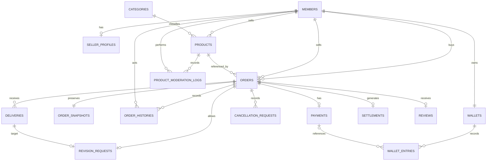
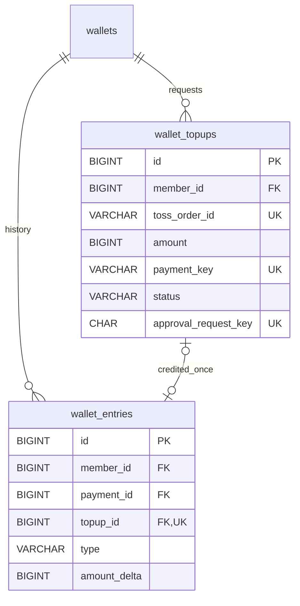

# 데이터베이스 설계

[목차](README.md) · [시스템·트랜잭션 설계](architecture.md) · [기능 규칙](features.md) · [변경 근거](change-history.md)

## 현재 스키마 기준

실행 원본은 [백엔드 Flyway](../LancerPick/src/main/resources/db/migration)다. 이번 정리는 SQL·엔티티·마이그레이션·이미지·검사 스크립트를 변경하거나 DB에 적용하지 않았다. 연결된 개인/운영 DB의 실제 적용 이력은 확인 필요다.

| 단계 | 실제 파일의 범위 | 누적 업무 테이블 |
| --- | --- | --- |
| V1 | 회원·판매자·상품·주문/조건/이력·납품/수정/취소·지갑/원장/결제·정산/후기·상품 운영 로그 | 16 |
| V2 | wallet_topups | 17 |
| V3 | 금융 준비 컬럼·정책/회차 기반, 신규 테이블 없음 | 17 |
| V4 | order_contracts, contract_signatures | 19 |
| V5 | order_chat_messages, outbox_events, notifications, account_challenges, auth_request_limits, support_inquiries, support_messages | 26 |
| V6 | order_trade_terms, order_response_timers, order_closures | 29 |
| V7 | order_funds·FULL/보관 정책·지급 원장·타이머/종료 제약 | 30 |
| V8 | product_favorites | 31 |
| V9 | BATCH_* 시스템 테이블 9개(Flyway 이력 제외) | 31 |
| V10 | member_sanctions·제재 종류/기간/요청 키/인증·타이머 전달 경계 | 32 |
| V11 | members.display_name_changed_at, password_changed_at, password_recommendation_base_at | 32 |

업무 32개 + Batch 시스템 9개 = 41개이며 Flyway 이력 테이블은 제외한다. V11은 nullable 시각 2개와 UTC 기본값이 있는 NOT NULL 권고 기준일을 추가한다. 기존 회원의 과거 비밀번호 변경 시각은 알 수 없으므로 꾸며 넣지 않고 도입 시각부터 첫 6개월 권고 기준을 시작한다.

## 관계·제약·서비스 책임

- 회원은 판매자 프로필·지갑과 연결되고 주문은 구매자/판매자·상품 및 불변 스냅샷을 참조한다. 스냅샷은 DB에서 최대 1개, 주문 생성 서비스가 필수 생성을 보장한다.
- payments는 결제 사실, order_funds는 미해결 보관, settlements/order_closures는 확정 결과, wallet_entries는 잔액 변동 근거다. V3도 주문당 결제 1건 UNIQUE·전액 환불 CHECK를 유지한다.
- order_funds의 order_id PK·payment_id UNIQUE와 결제/주문 복합 FK, 원장의 payment/type·event_key UNIQUE로 다른 주문 연결·중복 지급을 방어한다.
- 계약 버전·현재 계약·양측 서명·파일 해시를 연결한다. 채팅의 order_id/sequence·요청 키, 타이머의 활성 1건·회차, 취소 요청 대기 1건, 정산/후기의 주문당 1건 등은 아래 스키마 상세와 실제 Flyway를 따른다.
- FK·UNIQUE·CHECK는 행 간 모든 상태·가격·당사자·시각·금액 합계를 보장하지 않는다. 서비스가 잠금 아래 정책/당사자/상태/기한과 전체 보존식을 재검증하며 같은 트랜잭션에서 이력·아웃박스까지 저장한다.
- 금액은 원 단위 정수, DB 시각은 UTC. 한국 날짜 검색은 경계를 UTC로 바꾸고 닉네임 6개월은 한국 달력 기준으로 계산한다.

## 인덱스·변경·ERD

최신 인덱스/컬럼/NULL/FK/CHECK의 최종 기준은 V1~V11 누적 SQL이다. 아래 주제별 컬럼·관계·인덱스를 V1~V11 누적 SQL과 함께 읽는다. 기본 컬럼 사전은 V1 범위이며 후속 추가는 위 전환표가 보완한다. 적용한 마이그레이션은 수정하지 않고 새 버전으로 변경하며 DB 설계/DDL 담당은 황준범이다. 신규 계획 테이블 admin_action_logs는 실행 스키마가 아니다.

[기존 ERD 미리보기](images/lancerpick-physical-erd-preview.png)·[PNG](images/lancerpick-physical-erd.png)·[SVG](images/lancerpick-physical-erd.svg)는 V1 16개·120컬럼·23FK 그림이다. 최신 41개 전체 그림으로 표현하지 않는다. 생성·검사 스크립트와 SQL 후보는 원래 위치에 유지했다. 후보 SQL은 자동 Flyway 실행 대상이 아니다.

## 후속 V8·V10·V11 상세 — 현재 SQL 정적 확인

아래는 원본의 MVP 컬럼 사전을 보완하는 후속 설계 요약이다. SQL 복사본 대신 실제 [V8](../LancerPick/src/main/resources/db/migration/V8__add_product_favorites.sql)·[V10](../LancerPick/src/main/resources/db/migration/V10__add_member_sanctions.sql)·[V11](../LancerPick/src/main/resources/db/migration/V11__add_member_change_policy_dates.sql)을 참조한다.

| 대상 | 컬럼·제약·인덱스 |
| --- | --- |
| product_favorites | member_id·product_id BIGINT NOT NULL, created_at DATETIME(6) NOT NULL. PK(member_id, product_id)로 중복 관심 등록 방어. 두 ID는 members/products FK |
| 관심 상품 조회 | ix_product_favorites_recent(member_id, created_at DESC, product_id DESC), ix_product_favorites_product(product_id) |
| member_sanctions 기본 | id BIGINT AUTO_INCREMENT PK, member_id/applied_by BIGINT NOT NULL, kind VARCHAR(24), reason VARCHAR(1000), request_key CHAR(36) ascii/ascii_bin, starts_at/ends_at DATETIME(6); 모두 NOT NULL |
| 제재 해제·전달 | revoked_at DATETIME(6), revoked_by BIGINT, revoke_reason VARCHAR(1000), timer_stop_delivered_at DATETIME(6)는 nullable. 적용자·대상·해제자는 members FK |
| 제재 요청/조회 인덱스 | UNIQUE uk_member_sanction_request(member_id, request_key), ix_member_sanction_current(member_id, kind, id), ix_member_sanction_delivery(kind, timer_stop_delivered_at, id) |
| 제재 CHECK | kind는 GENERAL_RESTRICTION/SECURITY_LOCK, ends_at>starts_at. 해제 3필드는 모두 NULL이거나 모두 존재하며 revoked_at>=starts_at. 전달 시각이 있으면 SECURITY_LOCK이고 starts_at 이상 |
| members 변경 시각 | display_name_changed_at·password_changed_at DATETIME(6) NULL. password_recommendation_base_at DATETIME(6) NOT NULL, UTC_TIMESTAMP(6) 기본값. V11은 새 테이블·인덱스를 추가하지 않음 |

제재 현재 효력·관리자/본인 보호·동시 교체·같은 요청 키 내용 비교·보안 잠금 인증 버전·타이머 중단은 서비스 책임이다. DB 제약만으로 이를 모두 보장한다고 해석하지 않는다. V9 Batch 9개 시스템 테이블은 Flyway가 소유하며 initialize-schema=never이고 실행 기록과 업무 원장을 구분한다.

## 주제별 상세

- [기본 관계·컬럼·인덱스·변경 규칙](#schema)
- [회원·판매자](#identity)
- [상품·카테고리](#catalog)
- [주문·스냅샷·이력](#orders)
- [납품·수정](#delivery)
- [취소 요청](#cancellation)
- [지갑·결제·정산·후기](#finance)
- [충전·원장 확장](#topups)
- [계약·보관금·후속 스키마](#extensions)
- [금액 불변식 점검 SQL](#invariants)
- [ERD 이미지의 범위·재생성](#erd-assets)

<a id="schema"></a>
## 기본 관계·컬럼·인덱스·변경 규칙

### 업무 규칙·연결

#### 랜서픽 MVP ERD 설계 v1.0

역할 배정 갱신 2026-10-29: [확정 담당·지원 원칙·업무 비중](team-roles.md#b-1131-0)을 따른다. 상세 일정·검토자·배포 담당은 별도 확정한다.

목적: 4인 학원 취업·포트폴리오 프로젝트의 MVP 구현과 점진적 고도화를 위한 데이터 기준.

#### 설계 범위 / MVP 구현 대상

회원·판매자·상품·주문·테스트 적립금 결제·납품·수정 1회·취소·환불·구매 확정·판매 수익·후기·최소 상품 운영.

#### 설계 범위 / 원칙

금액·납품·수정·취소·상태 변경의 근거를 보존한다.

중복 방지는 서버 검증과 DB 제약을 함께 사용한다.

권한·상태·금액을 함께 검증한다.

실제 사용하지 않는 고도화 테이블은 만들지 않는다.

거래·금액 이력을 삭제하는 연쇄 삭제를 사용하지 않는다.

#### 공통 저장 규칙

식별자는 내부 ID로 연결한다. 이메일·상품명으로 관계를 맺지 않는다.

금액은 원 단위 정수로 저장한다. 금액·중간 계산에는 충분한 범위의 정수형을 사용한다.

수수료율은 정수 기준점인 bps로 저장한다. 1,000bps = 10%.

시각은 UTC를 기준으로 저장하고 API는 시간대가 포함된 ISO 8601로 전달하며 화면에는 한국 시간으로 표시한다.

상태는 의미가 명확한 문자열로 저장하고 허용값을 제한한다.

사용자 입력의 길이·URL 형식은 서버에서 검증한다.

정확한 문자열 길이·자료형·인덱스는 SQL 작성 단계에서 고정한다.

#### 고도화 연결 안내

| 기능 | 재사용할 구조 | 추가할 내용·주의점 |
| --- | --- | --- |
| 내부 알림 | 회원·주문·상태 변경 처리 | 알림·전달 및 재처리 기록 추가. 주문 이력을 발송 큐로 사용하지 않음 |
| 주문 문의 | 주문·당사자 관계 | 메시지·요청 중복 방지·접근 권한 추가 |
| 실시간 문의 | 저장형 문의 | 전송·구독 권한·재접속·누락 조회. 저장 구조를 먼저 구현 |
| 결제사 테스트 충전 | 지갑·적립금 내역 | 충전 주문·외부 결과 기록을 별도 추가 |
| 파일 납품 | 납품 이력 | 납품에 파일 메타데이터 연결, 접근 권한·실패 정리 |
| 소셜 로그인 | 내부 회원 ID | 인증 수단 추가, 소셜 회원 이메일·비밀번호 조건 재설계 |
| 판매 통계 | 주문·결제·정산 | 기간·취소 반영 기준과 집계 조회 |
| 향후 출금 | 정산 기록 | 출금·지급·예약 금액 구조 별도 설계 |

#### 고도화 연결 안내 / 외부 충전 확장 시

기존 payments는 주문 결제 용도로 유지한다.

초기 지급과 외부 충전을 서로 다른 지급 근거로 기록한다.

외부 충전은 wallet_entries에 새 유형·참조 관계를 추가한다.

기존 테스트 적립금을 실제 결제금으로 취급하지 않는다.

충전 취소를 지원한다면 사용·취소 가능 금액의 추적을 추가 설계한다.

#### 고도화 연결 안내 / 소셜 확장 시

현재 이메일·비밀번호 필수 구조를 그대로 둔 채 임의 이메일·가짜 비밀번호를 생성하지 않는다. 인증 수단을 분리하고 기존 회원 데이터의 이전 방식을 정한다.

#### 고도화 연결 안내 / 파일 확장 시

기존 URL 납품을 삭제하지 않고 파일 정보와 공존하게 한다. 저장소 주소 공개와 다운로드 권한은 별개로 다룬다.

#### 고도화 연결 안내 / 출금 확장 시

누적 판매 수익을 바로 출금 가능액으로 사용하지 않는다. 신청 중·지급 완료·실패 금액을 구분해야 한다.

#### 마감 상태

MVP 데이터 책임·관계·이력·중복 방지 기준: 정리 완료.

고도화 연결 위치·주의점: 정리 완료.

실제 DB 생성·SQL 실행·동시성 검증: 미수행.

다음 작업: API 응답 상세·물리 DB·담당별 작업표 확정 및 초기 구현 검증.

#### 결과물과 적용 범위

- [ERD PNG 원본](images/lancerpick-physical-erd.png) · [확대용 SVG](images/lancerpick-physical-erd.svg): DDL에서 생성한 16개 테이블·120개 컬럼·23개 FK 관계도. PK·FK·복합 UNIQUE 묶음·NULL 여부를 표시한다.

- [DDL 원본](../LancerPick/src/main/resources/db/migration/V1__init.sql): 기존 논리 ERD의 16개 테이블, 자료형·NULL·기본값·PK·FK·UNIQUE·CHECK·인덱스.
- [읽기 전용 스키마 확인 SQL](sql/inspect-physical-schema.sql): 별도 테스트 DB에 적용한 뒤 구조를 확인할 때 사용.
- [정적 검사 도구](scripts/check_physical_schema.py): 테이블·컬럼·FK·인덱스·안전한 파일 구성을 점검한다. MySQL 실행 검증을 대신하지 않는다.

V1은 기본 구조를 유지하며 채팅·알림·소셜 로그인·외부 충전·파일·출금 테이블을 포함하지 않는다. 외부 충전의 후속 추가는 위 V2 확장 문서를 따른다. 카테고리 실제 목록과 관리자·시연 회원 데이터는 임의로 만들지 않는다.

#### 문서에서 유지한 정책

| 근거 | 반영 내용 |
| --- | --- |
| [MVP](change-history.md#b-614-0) | 가격 1~100만원, 소요일 1~30일, 초기 지급 100만원, 수정 1회, 전액 환불, 구매 확정 시 정산, 수수료 10% 버림 |
| [ERD](database-design.md#schema) | 16개 테이블·기존 컬럼 이름·관계, 주문 스냅샷·이력 보존, 원장·정산 분리 |
| [API](architecture.md#api) | 문자열 ID, 주문·취소 요청 키, 상품 version, 납품 1·2회차, 별점 1~5, 선택 값 NULL |
| [화면 흐름](features.md#screens-navigation) | 현재 상품과 주문 조건 구분, 취소 대기 행동 제한, 최초·수정 납기 분리 |
| [개발 규칙](architecture.md#conventions) | 단일 트랜잭션, 주문→지갑 잠금, Flyway, UTC, MySQL 기반 검증 |
| [확장 계획](change-history.md#b-65-0) | 현재 payments는 주문 결제 전용, 미사용 고도화 구조 선제 도입 금지 |
| [Git 협업](team-roles.md#collaboration) | PR·교차 검토·CI 후 병합, 공유 적용된 Flyway 파일 수정 금지 |
| [환경 구축](architecture.md#environment)·[테스트 DB](architecture.md#environment) | 개인 DB와 테스트 DB 구분, ddl-auto=validate, MySQL 8.4 기준 |
| [문서 안내](README.md#source-map)·[구조 검토](change-history.md#b-65-0)·[변경 기록](change-history.md#b-12-1)·[작업표](project-progress.md#remaining) | 과거 설계·검토 기록과 현재 상태 구분, 역할별 공동 검토·미확정 사항 유지 |

기존에 확정되지 않았던 문자열 길이·자료형·인덱스·초기 기본값은 아래의 새 설계 선택이다. 이전부터 합의된 원문 정책이라고 표현하지 않는다.

#### 이번 설계 선택 / 공통 저장 기준

| 항목 | 선택 | 이유·매핑 |
| --- | --- | --- |
| 엔진 | InnoDB | 트랜잭션·FK·행 잠금 |
| 문자셋 | utf8mb4 | 한글·이모지 저장 |
| 일반 문자열 collation | utf8mb4_0900_ai_ci | 상품 검색 등의 대소문자·악센트 비구분 비교, 원문 저장값은 보존 |
| 이메일 | VARCHAR(254), utf8mb4_0900_as_cs | 서버 정규화 후 동일 문자열 고유성 보장, 악센트 차이를 임의로 합치지 않음 |
| ID | signed BIGINT, 독립 PK는 AUTO_INCREMENT | Java Long, JSON에서는 문자열. seller_profiles·wallets는 회원 ID 공유 PK, order_snapshots는 주문 ID 공유 PK |
| 금액·잔액 | signed BIGINT | Java Long, 결제 변동액 음수 허용, 중간 계산도 long 이상 |
| 기간·순번·별점·bps | INT | Java Integer로 일관되게 매핑 |
| 숨김 여부 | BOOLEAN | MySQL TINYINT(1), Java Boolean, 0·1 CHECK |
| 상태·행동 코드 | VARCHAR + CHECK, utf8mb4_0900_as_cs | 대소문자·후행 공백을 구분. JPA 순번 저장·MySQL ENUM 사용 안 함 |
| UUID 요청 키 | CHAR(36), ascii_bin | UUID 파싱 후 소문자 하이픈 표준형으로 저장·비교 |
| 원장 이벤트 키 | VARCHAR(100), ascii_bin | 서버가 규칙에 따라 생성, 사용자 입력으로 받지 않음 |
| 시각 | DATETIME(6) | UTC 규약, 마이크로초 정밀도, nullable 사건 시각 구분 |
| 긴 설명·조건 | TEXT + CHAR_LENGTH CHECK | utf8mb4 VARCHAR 여러 개로 인한 행 크기 부담을 줄이고 최대 문자 수 제한 |

DB 시각 자동 기본값·ON UPDATE CURRENT_TIMESTAMP·트리거는 사용하지 않는다. 서비스의 같은 UTC Clock에서 사건 시각을 정하고 마이크로초로 절삭한 값을 상태·이력·결제에 공유한다. JPA는 UTC LocalDateTime으로 매핑하고 API 경계에서 UTC OffsetDateTime/ISO 8601로 변환한다. DATETIME은 시간대를 저장하거나 자동 변환하지 않으므로 이 규약과 JDBC UTC 설정을 함께 유지한다. 납기는 절삭한 paid_at/requested_at에서 `Duration.ofDays`로 계산한다.

DB CHECK의 NULL 처리에 기대 필수값이 빠지지 않도록 필수 컬럼은 NOT NULL로 선언했다. 사건 시각은 상태별 NULL·NOT NULL 조합을 별도로 검사한다. FK에 연쇄 변경 동작을 지정하지 않아 기본 제한 동작으로 이력의 연쇄 삭제를 막는다. 거래 기록 자체의 직접 UPDATE/DELETE 금지는 애플리케이션·운영 권한 정책도 필요하다.

JPA 구현에서는 EnumType.STRING만 지정하고 DB가 VARCHAR일 것이라고 가정하지 않는다. Hibernate의 MySQL enum 매핑과 구분하기 위해 `@Enumerated(EnumType.STRING)`과 `@JdbcTypeCode(SqlTypes.VARCHAR)` 및 해당 `@Column(length=...)`를 함께 명시하고 validate로 확인한다. TEXT는 명시적인 TEXT 컬럼 매핑을 사용한다. 요청 키는 String CHAR(36) 매핑으로 두고 서버에서 UUID를 파싱·정규화한다. 공유 PK인 seller_profiles·wallets·order_snapshots에는 별도 IDENTITY를 붙이지 않는다. 실제 엔티티는 이 작업에서 생성하지 않았다.

#### 상태와 이력 코드

| action | 의미 |
| --- | --- |
| CREATED | 주문 신청, from_status=NULL·to_status=REQUESTED |
| ACCEPTED / REJECTED | 판매자 수락 / 거절 |
| PAID | 테스트 적립금 결제 |
| DELIVERED | 최초·수정 납품, 회차는 deliveries에서 확인 |
| REVISION_REQUESTED | 수정 요청 |
| CANCELLATION_REQUESTED | 취소 요청, 주문 상태 유지 |
| CANCELLATION_APPROVED / CANCELLATION_REJECTED / CANCELLATION_WITHDRAWN | 취소 요청 승인 / 거절 / 철회 |
| CANCELLED | 주문 직접 취소 또는 승인 후 취소 확정 |
| COMPLETED | 구매 확정·정산 |

취소 요청 해결과 주문 취소가 함께 일어나면 두 사건 이력을 같은 트랜잭션에 남긴다. 현재 상태가 유지되는 사건은 from_status=to_status다. 동일 요청 재호출에는 새 사건을 만들지 않는다. 이력 action은 API의 allowedActions 명령 코드와 다른 개념이다. 예를 들어 명령 ACCEPT의 완료 이력은 ACCEPTED다.

### 범위·후속 조건

#### 설계 범위 / MVP 제외 대상

소셜 로그인·결제사 충전·채팅·알림·파일 업로드·실제 송금·출금.

### 데이터·제약

#### 전체 테이블

| 영역 | 테이블 | 목적 | 주담당 |
| --- | --- | --- | --- |
| 회원 | members | 로그인·표시 이름·권한 | 김창재 |
| 판매자 | seller_profiles | 소개·전문 분야·포트폴리오 | 박소현 |
| 상품 | categories | 고정 분류 | 박소현 |
| 상품 | products | 현재 상품 조건·판매 상태 | 박소현 |
| 주문 | orders | 당사자·확정 가격·소요일·진행 상태 | 정은찬 |
| 주문 | order_snapshots | 주문 당시 상품 설명·조건·요구사항 | 정은찬 |
| 주문 | order_histories | 행동·상태 변경 이력 | 정은찬 |
| 납품 | deliveries | 최초 납품·재납품 | 정은찬 |
| 수정 | revision_requests | 주문당 수정 요청 1회 | 정은찬 |
| 취소 | cancellation_requests | 취소 요청·응답·철회 이력 | 정은찬 |
| 적립금 | wallets | 구매용 테스트 잔액 | 황준범 |
| 적립금 | wallet_entries | 초기 지급·사용·환불 내역 | 황준범 |
| 결제 | payments | 주문 결제·환불 상태 | 황준범 |
| 정산 | settlements | 수수료·판매 수익 | 황준범 |
| 후기 | reviews | 완료 주문 후기 | 박소현 |
| 운영 | product_moderation_logs | 상품 숨김·복구 기록 | 김창재 |

총 16개 테이블로 구성한다.

#### 관계도

최신 물리 관계도: [PNG 원본](images/lancerpick-physical-erd.png) · [확대용 SVG](images/lancerpick-physical-erd.svg). 16개 테이블·120개 컬럼·23개 FK를 SQL에서 추출한다. order_snapshots는 DB에서 주문당 최대 한 건을 보장하며, 아래 논리도의 필수 1:1 생성은 서비스 트랜잭션·테스트로 보장한다.



회원 가입 시 지갑을 함께 생성한다. 주문 생성 시 주문과 스냅샷을 함께 생성한다. 주문의 결제·정산·후기는 진행 단계에 따라 생성되므로 처음에는 존재하지 않는다.

#### 조회·인덱스 기준

우선 확인할 조회 경로:

판매 가능한 상품 목록·카테고리·정렬.

구매자별 주문·판매자별 주문.

주문별 납품·상태·취소 이력.

회원별 적립금 내역.

상품별 후기.

판매자별 완료 주문·정산.

상품별 관리자 처리 이력.

중복 방지 인덱스는 필수로 두고, 조회 인덱스는 실제 API 조건에 맞춰 결정한다.

키워드 검색은 일반 인덱스만 추가하면 해결된다고 가정하지 않는다. 실제 데이터와 조회 계획을 확인한 뒤 개선한다.

#### 핵심 제약과 서비스의 책임

orders는 REQUESTED·REJECTED에서 수락·결제 시각을 허용하지 않으며, AWAITING_PAYMENT에서는 수락 시각을 필수로 하고 결제 시각은 허용하지 않는다. 결제 후 진행·검수·수정·완료 상태에는 수락·조건 확인·결제·납기를 필수로 한다. CANCELLED는 수락 전·수락 후 미결제·결제 후 취소를 모두 허용하고 기존 수락·결제 기록은 보존한다.

수락≥생성, 조건 확인≥수락, 결제≥조건 확인, 최초 납기>결제, 완료≥결제, 취소≥이미 발생한 수락·결제 시각을 검사한다. updated_at도 이미 기록된 사건 시각보다 빠를 수 없다. 최초 납기의 정확한 소요일 덧셈과 다른 테이블의 사건 연결은 서비스에서 검증한다.

TEXT 길이는 `CHAR_LENGTH(원문) BETWEEN 1 AND 상한`으로 실제 저장 길이를 제한하고 `CHAR_LENGTH(TRIM(원문)) > 0`으로 공백뿐인 값을 별도 거절한다. 선택인 reviews.content는 NULL을 계속 허용한다. 서버의 trim·줄바꿈 정규화 정책과 별개로 뒤 공백을 붙여 DB 길이 검사를 우회하지 못하게 한다.

| 정책 | DB 보장 | 서비스·트랜잭션에서 보장 |
| --- | --- | --- |
| 회원 이메일 중복 | 정규화 문자열 UNIQUE·NOT NULL | 이메일 형식·정규화·동시 중복 오류의 409 변환 |
| 주문 중복 | (buyer_id, request_key) UNIQUE | 키 조회 우선·원입력 비교·다른 입력 409 |
| 취소 요청 중복 | (order_id, requested_by, request_key) UNIQUE | 주문 잠금 아래 PENDING 최대 1건, 같은 키 기존 결과 반환 |
| 납품 2회차 제한 | (order_id, sequence_no) UNIQUE, 순번 1·2 | 요청 회차와 현재 상태·판매자·대기 취소 검사 |
| 수정 1회 | order_id UNIQUE, delivery_id UNIQUE | 대상 납품이 같은 주문의 최초 납품인지 검증 |
| 결제·정산·후기 | 각각 order_id UNIQUE | 결제 자격·완료 상태·작성자 권한·원결제 일치 |
| 적립금 중복 | event_key UNIQUE, (payment_id,type) UNIQUE | 회원별 고정 초기 지급 키, 지갑 잠금, 원장합·잔액 일치 |
| 테스트 지급·결제·환불 | 원장 유형별 부호·범위·참조 NULL 규칙 | 주문 구매자와 지갑 소유자 일치·전액 환불·결제액 일치 |
| 정산 금액 | fee=floor(gross*bps/10000), seller+fee=gross | 원결제·완료 주문·정산 중복과 원자성 |
| 주문·스냅샷 | orders에 가격·기간 범위, order_snapshots에 공유 PK·FK·원문 필수값 | 주문·스냅샷·최초 이력 원자 생성, 상품 잠금·버전·판매자 일치·원문 불변 |
| 취소·완료 배타성 | 상태별 종료 시각·허용 상태 CHECK | 주문→지갑 잠금과 상태 재검사, 환불·정산 동시 성립 방지 |
| 숨김·판매 중지 분리 | 두 컬럼·허용값·version | 관리자 권한·동일 상태 무이력·판매자 변경과 버전 충돌 |

FK는 각 참조 대상의 존재만 보장한다. products.seller_id는 기존 ERD처럼 members를 참조하고 판매자 프로필 보유는 서비스에서 확인한다. orders.seller_id와 원상품 판매자 일치, 수정 대상 납품의 동일 주문 여부, 요청·이력 actor 권한, 관리자 role은 같은 트랜잭션에서 확인한다. 단순 FK만으로 이 관계가 보장된다고 표현하지 않는다.

원장 키는 `INITIAL_GRANT:{memberId}`, `PAYMENT:{paymentId}`, `REFUND:{paymentId}`로 고정한다. (payment_id,type) UNIQUE에서 NULL끼리는 중복 제한이 되지 않으므로 초기 지급 1회는 고정 event_key 규칙과 회원·지갑·원장 원자 생성에 의존한다. 조회용 orderId는 wallet_entries.payment_id → payments.order_id로 가져온다. 정산·후기의 판매자·상품·작성자도 orders를 통해 조회하며 중복 컬럼을 추가하지 않는다.

#### 조회와 인덱스

| 조회 | 우선 사용할 인덱스·조인 |
| --- | --- |
| 공개 상품 최신순 | products(is_hidden,sale_status,created_at DESC,id DESC) |
| 카테고리별 공개 상품 | products(category_id,is_hidden,sale_status,created_at DESC,id DESC) |
| 내 상품 | products(seller_id,created_at DESC,id DESC) |
| 구매/판매 주문 최신순 | orders(buyer_id 또는 seller_id,created_at DESC,id DESC), status는 우선 잔여 필터 |
| 상품별 주문·후기 | orders(product_id,created_at DESC,id DESC) → reviews의 order_id UNIQUE 조인 |
| 주문 상품명·조건 조회 | orders → order_snapshots(order_id) 공유 PK 조인. 상품명은 스냅샷에서 조회 |
| 주문 이력 | order_histories(order_id,created_at DESC,id DESC) |
| 납품·수정 | deliveries(order_id,sequence_no)·revision_requests(order_id) UNIQUE |
| 대기 취소 요청 | cancellation_requests(order_id,status,requested_at DESC,id DESC) |
| 지갑 내역 | wallet_entries(member_id,created_at DESC,id DESC) |
| 판매 수익 | orders(seller_id,...) → settlements(order_id) UNIQUE, 정산 생성순 정렬은 실행 계획 확인 |
| 관리자 운영 이력 | product_moderation_logs(product_id,created_at DESC,id DESC) |

FK에 필요한 인덱스도 DDL에서 명시했다. 상품 키워드는 제목·설명 LIKE 검색으로 시작하며 B-tree가 `%키워드%`를 해결한다고 가정하지 않는다. FULLTEXT·캐시·중복 집계 컬럼은 도입하지 않는다. 공개 후기 생성순, 판매자 정산 생성순, 관리자 복합 필터에는 조인·정렬 비용이 남으므로 실제 데이터의 EXPLAIN ANALYZE로 확인한다. 위 인덱스는 API 조회 형태에 따른 초기 설계이며 성능 측정 완료를 뜻하지 않는다.

가격·정산·잔액 API는 원 단위 정수를 유지한다. 집계 SUM은 MySQL에서 넓은 정밀도로 계산하고 Java에서 정확 변환한다. JSON 숫자 응답은 JavaScript 안전 정수 범위인지 확인하며 그 범위를 넘는 운영 규모를 지원하려면 별도 API 금액 표현 계약을 먼저 정한다.

#### 테이블별 컬럼 사전

아래는 DDL 원본에서 추출한 컬럼 정의다. CHECK·UNIQUE·FK·인덱스의 정확한 구문은 DDL 원본을 따른다. DDL 변경 시 컬럼 사전도 함께 갱신한다.

<!-- COLUMN_DICTIONARY -->

#### 테이블별 컬럼 사전 / product_moderation_logs

| 컬럼 | 자료형 | NULL | 기본값·생성 | 의미 |
| --- | --- | --- | --- | --- |
| `id` | `BIGINT` | 불가 | AUTO_INCREMENT | 상품 운영 이력 ID |
| `product_id` | `BIGINT` | 불가 | 없음 | 상품 ID |
| `admin_id` | `BIGINT` | 불가 | 없음 | 실행 관리자 회원 ID |
| `action` | `VARCHAR(10)` | 불가 | 없음 | 숨김 또는 복구 |
| `reason` | `VARCHAR(1000)` | 불가 | 없음 | 운영 사유 |
| `created_at` | `DATETIME(6)` | 불가 | 없음 | 처리 시각 UTC |

### 처리 순서·동시성·재전송

#### 트랜잭션·동시성 기준 / 가입

회원·지갑·초기 지급 내역을 함께 생성한다.

#### 트랜잭션·동시성 기준 / 구매 확정

주문 완료 + 정산 기록 + 주문 이력을 함께 확정한다. 구매 지갑에는 판매 수익을 넣지 않는다.

#### 트랜잭션·동시성 기준 / 원칙

같은 주문의 중복 결제와 여러 주문의 동시 결제를 모두 검증한다.

주문 취소·환불과 구매 확정·정산이 동시에 성공하지 않게 한다.

잠금 안에서 외부 URL 접속이나 오래 걸리는 작업을 하지 않는다.

중복·충돌·재시도 응답은 API 단계에서 통일한다.

결제 재요청은 주문·결제 상태를 함께 확인하며 재차감하거나 기존 시각을 덮어쓰지 않는다. 환불 후 충돌 응답과 유효한 기존 결제 재호출의 상세 계약은 [API 명세 7절](architecture.md#b-197-0)을 따른다.

취소 요청이 거절·철회된 뒤 지연 재전송되어도 같은 키의 요청은 한 건이어야 한다. 새 키의 의도적 재요청만 현재 상태 검증 후 새 기록을 만든다.

### API·입력·오류

#### 이번 설계 선택 / 입력 길이와 정규화

아래 길이는 2026-10-30 API 구현 기준으로 채택했다. 엔티티·DTO·화면이 만들어질 때 동일하게 반영한다. 숫자는 코드 포인트 수 상한이며 이전부터 합의된 정책으로 소급하지 않는다. 필수값·공백·생략·null·비밀번호 예외의 최신 계약은 [API 명세 10절](change-history.md#b-205-0)을 따른다.

| 입력 | 필수·길이 |
| --- | --- |
| 이메일 | 필수, 3~254. 서버에서 앞뒤 공백 제거·Locale.ROOT 소문자화·이메일 형식 검증 |
| 표시 이름 | 필수 1~30, 중복 허용 |
| 판매자 소개 / 전문 분야 | 필수 1~2000 / 1~100 |
| 카테고리명 / 상품명 | 필수 1~50 / 1~100 |
| 상품 설명 / 제공 범위 / 준비사항 | 필수 1~10000 / 1~3000 / 1~3000. 준비사항이 없다면 설명 문구로 표현 |
| 요구사항 / 납품 설명 | 필수 1~5000 / 1~5000 |
| 수정·취소·거절·운영 사유 | 1~1000. 업무상 필수 사유는 필수, history.reason·응답 사유는 선택 |
| 후기 글 | 선택, 입력 시 1~2000 |
| 포트폴리오 URL | 선택, 입력 시 1~2048, HTTPS로 통일하는 신규 기준안 |
| 결과물 URL | 필수 1~2048, 기존 HTTPS 정책 유지 |
| 거래 규칙 원문 | 서버 생성, 필수 1~10000. 게시한 규칙 전체가 범위에 드는지 확인 |

일반 사용자 문자열은 앞뒤 공백을 제거하고 본문 줄바꿈은 LF로 통일한다. 선택 문자열의 공백·빈 문자열은 NULL로 정규화한다. 본문 내부 공백·줄바꿈은 유지한다. 비밀번호 원문은 trim·소문자화하지 않으며 길이 정책은 인코더 선정과 함께 별도 확정한다. hash의 255는 인코딩 결과 저장 한도이지 비밀번호 원문 길이가 아니다.

길이 비교는 Unicode 코드 포인트 수로 통일한다. MySQL CHAR_LENGTH, Java codePointCount, 프런트 `[...value].length`를 기준으로 한다. Java String.length·기본 @Size와 HTML maxlength만으로는 이모지를 같은 기준으로 셀 수 없으므로 서버 검증을 별도로 구현한다. 결합 문자·이모지 한 묶음이 사용자 눈의 한 글자와 다를 수 있음을 UI 안내에 반영한다. TEXT는 utf8mb4 기준 최대 10000 코드 포인트를 수용할 수 있다.

UUID와 사용자 입력의 비교는 정규화된 문자열 기준이며, 주문 스냅샷도 같은 길이·정규화 정책을 따른다. URL은 서버 URI 파서로 https 스킴·호스트 존재·userinfo 부재를 검증하고 서버에서 접속하지 않는다. DB는 URL 길이만 검사한다.

<a id="identity"></a>
## 회원·판매자

기본 컬럼/관계 사전은 V1 범위이며 V2~V11 추가·변경은 첫 전환표와 누적 SQL을 함께 적용한다.

### 업무 규칙·연결

#### 회원·판매자 / 5.1 members

| 컬럼 | 의미 | 제약 |
| --- | --- | --- |
| id | 회원 ID | PK |
| email | 로그인 이메일 | 필수·UNIQUE |
| password_hash | 비밀번호 해시 | 필수 |
| display_name | 표시 이름 | 필수 |
| role | USER, ADMIN | 필수 |
| created_at | 가입 시각 | 필수 |
| updated_at | 정보 수정 시각 | 필수 |

이메일은 팀이 정한 정규화 규칙을 적용한 뒤 중복 검사한다.

비밀번호 원문을 저장하지 않는다.

일반 가입 요청으로 관리자 권한을 설정할 수 없다.

판매자 여부는 role이 아니라 판매자 프로필 존재 여부로 판단한다.

#### 회원·판매자 / 5.2 seller_profiles

| 컬럼 | 의미 | 제약 |
| --- | --- | --- |
| member_id | 판매자 회원 | PK·FK |
| introduction | 소개 | 필수 |
| specialty | 전문 분야 | 필수 |
| portfolio_url | 포트폴리오 링크 | 선택 |
| created_at, updated_at | 생성·수정 시각 | 필수 |

상품 등록 시 판매자 프로필 존재 여부를 검증한다.

### 데이터·제약

#### 테이블별 컬럼 사전 / members

| 컬럼 | 자료형 | NULL | 기본값·생성 | 의미 |
| --- | --- | --- | --- | --- |
| `id` | `BIGINT` | 불가 | AUTO_INCREMENT | 회원 ID |
| `email` | `VARCHAR(254)` | 불가 | 없음 | 정규화한 로그인 이메일 |
| `password_hash` | `VARCHAR(255)` | 불가 | 없음 | 인코더가 생성한 비밀번호 해시 |
| `display_name` | `VARCHAR(30)` | 불가 | 없음 | 표시 이름, 중복 허용 |
| `role` | `VARCHAR(10)` | 불가 | 'USER' | USER 또는 ADMIN |
| `created_at` | `DATETIME(6)` | 불가 | 없음 | 가입 시각 UTC |
| `updated_at` | `DATETIME(6)` | 불가 | 없음 | 수정 시각 UTC |

#### 테이블별 컬럼 사전 / seller_profiles

| 컬럼 | 자료형 | NULL | 기본값·생성 | 의미 |
| --- | --- | --- | --- | --- |
| `member_id` | `BIGINT` | 불가 | 없음 | 판매자 회원 ID, 공유 PK |
| `introduction` | `TEXT` | 불가 | 없음 | 판매자 소개, 최대 2000자 |
| `specialty` | `VARCHAR(100)` | 불가 | 없음 | 전문 분야 |
| `portfolio_url` | `VARCHAR(2048)` | 허용 | 없음 | 선택 포트폴리오 HTTPS URL |
| `created_at` | `DATETIME(6)` | 불가 | 없음 | 생성 시각 UTC |
| `updated_at` | `DATETIME(6)` | 불가 | 없음 | 수정 시각 UTC |

<a id="catalog"></a>
## 상품·카테고리

기본 컬럼/관계 사전은 V1 범위이며 V2~V11 추가·변경은 첫 전환표와 누적 SQL을 함께 적용한다.

### 업무 규칙·연결

#### 카테고리·상품 / 6.1 categories

id: PK

name: 필수·UNIQUE

display_order: 표시 순서

초기 데이터로 관리하며 카테고리 편집 화면은 만들지 않는다.

#### 카테고리·상품 / 6.2 products

| 컬럼 | 의미 |
| --- | --- |
| id | 상품 PK |
| seller_id | 판매자 회원 FK |
| category_id | 카테고리 FK |
| title | 상품명 |
| description | 상세 설명 |
| scope_description | 제공·미제공 범위 |
| preparation_description | 구매자 준비사항 |
| price | 현재 가격 |
| duration_days | 현재 소요일 |
| sale_status | ON_SALE, STOPPED |
| is_hidden | 관리자 숨김 |
| version | 상품 변경 식별 |
| created_at, updated_at | 생성·수정 시각 |

#### 관리자 상품 운영 / product_moderation_logs

id: PK

product_id: FK

admin_id: 회원 FK

action: HIDE, RESTORE

reason

created_at

관리자 권한을 확인하고 상품 숨김 상태 변경과 운영 기록을 함께 저장한다.

같은 상태로 반복 요청하면 불필요한 변경 이력을 중복 생성하지 않는다. 숨김·복구 시 판매자가 정한 판매 상태는 바꾸지 않는다.

### 데이터·제약

#### 카테고리·상품 / 제약·규칙

가격: 1원 이상 100만원 이하.

소요일: 1~30일.

신규 주문 가능 조건: ON_SALE이고 is_hidden = false.

판매 중지와 관리자 숨김은 별도 상태다.

숨김 복구가 판매 중지 상태까지 해제하지 않는다.

주문에 영향을 주는 수정·판매 상태 변경은 버전 관리 대상이다.

거래 이력이 있는 상품은 물리 삭제하지 않는다.

#### 테이블별 컬럼 사전 / categories

| 컬럼 | 자료형 | NULL | 기본값·생성 | 의미 |
| --- | --- | --- | --- | --- |
| `id` | `BIGINT` | 불가 | AUTO_INCREMENT | 카테고리 ID |
| `name` | `VARCHAR(50)` | 불가 | 없음 | 고정 분류명 |
| `display_order` | `INT` | 불가 | 0 | 화면 표시 순서 |

#### 테이블별 컬럼 사전 / products

| 컬럼 | 자료형 | NULL | 기본값·생성 | 의미 |
| --- | --- | --- | --- | --- |
| `id` | `BIGINT` | 불가 | AUTO_INCREMENT | 상품 ID |
| `seller_id` | `BIGINT` | 불가 | 없음 | 판매자 회원 ID |
| `category_id` | `BIGINT` | 불가 | 없음 | 카테고리 ID |
| `title` | `VARCHAR(100)` | 불가 | 없음 | 상품명 |
| `description` | `TEXT` | 불가 | 없음 | 상세 설명, 최대 10000자 |
| `scope_description` | `TEXT` | 불가 | 없음 | 제공 및 미제공 범위, 최대 3000자 |
| `preparation_description` | `TEXT` | 불가 | 없음 | 구매자 준비사항, 최대 3000자 |
| `price` | `BIGINT` | 불가 | 없음 | 현재 가격 원 |
| `duration_days` | `INT` | 불가 | 없음 | 소요일, 1일은 24시간 |
| `sale_status` | `VARCHAR(10)` | 불가 | 'ON_SALE' | 판매 상태 |
| `is_hidden` | `BOOLEAN` | 불가 | FALSE | 관리자 숨김 |
| `version` | `BIGINT` | 불가 | 0 | JPA 상품 버전 |
| `created_at` | `DATETIME(6)` | 불가 | 없음 | 생성 시각 UTC |
| `updated_at` | `DATETIME(6)` | 불가 | 없음 | 수정 시각 UTC |

### 처리 순서·동시성·재전송

#### 트랜잭션·동시성 기준 / 상품 수정과 주문 생성

상품 수정·숨김·판매 중지·주문 생성이 같은 상품의 최신 상태를 기준으로 처리되도록 한다.

주문 생성은 상품 상태·버전 확인, `orders`와 `order_snapshots` 생성, 최초 주문 이력 저장을 하나의 트랜잭션에서 수행한다. 구체적 잠금 구현은 실제 DB 테스트로 검증한다.

<a id="orders"></a>
## 주문·스냅샷·이력

기본 컬럼/관계 사전은 V1 범위이며 V2~V11 추가·변경은 첫 전환표와 누적 SQL을 함께 적용한다.

### 업무 규칙·연결

#### 주문·거래 조건 / 7.1 orders

| 구분 | 컬럼 | 의미 |
| --- | --- | --- |
| 식별 | id | 주문 PK |
| 관계 | buyer_id, seller_id, product_id | 구매자·판매자·원상품 FK |
| 재전송 | request_key | 동일 제출 식별 |
| 상태 | status | 주문 상태 |
| 금액 | price_amount | 주문 가격 |
| 일정 | duration_days_snapshot | 주문 당시 소요일 |
| 확인 | accepted_at | 판매자 수락 시각 |
| 확인 | buyer_confirmed_terms_at | 결제 시 조건 확인 시각 |
| 진행 | paid_at, due_at | 결제 시각·최초 납기 |
| 종료 | completed_at, cancelled_at | 완료·취소 시각 |
| 기본 | created_at, updated_at | 생성·수정 시각 |

#### 주문·거래 조건 / 주문 상태

| 값 | 의미 |
| --- | --- |
| REQUESTED | 수락 대기 |
| AWAITING_PAYMENT | 수락 후 결제 대기 |
| IN_PROGRESS | 진행 중 |
| AWAITING_CONFIRMATION | 검수 대기 |
| REVISION_IN_PROGRESS | 수정 중 |
| COMPLETED | 구매 확정 |
| REJECTED | 수락 전 판매자 거절 |
| CANCELLED | 취소 |

#### 주문·거래 조건 / 7.2 order_snapshots

| 컬럼 | 의미 | 제약 |
| --- | --- | --- |
| order_id | 연결 주문 ID | PK·FK → orders.id |
| product_version_snapshot | 신청 시 상품 버전 | 기존 입력·저장 정책 유지 |
| product_title_snapshot | 주문 당시 상품명 | 기존 입력·저장 정책 유지 |
| description_snapshot | 주문 당시 상품 설명 | 기존 입력·저장 정책 유지 |
| scope_snapshot | 주문 당시 제공·미제공 범위 | 기존 입력·저장 정책 유지 |
| preparation_snapshot | 주문 당시 구매자 준비사항 | 기존 입력·저장 정책 유지 |
| terms_snapshot | 당시 적용 거래 규칙 원문 | 기존 입력·저장 정책 유지 |
| requirements | 구매자 요구사항 | 기존 입력·저장 정책 유지 |

주문 한 건에 스냅샷 한 건을 연결한다. 별도의 스냅샷 ID 대신 `order_id`를 PK·FK로 사용하여 주문당 최대 한 건을 보장한다. 모든 주문에 스냅샷이 존재하도록 하는 것은 주문 생성 서비스와 통합 테스트로 보장한다.

상품 상태·버전 확인, `orders`의 가격·소요일 확정, `order_snapshots`의 조건 복사·요구사항 저장, 최초 주문 이력 생성을 하나의 트랜잭션에서 처리한다. 일부만 저장되면 전체를 롤백한다.

주문 목록의 상품명과 주문 상세의 상품 설명·조건은 이 테이블을 조회한다. 결제·환불·납기 계산은 `orders.price_amount`, `orders.duration_days_snapshot`을 기준으로 한다. API의 기존 요청·응답 구조는 유지하며 저장 위치만 분리한다.

#### 주문·거래 조건 / 7.3 order_histories

id: PK

order_id: FK

actor_id: 행동한 회원 FK

action: 신청·수락·거절·결제·납품·수정·취소 요청·응답·완료 등

from_status, to_status

reason: 필요 시 사유

created_at

취소 요청·철회처럼 주문 상태가 유지되는 행동도 기록한다. 최초 생성은 이전 상태가 없을 수 있다.

단순 조회 기록은 저장하지 않는다.

### 데이터·제약

#### 주문·거래 조건 / 제약

(buyer_id, request_key) UNIQUE.

구매자와 판매자는 달라야 한다.

가격·소요일은 주문 생성 시 확정한다.

성공적으로 생성된 주문의 가격·소요일은 변경하지 않는다. 설명·조건·요구사항은 `order_snapshots`에 보관하며 덮어쓰지 않는다. 가격·소요일은 스냅샷 테이블에 중복 저장하지 않는다.

#### 테이블별 컬럼 사전 / orders

| 컬럼 | 자료형 | NULL | 기본값·생성 | 의미 |
| --- | --- | --- | --- | --- |
| `id` | `BIGINT` | 불가 | AUTO_INCREMENT | 주문 ID |
| `buyer_id` | `BIGINT` | 불가 | 없음 | 구매자 회원 ID |
| `seller_id` | `BIGINT` | 불가 | 없음 | 주문 당시 판매자 회원 ID |
| `product_id` | `BIGINT` | 불가 | 없음 | 원상품 ID |
| `request_key` | `CHAR(36)` | 불가 | 없음 | 정규화 UUID 요청 키 |
| `status` | `VARCHAR(32)` | 불가 | 'REQUESTED' | 주문 상태 |
| `price_amount` | `BIGINT` | 불가 | 없음 | 주문 가격 원 |
| `duration_days_snapshot` | `INT` | 불가 | 없음 | 주문 소요일 |
| `accepted_at` | `DATETIME(6)` | 허용 | 없음 | 수락 시각 UTC |
| `buyer_confirmed_terms_at` | `DATETIME(6)` | 허용 | 없음 | 결제 전 조건 확인 시각 UTC |
| `paid_at` | `DATETIME(6)` | 허용 | 없음 | 결제 시각 UTC, 환불 후 보존 |
| `due_at` | `DATETIME(6)` | 허용 | 없음 | 최초 납기 UTC |
| `completed_at` | `DATETIME(6)` | 허용 | 없음 | 구매 확정 시각 UTC |
| `cancelled_at` | `DATETIME(6)` | 허용 | 없음 | 취소 시각 UTC |
| `created_at` | `DATETIME(6)` | 불가 | 없음 | 생성 시각 UTC |
| `updated_at` | `DATETIME(6)` | 불가 | 없음 | 수정 시각 UTC |

#### 테이블별 컬럼 사전 / order_snapshots

| 컬럼 | 자료형 | NULL | 기본값·생성 | 의미 |
| --- | --- | --- | --- | --- |
| `order_id` | `BIGINT` | 불가 | 없음 | 주문 ID, 공유 PK |
| `product_version_snapshot` | `BIGINT` | 불가 | 없음 | 확인한 상품 버전 |
| `product_title_snapshot` | `VARCHAR(100)` | 불가 | 없음 | 주문 당시 상품명 |
| `description_snapshot` | `TEXT` | 불가 | 없음 | 주문 당시 상세 설명 |
| `scope_snapshot` | `TEXT` | 불가 | 없음 | 주문 당시 제공 범위 |
| `preparation_snapshot` | `TEXT` | 불가 | 없음 | 주문 당시 준비사항 |
| `terms_snapshot` | `TEXT` | 불가 | 없음 | 주문 당시 거래 규칙 원문, 최대 10000자 |
| `requirements` | `TEXT` | 불가 | 없음 | 구매자 요구사항, 최대 5000자 |

#### 테이블별 컬럼 사전 / order_histories

| 컬럼 | 자료형 | NULL | 기본값·생성 | 의미 |
| --- | --- | --- | --- | --- |
| `id` | `BIGINT` | 불가 | AUTO_INCREMENT | 주문 이력 ID |
| `order_id` | `BIGINT` | 불가 | 없음 | 주문 ID |
| `actor_id` | `BIGINT` | 불가 | 없음 | 행동한 회원 ID |
| `action` | `VARCHAR(40)` | 불가 | 없음 | 업무 행동 코드 |
| `from_status` | `VARCHAR(32)` | 허용 | 없음 | 이전 주문 상태, 최초 생성은 NULL |
| `to_status` | `VARCHAR(32)` | 불가 | 없음 | 이후 주문 상태 |
| `reason` | `VARCHAR(1000)` | 허용 | 없음 | 선택 사유 |
| `created_at` | `DATETIME(6)` | 불가 | 없음 | 기록 시각 UTC |

### 처리 순서·동시성·재전송

#### 주문·거래 조건 / 재전송 규칙

같은 키·같은 제출 내용: 기존 주문 반환.

같은 키·다른 제출 내용: 충돌로 거절.

새로운 주문을 의도적으로 작성한 경우: 새 키 사용.

제출 내용 비교에는 `orders.product_id`, `order_snapshots.product_version_snapshot`, `order_snapshots.requirements` 등 최초 저장된 입력을 사용한다. 기존 주문을 재조회하는 요청에는 현재 상품 가격을 다시 적용하지 않는다.

#### 트랜잭션·동시성 기준 / 주문 상태 변경

납품·수정·취소 요청·응답·구매 확정은 같은 주문을 잠근 뒤 상태와 대기 요청을 확인한다.

주문은 이 방식으로 통일하며, 초기에는 별도의 주문 버전 컬럼을 중복 도입하지 않는다.

<a id="delivery"></a>
## 납품·수정

기본 컬럼/관계 사전은 V1 범위이며 V2~V11 추가·변경은 첫 전환표와 누적 SQL을 함께 적용한다.

### 업무 규칙·연결

#### 납품·수정 / 8.1 deliveries

| 컬럼 | 의미 |
| --- | --- |
| id | 납품 PK |
| order_id | 주문 FK |
| sequence_no | 최초 1, 재납품 2 |
| description | 제출 설명 |
| result_url | HTTPS 결과물 링크 |
| submitted_at | 제출 시각 |

(order_id, sequence_no) UNIQUE.

MVP에서는 제출 순번을 1·2로 제한한다.

최초 납품은 진행 중, 재납품은 수정 중에만 가능하다.

주문 판매자만 제출한다.

이전 납품은 수정·삭제하지 않는다.

저장하는 것은 URL·설명·시각이며 외부 파일 원본은 아니다.

#### 납품·수정 / 8.2 revision_requests

id: PK

order_id: FK·UNIQUE

delivery_id: 대상 납품 FK·UNIQUE

reason

requested_at

due_at: 재납품 기한

### 데이터·제약

#### 테이블별 컬럼 사전 / deliveries

| 컬럼 | 자료형 | NULL | 기본값·생성 | 의미 |
| --- | --- | --- | --- | --- |
| `id` | `BIGINT` | 불가 | AUTO_INCREMENT | 납품 ID |
| `order_id` | `BIGINT` | 불가 | 없음 | 주문 ID |
| `sequence_no` | `INT` | 불가 | 없음 | 최초 1, 재납품 2 |
| `description` | `TEXT` | 불가 | 없음 | 납품 설명, 최대 5000자 |
| `result_url` | `VARCHAR(2048)` | 불가 | 없음 | HTTPS 결과물 URL |
| `submitted_at` | `DATETIME(6)` | 불가 | 없음 | 제출 시각 UTC |

#### 테이블별 컬럼 사전 / revision_requests

| 컬럼 | 자료형 | NULL | 기본값·생성 | 의미 |
| --- | --- | --- | --- | --- |
| `id` | `BIGINT` | 불가 | AUTO_INCREMENT | 수정 요청 ID |
| `order_id` | `BIGINT` | 불가 | 없음 | 주문당 한 번 |
| `delivery_id` | `BIGINT` | 불가 | 없음 | 대상 최초 납품 ID |
| `reason` | `VARCHAR(1000)` | 불가 | 없음 | 수정 사유 |
| `requested_at` | `DATETIME(6)` | 불가 | 없음 | 요청 시각 UTC |
| `due_at` | `DATETIME(6)` | 불가 | 없음 | 재납품 기한 UTC |

<a id="cancellation"></a>
## 취소 요청

기본 컬럼/관계 사전은 V1 범위이며 V2~V11 추가·변경은 첫 전환표와 누적 SQL을 함께 적용한다.

### 업무 규칙·연결

#### 취소 요청 / cancellation_requests

| 컬럼 | 의미 |
| --- | --- |
| id, order_id | 요청 PK·주문 FK |
| requested_by | 요청자 FK |
| reason | 요청 사유 |
| status | PENDING, APPROVED, REJECTED, WITHDRAWN |
| requested_at | 요청 시각 |
| resolved_at | 응답·철회 시각 |
| resolved_by | 처리 회원 FK |
| response_reason | 응답 사유 |
| request_key | 취소 요청 재전송 식별 UUID, 필수 |

결제 후 구매자 취소 요청에 사용한다.

주문당 여러 이력은 가능하지만 대기 요청은 한 건만 허용한다.

대기 요청 검사·생성은 주문 잠금 아래에서 처리한다.

승인·거절·철회 시 당사자와 현재 요청 상태를 검증한다.

대기 중에는 납품·수정·구매 확정을 차단한다.

요청 중 납기는 자동 연장하지 않는다.

거절·철회 후 기존 주문 흐름을 계속한다.

판매자가 직접 취소할 때 대기 요청이 있으면 함께 승인으로 종료하고 환불·주문 취소를 확정한다.

결제 전 즉시 취소와 대기 요청 없는 판매자 직접 취소는 order_histories에 사유를 기록한다.

### 처리 순서·동시성·재전송

#### 취소 요청 / 취소 요청 재전송 보완

cancellation_requests에 request_key 컬럼과 (order_id, requested_by, request_key) UNIQUE를 추가한다. 대기 요청 최대 한 건 검사는 기존 주문 잠금 아래에서 유지한다. 새 테이블은 추가하지 않는다.

이미 처리된 동일 요청의 응답은 기존 요청 ID·해결 상태와 현재 주문을 제공한다. 이를 새로운 취소 요청으로 다시 생성하지 않는다.

### 데이터·제약

#### 테이블별 컬럼 사전 / cancellation_requests

| 컬럼 | 자료형 | NULL | 기본값·생성 | 의미 |
| --- | --- | --- | --- | --- |
| `id` | `BIGINT` | 불가 | AUTO_INCREMENT | 취소 요청 ID |
| `order_id` | `BIGINT` | 불가 | 없음 | 주문 ID |
| `requested_by` | `BIGINT` | 불가 | 없음 | 요청 구매자 회원 ID |
| `request_key` | `CHAR(36)` | 불가 | 없음 | 정규화 UUID 요청 키 |
| `reason` | `VARCHAR(1000)` | 불가 | 없음 | 취소 요청 사유 |
| `status` | `VARCHAR(16)` | 불가 | 'PENDING' | 취소 요청 상태 |
| `requested_at` | `DATETIME(6)` | 불가 | 없음 | 요청 시각 UTC |
| `resolved_at` | `DATETIME(6)` | 허용 | 없음 | 해결 시각 UTC |
| `resolved_by` | `BIGINT` | 허용 | 없음 | 해결한 회원 ID |
| `response_reason` | `VARCHAR(1000)` | 허용 | 없음 | 선택 응답 사유 |

<a id="finance"></a>
## 지갑·결제·정산·후기

기본 컬럼/관계 사전은 V1 범위이며 V2~V11 추가·변경은 첫 전환표와 누적 SQL을 함께 적용한다.

### 업무 규칙·연결

#### 적립금·결제 / 10.1 wallets

member_id: PK·회원 FK

balance: 현재 구매 적립금

updated_at

회원당 한 개, 잔액은 0원 이상이다. 판매 수익은 저장하지 않는다.

#### 적립금·결제 / 10.2 wallet_entries

| 컬럼 | 의미 |
| --- | --- |
| id | 내역 PK |
| member_id | 지갑 FK |
| payment_id | 관련 주문 결제 FK, 초기 지급은 NULL |
| type | INITIAL_GRANT, PAYMENT, REFUND |
| amount_delta | 증감액 |
| balance_after | 처리 직후 잔액 |
| event_key | 중복 반영 방지 키·UNIQUE |
| created_at | 처리 시각 |

예시:

| 유형 | 증감 |
| --- | --- |
| 초기 지급 | +1,000,000 |
| 결제 | −50,000 |
| 환불 | +50,000 |

초기 지급 키는 회원 기준으로 고정한다.

결제·환불 키는 결제 ID와 처리 종류를 기준으로 고정한다.

지급·환불은 양수, 결제는 음수다.

금액 내역은 삭제·덮어쓰기하지 않는다.

#### 적립금·결제 / 10.3 payments

id: PK

order_id: FK·UNIQUE

amount: 결제액

fee_rate_bps: 결제 시 고정한 수수료율

status: PAID, REFUNDED

paid_at

refunded_at

MVP의 주문 적립금 결제만 담당한다. 미래의 외부 충전 주문과 혼용하지 않는다.

결제액은 주문 가격과 일치해야 한다.

전액 환불만 허용한다.

환불되더라도 결제 기록을 삭제하지 않는다.

잔액 부족 등 실패 요청은 성공 결제 기록으로 만들지 않는다.

#### 정산·후기 / 11.1 settlements

id: PK

order_id: FK·UNIQUE

gross_amount: 결제액

fee_rate_bps: 결제에 고정된 비율

fee_amount: 수수료

seller_amount: 판매 수익

created_at

수수료 계산:

수수료 = 결제액 × 수수료율(bps) ÷ 10,000

→ 원 미만 버림

판매 수익 = 결제액 − 수수료

구매 확정 시에만 생성한다. 판매 수익 화면은 판매자의 정산 기록을 조회·합산한다.

출금이 없으므로 별도 판매 수익 지갑은 만들지 않는다.

#### 정산·후기 / 11.2 reviews

id: PK

order_id: FK·UNIQUE

rating: 1~5

content: 선택

created_at

작성자와 상품은 주문 관계에서 확인한다.

주문 구매자만 작성.

완료 주문에만 작성.

주문당 한 개.

수정·삭제·답글 미지원.

### 처리 순서·동시성·재전송

#### 트랜잭션·동시성 기준 / 결제·환불

잠금 순서는 주문 → 구매자 지갑으로 통일한다.

결제: 주문 진행 + 잔액 차감 + 결제 + 적립금 내역 + 주문 이력.

환불: 주문 취소 + 잔액 반환 + 결제 환불 상태 + 적립금 내역 + 요청 종료 + 주문 이력.

관련 변경은 함께 성공하거나 함께 실패한다.

### 데이터·제약

#### 테이블별 컬럼 사전 / wallets

| 컬럼 | 자료형 | NULL | 기본값·생성 | 의미 |
| --- | --- | --- | --- | --- |
| `member_id` | `BIGINT` | 불가 | 없음 | 회원 ID, 지갑 공유 PK |
| `balance` | `BIGINT` | 불가 | 0 | 구매용 테스트 적립금 잔액 원 |
| `updated_at` | `DATETIME(6)` | 불가 | 없음 | 최종 변동 시각 UTC |

#### 테이블별 컬럼 사전 / payments

| 컬럼 | 자료형 | NULL | 기본값·생성 | 의미 |
| --- | --- | --- | --- | --- |
| `id` | `BIGINT` | 불가 | AUTO_INCREMENT | 결제 ID |
| `order_id` | `BIGINT` | 불가 | 없음 | 주문당 한 건 |
| `amount` | `BIGINT` | 불가 | 없음 | 실제 결제액 원 |
| `fee_rate_bps` | `INT` | 불가 | 1000 | 결제 당시 수수료율, MVP 1000bps |
| `status` | `VARCHAR(10)` | 불가 | 'PAID' | 결제 상태 |
| `paid_at` | `DATETIME(6)` | 불가 | 없음 | 결제 시각 UTC |
| `refunded_at` | `DATETIME(6)` | 허용 | 없음 | 전액 환불 시각 UTC |

#### 테이블별 컬럼 사전 / wallet_entries

| 컬럼 | 자료형 | NULL | 기본값·생성 | 의미 |
| --- | --- | --- | --- | --- |
| `id` | `BIGINT` | 불가 | AUTO_INCREMENT | 적립금 내역 ID |
| `member_id` | `BIGINT` | 불가 | 없음 | 지갑 소유자 회원 ID |
| `payment_id` | `BIGINT` | 허용 | 없음 | 결제 ID, 초기 지급은 NULL |
| `type` | `VARCHAR(16)` | 불가 | 없음 | 초기 지급, 결제, 환불 |
| `amount_delta` | `BIGINT` | 불가 | 없음 | 변동액 원, 결제는 음수 |
| `balance_after` | `BIGINT` | 불가 | 없음 | 변동 직후 잔액 원 |
| `event_key` | `VARCHAR(100)` | 불가 | 없음 | 서버가 고정 규칙으로 생성한 중복 방지 키 |
| `created_at` | `DATETIME(6)` | 불가 | 없음 | 변동 시각 UTC |

#### 테이블별 컬럼 사전 / settlements

| 컬럼 | 자료형 | NULL | 기본값·생성 | 의미 |
| --- | --- | --- | --- | --- |
| `id` | `BIGINT` | 불가 | AUTO_INCREMENT | 정산 ID |
| `order_id` | `BIGINT` | 불가 | 없음 | 주문당 한 건 |
| `gross_amount` | `BIGINT` | 불가 | 없음 | 결제액 원 |
| `fee_rate_bps` | `INT` | 불가 | 없음 | 원결제에 고정한 수수료율 |
| `fee_amount` | `BIGINT` | 불가 | 없음 | 원 미만 버림 수수료 원 |
| `seller_amount` | `BIGINT` | 불가 | 없음 | 판매 수익 원 |
| `created_at` | `DATETIME(6)` | 불가 | 없음 | 구매 확정 정산 시각 UTC |

#### 테이블별 컬럼 사전 / reviews

| 컬럼 | 자료형 | NULL | 기본값·생성 | 의미 |
| --- | --- | --- | --- | --- |
| `id` | `BIGINT` | 불가 | AUTO_INCREMENT | 후기 ID |
| `order_id` | `BIGINT` | 불가 | 없음 | 주문당 한 건 |
| `rating` | `INT` | 불가 | 없음 | 별점 1~5 |
| `content` | `TEXT` | 허용 | 없음 | 선택 후기 글, 최대 2000자 |
| `created_at` | `DATETIME(6)` | 불가 | 없음 | 작성 시각 UTC |

<a id="topups"></a>
## 충전·원장 확장

### 업무 규칙·연결

#### 토스 테스트 충전 저장 구조

현재 상태 2026-11-03: [충전 신청·본인 조회](features.md#finance-topup)·[승인·지급·본인 재확인](features.md#finance-topup)·[React 충전 화면](features.md#finance-topup)을 구현했다. 서버 세션 인증도 존재하지만 실제 인증 화면을 통한 토스 테스트 카드 승인·복귀·지급 검증과 자동 복구는 완료되지 않았다. 스키마 준비와 전체 충전 완료를 구분하며 [현황표](project-progress.md#current-status)를 따른다.

#### 이번 구현 범위

사용자가 토스 테스트 충전의 저장 구조 추가를 요청하여 확장 계획 중 스키마·JPA 매핑 준비를 착수했다. 기존 MVP의 최초 지급·상품 주문 적립금 결제 정책은 유지한다. 새 `V2__add_wallet_topups.sql`은 충전 신청 테이블과 원장 참조를 추가한다. 공유된 V1은 변경하지 않는다.

### 데이터·제약

#### 관계



`wallet_topups`는 상품 `orders`와 연결하지 않는다. 토스 orderId는 서버가 생성하는 별도 문자열이다. 기존 payments는 상품 주문의 적립금 결제 전용이다. 충전 원장의 orderId 응답은 NULL이며 TOPUP 유형으로 구분한다.

#### wallet_topups 컬럼

| 컬럼 | 저장 기준 |
| --- | --- |
| id | BIGINT 자동 증가 내부 ID |
| member_id | wallets.member_id FK. 이미 생성된 지갑 소유자 |
| toss_order_id | ASCII 대소문자 구분, 서버 생성, UNIQUE, 6~64자 영문/숫자/_/-/= |
| amount | 서버에서 검증·확정한 원 단위 정수, 1~100만원 |
| currency / is_test | KRW / true만 허용 |
| payment_key | 승인 시도 전에 NULL, 이후 토스 식별자. 최대 200자·UNIQUE |
| status | 내부 처리 상태. 토스 Payment.status와 다른 코드 |
| approval_request_key | 소문자 표준 UUID·UNIQUE. 같은 승인 시도 재확인 시 유지 |
| last_error_code | 안전한 코드만. 시크릿·요청/응답 원문·카드 정보 저장 금지 |
| created_at / updated_at | 신청·최종 변경 시각, UTC DATETIME(6), Entity는 Instant |
| processing_started_at | 처리 시작 시각. 오래 멈춘 요청의 재확인 근거 |
| approved_at | 검증한 외부 승인 시각. 완료 전 NULL |
| completed_at | 내부 지급 완료 시각. 완료 전 NULL |

NULL payment_key는 준비 중인 여러 충전 신청을 허용하기 위한 것이다. 승인 시도에서 얻은 paymentKey는 외부 요청 전에 해당 신청과 묶어 보관해야 한다. 현재 request factory는 READY만 생성하며, 상태 변경 메서드와 서비스는 승인/복구 정책에 맞춰 후속 구현한다.

충전 Entity는 Clock.instant()와 연결할 Instant를 받고 마이크로초로 절삭한다. 검증 중 LocalDateTime의 JPA 저장에서 JVM 시간대가 섞여 실제 DB 값이 9시간 이동하는 현상을 확인해 Instant로 보완했다. 테스트는 EntityManager를 비운 뒤 재조회하고, DATE_FORMAT으로 물리 UTC 값도 직접 확인한다. JdbcTemplate fixture는 UTC Instant 기반 Timestamp를 사용한다.

### 처리 순서·동시성·재전송

#### 원장 확장과 중복 방지

한 신청의 중복 지급과 별개로 여러 신청 생성은 가능하다. 신청 API의 requestKey 재사용 정책은 후속 API 설계 대상이다. approval_request_key는 신청 API 요청 키와 혼용하지 않는다.

### API·입력·오류

#### 후속 호출·트랜잭션 계약

<a id="b-1100-0"></a>
1. 짧은 DB 트랜잭션에서 본인·금액을 검증하고 신청 저장.
2. 승인 요청에서 본인·주문번호·저장 금액을 다시 검증하고 충전 행 잠금 후 PROCESSING·paymentKey·승인 멱등키를 확정.
3. DB 트랜잭션 밖에서 토스 승인 호출. 시크릿은 서버에서만 사용.
4. 짧은 DB 트랜잭션에서 충전 행 → 지갑 순서로 잠금. 외부 결과의 주문번호·금액·통화·성공 상태를 확인하고 잔액 증가·원장 생성·COMPLETED를 함께 확정.
5. 외부 성공 후 내부 실패·프로세스 종료·타임아웃은 저장된 신청/결제 식별자로 조회·재확인하고 같은 멱등 반영 경로로 복구.

이는 후속 서비스 설계 기준이며 이번에 실행 가능한 API를 추가한 것이 아니다. 상품 주문 결제의 주문 → 지갑 잠금 순서는 그대로 유지한다. 충전 취소와 상품 구매 환불을 혼용하지 않는다.

<a id="extensions"></a>
## 계약·보관금·후속 스키마

### 데이터·제약

#### DB와 마이그레이션

| 대상 | V7 변경 |
| --- | --- |
| orders | CONTRACT_V3 허용, 새 계약 최소 금액 CHECK |
| payments | V3/FULL 허용. 주문당 1건 UNIQUE·기존 단건 조회·전액 환불 CHECK 유지 |
| order_trade_terms | funding_mode 추가. V2 INSTALLMENT 비율 보존, V3 FULL_HOLD(전액 10000bps/보상 0/정상 수수료 1000bps/보상 수수료 0) |
| order_funds | order_id PK, payment_id UNIQUE, 최초 금액·남은 보관액·HELD/RELEASED/REFUNDED·보관/해결 시각. 결제+주문 복합 FK로 다른 주문 대금 연결 차단 |
| wallet_entries | SELLER_PAYOUT 유형과 금액 CHECK. payment/type UNIQUE·event_key UNIQUE로 중복 지급 방어 |
| order_response_timers | AUTO_CONFIRM 유형·cycle_no, 동일 납품에서도 응답 이후 새 타이머 회차 허용. 활성 한 건 UNIQUE 유지 |
| order_closures | SYSTEM/AUTO_CONFIRMED 정상 10% 수수료 분배 허용. 기존 V2 보상 종료 제약 보존 |

보관금은 결제 행을 대신하지 않는다. payments는 결제 사실, order_funds는 미해결 보관 상태, settlements/closures는 확정 결과, wallet_entries는 지갑 변동 근거다. 원래 금액·당사자·정책·타이머 납품 연결과 전체 합계는 서비스에서도 검증한다. FK/CHECK만으로 정책별 행 간 금액 관계까지 모두 보장하지 않는다.

<a id="invariants"></a>
## 금액 불변식 점검 SQL

### 업무 규칙·연결

#### 금액 불변식 조회

<a id="b-1009-1"></a>
```sql
SELECT * FROM (
  SELECT o.id, o.buyer_id, o.seller_id, p.amount AS paid,
         f.order_id AS funds_order, f.payment_id AS funds_payment, f.amount AS funds_amount,
         f.status, f.remaining_amount AS held,
         pay.member_id AS debit_member, -pay.amount_delta AS debit,
         r.member_id AS refund_member, COALESCE(r.amount_delta, 0) AS refund,
         s.member_id AS payout_member, COALESCE(s.amount_delta, 0) AS payout,
         c.order_id AS closure_order, COALESCE(c.fee_amount, 0) AS fee, c.reason, p.id AS payment_id
  FROM orders o
  JOIN payments p ON p.order_id = o.id
  LEFT JOIN order_funds f ON f.order_id = o.id
  LEFT JOIN wallet_entries pay ON pay.payment_id = p.id AND pay.type = 'PAYMENT'
  LEFT JOIN wallet_entries r ON r.payment_id = p.id AND r.type = 'REFUND'
  LEFT JOIN wallet_entries s ON s.payment_id = p.id AND s.type = 'SELLER_PAYOUT'
  LEFT JOIN order_closures c ON c.order_id = o.id
  WHERE o.policy_version = 'CONTRACT_V3'
) t
WHERE (
  funds_order IS NOT NULL AND funds_payment = payment_id AND funds_amount = paid
  AND debit_member = buyer_id AND debit = paid
  AND (refund_member IS NULL OR refund_member = buyer_id)
  AND (payout_member IS NULL OR payout_member = seller_id)
  AND paid = held + refund + payout + fee
  AND ( (status = 'HELD'     AND closure_order IS NULL AND refund = 0 AND payout = 0)
     OR (status = 'RELEASED' AND reason IN ('COMPLETED','AUTO_CONFIRMED') AND refund = 0 AND payout > 0)
     OR (status = 'REFUNDED' AND reason IN ('MUTUAL_CANCELLATION','ADMIN_CANCELLATION') AND payout = 0 AND fee = 0) )
) IS NOT TRUE;
```

보관금·차감 원장·종료 기록은 모두 LEFT JOIN으로 읽고, 정상 조건 전체에 `IS NOT TRUE`를 적용해 행 누락(NULL)도 위반으로 잡는다. 원장은 회원 조건 없이 결제 ID로 읽고 회원 일치를 따로 검사해 다른 회원에게 연결된 원장도 잡는다. 컬럼 이름이 바뀌면 이 조회도 함께 고친다.

확인 기록(2026-11-06, 로컬 `lancerpick_test`): 조회 실행은 오류 없이 0행(V3 결제 데이터 0건). 바깥 판정식은 가짜 행 9개(정상 HELD/RELEASED/REFUNDED, 보관금 누락, 차감 원장 누락, 차감 원장 다른 회원, REFUNDED인데 closure 누락, 합계 불일치, HELD인데 closure 존재)로 위반 6건만 반환되는 것을 확인했다. 실제 V3 거래 데이터에서의 확인은 G1 판정 때 한다.

<a id="erd-assets"></a>
## ERD 이미지의 범위·재생성

### 업무 규칙·연결

#### 물리 ERD 이미지

- `lancerpick-physical-erd.png`: 4000×3320 원본, 공유·확대 확인용.
- `lancerpick-physical-erd.svg`: 벡터 원본, 확대 시 선·글자 품질 유지.
- `lancerpick-physical-erd-preview.png`: 1800×1494 미리보기.

생성 기준은 [Flyway V1](../LancerPick/src/main/resources/db/migration/V1__init.sql)이다. 테이블 16개·컬럼 120개·FK 23개를 추출하고 키·NULL 여부·복합 UNIQUE 그룹을 표시했다. FK 목록의 0..1/0..N은 해당 부모에 대한 자식의 개수이며, nullable FK는 점선으로 구분한다. CHECK·기본값·일반 인덱스는 SQL 원본을 참조한다. 각 테이블에 확정된 주담당자 이름(김창재·박소현·정은찬·황준범)을 표시한다. 실제 회원 데이터·접속 정보는 포함하지 않는다.

생성 도구는 [render_erd.py](scripts/render_erd.py)이며 Python·Pillow와 Windows 맑은 고딕·Consolas 폰트를 사용한다. 저장소 루트에서 `python docs/scripts/render_erd.py`로 다시 생성한다. SQL이 변경되면 이미지를 함께 갱신한다. PNG 미리보기를 열어 표·관계선·글자 배치를 확인했다. 실제 DB 적용 검증과는 다르다.

주문 조건 분리 반영: orders에는 가격·소요일·진행 정보를 남기고 order_snapshots에 상품 버전·상품명·설명·제공 범위·준비사항·거래 규칙·요구사항을 표시했다. DB는 주문당 스냅샷 최대 1건을 보장하므로 물리 FK 목록은 0..1이며, 모든 주문의 스냅샷 필수 생성은 서비스가 보장한다. 주문 상태·시각·TEXT 길이 CHECK의 보완은 SQL에 있으며 관계도에는 CHECK 본문을 생략한다.
