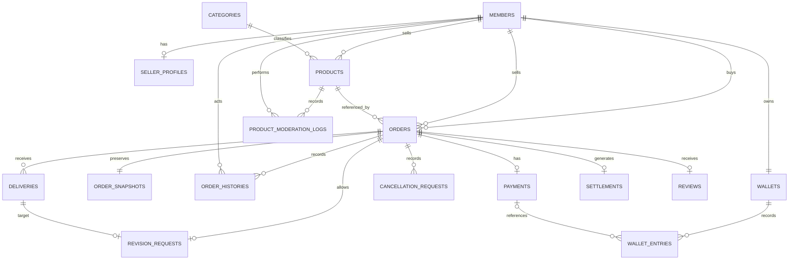

# 랜서픽 MVP ERD 설계 v1.0

2026-11-05 신규 정책: CONTRACT_V3는 [전액 보관·판매자 적립금 지급·자동 구매 확정](full-funding-policy.md)을 따른다. V7은 main `2fec099`에 반영돼 업무 테이블 30개와 새 모드를 제공한다. 아래 선금/잔금·보상·V1~V6/29개 설명은 해당 버전의 이력이다. 신규 V3 금액 명령·스케줄러의 완료를 뜻하지 않는다.

2026-11-05 후속: 아래 그림·본문은 V1 MVP 기준으로 보존한다. main `1e10d78`에는 V3~V6가 반영돼 목표 신규 12개 전체·누적 29개 업무 테이블이 있다. [DB 설계](advanced-db-design.md)·[전체 업무 스키마](advanced-schema-foundation.md)와 실행 Flyway V1~V6가 고도화 관계/제약의 기준이다. 이 문서의 기존 16/17개 설명을 현재 고도화 총수로 해석하지 않는다. 스키마 준비와 신규 기능 활성화도 구분한다.

구현 대조 2026-11-03: V1 기본 16개와 V2 충전 확장을 적용하면 누적 17개 테이블이다. 현재 Entity·운영 JPA/QueryDSL과 V1/V2의 validate·회귀 검증은 [현황표](current-status.md)·[저장소 전환](project-persistence.md)을 따른다. 아래 기본 ERD·이미지는 V1이며, 추가 마이그레이션이나 이미지 재생성은 이번 문서 최신화에서 수행하지 않는다.

2026-11-02 확장 착수: 사용자 요청으로 토스 테스트 충전의 [V2 저장 구조](wallet-topup-schema.md)를 별도 추가한다. 아래 기본 논리 ERD·이미지는 V1 MVP 16개 테이블 기준이다. V2 적용 시 wallet_topups 1개와 원장 topup_id 참조가 추가되며, 실제 승인·지급 기능 완료를 뜻하지 않는다.

설계 변경 2026-10-29: 주문 당시 설명·조건·요구사항을 `order_snapshots`로 분리한다. 주문 확정 가격·소요일과 진행 정보는 `orders`에 유지하며 총 16개 논리 테이블로 구성한다. 물리 SQL·엔티티 구현 완료를 의미하지 않는다.

역할 배정 갱신 2026-10-29: [확정 담당·지원 원칙·업무 비중](work-plan.md#확정-역할-배정)을 따른다. 상세 일정·검토자·배포 담당은 별도 확정한다.

2026-10-29 구조 검토 반영: [변경 기록](review-changes.md). 실제 구현·실행 검증과 구분한다.

개정 기록 2026-10-29 | 정책·역할·기술 정리, 취소 요청 식별, 환불 후 결제 재요청, 납품 회차·지연 표시 보완 | 구현·설치·페이지 시각 검증 미완료

목적: 4인 학원 취업·포트폴리오 프로젝트의 MVP 구현과 점진적 고도화를 위한 데이터 기준.

## 1. 설계 범위

### MVP 구현 대상

회원·판매자·상품·주문·테스트 적립금 결제·납품·수정 1회·취소·환불·구매 확정·판매 수익·후기·최소 상품 운영.

### MVP 제외 대상

소셜 로그인·결제사 충전·채팅·알림·파일 업로드·실제 송금·출금.

### 원칙

현재 상품 정보와 주문 당시 거래 조건을 분리한다.

금액·납품·수정·취소·상태 변경의 근거를 보존한다.

중복 방지는 서버 검증과 DB 제약을 함께 사용한다.

권한·상태·금액을 함께 검증한다.

실제 사용하지 않는 고도화 테이블은 만들지 않는다.

거래·금액 이력을 삭제하는 연쇄 삭제를 사용하지 않는다.

## 2. 전체 테이블

| 영역 | 테이블 | 목적 | 주담당 |
| --- | --- | --- | --- |
| 회원 | members | 로그인·표시 이름·권한 | 김창재 |
| 판매자 | seller_profiles | 소개·전문 분야·포트폴리오 | 박소현 |
| 상품 | categories | 고정 분류 | 박소현 |
| 상품 | products | 현재 상품 조건·판매 상태 | 박소현 |
| 주문 | orders | 당사자·확정 가격·소요일·진행 상태 | 정은찬 |
| 주문 | order_snapshots | 주문 당시 상품 설명·조건·요구사항 | 정은찬 |
| 주문 | order_histories | 행동·상태 변경 이력 | 정은찬 |
| 납품 | deliveries | 최초 납품·재납품 | 정은찬 |
| 수정 | revision_requests | 주문당 수정 요청 1회 | 정은찬 |
| 취소 | cancellation_requests | 취소 요청·응답·철회 이력 | 정은찬 |
| 적립금 | wallets | 구매용 테스트 잔액 | 황준범 |
| 적립금 | wallet_entries | 초기 지급·사용·환불 내역 | 황준범 |
| 결제 | payments | 주문 결제·환불 상태 | 황준범 |
| 정산 | settlements | 수수료·판매 수익 | 황준범 |
| 후기 | reviews | 완료 주문 후기 | 박소현 |
| 운영 | product_moderation_logs | 상품 숨김·복구 기록 | 김창재 |

총 16개 테이블로 구성한다.

## 3. 관계도

최신 물리 관계도: [PNG 원본](images/lancerpick-physical-erd.png) · [확대용 SVG](images/lancerpick-physical-erd.svg). 16개 테이블·120개 컬럼·23개 FK를 SQL에서 추출한다. order_snapshots는 DB에서 주문당 최대 한 건을 보장하며, 아래 논리도의 필수 1:1 생성은 서비스 트랜잭션·테스트로 보장한다.

회원 가입 시 지갑을 함께 생성한다. 주문 생성 시 주문과 스냅샷을 함께 생성한다. 주문의 결제·정산·후기는 진행 단계에 따라 생성되므로 처음에는 존재하지 않는다.

## 4. 공통 저장 규칙

식별자는 내부 ID로 연결한다. 이메일·상품명으로 관계를 맺지 않는다.

금액은 원 단위 정수로 저장한다. 금액·중간 계산에는 충분한 범위의 정수형을 사용한다.

수수료율은 정수 기준점인 bps로 저장한다. 1,000bps = 10%.

시각은 UTC를 기준으로 저장하고 API는 시간대가 포함된 ISO 8601로 전달하며 화면에는 한국 시간으로 표시한다.

상태는 의미가 명확한 문자열로 저장하고 허용값을 제한한다.

사용자 입력의 길이·URL 형식은 서버에서 검증한다.

정확한 문자열 길이·자료형·인덱스는 SQL 작성 단계에서 고정한다.

## 5. 회원·판매자

### 5.1 members

| 컬럼 | 의미 | 제약 |
| --- | --- | --- |
| id | 회원 ID | PK |
| email | 로그인 이메일 | 필수·UNIQUE |
| password_hash | 비밀번호 해시 | 필수 |
| display_name | 표시 이름 | 필수 |
| role | USER, ADMIN | 필수 |
| created_at | 가입 시각 | 필수 |
| updated_at | 정보 수정 시각 | 필수 |

  
이메일은 팀이 정한 정규화 규칙을 적용한 뒤 중복 검사한다.

비밀번호 원문을 저장하지 않는다.

일반 가입 요청으로 관리자 권한을 설정할 수 없다.

판매자 여부는 role이 아니라 판매자 프로필 존재 여부로 판단한다.

### 5.2 seller_profiles

| 컬럼 | 의미 | 제약 |
| --- | --- | --- |
| member_id | 판매자 회원 | PK·FK |
| introduction | 소개 | 필수 |
| specialty | 전문 분야 | 필수 |
| portfolio_url | 포트폴리오 링크 | 선택 |
| created_at, updated_at | 생성·수정 시각 | 필수 |

상품 등록 시 판매자 프로필 존재 여부를 검증한다.

## 6. 카테고리·상품

### 6.1 categories

id: PK

name: 필수·UNIQUE

display_order: 표시 순서

초기 데이터로 관리하며 카테고리 편집 화면은 만들지 않는다.

### 6.2 products

| 컬럼 | 의미 |
| --- | --- |
| id | 상품 PK |
| seller_id | 판매자 회원 FK |
| category_id | 카테고리 FK |
| title | 상품명 |
| description | 상세 설명 |
| scope_description | 제공·미제공 범위 |
| preparation_description | 구매자 준비사항 |
| price | 현재 가격 |
| duration_days | 현재 소요일 |
| sale_status | ON_SALE, STOPPED |
| is_hidden | 관리자 숨김 |
| version | 상품 변경 식별 |
| created_at, updated_at | 생성·수정 시각 |

### 제약·규칙

가격: 1원 이상 100만원 이하.

소요일: 1~30일.

신규 주문 가능 조건: ON_SALE이고 is_hidden = false.

판매 중지와 관리자 숨김은 별도 상태다.

숨김 복구가 판매 중지 상태까지 해제하지 않는다.

주문에 영향을 주는 수정·판매 상태 변경은 버전 관리 대상이다.

거래 이력이 있는 상품은 물리 삭제하지 않는다.

## 7. 주문·거래 조건

### 7.1 orders

| 구분 | 컬럼 | 의미 |
| --- | --- | --- |
| 식별 | id | 주문 PK |
| 관계 | buyer_id, seller_id, product_id | 구매자·판매자·원상품 FK |
| 재전송 | request_key | 동일 제출 식별 |
| 상태 | status | 주문 상태 |
| 금액 | price_amount | 주문 가격 |
| 일정 | duration_days_snapshot | 주문 당시 소요일 |
| 확인 | accepted_at | 판매자 수락 시각 |
| 확인 | buyer_confirmed_terms_at | 결제 시 조건 확인 시각 |
| 진행 | paid_at, due_at | 결제 시각·최초 납기 |
| 종료 | completed_at, cancelled_at | 완료·취소 시각 |
| 기본 | created_at, updated_at | 생성·수정 시각 |

### 제약

(buyer_id, request_key) UNIQUE.

구매자와 판매자는 달라야 한다.

가격·소요일은 주문 생성 시 확정한다.

성공적으로 생성된 주문의 가격·소요일은 변경하지 않는다. 설명·조건·요구사항은 `order_snapshots`에 보관하며 덮어쓰지 않는다. 가격·소요일은 스냅샷 테이블에 중복 저장하지 않는다.

### 재전송 규칙

같은 키·같은 제출 내용: 기존 주문 반환.

같은 키·다른 제출 내용: 충돌로 거절.

새로운 주문을 의도적으로 작성한 경우: 새 키 사용.

제출 내용 비교에는 `orders.product_id`, `order_snapshots.product_version_snapshot`, `order_snapshots.requirements` 등 최초 저장된 입력을 사용한다. 기존 주문을 재조회하는 요청에는 현재 상품 가격을 다시 적용하지 않는다.

### 주문 상태

| 값 | 의미 |
| --- | --- |
| REQUESTED | 수락 대기 |
| AWAITING_PAYMENT | 수락 후 결제 대기 |
| IN_PROGRESS | 진행 중 |
| AWAITING_CONFIRMATION | 검수 대기 |
| REVISION_IN_PROGRESS | 수정 중 |
| COMPLETED | 구매 확정 |
| REJECTED | 수락 전 판매자 거절 |
| CANCELLED | 취소 |

### 7.2 order_snapshots

| 컬럼 | 의미 | 제약 |
| --- | --- | --- |
| order_id | 연결 주문 ID | PK·FK → orders.id |
| product_version_snapshot | 신청 시 상품 버전 | 기존 입력·저장 정책 유지 |
| product_title_snapshot | 주문 당시 상품명 | 기존 입력·저장 정책 유지 |
| description_snapshot | 주문 당시 상품 설명 | 기존 입력·저장 정책 유지 |
| scope_snapshot | 주문 당시 제공·미제공 범위 | 기존 입력·저장 정책 유지 |
| preparation_snapshot | 주문 당시 구매자 준비사항 | 기존 입력·저장 정책 유지 |
| terms_snapshot | 당시 적용 거래 규칙 원문 | 기존 입력·저장 정책 유지 |
| requirements | 구매자 요구사항 | 기존 입력·저장 정책 유지 |

주문 한 건에 스냅샷 한 건을 연결한다. 별도의 스냅샷 ID 대신 `order_id`를 PK·FK로 사용하여 주문당 최대 한 건을 보장한다. 모든 주문에 스냅샷이 존재하도록 하는 것은 주문 생성 서비스와 통합 테스트로 보장한다.

분리 당시에는 필드별 필수 여부·문자열 길이·공백 정책을 새로 확정하지 않았다. 이후 2026-10-30 사용자 요청으로 기존 물리 설계의 입력 기준을 API 계약으로 채택했다. 최신 기준은 [API 명세 10절](api-spec.md#10-오류와-입력-기준)을 따르고 DTO·화면·물리 SQL의 일치는 구현 시 검증한다.

상품 상태·버전 확인, `orders`의 가격·소요일 확정, `order_snapshots`의 조건 복사·요구사항 저장, 최초 주문 이력 생성을 하나의 트랜잭션에서 처리한다. 일부만 저장되면 전체를 롤백한다.

스냅샷은 최초 신청 내용을 보존하는 불변 기록이다. 수정·삭제 API를 제공하지 않으며, 조건 변경이 필요하면 기존 정책에 따라 취소 후 새 주문과 스냅샷을 생성한다. 현재 상품을 다시 조회하여 과거 스냅샷을 갱신하지 않는다.

주문 목록의 상품명과 주문 상세의 상품 설명·조건은 이 테이블을 조회한다. 결제·환불·납기 계산은 `orders.price_amount`, `orders.duration_days_snapshot`을 기준으로 한다. API의 기존 요청·응답 구조는 유지하며 저장 위치만 분리한다.

### 7.3 order_histories

id: PK

order_id: FK

actor_id: 행동한 회원 FK

action: 신청·수락·거절·결제·납품·수정·취소 요청·응답·완료 등

from_status, to_status

reason: 필요 시 사유

created_at

취소 요청·철회처럼 주문 상태가 유지되는 행동도 기록한다. 최초 생성은 이전 상태가 없을 수 있다.

단순 조회 기록은 저장하지 않는다.

## 8. 납품·수정

### 8.1 deliveries

| 컬럼 | 의미 |
| --- | --- |
| id | 납품 PK |
| order_id | 주문 FK |
| sequence_no | 최초 1, 재납품 2 |
| description | 제출 설명 |
| result_url | HTTPS 결과물 링크 |
| submitted_at | 제출 시각 |

  
(order_id, sequence_no) UNIQUE.

MVP에서는 제출 순번을 1·2로 제한한다.

최초 납품은 진행 중, 재납품은 수정 중에만 가능하다.

주문 판매자만 제출한다.

이전 납품은 수정·삭제하지 않는다.

저장하는 것은 URL·설명·시각이며 외부 파일 원본은 아니다.

### 8.2 revision_requests

id: PK

order_id: FK·UNIQUE

delivery_id: 대상 납품 FK·UNIQUE

reason

requested_at

due_at: 재납품 기한

### 검증

요청자가 주문 구매자인가?

검수 대기이며 취소 요청 대기가 없는가?

대상 납품이 해당 주문의 최초 납품인가?

이전 수정 요청이 없는가?

주문당 UNIQUE로 수정 요청 한 번을 제한한다. 재납품해도 이 기록을 삭제하거나 횟수를 초기화하지 않는다.

최초 납기는 orders.due_at, 수정 납기는 revision_requests.due_at에 별도로 보존한다. API는 두 값을 구분하고 현재 적용 기한은 조회 시 결정한다. 이를 위한 새 컬럼은 추가하지 않는다. 완료·취소·거절 주문에는 진행 중 지연 표시를 하지 않는다.

납품 요청은 최초 1·수정 2 회차를 명시하고 재전송에서 바꾸지 않는다. 서버는 주문 잠금 아래 권한·상태·기존 회차·대기 취소 요청을 검증한다. 상세 입력·처리 순서·충돌 응답은 [API 명세 5절](api-spec.md#5-주문-명령-정은찬과-황준범)을 따른다.

expectedSequenceNo는 API 요청값이며 별도 컬럼이 아니다. 기존 deliveries.sequence_no와 (order_id, sequence_no) UNIQUE를 사용한다.

지연 표시는 작업 중 기한 초과와 납품 제출 시각의 지각 여부를 구분한다. 확인 대기·종료 상태를 현재 작업 지연으로 표시하지 않는다. 계산값을 위한 DB 컬럼은 추가하지 않으며 상태별 계산·경계 시각 기준은 [API 명세 5절](api-spec.md#5-주문-명령-정은찬과-황준범)을 따른다.

## 9. 취소 요청

### cancellation_requests

| 컬럼 | 의미 |
| --- | --- |
| id, order_id | 요청 PK·주문 FK |
| requested_by | 요청자 FK |
| reason | 요청 사유 |
| status | PENDING, APPROVED, REJECTED, WITHDRAWN |
| requested_at | 요청 시각 |
| resolved_at | 응답·철회 시각 |
| resolved_by | 처리 회원 FK |
| response_reason | 응답 사유 |
| request_key | 취소 요청 재전송 식별 UUID, 필수 |

  
결제 후 구매자 취소 요청에 사용한다.

주문당 여러 이력은 가능하지만 대기 요청은 한 건만 허용한다.

대기 요청 검사·생성은 주문 잠금 아래에서 처리한다.

승인·거절·철회 시 당사자와 현재 요청 상태를 검증한다.

대기 중에는 납품·수정·구매 확정을 차단한다.

요청 중 납기는 자동 연장하지 않는다.

거절·철회 후 기존 주문 흐름을 계속한다.

판매자가 직접 취소할 때 대기 요청이 있으면 함께 승인으로 종료하고 환불·주문 취소를 확정한다.

결제 전 즉시 취소와 대기 요청 없는 판매자 직접 취소는 order_histories에 사유를 기록한다.

### 취소 요청 재전송 보완

취소 요청은 요청 키를 유지하여 과거 요청과 새 요청을 구분한다. 동일 키 입력 비교·재호출 응답·처리 순서는 [API 명세 6절](api-spec.md#6-취소-요청과-재전송-계약)을 따른다.

cancellation_requests에 request_key 컬럼과 (order_id, requested_by, request_key) UNIQUE를 추가한다. 대기 요청 최대 한 건 검사는 기존 주문 잠금 아래에서 유지한다. 새 테이블은 추가하지 않는다.

이미 처리된 동일 요청의 응답은 기존 요청 ID·해결 상태와 현재 주문을 제공한다. 이를 새로운 취소 요청으로 다시 생성하지 않는다.

## 10. 적립금·결제

### 10.1 wallets

member_id: PK·회원 FK

balance: 현재 구매 적립금

updated_at

회원당 한 개, 잔액은 0원 이상이다. 판매 수익은 저장하지 않는다.

### 10.2 wallet_entries

| 컬럼 | 의미 |
| --- | --- |
| id | 내역 PK |
| member_id | 지갑 FK |
| payment_id | 관련 주문 결제 FK, 초기 지급은 NULL |
| type | INITIAL_GRANT, PAYMENT, REFUND |
| amount_delta | 증감액 |
| balance_after | 처리 직후 잔액 |
| event_key | 중복 반영 방지 키·UNIQUE |
| created_at | 처리 시각 |

예시:

| 유형 | 증감 |
| --- | --- |
| 초기 지급 | +1,000,000 |
| 결제 | −50,000 |
| 환불 | +50,000 |

  
초기 지급 키는 회원 기준으로 고정한다.

결제·환불 키는 결제 ID와 처리 종류를 기준으로 고정한다.

지급·환불은 양수, 결제는 음수다.

금액 내역은 삭제·덮어쓰기하지 않는다.

### 10.3 payments

id: PK

order_id: FK·UNIQUE

amount: 결제액

fee_rate_bps: 결제 시 고정한 수수료율

status: PAID, REFUNDED

paid_at

refunded_at

MVP의 주문 적립금 결제만 담당한다. 미래의 외부 충전 주문과 혼용하지 않는다.

결제액은 주문 가격과 일치해야 한다.

전액 환불만 허용한다.

환불되더라도 결제 기록을 삭제하지 않는다.

잔액 부족 등 실패 요청은 성공 결제 기록으로 만들지 않는다.

## 11. 정산·후기

### 11.1 settlements

id: PK

order_id: FK·UNIQUE

gross_amount: 결제액

fee_rate_bps: 결제에 고정된 비율

fee_amount: 수수료

seller_amount: 판매 수익

created_at

수수료 계산:

수수료 = 결제액 × 수수료율(bps) ÷ 10,000

         → 원 미만 버림

판매 수익 = 결제액 − 수수료

구매 확정 시에만 생성한다. 판매 수익 화면은 판매자의 정산 기록을 조회·합산한다.

출금이 없으므로 별도 판매 수익 지갑은 만들지 않는다.

### 11.2 reviews

id: PK

order_id: FK·UNIQUE

rating: 1~5

content: 선택

created_at

작성자와 상품은 주문 관계에서 확인한다.

주문 구매자만 작성.

완료 주문에만 작성.

주문당 한 개.

수정·삭제·답글 미지원.

## 12. 관리자 상품 운영

### product_moderation_logs

id: PK

product_id: FK

admin_id: 회원 FK

action: HIDE, RESTORE

reason

created_at

관리자 권한을 확인하고 상품 숨김 상태 변경과 운영 기록을 함께 저장한다.

같은 상태로 반복 요청하면 불필요한 변경 이력을 중복 생성하지 않는다. 숨김·복구 시 판매자가 정한 판매 상태는 바꾸지 않는다.

## 13. DB 제약과 서버 검증 구분

### 추가 관계·상태 검증 기준

주문의 seller_id는 상품에서 가져오며, 사용자가 전달한 값을 그대로 저장하지 않는다. 거래 이력이 있는 상품의 판매자는 변경하지 않는다.

취소 요청 승인·거절·철회 시 해당 주문의 요청인지, 대기 상태인지, 실행자가 허용된 당사자인지 확인한다.

결제·환불 내역의 지갑 소유자는 주문 구매자와 일치해야 한다. 초기 지급은 양수, 결제는 음수, 전액 환불은 원결제액과 같은 양수로 기록한다.

paid_at, completed_at, cancelled_at은 해당 사건이 발생했을 때 기록하며, 상태 변경과 함께 처리한다. 이후 취소되더라도 기존 결제 시각은 보존한다.

| DB로 보장할 것 | 서버에서 확인할 것 |
| --- | --- |
| 이메일·요청 키 중복 제한 | 로그인 사용자·소유권·관리자 권한 |
| 주문당 결제·정산·후기 한 개 | 허용된 주문 상태 전환 |
| 주문당 수정 요청 한 개 | 수정 대상이 해당 주문의 최초 납품인지 |
| 납품 순번 중복 제한 | 납품·재납품 자격 |
| 적립금 이벤트 키 중복 제한 | 원결제 금액과 환불액 일치 |
| FK·금액·별점 범위 | 상품 판매 가능 상태 |
| 구매자·판매자 구분 | 대기 취소 요청 중 행동 제한 |

여러 데이터에 걸친 정책을 단일 DB 제약만으로 해결하려 하지 않는다.

## 14. 트랜잭션·동시성 기준

### 가입

회원·지갑·초기 지급 내역을 함께 생성한다.

### 상품 수정과 주문 생성

상품 수정·숨김·판매 중지·주문 생성이 같은 상품의 최신 상태를 기준으로 처리되도록 한다.

주문 생성은 상품 상태·버전 확인, `orders`와 `order_snapshots` 생성, 최초 주문 이력 저장을 하나의 트랜잭션에서 수행한다. 구체적 잠금 구현은 실제 DB 테스트로 검증한다.

### 주문 상태 변경

납품·수정·취소 요청·응답·구매 확정은 같은 주문을 잠근 뒤 상태와 대기 요청을 확인한다.

주문은 이 방식으로 통일하며, 초기에는 별도의 주문 버전 컬럼을 중복 도입하지 않는다.

### 결제·환불

잠금 순서는 주문 → 구매자 지갑으로 통일한다.

결제: 주문 진행 + 잔액 차감 + 결제 + 적립금 내역 + 주문 이력.

환불: 주문 취소 + 잔액 반환 + 결제 환불 상태 + 적립금 내역 + 요청 종료 + 주문 이력.

관련 변경은 함께 성공하거나 함께 실패한다.

### 구매 확정

주문 완료 + 정산 기록 + 주문 이력을 함께 확정한다. 구매 지갑에는 판매 수익을 넣지 않는다.

### 원칙

같은 주문의 중복 결제와 여러 주문의 동시 결제를 모두 검증한다.

주문 취소·환불과 구매 확정·정산이 동시에 성공하지 않게 한다.

잠금 안에서 외부 URL 접속이나 오래 걸리는 작업을 하지 않는다.

중복·충돌·재시도 응답은 API 단계에서 통일한다.

결제 재요청은 주문·결제 상태를 함께 확인하며 재차감하거나 기존 시각을 덮어쓰지 않는다. 환불 후 충돌 응답과 유효한 기존 결제 재호출의 상세 계약은 [API 명세 7절](api-spec.md#7-결제-재요청과-충돌-응답)을 따른다.

취소 요청이 거절·철회된 뒤 지연 재전송되어도 같은 키의 요청은 한 건이어야 한다. 새 키의 의도적 재요청만 현재 상태 검증 후 새 기록을 만든다.

## 15. 데이터 일치 검증

지갑 잔액 = 해당 지갑의 증감 내역 합계.

결제액 = 주문에 보관한 가격.

전액 환불액 = 원결제액.

판매 수익 + 수수료 = 결제액.

완료 주문에는 정산 한 건.

취소 주문에는 정산 없음.

결제된 주문의 취소에는 환불 기록 존재.

초기 지급은 회원당 한 번.

모든 주문에는 스냅샷 한 건이 존재한다. 주문 확정 가격·소요일과 스냅샷의 설명·조건·요구사항은 생성 후 불변이다.

재납품 뒤에도 수정 요청은 한 건.

이 조건은 설계 목표다. 실제 통합 테스트로 확인해야 한다.

## 16. 조회·인덱스 기준

우선 확인할 조회 경로:

판매 가능한 상품 목록·카테고리·정렬.

구매자별 주문·판매자별 주문.

주문별 납품·상태·취소 이력.

회원별 적립금 내역.

상품별 후기.

판매자별 완료 주문·정산.

상품별 관리자 처리 이력.

중복 방지 인덱스는 필수로 두고, 조회 인덱스는 실제 API 조건에 맞춰 결정한다.

키워드 검색은 일반 인덱스만 추가하면 해결된다고 가정하지 않는다. 실제 데이터와 조회 계획을 확인한 뒤 개선한다.

## 17. 고도화 연결 안내

| 기능 | 재사용할 구조 | 추가할 내용·주의점 |
| --- | --- | --- |
| 내부 알림 | 회원·주문·상태 변경 처리 | 알림·전달 및 재처리 기록 추가. 주문 이력을 발송 큐로 사용하지 않음 |
| 주문 문의 | 주문·당사자 관계 | 메시지·요청 중복 방지·접근 권한 추가 |
| 실시간 문의 | 저장형 문의 | 전송·구독 권한·재접속·누락 조회. 저장 구조를 먼저 구현 |
| 결제사 테스트 충전 | 지갑·적립금 내역 | 충전 주문·외부 결과 기록을 별도 추가 |
| 파일 납품 | 납품 이력 | 납품에 파일 메타데이터 연결, 접근 권한·실패 정리 |
| 소셜 로그인 | 내부 회원 ID | 인증 수단 추가, 소셜 회원 이메일·비밀번호 조건 재설계 |
| 판매 통계 | 주문·결제·정산 | 기간·취소 반영 기준과 집계 조회 |
| 향후 출금 | 정산 기록 | 출금·지급·예약 금액 구조 별도 설계 |

### 외부 충전 확장 시

기존 payments는 주문 결제 용도로 유지한다.

초기 지급과 외부 충전을 서로 다른 지급 근거로 기록한다.

외부 충전은 wallet_entries에 새 유형·참조 관계를 추가한다.

기존 테스트 적립금을 실제 결제금으로 취급하지 않는다.

충전 취소를 지원한다면 사용·취소 가능 금액의 추적을 추가 설계한다.

### 소셜 확장 시

현재 이메일·비밀번호 필수 구조를 그대로 둔 채 임의 이메일·가짜 비밀번호를 생성하지 않는다. 인증 수단을 분리하고 기존 회원 데이터의 이전 방식을 정한다.

### 파일 확장 시

기존 URL 납품을 삭제하지 않고 파일 정보와 공존하게 한다. 저장소 주소 공개와 다운로드 권한은 별개로 다룬다.

### 출금 확장 시

누적 판매 수익을 바로 출금 가능액으로 사용하지 않는다. 신청 중·지급 완료·실패 금액을 구분해야 한다.

## 18. 변경·검증 관리

DB 변경은 Flyway 스크립트로 관리한다. 적용된 공유 스크립트는 수정하지 않고 새 변경을 추가한다.

고도화 전 MVP 기준 버전과 테스트 데이터를 보존한다.

기존 회원·주문·잔액이 있는 상태에서 변경을 검증한다.

사용하지 않는 컬럼·테이블을 미리 만들지 않는다.

스키마 변경마다 담당자·이유·기존 데이터 영향·검증 결과를 기록한다.

React 사용 자체로 데이터 관계를 변경하지 않는다. 주문 정보와 조건 원문을 분리하는 이번 설계 변경으로 `order_snapshots`를 추가해 총 16개 테이블로 구성한다. 기술 버전은 공통 개발 규칙, 업무 정책은 MVP 명세서를 참조한다.

자료형·문자열 길이·인덱스·실제 SQL은 물리 설계 작업이다. 논리 설계 정리 완료와 실제 DB 실행·동시성 검증 완료를 구분한다.

기능 담당은 김창재, 박소현, 정은찬, 황준범이다. 정은찬은 조장·통합 조율, 황준범은 React 공통 기반을 겸한다. 별도 배포 담당·검토자·세부 일정은 작업표에서 확정한다.

## 19. 마감 상태

MVP 데이터 책임·관계·이력·중복 방지 기준: 정리 완료.

고도화 연결 위치·주의점: 정리 완료.

실제 DB 생성·SQL 실행·동시성 검증: 미수행.

다음 작업: API 응답 상세·물리 DB·담당별 작업표 확정 및 초기 구현 검증.
