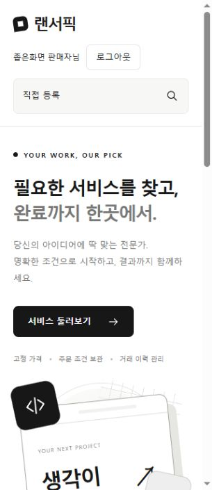
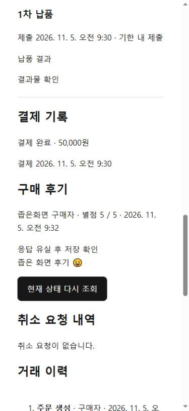

# 상품·후기 좁은 화면과 응답 유실 복구 확인

2026-11-05. 기준 main `a681219`. `codex/product-review-browser-check`는 실제 세션 후기 서버 검사 [PR #71](https://github.com/ecjung-dev/lancerpick/pull/71)과 독립적으로 병합할 수 있는 화면 보완·검증 단위다. 정책·스키마·백엔드·API 계약은 바꾸지 않는다.

## 발견 문제와 수정

320px 브라우저에서 세로 스크롤바를 제외한 가용 폭은 305px인데 body의 min-width:320px 때문에 문서 scrollWidth가 320px가 되어 가로 스크롤이 발생했다. 로그인 이름/로그아웃 메뉴와 로고도 같은 줄에서 겹쳤다.

- body의 강제 최소 폭을 해제했다.
- 480px 이하에서는 로고·회원 메뉴·검색을 각 줄에 놓고 회원 링크의 줄바꿈을 허용했다. 로그아웃 버튼과 검색 입력을 유지하며 이름을 잘라 숨기지 않는다.
- 수정 후 같은 320px 조건에서 clientWidth=305, scrollWidth=305를 확인했다. 검색 결과와 공개 상품 상세, 판매 상태 관리에서 가로 넘침이 없다. 더 넓은 화면의 기존 미디어 쿼리는 유지했다.

## 실행 환경과 데이터

에이전트가 실제 IAB 브라우저를 조작했다. 390×844 및 320×740 viewport를 사용한 데스크톱 브라우저 검사이며 실기기 모바일/Safari/가상 키보드/터치 검증으로 확대하지 않는다.

루프백 MySQL8.0.46의 임시 lancerpick_ci, 백엔드18080, Vite15173을 사용했다. 회원 두 명·판매자 프로필·상품21개·주문은 실제 API로 생성했다. 카테고리만 전용 DB fixture다. 구매 확정은 주문 생성→수락→결제→납품→확정 API를 호출했고 주문 상태 SQL 변경은 없다. 개인 DB·개인 접속 파일·기존 stash는 변경하지 않았다.

## 담당 기능별 화면 확인

| 담당표 기능명 | 실제 수행·확인 |
| --- | --- |
| 판매자 프로필 관리 | 판매자 로그인 후 소개 변경·프로필 수정 저장 성공 |
| 카테고리 조회·상품 검색 | 직접 등록한 상품명 검색·카테고리 체크, URL keyword/categoryId와 같은 상품 결과 확인 |
| 상품 상세·주문 진입 | 구매자 로그인→상품 상세→요구사항 입력→주문 요청 생성→수락 대기 주문 상세 도착 |
| 상품 등록·수정·버전 관리 | 등록 폼의 카테고리·본문·금액·소요일 입력→신규 상품 수정 화면 도착/버전0. 기존 상품 가격50000→60000 저장/버전1 확인 |
| 상품 판매 상태 관리 | 판매 중지 확인→적용 성공→판매 중지 표시, 이후 재개 확인→적용 성공→판매 중 표시 |
| 내 상품 조회 | 상품21개에서 page=1 직접 복원→수정 이동→가격 저장→복귀 링크로 같은 page=1에서60000원 확인 |
| 후기 작성·조회 | 실제 완료 주문에 줄바꿈/emoji 후기 작성→아래 응답 유실 재현→저장된 후기 표시·폼 제거. 로그아웃 후 공개 상품 상세에서 동일 후기 조회 |

회원 전환은 구매자 로그아웃→판매자 로그인으로 수행했으며 헤더와 본인 상품이 판매자 기준으로 바뀌었다. 이는 동시 계정 전환 경쟁이나 모든 캐시 조합의 검증을 뜻하지 않는다.

## 저장 성공 후 응답 유실

Vite와 백엔드 사이에 루프백 테스트 프록시18081을 임시로 두었다. 실제 POST /orders/{id}/review를 서버에 전달하고 서버의201 응답을 받은 **그 한 번만** 테스트502로 바꿨다. GET 재조회와 다음 요청은 그대로 전달했다. 이 테스트 프록시는 제품·저장소·CI에 추가하지 않는다.

- 화면에서 후기 등록은 한 번만 클릭했다.
- 프록시의 후기 POST 전달 횟수는1이며 자동 재전송이 없었다.
- 화면은 실제 주문 GET 재조회로 저장된 후기를 보여주고 작성 폼을 제거했다.
- DB의 해당 주문 후기 건수도1이다. 중복으로 작성할 필요가 없는 결과를 확인했다.

Vite 재시작 중 일시적으로 연결이 안 된 화면도 새로고침 후 정상 조회로 돌아왔다. 이를 강제 timeout·완전한 오프라인·승인 결과 불명확의 모든 조합을 검증했다고 표시하지 않는다.

## 재현과 검사

1. 개발 DB와 분리한 전용 테스트 DB에서 두 회원/판매자 프로필/상품을 준비한다.
2. 구매자 주문→판매자 수락→구매자 결제→판매자 납품→구매자 확정 API를 수행한다.
3. 390px에서 구매자로 로그인하여 주문 상세 후기 입력과 등록, 조회를 확인한다. 응답 유실은201 저장 완료 응답만 한 번502로 바꾸고 POST 횟수·GET 결과·DB 건수를 함께 확인한다.
4. 판매자로 전환해 프로필·상품 등록/수정·본인 목록 복귀·중지/재개를 확인한다. 320px에서는 헤더·검색·공개 상세·판매 상태 관리의 배치와 scrollWidth/clientWidth를 대조한다.
5. 로그아웃 후 공개 후기 유지, 브라우저 viewport 복원과 임시 서버 종료를 확인한다.

수정 후 프런트 전체128건·build(타입 검사 포함)·lint 통과(실패·건너뜀0). 백엔드 소스는 main과 동일하여 이 PR에서 재실행하지 않는다. PR #71의635건 결과를 이 브랜치의 실행 결과로 합산하지 않는다.

## 남은 범위

실기기 모바일, 다른 브라우저, 키보드/터치, 모든 다중 탭·동시 계정 전환, 저장 직전 서버 중단과 timeout 등 추가 네트워크 조합, 원격 CI는 별도다. 문서의 사용자 수동 완료 기록을 임의로 확대하거나 전체 MVP·배포 완료로 바꾸지 않는다. 디자인 개선·배포 보류와 선택적 고도화 착수 조건도 유지한다.
