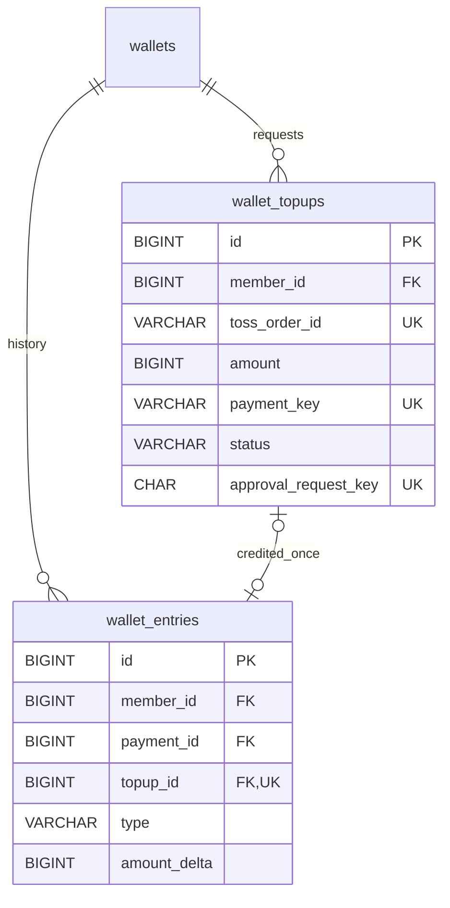

# 토스 테스트 충전 저장 구조

후속 API: [충전 신청·본인 조회](wallet-topup-api.md)와 [승인·지급·본인 재확인](wallet-topup-approval.md)을 추가했다. 아래 스키마 착수 기록과 구분하며, 실제 토스 테스트 결제창·로그인·프런트 연동·자동 복구는 아직 미검증/미구현이다.

작성일: 2026-11-02. 담당: 황준범. 작업 브랜치: `feature/wallet-topup-schema`.

## 1. 이번 구현 범위

사용자가 토스 테스트 충전의 저장 구조 추가를 요청하여 확장 계획 중 스키마·JPA 매핑 준비를 착수했다. 기존 MVP의 최초 지급·상품 주문 적립금 결제 정책은 유지한다. 새 `V2__add_wallet_topups.sql`은 충전 신청 테이블과 원장 참조를 추가한다. 공유된 V1은 변경하지 않는다.

현재는 Entity·Repository와 제약·조회 호환 검증까지이며, 충전 신청/승인 API·토스 통신·실제 잔액 증가 서비스·복구 작업·충전 UI는 미구현이다. 앱 실행만으로 충전 신청이 생기거나 적립금이 추가되지는 않는다. 개인 DB에 자동으로 검증하지 않으며, 일반 실행 전 Flyway 적용 대상을 확인한다.

이번 저장 범위의 선택: 테스트 전용, KRW, 1회 충전 1~1,000,000원. 이는 이번 스키마의 충전 한도이며 토스 자체 한도나 기존 상품 가격 정책의 자동 확장을 뜻하지 않는다. 누적 잔액 상한·충전 취소·비동기 입금 수단은 후속 서비스 설계에서 결정한다. 외부 식별자는 토스 공식 API 기준 주문번호 6~64자, paymentKey 최대 200자로 저장한다.

## 2. 관계



`wallet_topups`는 상품 `orders`와 연결하지 않는다. 토스 orderId는 서버가 생성하는 별도 문자열이다. 기존 payments는 상품 주문의 적립금 결제 전용이다. 충전 원장의 orderId 응답은 NULL이며 TOPUP 유형으로 구분한다.

## 3. wallet_topups 컬럼

| 컬럼 | 저장 기준 |
| --- | --- |
| id | BIGINT 자동 증가 내부 ID |
| member_id | wallets.member_id FK. 이미 생성된 지갑 소유자 |
| toss_order_id | ASCII 대소문자 구분, 서버 생성, UNIQUE, 6~64자 영문/숫자/_/-/= |
| amount | 서버에서 검증·확정한 원 단위 정수, 1~100만원 |
| currency / is_test | KRW / true만 허용 |
| payment_key | 승인 시도 전에 NULL, 이후 토스 식별자. 최대 200자·UNIQUE |
| status | 내부 처리 상태. 토스 Payment.status와 다른 코드 |
| approval_request_key | 소문자 표준 UUID·UNIQUE. 같은 승인 시도 재확인 시 유지 |
| last_error_code | 안전한 코드만. 시크릿·요청/응답 원문·카드 정보 저장 금지 |
| created_at / updated_at | 신청·최종 변경 시각, UTC DATETIME(6), Entity는 Instant |
| processing_started_at | 처리 시작 시각. 오래 멈춘 요청의 재확인 근거 |
| approved_at | 검증한 외부 승인 시각. 완료 전 NULL |
| completed_at | 내부 지급 완료 시각. 완료 전 NULL |

NULL payment_key는 준비 중인 여러 충전 신청을 허용하기 위한 것이다. 승인 시도에서 얻은 paymentKey는 외부 요청 전에 해당 신청과 묶어 보관해야 한다. 현재 request factory는 READY만 생성하며, 상태 변경 메서드와 서비스는 승인/복구 정책에 맞춰 후속 구현한다.

충전 Entity는 Clock.instant()와 연결할 Instant를 받고 마이크로초로 절삭한다. 검증 중 LocalDateTime의 JPA 저장에서 JVM 시간대가 섞여 실제 DB 값이 9시간 이동하는 현상을 확인해 Instant로 보완했다. 테스트는 EntityManager를 비운 뒤 재조회하고, DATE_FORMAT으로 물리 UTC 값도 직접 확인한다. JdbcTemplate fixture는 UTC Instant 기반 Timestamp를 사용한다.

## 4. 상태와 검증 경계

| 상태 | 의미 |
| --- | --- |
| READY | 충전 신청 저장, 외부 승인 전 |
| PROCESSING | 검증 후 승인 시도 시작. paymentKey·시작 시각 필요 |
| UNKNOWN | 통신 실패 등 결과 불명확. 결과 조회 전 실패로 확정하지 않음 |
| COMPLETED | 외부 승인 검증과 내부 지급 반영 완료 |
| FAILED | 미승인·실패를 확정한 종료 상태. UNKNOWN을 단순 시간 경과로 전환하지 않음 |

DB는 허용 상태·필요 필드·시각 순서를 제한한다. 과거 상태에서 다음 상태로 이동 가능한지, 토스 결과가 실제 성공인지, 완료 행에 원장이 반드시 존재하는지는 서비스 트랜잭션·테스트로 보장해야 한다. READY 요청 저장은 외부 승인·지갑 증가를 실행하지 않는다.

## 5. 원장 확장과 중복 방지

- `wallet_entries.topup_id`는 nullable이고 UNIQUE다. 충전 신청 한 건에 TOPUP 원장은 최대 한 건이다.
- TOPUP은 payment_id=NULL, topup_id 필수, 증감액 양수다. 다른 유형은 topup_id=NULL이어야 한다.
- `(topup_id, member_id, amount_delta)` → `wallet_topups(id, member_id, amount)` 복합 FK로 다른 회원·다른 금액의 지급 근거를 차단한다. 부모의 복합 UNIQUE는 이 FK를 위한 참조 키다.
- 기존 초기 지급·결제·환불의 범위와 FK·고유 제약을 유지한다. 전역 event_key UNIQUE도 유지한다.
- 추후 서비스는 고정 이벤트 키 `TOPUP:{topupId}`를 생성한다. 아직 TOPUP 원장 factory와 지급 서비스는 추가하지 않았다.

한 신청의 중복 지급과 별개로 여러 신청 생성은 가능하다. 신청 API의 requestKey 재사용 정책은 후속 API 설계 대상이다. approval_request_key는 신청 API 요청 키와 혼용하지 않는다.

## 6. 후속 호출·트랜잭션 계약

1. 짧은 DB 트랜잭션에서 본인·금액을 검증하고 신청 저장.
2. 승인 요청에서 본인·주문번호·저장 금액을 다시 검증하고 충전 행 잠금 후 PROCESSING·paymentKey·승인 멱등키를 확정.
3. DB 트랜잭션 밖에서 토스 승인 호출. 시크릿은 서버에서만 사용.
4. 짧은 DB 트랜잭션에서 충전 행 → 지갑 순서로 잠금. 외부 결과의 주문번호·금액·통화·성공 상태를 확인하고 잔액 증가·원장 생성·COMPLETED를 함께 확정.
5. 외부 성공 후 내부 실패·프로세스 종료·타임아웃은 저장된 신청/결제 식별자로 조회·재확인하고 같은 멱등 반영 경로로 복구.

이는 후속 서비스 설계 기준이며 이번에 실행 가능한 API를 추가한 것이 아니다. 상품 주문 결제의 주문 → 지갑 잠금 순서는 그대로 유지한다. 충전 취소와 상품 구매 환불을 혼용하지 않는다.

## 7. 검증 방법과 제한

`WalletTopupSchemaIntegrationTests`는 테스트 DB의 실제 V2·JPA validate·Repository·DB 제약을 검사한다. 신청 저장 시 잔액 무변경, 소유자 조회, 토스 주문/승인 키/결제 키 고유성, 금액·통화·테스트 전용·상태·시각, 원장의 같은 회원/금액/1회 제한, TOPUP 조회 호환을 확인한다. SQL fixture로 완료 상태를 구성하는 검사는 실제 토스 승인·지급 서비스 검증과 구분한다.

```powershell
cd C:\project\LancerPick
.\gradlew.bat test --tests "com.example.lancerpick.wallet.WalletTopupSchemaIntegrationTests"
```

전용 TEST_DB_* 설정은 [테스트 DB 안내](test-database.md)를 따른다. 일반 앱 실행 시 V2가 적용될 수 있으므로 DB 대상과 기존 Flyway 이력을 먼저 확인한다. MySQL DDL은 앱 데이터 트랜잭션처럼 전체 롤백되지 않으므로 공유 환경 적용 후에는 V2를 수정하지 않고 새 버전으로 보완한다. 병렬 브랜치의 V2 번호 충돌은 공유 적용 전에 조율한다.

기존 물리 ERD 이미지·정적 검사/컬럼 사전 생성기는 V1 기본 16개 테이블 기준으로 유지한다. V2 확장은 이 문서·마이그레이션·실제 DB 검사로 확인하며, V1 검사 성공을 V2 검증으로 표현하지 않는다.

외부 식별자 규격 근거: [토스 코어 API](https://docs.tosspayments.com/reference). 실제 실행 결과는 검증 후 아래에 기록한다.

## 8. 2026-11-02 실행 결과

- 임시 MySQL 8.4.13에 Flyway target=1로 V1만 적용한 뒤 기존 회원·100만원 잔액·최초 지급 내역을 넣고 V2로 업그레이드했다. 기존 값과 원장 1건이 유지되고 topup_id=NULL임을 확인했다. V1만 준비하는 단계는 새 Entity의 테이블이 없으므로 해당 컨텍스트 검사에서만 ddl-auto=none을 사용했고, 이후 검사는 기본 validate로 실행했다.
- 같은 격리 컨테이너의 별도 빈 lancerpick_ci DB에서는 기본 설정으로 V1→V2를 연속 적용하고 clean build --offline을 통과했다. 전체 82건 중 충전 스키마 검사는 13건이다. 3개 지갑 Entity의 매핑도 validate를 통과했다.
- 누적 업무 구조: 17개 테이블·136개 컬럼·25개 FK·84개 CHECK. Flyway 이력은 V1/V2 모두 success=1이다. V1 SQL은 변경하지 않았고 기존 V1 정적 검사도 통과했다.
- 최초 검사에서 MySQL CHECK 오류 3819가 JDBC에서 UncategorizedSQLException으로 전달되는 점을 확인했다. 테스트는 예외 클래스만 추정하지 않고 실제 DB 제약 오류 코드(1062/1452/3819)를 확인하도록 보완했다. 충전 Entity의 UTC 저장 문제도 위 Instant 매핑과 DB 물리 값 검사로 수정했다.
- 프런트 TOPUP 타입·표시 문구 추가 후 lint·build·test:api 8건을 통과했다. 토스 API·인증·지급·충전 화면의 통합 검증은 아니다.
- 전용 컨테이너·볼륨은 소유 라벨 확인 후 정리했다. 원격 CI·팀원 환경 재현은 별도다.

### 최신 main 반영 후 push 전 확인

main의 `c7a03e2`(주문 Entity·생성 요청 검증)를 작업 브랜치에 반영하고, 새 임시 MySQL 8.4에서 V1/V2 및 기본 validate로 전체 clean build를 다시 실행했다. 주문 단위 테스트 20건을 포함한 총 102건이 통과했다. 실제 주문 INSERT·토스 승인·실제 충전 지급의 통합 검증은 아니다. 프런트 lint·build·test:api 8건도 재확인했으며 전용 컨테이너·볼륨은 정리했다. `.db`는 루트 .gitignore로 제외하고 README의 공통 HTTP·Security 설명과 main의 주문 설명을 함께 유지했다. PR 생성·병합은 사용자가 진행한다.
